# 减数分裂：同源染色体配对交换与两次分裂的减半记账

> 视频来源：[细胞之城 | 可视化讲解减数分裂！| 细胞生物学 P10](https://www.bilibili.com/video/BV17nsV6YExb/)（Bilibili · 羽升生物可视化教学，13 分 33 秒）。本文按该视频的逐窗口字幕与 3D 画面整理，关键结论均带原片时间戳。
> 导读：上一篇（4.3.1）把细胞周期读成一条状态时间轴，4.3.2 讲有丝分裂怎样把复制好的染色体平分给两个子细胞。这一篇换一个问题：如果精子和卵细胞也用有丝分裂的方式分，每受精一次染色体就翻一倍，所以产生配子时细胞必须换一种分法——复制一次、连分两次。[【跳转到 00:10】](https://www.bilibili.com/video/BV17nsV6YExb/?t=10) 本文按「先算账 → 认清对象 → 减一 → 减二 → 变异从哪来 → 与有丝分裂对照」的顺序展开，并把视频的 N/C 记账法套到 2n=4 上逐步走一遍。

## 本讲要解决的核心问题（SCQA）

**背景**：有丝分裂的产物是两个和亲代遗传组成相同的 2N 子细胞。这套机器在体细胞里天天在跑，用来长身体、补损伤。

**冲突**：有性生殖要做两件互相矛盾的事。第一件是**把染色体数减半**——否则两个配子一融合，染色体数就代代翻倍；第二件是**让产物彼此不同**——否则同一对父母的孩子应该像复印件。这两件事有丝分裂一件也做不到：它既不减半，也不制造差异。

**疑问**：减半到底发生在哪一次分裂？减一分开的是什么、减二分开的又是什么？如果减数分裂只是「分两次」，那产物为什么会各不相同？

**回答（中心思想）**：减数分裂是**复制一次、连分两次**。减一分开的是**同源染色体**（每条仍带着两条姐妹染色单体），减二分开的是**姐妹染色单体**——所以染色体数在减一减半，DNA 量在两次各减一半。而产物的差异来自三个叠加的来源：非同源染色体的独立分配（人 2²³ ≈ 838 万种）、减一前期同源染色体非姐妹染色单体之间的交换、以及受精时两个配子的随机结合。[【跳转到 02:29】](https://www.bilibili.com/video/BV17nsV6YExb/?t=149) [【跳转到 08:57】](https://www.bilibili.com/video/BV17nsV6YExb/?t=537)

---

## 一、先算一笔账：减半发生在减一，不在减二

### 1.1 减数分裂全程只复制一次

DNA 复制只发生在减一之前的 S 期。减一和减二之间，有的细胞有一段很短的间期，有的直接接着分，但**不管有没有这段间期，减二之前都不再复制**。[【跳转到 01:28】](https://www.bilibili.com/video/BV17nsV6YExb/?t=88) 这一条是后面所有记账的前提。

### 1.2 用 N 和 C 记账：2N2C → 2N4C → N2C → NC

视频用两个字母记账：**N 表示一套染色体的条数，C 表示 DNA 含量**。[【跳转到 01:53】](https://www.bilibili.com/video/BV17nsV6YExb/?t=113)

- 复制前：**2N2C**；
- S 期复制后：染色体数不变、DNA 翻倍，**2N4C**；
- 减一：同源染色体分开，分到的每条染色体**仍然带着两条姐妹染色单体**，所以变成 **N2C**——染色体数和 DNA 都减半；
- 减二：姐妹染色单体分开，染色体数还是 N，DNA 再减半，变成 **NC**。[【跳转到 02:18】](https://www.bilibili.com/video/BV17nsV6YExb/?t=138)

老师给的口诀是「**减一分同源，减二分姐妹**」，所以「染色体数减半」这件事发生在**减一**。[【跳转到 02:35】](https://www.bilibili.com/video/BV17nsV6YExb/?t=155)

要回答「减半发生在哪一次」，得先问：减一分开的是什么？减二分开的又是什么？[【跳转到 01:53】](https://www.bilibili.com/video/BV17nsV6YExb/?t=113)

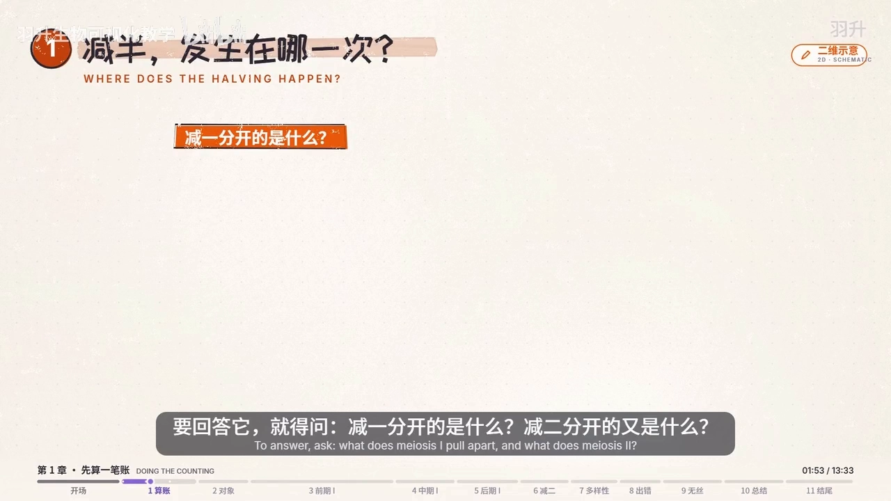

---

## 二、认清对象：同源染色体、姐妹染色单体、等位基因

### 2.1 一对同源染色体：一条来自父方，一条来自母方

同源染色体是**形态大小一样、带着同样一套基因座**的两条染色体，一条来自父方、一条来自母方。[【跳转到 02:45】](https://www.bilibili.com/video/BV17nsV6YExb/?t=165) 人有 23 对。

**基因座**可以简单理解成染色体上的一个位置；同一个基因座上、分别位于两条同源染色体上的基因互称**等位基因**，比如大 A 和小 A。它们**可能有差异，也可能没有**——大部分其实没有差异。[【跳转到 02:45】](https://www.bilibili.com/video/BV17nsV6YExb/?t=165)

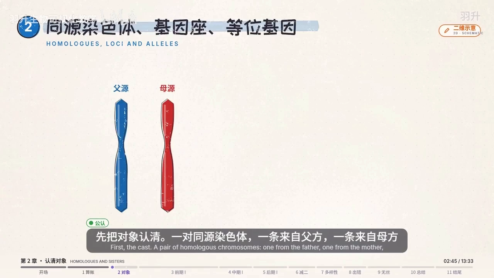

### 2.2 姐妹染色单体：同一条染色体的两份拷贝

复制之后，同一条染色体的两份拷贝叫**姐妹染色单体**，二者完全相同，靠黏连蛋白绑在一起。**只有父源和母源这两条之间才叫同源**——这两个概念一定要分清。[【跳转到 03:10】](https://www.bilibili.com/video/BV17nsV6YExb/?t=190)

减数分裂里，黏连蛋白换上了一个专用的连接亚基（REC8）。这个替换为什么重要，要到减一后期才看得出来。[【跳转到 03:15】](https://www.bilibili.com/video/BV17nsV6YExb/?t=195)

---

## 三、减数第一次分裂：配对、交换、同源分离

减一前期是减数分裂里最长、也最特别的一段。五个亚期的名字不考，但逻辑要懂。[【跳转到 03:32】](https://www.bilibili.com/video/BV17nsV6YExb/?t=212)

### 3.1 细线期与偶线期：先切开口，再配对

**细线期**：染色体开始凝集成一根根细线，**重组也在这时开始**——一种叫 SPO11 的蛋白在 DNA 上有意切开一些双链断口。[【跳转到 03:44】](https://www.bilibili.com/video/BV17nsV6YExb/?t=224)

**偶线期**：同源染色体开始互相识别、配对，这就是**联会**。它们究竟怎么认出对方，至今还没有完全弄清楚；联会不只是「靠得近」，两条同源染色体之间会搭起一个实体结构，叫**联会复合体**，像一条宽约 100 nm 的拉链，SYCP1 蛋白从两侧伸过来在正中头对头咬合。[【跳转到 04:13】](https://www.bilibili.com/video/BV17nsV6YExb/?t=253)

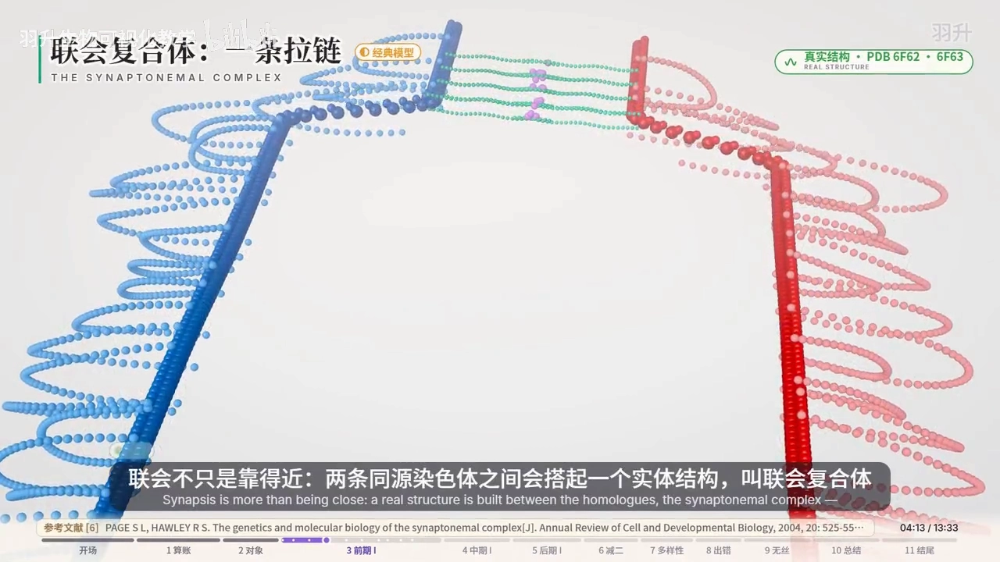

### 3.2 二价体与四分体：同一对染色体的两个名字

这一对已经联会的同源染色体有两个名字：**按染色体数有两条，叫二价体；按染色单体数有四条，叫四分体**。只有减一前期联会的这一对才这么叫。[【跳转到 04:34】](https://www.bilibili.com/video/BV17nsV6YExb/?t=274)

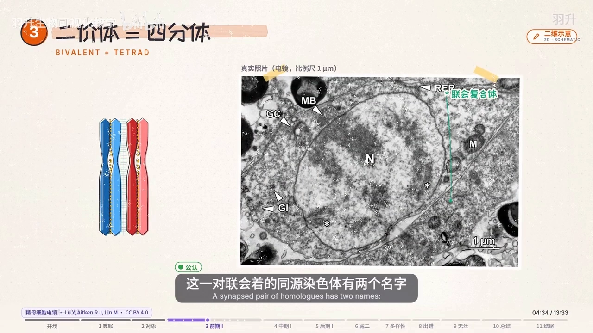

### 3.3 粗线期：交换在同源染色体的非姐妹染色单体之间完成

**粗线期**拉链拉满全长，**交换**就在这时完成，发生在同源染色体的**非姐妹染色单体**之间；电镜下拉链上能看到一个个小颗粒，叫重组结。[【跳转到 04:45】](https://www.bilibili.com/video/BV17nsV6YExb/?t=285)

老师在这里追问了一句：**有丝分裂会交换吗？** 不会——姐妹染色单体一模一样，换了也等于没换。[【跳转到 05:01】](https://www.bilibili.com/video/BV17nsV6YExb/?t=301) 这句话点出了交换的意义：它之所以能产生新组合，前提是交换的两条单体**来自不同的亲本**。

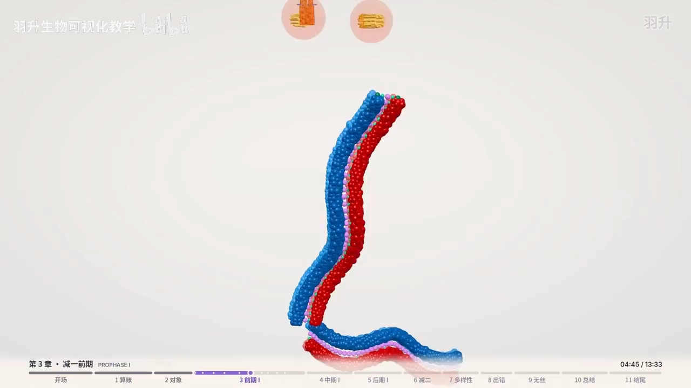

### 3.4 双线期与终变期：交叉是交换留下的样子

**双线期**拉链开始解体，同源染色体想分开，可交换过的地方还被黏连蛋白锁着，于是留下一个个**交叉**。**终变期**染色体进一步凝集变粗短，接着核膜崩解。[【跳转到 05:08】](https://www.bilibili.com/video/BV17nsV6YExb/?t=308)

这里三个词必须分开，混淆是后面所有推理出错的根源：[【跳转到 05:31】](https://www.bilibili.com/video/BV17nsV6YExb/?t=331)

| 术语 | 属于什么概念 | 含义 |
| --- | --- | --- |
| 联会 | 形态学 | 同源染色体沿全长配对 |
| 交换 | 遗传学 | 非姐妹染色单体之间交换 DNA 片段，改变的是**等位基因的组合**，不是凭空造出新基因 |
| 交叉 | 形态学 | 前面那次交换留在显微镜下的样子 |

顺序是**先有交换，后有交叉**。[【跳转到 05:49】](https://www.bilibili.com/video/BV17nsV6YExb/?t=349)

### 3.5 中期 I：排在赤道面上的是二价体，而且是同向附着

减一中期是这一章里和有丝分裂**区别最大**的一张图：排在赤道面上的是**一对一对的二价体**，不是一条一条的染色体。[【跳转到 06:01】](https://www.bilibili.com/video/BV17nsV6YExb/?t=361)

动粒的朝向也不同。有丝分裂中期，两个姐妹动粒朝向两极，叫**双向附着**；减一中期却是**同一条染色体的两个姐妹动粒朝向同一极**，叫**同向附着**。[【跳转到 06:08】](https://www.bilibili.com/video/BV17nsV6YExb/?t=368) 原因很直接：减一要分的是同源染色体，一条同源染色体的两个动粒都朝一极，它才能整条被拉过去，另一条朝另一极。[【跳转到 06:26】](https://www.bilibili.com/video/BV17nsV6YExb/?t=386)

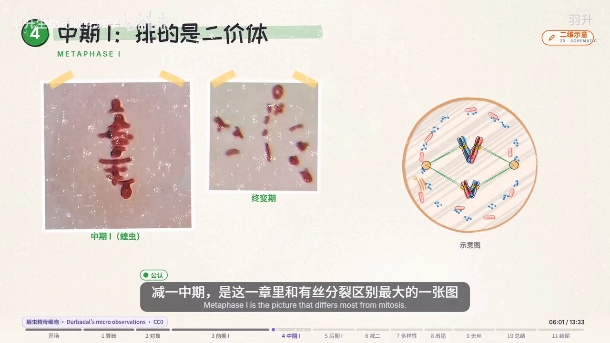

那是什么挡着同源染色体、不让它们提前被拉开？就是**交叉**——两极往外拉，交叉往里拽，二价体才在中间绷住。[【跳转到 06:38】](https://www.bilibili.com/video/BV17nsV6YExb/?t=398)

还有一点对后面的多样性计算很关键：**每一对二价体朝哪个方向排，彼此独立**——这一对的父源朝左，下一对的父源可能朝右。[【跳转到 06:48】](https://www.bilibili.com/video/BV17nsV6YExb/?t=408)

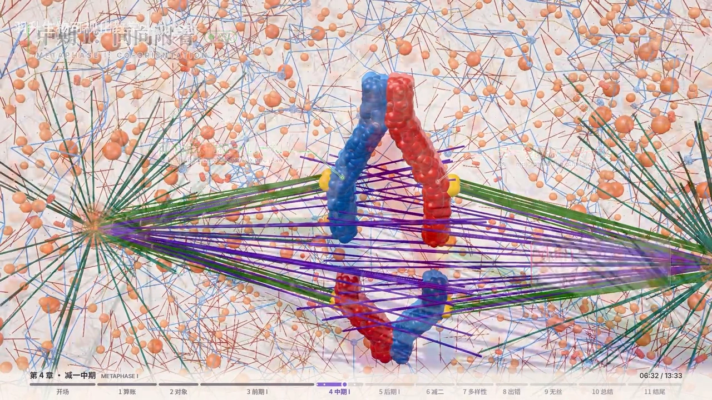

### 3.6 后期 I 与末期 I：同源染色体分开，姐妹染色单体不分开

**后期 I**：同源染色体分开，各自拖着两条姐妹染色单体走向两极。[【跳转到 07:03】](https://www.bilibili.com/video/BV17nsV6YExb/?t=423) 要放开交叉就得剪掉染色体臂上的黏连蛋白，可**着丝粒附近**的黏连蛋白被一种叫 shugoshin 的蛋白护着（名字来自日语里的「守护神」），所以减一后期姐妹染色单体不会散开，只在臂上张开一点，要等到减二才分开。[【跳转到 07:22】](https://www.bilibili.com/video/BV17nsV6YExb/?t=442)

被拉走的染色单体有的已经是一段蓝一段红——这就是前期那次交换的结果。[【跳转到 07:29】](https://www.bilibili.com/video/BV17nsV6YExb/?t=449)

**末期 I**：染色体到了两极，胞质分裂，一个细胞变成两个。每个细胞的染色体数已经减半，是 **N**，但每条还带着两条姐妹单体，是 **2C**。[【跳转到 07:39】](https://www.bilibili.com/video/BV17nsV6YExb/?t=459)

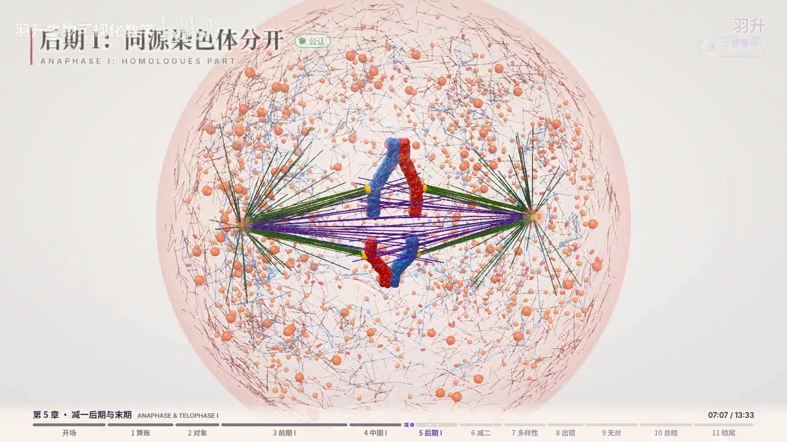

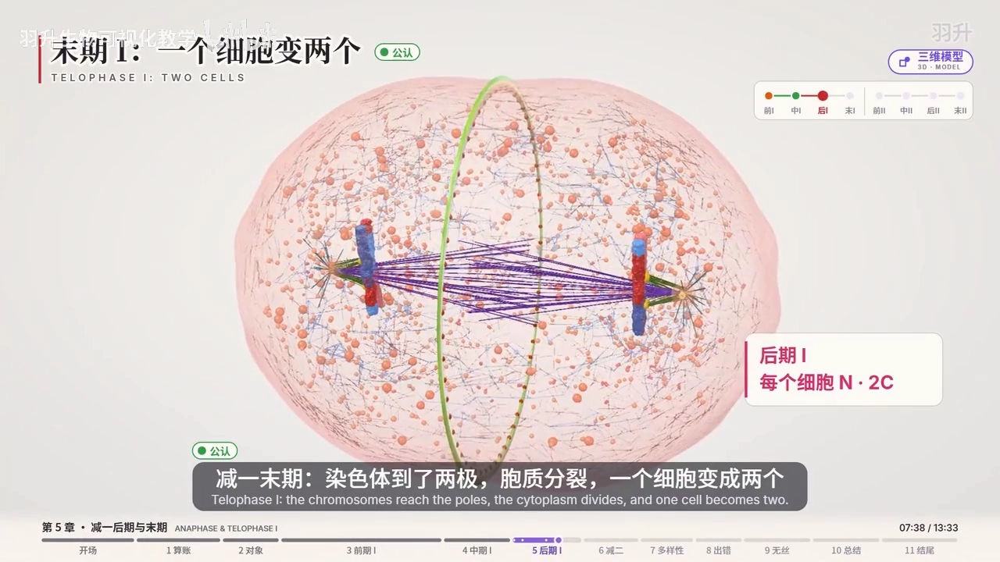

---

## 四、减数第二次分裂：几乎就是一遍有丝分裂

减二开局就是单倍体：每个细胞里只有 N 条染色体，每条仍是两条姐妹染色单体。[【跳转到 08:06】](https://www.bilibili.com/video/BV17nsV6YExb/?t=486)

接下来几乎就是一遍有丝分裂：核膜崩解、纺锤体重新搭起来；这一次姐妹动粒朝向两极，是**双向附着**；被守护到现在的着丝粒黏连蛋白这时才被剪开；姐妹染色单体分开走向两极，胞质再分一次——一个细胞经过两次分裂变成**四个单倍体细胞**。[【跳转到 08:28】](https://www.bilibili.com/video/BV17nsV6YExb/?t=508)

和有丝分裂明显不同的一点是：**这次分开的两条姐妹染色单体可能已经不一样了**，因为其中一条在减一前期交换过。[【跳转到 08:41】](https://www.bilibili.com/video/BV17nsV6YExb/?t=521) 有丝分裂的产物是「相同」，减数分裂的产物是「各不相同」，根源就在这一步。

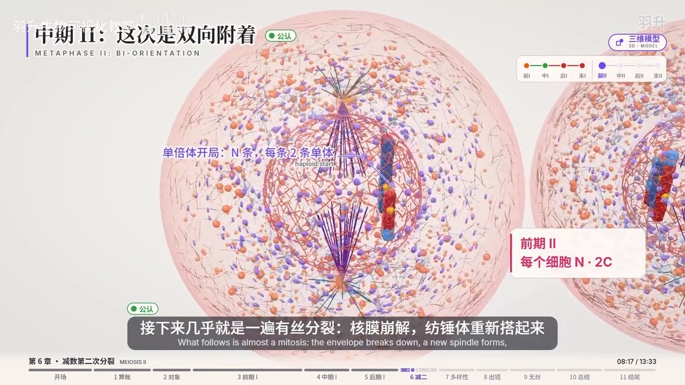

---

## 五、用 2n=4 走一遍：每一步的染色体数、染色单体数、DNA 量

把上面的记账法落到一个 2n=4 的细胞上（两条大染色体、两条小染色体，父源蓝、母源红）。这张表是按视频的 N/C 记账法展开的讲解示例，不是视频原图。

| 阶段 | 染色体数 | 染色单体数 | DNA 分子数（双螺旋） | 记账 |
| --- | --- | --- | --- | --- |
| 精原/卵原细胞（G1） | 4 | 4 | 4 | 2N·2C |
| S 期后 / G2 | 4 | 8 | 8 | 2N·4C |
| 前期 I（联会、交换） | 4 | 8 | 8 | 2N·4C；2 个二价体 = 2 个四分体 |
| 中期 I | 4 | 8 | 8 | 2N·4C；二价体排赤道面 |
| 后期 I（同一细胞内） | 4 | 8 | 8 | 同源染色体已分开，但尚未胞质分裂 |
| 末期 I 后的每个细胞 | 2 | 4 | 4 | N·2C |
| 中期 II | 2 | 4 | 4 | N·2C |
| 后期 II（同一细胞内） | 4 | 0（已变成染色体） | 4 | 着丝粒分裂后染色体数暂时翻倍，DNA 不变 |
| 末期 II 后的每个配子 | 2 | 0 | 2 | N·1C |

读这张表要注意三个容易错的点：

1. **染色体数只在减一减半**（4 → 2），减二不再减半，减二减的是 DNA（4 → 2）。
2. **后期 II 的染色体数会暂时翻倍**：着丝粒一分裂，两条染色单体各自成为一条染色体，所以一个细胞内暂时有 4 条，但 DNA 分子数没变。
3. **「2n=4」说的是染色体条数，不是 DNA 量**：复制之后染色体还是 4 条，只是每条从 1 个双螺旋变成 2 个。

---

## 六、三个变异来源：为什么同一对父母的孩子都不一样

老师的问题是：同一对父母生的孩子，为什么各不相同？靠的就是减数分裂。[【跳转到 08:52】](https://www.bilibili.com/video/BV17nsV6YExb/?t=532)

### 6.1 来源一：非同源染色体的独立分配，2²³ ≈ 838 万

每一对同源染色体在减一中期怎么排，互不影响。人有 23 对，光这一项，配子的组合就有 **2²³ 种，也就是 800 多万种**。[【跳转到 08:57】](https://www.bilibili.com/video/BV17nsV6YExb/?t=537)

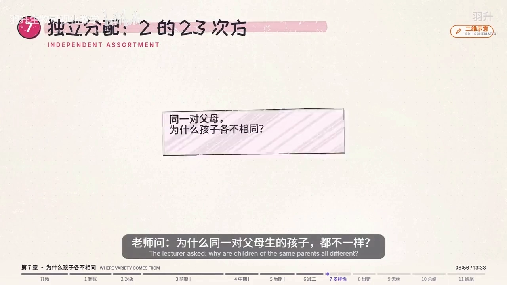

### 6.2 来源二：交换，不止、不止、不止

老师说「不止，不止，不止」——还要再乘上交换。每对同源染色体通常至少交换一次，**位置每次还不一样**，组合数就大到几乎不可能重复。[【跳转到 09:20】](https://www.bilibili.com/video/BV17nsV6YExb/?t=560)

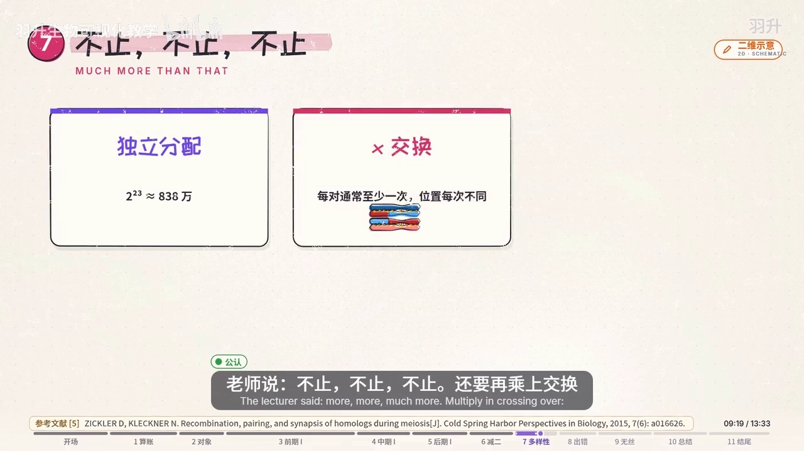

### 6.3 来源三：受精时两个配子随机结合

再乘上受精时两个配子的随机结合，两个孩子一模一样几乎只有一种可能：**同卵双胞胎**——一个受精卵分成了两个。[【跳转到 09:20】](https://www.bilibili.com/video/BV17nsV6YExb/?t=560)

### 6.4 独立分配的边界：连锁基因不独立

「2²³ 种」这个数字有一个隐含前提：**每一对同源染色体各自独立地朝向**。它成立的前提是基因分别位于**不同**的染色体上。如果两个基因位于**同一条**染色体上，它们就会倾向于一起被拉走，配子组合数达不到自由组合给出的那个数——这就是**连锁**，下一篇专门讲。[【跳转到 06:48】](https://www.bilibili.com/video/BV17nsV6YExb/?t=408)

---

## 七、一张表收尾：有丝分裂 vs 减数分裂

老师最后用一张表收尾，原话是「我读有丝，你们读减数」。[【跳转到 11:30】](https://www.bilibili.com/video/BV17nsV6YExb/?t=690) 表格逐行写满在 11:54 左右。[【跳转到 11:54】](https://www.bilibili.com/video/BV17nsV6YExb/?t=714)

| 对照项 | 有丝分裂 | 减数分裂 |
| --- | --- | --- |
| 复制 / 分裂次数 | 1 次 / 1 次 | 1 次 / 2 次 |
| 联会、交换 | 没有 | 减一前期 |
| 后期分开什么 | 姐妹染色单体 | 减一分同源，减二分姐妹 |
| 动粒附着 | 双向 | 减一同向，减二双向 |
| 子细胞染色体数 | 2 个 2N | 4 个 N |
| 子细胞遗传组成 | 相同 | 各不相同 |

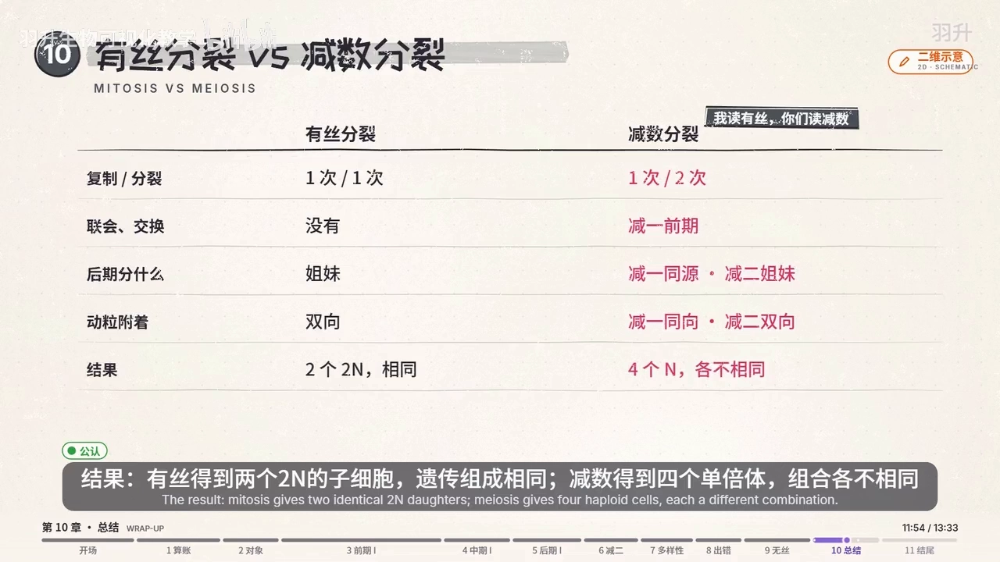

两者的共同点是**用的是同一套机器**：纺锤体、动粒、黏连蛋白。[【跳转到 11:55】](https://www.bilibili.com/video/BV17nsV6YExb/?t=715) 减数分裂并没有另造一套装置，它只是把同一套装置用了两次，并在第一次里加上了联会、交换和同向附着。有丝分裂的过程见 4.3.2，这里不重复。

---

## 八、边界：分错了会怎样，以及本文不展开的部分

### 8.1 不分离：减一出错，四个产物全异常

假设只有一对同源染色体出错，其余都正常：[【跳转到 09:41】](https://www.bilibili.com/video/BV17nsV6YExb/?t=581)

- **减一不分离**：这一对同源染色体全进了同一个细胞，再往下分，**四个产物全都异常**——两个多一条（N+1），两个少一条（N−1）。
- **减二不分离**：减一正常，只有一个细胞里的姐妹染色单体没有分开，四个产物里**只有两个异常**，另外两个正常。[【跳转到 09:46】](https://www.bilibili.com/video/BV17nsV6YExb/?t=586)

后果的尺度也不同：有丝分裂分错，影响的是那一个细胞的后代；减数分裂分错，出问题的是配子，受精以后**个体的每一个细胞染色体数都不对**。[【跳转到 10:16】](https://www.bilibili.com/video/BV17nsV6YExb/?t=616)

### 8.2 视频顺带提到、本文不展开的

- **无丝分裂**：凝集的染色体、纺锤体通通没有，细胞核从中间一分为二。快是快，但完全做不到精确分配——它还存在，说明在那种场合细胞不在乎精确（典型例子是纤毛虫的大核）。[【跳转到 10:31】](https://www.bilibili.com/video/BV17nsV6YExb/?t=631)
- **交换的分子机制**（SPO11 切开双链之后的修复路径、双霍利迪连接体）只有一句带过；本节只需要知道「有意的双链断口 → 交换 → 交叉」这条因果链。
- **重组率的估计**（交换值、图距、三点测交）不在本节范围；下一节只讲连锁与重组的概念关系。
- **减数分裂的性别差异与重组热点**：视频未涉及。卵母细胞在减一双线期活跃转录、形成灯刷染色体这件事，见 4.3.4 的干细胞与分化一篇。

---

## 小结

1. 减数分裂 = **复制一次、连分两次**；染色体数在**减一**减半，DNA 量在两次各减一半。
2. 减一分开**同源染色体**（每条带两条姐妹单体，同向附着），减二分开**姐妹染色单体**（双向附着）。
3. 减一前期的因果链是：SPO11 造断口 → 联会（联会复合体）→ 二价体/四分体 → 非姐妹染色单体交换 → 交叉。联会是形态学、交换是遗传学、交叉是交换留下的形态。
4. 三个变异来源叠加：独立分配 2²³、交换、受精随机结合；但独立分配只在基因位于不同染色体时成立。
5. 有丝分裂与减数分裂共用同一套机器，差别集中在「分几次、分什么、怎么附着、产物是否相同」。