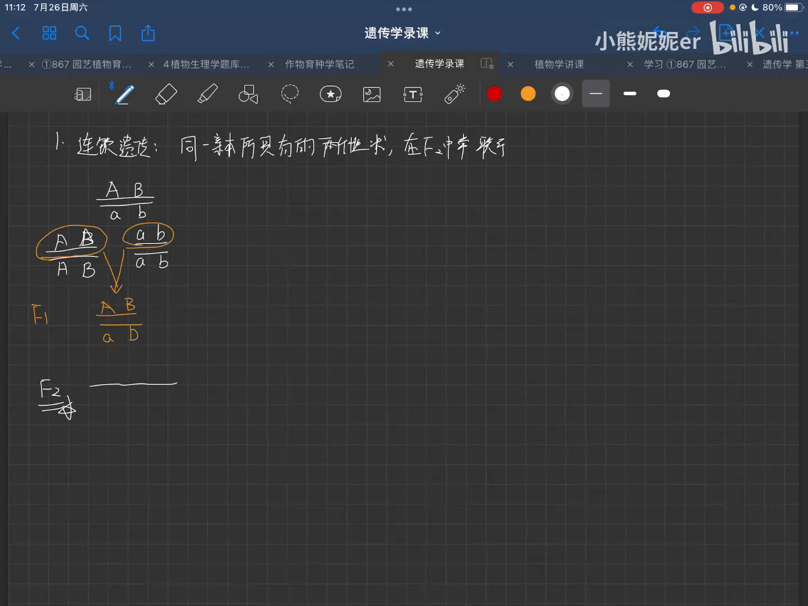
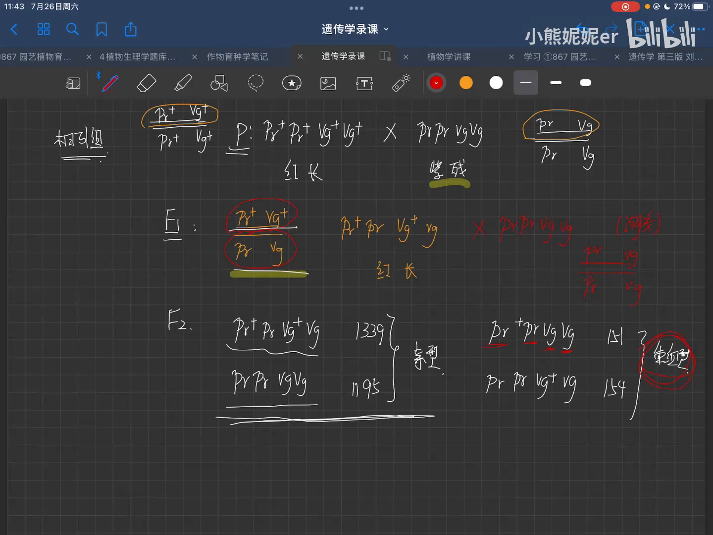
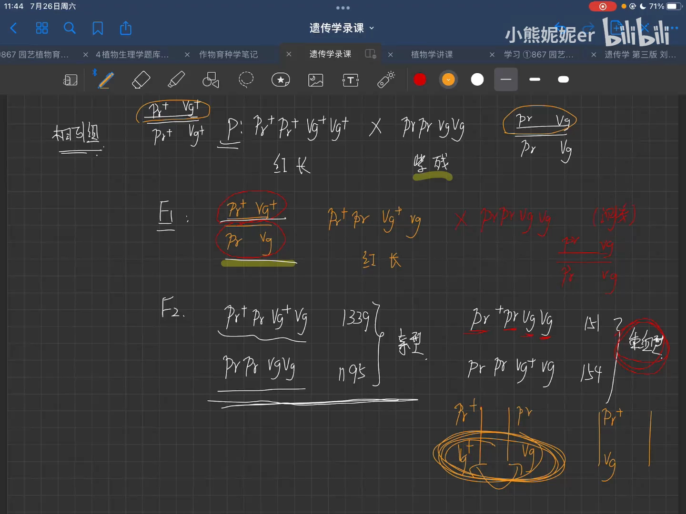
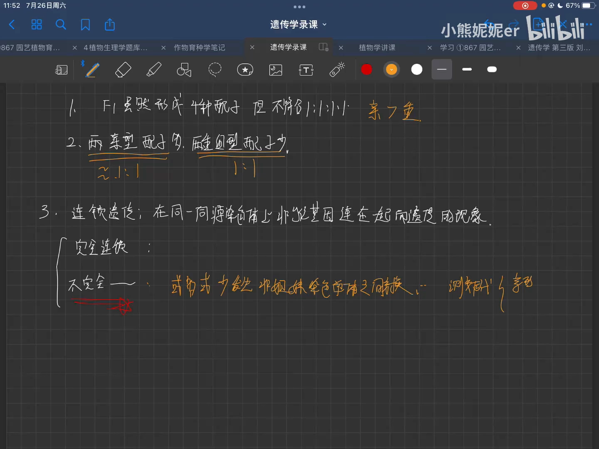

# 连锁与交换：同一染色体上非等位基因的共传与重组

> 视频来源：[【遗传学】刘庆昌 第四章 连锁遗传和性遗传 第一节 连锁与交换](https://www.bilibili.com/video/BV1Xv8xzJEFo/)（Bilibili · 小熊妮妮er 搬运的遗传学录课，23 分 47 秒）。该视频无平台字幕，本文依据本地语音转写（faster-whisper）与画面板书整理，时间戳指向原片；转写中的人名、基因符号已按画面与遗传学通行写法校正。
> 导读：上一篇讲减数分裂时，多样性被算成 2²³ 种配子组合——这个数字的前提是「每一对同源染色体各自独立地朝向」。本篇补上这个前提失效的情形：两个基因位于**同一条**染色体上时，它们会倾向于一起被传下去，这就是连锁；而减一前期的交换会把这种连锁打断，产生少量新的组合。

## 本讲要解决的核心问题（SCQA）

**背景**：一对等位基因自交，后代表型 3:1、基因型 1:2:1；两对等位基因分别位于两对同源染色体上，自交后代 9:3:3:1。这两条结论的前提是：形成配子时，两对基因**独立地分配**。[【跳转到 00:30】](https://www.bilibili.com/video/BV1Xv8xzJEFo/?t=30)

**冲突**：这个前提经常不成立。一个生物有上万对基因，染色体却只有几十条，所以**必然有多个基因位于同一条染色体上**。一旦两对等位基因落在同一条染色体上，它们还能按 1:1:1:1 自由组合吗？[【跳转到 01:30】](https://www.bilibili.com/video/BV1Xv8xzJEFo/?t=90)

**疑问**：连锁到底改变了什么？既然连在一起，为什么还会出现少数「不连锁」的后代？这些少数后代是从哪一步冒出来的？

**回答（中心思想）**：位于同一条染色体上的非等位基因倾向于**一起遗传**，这叫**连锁**；减数分裂时同源染色体的**非姐妹染色单体之间发生交换**，会把连锁打断，产生少量**重组型**配子。所以测交后代的四种表型不再是 1:1:1:1，而是**两种亲型多、两种重组型少**，且各自大致 1:1。[【跳转到 17:00】](https://www.bilibili.com/video/BV1Xv8xzJEFo/?t=1020)

---

## 一、连锁的定义：同一亲本的两个性状在 F2 里常绑在一起

### 1.1 从「两对基因在两对染色体上」到「两对基因在一条染色体上」

常规情形是：大 A 小 A 在一对同源染色体上，大 B 小 B 在另一对上，形成配子时两对各自独立分离，后代出现 9:3:3:1 或基因互作的各种变形。[【跳转到 01:00】](https://www.bilibili.com/video/BV1Xv8xzJEFo/?t=60)

今天说的情形更特殊：**两对等位基因分布在同一条染色体上**——一条染色体上既有大 A 小 A，也有大 B 小 B。[【跳转到 01:30】](https://www.bilibili.com/video/BV1Xv8xzJEFo/?t=90)

### 1.2 定义与发现者

**连锁遗传**：同一亲本所具有的两个性状，在 F2 中常常联系在一起遗传的现象。[【跳转到 05:00】](https://www.bilibili.com/video/BV1Xv8xzJEFo/?t=300)

- **贝特森和庞尼特**（1906）在香豌豆的两对性状杂交实验中首先发现了性状连锁的现象，比摩尔根早几年。[【跳转到 03:00】](https://www.bilibili.com/video/BV1Xv8xzJEFo/?t=180)
- **摩尔根**（1910）以果蝇为材料，指出**同一染色体上的非等位基因连在一起遗传**，这就是连锁遗传。[【跳转到 02:30】](https://www.bilibili.com/video/BV1Xv8xzJEFo/?t=150)

注意 F1 是看不出区别的：F1 的基因型跟独立分配时一模一样，真正的差别要到 **F2** 才表现出来——比例不再是 9:3:3:1。[【跳转到 04:30】](https://www.bilibili.com/video/BV1Xv8xzJEFo/?t=270)

### 1.3 相引组与相斥组：连锁有两种「摆法」

同样是连锁，两个基因在两条同源染色体上的搭配方式不同，名字也不同：[【跳转到 06:30】](https://www.bilibili.com/video/BV1Xv8xzJEFo/?t=390)

| 名称 | 定义 | 写法 |
| --- | --- | --- |
| 相引组（coupling） | 两个显性性状联系在一起、两个隐性性状联系在一起 | AB / ab |
| 相斥组（repulsion） | 一个显性性状与另一个隐性性状联系在一起 | Ab / aB |

这个区分不是术语游戏：它决定了哪两种配子是「亲型」——后面数测交后代的四类个体时，先要看清亲本是怎么摆的。[【跳转到 07:00】](https://www.bilibili.com/video/BV1Xv8xzJEFo/?t=420)

---

## 二、摩尔根的果蝇实验：四种后代，但比例不是 1:1:1:1

### 2.1 两个基因：眼色 pr 与翅型 vg

摩尔根用了两对基因：眼色和翅型。[【跳转到 08:30】](https://www.bilibili.com/video/BV1Xv8xzJEFo/?t=510)

- **眼色**：红眼 **pr⁺** 为显性（野生型），紫眼 **pr** 为隐性；
- **翅型**：长翅 **vg⁺** 为显性（野生型），残翅 **vg** 为隐性。

符号里的「+」表示该基因是野生型、功能正常；它就相当于前面写法里的大 A，pr 相当于小 a。[【跳转到 09:00】](https://www.bilibili.com/video/BV1Xv8xzJEFo/?t=540)

### 2.2 相引组杂交 + 测交

亲本取相引组：pr⁺pr⁺vg⁺vg⁺（红眼长翅）× prprvgvg（紫眼残翅），F1 全部是 pr⁺prvg⁺vg（红眼长翅）。[【跳转到 11:00】](https://www.bilibili.com/video/BV1Xv8xzJEFo/?t=660)

然后拿 F1 与全隐性个体 prprvgvg 测交。**如果两对基因是独立分配的**，F1 应该产生四种配子、比例 1:1:1:1，测交后代也应该是四种各 1/4。[【跳转到 12:00】](https://www.bilibili.com/video/BV1Xv8xzJEFo/?t=720)

### 2.3 实测数据：1339、1195、151、154

实际数出来的四类后代是：[【跳转到 13:00】](https://www.bilibili.com/video/BV1Xv8xzJEFo/?t=780)

| 后代类型 | 基因型 | 个体数 | 归类 |
| --- | --- | --- | --- |
| 红眼长翅 | pr⁺pr vg⁺vg | 1339 | 亲型 |
| 紫眼残翅 | prpr vgvg | 1195 | 亲型 |
| 红眼残翅 | pr⁺pr vgvg | 151 | 重组型 |
| 紫眼长翅 | prpr vg⁺vg | 154 | 重组型 |

两个亲型加起来 2534，两个重组型加起来 305，比例约 8.3 : 1——**离 1:1:1:1 差得很远**，但也不是「只有亲型」。这个「多 + 少」的格局就是连锁加交换的指纹。

---

## 三、重组型从哪来：非姐妹染色单体之间的交换

### 3.1 摩尔根的解释

控制眼色和翅型的两对基因位于**同一对同源染色体**上。减数分裂时，**部分性母细胞**的同源染色体的两条**非姐妹染色单体**之间发生了交换，于是形成了重组型配子。[【跳转到 14:30】](https://www.bilibili.com/video/BV1Xv8xzJEFo/?t=870)

画成图就是：pr⁺ 与 vg⁺ 原本在一条单体上、pr 与 vg 在另一条上；两条非姐妹单体在某个位置互换片段以后，就出现了 pr⁺vg 和 prvg⁺ 这两条新的组合。[【跳转到 15:00】](https://www.bilibili.com/video/BV1Xv8xzJEFo/?t=900)

### 3.2 三条可以直接读出来的规律

从这两组（相引组、相斥组）相似的结果，可以读出三条规律：[【跳转到 17:00】](https://www.bilibili.com/video/BV1Xv8xzJEFo/?t=1020)

1. **F1 确实形成了四种配子**，但比例不符合 1:1:1:1——所以测交后代才有四种表型，却不是四等份。
2. **两种亲型配子多，两种重组型配子少**。亲型多是因为它们不需要交换就能产生；重组型少，是因为要靠交换才产生。
3. **两种亲型之间大致 1:1，两种重组型之间也大致 1:1**。视频里 151 与 154 就接近 1:1；数据量越大越接近，因为交换本身没有偏向哪一条单体的理由。[【跳转到 18:00】](https://www.bilibili.com/video/BV1Xv8xzJEFo/?t=1080)

这三点合起来就是判读测交数据的顺序：**先看有几种表型（判断是否连锁），再看哪两类多（判断亲型，从而回推亲本的摆法），最后看多的和少的各占多少**。

---

## 四、完全连锁与不完全连锁

同样是连锁，交换发生不发生，测交结果完全不同：[【跳转到 20:30】](https://www.bilibili.com/video/BV1Xv8xzJEFo/?t=1230)

| | 完全连锁 | 不完全连锁 |
| --- | --- | --- |
| 是否发生非姐妹染色单体交换 | 不发生 | 或多或少发生 |
| 两个非等位基因 | 总是连在一起 | 多数时候连在一起 |
| 配子种类 | 只有两种亲型 | 两种亲型 + 两种重组型 |
| 测交后代 | 只有亲型，1:1 | 亲型多、重组型少 |

摩尔根的 pr-vg 属于**不完全连锁**：有重组型，只是少。完全连锁在自然界相对少见——视频没有展开哪些基因属于完全连锁，本节也不要求记住具体例子。

---

## 五、边界：本节讲到哪、不讲什么

### 5.1 连锁群：一条染色体上的基因构成一个组

一个生物有上万对基因、却只有几十条染色体，所以多个基因必然共享一条染色体。把**同一条染色体上的所有基因**看作一个整体，就是**连锁群**；一个物种的连锁群数等于它的单倍体染色体数（人 23 个）。这一条是教材常识，视频只讲到「基因数远多于染色体数」这一步，没有点出「连锁群」这个名字。[【跳转到 01:30】](https://www.bilibili.com/video/BV1Xv8xzJEFo/?t=90)

### 5.2 交换频率与物理距离：只讲方向，不给公式

两个基因在染色体上**离得越远，它们之间发生交换的机会越大，重组型后代的比例就越高**；离得越近，越容易被一起传下去。这条关系是「用重组频率来度量基因间距离」的全部直觉来源，但**具体的估计方法不在本节范围**——交换值的测定、图距、三点测交与双交换计算都是下一层的内容，本节只需要能定性判断「哪两个基因更靠近」。

### 5.3 与上一篇的衔接

上一篇算出的 2²³ 种配子组合，前提是各对同源染色体独立朝向，也就是基因位于**不同**染色体上。真实基因组里大量基因共享染色体，所以实际配子多样性比 2²³ 更大（交换又加了一层），但**不是所有组合都等概率**——连锁让某些组合明显更常见。这两件事不矛盾：多样性看总量，连锁看分布。

---

## 小结

1. **连锁**：同一染色体上的非等位基因倾向于一起遗传；F1 看不出差别，差别在 F2 的比例。
2. **相引组 / 相斥组**：两个显性（或两个隐性）绑在一起 vs 一个显性配一个隐性，决定哪两种配子算亲型。
3. **重组型来自交换**：减数分裂时同源染色体非姐妹染色单体互换片段。
4. **判读测交数据的顺序**：几种表型 → 哪两类多（亲型）→ 多的与少的各占多少；亲型多、重组型少，各约 1:1。
5. **完全连锁**没有重组型（测交只出亲型，1:1）；**不完全连锁**有少量重组型。
6. 距离越远、重组越频繁——只到定性方向为止，重组率的估计不在本节。