# 细胞谱系与谱系追踪：条形码如何重建造血干细胞的分化树

> 视频来源：[CGM 第一百四十九期 裴唯珂博士 单细胞谱系追踪解析免疫系统的发育](https://www.bilibili.com/video/BV145411c7qz/)（Bilibili · CGMonline，约 59 分钟，其中前 30 分钟为报告、后 29 分钟为问答；中文字幕为自动识别）
> 导读（100 字以内）：这篇讲的是「谱系」这件事本身：一个细胞从哪来、能变成什么，谱系树怎么读，遗传标记、DNA 条形码、CRISPR 记录三类追踪方法各自能回答什么、边界在哪，以及为什么单细胞图谱上的拟时序轨迹只是推断。字幕中的术语错拼（如"火学习追踪"→谱系追踪、"BARKHOUSE"→条形码）已按上下文与幻灯片订正。

## 本讲要解决的核心问题（SCQA）

**背景**：前面几篇已经讲过，细胞分化的本质是基因的选择性表达，干细胞靠自我更新与多向分化潜能维持组织更新。但「分化」讲的是单个细胞发生了什么变化，「谱系」讲的是另一件事：一群细胞之间，谁是谁的后代。

**冲突**：这件事很难直接看见。线虫只有一千个左右的细胞、身体透明，Sulston 可以在显微镜下一个一个盯着看，画出了完整的发育图谱；但小鼠和人的组织是不透明的，细胞还会在体内疯狂迁移。于是研究者只能给细胞"打标签"，再从标签的分布去反推亲缘关系。问题是：标签够不够多？会不会重复？标记的时间点会不会把祖细胞也标上？更麻烦的是，近十年单细胞测序给出了另一条看似能回答同一问题的路——拟时序轨迹，它画出来的树和谱系树长得几乎一样。

**疑问**：谱系到底是什么？它和"细胞类型""细胞状态"有什么区别？谱系树该怎么读？遗传标记、DNA 条形码、CRISPR 记录这几类追踪方法各自的边界在哪？单细胞图谱上的 trajectory / pseudotime 能不能替代谱系追踪？

**回答（中心思想）**：**谱系是一个克隆层面的亲缘关系——某个细胞由谁分裂而来、它的后代又去了哪里；它不是细胞类型，也不是细胞状态。** 谱系树只能靠"可遗传的标记"重建：颜色标签受限于标签数量，DNA 条形码用组合多样性换取克隆分辨率，CRISPR 累积突变用随机性换取更高的多样性，三者都要面对"标签碰撞"和"标记时间窗"这两个边界。而单细胞图谱上的拟时序轨迹，是用转录组相似度**推断**出来的排序，它给出的是"最可能的发育路径"，不是真实的谱系；要判断谱系关系，黄金标准仍然是谱系追踪——把条形码和转录组同时读出来，才能既知道细胞从哪来，又知道它此刻在表达什么。

---

## 一、谱系追踪回答的是三个问题里最容易被跳过的那一个

### 1.1 一个细胞的三个问题

讲者用高更那幅画开了场：我们从哪里来，我们是谁，我们到哪里去。换成细胞，就是三个具体的问题——这是一个什么样的细胞？它从哪里发育而来？它将来会变成什么样子？[【跳转到 00:44】](https://www.bilibili.com/video/BV145411c7qz/?t=44)

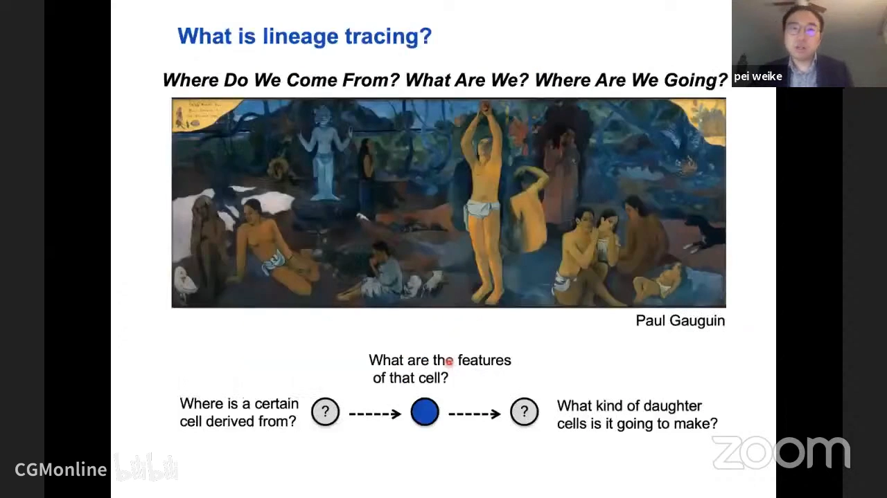

「谱系追踪」就是把中间那个细胞接上左右两端：往左接它的来源，往右接它的后代。所以**谱系（lineage）描述的不是一个细胞此刻的样子，而是一条克隆的血缘链**——同一个祖先分裂出来的所有细胞，构成一条谱系。这解释了为什么谱系信息不能从单个细胞的表达谱里读出来：表达谱只告诉你"它现在像什么"，不告诉你"它和谁同源"。

### 1.2 最原始也最可靠的做法：直接盯着看

这个领域的开山工作是 Sulston 完成的：把线虫固定在光学显微镜下，观察它每一个细胞的分裂、分化过程，最终绘制出整条线虫的发育图谱，这项工作获得了 2002 年诺贝尔奖 [【跳转到 01:24】](https://www.bilibili.com/video/BV145411c7qz/?t=84)。

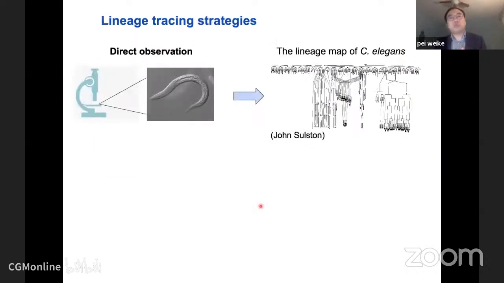

这张图就是最标准的谱系树：**根在最上面，每一次分裂产生一个分叉，末端是终末分化的细胞**。它是"观察"出来的，不是"推断"出来的——每个分叉都对应一次真实看到的分裂。这也说明了谱系追踪的困难所在：能直接看的前提是身体透明、细胞少、不移动。线虫满足全部三条，小鼠和人的组织一条都不满足。

### 1.3 不透明的组织只能靠标签：从颜色到序列

组织不透明，就必须给细胞打上可遗传的标签，再让标签随分裂传递下去。讲者把这条技术路线分成两代，分界线是**标签的数量** [【跳转到 02:14】](https://www.bilibili.com/video/BV145411c7qz/?t=134)。

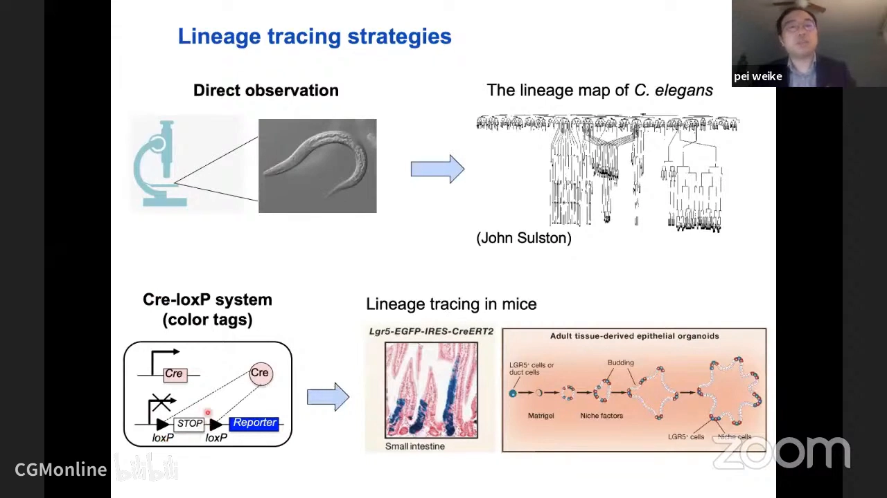

第一代是**遗传标记**：用 Cre-loxP 系统，Cre 重组酶识别 loxP 位点、切掉两个位点之间的 stop 元件，让下游的报告基因（比如荧光蛋白）表达出来。于是"Cre 有活性的那些细胞"及其所有后代都会带上颜色，看颜色往哪里扩散，就知道这些细胞的后代去了哪里。图里展示的是肠道：标记肠底部的 Lgr5 干细胞后，可以看到它如何分裂出子代、并沿着绒毛向上迁移，完成整个肠上皮的更新。

第二代是**DNA 条形码**：既然 DNA 序列的组合几乎是无限的，那就用一段会被随机重排的 DNA 当作标签，用序列本身代替颜色 [【跳转到 04:02】](https://www.bilibili.com/video/BV145411c7qz/?t=242)。这条路线的动机很直接——血液与免疫系统里有几十种细胞类型、细胞还在体内疯狂迁移，四五种颜色根本不够用。

---

## 二、谱系、细胞类型、细胞状态：三个概念必须分开

初学者最容易把这三个词混着用，而它们回答的是不同的问题。讲者在报告里恰好用三个实验把它们逐一区分开了。

| 概念 | 回答的问题 | 判据 | 在本讲中的证据 |
| --- | --- | --- | --- |
| 细胞类型（cell type） | 它是什么 | marker 组合、参考表达谱 | 造血树上的 HSC、MEP、GMP、CLP、T、B |
| 细胞状态（cell state） | 它此刻处在什么状况 | 转录组位置、细胞周期、激活/静息 | 同一群 HSC 在转录组图谱上位置不同 |
| 谱系（lineage） | 它和谁同源、从哪来 | 可遗传标记的共享 | 同一个条形码出现在哪些细胞类型里 |

**细胞类型是标签，谱系是关系。** 这句话在讲者的数据里有很直接的表现：他先按 marker 把成熟血细胞分成红系、髓系、T、B 等类型，再去看这些类型之间共享多少条形码。类型相同不代表谱系相同，类型不同也不代表谱系不同——真正决定亲缘关系的是"有没有共享同一个祖先的条形码"。

**细胞状态也不能代替谱系。** 讲者比较了不同命运造血干细胞的细胞周期评分（cell cycle score），没有发现显著区别；又比较了 long-term 与 short-term 造血干细胞的自我更新基因签名，发现无论哪种命运的细胞里都同时含有这两种成分 [【跳转到 25:44】](https://www.bilibili.com/video/BV145411c7qz/?t=1544)、[【跳转到 26:34】](https://www.bilibili.com/video/BV145411c7qz/?t=1594)。也就是说：**"分不分裂""自我更新能力强不强"这类状态指标，都区分不了细胞的命运**。命运的信息不在这些状态里，得回到克隆层面去找。

第三个容易混的点是**谱系与"祖细胞链"的区别**。教科书上的造血树画的是"HSC → MEP → 红细胞"这样的细胞类型链条，它描述的是"通常的路径"；而谱系追踪问的是"这一个具体的克隆，实际走了哪条路"。前者是群体的平均模型，后者是单克隆的历史。这两者经常不一致——这正是这份工作要做的原因。

---

## 三、谱系树怎么读：从教科书模型到条形码重建

### 3.1 先看一张教科书上的树

经典的造血模型来自骨髓移植实验：造血干细胞位于整个系统的顶端，向下分出 common myeloid progenitor 与 common lymphoid progenitor 两支，再分别产生髓系、红系与 T、B 淋巴细胞 [【跳转到 12:47】](https://www.bilibili.com/video/BV145411c7qz/?t=767)。

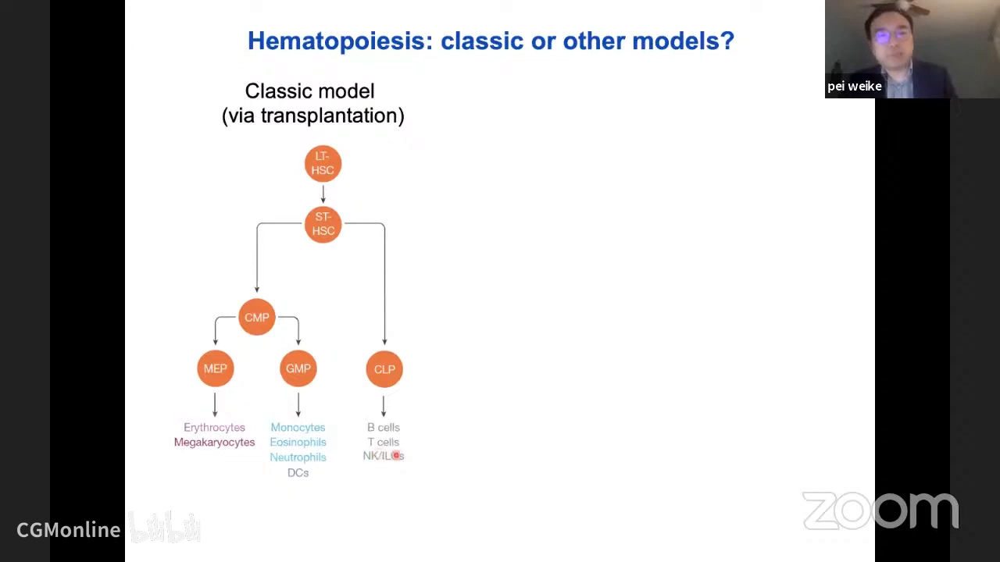

读这种树要抓住三件事：**根**（最上游的细胞）、**分叉点**（命运在这里分开）、**末端**（终末分化的细胞类型）。树上的每一个分叉都隐含一个主张："这两支的共同祖先，就是分叉点上的那个细胞"。教科书的树是把许多实验的结果叠在一起画出来的平均图，它不保证任何一个具体克隆真的这样走。

### 3.2 条形码怎么变成一棵树：共享 = 同源

讲者的做法是：在胚胎期给造血干细胞打上 DNA 条形码，等小鼠成年后，把不同细胞类型分出来，测每一群细胞里出现了哪些条形码。逻辑非常朴素 [【跳转到 18:44】](https://www.bilibili.com/video/BV145411c7qz/?t=1124)：

- 两类细胞共享大量条形码 → 它们大概率来自同一条发育路径、同一个前体；
- 两类细胞的条形码几乎不重叠 → 它们在发育很早期就分开了。

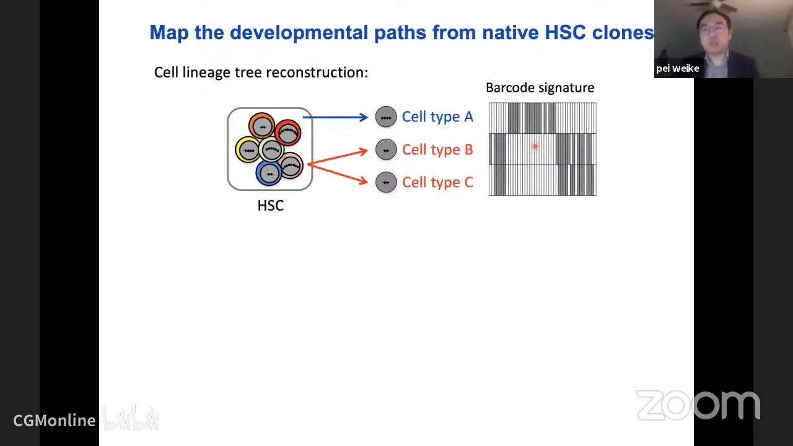

讲者自己给了一个很好的类比：这跟**进化树**是一回事。两个物种基因组相似度高，说明它们在进化树上分开得晚、有共同祖先；基因组差异极大，说明它们在进化树早期就分开了。区别只在于：进化树用的是物种间的序列差异，谱系树用的是克隆间的条形码共享。

### 3.3 两张必须会读的图：热图与树

第一张是**条形码流向热图**。每一行是一个造血干细胞的条形码（也就是一个克隆），每一列是一种细胞类型，颜色深浅代表这个条形码在该细胞类型里出现的频率 [【跳转到 16:02】](https://www.bilibili.com/video/BV145411c7qz/?t=962)。

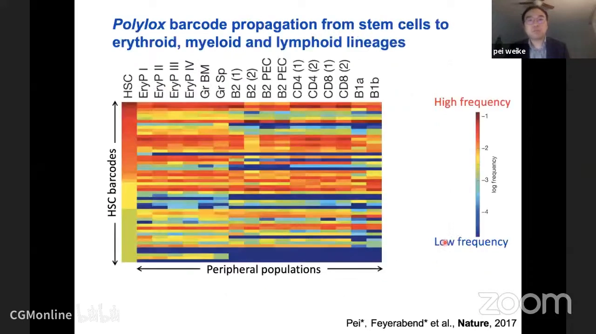

这张图一眼就能看出克隆的"宽度"：有的行从 HSC 一路红到 T、B 细胞，说明这个克隆贡献了所有谱系；有的行只在红系、髓系那几列发亮，到淋巴系就变蓝，说明它被限制住了。讲者据此把造血干细胞分成三类 [【跳转到 17:02】](https://www.bilibili.com/video/BV145411c7qz/?t=1022)：

- **multilineage（多能）**：像劳模，能产生所有被分析过的血液谱系；
- **restricted（潜能受限）**：只产生红系与髓系，不产生 T、B；
- **inactive（静息）**：标记之后长达 9–10 个月几乎不产生子代，只占约 5%。

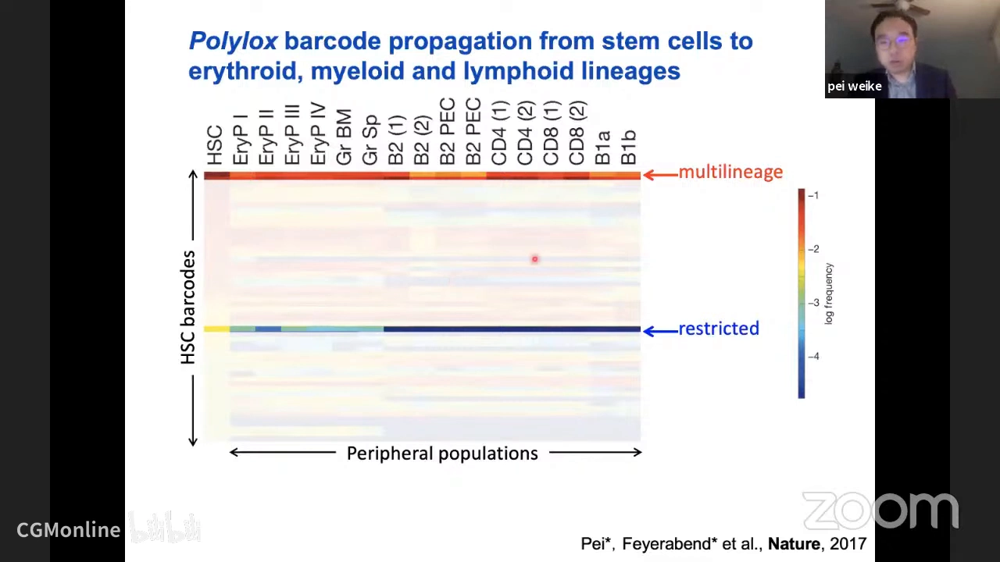

第二张是**重建出来的树**。把所有细胞类型两两比较条形码组成的相似度（用 Spearman 相关系数），先得到一张相关性热图，再据此把细胞类型聚成树 [【跳转到 20:22】](https://www.bilibili.com/video/BV145411c7qz/?t=1222)。

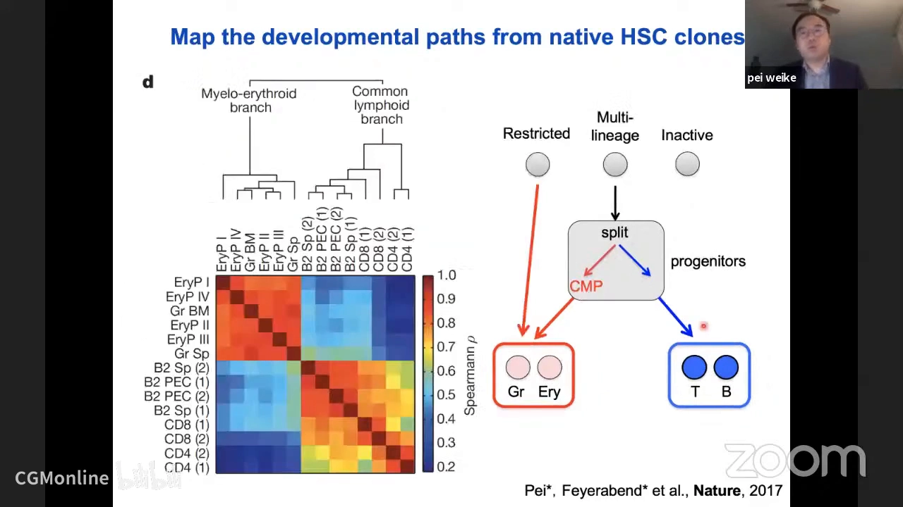

读这张图要注意：**树的分叉位置是由相似度矩阵算出来的，不是观察到的分裂事件**。它表达的是"哪些细胞类型的条形码更像"，而不是"哪一个细胞在哪一天分裂成了哪两个"。这一点和后面要讲的拟时序是同一种性质——都是推断，只是推断用的信息不同（这里是条形码共享，那里是转录组相似度）。

### 3.4 结论：树是二叉的，但每根枝条的宽度不一样

把热图和树合起来，这份工作得到的是一个**二叉分叉 + 命运记忆**的图景：multilineage 的造血干细胞沿着一棵二叉树，一支产生 T、B 淋巴细胞，一支产生髓系与红细胞；而一个干细胞一旦被定型为某一种命运，这种命运记忆非常稳定，可以维持十个月以上不变 [【跳转到 17:54】](https://www.bilibili.com/video/BV145411c7qz/?t=1074)。

这正好接上了上一篇讲过的"决定早于分化"：命运在克隆层面被锁定，而转录组上的差异可能还没那么明显。讲者后来把工作发在 Cell Stem Cell 上时，封面就是一棵用条形码画成的树——根是条形码的数字串，枝条是它衍生出的各个谱系 [【跳转到 28:44】](https://www.bilibili.com/video/BV145411c7qz/?t=1724)。

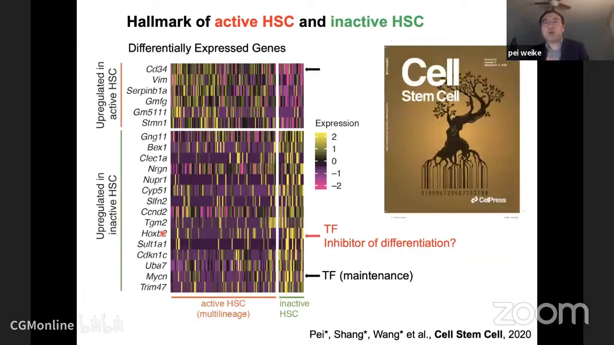

---

## 四、三类追踪方法，三种边界

把讲者的报告和问答合起来看，谱系追踪的方法可以归成三类。它们的差别不在"先进程度"，而在**标签的多样性来自哪里、以及标签能不能被唯一识别**。

### 4.1 遗传标记（颜色标签）：直观，但标签太少

Cre-loxP 加上几种荧光蛋白，是最经典的一套。它的优点是直观、可以原位看、不需要测序；缺点是**标签数量只有几种**，而血液免疫系统有几十种细胞类型、还会迁移，几种颜色根本解析不了 [【跳转到 03:12】](https://www.bilibili.com/video/BV145411c7qz/?t=192)。

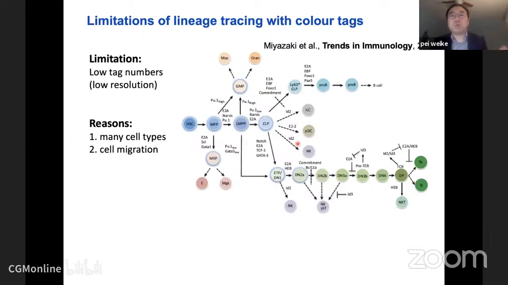

所以颜色标签适合回答"某群细胞的后代去了哪里"这种粗粒度问题（比如肠道干细胞的向上迁移），不适合回答"这几十种细胞类型之间的亲缘关系"。

### 4.2 DNA 条形码：用组合多样性换克隆分辨率

讲者开发的 Polylox 系统，思路是把一段 2 kb 的人工 DNA 底物插进基因组：底物上有五对 loxP 位点和九个不同的 DNA 块，Cre 随机地在这些位点之间做倒位或切除，就能产生大量不同的序列组合 [【跳转到 05:17】](https://www.bilibili.com/video/BV145411c7qz/?t=317)。

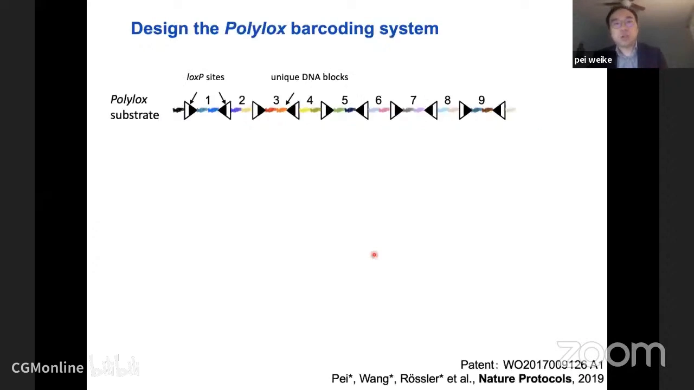

理论上可以产生 180 万种条形码。但这个设计一开始被同行判了死刑：大家认为 Cre 一旦激活就会把所有位点切干净，最后只剩十来种产物。讲者的反驳方式很朴素——先在试管里做一个 in vitro 实验，把底物和 Cre 蛋白孵育过夜再跑胶：如果完全不切，会看到一条完整底物；如果切得干干净净，会看到一条极短的产物；如果像他们预期的那样产生不完全重组的中间产物，就会看到一条 ladder [【跳转到 07:47】](https://www.bilibili.com/video/BV145411c7qz/?t=467)。

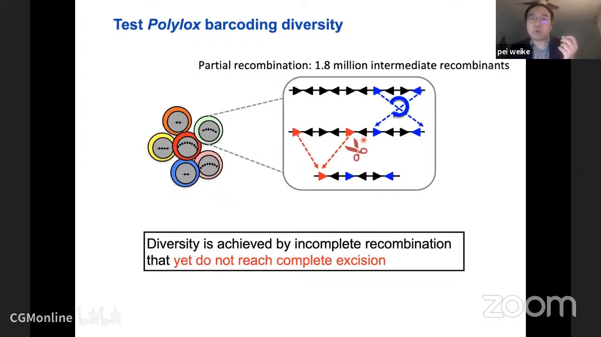

体内实验证实了这条 ladder 是真的：标记之后测了约 3 万个细胞，观察到 800 多种不同的条形码，用单分子实时测序（SMRT，即三代测序）读取长片段条形码 [【跳转到 10:17】](https://www.bilibili.com/video/BV145411c7qz/?t=617)。

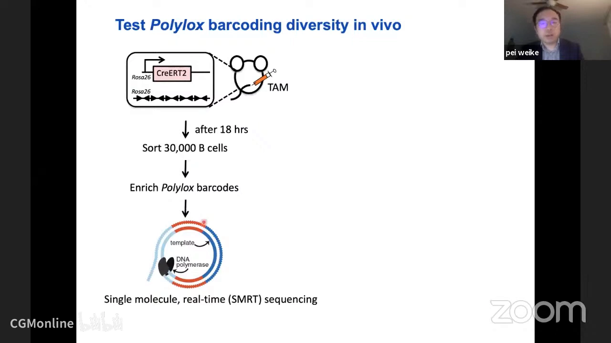

800 远小于 180 万，原因不是系统坏了，而是**不同条形码的产生概率天差地别**：切一刀就能形成的简单条形码常见，要转一圈再切两刀的复杂条形码罕见。讲者与合作者用数学建模给每种条形码算了一个产生概率 $P_{gen}$，这就引出了这类方法最重要的一个边界——**标签碰撞**。

### 4.3 边界一：标签碰撞，以及 P 值为什么是必需品

一只小鼠里大约有 1 万个造血干细胞。如果某个条形码的产生概率是 $10^{-4}$，那么在一万个干细胞里它平均只出现一次——这时候"看到一个条形码"就约等于"看到一个克隆"。反过来，如果用一个高概率的常见条形码，它会在很多干细胞里独立产生，你就无法区分"共享条形码"是因为同源，还是因为撞码 [【跳转到 09:52】](https://www.bilibili.com/video/BV145411c7qz/?t=592)。

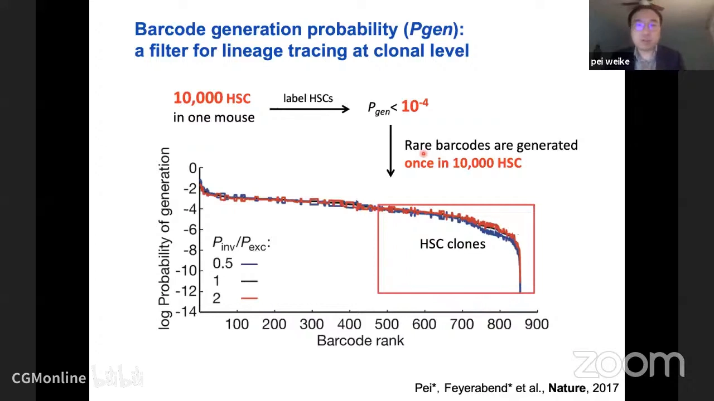

这就是为什么讲者反复强调 $P_{gen}$ 是"关键参数"：**谱系追踪的分辨率不是由条形码总数决定的，而是由"每个条形码被独立产生过几次"决定的**。用常见的条形码做追踪，等于把不同克隆的后代混在一起，热图上就会出现假的共享。

### 4.4 边界二：CRISPR 记录，随机性带来的另一套取舍

问答里有人问：为什么不用 Cas9 做谱系追踪——让 Cas9 在细胞分裂过程中不断在特定位点累积随机突变，用突变组合当条形码？讲者的回答很坦率 [【跳转到 38:13】](https://www.bilibili.com/video/BV145411c7qz/?t=2293)：

- **优点**：突变完全随机，多样性可以非常高，不需要像 Polylox 那样按规则重组，也不需要 P 值过滤就能看到很多条形码；而且更便宜，做非小鼠模型时尤其方便。
- **缺点一**：Polylox 有一个"参考字典"（180 万种已知产物），测序出现两三个 mismatch 也能准确判断这个条形码到底是什么；而 Cas9 的突变没有参考，只能靠 window（一段区间）去判断，很难区分"真实的突变"和"测序错误"。
- **缺点二**：Cas9 目前还做不到器官或细胞类型特异，而小鼠里有大量现成的 inducible Cre driver，只要跟 Polylox 结合就能立刻用上。

这段对比其实给出了一个通用的判据：**条形码方法的可靠性，取决于"标签空间是否可枚举"**。可枚举（Polylox）就能纠错，但多样性受限于规则；不可枚举（Cas9 随机突变）多样性高，但纠错只能靠启发式规则。

### 4.5 边界三：标记时间窗，决定了你能不能分清"继承"和"新标"

第三个边界不在标签上，而在**什么时候标**。讲者用的是 Tie2-Cre：它依赖他莫昔芬——加药才标、不加药不标，这就给出了一个时间维度；而 Tie2 这个 driver 在他们标记的胚胎里只在最上游的造血干细胞中活化，下游的祖细胞与成熟细胞不活化。他们在 E10.5 标记，因此只标到了干细胞 [【跳转到 41:08】](https://www.bilibili.com/video/BV145411c7qz/?t=2468)。

为什么这一点关键？因为如果标记时把祖细胞和成熟细胞也标上，那么你后来看到的条形码，就分不清是"从干细胞继承来的"还是"当时被人工标上的"。这也是讲者认为 Cas9 类方法的一个隐患：如果记录系统一直在开，后天的突变会混进谱系信息里。所以"标记窗口"必须和"想回答的问题"对齐——要问克隆来源，就得在干细胞阶段标；要问某群细胞之后去了哪，才可以在更晚的时间点标。

### 4.6 边界四：移植模型不等于生理状态

还有一个容易被忽略的边界来自实验体系本身。经典的造血模型建立在骨髓移植上，但近年有工作发现：移植情况下很多干细胞克隆只有微弱、不可持续的贡献，移植之后只有极少数克隆保持 dominant，多数会变得 inactive [【跳转到 11:07】](https://www.bilibili.com/video/BV145411c7qz/?t=667)。也就是说，**移植本身会改变干细胞的命运分布**，用它画出来的树，未必是生理状态下的树。

这正是 Polylox 的价值所在：不需要移植，直接在体内标记、在体内追踪。反过来说，读任何谱系追踪的结论时，都要先问一句：这个体系有没有干扰细胞本身？

---

## 五、把谱系接回单细胞图谱：条形码 + 转录组

### 5.1 两套技术各自缺一半

到这里，两条技术路线各自的缺口已经很清楚了 [【跳转到 21:30】](https://www.bilibili.com/video/BV145411c7qz/?t=1290)：

- **谱系追踪**在克隆层面揭示了细胞之间的分化关系与命运，但**不提供任何分子信息**——你知道这两个细胞同源，但不知道它们表达什么、靠什么因子维持；
- **单细胞转录组**提供大量分子信息、可以给细胞定义状态，但**通过转录组预测出来的发育轨迹，与真实发育通路是否一致，没有人知道**。

所以讲者要做的下一代技术，是把条形码做成 RNA，让它混进单细胞转录组里——一个细胞同时被读出"条形码"和"表达谱"。

### 5.2 PolyloxExpress：一个细胞，两份信息

做法很直接：把 Polylox 底物插在 3' UTR 后面、带一个 polyA 标签，用 10x 的体系把条形码转录成 RNA；再跟 Tie2-Cre 杂交，在 E10.5 标记干细胞，成年后分选不同细胞做单细胞测序 [【跳转到 23:03】](https://www.bilibili.com/video/BV145411c7qz/?t=1383)。

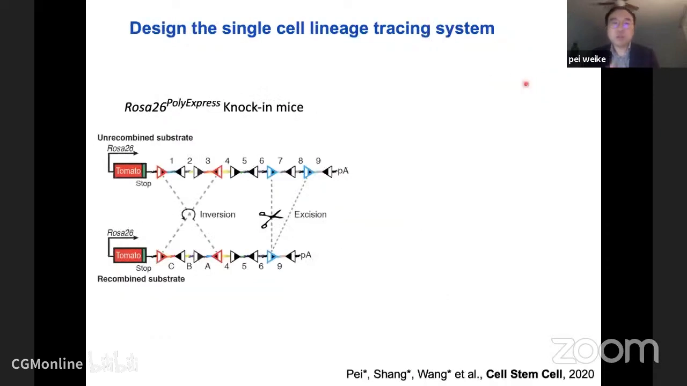

于是每个细胞都有了两份坐标：一份是它的**命运**（条形码属于哪个克隆、这个克隆之前被判定为 multilineage / restricted / inactive），一份是它的**转录组位置**。

### 5.3 关键结果：命运不同的细胞，落在转录组图谱的不同位置

把命运信息投影到拟时序（pseudotime）画出的转录组图谱上，可以看到一个很整齐的分布：inactive 的干细胞集中在发育轨迹的最顶端，而 active、multilineage 的干细胞落在下方、靠近 progenitor 与分叉点的位置 [【跳转到 24:54】](https://www.bilibili.com/video/BV145411c7qz/?t=1494)。

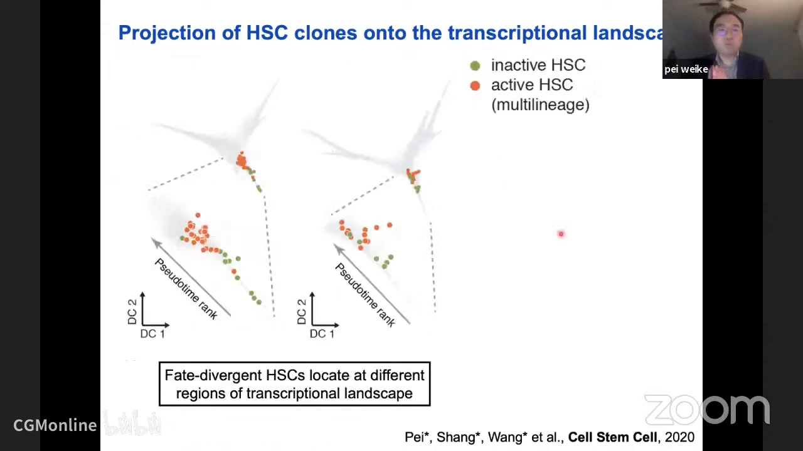

这张图是本讲最值得记住的一张，因为它同时说明了两件事：

1. **命运信息确实能在转录组上找到对应**——不同命运的细胞在转录组景观上有系统性不同的位置，所以"从表达谱预测命运"不是空想；
2. **但位置是"落在哪里"，不是"从哪里来"**——图上的箭头是 pseudotime rank，也就是一个推断出来的排序，它不知道哪个细胞是哪个细胞的后代。

### 5.4 pseudotime 是推断，不是谱系

这一点在问答里被问得很直接：如果做单细胞转录组加内置条形码，跟别人用 RNA velocity 或者直接用 pseudotime 从转录组去推，两者会不会不一样？讲者的回答可以概括成三层 [【跳转到 46:08】](https://www.bilibili.com/video/BV145411c7qz/?t=2768)：

- **历史**：这个领域早期确实"打架"。做单细胞转录组的人能给出很漂亮的预测，甚至能提出新发现；做谱系追踪的人则会追问"你怎么证明你的预测是准的"。
- **判据**：如果想知道发育的谱系关系，**最核心的黄金标准就是做谱系追踪**。拟时序给出的是"最可能的路径"，条形码给出的是"实际发生过的克隆历史"。
- **现状**：2018 年前后随着单细胞谱系追踪技术出现，两边找到了和解方式——把条形码和转录组放在同一个细胞里读，既有分子信息，又有克隆信息。

所以读单细胞图谱时的正确姿势是：**pseudotime 可以告诉你"细胞状态沿着什么方向渐变"，不能告诉你"谁是谁的后代"**。轨迹上的分叉是不是真的分叉、起点是不是真的起点，都需要另外的证据——最好是克隆层面的条形码证据。

### 5.5 顺着这条路，还能问什么

报告末尾和问答里还留了几条延伸线索，正好接上"细胞图谱"这个后续主题：

- **命运由什么决定**：讲者比较了细胞周期评分、long-term/short-term 自我更新签名，都区分不了命运；最后是通过比较 active 与 inactive 干细胞的差异表达基因，列出一批候选转录因子（包括 CD44、HLF、Hoxb5 等），把问题推进到"哪个转录因子决定命运"这一层 [【跳转到 27:24】](https://www.bilibili.com/video/BV145411c7qz/?t=1644)。
- **命运记忆可能存在表观层**：问答里提到，命运记忆的稳定性可能不只是转录组决定的，而是打在表观遗传修饰上，需要把 ATAC、甲基化等数据合起来看 [【跳转到 51:56】](https://www.bilibili.com/video/BV145411c7qz/?t=3116)。
- **空间维度**：讲者认为神经与胚胎系统最适合把谱系追踪和空间转录组结合，因为一个细胞的命运不只由转录组决定，还受它所在位置、周围细胞与细胞外基质影响。
- **技术可迁移**：Polylox 与 PolyloxExpress 都是 reporter，只要换一个 inducible Cre，就能换组织、换时间点；报告发表后已有 30 多个实验室把它用到神经、生殖、肿瘤迁移等系统。

---

## 小结

- **谱系是克隆层面的亲缘关系**：它回答"这个细胞由谁分裂而来、后代去了哪里"，既不是细胞类型（它是什么），也不是细胞状态（它此刻怎样）。三者判据不同，不能互相替代。
- **谱系树有两种读法**：教科书的树是群体平均模型，节点是"通常的分叉点"；条形码重建的树是克隆相似度的聚类结果，节点是"哪些类型的条形码更像"。两者都不是直接观察到的分裂事件。
- **热图是谱系追踪最实用的中间产物**：一行一个克隆、一列一种细胞类型，颜色深浅就是"这个克隆在这类细胞里出现了多少次"。克隆的宽度直接对应命运的多能或受限。
- **三类方法的边界各不相同**：颜色标签受限于标签数量；DNA 条形码受限于标签碰撞（必须用 $P_{gen}$ 过滤稀有条形码）；CRISPR 记录多样性高但没有参考字典、纠错只能靠 window，且难以做到器官/细胞特异。
- **标记时间窗决定结论的含义**：只在最上游干细胞标记，才能保证后来看到的条形码都是"继承来的"；如果在祖细胞也标上，就分不清继承与新标。
- **实验体系本身会改变命运**：移植会让多数克隆变得 inactive，只有极少数保持 dominant，所以移植体系下画出的树未必是生理状态下的树。
- **pseudotime 是推断，条形码是历史**：拟时序给出的是转录组相似度上的排序，方向由人指定、分叉需要额外证据；要判断谱系关系，黄金标准仍是谱系追踪，而把条形码与转录组放进同一个细胞，是目前把两者接起来的正解。

## 关键术语速查

| 术语 | 一句话解释 |
| --- | --- |
| 谱系（lineage） | 一个祖先细胞分裂产生的全部后代所构成的血缘链，描述"谁和谁同源" |
| 谱系追踪（lineage tracing） | 给细胞打上可遗传的标记，通过标记的分布反推细胞之间的亲缘关系与分化路径 |
| 细胞谱系树（lineage tree） | 以祖先为根、以分裂为分叉、以终末分化细胞为末端的树状图；可由直接观察得到，也可由标记相似度重建 |
| 克隆（clone） | 由一个祖先细胞经分裂产生的细胞群体；克隆水平追踪是谱系追踪的分辨率上限 |
| Cre-loxP 系统 | 由 Cre 重组酶识别 loxP 位点并切除或倒位其间片段的可遗传标记工具，常与报告基因联用 |
| 他莫昔芬诱导（inducible Cre） | 只有加药才激活 Cre，从而把标记限制在一个时间窗口内 |
| DNA 条形码（DNA barcode） | 一段可被随机重排或突变的 DNA 序列，用序列组合作为细胞的"身份证" |
| Polylox | 含五对 loxP 位点与九个独特 DNA 块的条形码底物，理论可产生 180 万种组合 |
| 产生概率 $P_{gen}$ | 某一种条形码在标记池中独立产生的概率；只保留稀有（如 $P_{gen}<10^{-4}$）条形码才能做克隆水平追踪 |
| 标签碰撞（barcode collision） | 两个无关克隆独立获得同一条形码，导致被误判为同源 |
| CRISPR/Cas9 谱系记录 | 用 Cas9 在细胞分裂中累积随机突变作为条形码的方法，多样性高但没有参考字典 |
| 拟时序（pseudotime） | 按转录组相似度给细胞排出的"进度值"，是推断的排序，不是真实时间 |
| 发育轨迹（trajectory） | 由表达相似度连成的树或线，用于描述状态渐变方向，不保证对应真实克隆历史 |
| 命运记忆（fate memory） | 干细胞被定型为某种命运后，该命运在后续分裂中稳定保持的现象 |