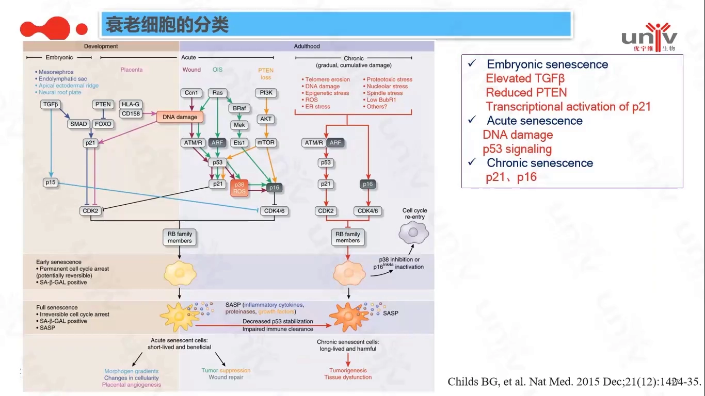
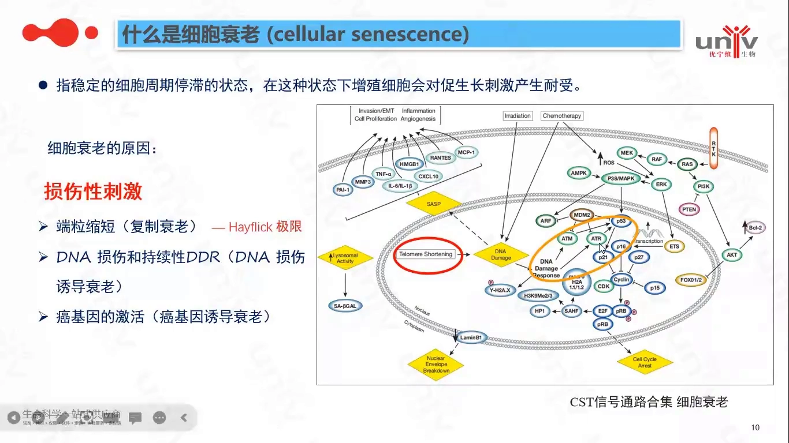
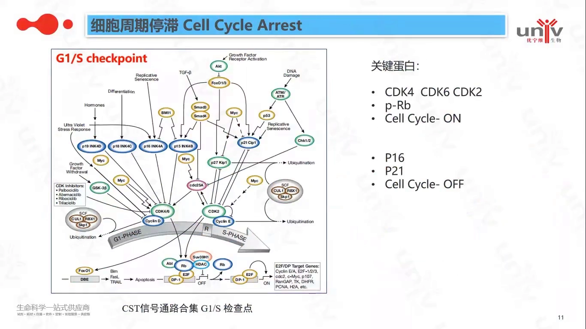
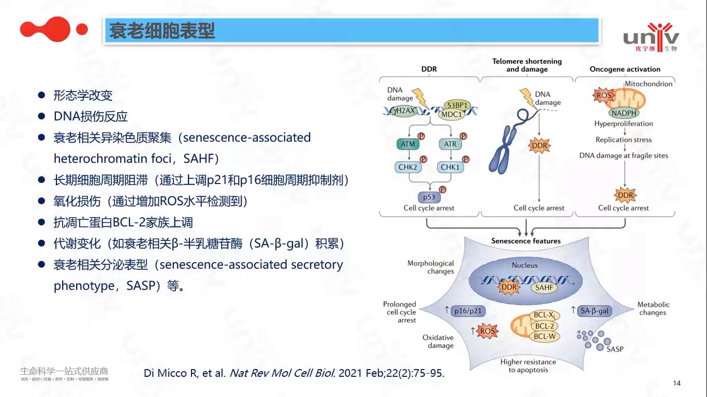
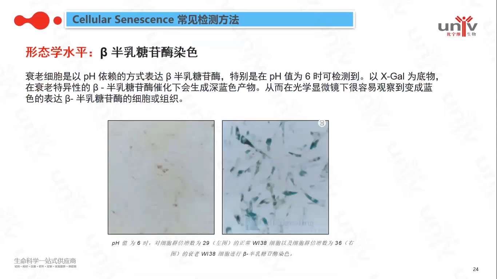
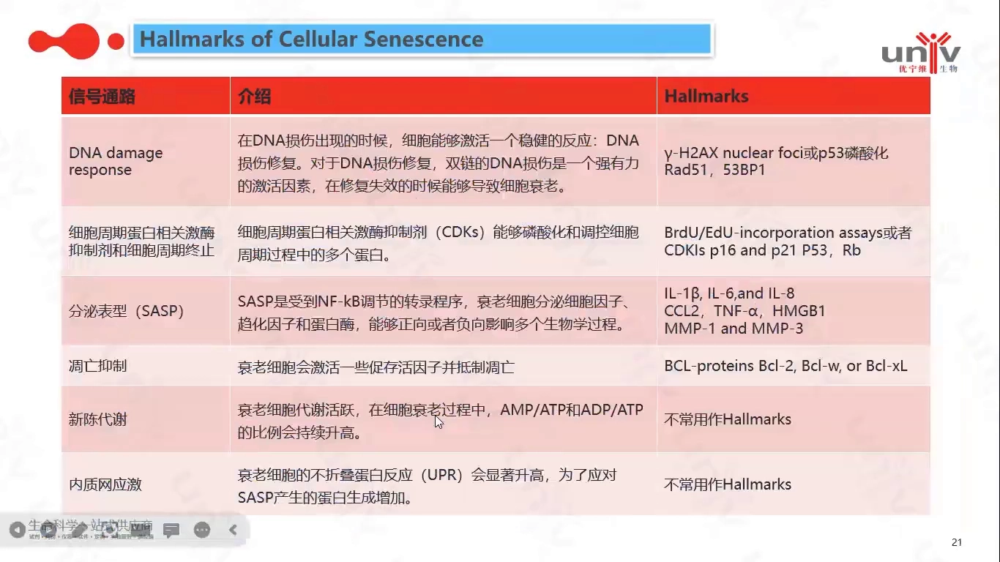
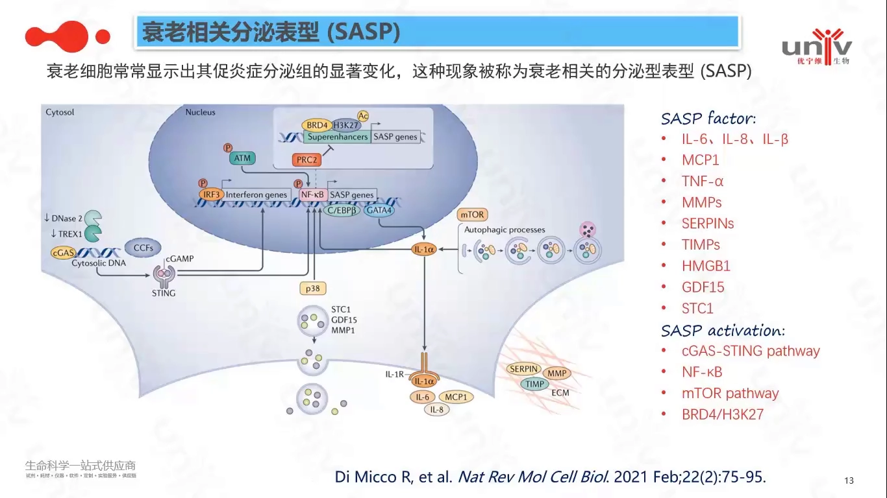
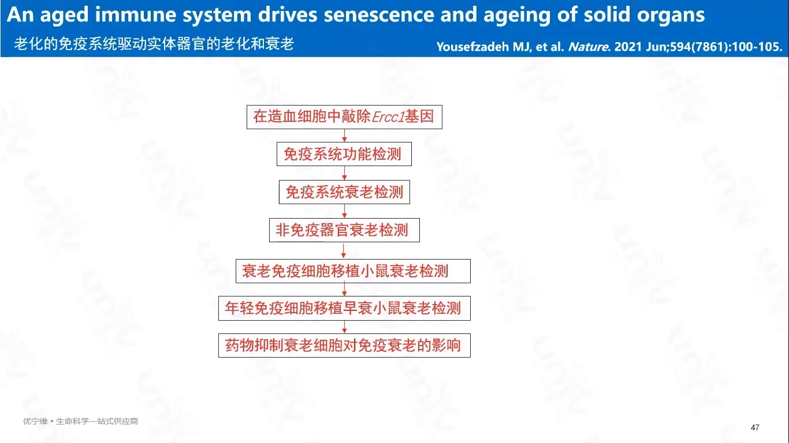
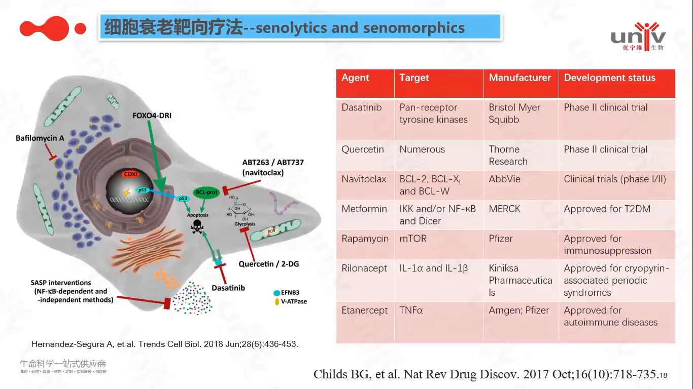

# 细胞衰老：从端粒、损伤到 SASP，一种刹不住的不分裂状态

> 视频来源：[细胞衰老相关信号通路及研究解决方案](https://www.bilibili.com/video/BV1pC4y1r7Yo/)（Bilibili · 优宁维生物 / LabEx 网络讲座，约 47 分钟）
> 导读：这是一场面向科研人员的厂商 webinar，前半段讲衰老的定义、触发因素、通路、表型与检测方法，后半段用两篇论文演示组织层面的研究思路，中间夹有产品介绍（本文略去）。本文按「不分裂的第三种状态 → 触发 → 刹车轴 → 标志物 → SASP → 组织背景」重排，字幕中的术语已按通行写法订正。

## 本讲要解决的核心问题（SCQA）

**背景**：上一篇 [4.3.1 细胞周期](../4.3.1_细胞周期：生长、DNA%20复制与检查点/细胞周期是细胞状态的时间轴：从周期蛋白波动与染色体形态，读出细胞处在哪个状态.md) 讲了细胞周期的时间表、cyclin–CDK 推进力和检查点。检查点让细胞在损伤时停下来，等修好了再走。一个细胞最终可能持续增殖，也可能退出周期。

**冲突**：但退出周期不止一种方式。有的细胞只是**暂时**停下，给点生长因子就回来；有的细胞是**永久**停下，而且停下的同时还活着、代谢活跃，还不停向外分泌炎症因子，把邻居也拖下水。这三种「不分裂」在显微镜下都表现为「没有分裂」，用同一个增殖标志物去看都是阴性——只看「分不分裂」，无法区分它们。

**疑问**：这三种状态凭什么区分？是什么把细胞锁在「永久停下」这一档？我们凭什么判断一个细胞真的衰老了？衰老细胞在组织里做什么，为什么它既被认为是抑癌机制、又被认为是促炎促病的源头？

**回答（中心思想）**：细胞衰老是**稳定的（不可逆）细胞周期停滞 + 抗凋亡 + SASP 分泌表型**三件事的组合；触发它的是端粒缩短、持续性 DNA 损伤和癌基因激活三类损伤性刺激，它们都汇到 p53–p21 与 p16–Rb 两条刹车轴上，最终把 Rb–E2F 开关锁死。正因为衰老是「停滞 + 分泌 + 抗凋亡」的组合，没有任何单一标志物能独立判定它：判据必须是多指标组合，而且必须放回组织背景——衰老细胞的净效应取决于它是否被及时清除。[【跳转到 00:00】](https://www.bilibili.com/video/BV1pC4y1r7Yo/?t=0)

---

## 一、三种「不分裂」：静止、衰老、终末分化

### 1.1 先分清 aging 和 senescence

中文都把 aging 和 senescence 译成「衰老」，但两个词的范围不同。[【跳转到 01:12】](https://www.bilibili.com/video/BV1pC4y1r7Yo/?t=72)

- **aging（老化）**：细胞或机体随时间朝退化方向发展的过程，可以预知。成因包括 DNA 损伤、蛋白质折叠错误、脂质损伤堆积等，结果是细胞活力下降、功能受损。
- **senescence（细胞衰老）**：aging 这个过程**可能出现的一个结果**——细胞进入细胞周期停滞的状态。它什么时候发生、在哪个细胞上发生，是不可预知的。

所以 aging 的范围比 senescence 大：aging 是整条退化曲线，senescence 是曲线上某个细胞被锁死的那一档。[【跳转到 02:27】](https://www.bilibili.com/video/BV1pC4y1r7Yo/?t=147)

### 1.2 定义：稳定的停滞，加上对促生长信号的耐受

细胞衰老的定义可以概括为「稳定的细胞周期停滞状态」，处于这种状态的增殖细胞会对促生长刺激产生**耐受**——加生长因子也叫不醒。[【跳转到 02:33】](https://www.bilibili.com/video/BV1pC4y1r7Yo/?t=153)

这个定义里有两个词要抓住：「稳定」（不是等一会儿就恢复）和「耐受」（对正常的增殖信号不再响应）。后面所有标志物和判据问题，都源于这两点。

### 1.3 三者对照：可逆性与分泌表型是分水岭

细胞周期停滞不是衰老独有的。终末分化细胞、静息（quiescent）细胞也可能停在周期外。区别在两点：**停滞能不能逆转**，以及**有没有分泌表型**。[【跳转到 08:36】](https://www.bilibili.com/video/BV1pC4y1r7Yo/?t=516)

| | 静息（quiescence / G0） | 细胞衰老（senescence） | 终末分化 |
| --- | --- | --- | --- |
| 为什么不分裂 | 缺生长信号、接触抑制等，主动退出 | 损伤性刺激触发的稳定停滞 | 发育程序决定的命运终点 |
| 可逆性 | **可逆**：给刺激能回到周期 | **不可逆**：对促生长信号耐受 | 一般不可逆 |
| 分泌表型 | 没有 SASP | **有 SASP** | 可有可无，不是定义特征 |
| 抗凋亡 | 无明显上调 | BCL-2 家族抗凋亡蛋白上调 | 不是定义特征 |
| 典型例子 | 成纤维细胞、肝细胞 | 端粒耗尽的成纤维细胞、放疗后的肿瘤细胞 | 神经元、心肌细胞 |

[【跳转到 09:01】](https://www.bilibili.com/video/BV1pC4y1r7Yo/?t=541)

这张表最重要的一行是「分泌表型」：**静息细胞不分泌 SASP，衰老细胞分泌**。所以「不分裂 + 有 SASP」比「不分裂」更接近衰老的定义。反过来说，只测「不分裂」（Ki67 阴性、没有 BrdU 掺入）无法区分这三者——这正是后面「单一标志物不够」的根源。

### 1.4 停在哪里：多数在 G1，少数在 G2

几乎所有衰老细胞都停滞在 **G1 期**；特殊情况下，也有一些衰老细胞停在 **G2 期**，但关键蛋白同样是 p53 和 p21。[【跳转到 09:26】](https://www.bilibili.com/video/BV1pC4y1r7Yo/?t=566) 这一点在流式数据里会表现为 G0/G1 比例升高、S 期比例下降（下一篇会给出具体判读方式）。

### 1.5 衰老不是一瞬间，而是分期的

讲者给了一套分期，用来解释「同样是衰老细胞，为什么有的有益、有的有害」：大分是**发育期**和**成年期**，再细分为胚胎期、急性期、慢性期。[【跳转到 15:29】](https://www.bilibili.com/video/BV1pC4y1r7Yo/?t=929)

- **胚胎期**：以 p21 增强为主，参与形态发生。
- **急性期**：DNA 损伤介导 p53 激活，p21 和 p16 表达上升。
- **慢性期**：主要由 p16、p21 维持的长期停滞。[【跳转到 15:54】](https://www.bilibili.com/video/BV1pC4y1r7Yo/?t=954)

另一条分法是**早期衰老**与**完全期衰老**：早期衰老相对可逆，用 p38 抑制剂或让 p16 失活，细胞可以重新进入周期；完全期衰老则不可逆，又分急性与慢性——急性期参与胚胎血管生成、肿瘤抑制、创面修复，是有益的；慢性期才涉及肿瘤发生和组织功能失调。[【跳转到 16:19】](https://www.bilibili.com/video/BV1pC4y1r7Yo/?t=979)

这张图把「同一个词覆盖了不同东西」画得很清楚：早期衰老标着 "permanent cell cycle arrest (potentially reversible)"，完全期衰老标着 "irreversible" 并加上 SASP。所以讨论「衰老能不能逆转」时，先要问是哪个阶段。

---

## 二、触发：三条损伤通路，汇到同一个刹车

发生细胞衰老的原因可以统称为**损伤性刺激**，主要有三类：端粒缩短、DNA 损伤（含持续性损伤应答）、癌基因激活。[【跳转到 02:58】](https://www.bilibili.com/video/BV1pC4y1r7Yo/?t=178)

### 2.1 端粒缩短与 Hayflick 极限：复制性衰老

正常非恶性细胞在体外大约分裂 **50 次**之后就停止分裂，这个现象叫 **Hayflick 极限**。机制是：每一轮 DNA 复制都会让端粒逐渐缩短，短到临界长度就阻碍进一步复制；这种失去保护的极短端粒被细胞识别为 DNA 损伤，触发损伤应答，从而进入衰老。[【跳转到 03:23】](https://www.bilibili.com/video/BV1pC4y1r7Yo/?t=203)

这类由「分裂次数耗尽端粒」引起的衰老叫**复制性衰老**（replicative senescence）。它是最经典、也最容易在培养皿里复现的一类。

### 2.2 DNA 损伤与持续 DDR：应激诱导早衰

电离辐射、化疗药、氧化应激都能直接造成 DNA 损伤。损伤之后细胞走向哪条路——修复、凋亡还是衰老——取决于损伤程度和细胞所处的生理环境。[【跳转到 04:13】](https://www.bilibili.com/video/BV1pC4y1r7Yo/?t=253)

衰老的特征不是「有损伤」，而是**损伤修不完、应答一直开着**：慢性的 ATM/ATR 激酶信号转导持续存在，导致 p53 磷酸化，最终通过 p53–p21 与 p16–Rb 两条通路诱导停滞。这类由外源应激直接造成的衰老，通常称为**应激诱导早衰**（stress-induced premature senescence, SIPS），区别于需要几十次分裂才出现的复制性衰老。

DNA 损伤最常用的读数之一是 **γH2AX**：电离辐射、紫外等造成的损伤会让 H2AX 在丝氨酸 139 位点快速磷酸化，形成可在显微镜下数出的「焦点」（foci）。[【跳转到 04:38】](https://www.bilibili.com/video/BV1pC4y1r7Yo/?t=278)

### 2.3 癌基因激活：抑癌机制的副作用

第三类是癌基因激活诱导的衰老。讲者特意强调「这个不能说它是坏的」：它可以作为一种强效的**细胞自主抗癌机制**，防止细胞转化为恶性细胞。[【跳转到 05:03】](https://www.bilibili.com/video/BV1pC4y1r7Yo/?t=303)

具体例子：RAS 的过度激活，或 PTEN 这类抑癌基因的失活，都可能诱导衰老。以 RAS 为例，它激活后通过 MKK–p38 MAPK 通路触发衰老；而强烈的有丝分裂信号还会通过**复制应激**造成 DNA 损伤，反过来再触发停滞。[【跳转到 05:53】](https://www.bilibili.com/video/BV1pC4y1r7Yo/?t=353)

这条通路解释了衰老的「双面性」从哪来：它是抑癌的，但抑癌的代价是把一个活着的、分泌炎症因子的细胞留在组织里。

### 2.4 两条刹车轴：p53–p21 与 p16–Rb

三条触发路径最后都汇到同一个开关上。要理解这个开关，先看正常情况：Rb 蛋白可以被 CDK4/6、CDK2 磷酸化；磷酸化之后，Rb 对 **E2F** 转录因子的抑制解除，E2F 被释放，推动细胞从 G1 进入 S 期。[【跳转到 06:31】](https://www.bilibili.com/video/BV1pC4y1r7Yo/?t=391)

衰老时发生的是反过来：CDK 抑制因子（**p16**、**p21**）活性升高 → CDK 无法磷酸化 Rb → Rb 持续与 E2F 结合 → G1/S 转换被阻断，细胞锁在 G1。[【跳转到 07:46】](https://www.bilibili.com/video/BV1pC4y1r7Yo/?t=466)

这个刹车有多硬？讲者给了一个实验证据：即使把 p53 这类周期抑制因子失活，细胞周期停滞也**无法被逆转**。[【跳转到 08:11】](https://www.bilibili.com/video/BV1pC4y1r7Yo/?t=491) 这说明 p53–p21 只是其中一条轴；另一条 p16–Rb 轴（以及染色质层面的改变）足以独立维持停滞。这也解释了为什么「敲掉 p53 看细胞是否恢复增殖」不能作为否定衰老的判据。

---

## 三、标志物：八种表型，但没有一个是专属的

### 3.1 八种衰老表型

目前已经发现八种衰老相关表型：[【跳转到 12:49】](https://www.bilibili.com/video/BV1pC4y1r7Yo/?t=769)

1. **形态学改变**：体积增大、扁平、广泛空泡化、线粒体内容失调、核膜完整性破坏。
2. **DNA 损伤反应**：持续的损伤应答（γH2AX 焦点等）。
3. **衰老相关异染色质聚集（SAHF）**：细胞核内多个异染色质高度聚集，参与染色质重构。
4. **长期细胞周期停滞**：通过上调 p21 和 p16 实现。
5. **氧化损伤**：ROS 水平升高。
6. **抗凋亡蛋白上调**：BCL-2 家族成员升高，使衰老细胞比正常细胞更抗凋亡。
7. **代谢变化**：最典型的是**衰老相关 β-半乳糖苷酶（SA-β-gal）**在溶酶体中累积。
8. **衰老相关分泌表型（SASP）**。

[【跳转到 13:14】](https://www.bilibili.com/video/BV1pC4y1r7Yo/?t=794) [【跳转到 14:04】](https://www.bilibili.com/video/BV1pC4y1r7Yo/?t=844)

注意第 6 条：**衰老细胞是抗凋亡的**。这一点常被忽略，但它有两个后果——一是衰老不等于「快要死了」，二是后来 senolytics 药物的设计思路正是利用这种对特定抗凋亡蛋白的依赖。

### 3.2 异质性：不同细胞、不同亚型，表型不一样

讲者反复强调：**并不是所有衰老细胞都有相同的衰老表型**。[【跳转到 14:29】](https://www.bilibili.com/video/BV1pC4y1r7Yo/?t=869)

以免疫细胞为例：T 细胞衰老时表现为 TCR 多样性降低，B 细胞衰老时 BCR 多样性降低，DC 细胞衰老时内吞能力下降。[【跳转到 14:34】](https://www.bilibili.com/video/BV1pC4y1r7Yo/?t=874) 也就是说，「衰老」是一组共享框架下的多种状态，不同细胞类型填进去的具体表型不同。

这直接决定了判据的设计：如果一个标志物只在部分衰老细胞里出现，那它就不能单独当判据。

### 3.3 SA-β-gal：最经典，也最容易被误读

SA-β-gal 是衰老细胞最常用的标志物：衰老细胞以 pH 依赖的方式表达 β-半乳糖苷酶，在 pH 6.0 时活性可被检出；以 X-Gal 为底物，在衰老特异性 β-半乳糖苷酶催化下生成深蓝色产物，光学显微镜下就能看到，细胞和组织都适用。[【跳转到 22:06】](https://www.bilibili.com/video/BV1pC4y1r7Yo/?t=1326)

这张对照图很能说明问题：同一个细胞系、同一个染色条件，只有传代次数足够多的那一侧才大量变蓝。但「pH 6.0」这个条件本身就是它不可靠的原因——任何酸性溶酶体活性升高的细胞都可能变蓝，包括静止细胞和巨噬细胞。这一点下一篇会专门展开。

### 3.4 检测的层次：同一个标志物，不同层面的读数

讲者把检测方法按层次做了归纳：[【跳转到 20:31】](https://www.bilibili.com/video/BV1pC4y1r7Yo/?t=1231)

| 层面 | 常用读数 |
| --- | --- |
| DNA 损伤 | γH2AX 焦点、p53 磷酸化 |
| 周期停滞 | p53、p21、BrdU/EdU 掺入 |
| SASP | 炎症因子、趋化因子、蛋白酶（ELISA、多因子芯片） |
| 凋亡抑制 | BCL-2 家族成员 |
| 形态 | SA-β-gal、细胞面积、核形态、Lamin B1 |
| 组织原位 | 免疫组化/免疫荧光（γH2AX、Ki67、Lamin B1） |
| 单细胞 | scRNA-seq 鉴定衰老细胞类型与转录组特征 |

[【跳转到 23:16】](https://www.bilibili.com/video/BV1pC4y1r7Yo/?t=1396) [【跳转到 23:46】](https://www.bilibili.com/video/BV1pC4y1r7Yo/?t=1426)

一个关键提醒：**mRNA 水平不一定反映蛋白水平变化**，所以 PCR 测到 p21 升高还需要 Western blot 或 ELISA 在蛋白层面确认。[【跳转到 22:38】](https://www.bilibili.com/video/BV1pC4y1r7Yo/?t=1358) 这也是「多指标」的另一层含义——不只是多个分子，还包括多个测量层面。

这张表值得注意最后两行：代谢活跃和内质网应激升高确实是衰老细胞的特征，但因为缺乏特异性，不常被当作判据使用。**「是特征」和「能当判据」是两件事**，这是理解本节的关键。

---

## 四、SASP：衰老细胞如何影响邻居

### 4.1 定义与组成

衰老相关分泌表型（senescence-associated secretory phenotype, SASP）的定义是：衰老细胞常常表现出**促炎分泌组的显著变化**。[【跳转到 10:04】](https://www.bilibili.com/video/BV1pC4y1r7Yo/?t=604)

它的成分非常复杂，是一种高度复杂的混合物，包括细胞因子、趋化因子、生长因子、蛋白酶等。某个细胞衰老后，SASP 的具体成分取决于细胞类型、所处环境、衰老持续时间、衰老刺激的来源等。[【跳转到 10:54】](https://www.bilibili.com/video/BV1pC4y1r7Yo/?t=654)

这些分泌因子促成衰老细胞与相邻细胞、免疫系统的通信，最终影响衰老细胞自身的命运。

### 4.2 上游：几条通路把 SASP 基因打开

SASP 受多条通路激活，包括 **cGAS–STING**、**NF-κB**、**mTOR**、p38 MAPK 等。[【跳转到 10:29】](https://www.bilibili.com/video/BV1pC4y1r7Yo/?t=629)

这张图来自 Di Micco 等 2021 年的综述（Nat Rev Mol Cell Biol），把「胞质 DNA → cGAS–STING → 干扰素/NF-κB → SASP」这条链画得很完整。它解释了为什么 SASP 与慢性炎症绑定：驱动它的正是细胞自己感知到的「核酸异常」和「损伤信号」。

### 4.3 双刃剑：招募免疫细胞，也可能促进肿瘤

SASP 有双重作用，是一把双刃剑，取决于细胞所处的环境。[【跳转到 11:19】](https://www.bilibili.com/video/BV1pC4y1r7Yo/?t=679)

- **有益面**：SASP 把免疫细胞募集到衰老细胞处，促进免疫清除，发挥抑肿瘤功能。
- **有害面**：SASP 也可以通过促进血管生成、细胞外基质重塑、上皮—间质转化（EMT）等来促进肿瘤进展。[【跳转到 11:44】](https://www.bilibili.com/video/BV1pC4y1r7Yo/?t=704)

也就是说，同一套分泌程序，在「免疫系统能及时清除」时是抑癌的，在「清除失败、衰老细胞长期滞留」时是促癌的。此外，衰老诱导的慢性炎症还会引起系统性免疫抑制，最终导致包括癌症在内的疾病，并造成组织损伤和变性。[【跳转到 12:09】](https://www.bilibili.com/video/BV1pC4y1r7Yo/?t=729)

---

## 五、组织背景：累积、清除与双面性

### 5.1 衰老细胞随年龄累积

细胞衰老随年龄不断累积，最终导致年龄相关疾病，包括神经退行性疾病、代谢病、心血管疾病和肿瘤等。[【跳转到 17:56】](https://www.bilibili.com/video/BV1pC4y1r7Yo/?t=1076)

这里要抓住一个因果方向的问题：是「衰老细胞多导致组织功能下降」，还是「组织功能下降导致衰老细胞多」？观察性数据无法回答。下面两篇论文的价值就在于用干预实验去逼近因果。

### 5.2 免疫清除的一个具体例子：NK 细胞清除衰老的神经母细胞

第一篇论文发表在 Nature Neuroscience（Jin 等，2021），标题是「老年大脑中神经母细胞的衰老增强自然杀伤细胞的细胞毒性，导致神经发生和认知功能受损」。[【跳转到 27:09】](https://www.bilibili.com/video/BV1pC4y1r7Yo/?t=1629)

论证链条是这样的：

1. **现象**：老年小鼠大脑齿状回中 NK 细胞数量明显增加，且细胞毒性增强。[【跳转到 27:31】](https://www.bilibili.com/video/BV1pC4y1r7Yo/?t=1651)
2. **来源**：这些 NK 细胞不是从外周招募来的——异体共生（parabiosis）实验排除了这一点，说明是**原位增殖**。[【跳转到 29:28】](https://www.bilibili.com/video/BV1pC4y1r7Yo/?t=1768)
3. **信号**：齿状回微透析蛋白质组学发现老年小鼠神经母细胞的 **IL-27** 明显增加，而 NK 细胞表达 IL-27 受体；共培养证明 NK 细胞对老年神经母细胞的细胞毒性增强。[【跳转到 29:52】](https://www.bilibili.com/video/BV1pC4y1r7Yo/?t=1792)
4. **来源确认**：单细胞 RNA 测序显示神经母细胞出现 SASP；衰老小鼠神经母细胞高表达 p16、p21、p53，SA-β-gal 也增加——即 IL-27 来自**衰老的**神经母细胞。[【跳转到 30:45】](https://www.bilibili.com/video/BV1pC4y1r7Yo/?t=1845)
5. **功能**：清除 NK 细胞后，神经干细胞数量不变，但神经母细胞数量增加，说明 NK 细胞确实在清除神经母细胞；这种清除不依赖 T 细胞和 B 细胞。[【跳转到 31:35】](https://www.bilibili.com/video/BV1pC4y1r7Yo/?t=1895)
6. **识别机制**：衰老神经母细胞的 MHC I 类相关配体大量上调，触发 NK 细胞激活与细胞毒性。[【跳转到 32:40】](https://www.bilibili.com/video/BV1pC4y1r7Yo/?t=1960)

这个例子把 SASP 的「有益面」落到了具体分子上：衰老细胞分泌 IL-27 → 招募并激活 NK 细胞 → 清除衰老细胞。它同时说明，**衰老细胞的净效应取决于清除效率**，而不是衰老本身。

### 5.3 免疫系统的衰老可以驱动实体器官衰老

第二篇论文发表在 Nature（Yousefzadeh 等，2021），标题是「老化的免疫系统驱动实体器官的老化和衰老」。[【跳转到 34:07】](https://www.bilibili.com/video/BV1pC4y1r7Yo/?t=2047)

模型设计很巧：在**造血细胞**中敲除 **ERCC1**。ERCC1 是多种 DNA 损伤修复所必需的，敲掉它就会造成持续性 DNA 损伤和持续损伤应答，从而引发细胞衰老——这正好复用了第二节的机制。[【跳转到 34:32】](https://www.bilibili.com/video/BV1pC4y1r7Yo/?t=2072)

结果分三层：

- **免疫系统本身**：γH2AX、8-OHdG 升高说明 DNA 氧化损伤与修复缺陷；外周血白细胞减少，CD4/CD8 细胞减少，脾脏 CD4 T 细胞减少而 CD44⁺ 记忆 T 细胞与 PD-1⁺ 细胞增加（提示激活与耗竭）；脾脏重量下降；迟发型超敏反应减弱、KLH 抗体减少、NK 细胞毒性降低——细胞免疫和体液免疫都受损。[【跳转到 36:26】](https://www.bilibili.com/video/BV1pC4y1r7Yo/?t=2186)
- **衰老指标扩散到非免疫器官**：多个实体器官 p16、p21 高表达；肝脏氧化 DNA 损伤与脂质氧化升高；血清肝损伤标志物、尿液肾损伤标志物、血清胰损伤标志物升高；椎间盘蛋白多糖降低（退行性病变）；肌肉损伤后恢复变慢；血清 β2-微球蛋白与 SASP 成分升高；小鼠生存期缩短。[【跳转到 39:09】](https://www.bilibili.com/video/BV1pC4y1r7Yo/?t=2349)
- **因果方向**：把 ERCC1 敲除小鼠或两年龄野生型小鼠的**脾细胞**移植到荧光报告小鼠体内，多个脏器的荧光信号、p16 mRNA 与 SASP 成分都升高；把衰老脾细胞移植到早衰小鼠体内，生存期进一步降低。反过来，把**年轻**野生型小鼠的脾细胞移植到早衰小鼠体内，p16、p21 与 SASP 下降，组织损伤标志物减少；用雷帕霉素治疗也能改善部分免疫指标并降低 T 细胞的 p16/p21 与 SASP。[【跳转到 40:54】](https://www.bilibili.com/video/BV1pC4y1r7Yo/?t=2454) [【跳转到 42:14】](https://www.bilibili.com/video/BV1pC4y1r7Yo/?t=2534)

这篇论文的意义在于把「局部衰老」和「整体老化」连成一条可干预的链：一个器官系统的衰老细胞，可以通过 SASP 和免疫失衡把衰老扩散到别的器官。

### 5.4 两类干预：senolytics 与 senomorphics

目前针对衰老细胞的疗法无外乎两大类：[【跳转到 18:21】](https://www.bilibili.com/video/BV1pC4y1r7Yo/?t=1101)

- **senolytics**：选择性杀伤衰老细胞。经典组合是达沙替尼（dasatinib）联合槲皮素（quercetin），简称 D+Q。设计原理是衰老细胞上调了抗凋亡通路（BCL-2、BCL-xL、HSP90 等），这类药物靶向这些「脆弱点」，诱导衰老细胞凋亡。
- **senomorphics**：不杀死衰老细胞，而是抑制 SASP 分泌，代表有 JAK 抑制剂、NF-κB 抑制剂、mTOR 抑制剂。

这里只需要记住两类的区别：**一类减少衰老细胞的数量，一类减少它们说的话**。药物的临床进展不在本节范围。

---

## 六、边界：体外不等于体内

讲者在方法部分给了一个总结：同一批 hallmarks 在体外、体内、离体几种水平上能测的指标并不相同，需要按样本类型选择检测方法。[【跳转到 25:09】](https://www.bilibili.com/video/BV1pC4y1r7Yo/?t=1509)

结合前面内容，本节要守住的边界有三条：

1. **复制性衰老是培养皿里的现象**。Hayflick 极限描述的是「正常非恶性细胞在体外分裂约 50 次后停止」；体内细胞面对的损伤组合、免疫清除和微环境完全不同，不能把培养皿里的传代次数直接换算成个体年龄。
2. **不同组织、不同物种差异很大**。衰老细胞的标志物组合、SASP 成分、清除效率都随细胞类型和组织而变化（第 3.2 节的异质性）。小鼠的端粒长度与人类差别很大，端粒相关的结论尤其不能直接外推。
3. **单一标志物不能当判据**。八种表型没有一个是衰老专属的：SA-β-gal 也见于其他酸性溶酶体活性升高的细胞，p16 并非在所有衰老细胞中都高，SASP 成分高度可变。判据必须是多指标组合，并且最好包含「停滞 + 分泌 + 抗凋亡」三个维度各一项。

第三点下一篇会展开成一套可操作的判据和常见陷阱。

---

## 小结

- **aging 与 senescence 不是同义词**：aging 是整条退化过程，senescence 是其中细胞被锁在周期外的那一档。
- **三种「不分裂」靠两件事区分**：停滞可否逆转，以及有没有 SASP。静息可逆、无 SASP；衰老不可逆、有 SASP；终末分化不可逆、SASP 可有可无。
- **三类损伤性刺激**（端粒缩短、持续 DNA 损伤、癌基因激活）汇到两条刹车轴（p53–p21、p16–Rb），最终锁死 Rb–E2F。p53 失活并不能逆转停滞，说明刹车有多条。
- **八种表型没有一个是专属的**；衰老细胞还额外是抗凋亡的，这一点常被忽略。
- **SASP 是双刃剑**：免疫清除及时时抑癌，长期滞留时促炎、促肿瘤。
- **净效应取决于组织背景**：NK 细胞清除衰老神经母细胞、免疫衰老驱动实体器官衰老，两个例子都说明「衰老细胞是否被清除」比「有没有衰老细胞」更决定后果。
- **体外不等于体内**：复制性衰老是培养皿现象，标志物组合与 SASP 谱在体内外不同。

## 关键术语速查

| 术语 | 一句话解释 |
| --- | --- |
| aging | 细胞或机体随时间退化的过程，范围大于 senescence。 |
| cellular senescence | 稳定的（不可逆）细胞周期停滞，伴抗凋亡与 SASP。 |
| quiescence（G0） | 暂时退出周期、可被刺激唤回的状态，没有 SASP。 |
| Hayflick 极限 | 正常非恶性细胞在体外约分裂 50 次后停止分裂的现象。 |
| 复制性衰老 | 端粒随分裂缩短到临界长度所触发的衰老。 |
| SIPS | 应激诱导早衰：辐射、化疗、氧化应激等直接造成的衰老。 |
| γH2AX | H2AX 在 Ser139 位点的磷酸化，DNA 双链断裂的标志，显微镜下呈「焦点」。 |
| p16 / p21 | 两个 CDK 抑制因子，分别抑制 CDK4/6 与 CDK2，让 Rb 保持低磷酸化。 |
| SAHF | 衰老相关异染色质聚集，细胞核内异染色质成灶。 |
| SA-β-gal | 衰老相关 β-半乳糖苷酶，pH 6.0 下可检出，最常用但非专属的标志物。 |
| SASP | 衰老相关分泌表型：细胞因子、趋化因子、生长因子、蛋白酶等的混合分泌程序。 |
| senolytics | 选择性杀死衰老细胞的药物（如 D+Q）。 |
| senomorphics | 不杀死衰老细胞、只抑制 SASP 的药物（如 JAK 抑制剂）。 |