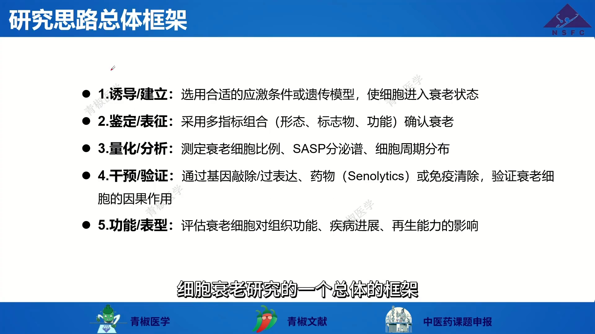
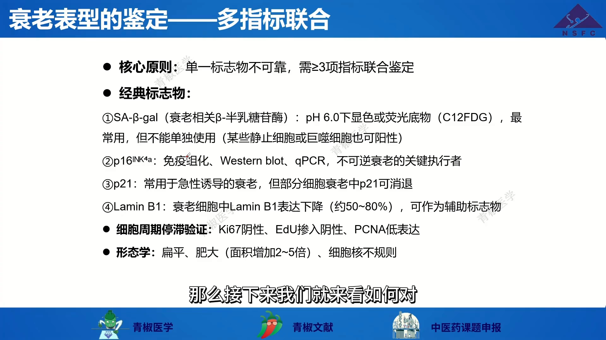
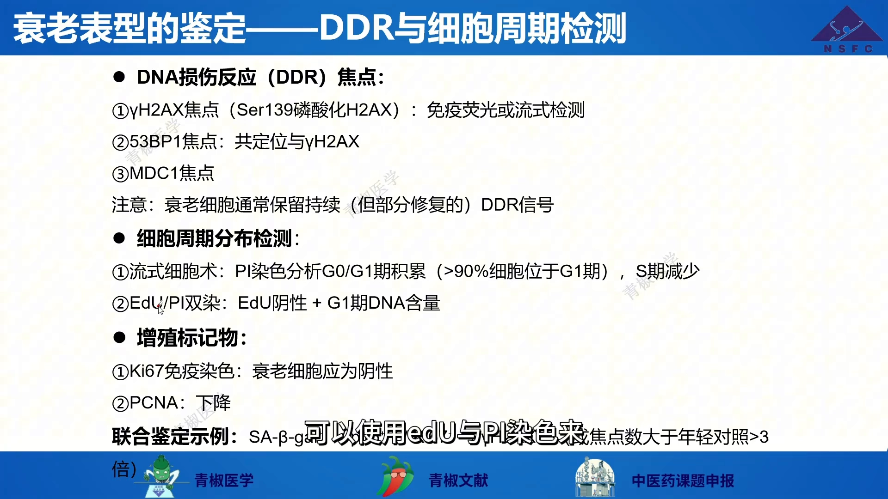
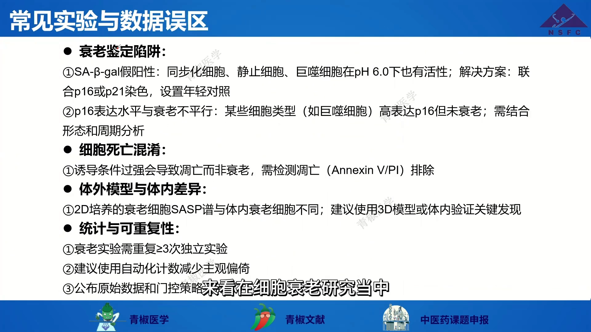
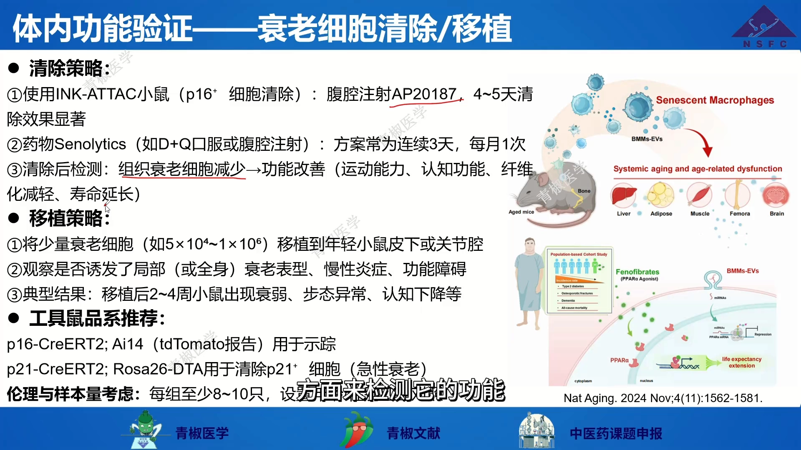

# 衰老细胞的判据：为什么单一标志物不够，以及如何用清除与移植验证因果

> 视频来源：[写标书必看：细胞衰老完整研究逻辑](https://www.bilibili.com/video/BV1icu46fEUC/)（Bilibili · 青椒医学，约 14 分钟）
> 导读：这支视频不讲「衰老是什么」，而是讲「怎么把『这个细胞衰老了』变成一句能被审稿人接受的话」。它把研究流程拆成五步，重点在第二步（鉴定）和第四步（因果验证），并列出四个常见误区。字幕中的术语已按通行写法订正（如 p26→p16、SASP、senolytics、INK-ATTAC）。

## 本讲要解决的核心问题（SCQA）

**背景**：上一篇讲了衰老的机制与八种表型。做实验的人拿到的是另一类问题：我处理了一批细胞，怎么证明它们衰老了？我在小鼠组织里看到 p16 升高，能不能说「衰老细胞增加了」？

**冲突**：每个常用标志物都有反例。SA-β-gal 在静止细胞、巨噬细胞里也会阳性；p16 在某些细胞类型里高表达却并不衰老；p21 会随时间消退；诱导条件过强，细胞直接走向凋亡而不是衰老。**任何一个单独拿出来都可能骗人。**

**疑问**：那么判据应该怎么组合？组合到什么程度算够？就算鉴定对了，又怎么证明这些衰老细胞真的造成了组织功能下降，而不只是一个伴随现象？

**回答（中心思想）**：衰老的鉴定是一条**多指标联合**的判据链——至少三项，且要覆盖「停滞」「标志物」「形态」三类；其中停滞必须用不依赖单一分子的方法（Ki67/EdU/PCNA、细胞周期分布）确认，SASP 必须用静止细胞作对照。因果则靠一对反向实验：**清除**（看功能是否改善）与**移植**（看功能是否变差）。缺了这两步，看到的只是相关性。[【跳转到 00:00】](https://www.bilibili.com/video/BV1icu46fEUC/?t=0)

---

## 一、把「衰老」变成可判定的对象：五步框架

整条研究链路被拆成五步：[【跳转到 00:14】](https://www.bilibili.com/video/BV1icu46fEUC/?t=14)

1. **诱导/建立**：按研究目的选择合适的应激条件或遗传模型，让细胞进入衰老。
2. **鉴定/表征**：用**多指标组合**（形态、标志物、功能）确认它真的衰老了。
3. **量化/分析**：测衰老细胞比例、SASP 分泌谱、细胞周期分布。
4. **干预/验证**：用基因敲除/过表达、senolytics 药物或免疫清除，验证衰老细胞的**因果作用**。
5. **功能/表型**：评估衰老细胞对组织功能、疾病进展、再生能力的影响。

这个框架的价值在于：它把「鉴定」和「因果」分成了两个独立关卡。很多研究的漏洞不是标志物选错，而是**只过了第一关就下结论**。

---

## 二、模型：复制性衰老与诱导性衰老

### 2.1 复制性衰老模型：最像自然过程，但慢

经典做法是用人的二倍体成纤维细胞连续传代，直到增殖停滞。优点是能模拟自然衰老进程；缺点是耗时长、个体差异大。[【跳转到 01:01】](https://www.bilibili.com/video/BV1icu46fEUC/?t=61)

### 2.2 诱导性衰老模型：快，但容易做成凋亡

诱导性模型用得更多，常见条件包括：[【跳转到 01:26】](https://www.bilibili.com/video/BV1icu46fEUC/?t=86)

| 诱导方式 | 典型条件 |
| --- | --- |
| 电离辐射 | X 射线处理后 3–7 天出现衰老 |
| 化疗药 | 博来霉素 50 μg/mL 处理 48 小时 |
| 氧化应激 | 过氧化氢处理 |
| 癌基因 | 过表达 RAS 或 BRAF 突变体（常见于原代成纤维细胞或上皮细胞） |

这里有一条硬性要求：**所有诱导条件都必须先用预实验优化**，否则细胞毒性过强，细胞会走向凋亡而不是衰老。[【跳转到 01:51】](https://www.bilibili.com/video/BV1icu46fEUC/?t=111)

### 2.3 细胞类型与模型层级

除了成纤维细胞，可用的原代细胞类型很多：内皮细胞、上皮细胞、星形胶质细胞、小胶质细胞。干细胞层面，间充质干细胞多次传代后自我更新能力下降、p16 上调、SASP 分泌增多；神经干细胞常用于探索认知衰老。[【跳转到 01:59】](https://www.bilibili.com/video/BV1icu46fEUC/?t=119)

近几年的类器官模型能更好地模拟组织环境中的衰老，保留了细胞与基质的相互作用，缺点是衰老标志物的检测还需要优化。共培养模型则通过 Transwell 或直接接触，研究衰老细胞对未衰老细胞的旁分泌效应。[【跳转到 02:24】](https://www.bilibili.com/video/BV1icu46fEUC/?t=144)

### 2.4 体内模型：自然衰老与加速衰老

- **自然衰老**：常用 C57BL/6 品系，年轻组 2–3 月龄，老年组 18–24 月龄。最大程度模拟生理性衰老，但耗时长、饲养成本高。[【跳转到 02:49】](https://www.bilibili.com/video/BV1icu46fEUC/?t=169)
- **加速衰老**：如 SAMP8，寿命只有 12 个月，会早发认知衰老和免疫衰老，适合神经退行性疾病研究；此外还有遗传性早衰综合征模型，以及化疗、辐射诱导的急性衰老模型。[【跳转到 02:54】](https://www.bilibili.com/video/BV1icu46fEUC/?t=174)

模型的选择直接决定了后面判据的严格程度：复制性衰老模型里 p16/p21 都高，判据容易成立；急性诱导模型里 p21 可能很快消退，判据就要另找锚点。

---

## 三、判据：单一标志物为什么不够

### 3.1 核心原则：至少三项，联合鉴定

模型建好后的核心原则只有一句：**单一指标不可靠，需要三种以上的检测指标联合鉴定**，才能确认细胞真正进入了衰老状态。[【跳转到 03:30】](https://www.bilibili.com/video/BV1icu46fEUC/?t=210)

这张表把每个标志物的「软肋」直接写在旁边，值得逐条读：

| 标志物 | 怎么测 | 问题在哪 |
| --- | --- | --- |
| **SA-β-gal** | pH 6.0 下显色或荧光底物（C12FDG） | 最常用，但**不能单独使用**：某些静止细胞或巨噬细胞也可阳性 |
| **p16INK4a** | 免疫组化、Western blot、qPCR | 不可逆衰老的关键执行者，但表达水平与衰老不完全平行 |
| **p21** | 同上 | 常用于急性诱导模型，但**部分细胞衰老中 p21 会消退** |
| **Lamin B1** | 免疫荧光/Western blot | 衰老细胞中下降约 50–80%，只能作**辅助**标志物 |
| **细胞周期停滞** | Ki67 阴性、EdU 掺入阴性、PCNA 低表达 | 只能说明「不分裂」，不能区分静止/衰老/终末分化 |
| **形态学** | 显微观察与测量 | 扁平、肥大（面积增加 2–5 倍）、细胞核不规则 |

[【跳转到 03:55】](https://www.bilibili.com/video/BV1icu46fEUC/?t=235)

把这张表和上一篇的「三种不分裂」对照着看，就能理解为什么「至少三项」不是形式主义：**没有任何一项能同时排除静止细胞和终末分化细胞**。SA-β-gal 排除不了静止细胞，Ki67 阴性排除不了任何一种，p16 排除不了某些高表达 p16 却不衰老的细胞类型。只有把「停滞」「标志物」「形态」三类证据叠起来，才把假阳性压下去。

### 3.2 停滞怎么验：三种互相独立的读数

判定「真的停了」，讲者给了三条互相独立的路径：[【跳转到 03:55】](https://www.bilibili.com/video/BV1icu46fEUC/?t=235) [【跳转到 05:15】](https://www.bilibili.com/video/BV1icu46fEUC/?t=315)

1. **增殖标志物**：Ki67 免疫染色应为阴性；PCNA 表达下降；EdU 掺入阴性。
2. **细胞周期分布**：流式 PI 染色显示 G0/G1 期累积（常超过 90% 的细胞位于 G1 期），S 期明显减少；EdU/PI 双染表现为 EdU 阴性且 DNA 含量为 G1 期水平。
3. **DNA 损伤应答**：γH2AX 焦点、53BP1 焦点、MDC1 焦点（免疫荧光或流式）。关键区别是——**衰老细胞通常保留持续但只部分修复的 DDR 信号**，这与急性损伤后很快修复的细胞不同。

第 3 条是这套判据里最容易被忽略、也最有价值的一条：**「损伤应答还在」比「损伤存在」更能说明问题**。急性损伤的细胞 γH2AX 会随时间消退，衰老细胞的焦点却持续存在——这正是「持续损伤」在读数上的体现。

### 3.3 一个可用的联合判据

讲者给了一个具体示例：**SA-β-gal 阳性 + p16 阳性 + Ki67 阴性 + γH2AX 焦点数超过年轻对照 3 倍以上**，这样一组多指标组合才能可靠地鉴定衰老细胞。[【跳转到 05:40】](https://www.bilibili.com/video/BV1icu46fEUC/?t=340)

这个组合的设计逻辑值得拆开看：

- SA-β-gal 阳性 → 溶酶体/代谢改变（但可能是静止细胞）
- p16 阳性 → 不可逆停滞的执行者（但可能不平行）
- Ki67 阴性 → 确实不在周期里（但不能区分三种不分裂）
- γH2AX 焦点 > 3 倍 → 持续损伤应答（把「急性损伤后暂时停下」排除掉）

四项各自都有漏洞，但漏洞不重叠。这就是「多指标」的真正含义：**不是重复测同一件事，而是让每个指标的假阳性被另一个指标排除**。

### 3.4 SASP 检测：必须设静止细胞作对照

SASP 的检测方法很多：蛋白水平用 ELISA、Western blot、多重液相芯片或 CBA；转录水平用包含 12–16 个因子的 qPCR panel。[【跳转到 04:25】](https://www.bilibili.com/video/BV1icu46fEUC/?t=265)

但有一条容易被漏掉的要求：**SASP 的分泌有细胞类型特异性和时间动态性，所以实验里必须设置静止细胞作对照**，才能准确判断 SASP 的变化。[【跳转到 04:50】](https://www.bilibili.com/video/BV1icu46fEUC/?t=290)

这条要求的逻辑很直接：如果只比较「衰老细胞 vs 正常增殖细胞」，测到的差异里混着「不分裂」本身的效应。只有和**同样不分裂但可逆的静止细胞**比，差异才归因于衰老。这是上一篇「静息没有 SASP」那条对照表的实验落地。

---

## 四、四个常见陷阱

讲者列了一份误区清单，每一条都对应判据链上的一个薄弱环节。[【跳转到 11:44】](https://www.bilibili.com/video/BV1icu46fEUC/?t=704)

### 4.1 SA-β-gal 假阳性

同步化细胞、静止细胞、巨噬细胞在 pH 6.0 的酸性条件下也可能呈阳性。解决方案是**联合 p16 或 p21 染色，并设置阴性对照**（讲者原话是「年轻对照」）。[【跳转到 11:44】](https://www.bilibili.com/video/BV1icu46fEUC/?t=704)

### 4.2 p16 与衰老不平行

某些细胞类型（如巨噬细胞）即使高表达 p16，也不说明它处于衰老状态，还要结合形态学和细胞周期分析综合判断。[【跳转到 12:09】](https://www.bilibili.com/video/BV1icu46fEUC/?t=729)

这一条对组织学数据尤其重要：免疫组化看到 p16 阳性细胞增多，不能直接读成「衰老细胞增多」。

### 4.3 与细胞死亡混淆

诱导条件过长，细胞可能走向凋亡而不是衰老。实验里必须用 Annexin V/PI 等凋亡检测排除这种可能。[【跳转到 12:09】](https://www.bilibili.com/video/BV1icu46fEUC/?t=729)

这条和上一篇的「衰老细胞是抗凋亡的」正好互补：衰老细胞上调 BCL-2 家族，所以「细胞死了很多」本身就不像衰老表型。

### 4.4 体外模型与体内差异

二维培养的衰老细胞，其 SASP 谱与体内衰老细胞不同，所以最好在三维模型或体内实验中得到验证。[【跳转到 12:34】](https://www.bilibili.com/video/BV1icu46fEUC/?t=754)

此外还有统计与可重复性要求：衰老实验需重复至少 3 次独立实验，建议用自动化计数减少主观偏倚，并公布原始数据和门控策略。

---

## 五、因果：清除与移植是一对反向实验

鉴定只能证明「这里有衰老细胞」。要证明「这些衰老细胞造成了功能下降」，需要一对方向相反的实验。[【跳转到 10:55】](https://www.bilibili.com/video/BV1icu46fEUC/?t=655)

### 5.1 清除：去掉衰老细胞，看功能是否改善

- **遗传工具**：INK-ATTAC 小鼠，腹腔注射 AP20187，可在 4–5 天内显著清除 p16 阳性的衰老细胞。
- **药物工具**：senolytics（如 D+Q 口服或腹腔注射），常见方案是连续 3 天、每月 1 次。
- **读数**：组织衰老细胞减少 → 功能改善（运动能力、认知功能、纤维化减轻、寿命延长）。

### 5.2 移植：加入衰老细胞，看功能是否变差

- 把少量衰老细胞（约 5×10⁴–1×10⁶）移植到年轻小鼠皮下或关节腔。
- 观察是否诱发局部或全身的衰老表型、慢性炎症、功能障碍。
- 典型结果：移植后 2–4 周，小鼠出现衰弱、步态异常、认知下降。

### 5.3 为什么必须成对

单做清除，可能被质疑「药物有脱靶效应」；单做移植，可能被质疑「移植的细胞状态不纯」。两个方向都成立时，「衰老细胞 → 功能下降」这条因果链才站得住。[【跳转到 11:25】](https://www.bilibili.com/video/BV1icu46fEUC/?t=685)

工具鼠的设计也体现了同样的思路：p16-CreERT2;Ai14 用来**示踪**（把 p16 阳性细胞标成 tdTomato），p21-CreERT2;Rosa26-DTA 用来**清除** p21 阳性细胞（主要针对急性衰老）。一个看位置，一个做干预。

### 5.4 干预的另一半：基因操作

除了药物和清除，还可以做正反两向的基因操作：[【跳转到 07:12】](https://www.bilibili.com/video/BV1icu46fEUC/?t=432)

- **正向**：用诱导表达系统强制表达 p16 或 p21，让细胞进入衰老，观察由此引发的功能变化。
- **反向**：用 siRNA/shRNA 敲低 p53、p21 或 p16，阻断衰老诱导，看下游表型是否被逆转；或用 CRISPR/Cas9 敲除关键效应分子（如 p16 或 NF-κB 通路组分）。

但这里有一个必须提醒的边界：这些基因操作可能同时影响凋亡等其他通路，所以分析结果时必须配合多标志物检测，排除干扰，才能确认表型改变确实来自衰老相关的变化。[【跳转到 08:02】](https://www.bilibili.com/video/BV1icu46fEUC/?t=482)

---

## 六、边界：这套判据不能保证什么

这套判据能解决「怎么证明细胞衰老了」，但有几件事它做不到，需要在使用时明确标注：

1. **它不能给出通用的分子定义**。讲者在方法部分说得很直接：目前最大的挑战仍然是**缺乏单一通用标志物**，因此推荐的做法是用多组学指标指导下的特异性衰老特征基因集，结合多种方法综合判断。[【跳转到 06:35】](https://www.bilibili.com/video/BV1icu46fEUC/?t=395)
2. **它依赖模型**。同一套判据在复制性衰老模型里很稳，在急性诱导模型里可能因为 p21 消退而失效；类器官模型的标志物检测本身「还需要优化」。
3. **体外判据不能直接搬到体内**。二维培养的 SASP 谱与体内不同，组织原位还需要免疫组化、免疫荧光共染（如 p16 与 Lamin B1 双标）来提高特异性。
4. **它只判「状态」，不判「后果」**。衰老细胞在组织里是抑癌还是促病，取决于是否被及时清除——这是上一篇的组织背景问题，判据本身回答不了。

---

## 小结

- **鉴定是一条判据链，不是一个标志物**：至少三项，覆盖「停滞 + 标志物 + 形态」三类，让各自的假阳性互相排除。
- **每个经典标志物都有明确软肋**：SA-β-gal 见于静止细胞和巨噬细胞；p16 与衰老不平行；p21 会消退；Lamin B1 只能作辅助。
- **停滞要用互相独立的读数确认**：Ki67/EdU/PCNA、PI 细胞周期分布、持续 DDR 焦点（γH2AX/53BP1/MDC1）。「损伤应答持续存在」是区别于急性损伤的关键。
- **SASP 必须与静止细胞对照**，否则测到的是「不分裂」的效应而不是「衰老」的效应。
- **因果靠一对反向实验**：清除（INK-ATTAC、senolytics）看功能是否改善，移植看功能是否变差。
- **边界**：没有通用标志物，判据依赖模型，体外不等于体内，状态判定不等于后果判定。

## 关键术语速查

| 术语 | 一句话解释 |
| --- | --- |
| 多指标联合鉴定 | 用 ≥3 项覆盖停滞、标志物、形态的指标共同判定衰老，避免单一标志物的假阳性。 |
| SA-β-gal | 衰老相关 β-半乳糖苷酶，pH 6.0 下显色；静止细胞与巨噬细胞也可阳性。 |
| p16INK4a | 抑制 CDK4/6 的周期抑制因子，不可逆衰老的关键执行者，但与衰老不完全平行。 |
| Lamin B1 | 核纤层蛋白 B1，衰老细胞中下降约 50–80%，作辅助标志物。 |
| C12FDG | SA-β-gal 的荧光底物，可配合流式或酶标仪做定量。 |
| 条件培养基转移 | 把衰老细胞的培养上清加到年轻细胞上，检测旁分泌效应。 |
| INK-ATTAC | 可在药物诱导下清除 p16 阳性细胞的转基因小鼠。 |
| senolytics | 选择性杀死衰老细胞的药物，如达沙替尼 + 槲皮素（D+Q）。 |
| senomorphics | 不杀死衰老细胞、只抑制 SASP 的药物，如 JAK、NF-κB、mTOR 抑制剂。 |