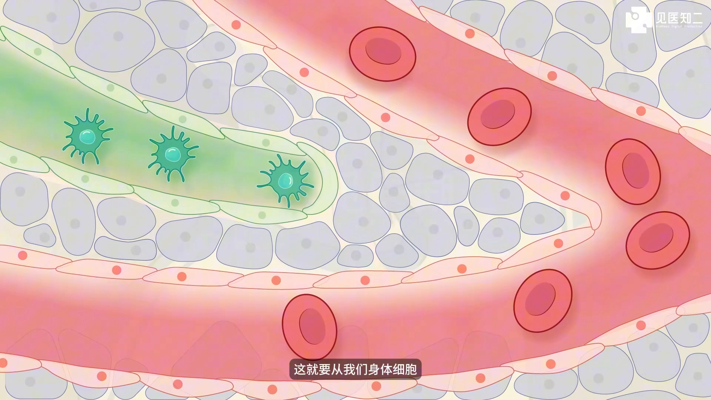
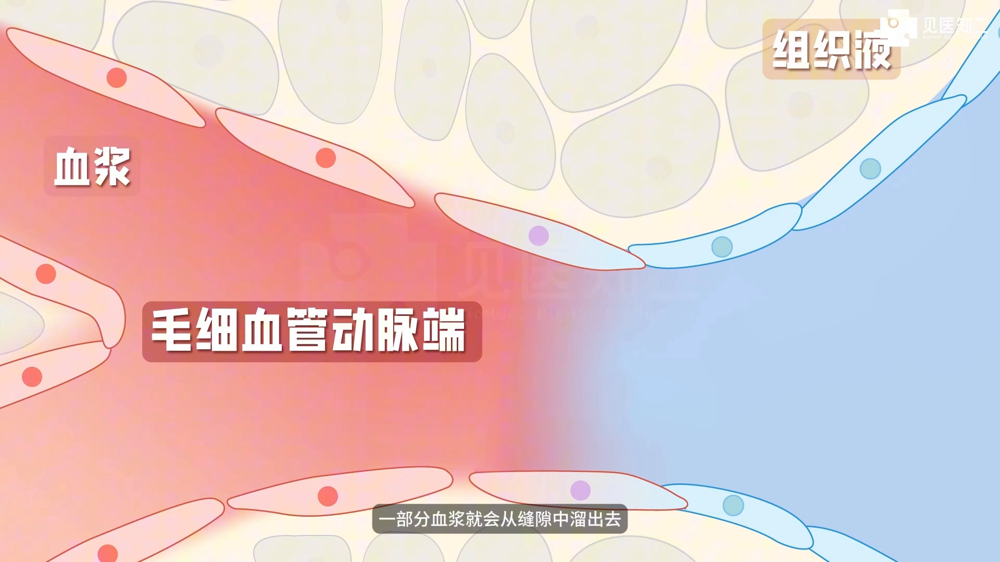
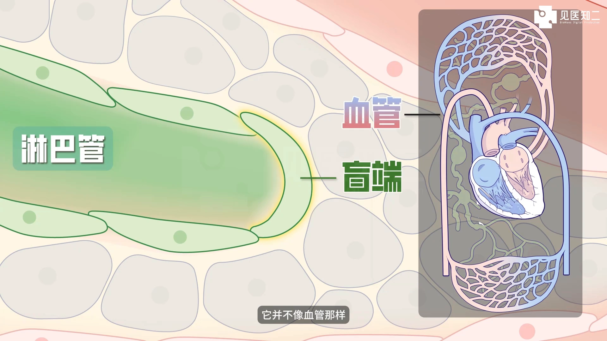
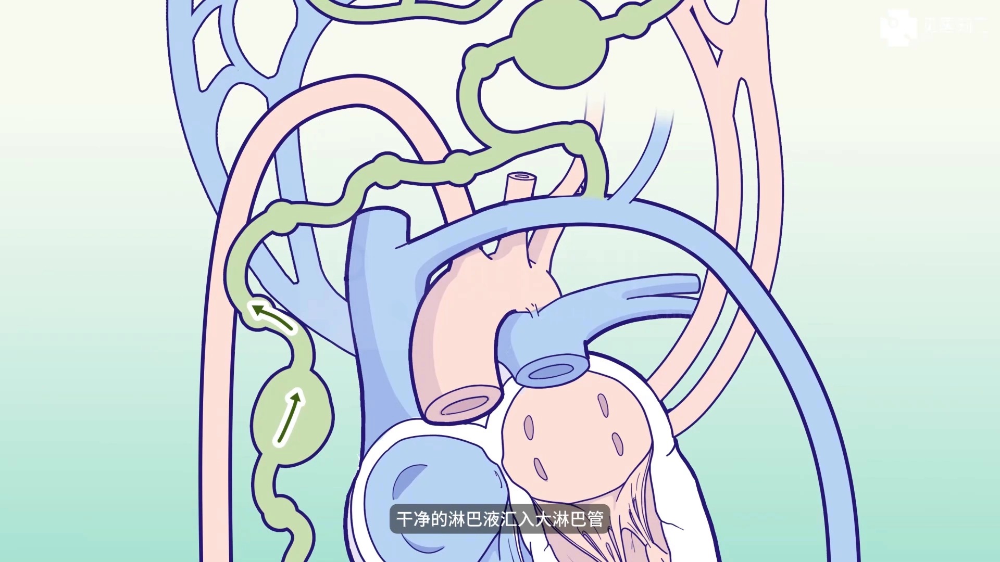
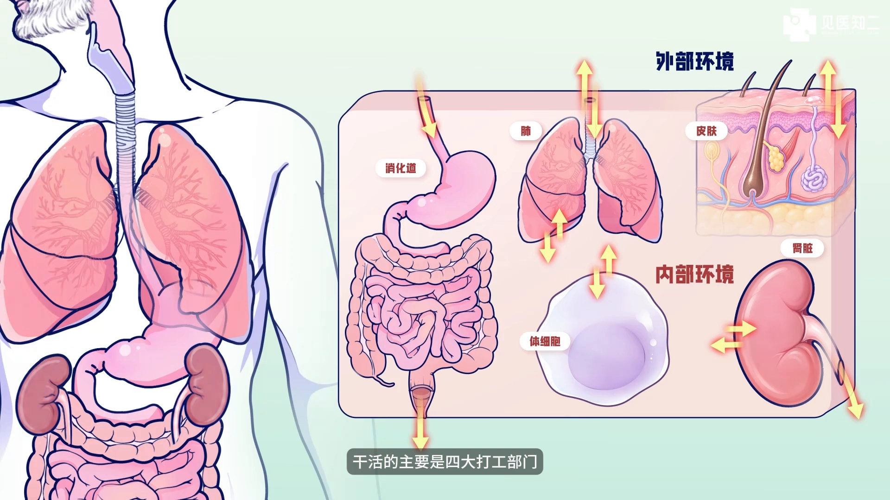
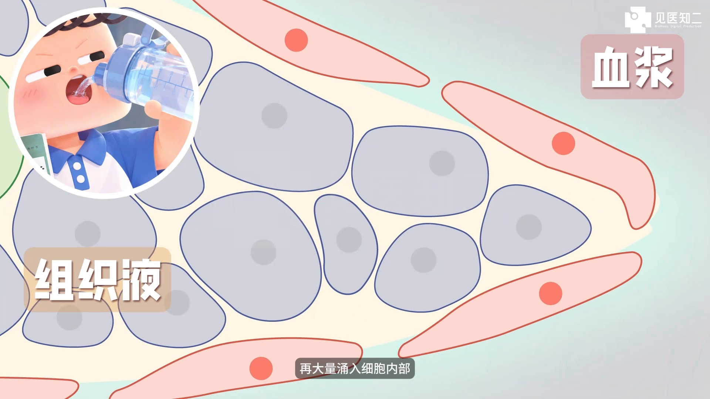

# 内环境：血浆、组织液与淋巴液的物质交换

> 视频来源：[【高中生物】动画带你完整了解选必一内环境中的血浆、淋巴液、组织液](https://www.bilibili.com/video/BV1cDaw6fEX5/)（Bilibili · 见医知二，约 6 分 38 秒）
> 导读：这支动画课把三种细胞外液的流向画成一条有方向的通路，再用"一口气喝八杯水"收口。本文按"三液→两个界面→与外界四个通道→缓冲上限"重排；反馈环的四个部件与调定点已在 [3.4.2 稳态与反馈](../../../3_从分子结构到生物功能/3.4_细胞信号转导与反馈调控/3.4.2_反馈、稳态与时间依赖的细胞响应/稳态与反馈：调定点、负反馈与正反馈.md) 讲过，本文只讲这套逻辑在整体生理里的落点。

## 本讲要解决的核心问题（SCQA）

**背景**：多细胞生物体内绝大多数细胞并不直接接触外界。它们泡在一层液体里，这层液体叫**内环境**，也叫**细胞外液**，主要包括血浆、组织液和淋巴液。

**冲突**：这里立刻出现两个疑问。第一，组织液浸泡着组织细胞还好理解，可血浆和淋巴液明明是在管道里流动的液体，凭什么也算"细胞生活的环境"？第二，这三种液体看起来是三个分开的池子，为什么不会一个越积越多、另一个被抽干？

**疑问**：三种液体各自是谁的家？它们之间靠什么交换、朝哪个方向流？细胞与外界的物质交换究竟发生在哪几个界面上？既然内环境"保持稳定"，为什么短时间内猛灌水还能把人喝出问题？

**回答（中心思想）**：三种细胞外液不是三个池子，而是**同一条有方向的通路上的三个站点**——血浆从毛细血管壁滤出成为组织液，组织液浸润细胞后大部分回到血液，剩下约 10% 经毛细淋巴管单向回流，最终在锁骨附近汇入静脉、重新变成血浆。细胞与外界的交换被两层界面隔开：**毛细血管壁**（血浆↔组织液）和**细胞膜**（组织液↔细胞内液）；而内环境与真正的外界之间，还有消化、呼吸、泌尿、皮肤四个通道。所谓稳态，就是这条通路在**缓冲能力范围之内**把成分维持在相对稳定的水平；缓冲有上限，超过上限就是稳态失调。

---

## 一、内环境是细胞外液：三种液体，三种"住户"

### 1.1 判断标准只有一条：细胞是不是直接泡在里面

内环境的本质是**细胞直接生活的液体环境**。按这条标准，它包括三种液体：

- **组织液**：组织细胞与组织细胞之间充满的液体。平时挤痘痘，除了血以外挤出的那点淡黄色液体就是组织液。绝大多数细胞（神经细胞、肌肉细胞、上皮细胞）是"钉在岗位上不动"的固定细胞，它们直接泡在组织液里。
- **血浆**：血管里血液的液体成分。血液离心分层后，上层的液体就是血浆。
- **淋巴液**：淋巴管里的液体。

血浆和淋巴液都在管道里流动，为什么也算内环境？视频给的解释是**细胞也有分工**：除了固定不动的组织细胞，还有一批到处跑外勤的流动细胞。红细胞常年泡在血浆里跑腿送货，各类免疫细胞在淋巴液里巡逻打怪——对它们来说，管道里的液体就是自己的家。

[【跳转到 00:43】](https://www.bilibili.com/video/BV1cDaw6fEX5/?t=43)

[【跳转到 00:20】](https://www.bilibili.com/video/BV1cDaw6fEX5/?t=20)

所以判断一种液体算不算内环境，不看它装在哪里，而看**有没有细胞把它当作家**。这也是为什么胃液、唾液、汗液不算内环境：它们与外界直接相通，里面没有细胞长期居住。

### 1.2 三液不是三个池子，而是一条有方向的通路

三种液体之间在不停地做物资流通，但流通的**方向并不对称**：

1. **血浆 → 组织液**：毛细血管壁不是焊死的铜墙铁壁，壁上是有缝隙的。在毛细血管动脉端，一部分血浆从缝隙里溜出去，变成新的组织液。
2. **组织液 → 血浆**：跑出去的组织液大部分"乖乖回归血液的怀抱"，重新成为血浆。这一来一回是**双向**的。
3. **组织液 → 淋巴液**：剩下约 10% 的"漏网之鱼"钻进毛细淋巴管，变成淋巴液。这一条是**单向**的。
4. **淋巴液 → 血浆**：淋巴液沿淋巴管一路向前，经过淋巴结过滤，最后在锁骨附近汇入静脉，重新加入血液循环。

[【跳转到 01:20】](https://www.bilibili.com/video/BV1cDaw6fEX5/?t=80)

一句话概括这条通路：**血浆和组织液可以双向串门，组织液只能单向冲进淋巴管，淋巴液一路单向跑路、最终回到血液**，不存在反向倒车。理解了这张单向图，后面所有"某成分属于内环境吗""水肿时水积在哪"的问题都能顺着箭头推出来。

---

## 二、细胞与血液之间的两个交换界面

细胞要拿到氧气和营养、排出废物，必须穿过两层界面。这两层界面的性质完全不同，不能混为一谈。

### 2.1 第一层界面：毛细血管壁，靠缝隙和压力交换

毛细血管壁由一层内皮细胞拼成，细胞之间有缝隙。血浆中的水、离子、小分子营养物质和氧气可以顺着缝隙滤出，进入组织间隙成为组织液；组织液里的代谢废物同样可以顺着缝隙回到血液。

这里的关键不是"膜上有泵"，而是**壁上有孔**：交换的驱动力是血管内外的压力差与浓度差，而不是某一种转运蛋白。所以毛细血管壁这一层的交换是**被动、双向、非选择性**的——谁能过缝隙谁就过，大分子蛋白质和血细胞基本留在血管里。

[【跳转到 01:15】](https://www.bilibili.com/video/BV1cDaw6fEX5/?t=75)

### 2.2 第二层界面：细胞膜，靠转运蛋白做选择性交换

组织液里的物质要真正进入细胞，还得再过一道**细胞膜**。这一层是脂双层加膜蛋白，具有选择透过性：水、氧气、脂溶性小分子可以自由扩散，葡萄糖、氨基酸、离子则要靠转运蛋白，逆浓度时还要耗能。

三种跨膜方式（自由扩散、协助扩散、主动运输）的判据、以及钠钾泵和协同转运的能量来源，已在 [1.3.2 生物膜结构与跨膜运输](../../../1_生命的物质与组织层级/1.3_细胞结构、生物膜与物质运输/1.3.2_生物膜结构与跨膜运输/跨膜运输的三种方式：自由扩散、协助扩散与主动运输的判别.md) 讲透，这里只需记住分工：**毛细血管壁负责"运到门口"，细胞膜负责"挑着进门"**。

### 2.3 淋巴管：单向门禁，而且没有泵

淋巴管有两个结构特点，直接决定了它的功能：

**第一，淋巴管有盲端。** 它不像血管那样是一条首尾相连的闭环管道，而是在组织里以盲端起始——所以组织液只能从盲端流进去，不能从别处倒灌。

**第二，内皮细胞像瓦片一样叠着，相当于装了单向门禁。** 只允许组织液往里进，想倒流跑出来门儿都没有。

[【跳转到 01:46】](https://www.bilibili.com/video/BV1cDaw6fEX5/?t=106)

[【跳转到 01:51】](https://www.bilibili.com/video/BV1cDaw6fEX5/?t=111)

为什么身体要故意设计成不能逆流？视频用泳池作类比：泳池里的水不是一滩死水，而是不停过滤的，这样才不会因为不流通而慢慢变脏。

[【跳转到 02:03】](https://www.bilibili.com/video/BV1cDaw6fEX5/?t=123)淋巴系统就是这套过滤系统——淋巴液像一波波旅客沿淋巴管来到淋巴结，淋巴结像安检扫描仪，把混进来的细菌、病毒等拦截扣押，免疫细胞就地收拾，保证流出去的淋巴液干干净净。

还有一个容易被忽略的细节：**血液循环有心脏这个超级水泵，淋巴系统没有专属的泵**。淋巴液靠什么往前赶路？答案是骨骼肌——肌肉一收一缩就不断挤压淋巴管，推着淋巴液向前。

[【跳转到 03:30】](https://www.bilibili.com/video/BV1cDaw6fEX5/?t=210)这也是"运动有助于提升免疫力"的一个机械解释：运动带动淋巴循环跑起来，免疫巡逻队的出勤效率提高。

[【跳转到 02:40】](https://www.bilibili.com/video/BV1cDaw6fEX5/?t=160)

---

## 三、内环境与外界：四个交换通道

内环境不是与世隔绝的世外桃源，它时时刻刻在跟外界做物资交换。干活的主要是四个系统：

| 系统 | 负责什么 | 交换方向 |
| --- | --- | --- |
| 消化系统 | 把食物拆成小分子 | 营养进入内环境 |
| 呼吸系统 | 气体快递 | 吸入氧气、排出二氧化碳 |
| 泌尿系统 | 清理细胞产生的废物 | 废物从内环境排出，变成尿液 |
| 皮肤 | 汗腺排出少量代谢废物 | 排出 |

[【跳转到 04:10】](https://www.bilibili.com/video/BV1cDaw6fEX5/?t=250)

其中呼吸系统负责气体、泌尿系统负责废物，这两条通道的细节（肺泡换气、肾单位分段）不属于本节范围；这里只登记"外界与内环境在哪几个面上交换"。

[【跳转到 04:20】](https://www.bilibili.com/video/BV1cDaw6fEX5/?t=260)

这张图要读出两层意思：

1. **外界的东西必须经过中转才能到达细胞。** 吃进来的糖、吸进来的氧，先进入内环境（血浆、组织液），再经细胞膜进入细胞；细胞产生的废物也要先回到内环境，再由四个系统排出去。细胞从来不直接和外界打交道。
2. **"身体内部"不等于"内环境"。** 消化道腔、肺泡腔、肾小管腔、汗腺导管在拓扑上仍然与外界相通，里面的东西还算"体外"。所以内环境是"身体内部"的一个子集，不是同义词。这条判据在 [3.4.2](../../../3_从分子结构到生物功能/3.4_细胞信号转导与反馈调控/3.4.2_反馈、稳态与时间依赖的细胞响应/稳态与反馈：调定点、负反馈与正反馈.md) 里已经用过一次：胃液、口腔里的液体不算内环境，因为与外界相通。

---

## 四、稳态的缓冲上限：一口气喝八杯水会怎样

视频开头抛出的问题是"喝水怎么会中毒"。学完三液通路，这个问题可以一步步推出来：

1. 大量水快速经消化道吸收，冲进血浆；
2. 血浆被稀释，**渗透压下降**；
3. 血浆和组织液双向互通，水顺着浓度差从血浆跑到组织液；
4. 组织液渗透压也下降，水再大量涌入细胞内部，**细胞吸水膨胀**；
5. 肾脏虽然能排水，但它也是打工人，有处理上限——灌水速度远超它加班干活的速度；
6. 脑细胞水肿尤其危险：颅内压增高会引起抽搐、昏迷，严重时威胁生命。

[【跳转到 05:52】](https://www.bilibili.com/video/BV1cDaw6fEX5/?t=352)

[【跳转到 05:22】](https://www.bilibili.com/video/BV1cDaw6fEX5/?t=322)

这个例子把"稳态"这个词的两层含义同时说清楚了：

- **稳态是相对稳定，不是绝对不变。** 血浆渗透压本来就随饮水、出汗、进食在波动，只要在可承受范围内，细胞形态和功能就不受影响。
- **稳态依赖缓冲，而缓冲有上限。** 肾脏的排水速率、血液自身的缓冲物质、细胞膜上的转运能力，都是"缓冲"。一旦输入速率超过所有缓冲环节的处理能力，稳态就被打破。视频把这句话收成一句生活建议：喝水要细水长流，不要猛灌。

[【跳转到 06:07】](https://www.bilibili.com/video/BV1cDaw6fEX5/?t=367)

至于"偏离多少算打破、由谁监测、怎么纠回来"，那是负反馈回路的四部件问题：感受器测偏差、控制部分比较调定点、效应器执行纠正、反馈信号回报结果。这套一般逻辑已在 [3.4.2](../../../3_从分子结构到生物功能/3.4_细胞信号转导与反馈调控/3.4.2_反馈、稳态与时间依赖的细胞响应/稳态与反馈：调定点、负反馈与正反馈.md) 讲完；本文只交代了它落地时需要的"地形"——物质在哪两种液体之间流动、朝哪个方向流。下一篇 [血糖稳态](血糖稳态：胰岛素与胰高血糖素的负反馈回路.md) 就把这条回路完整走一遍。

---

## 五、读图检查清单

遇到内环境相关的图或题，按下面四步核对，基本不会错：

1. **先认箭头方向。** 血浆↔组织液是双向；组织液→淋巴液是单向；淋巴液→血浆只有汇入静脉这一条路。
2. **再认"谁泡在里面"。** 红细胞泡在血浆里，组织细胞泡在组织液里，淋巴细胞泡在淋巴液里；细胞内液不属于内环境。
3. **分清两层界面。** 毛细血管壁靠缝隙做被动交换，细胞膜靠转运蛋白做选择性交换。
4. **分清"内环境"和"外界"。** 消化道腔、肺泡腔、肾小管腔里的液体不算内环境。

两个常见误解值得单独点出：

- **把淋巴管当成闭环。** 淋巴管有盲端，是单向通路，不是循环回路。
- **以为组织液只从血浆来、不回去。** 如果组织液只出不回，几分钟内全身就会水肿；正因为绝大部分回收到血液、小部分走淋巴，组织间隙的液体量才能稳定。

---

## 小结

- **内环境 = 细胞外液**，主要包括血浆、组织液、淋巴液；判断标准是"有没有细胞直接泡在里面"，不是"装在什么容器里"。
- 三液构成一条**有方向的通路**：血浆经毛细血管壁滤出成组织液，组织液大部分回血、约 10% 单向进入毛细淋巴管，淋巴液经淋巴结过滤后在锁骨附近汇入静脉。
- 细胞与血液之间隔着**两层界面**：毛细血管壁（靠缝隙，被动双向）和细胞膜（靠转运蛋白，选择透过）。
- 内环境与外界之间由**消化、呼吸、泌尿、皮肤**四个系统交换；消化道腔、肺泡腔等与外界相通，不算内环境。
- **稳态是相对稳定 + 有限缓冲**：正常波动可以承受，输入速率超过缓冲上限（如短时间大量饮水）就会失稳。
- 淋巴系统没有专属的泵，靠骨骼肌收缩推动；淋巴管有盲端和单向门禁，不允许倒流。

## 关键术语速查

| 术语 | 一句话解释 |
| --- | --- |
| 内环境 | 细胞外液，细胞直接生活的液体环境 |
| 细胞外液 | 血浆、组织液、淋巴液的统称 |
| 组织液 | 组织细胞间隙中的液体，组织细胞直接生活的环境 |
| 血浆 | 血液的液体成分，血细胞直接生活的环境 |
| 淋巴液 | 淋巴管内的液体，淋巴细胞直接生活的环境 |
| 毛细淋巴管盲端 | 淋巴管的起始端，只进不出，保证单向流动 |
| 组织水肿 | 组织液中的水异常增多，表现为局部肿胀 |
| 稳态 | 内环境理化性质在缓冲范围内保持相对稳定 |