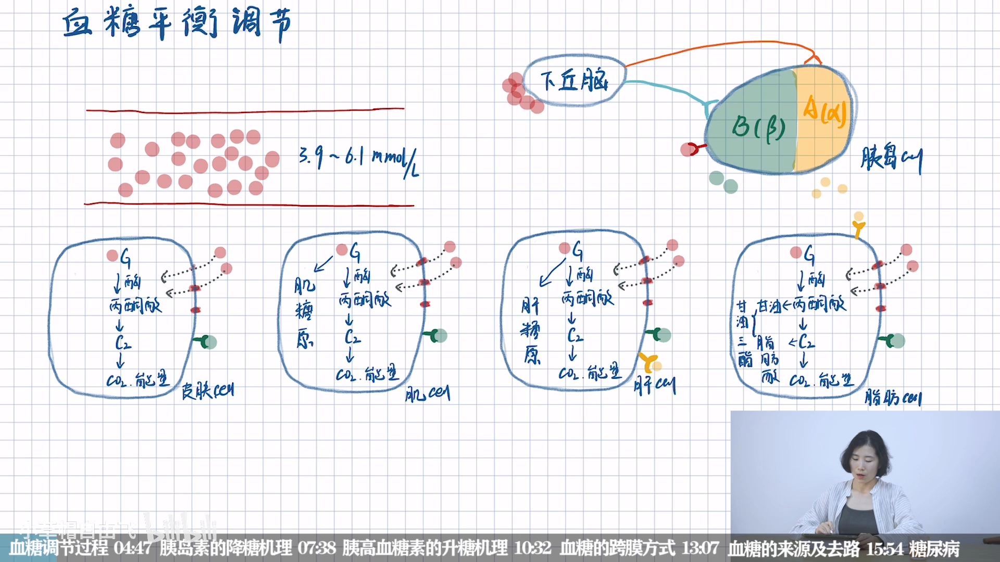
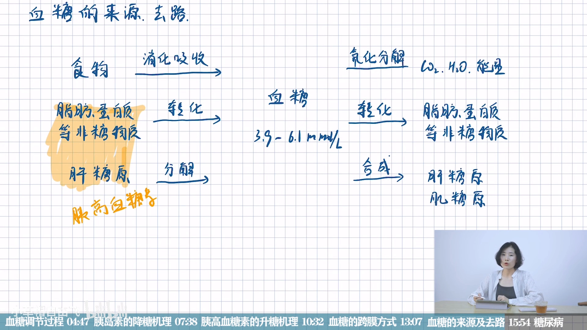
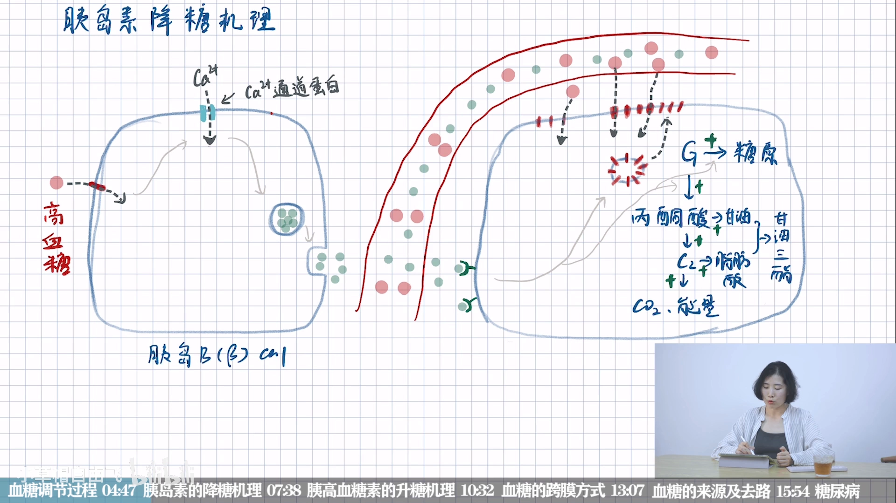
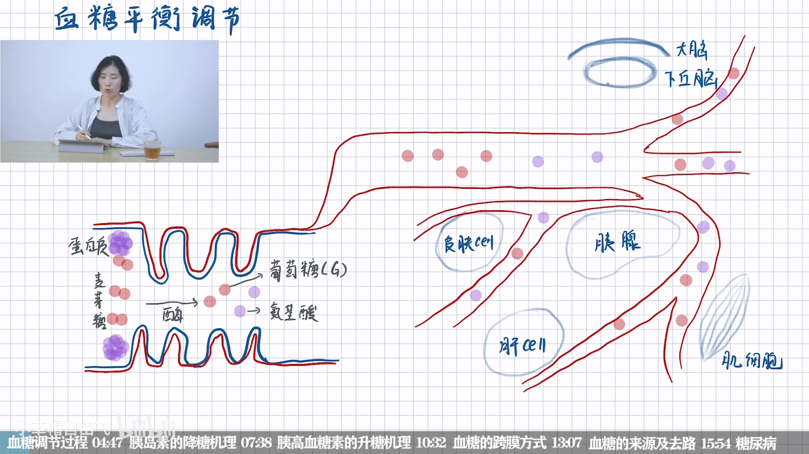
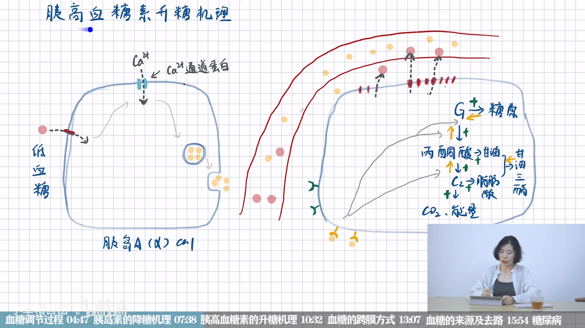
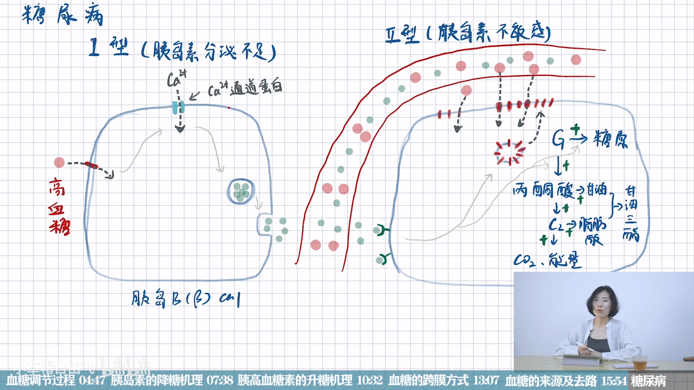
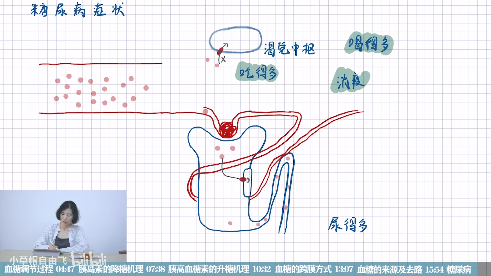

# 血糖稳态：胰岛素与胰高血糖素的负反馈回路

> 视频来源：[内环境——血糖调节【字幕版】](https://www.bilibili.com/video/BV1Hh4y137Ap/)（Bilibili · 小草帽自由飞，约 21 分钟）
> 导读：这支课用手绘板书把血糖调节从头到尾走了一遍：吸收、感受、分泌、运输、靶细胞、两条反向激素，最后落到糖尿病。本文按"变量—五步回路—闭环—断点"重排；反馈环的四个部件与调定点概念见 [3.4.2](../../../3_从分子结构到生物功能/3.4_细胞信号转导与反馈调控/3.4.2_反馈、稳态与时间依赖的细胞响应/稳态与反馈：调定点、负反馈与正反馈.md)，三液通路见 [内环境：血浆、组织液与淋巴液的物质交换](内环境：血浆、组织液与淋巴液的物质交换.md)。

## 本讲要解决的核心问题（SCQA）

**背景**：血糖就是血浆中的葡萄糖。它必须被压在很窄的范围内——空腹约 3.9–6.1 mmol/L。上一节已经看到，血浆与组织液双向互通、组织液浸润着每一个细胞，所以血浆里葡萄糖的浓度，直接决定了全身细胞能拿到多少燃料。

**冲突**：可是进食是间断的，消耗是连续的。刚吃完饭血糖必然冲高，饿一顿又必然走低。如果只靠"吃进来"和"用掉"这两个被动过程，血糖曲线应该随三餐剧烈起伏。为什么实际能压在 3.9–6.1 之间？更奇怪的是：同一条通路里，降糖和升糖由两种作用完全相反的激素负责，它们为什么不会互相打架、把血糖拉成锯齿？

**疑问**：一条完整的血糖负反馈回路包含哪些环节？信号在哪一步从"神经"换成"激素"？为什么降糖只有一种激素，升糖却有好几条路？这条回路断掉以后，症状为什么是"吃得多、喝得多、尿得多、还消瘦"？

**回答（中心思想）**：血糖调节是一条**双向负反馈回路**——血糖偏高时，下丘脑的血糖感受器和胰岛 β 细胞同时察觉，β 细胞把胰岛素释放进组织液、再由血浆送到全身，靶细胞把膜上的葡萄糖转运蛋白增多，加速摄取并转成糖原或脂肪，血糖回落；血糖偏低时，α 细胞释放胰高血糖素，让肝糖原水解、脂肪分解，血糖回升。**降糖只有胰岛素一条路，升糖有胰高血糖素加肾上腺素两条路**，这种不对称正是"宁可高一点、不能低太多"的设计。回路的两个断点——分泌端断（I 型糖尿病）和接收端断（II 型糖尿病）——分别解释了两种完全不同的病因。

---

## 一、血糖：一个被压在窄区间里的变量

### 1.1 "血糖"指的是血浆里的葡萄糖

血糖不是"身体里的糖"，而是**血浆中的葡萄糖浓度**。视频给的正常范围是 **3.9–6.1 mmol/L**（空腹参考值）；刚吃完饭，血浆葡萄糖会超过 6.1，饿的时候会低于 3.9。这两个越界的方向，分别对应回路的两条腿。

[【跳转到 01:45】](https://www.bilibili.com/video/BV1Hh4y137Ap/?t=105)

### 1.2 来源三条、去路三条

把血糖当成一个水池，进水和出水各有三条管道：

| 方向 | 途径 | 是否受激素调控 |
| --- | --- | --- |
| 来源 | 食物中的糖类经消化吸收 | 不需要激素，吃了就有 |
| 来源 | 肝糖原分解成葡萄糖 | 主要靠胰高血糖素 |
| 来源 | 脂肪等非糖物质转化（糖异生） | 主要靠胰高血糖素 |
| 去路 | 氧化分解成 CO₂、H₂O 和能量 | 靠胰岛素加速 |
| 去路 | 合成肝糖原、肌糖原 | 靠胰岛素加速 |
| 去路 | 转化为脂肪、某些氨基酸 | 靠胰岛素加速 |

[【跳转到 13:07】](https://www.bilibili.com/video/BV1Hh4y137Ap/?t=787)

这张表里最容易被忽略的一格是**肌糖原**。肌糖原能水解成葡萄糖，但水解出来的葡萄糖**只给肌肉自己用，不进血浆**；能补充血糖的只有**肝糖原**。视频给了一个进化解释：远古时代没有一日三餐，肌肉的功能是收缩、是逃命的本钱，如果肌肉把糖原无私地分给全身，真遇到危险时它自己就没燃料了。同样的道理，脑和心脏里的糖原也只供自己使用。

> 补充核对（非视频内容）：肌糖原不能补充血糖的直接原因，是肌细胞缺少把葡萄糖-6-磷酸水解成游离葡萄糖的酶（葡萄糖-6-磷酸酶），磷酸基团出不了膜，葡萄糖就放不进血液。视频给的进化解释是"为什么保留这种设计"，酶学原因是"怎么实现的"，两者不冲突。

---

## 二、升糖之后：从感受器到效应器的五步

饭后血糖超过 6.1，回路开始工作。把它拆成五步，每一步都对应一个可以单独提问的环节。

### 2.1 第一步 感受：下丘脑和胰岛同时"看见"血糖

视频强调这里有**两条并行的感受途径**：

- **神经途径**：下丘脑有血糖感受器，感受到血糖浓度变化后，通过神经把指令传给胰岛；
- **体液途径**：血糖可以直接刺激胰岛 α 细胞和 β 细胞，不需要经过下丘脑。

两条途径同时存在，意味着即使神经通路出了问题，胰岛仍能对血糖作出反应。这也解释了教材里"下丘脑—胰岛"的经典图和"血糖直接刺激胰岛"的说法为什么都对：它们画的是同一条回路的两条支路。

[【跳转到 04:15】](https://www.bilibili.com/video/BV1Hh4y137Ap/?t=255)

> 术语提示：旧教材写"胰岛 A 细胞 / B 细胞"，新教材改称"胰岛 α 细胞 / β 细胞"，指的是同一群细胞。本文统一用 α/β，引用原文时保留 A/B。

### 2.2 第二步 分泌：β 细胞里的钙离子开关

β 细胞怎么知道该分泌胰岛素？视频把它拆成一条链：

1. 血浆葡萄糖浓度升高，葡萄糖**进入 β 细胞**；
2. 葡萄糖在细胞内代谢，引起一系列反应；
3. 反应的结果是**钙离子通道打开**，Ca²⁺ 内流；
4. Ca²⁺ 促使包裹胰岛素的囊泡向细胞膜运输；
5. 囊泡与细胞膜融合，**胰岛素被胞吐释放**到组织液中，再渗入血浆。

[【跳转到 04:40】](https://www.bilibili.com/video/BV1Hh4y137Ap/?t=280)

注意这里的因果方向：**葡萄糖是信号，Ca²⁺ 是开关，胞吐是执行**。β 细胞本质上是一个"葡萄糖浓度计 + 分泌装置"，它不需要外部指令就能工作。这也是后面讲 I 型糖尿病时要盯住的位置——链条上任何一环坏了，胰岛素都出不来。

### 2.3 第三步 运输：从组织液到血浆，再到全身

胰岛素释放后先进入**组织液**，再进入**血浆**，随血液循环到达全身。这一步是整条回路里唯一"纯运输"的环节，但它决定了回路的两个重要性质：

- **激素调节是不定向的。** 激素随血液弥漫到全身，每个细胞附近都有；它不"瞄准"某个器官。
- **真正的定向来自受体。** 只有表面有相应受体的细胞才能接住这个信号，没有受体的细胞对它毫无反应。所以"靶细胞"不是被激素找到的，而是被受体**筛出来**的。

[【跳转到 01:08】](https://www.bilibili.com/video/BV1Hh4y137Ap/?t=68)

[【跳转到 08:27】](https://www.bilibili.com/video/BV1Hh4y137Ap/?t=507)

### 2.4 第四步 识别：谁有胰岛素受体

视频列了四类典型靶细胞，它们接住胰岛素后做的事并不相同：

| 靶细胞 | 接住胰岛素后做什么 |
| --- | --- |
| 皮肤等普通组织细胞 | 把葡萄糖吸进来，氧化分解释放能量 |
| 肌肉细胞 | 氧化分解，并把葡萄糖合成**肌糖原**储存 |
| 肝细胞 | 氧化分解，并把葡萄糖合成**肝糖原**储存 |
| 脂肪细胞 | 把葡萄糖转成甘油和脂肪酸，再合成甘油三酯（脂肪） |

[【跳转到 02:35】](https://www.bilibili.com/video/BV1Hh4y137Ap/?t=155)

这张表顺带回答了一个常见疑问："吃糖多了为什么会胖？"因为脂肪细胞也是胰岛素的靶细胞，血糖高时它会把多余的葡萄糖转成脂肪存起来。视频还补了一句：糖、脂肪、蛋白质三者在体内可以相互转化。

### 2.5 第五步 效应：把转运蛋白搬到膜上

胰岛素到底怎么让细胞"多吃糖"？视频给的机制很具体：

1. 靶细胞膜上有**胰岛素受体**，接住胰岛素后，细胞内部发生一系列化学反应；
2. 反应的结果是**葡萄糖运载蛋白（转运体）合成数量变多**；
3. 新合成的转运体被运送到细胞膜表面；
4. 膜上的转运体一多，葡萄糖进入细胞的速度就加快。

视频用了一个很好记的对比：没接收胰岛素时，细胞膜上只有三个葡萄糖运载体；接收之后，膜表面布满转运体，葡萄糖加速涌入。

[【跳转到 05:55】](https://www.bilibili.com/video/BV1Hh4y137Ap/?t=355)

这里有一个容易考、也容易想错的点：**葡萄糖进入普通组织细胞走的是协助扩散**，不是主动运输。因为它顺浓度梯度、需要转运蛋白、不耗能——正好符合 [1.3.2](../../../1_生命的物质与组织层级/1.3_细胞结构、生物膜与物质运输/1.3.2_生物膜结构与跨膜运输/跨膜运输的三种方式：自由扩散、协助扩散与主动运输的判别.md) 里协助扩散的三条判据。只有两个例外：**肾小管上皮细胞**和**小肠上皮细胞**吸收葡萄糖时用主动运输，因为这两处要把糖从"体外"抢回体内，不能等浓度差说了算。

视频还给了一个进化角度的解释：如果全身细胞都用主动运输摄取葡萄糖，那么血糖很低时细胞照样能把糖吸进去，大脑会一直觉得"我很饱"，人就不会主动找食物，饿到糖耗尽就危险了。用协助扩散，血糖低时糖进不去、细胞才会发出"饿"的信号——**"进不去"本身就是一种保护**。

[【跳转到 06:20】](https://www.bilibili.com/video/BV1Hh4y137Ap/?t=380)

---

## 三、降糖之后：α 细胞与胰高血糖素

### 3.1 分泌机制与 β 细胞对称

血糖低于 3.9 时，回路换方向工作：

1. 低血糖刺激下丘脑，下丘脑发出神经作用于**胰岛 α 细胞**；低血糖也能**直接**刺激 α 细胞；
2. 葡萄糖进入 α 细胞，同样引起 Ca²⁺ 通道打开；
3. Ca²⁺ 促使包裹**胰高血糖素**的囊泡向细胞膜运输并胞吐；
4. 胰高血糖素进入组织液，再进入血浆，随血液到全身找靶细胞。

[【跳转到 07:45】](https://www.bilibili.com/video/BV1Hh4y137Ap/?t=465)

视频在这里补了一个实用细节：胰岛素和胰高血糖素**都是蛋白质类物质，都不能口服**——口服会被胃蛋白酶降解掉，失去功能。所以胰岛素只能注射。

### 3.2 靶细胞不对称：肌肉不接胰高血糖素的信号

胰高血糖素的靶细胞比胰岛素少得多，主要是**肝细胞**和**脂肪细胞**：

- 肝细胞接住信号后，把**肝糖原水解**成葡萄糖，葡萄糖经转运体进入血浆，血糖上升；
- 脂肪细胞接住信号后，把脂肪水解，参与能量代谢，也可以经糖异生补充血糖。

**肌肉细胞没有胰高血糖素受体**，所以胰高血糖素管不了肌糖原；肌糖原的水解靠**肾上腺素**，而且水解出来的葡萄糖只供肌肉自己用。

[【跳转到 08:56】](https://www.bilibili.com/video/BV1Hh4y137Ap/?t=536)

于是升糖这件事至少有两条路：胰高血糖素（肝糖原、脂肪）+ 肾上腺素（肌糖原）。视频顺带提了一句"这样看来胰高血糖素还有点减脂的作用"——这只是机制上的推论，不是减脂建议。

> 补充核对（非视频内容）：视频说"脂肪水解再释放出来变成葡萄糖"，这是简化的说法。脂肪水解产生甘油和脂肪酸，**只有甘油**能进入糖异生变成葡萄糖；脂肪酸主要在肝脏氧化供能、生成酮体。方向没错，但"脂肪变糖"的产量被视频夸大了。

---

## 四、把五步接成环：这就是一条负反馈

现在把两条腿接起来，对照 [3.4.2](../../../3_从分子结构到生物功能/3.4_细胞信号转导与反馈调控/3.4.2_反馈、稳态与时间依赖的细胞响应/稳态与反馈：调定点、负反馈与正反馈.md) 给出的四个部件，可以看到一条标准的负反馈环：

| 反馈环部件 | 血糖回路里的对应物 |
| --- | --- |
| 被调变量 | 血浆葡萄糖浓度 |
| 调定点 | 3.9–6.1 mmol/L 这个区间 |
| 感受器 / 监测装置 | 下丘脑血糖感受器；胰岛 α、β 细胞本身 |
| 控制部分（比较器） | 下丘脑 + 胰岛（把偏差转成分泌指令） |
| 受控部分（效应器） | 肝、肌肉、脂肪、皮肤等靶细胞 |
| 反馈信号 | 血糖浓度本身回到起点 |

关键在于最后一行：**这条回路的反馈信号就是被调变量自己**。效应器把血糖降下来，降下来的血糖又被感受器读到，于是分泌减少——偏差被削弱，这就是负反馈。它不需要额外的"报告线"，血糖浓度本身就是报告。

### 4.1 为什么必须有两个方向相反的激素

如果只有胰岛素，回路只能纠正"血糖偏高"这一种偏差；一旦血糖偏低，没有任何机制能把它拉回来，人会在两餐之间陷入低血糖。反过来，如果只有胰高血糖素，饭后血糖会一路冲高。**单向控制只能纠一个方向的偏差，双向控制才能把变量夹在一个区间里**——这是"稳态是一个范围而不是一个点"在回路层面的直接体现。

### 4.2 神经快、体液慢：同一条回路的两套载体

同一条回路里，同一个偏差可以走两条路：

- **神经途径**：下丘脑感受血糖 → 神经 → 胰岛，毫秒到秒级，快而短；
- **体液途径**：血糖直接刺激胰岛 → 激素入血 → 全身，分钟级，慢而持久。

两者不是二选一，而是并联。神经和体液调节在速度、范围、持续时间上的系统对照，见 [4.4.2 三种调节方式的分工](../4.4.2_神经、内分泌与免疫系统的分工/三种调节方式的分工：神经、体液与免疫的尺度对照.md)；这里只需记住一句：**回路的拓扑决定它会不会稳定，回路的载体决定它多快稳定**。

---

## 五、回路断在哪：I 型与 II 型糖尿病

负反馈回路的价值，在它坏掉的时候看得最清楚。视频把糖尿病分成两型，正好对应回路的两个不同环节。

### 5.1 分泌端断：I 型糖尿病

I 型糖尿病是**胰岛素分泌不足**。按 2.2 节的链条，断点可能在 β 细胞里任何一环：Ca²⁺ 通道出问题、囊泡运输出问题，都会导致胰岛素运不出来。这类病人多在青少年时期发病，常与遗传有关。

治疗方式是**注射胰岛素**——因为胰岛素是蛋白质，口服会被消化掉。

### 5.2 接收端断：II 型糖尿病

II 型糖尿病是**胰岛素不敏感**：胰岛素有，但用不上。全身细胞膜上都有胰岛素受体，可是受体对胰岛素不敏感，后面一系列反应都进行得不通畅，效果大打折扣。视频提到一种可能：体内产生抗体攻击了胰岛素受体，使胰岛素无法发挥作用。

这类病人**再打胰岛素也没用**，因为问题不在"有没有信号"，而在"接不接得住"。所以 II 型糖尿病更危险——没有能直接"治好"的药，只能靠控制饮食和生活习惯管理。

[【跳转到 15:55】](https://www.bilibili.com/video/BV1Hh4y137Ap/?t=955)

### 5.3 "三多一少"能从回路推出来

两型糖尿病的症状相同：吃得多、喝得多、尿得多、消瘦。这四个症状都能从"血糖高但进不了细胞"这一个前提推出来：

- **喝得多**：血糖太高使血浆渗透压升高 → 刺激下丘脑 → 传到大脑皮层的渴觉中枢 → 觉得渴 → 喝水；
- **吃得多**：葡萄糖因为缺少胰岛素（或胰岛素不敏感）进不了组织细胞，细胞"饿" → 大脑收到缺能量的信号 → 多吃；
- **消瘦**：细胞用不上糖，只好分解脂肪供能 → 体重下降；
- **尿得多**：血糖超过肾小管上皮细胞转运蛋白的处理上限，一部分葡萄糖留在尿里 → 尿中葡萄糖浓度升高 → 水的重吸收发生障碍 → 尿量增多。

[【跳转到 18:02】](https://www.bilibili.com/video/BV1Hh4y137Ap/?t=1082)

注意"尿得多"这一条把两个小节连起来了：**血糖回路和渗透压/水平衡共用同一套运输通路**。尿里葡萄糖多了，渗透压就高，水的重吸收就被拖累——这正是 [内环境：血浆、组织液与淋巴液的物质交换](内环境：血浆、组织液与淋巴液的物质交换.md) 里"渗透压靠溶质微粒数目决定"的直接应用。

---

## 六、这条回路给出的通用读法

把血糖回路抽象一下，可以得到一个读任何生理反馈回路的模板：

1. **被调变量是什么？** 血糖＝血浆葡萄糖浓度。
2. **正常区间是多少？** 3.9–6.1 mmol/L（空腹参考）。
3. **谁在测？** 下丘脑感受器 + 胰岛细胞本身。
4. **偏差怎么变成指令？** 神经递质作用于胰岛，或血糖直接作用于胰岛。
5. **指令怎么送到？** 激素入组织液、进血浆、随循环到全身。
6. **谁执行？** 有受体的靶细胞；没有受体就不是靶细胞。
7. **结果怎么回报？** 血糖浓度本身回到感受器。
8. **哪一环坏了会怎样？** 分泌端坏＝I 型，接收端坏＝II 型。

这套读法可以直接搬到水盐平衡、体温调节、甲状腺轴上去——变量换了，拓扑不变。

### 6.1 三个边界

- **"正常范围"是参考值，不是绝对真理。** 3.9–6.1 mmol/L 是空腹参考；餐后、运动后、应激时本来就会越界。判断稳态是否被打破，要看**偏离的幅度和持续时间**，不能看单点数值。
- **回路有滞后。** 激素从分泌到起效需要时间，所以血糖曲线不会是一条直线，而是在区间内起伏的波浪。稳态是"被拉回"，不是"不动"。
- **靶细胞由受体定义，不由器官定义。** 同一个器官（如肝脏）可以同时是升糖和降糖激素的靶细胞，因为它同时有两种受体；肌肉只有胰岛素受体、没有胰高血糖素受体，所以它只能被"降糖"指令指挥。

---

## 小结

- **血糖 = 血浆葡萄糖**，空腹参考范围 3.9–6.1 mmol/L；来源三条（消化吸收、肝糖原分解、非糖物质转化），去路三条（氧化分解、合成糖原、转化为脂肪和氨基酸）。
- **升糖后的五步回路**：下丘脑/胰岛感受 → β 细胞经 Ca²⁺ 开关胞吐胰岛素 → 组织液入血浆运到全身 → 靶细胞受体识别 → 转运蛋白上膜、摄取加速并转成糖原或脂肪。
- **降糖后的反向回路**：α 细胞释放胰高血糖素 → 肝糖原水解、脂肪分解 → 血糖回升；肌糖原不受胰高血糖素指挥，只供肌肉自己用。
- **两个方向相反的激素**把血糖夹在区间里；反馈信号就是血糖本身，因此这是一条标准负反馈。
- **神经快、体液慢**，两条感受途径并联，不是二选一。
- **I 型糖尿病断在分泌端**（胰岛素不足，可注射），**II 型断在接收端**（胰岛素不敏感，注射无效）；"三多一少"都能从"血糖高但进不了细胞"推出来。

## 关键术语速查

| 术语 | 一句话解释 |
| --- | --- |
| 血糖 | 血浆中的葡萄糖浓度，空腹参考 3.9–6.1 mmol/L |
| 胰岛 β 细胞 | 分泌胰岛素的细胞，靠 Ca²⁺ 内流触发囊泡胞吐 |
| 胰岛 α 细胞 | 分泌胰高血糖素的细胞，机制与 β 细胞对称 |
| 胰岛素 | 唯一降血糖的激素，促进靶细胞摄取葡萄糖并合成糖原、脂肪 |
| 胰高血糖素 | 升血糖激素，促进肝糖原分解和糖异生，不作用于肌肉 |
| 葡萄糖转运蛋白 | 细胞膜上的葡萄糖运载体，胰岛素可使其数量增多 |
| 靶细胞 | 表面有相应受体、能对激素作出反应的细胞 |
| 肝糖原 | 水解后可补充血糖的糖原储备 |
| 肌糖原 | 只能供肌肉自身使用的糖原，不补充血糖 |
| I 型糖尿病 | 胰岛素分泌不足，断点在分泌端 |
| II 型糖尿病 | 胰岛素不敏感，断点在受体/接收端 |