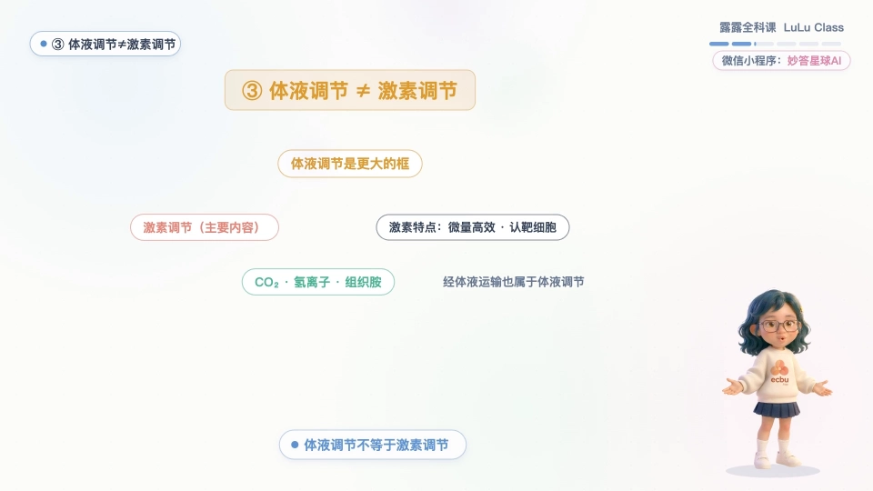
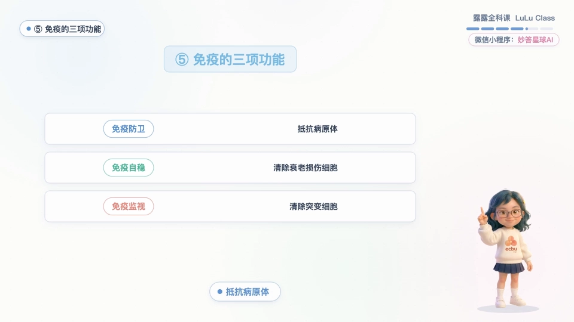

# 三种调节方式的分工：神经、体液与免疫的尺度对照

> 视频来源：[4分钟讲透神经体液免疫调节网络](https://www.bilibili.com/video/BV165nu6jE8H/)（Bilibili · 露露全科课，约 3 分钟）
> 导读：这支短视频把神经、体液、免疫三种调节方式并排放在一张表里，并给出三类信号分子的路径对照。本文按"分工—信号分子—边界"重排；突触细节见 4.4.7，激素轴见 4.4.8，免疫机制见 B05。

## 本讲要解决的核心问题（SCQA）

**背景**：体温、血糖、水盐这些指标要长期稳定，靠的是机体自己的调节。3.4.2 已经看到，调节回路由感受器、控制部分、受控部分和反馈信号构成，而且"神经快、体液慢"。

**冲突**：但机体并不只有神经和体液两套调节。免疫系统也在不停地"传信息"——它识别、清理，还会引起发热和炎症。如果三套系统都在传递信号，凭什么说它们各有分工、不能互相替代？

**疑问**：神经、体液、免疫各自用什么信号分子、走什么路径、在什么时间尺度上起作用、覆盖多大范围？它们的边界画在哪里？

**回答（中心思想）**：三套系统是**同一张分工表上的三列**——神经靠反射弧，**迅速、准确、部位局限、时间短暂**；体液靠化学物质经体液运输，**缓慢、范围广、时间更长**；免疫负责**防卫与清除**，把外来的和自身出问题的成分处理掉。三列的差别不在"有没有信号"，而在**信号走多远、走多久、被谁接住**。

---

## 一、三列并排：同一张表上的三种调节

[【跳转到 00:00】](https://www.bilibili.com/video/BV165nu6jE8H/?t=0)

视频开篇就把三种调节方式摆成三列，每列只留四个关键词：

[【跳转到 00:10】](https://www.bilibili.com/video/BV165nu6jE8H/?t=10)

| 调节方式 | 速度与精度 | 作用范围 | 持续时间 | 负责什么 |
| --- | --- | --- | --- | --- |
| 神经调节 | 迅速、准确 | 部位局限 | 时间短暂 | 靠反射弧快速发指令 |
| 体液调节 | 比较缓慢 | 范围更广 | 时间更长 | 化学物质经体液运输 |
| 免疫调节 | —— | —— | —— | 防卫、清除 |

[【跳转到 00:18】](https://www.bilibili.com/video/BV165nu6jE8H/?t=18)

这张表最容易被误读成"三选一"：遇到一个生理过程，判断它属于哪一列。视频随后纠正了这个读法——**三列是分工，不是互斥**。寒冷时体温能维持，是神经和甲状腺激素一起起作用；血糖的调节是下丘脑配上胰岛素；水盐平衡则靠抗利尿激素管住肾小管。真实的生理过程往往同时占用两列甚至三列。

[【跳转到 02:48】](https://www.bilibili.com/video/BV165nu6jE8H/?t=168)

[【跳转到 02:23】](https://www.bilibili.com/video/BV165nu6jE8H/?t=143)

---

## 二、神经与体液不是各干各的

在把三列分开讲之前，视频先处理了一个更基础的问题：神经和体液之间有没有墙？

**没有。** 两个方向都通：

- **神经 → 内分泌**：不少内分泌腺直接受神经系统调节。下丘脑控制垂体，交感神经管着肾上腺——腺体是神经指令的"执行末端"。
- **内分泌 → 神经**：激素反过来影响神经系统。甲状腺激素促进脑的发育、提高神经系统的兴奋性。

[【跳转到 00:43】](https://www.bilibili.com/video/BV165nu6jE8H/?t=43)

所以"神经调节"和"体液调节"的界线，不在于器官属于哪个系统，而在于**这一刻信号是怎么传的**：如果是动作电位沿神经走、在末端释放递质，那是神经调节；如果是化学物质进入体液、随运输到达远处细胞，那是体液调节。同一个腺体可以既是神经的效应器，又是激素的来源——它同时站在两列里。

> 这也解释了为什么后面会出现"神经—体液调节"这种复合说法：一条通路的前半段走神经，后半段走血液。

---

## 三、体液调节不等于激素调节

第二个容易混淆的地方是"体液调节"和"激素调节"能不能画等号。视频的答案是：**不能，体液调节是更大的框**。

- **激素调节是主要内容**：内分泌细胞分泌激素，经体液运输，作用于靶器官、靶细胞。
- **但不止激素**：二氧化碳、氢离子、组织胺等化学物质，只要是经体液运输起作用，也属于体液调节。

[【跳转到 01:08】](https://www.bilibili.com/video/BV165nu6jE8H/?t=68)

视频还给激素列了四条特点，这四条合起来正好解释了"为什么体液调节慢而广"：

1. **微量而高效**——浓度很低就能起作用；
2. **仅经体液运输**——没有专用的"线路"，只能搭循环系统的便车；
3. **只作用于靶器官、靶细胞**——全身都泡在激素里，但只有带相应受体的细胞会响应；
4. **起作用后就被灭活**——信号有寿命，不能无限累积。

第 3 条是这一节最关键的一句：**体液调节的"广"是投递上的广，不是响应上的广**。激素随血液到全身，但响应范围由受体表达决定。这一点在 3.4.1 已经作为受体—配体识别讲过，这里只是把它放回尺度问题里。

---

## 四、三类信号分子：路径决定尺度

三套系统各自的"信使"是什么？视频把三类信号分子放在一起对照：

| 信号分子 | 谁分泌 | 走什么路径 | 距离与结局 |
| --- | --- | --- | --- |
| 神经递质 | 突触前膜 | 经突触间隙扩散，作用于后膜受体 | 距离短；用完就降解、回收 |
| 激素 | 内分泌细胞 | 随血液到全身 | 距离远；只作用于靶器官、靶细胞 |
| 细胞因子 | 淋巴细胞 | 在免疫细胞间传递信息 | 局部为主，也可经血液扩散 |

[【跳转到 01:33】](https://www.bilibili.com/video/BV165nu6jE8H/?t=93)

三者有一个共同点，视频特意点出来：**都要与受体结合**。信号分子本身不决定细胞做什么，是受体决定了"谁能听见"。

把这张表读成一条因果链，三列的尺度差别就出来了：

- **路径短 → 快、准、局部**。递质只穿过突触间隙，目标就是后膜上的受体，所以神经调节迅速、准确、部位局限；递质随即被降解或回收，所以作用时间短暂。
- **路径长 → 慢、广、持久**。激素进入血液，要经过循环、稀释、到达靶组织，起效必然慢；但它能同时叫醒全身所有带受体的细胞，所以范围广；灭活需要时间，所以作用更长。
- **路径介于两者之间 → 免疫**。细胞因子主要在免疫细胞之间"传话"，是局部的；但也可以进入血液，变成全身性的信号（发热就是例子，见下一篇）。

> 具体的数量级差别——神经的毫秒级、内分泌的秒到天、免疫先天反应的数小时与适应性反应的数天——在下一篇《免疫作为通讯系统》里展开。本节只需要记住：**尺度差别来自路径，而不是来自"哪个系统更高级"**。

[【跳转到 02:53】](https://www.bilibili.com/video/BV165nu6jE8H/?t=173)

---

## 五、免疫在这张表里的位置

免疫调节在表里占第三列，视频给它的定位是**防卫与清除**，具体分三项功能：

| 功能 | 做什么 | 失常的后果 |
| --- | --- | --- |
| 免疫防卫 | 抵抗病原体 | 防卫过强会过敏 |
| 免疫自稳 | 清除衰老、损伤的细胞 | 自稳失常得自身免疫病 |
| 免疫监视 | 识别、清除突变的细胞 | 监视失职则肿瘤风险升高 |

[【跳转到 01:58】](https://www.bilibili.com/video/BV165nu6jE8H/?t=118)

这三项功能说明了免疫为什么必须是一套**独立的通讯系统**：它要处理的对象不是"体温偏高"这类连续变量，而是"这一个细胞是不是自己人、是不是出了问题"这类**身份判断**。身份判断需要识别分子、需要把识别结果在细胞之间传开、需要在局部聚集力量——这正是细胞因子在做的事。

**本篇到此为止。** 抗体怎么结合抗原、T 细胞怎么分工、MHC 怎么提呈、补体怎么打孔，都属于免疫机制，在 B05《免疫与抗体生物学基础》展开；本节只回答"免疫在通讯版图上占哪一格"。

---

## 六、为什么三列不能合并成一列

如果三套系统都在用"信号分子 + 受体"这套通用语法，为什么不干脆算作一种调节？视频给出的理由可以归成三条，正好对应三列各自的不可替代性：

1. **速度不可替代**。需要毫秒级反应的场合，等激素经血液走一圈就来不及了；只有神经的"点对点"线路能做到。
2. **覆盖不可替代**。需要同时改变全身状态时（比如应激时把血糖、心率、血流一起调起来），逐个神经元去下指令不现实；只有激素的"广播"能一次覆盖所有带受体的细胞。
3. **识别不可替代**。需要区分"这一个病原体"和"那一个自身细胞"时，递质和激素都没有这种分辨力；只有免疫的抗原识别能做到。

反过来说，三列也各有代价：神经的线路固定、改动成本高；激素的广播没有地址、只能靠受体筛选；免疫的识别要花时间，第一次遇到新病原体不能立刻给出针对性反应（这正是下一篇要讲的先天与适应的分工）。

---

## 小结

- 神经、体液、免疫是**同一张分工表上的三列**：神经迅速准确、部位局限、时间短暂；体液缓慢、范围广、时间更长；免疫负责防卫与清除。
- 三列**不互斥**：寒冷、血糖、水盐这些真实过程往往同时占用两列。
- 神经与体液**双向沟通**：下丘脑控制垂体、交感神经支配肾上腺；甲状腺激素反过来提高神经系统的兴奋性。
- **体液调节 ≠ 激素调节**：体液调节是更大的框，二氧化碳、氢离子、组织胺经体液运输起作用也算。
- 三类信号分子——**神经递质、激素、细胞因子**——的共同点是都要与受体结合；差别在路径：突触间隙、血液、免疫细胞之间。
- **尺度差别来自路径**：路径短就快、准、局部；路径长就慢、广、持久。
- 免疫的三项功能是防卫、自稳、监视；免疫机制本身见 B05。

## 关键术语速查

| 术语 | 一句话解释 |
| --- | --- |
| 神经调节 | 通过反射弧完成、迅速准确、作用部位局限且时间短暂的调节 |
| 体液调节 | 化学物质经体液运输发挥作用的调节，比激素调节的范围更大 |
| 免疫调节 | 免疫系统通过防卫、自稳、监视维持内环境的调节 |
| 神经递质 | 由突触前膜释放、经突触间隙作用于后膜受体的信号分子 |
| 激素 | 内分泌细胞分泌、随血液到全身、只作用于靶器官靶细胞的信号分子 |
| 细胞因子 | 主要由淋巴细胞分泌、在免疫细胞间传递信息的信号分子 |
| 靶细胞 | 表面带有相应受体、能对特定信号分子作出响应的细胞 |
| 反射弧 | 感受器→传入神经→中枢→传出神经→效应器的串联结构 |