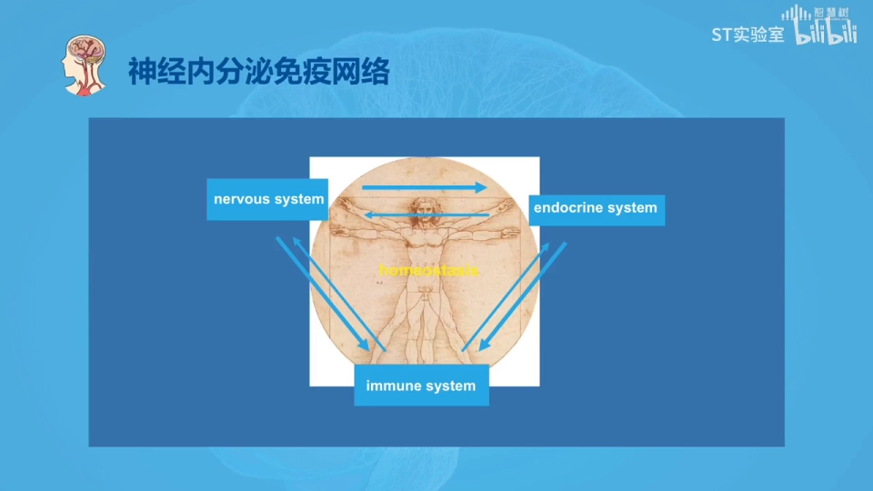
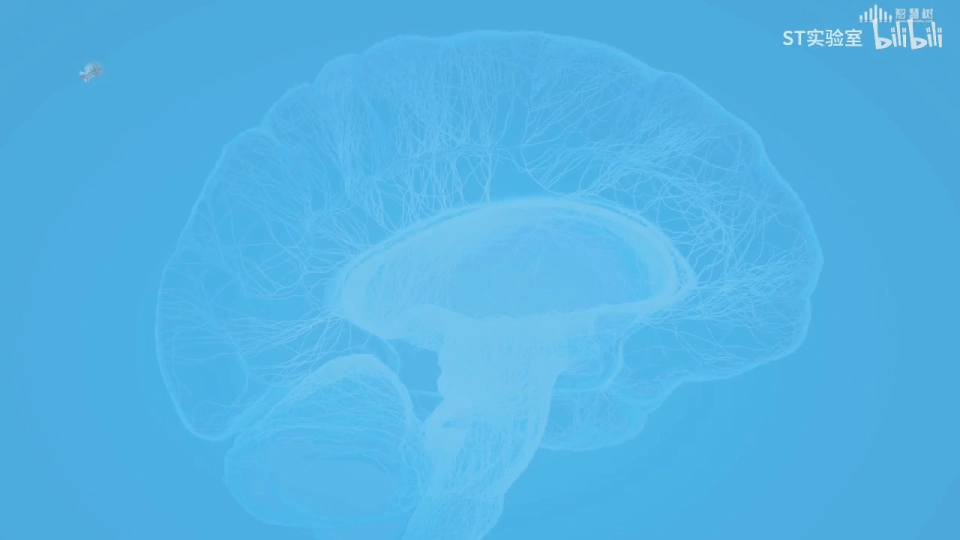
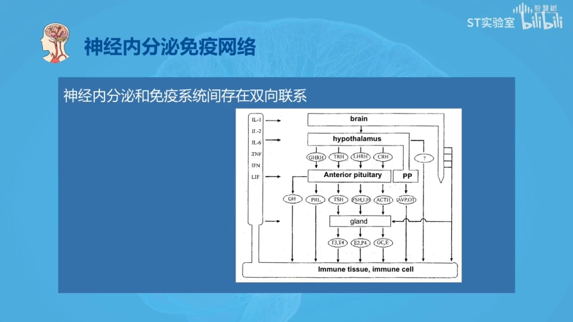
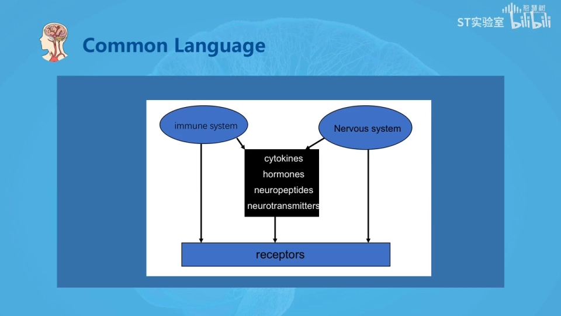

# 三者的交叉：应激反应里的神经、内分泌与免疫

> 视频来源：[神经内分泌免疫网络](https://www.bilibili.com/video/BV1gi4y1S7JR/)（Bilibili · ST 实验室，约 5 分钟）
> 导读：这支课把三套系统画成一个围绕稳态的三角，用应激反应演示"神经—内分泌—免疫"如何串成一条链，并给出"共用信号语言"的边界论证。突触与激素轴细节分别见 4.4.7、4.4.8。

## 本讲要解决的核心问题（SCQA）

**背景**：前两篇分别建立了三列分工表和免疫的尺度。神经快而准、体液慢而广、免疫靠识别身份，三列各管一段。

**冲突**：但真实的生理事件从不按学科分科发生。考试前紧张会拉肚子、会感冒；感染会发热、会没胃口。这些现象里，神经、内分泌、免疫同时在动。如果三套系统各有专用信号，它们靠什么对话？

**疑问**：三套系统之间到底怎么接线？交叉是"特例"还是"常态"？如果信号分子是通用的，那"三列分工"还成立吗？

**回答（中心思想）**：三套系统构成一个**围绕内环境稳态的三角**，每一条边都是双向的。交叉的典型例子是**应激**：中枢接受应激源信号后，一条路走交感神经输出肾上腺素、去甲肾上腺素，另一条路走"下丘脑—垂体—肾上腺皮质轴"输出糖皮质激素，两者都经血液循环作用于免疫器官、组织和细胞。更关键的是，**三类信号分子和它们的受体是共用的**——所以"分工"是功能层面的分工，不是分子层面的专属线路。

---

## 一、三角：三套系统围着同一个目标

[【跳转到 00:15】](https://www.bilibili.com/video/BV1gi4y1S7JR/?t=15)

视频开篇的比喻很直接：我们身体里有一个高效运作的信息网络，体内有**三大信号系统**——神经系统、内分泌系统、免疫系统。它们之间相互调节，共同达成内环境稳态，保障生命健康。

[【跳转到 00:44】](https://www.bilibili.com/video/BV1gi4y1S7JR/?t=44)

三角的每一条边都值得单独看，但视频先处理了一个容易被忽略的结构事实：**内分泌系统的高级中枢（下丘脑和垂体）就在脑内，而且受高位中枢的调控**。所以从解剖上看，内分泌系统本就是神经系统的一个部分，是它功能输出的一条途径。

[【跳转到 01:01】](https://www.bilibili.com/video/BV1gi4y1S7JR/?t=61)

这句话把"神经"和"内分泌"两列的界线说清楚了：它们的区别不在于"谁指挥谁"，而在于**信号出脑之后走哪条路**——走神经纤维，是神经调节；进入血液，是体液调节。同一个中枢，可以同时用两种方式输出。

---

## 二、神经—内分泌—免疫：应激是一条完整的三段链

视频给的典型例子是**应激反应**。它的结构值得逐段拆开，因为这是全篇唯一一条把三套系统串起来的完整通路：

1. **中枢接受应激源信号**（来自躯体的、心理的刺激都在此汇合）；
2. **第一条输出路**：通过交感神经，输出肾上腺素、去甲肾上腺素等神经递质；
3. **第二条输出路**：通过下丘脑—垂体—肾上腺皮质轴，输出可的松等糖皮质激素；
4. **两条路的信号都经血液循环运输**，作用于免疫器官、免疫组织和免疫细胞，调节免疫功能。

[【跳转到 01:24】](https://www.bilibili.com/video/BV1gi4y1S7JR/?t=84)

这条链里有三个值得注意的细节：

- **同一起点，两条结构不同的输出**。交感神经那条把递质直接送到靶组织；HPA 轴那条要经过下丘脑—垂体—肾上腺皮质三级，才把糖皮质激素送进血液。这正好复用了前两篇的结论：路径决定速度。
- **免疫器官是这两条线的共同靶点**。也就是说，免疫系统不只听抗原的，还听神经和激素的。
- **糖皮质激素是抑制性的**。视频点明：这也是应激状态下人往往容易生病的原因之一——比如每逢临近考试，生病的学生人数就会上升；糖皮质激素同时也是临床上最常用的免疫抑制剂。

[【跳转到 01:49】](https://www.bilibili.com/video/BV1gi4y1S7JR/?t=109)

这一条把"内分泌—免疫"那条边坐实了：**激素可以直接改写免疫反应的强度**。注意这不是"激素替代免疫"，而是激素给免疫系统调了一个音量。

---

## 三、反方向：免疫也能对神经内分泌说话

三角的边是双向的。视频接着给出反向的一条：

> 感染时，免疫细胞分泌的炎症介质可以介导发热反应、痛觉调制等等。

[【跳转到 02:21】](https://www.bilibili.com/video/BV1gi4y1S7JR/?t=141)

于是完整的双向关系是：

- **正向**：中枢神经通过自主神经和内分泌系统输出神经递质和激素，调节免疫功能；
- **反向**：免疫细胞分泌细胞因子，经血液循环调节神经内分泌功能。

[【跳转到 02:42】](https://www.bilibili.com/video/BV1gi4y1S7JR/?t=162)

这张图把两条边画在了一起：向下是"脑—下丘脑—垂体—腺体—免疫组织、免疫细胞"，向上是"IL-1、IL-2、IL-6、TNF、IFN 等细胞因子—脑"。**发热就是反向这条边的临床表现**：免疫细胞在局部打的仗，通过细胞因子把信号送到中枢，中枢再改写体温的调定点（调定点机制见 3.4.2）。

---

## 四、共用语言：分工是功能层面的

到这里，一个更尖锐的问题出现了：如果神经能调免疫、免疫能调神经，那"三类信号分子"的划分还有意义吗？

视频的答案是**没有分子层面的专属**，而且说得很彻底：

- 神经元既可以产生神经递质，也可以分泌激素和细胞因子；神经元上就有各类递质、激素、细胞因子的受体。
- 免疫细胞既产生细胞因子，也可以分泌递质、激素；免疫细胞上也全有各类受体。
- 所以"把信号分子再区分成所谓神经信号和免疫介质已毫无意义——所有的信号都是通用的，one word, one language"。

[【跳转到 03:01】](https://www.bilibili.com/video/BV1gi4y1S7JR/?t=181)

这张图是全篇的收口。它说明三列分工的界线应该画在哪里：

| 划分依据 | 是否成立 | 说明 |
| --- | --- | --- |
| 信号分子种类 | **不成立** | 递质、激素、细胞因子是共用的词汇，不是某个系统的专有名词 |
| 受体归属 | **不成立** | 各类细胞表面都有多类受体 |
| 传递路径 | **成立** | 突触间隙、血液、免疫细胞之间——路径决定速度和范围 |
| 任务与判据 | **成立** | 神经判"该不该动"，内分泌判"全身状态调到哪"，免疫判"这是不是自己人" |

也就是说，**分工不是"谁用哪种分子"，而是"信号走哪条路、由谁来判读"**。这正好接上前两篇的结论：尺度差别来自路径，特异性来自受体与识别。

[【跳转到 03:44】](https://www.bilibili.com/video/BV1gi4y1S7JR/?t=224)

---

## 五、小结里的那张全景

视频最后用一段话把三角收束起来：

> 免疫系统接受外界病原体、毒素信号，监测体内肿瘤的异常信号；神经系统接受体内外各种躯体及心理的刺激信号。两者分享神经递质、神经肽、激素、细胞因子信号及其受体，通过共用的生物学语言交换信息，协调功能，共同达成内环境稳态，调节全身各系统器官功能。

[【跳转到 03:59】](https://www.bilibili.com/video/BV1gi4y1S7JR/?t=239)

这段话里有两个容易被略过的点：

1. **三套系统接收的"输入"不同**。免疫收的是分子层面的身份信号（病原体、毒素、肿瘤异常），神经收的是躯体与心理刺激。输入不同，才有分工的必要。
2. **共享的是"语言"，不是"器官"**。共用信号分子和受体，意味着任何一套系统都可以借用另一套的词汇；但器官的位置、线路的走向、反应的时间常数仍然各自不同。

---

## 六、边界：这一节讲到哪里为止

本篇只做"三者并排"和"交叉各一例"。以下内容不在本篇范围：

- 突触传递的细节（递质释放、受体类型、突触整合）见 4.4.7；
- 具体激素轴的分级调节与负反馈（HPA 轴的三级结构、反馈回路）见 4.4.8；
- 免疫机制（抗体、T 细胞亚群、MHC、补体）见 B05；
- 应激的临床后果、糖皮质激素的药理应用不展开。

[【跳转到 04:24】](https://www.bilibili.com/video/BV1gi4y1S7JR/?t=264)

---

## 小结

- 神经、内分泌、免疫构成一个**围绕内环境稳态的三角**，每条边都是双向的。
- 内分泌的高级中枢（下丘脑、垂体）在脑内并受高位中枢调控，因此**内分泌是神经系统的输出途径之一**；区别在于信号出脑后走神经还是走血液。
- **应激**是唯一一条把三套系统串起来的完整例子：中枢→交感神经→肾上腺素/去甲肾上腺素；中枢→HPA 轴→糖皮质激素；两者经血作用于免疫器官与免疫细胞。
- 糖皮质激素**抑制**免疫，是应激时容易生病的原因之一，也是临床上最常用的免疫抑制剂。
- 反方向：免疫细胞分泌**细胞因子**，经血调节神经内分泌功能，发热是典型表现。
- **三类信号分子与受体是共用的**（one word, one language）；分工的依据是**路径与判据**，不是分子种类。

## 关键术语速查

| 术语 | 一句话解释 |
| --- | --- |
| 神经内分泌免疫网络 | 三套系统通过共用信号分子与受体相互调节、共同维持稳态的网络 |
| 应激 | 机体对躯体或心理刺激的整体反应，同时动员神经、内分泌与免疫 |
| 交感神经 | 应激时输出肾上腺素、去甲肾上腺素等递质的通路 |
| 下丘脑—垂体—肾上腺皮质轴 | 应激时输出糖皮质激素的三级内分泌通路 |
| 糖皮质激素 | 应激时升高、抑制免疫功能的激素，临床常用免疫抑制剂 |
| 细胞因子 | 免疫细胞分泌、可经血作用于神经内分泌系统的信号分子 |
| 炎症介质 | 感染时免疫细胞释放、介导发热与痛觉调制的物质 |
| 共用生物学语言 | 三套系统使用同一批信号分子与受体，因此可互相"听懂" |