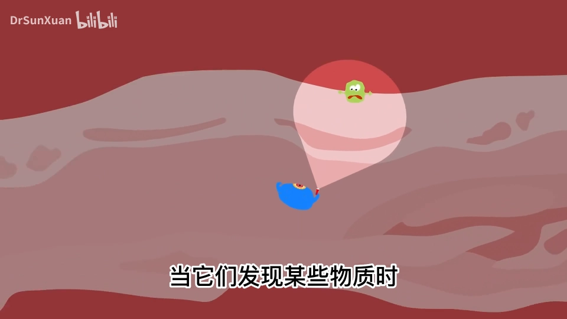
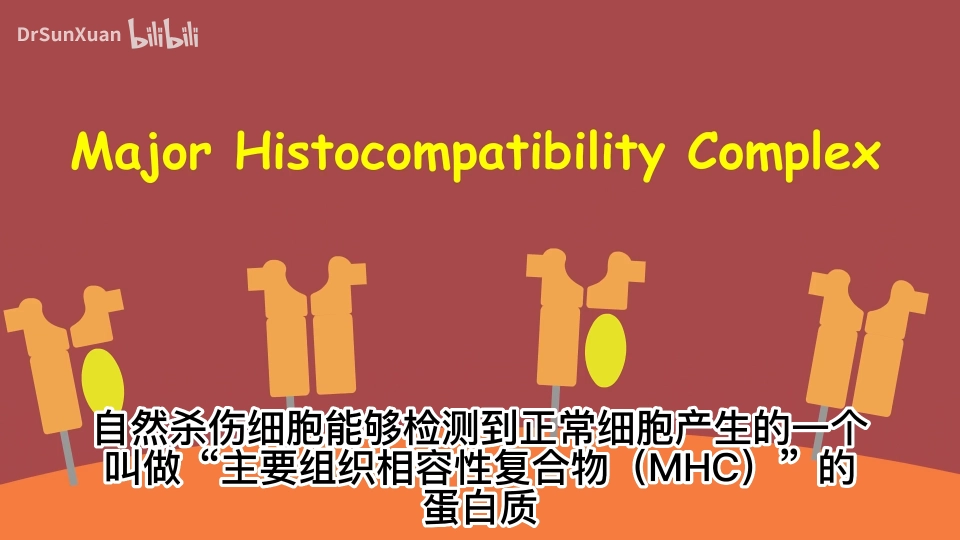
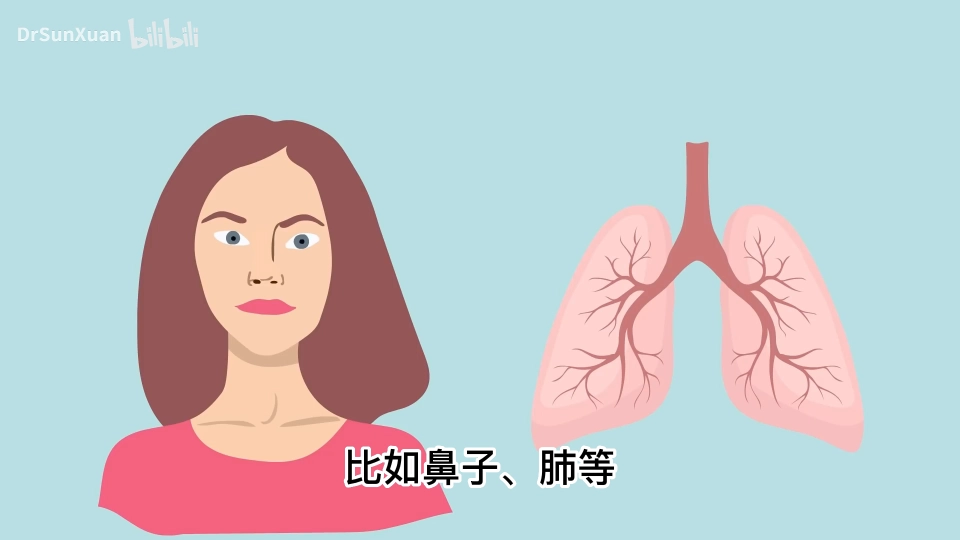
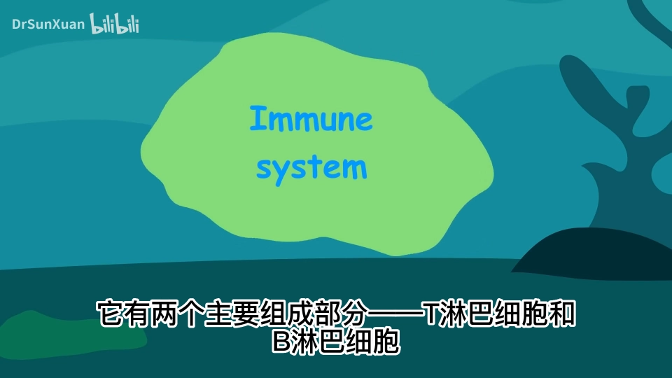
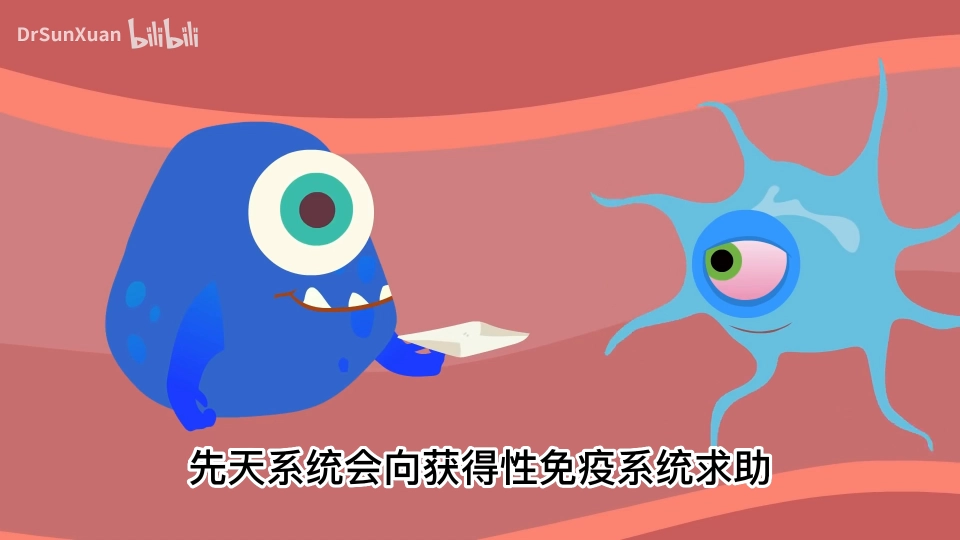

# 免疫作为通讯系统：先天与适应的尺度、范围与特异性

> 视频来源：[免疫系统：先天性免疫与适应性免疫简介](https://www.bilibili.com/video/BV1UV411P7wM/)（Bilibili · DrSunXuan 译制动画，约 7 分钟）
> 导读：这支动画把免疫系统拆成先天与适应两套，并给出两者的时间差、范围差和识别方式差。本文只取"免疫作为一类通讯系统"的框架，抗体结构、T 细胞亚群、MHC 提呈等机制留给 B05。

## 本讲要解决的核心问题（SCQA）

**背景**：上一篇把神经、体液、免疫并排成三列，免疫那一列只写了"防卫、清除"四个字。我们也知道免疫靠细胞因子在细胞之间传话。

**冲突**：但免疫系统不是一个器官、一种细胞，而是一大群细胞。它们之间怎么协调？为什么有的反应几分钟就起来、有的要等好几天？为什么有的反应只在伤口周围，有的能覆盖全身？

**疑问**：如果把免疫当成一类通讯系统来看，它的信号是什么、路径是什么、时间尺度和作用范围有多大、特异性从哪里来？

**回答（中心思想）**：免疫是**两套速度不同的通讯系统叠在一起**——先天免疫**快而不特异**，几小时内启动，靠化学信号在局部召集细胞；适应性免疫**慢而高度特异**，需要数天，靠抗原识别、细胞增殖和记忆把反应"定制"出来。两者的分界不是"有没有信号"，而是**识别方式和时间成本**。

---

## 一、免疫系统是两套系统，不是一套

[【跳转到 00:00】](https://www.bilibili.com/video/BV1UV411P7wM/?t=0)

视频开篇就给了一个二分：免疫系统可以粗略分为**先天免疫**和**适应性免疫**。

- **先天免疫**（非特异性免疫）：身体对任何入侵者的第一道自然防御。它"不关心自己正在杀死什么"，主要目标是防止入侵者进入身体；一旦进来了，就把它杀死。
- **适应性免疫**：能区分不同类型的病原体，因此更高效，但需要时间。

[【跳转到 00:40】](https://www.bilibili.com/video/BV1UV411P7wM/?t=40)

这个二分是理解免疫尺度的钥匙。后面所有的细节——屏障、炎症、吞噬细胞、抗体、记忆细胞——都可以挂到这两套系统下面。

---

## 二、先天免疫：用化学信号在局部召集人手

### 2.1 第一层不是细胞，是屏障

先天免疫最先出场的不是白细胞，而是物理与化学屏障：

- **皮肤**：身体最大的器官，任何试图进入身体的生物都会被它挡住；
- **黏膜**：所有器官的黏膜内层，表面的黏液能拦住试图通过的病原体；
- **化学屏障**：眼泪中的溶菌酶、胃酸，能杀死试图入侵的病原体；
- **正常菌群**：生殖泌尿道等部位有自己的微生物群，与病原体争夺空间和食物，因此也起屏障作用。

[【跳转到 01:05】](https://www.bilibili.com/video/BV1UV411P7wM/?t=65)

屏障的意义在于：**大多数"通讯"根本不需要发生**。病原体在门口就被拦住了，不必惊动后面的细胞部队。

### 2.2 炎症：一条典型的局部化学信号链

一旦屏障被突破，下一道防线是**炎症**，执行者是**肥大细胞**。

这条链很短，但把"通讯"的要素都占全了：

1. 肥大细胞不断搜索身体中的可疑物体；
2. 发现目标后，释放**组胺**分子作为信号；
3. 组胺提醒身体把血液送往问题区域，引起炎症，并带来白细胞；
4. 白细胞——细胞军队里的士兵——到达后引发一系列反应。

[【跳转到 01:53】](https://www.bilibili.com/video/BV1UV411P7wM/?t=113)

这条链解释了免疫通讯的第一个特征：**信号是化学的，路径是局部的**。组胺不需要进入全身循环去"广播"，它只需要在受伤点周围扩散，让附近的血管舒张、让白细胞黏附并穿出。所以炎症是**局灶性**的——哪块伤了，哪块红、肿、热、痛。

视频还补了一个反面案例：有时候入侵者并不是细菌，而是灰尘这类无害物质，身体仍然会对它产生完整的免疫反应，**这就是过敏**。信号链本身没有错，错的是"把谁当成敌人"这个判断。

### 2.3 细胞部队的分工

白细胞是这套系统里的"VIP"，拥有通往全身的通行证（大脑和脊髓除外）。视频按职能把它们分成几类：

| 细胞 | 干什么 | 通讯上的角色 |
| --- | --- | --- |
| 中性粒细胞 | 数量最多，在身体里巡逻，迅速到达破损部位，杀死感染细胞后自己死亡，形成脓液 | 快速反应部队，靠"到场"而不是靠"定制" |
| 巨噬细胞 | 像饥饿的猛兽一样吞食病原体，死亡前可消化约 100 个病原体；也能识别并杀死自身变异的细胞（如癌细胞） | 驻守型清道夫 |
| 自然杀伤细胞 | 识别自身细胞是否变异或被感染，发现异常就结合并释放化学物质摧毁它 | 用"缺失标记"做判断的巡逻兵 |
| 树突状细胞 | 存在于鼻子、肺等与外界接触的地方，吞噬病原体后把信息传给适应性免疫系统 | **两套系统之间的纽带** |

[【跳转到 02:36】](https://www.bilibili.com/video/BV1UV411P7wM/?t=156)

自然杀伤细胞的判断方式值得单独一提：正常细胞表面会产生一种叫**主要组织相容性复合物（MHC）**的蛋白质，细胞一旦不正常就停止产生这种蛋白；自然杀伤细胞不断巡逻，检查细胞是否出现这个缺陷，发现异常就摧毁它。

[【跳转到 03:49】](https://www.bilibili.com/video/BV1UV411P7wM/?t=229)

注意这里的逻辑：它检测的不是"你是不是病原体"，而是"**你是不是还正常**"。这是一种**基于缺失的识别**，速度快，但精度有限——这也正是先天免疫"快而不特异"的分子基础。MHC 的具体结构与提呈机制属于 B05，此处只取"它是细胞正常状态的展示牌"这一层。

---

## 三、抗原：把"敌人长什么样"变成可传递的信息

先天免疫打到一定程度，如果事情失控，就需要向适应性免疫系统求助。求助的方式是**传递信息**，而信息的载体是**抗原**。

链条是这样的：

1. 树突状细胞（巨噬细胞也能做）吞噬病原体；
2. 它把关于病原体的信息传递给适应性免疫系统的细胞；
3. 这些信息以**抗原**的形式产生和分享——抗原是病原体留下的痕迹，是可以被适应性免疫系统检测到、以便识别的表面分子；
4. 树突状细胞把信息传递给 **T 细胞**。

[【跳转到 04:27】](https://www.bilibili.com/video/BV1UV411P7wM/?t=267)

这一步是整篇的关键转折：**先天免疫处理的是"位置"（哪里有问题），适应性免疫处理的是"身份"（这个敌人具体是谁）**。把位置信息翻译成身份信息，靠的就是抗原这张"通缉令"。

---

## 四、适应性免疫：慢，但把特异性做到了极致

适应性免疫系统有两个主要组成部分：**T 淋巴细胞**和 **B 淋巴细胞**。

- 感染已经发生时，T 细胞发挥作用，引发**细胞介导的免疫反应**；
- 病原体已经进入但还没引起疾病时，B 细胞参与战斗，这被称为**体液免疫反应**。

[【跳转到 05:02】](https://www.bilibili.com/video/BV1UV411P7wM/?t=302)

视频随后给出了两条分支的轮廓（细节留给 B05）：

- **辅助 T 细胞**接收来自树突状细胞或巨噬细胞的信号，执行两项任务：一是形成**效应 T 细胞**，循环穿越全身、召集其他白细胞；二是形成**记忆 T 细胞**，为将来保留这个抗原的记录。
- 当受感染的细胞已经没有希望时，免疫系统会引出**细胞毒性 T 细胞**，让它们对受感染和垂死的细胞执行"安乐死"。
- **B 细胞**产生称为**抗体**的化学物质，与病原体上的抗原结合，"就像锁和钥匙一样契合"；抗体围在病原体周围起标签作用，向巨噬细胞发出信号，让它们前来消灭被标记的病原体。
- B 细胞遭遇抗原时还会产生**记忆 B 细胞**，与记忆 T 细胞一起维护所有遭遇感染的记录。

[【跳转到 06:15】](https://www.bilibili.com/video/BV1UV411P7wM/?t=375)

从通讯的角度看，这条分支做了一件先天免疫做不到的事：**把"识别"变成"生产"**。先天免疫的识别是现成的、固定的；适应性免疫在识别之后还要**增殖、分化、生产**专用武器（效应细胞和抗体），并把这次识别的结果**存档**（记忆细胞）。生产和存档都要花时间，这就是它慢的原因。

---

## 五、尺度对照：把免疫放进三列分工表

视频最后用两句话把时间尺度点明了：

> 我们的先天免疫反应更快，但不够特异，它在**几个小时**内就开始发挥作用，而且相当强大；然而当事情失控时，先天系统就会向获得性免疫系统求助，后者可能需要**数天**时间才能产生反应——但下次我们遭遇同样的病原体时，它就不会让我们生病了。

[【跳转到 06:45】](https://www.bilibili.com/video/BV1UV411P7wM/?t=405)

把这一篇的内容填进上一篇的三列分工表，免疫那一列就完整了：

| 维度 | 先天免疫 | 适应性免疫 |
| --- | --- | --- |
| 信号分子 | 组胺等化学介质 | 抗原信息、抗体 |
| 传递路径 | 局部扩散、局部血管 | 淋巴器官、循环全身 |
| 时间尺度 | 数小时 | 数天；再次遇到时更快 |
| 作用范围 | 局部为主（炎症是局灶性的） | 系统性（效应细胞循环全身） |
| 特异性来源 | 固定模式：正常/异常、自己/非己 | 抗原识别 + 克隆增殖 + 记忆 |
| 记忆 | 无 | 有 |

这张表回答了两个常见误解：

1. **"免疫就是炎症"**——不对。炎症只是先天免疫的一条局部反应，适应性免疫是完全不同的另一套，走淋巴器官和循环，能覆盖全身。
2. **"免疫反应越强越好"**——不对。过敏就是"把无害物质当成敌人"的过度反应；识别精度和反应强度是两件事。

---

## 六、边界：这里讲的是"位置"，不是"机制"

本篇刻意停在系统层面。以下内容都属于免疫机制，在 B05《免疫与抗体生物学基础》展开：

- 抗体的结构、类别与抗原结合位点；
- T 细胞亚群（辅助性、细胞毒性、调节性）的分工与相互调控；
- MHC 分子的结构与抗原提呈途径；
- 补体系统、干扰素等效应机制；
- 免疫记忆的细胞基础与疫苗设计。

本节只需要带走一句话：**免疫是三类通讯系统里唯一以"识别身份"为核心任务的一套**，它的慢、它的特异、它的记忆，都是为这个任务付出的代价。

[【跳转到 07:06】](https://www.bilibili.com/video/BV1UV411P7wM/?t=426)

---

## 小结

- 免疫系统分**先天免疫**与**适应性免疫**两套：前者快而不特异，后者慢而高度特异。
- 先天免疫先用**屏障**（皮肤、黏膜、化学屏障、正常菌群）把大多数入侵者挡在门外。
- 屏障被突破后，**肥大细胞释放组胺**，把血液和白细胞引向问题区域，形成**局灶性炎症**；把无害物质当敌人就是过敏。
- 白细胞分工：中性粒细胞快速到场、巨噬细胞驻守吞噬、自然杀伤细胞检查 MHC 缺失、树突状细胞负责**把信息交给适应性免疫**。
- **抗原**是"敌人长什么样"的可传递信息，把位置信息翻译成身份信息。
- 适应性免疫靠 T 细胞（细胞介导）和 B 细胞（体液免疫，产生抗体），并在识别后**增殖、分化、存档**，因此要数天。
- 免疫的尺度：先天数小时、局部；适应数天、全身、有记忆。机制见 B05。

## 关键术语速查

| 术语 | 一句话解释 |
| --- | --- |
| 先天免疫 | 生来就有、不针对特定病原体的防御，几小时内启动 |
| 适应性免疫 | 针对特定病原体、需要数天产生、并有记忆的防御 |
| 抗原 | 病原体表面留下的、可被适应性免疫识别的分子痕迹 |
| 抗体 | B 细胞产生的、与抗原特异性结合的蛋白质，起标签作用 |
| 组胺 | 肥大细胞释放的信号分子，引起局部血管反应与炎症 |
| 炎症 | 局部血管扩张、血流增加、白细胞聚集的反应 |
| MHC | 主要组织相容性复合物，细胞正常状态的"展示牌" |
| 记忆细胞 | 遭遇抗原后留存下来的 B/T 细胞，使再次应答更快更强 |
| 树突状细胞 | 吞噬病原体并把抗原信息递给 T 细胞的纽带细胞 |