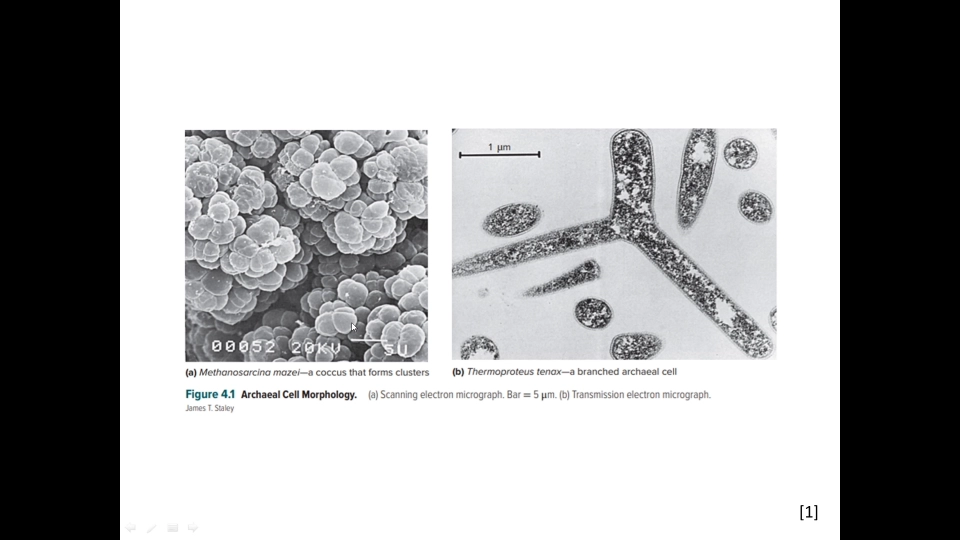
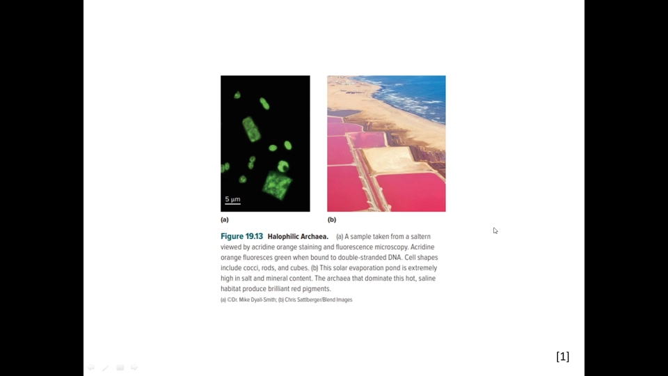
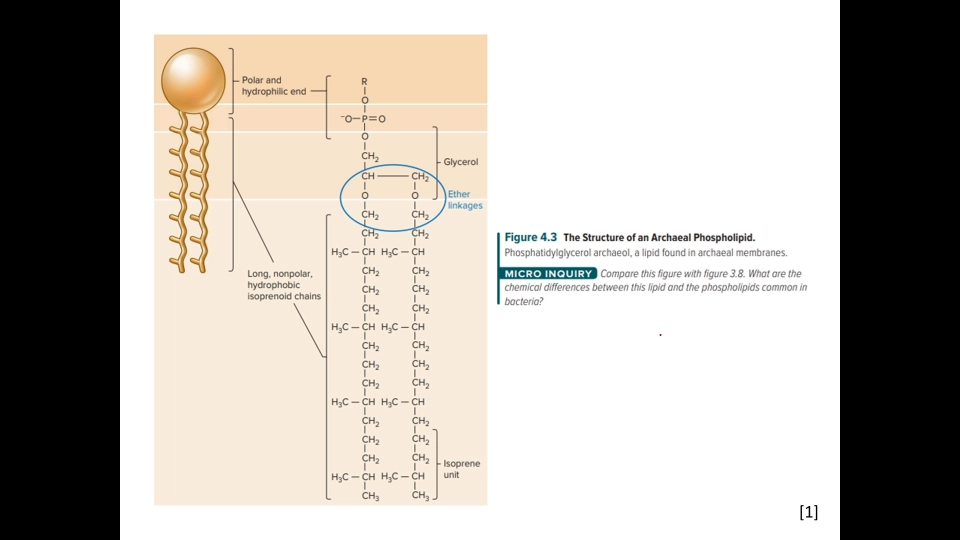
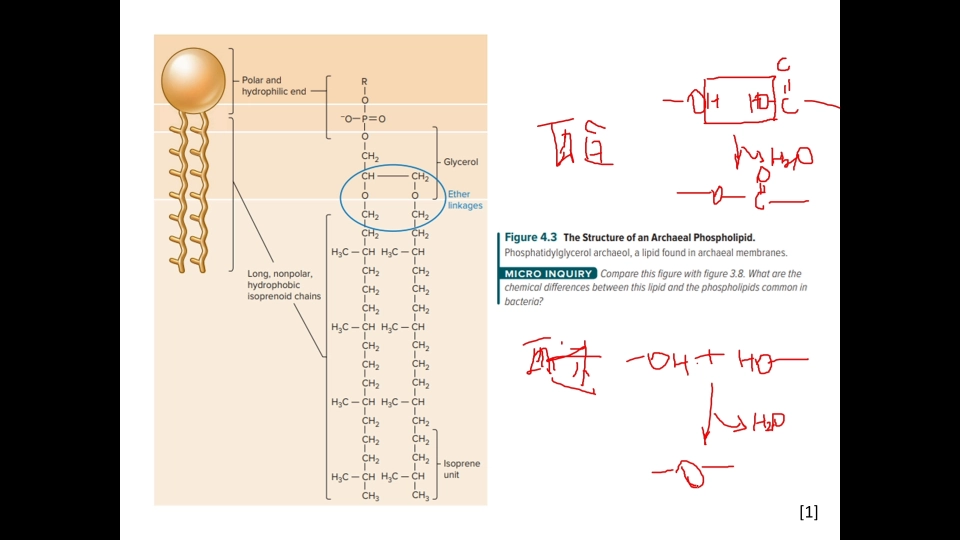
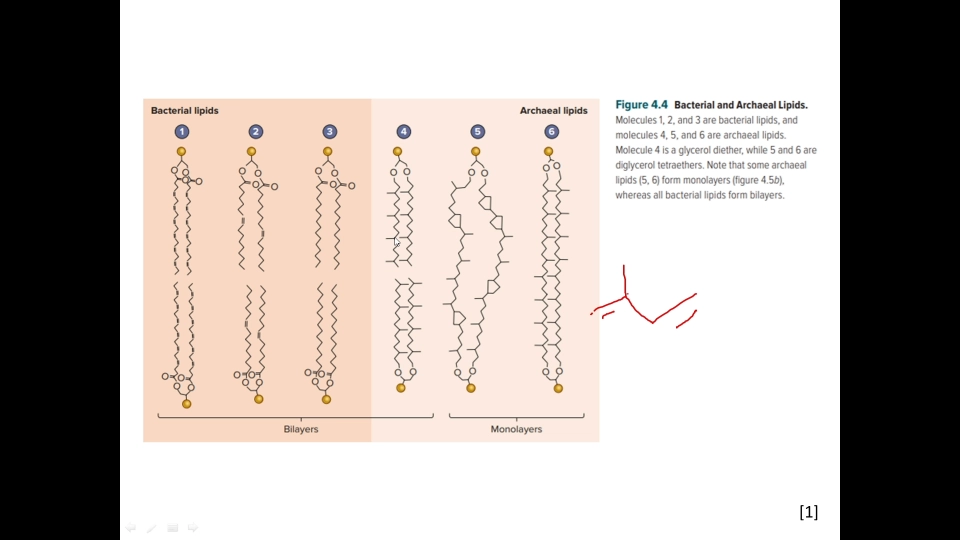
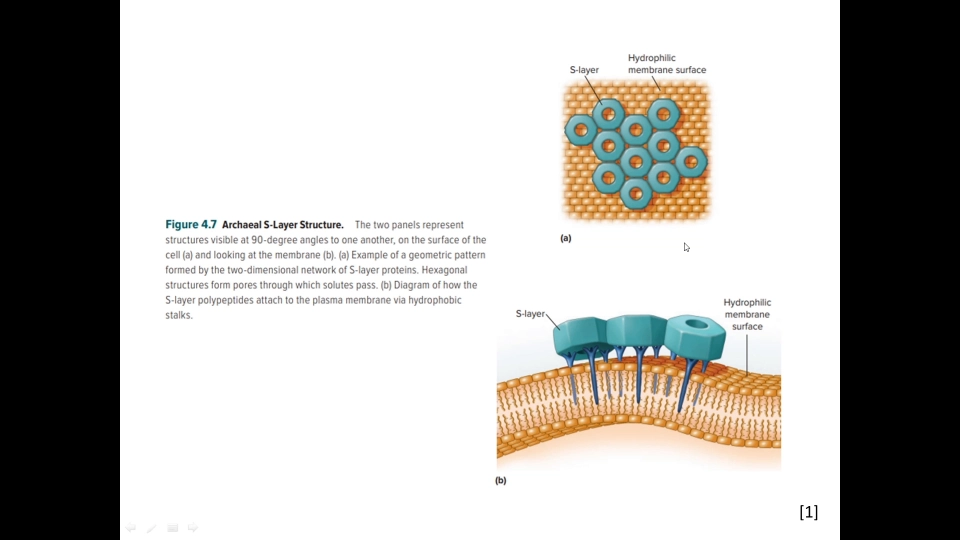
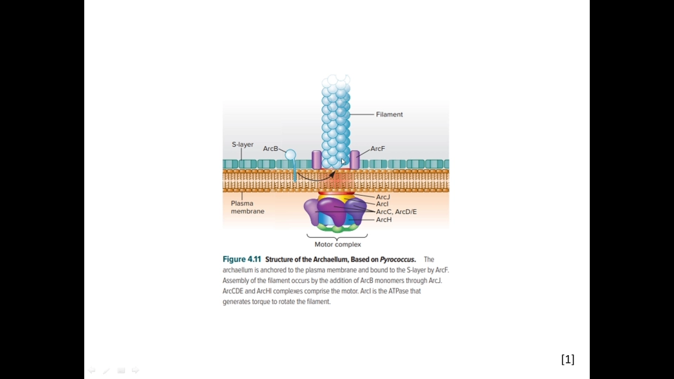

# 古菌细胞：三域框架、醚键膜脂与极端环境适应

> 视频来源：[《【细胞生物学讨论】7 古菌细胞》](https://www.bilibili.com/video/BV1Th4y147Tv/)（B 站 · 细胞生物学讨论课）｜时长约 36 分 14 秒
> 导读：上一篇讲的是细菌。这一篇讲第三域——古菌。它和细菌一样没有核膜、大小也差不多，光看外形分不开；但把镜头推到分子层面，细胞膜的化学键、细胞壁的成分、核糖体的蛋白组成都和细菌不同，其中好几项反而更像真核生物。这一篇的任务，是把「三域」这个框架落到具体的结构差异上。

## 本讲要解决的核心问题（SCQA）

**背景**：生物分类用三域学说：细菌域、古菌域、真核生物域。古菌在形态、大小上和细菌几乎一样，都是微米级、没有核膜的单细胞生物。

**冲突**：如果只看形态，古菌就是「一种细菌」。但古菌能在高温热泉、高盐盐湖、强酸环境里生长，而这些地方一般细菌和真核生物都活不了；针对细菌细胞壁的抗生素对古菌也无效。这说明差异不在外形，而在分子层面。

**疑问**：古菌和细菌到底差在哪几个结构上？这些差异为什么能让它活在极端环境里？又为什么说它和真核生物关系更近？

**回答（中心思想）**：古菌与细菌的差别集中在三处：**细胞膜的脂质用醚键连接、脂链是萜类（有支链）、常形成单层膜**；**细胞壁没有肽聚糖，主要靠 S 层**；**核糖体虽是 70S，但蛋白成分更接近真核生物**，并且有类组蛋白包装 DNA 形成核小体样结构。醚键更稳定、单层膜更坚硬，正好对应高温高酸环境；核糖体蛋白与组蛋白的相似性，则是「真核生物可能从一类古菌演化而来」这一观点的结构证据。

---

## 一、三域框架：古菌为什么单独成域

视频开场先定位：生物分类用的是**三域学说**，古菌在这个学说里占有一席之地。[【跳转到 00:30】](https://www.bilibili.com/video/BV1Th4y147Tv/?t=30)

一个容易被忽略的时间点：古菌从细菌里被分离出来、被认为是一个单独的类群，要到 1980 年代，非常晚；这么多年来古菌研究一直比较缓慢。[【跳转到 00:30】](https://www.bilibili.com/video/BV1Th4y147Tv/?t=30)

> **补充**（不在本视频字幕内）：三域框架的依据是比较 rRNA 序列——Woese 等人在 1970 年代末发现产甲烷菌的 rRNA 序列与细菌、真核生物都差得很远，据此提出把生命分成三域。也就是说，**古菌是被分子序列「发现」的，不是被形态发现的**。这一点正好解释了本节为什么反复强调「形态分不开、分子才分得开」。

为什么古菌研究慢？因为很多古菌生活在极端环境里：高温、高盐、高酸，一般的细菌和真核生物无法生长，古菌在这些环境里占有比较重要的生态地位。[【跳转到 00:55】](https://www.bilibili.com/video/BV1Th4y147Tv/?t=55)

这带来一个研究上的连锁困难：要把古菌从野外获取本来就很困难；获取之后人工培养也很困难，因为很难给它制造适合生长的环境——要调极酸的 pH、非常高的温度，或者非常强的厌氧环境，这样的环境很难人工塑造。[【跳转到 01:20】](https://www.bilibili.com/video/BV1Th4y147Tv/?t=80)

**培养不到它，就无法研究它**，这是古菌研究的一个难点。[【跳转到 01:45】](https://www.bilibili.com/video/BV1Th4y147Tv/?t=105)

> 这条链值得单独记住，它是本节「区分研究对象」的第一个理由：**对象的可培养性，决定了你能用哪些方法研究它**。对古菌，很多结论只能来自环境样品测序和少数可培养代表株，而不是像大肠杆菌那样随心所欲的遗传操作。

---

## 二、形态和大小：从外形分不开细菌与古菌

第一部分讨论古菌的形态和大小，结论很干脆：**分不开**。[【跳转到 02:40】](https://www.bilibili.com/video/BV1Th4y147Tv/?t=160)

古菌的形状有球状、杆状，也有多边形的；大小和细菌差不多，直径基本在一微米左右。[【跳转到 03:05】](https://www.bilibili.com/video/BV1Th4y147Tv/?t=185)

视频给了几个具体例子：[【跳转到 03:55】](https://www.bilibili.com/video/BV1Th4y147Tv/?t=235)

- 一种多孔热变形菌，表面结构非常复杂，这和它的生存环境相关；
- 一种非常大的古菌，上面附着了很多细菌，两者尺寸对比悬殊，是一种共生关系；
- 荧光显微镜下的古菌尺寸很小，和细菌差不多；
- 类似纳米古菌那样的东西，比较小，附着在另一个细胞上。

视频还展示了一种嗜盐古菌的结构：凡是着色的位置都是 DNA 分布的区域。[【跳转到 08:02】](https://www.bilibili.com/video/BV1Th4y147Tv/?t=482)

> 所以判断「这是细菌还是古菌」，**形态学给不出答案**。这一点和后面要讲的生长条件、抗生素敏感性是同一件事的三个面：分类依据不在外形，在分子。

---

## 三、细胞膜：酯键 vs 醚键，脂肪酸 vs 萜类，双层 vs 单层

从分子水平区分细菌和古菌，第一站是细胞膜。[【跳转到 09:07】](https://www.bilibili.com/video/BV1Th4y147Tv/?t=547)

### 3.1 第一个差别：成醚键，不成酯键

正常的磷脂分子由甘油和脂肪酸通过**酯键**连接：一个提供羟基、一个提供羧基，发生酯化反应，脱去一分子水。[【跳转到 09:32】](https://www.bilibili.com/video/BV1Th4y147Tv/?t=572)

古菌细胞膜的脂成分不是这样：它没有羧基，是**醚键**。[【跳转到 09:57】](https://www.bilibili.com/video/BV1Th4y147Tv/?t=597)

醚键是两个羟基之间缩水形成的结构。醚键的形成其实相对困难，但形成之后比酯键更稳定。[【跳转到 10:22】](https://www.bilibili.com/video/BV1Th4y147Tv/?t=622)

> 这就是「化学稳定性 → 环境耐受」的第一条因果链：**醚键比酯键更难水解**，所以在高温、强酸、强碱条件下膜不容易散架。古菌能在极端环境里生存，和它成醚键是有关系的。[【跳转到 10:47】](https://www.bilibili.com/video/BV1Th4y147Tv/?t=647)

另外，古菌膜成分里甘油这一端连的不一定是磷脂，还可能是糖脂等别的成分；但不管怎么变，**都是成醚键**。[【跳转到 11:12】](https://www.bilibili.com/video/BV1Th4y147Tv/?t=672)

### 3.2 第二个差别：脂链是萜类，带支链

正常情况下的脂链应该是脂肪酸，一条直链下来；但古菌的脂链上有支链，细菌的脂质里不会出现这种支链成分。[【跳转到 11:37】](https://www.bilibili.com/video/BV1Th4y147Tv/?t=697)

所以古菌膜脂的下半部分不是脂肪酸，而是**萜类**——异戊二烯单元相互连接组成的复杂分子（固醇类物质本质上也是萜类）。[【跳转到 12:02】](https://www.bilibili.com/video/BV1Th4y147Tv/?t=722)

异戊二烯单元是五个碳，一个接一个连起来；古菌的脂链一般是 20 个碳，也就是二萜。[【跳转到 12:52】](https://www.bilibili.com/video/BV1Th4y147Tv/?t=772)

### 3.3 第三个差别：可能是单层膜

细菌是磷脂双分子层膜；但古菌不一定是双层膜，**有可能是单分子层膜**。[【跳转到 12:27】](https://www.bilibili.com/video/BV1Th4y147Tv/?t=747)

怎么形成单层？两个 20 碳的萜类链有可能连到一起，形成一个 40 碳的四萜，把双层膜的两侧连成一体。[【跳转到 13:17】](https://www.bilibili.com/video/BV1Th4y147Tv/?t=797) 当然这不绝对，有一些古菌仍是双层膜，这和它所处的环境有关系。[【跳转到 13:42】](https://www.bilibili.com/video/BV1Th4y147Tv/?t=822)

单层膜这种五元环结构在空间上位阻比较大，它把膜分子本身的流动性抑制住了，所以是一个比较坚硬的结构。[【跳转到 14:32】](https://www.bilibili.com/video/BV1Th4y147Tv/?t=872) 因此它能在非常高温的环境里生存，有可能到八九十度。[【跳转到 14:57】](https://www.bilibili.com/video/BV1Th4y147Tv/?t=897)

> 注意这里的取舍：**更硬的膜不是「更好」，而是「更耐受」**。膜的流动性是正常生理活动需要的，古菌用降低流动性换取高温下的不散架——这是权衡，不是升级。跨膜运输方面古菌和细菌一致，也有被动运输、主动运输和 ABC 转运体。[【跳转到 15:22】](https://www.bilibili.com/video/BV1Th4y147Tv/?t=922)

---

## 四、细胞壁：没有肽聚糖，主要靠 S 层

古菌的细胞壁**功能上和细菌一模一样，但分子水平上完全不同**。[【跳转到 16:59】](https://www.bilibili.com/video/BV1Th4y147Tv/?t=1019)

第一个区别：**古菌的细胞壁没有肽聚糖**。

第二个区别：既然没有肽聚糖，它靠什么组成细胞壁？往往靠 **S 层**——一些疏水成分插在膜里，蛋白质单体之间相互结合，组成复杂的表面结构。[【跳转到 17:17】](https://www.bilibili.com/video/BV1Th4y147Tv/?t=1037)

细菌里也有 S 层，但细菌和古菌的 S 层蛋白并不一样；对古菌来说，S 层的成分其实比较复杂。[【跳转到 17:38】](https://www.bilibili.com/video/BV1Th4y147Tv/?t=1058)

S 层是一个基本成分，有点像细菌的肽聚糖；但在 S 层之外还有一些别的成分——有的是单独的 S 层，有的在 S 层外面还有其他蛋白质层或多糖成分，有的则可能没有 S 层蛋白，还有的会有双层膜。[【跳转到 18:03】](https://www.bilibili.com/video/BV1Th4y147Tv/?t=1083)

所以**古菌的细胞壁成分是多变的，有非常大的多样性**；但这能不能代表整个古菌类群？视频说：真的不一定。[【跳转到 18:53】](https://www.bilibili.com/video/BV1Th4y147Tv/?t=1133)

> **补充**（不在本视频字幕内）：部分产甲烷古菌的壁含**假肽聚糖**（pseudopeptidoglycan）——糖骨架由 N-乙酰塔罗糖胺糖醛酸与 N-乙酰葡糖胺以 β-1,3 键交替连接，肽链含 L-型氨基酸。它和细菌肽聚糖功能相似、化学不同，所以溶菌酶和青霉素对它也无效。这条正好补上「没有肽聚糖」这句话的例外，也解释了为什么不能把「古菌壁 = S 层」当成绝对规律。

---

## 五、核糖体与拟核：70S 的壳，真核的芯

### 5.1 核糖体：大小像细菌，蛋白像真核

古菌的核糖体也是 **70S**，也有两个大小亚基，rRNA 成分和细菌相同；但 rRNA 序列和细菌不太一样，核糖体的蛋白质成分也和细菌不一样——**古菌的核糖体蛋白更接近真核生物的蛋白质**。[【跳转到 21:03】](https://www.bilibili.com/video/BV1Th4y147Tv/?t=1263)

所以有观点认为，真核生物可能是从一类古菌演化出来的。[【跳转到 21:28】](https://www.bilibili.com/video/BV1Th4y147Tv/?t=1288)

> 这一条是「为什么微生物学家关心这是细菌还是古菌」的最直接答案：**70S 这个数字会骗人**。许多抗生素（如四环素、红霉素）靶向细菌 70S 核糖体，但古菌的 70S 在蛋白组成上与细菌不同，因此这些药对古菌往往无效。**结构尺寸相同，不等于分子靶点相同。**

### 5.2 拟核与组蛋白：古菌有「类核小体」

古菌的拟核也有核酸相关蛋白包裹；拟核可能是单倍体或多倍体，而且可能是多条染色体。[【跳转到 21:53】](https://www.bilibili.com/video/BV1Th4y147Tv/?t=1313)

因为 DNA 结合了很多蛋白，这些蛋白之间相互作用可能影响基因的表达。[【跳转到 22:18】](https://www.bilibili.com/video/BV1Th4y147Tv/?t=1338)

**组蛋白是古菌特别特殊的一点**：古菌的组蛋白和真核生物的组蛋白不一样，但又有相似之处；这些组蛋白有可能缠绕 DNA 形成核小体，但古菌的核小体和真核生物的不一样——真核生物的核小体是 DNA 缠绕在组蛋白八聚体上，而古菌核小体中间的蛋白质成分往往不是八个，有可能是四个。[【跳转到 23:33】](https://www.bilibili.com/video/BV1Th4y147Tv/?t=1413)

> 这一条修正了一个常见的简化说法：「原核生物没有组蛋白」。**细菌确实没有，古菌有类组蛋白**。所以 1.3.1 对照表里「DNA 包装」那一行，对古菌要单独说——它介于细菌和真核之间。

---

## 六、附属物：菌毛与鞭毛（archaellum）

古菌也有菌毛，而且有两种。[【跳转到 24:23】](https://www.bilibili.com/video/BV1Th4y147Tv/?t=1463)

第一种由 Aap 这样的蛋白单体拼起来，可以实现古菌之间的细胞结合：两个古菌之间形成一个管道。[【跳转到 24:48】](https://www.bilibili.com/video/BV1Th4y147Tv/?t=1488)

第二种见于热网菌：菌毛非常密集，实现细胞之间的联系——分裂形成的子细胞还连在一起。[【跳转到 25:27】](https://www.bilibili.com/video/BV1Th4y147Tv/?t=1527)

还有钩状的菌毛，可以附着在基质上，形成生物膜的结构。[【跳转到 25:52】](https://www.bilibili.com/video/BV1Th4y147Tv/?t=1552)

除了菌毛，古菌还有鞭毛，但和细菌的鞭毛有三点不同：[【跳转到 26:34】](https://www.bilibili.com/video/BV1Th4y147Tv/?t=1594)

1. **生长方向不同**：古菌的鞭毛从基部开始生长，细菌的鞭毛是顶端生长；
2. **驱动方式不同**：古菌鞭毛由 ATP 直接驱动构象变化，而不是像细菌那样靠质子梯度驱动马达旋转；
3. **转向行为不同**：它在反向旋转过程中不会导致群体原地打转。

鞭毛的用途是**趋化**：感受化学物质，向着有利的环境迁移。[【跳转到 27:49】](https://www.bilibili.com/video/BV1Th4y147Tv/?t=1669)

视频给了一个很能说明问题的例子：一种产甲烷古菌生活在热液喷口附近，那里是高压环境，而且温度从 400 摄氏度急剧下降到很低；它要找到 50 到 90 度的环境，靠的就是鞭毛。[【跳转到 30:19】](https://www.bilibili.com/video/BV1Th4y147Tv/?t=1819)

> 这个例子把「结构」和「生长条件」直接连了起来：**极端环境不是均质的**。热液喷口附近存在陡峭的温度梯度，古菌靠运动在梯度里找到自己那段窗口——这正是「最适温度」在自然界里的实际含义。

---

## 七、三类细胞型微生物的结构对照

把两篇材料（本篇 + [细菌的形态与结构](细菌的形态与结构：细胞壁、细胞膜、荚膜、鞭毛与芽孢.md)）合起来，得到一张对照表。**真核微生物一列按通行教材补充，不在这两支视频的字幕内**；基因组组织一行只作回链，不重述。

| 对照项 | 细菌（真细菌） | 古菌 | 真核微生物（真菌等） |
| --- | --- | --- | --- |
| 核膜与细胞核 | 无，只有拟核 | 无，只有拟核 | 有真正的细胞核 |
| 细胞壁 | **肽聚糖**为共有骨架；阳性菌 15–50 层 + 磷壁酸，阴性菌 1–2 层 + 外膜与 LPS | **无肽聚糖**，主要靠 **S 层**；部分类群有假肽聚糖 | 真菌为**几丁质**，藻类多为纤维素，原生生物多样 |
| 膜脂连接 | **酯键** | **醚键**（更稳定） | 酯键 |
| 膜脂碳链 | 脂肪酸，直链 | **萜类**（异戊二烯单元），有支链 | 脂肪酸，直链 |
| 膜结构 | 双层 | 双层，也常为**单层**（四萜跨两层） | 双层，含固醇（真菌为麦角固醇） |
| 核糖体 | 70S（50S + 30S） | 70S，但**蛋白成分更接近真核** | 80S（细胞质） |
| DNA 包装 | 少量蛋白，无组蛋白 | **有类组蛋白**，可形成核小体样结构 | 组蛋白八聚体 + 核小体 |
| 细胞器 | 无膜性细胞器 | 无膜性细胞器 | 有线粒体、内质网、高尔基体等 |
| 运动结构 | 鞭毛（质子梯度驱动，顶端生长） | 鞭毛（ATP 驱动，基部生长） | 纤毛/鞭毛（微管 + 动力蛋白） |
| 基因组组织 | 环状为主、单复制起点、操纵子、可有质粒 | 环状为主，常多染色体、有类组蛋白 | 线性多染色体、多复制起点、基因散在 |
| 抗生素敏感性 | 肽聚糖类（青霉素）、70S 类（四环素等）敏感 | 对上述多数**天然不敏感** | 靶点少（麦角固醇、几丁质/葡聚糖合成） |

> 基因组组织一行只作索引：环状/线性、单/多复制起点、编码占比、操纵子、质粒，见 [1.3.1 原核与真核的基因组组织](../../../1_生命的物质与组织层级/1.3_细胞结构、生物膜与物质运输/1.3.1_原核与真核细胞、细胞器与分工/原核与真核的基因组组织：环状与线性染色体、复制起点与基因排布.md) 与 [质粒：染色体之外的环状DNA、独立复制与水平转移](../../../1_生命的物质与组织层级/1.3_细胞结构、生物膜与物质运输/1.3.1_原核与真核细胞、细胞器与分工/质粒：染色体之外的环状DNA、独立复制与水平转移.md)。本节不重复其机制。

---

## 八、边界：这张表不能当分类学用

1. **「古菌壁 = S 层」不是绝对规律**。古菌壁成分多样，部分类群有假肽聚糖，也有完全没有壁的类群。
2. **「醚键」是古菌的典型特征，但并非全部膜脂都如此**；视频讲的是主要脂质类型。
3. **形态学不能用于区分细菌与古菌**。这是本节反复强调的一点，也是三域框架「由分子序列定义」的直接后果。
4. **古菌的细胞分裂与细胞周期机制远比本节呈现的复杂**。视频提到 FtsZ 环、ParB、马达蛋白等，并明确说古菌研究历史很短、多样性还认识不清；本节只保留「古菌有类似细菌的分裂机器，也有类似真核的周期结构」这一层。[【跳转到 34:38】](https://www.bilibili.com/video/BV1Th4y147Tv/?t=2078)
5. **本节不展开分类大全**。古菌内部的谱系（如阿斯加德古菌与真核起源的关系）只作一句提示：视频结尾提到古菌细胞结构与真核特别像，这是「真核源于古菌」观点的基础。[【跳转到 35:03】](https://www.bilibili.com/video/BV1Th4y147Tv/?t=2103)

---

## 小结

- **三域框架**把生命分成细菌域、古菌域、真核生物域；古菌在 1980 年代才被单独分出，依据是分子而非形态。
- 古菌与细菌在形态、大小上**分不开**，差别在分子层面。
- 细胞膜三重差别：**醚键（不是酯键）、萜类支链（不是直链脂肪酸）、可为单层膜（不是双层）**；醚键更稳定、单层更坚硬，对应高温高酸环境。
- 细胞壁**没有肽聚糖**，主要靠 **S 层**，且成分多样（部分类群有假肽聚糖）。
- 核糖体是 **70S**，但蛋白成分更接近真核；有**类组蛋白**，可形成核小体样结构——所以「原核没有组蛋白」这句话对古菌不成立。
- 鞭毛与细菌不同：基部生长、ATP 驱动；靠趋化在温度梯度里找到自己的窗口。
- 区分研究对象的三条理由：**抗生素靶点不同、极端环境适应不同、演化关系不同**；再加上一条方法上的理由——**古菌难培养，可用的研究手段因此受限**。

## 关键术语速查

| 术语 | 一句话解释 |
| --- | --- |
| 三域学说 | 把生命分为细菌域、古菌域、真核生物域的分类框架，依据主要是 rRNA 序列 |
| 醚键 | 两个羟基缩水形成的连接，比酯键更稳定，是古菌膜脂的典型特征 |
| 萜类（异戊二烯链） | 由五碳异戊二烯单元连成的脂链，古菌膜脂的疏水尾，常带支链 |
| 四萜 / 单层膜 | 两条 20 碳萜链首尾相连成 40 碳，跨越双层膜两侧，形成单分子层膜 |
| S 层 | 由蛋白或糖蛋白单体组成的表面层，是许多古菌细胞壁的主要成分 |
| 假肽聚糖 | 部分产甲烷古菌的壁成分，糖骨架与肽链和细菌肽聚糖不同，溶菌酶与青霉素对其无效 |
| 类组蛋白 | 古菌中与真核组蛋白相似的 DNA 结合蛋白，可形成核小体样结构 |
| 鞭毛（archaellum） | 古菌的运动结构，基部生长、由 ATP 驱动，与细菌鞭毛同功不同源 |
| 趋化 | 感受化学物质浓度梯度并向有利环境迁移的行为 |