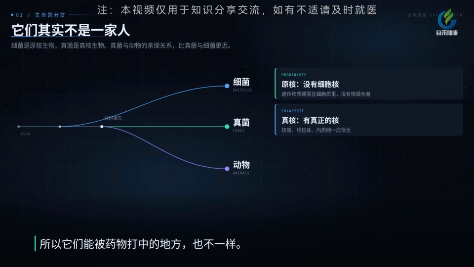
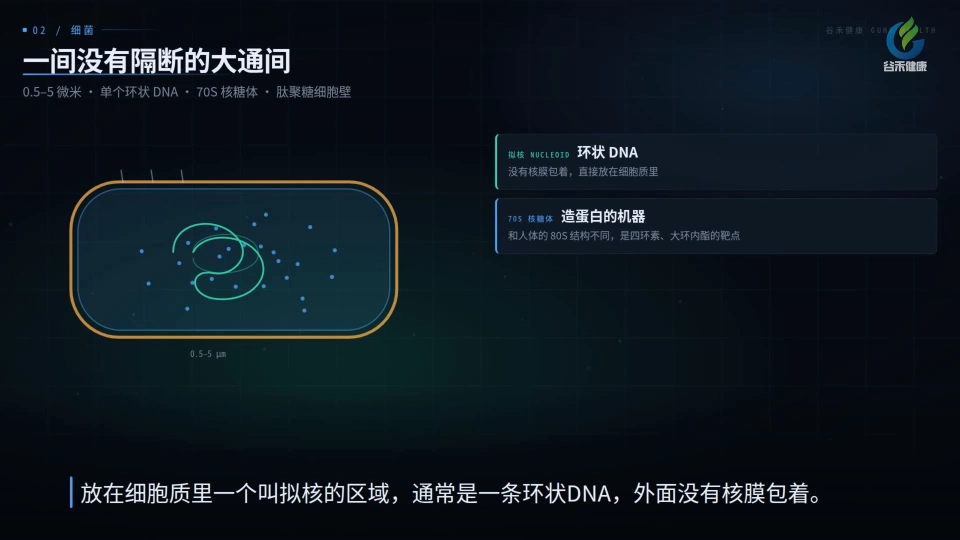
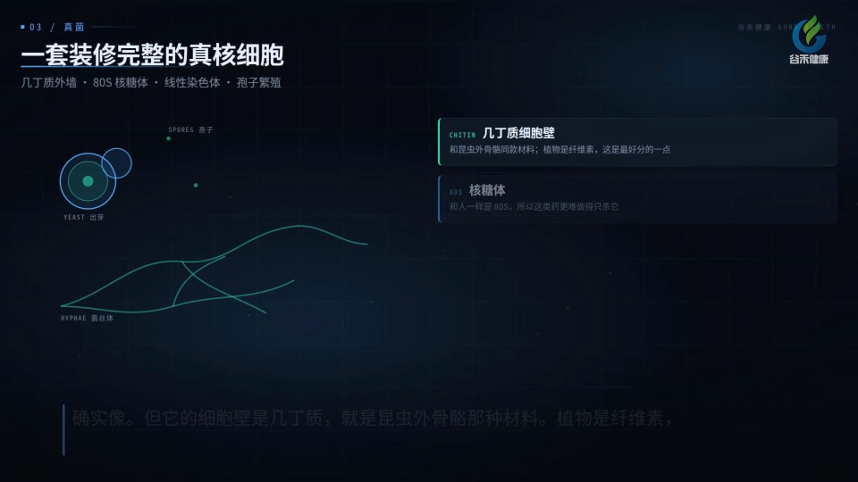
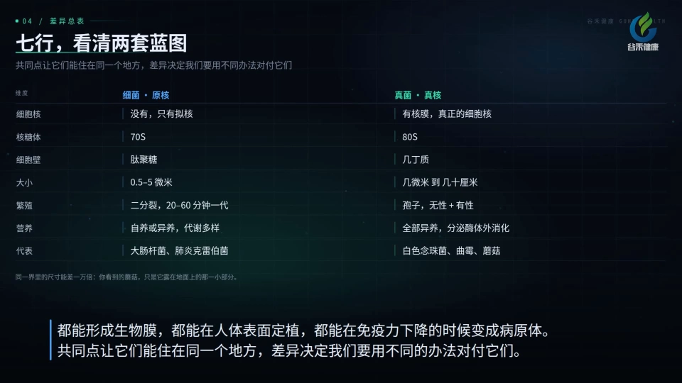
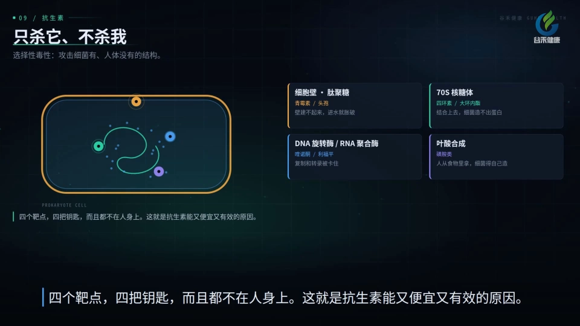
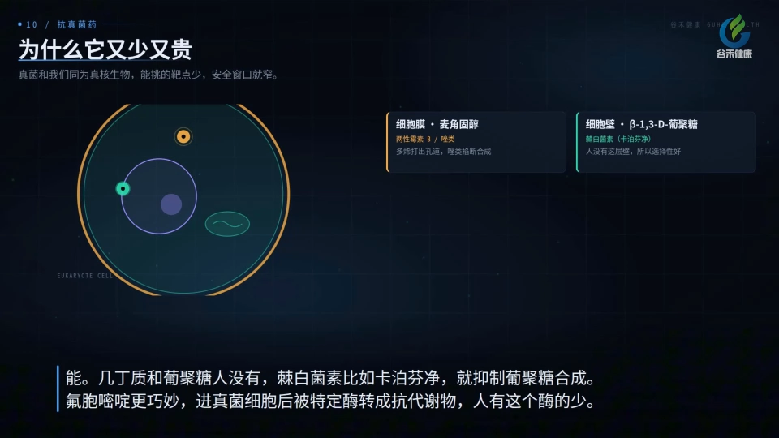

# 真核微生物：真菌、原生生物与藻类的结构与生长

> 视频来源：[《细菌与真菌，为什么一字之差，区别这么大？》](https://www.bilibili.com/video/BV1Vv4t6TEWS/)（B 站 · 谷禾健康）｜时长约 7 分 45 秒
> 导读：前两篇讲的是细菌和古菌，都是原核。这一篇补上第三类——**真核微生物**，主角是真菌（酵母、霉菌、蘑菇），并带一句原生生物与藻类。它和细菌的差别不是「多几个细胞器」这么简单：细胞壁换成几丁质、核糖体换成 80S、膜里换成麦角固醇——每一项都决定了有没有药能打中它。

## 本讲要解决的核心问题（SCQA）

**背景**：细菌和真菌都是微生物，尺寸都小，都能在人体表面定植，都能形成生物膜。日常语言里它们常被混为一谈。

**冲突**：但它们一个是原核、一个是真核。这个差别不是分类学趣味：同样是肺炎，医生一看是细菌还是真菌，用药方向就完全不同。抗真菌药比抗生素少得多、也难得多，原因就埋在这套结构差异里。

**疑问**：真菌的细胞结构和细菌到底差在哪几项？这些差异如何变成「药物能不能打中」的问题？真核微生物还包括哪些类群？

**回答（中心思想）**：真菌是**装修完整的真核细胞**——有真正的细胞核与成套细胞器、线性染色体、**80S 核糖体**、**几丁质**细胞壁、膜脂用**麦角固醇**。细菌则是「没有隔断的大通间」——拟核、环状 DNA、**70S 核糖体**、肽聚糖细胞壁。抗生素之所以能「只杀它不杀我」，靠的是攻击细菌独有、人体没有的结构；而真菌和人体同为真核，可挑的靶点少，抗真菌药因此又少又贵。

---

## 一、先看亲缘关系：真菌和动物比和细菌更近

视频开场给了一张很关键的图：细菌、真菌、动物从共同祖先分出来，**真菌与动物的亲缘关系比真菌与细菌更近**。[【跳转到 00:30】](https://www.bilibili.com/video/BV1Vv4t6TEWS/?t=30)

> 这张图解释了本节所有「为什么」：**真菌和人体共享的东西太多，所以能打的靶点太少**。反过来，细菌和人差得远，才有那么多选择性毒性高的抗生素。

---

## 二、细菌那一侧：一间没有隔断的大通间

为了对照，视频先把细菌的结构压成一句话：整个细胞像一间没有隔断的大空间，没有细胞核，遗传物质放在一个叫**拟核**的区域，通常是一条**环状 DNA**，外面没有核膜包着。[【跳转到 00:55】](https://www.bilibili.com/video/BV1Vv4t6TEWS/?t=55)

外面再套一层细胞壁，主要成分是**肽聚糖**。这层壁既是盔甲，也是很多抗生素下手的地方。细菌通常只有 0.5 到 5 微米，形状就三种：球、杆、螺旋；繁殖靠**二分裂**，条件合适时一代只要 20 到 60 分钟。[【跳转到 01:20】](https://www.bilibili.com/video/BV1Vv4t6TEWS/?t=80)

细菌还有一个「更麻烦的本事」：**水平基因转移**，有接合、转化、转导三种方式，能让细菌跨物种交换基因。耐药基因就是这么传开的——不是自己慢慢突变出来的，而是跟邻居借的。[【跳转到 01:45】](https://www.bilibili.com/video/BV1Vv4t6TEWS/?t=105)

> 结构细节（肽聚糖分层、革兰氏阴阳性、荚膜、鞭毛、芽孢）见同节 [细菌的形态与结构：细胞壁、细胞膜、荚膜、鞭毛与芽孢](细菌的形态与结构：细胞壁、细胞膜、荚膜、鞭毛与芽孢.md)，本篇不重述。

---

## 三、真菌：装修完整的真核细胞

### 3.1 四个结构要点

真菌单独成为一个界，视频给了四个关键差异：[【跳转到 02:10】](https://www.bilibili.com/video/BV1Vv4t6TEWS/?t=130)

1. **有真正的细胞核**，染色体是**线性**的；
2. **核糖体是 80S**，和人的一样；
3. **细胞壁是几丁质**——就是昆虫外骨骼那种材料（植物是纤维素），这是最好分的一点；
4. 膜脂用**麦角固醇**（后文抗真菌药一节展开）。

### 3.2 形态：酵母、菌丝与假菌丝

真菌可以很小，比如**单细胞的酵母**只有几微米；也可以很大，比如蘑菇这类**多细胞真菌**长成**菌丝**，菌丝缠在一起叫**菌丝体**。[【跳转到 02:35】](https://www.bilibili.com/video/BV1Vv4t6TEWS/?t=155)

一个容易看漏的点：你看到的蘑菇只是它露在地面上的那一小部分，**真正的身体在地下，是一大片菌丝**。[【跳转到 03:00】](https://www.bilibili.com/video/BV1Vv4t6TEWS/?t=180)

> **补充**（不在本视频字幕内）：酵母在出芽生殖时，子细胞与母细胞不脱离、连成链状，形成**假菌丝**（pseudohypha）——形态上像菌丝，但它是细胞的串联，不是真正的菌丝。白色念珠菌在侵入组织时会出现这种形态，这也是「酵母相 ↔ 菌丝相」转换的经典例子。

### 3.3 繁殖与营养

繁殖靠**孢子**，无性、有性都行；孢子很轻，能飘很远，这是它传播的主力。[【跳转到 02:35】](https://www.bilibili.com/video/BV1Vv4t6TEWS/?t=155)

营养上**全是异养**：把酶分泌到体外分解，再吸回来。[【跳转到 03:00】](https://www.bilibili.com/video/BV1Vv4t6TEWS/?t=180)

> 这句「全是异养」把真菌和细菌区分开了一半：细菌里有自养型（硝化细菌、硫细菌等），真菌没有。营养类型的通用框架见 [3.3.4 自养、异养与合成代谢的碳源和能源](../../../README.md#b01-3-3-4)，本节不重述。

---

## 四、原生生物与藻类：一句话概括

真核微生物不止真菌。**原生生物**（如阿米巴、草履虫、疟原虫）是单细胞真核生物，靠吞噬或胞饮取食，很多能运动；**藻类**（如硅藻、甲藻、绿藻）也是单细胞或简单多细胞真核生物，靠光合作用自养，是水体初级生产者。它们的共同点是：**单细胞真核、结构比真菌更多样，没有统一的细胞壁成分**——原生生物多为裸露或具表膜，藻类多为纤维素壁。

> **补充**：这一段按通行微生物学教材概括，**不在这支视频的字幕内**，本节不展开分类。之所以只做一段，是因为本节的目标是「区分研究对象」，不是分类大全：真正需要记住的是**真菌**这一支，因为它是临床和实验里与细菌最常被混淆的真核微生物。

---

## 五、与细菌的结构对照

把视频里那张「七行」对照表，加上基因组组织一行（只作回链）：

| 对照项 | 细菌（原核） | 真菌（真核） |
| --- | --- | --- |
| 细胞核 | 无，只有拟核 | 有核膜，真正的细胞核 |
| 核糖体 | 70S（50S + 30S） | **80S**（60S + 40S） |
| 细胞壁 | **肽聚糖** | **几丁质**（少数为纤维素） |
| 膜脂固醇 | 一般不含固醇 | **麦角固醇** |
| 细胞器 | 无膜性细胞器 | 线粒体、内质网、高尔基体等齐全 |
| 大小 | 0.5–5 微米 | 几微米（酵母）到几十厘米（菌丝体） |
| 繁殖 | 二分裂 | 孢子（无性 + 有性）、酵母出芽 |
| 营养 | 自养或异养，代谢多样 | 全部异养，分泌酶体外消化 |
| 基因组组织 | 环状为主、单复制起点、操纵子、可有质粒 | 线性多染色体、多复制起点、基因散在、有内含子 |
| 代表 | 大肠杆菌、肺炎克雷伯菌 | 白色念珠菌、曲霉、蘑菇 |

> 基因组组织一行只作索引：环状/线性、单/多复制起点、编码占比、操纵子、质粒，见 [1.3.1 原核与真核的基因组组织](../../../1_生命的物质与组织层级/1.3_细胞结构、生物膜与物质运输/1.3.1_原核与真核细胞、细胞器与分工/原核与真核的基因组组织：环状与线性染色体、复制起点与基因排布.md)。本节不重复其机制。
>
> 古菌那一列见同节 [古菌细胞：三域框架、醚键膜脂与极端环境适应](古菌细胞：三域框架、醚键膜脂与极端环境适应.md)——古菌的壁没有肽聚糖、膜脂用醚键，但核糖体仍是 70S。

---

## 六、生长条件：补上氧气与渗透压两轴

前一篇讲生长曲线时，已经把**营养**和**温度、pH 对代时的影响**讲过了（见 [细菌群体生长与生长曲线：四个时期、代时与分批培养](细菌群体生长与生长曲线：四个时期、代时与分批培养.md)）。这里补两条本节此前没有覆盖的轴。

### 6.1 氧气：四类耐受谱

按对氧气的需求，微生物可以分成四类：

| 类型 | 氧气需求 | 能量获取方式 | 代表 |
| --- | --- | --- | --- |
| 专性需氧 | 必须有氧（正常大气氧浓度） | 有氧呼吸 | 多数真菌、枯草芽孢杆菌 |
| 兼性厌氧 | 有氧更好，无氧也能活 | 有氧呼吸为主，无氧时发酵 | 大肠杆菌、酿酒酵母 |
| 专性厌氧 | 有氧即被毒害 | 发酵或无氧呼吸 | 产甲烷古菌、破伤风梭菌 |
| 微需氧 | 只需低浓度氧（约 2%–10%） | 有氧呼吸 | 幽门螺杆菌、空肠弯曲菌 |

关于真菌：**多数真菌是专性需氧的**，这也是为什么霉菌总长在表面、而酿酒时的酵母能在缺氧的发酵罐里工作——酵母属于兼性厌氧，是少数例外。

> **补充**：这张四分类表和「多数真菌专性需氧」按通行微生物学教材整理，**不在这支视频的字幕内**。视频只说了真菌「营养上全是异养」，没有展开氧气需求。

### 6.2 渗透压：嗜盐与耐压

渗透压这一轴决定「这个环境里水活度够不够」。两个典型：

- **嗜盐菌**：需要高盐（如 1.5–5 M NaCl）才能正常生长，多见于盐湖、盐田和腌制品；古菌里的嗜盐古菌是代表（见古菌篇的盐湖照片）。
- **耐压/嗜压微生物**：深海、地下深处的高静水压环境中的微生物，嗜压者甚至需要高压才能最适生长。

> **补充**：渗透压一段按通行教材整理，**不在这支视频的字幕内**。它与「水活度」这个概念直接相关：加盐、加糖保存食物的原理，就是压低水活度、让微生物无法维持渗透平衡。

---

## 七、为什么这个区分在实践上重要：结构差异 → 药物选择性

### 7.1 抗生素为什么「只杀它、不杀我」

抗生素能又便宜又有效，靠的是一个原则：**选择性毒性**——攻击细菌有、人体没有的结构。[【跳转到 05:30】](https://www.bilibili.com/video/BV1Vv4t6TEWS/?t=330)

视频给了四个靶点：[【跳转到 05:55】](https://www.bilibili.com/video/BV1Vv4t6TEWS/?t=355)

1. **细胞壁肽聚糖**：细菌有、人没有。青霉素、头孢卡在这一步，细菌的壁建不起来，一进水就胀破；
2. **70S 核糖体**：细菌是 70S，人是 80S，结构差得很明显。四环素、大环内酯结合上去，细菌就造不出蛋白；
3. **核酸**：喹诺酮抑制细菌的 DNA 旋转酶，利福平抑制 RNA 聚合酶；
4. **叶酸合成**：人直接从食物里拿，细菌得自己造，磺胺堵在这条路上。

### 7.2 抗真菌药为什么又少又贵

抗真菌药就难多了，因为**真菌和我们都是真核生物，能挑的靶点少**。[【跳转到 06:20】](https://www.bilibili.com/video/BV1Vv4t6TEWS/?t=380)

视频列出的靶点只有三类：

- **细胞膜的麦角固醇**：真菌用它，我们用胆固醇，就差这一点，两性霉素 B 和唑类才有了立足点。两性霉素 B 结合麦角固醇，在膜上打出孔道，内容物漏出去，菌就死了；唑类则是抑制合成麦角固醇的关键酶。
- **细胞壁的几丁质与 β-1,3-D-葡聚糖**：人没有这层壁，所以选择性好。棘白菌素类（如卡泊芬净）抑制葡聚糖合成。
- **核酸类似物**：5-氟胞嘧啶更巧妙，进真菌细胞后被特定酶转成抗代谢物，人有这个酶的少。

> 这就是本节标题里「结构」和「生长」为什么要放在一起：**结构差异决定药物能不能打中，而药物又是在生长条件下被评价的**（MIC 就是在特定培养基、温度、氧气条件下测的）。靶点少 → 安全窗口窄 → 抗真菌药又少又贵，真菌感染也更强调早诊断而不是干等培养。

---

## 八、边界：本篇不覆盖什么

1. **视频后半段（约 03:25–05:05）讲的是定植与感染的区分、以及诊断方法**（革兰氏染色、G/GM 试验、PCR、16S/ITS、宏基因组）。这属于宿主—微生物互作的范围，见 [4.4.5 宿主—微生物互作：共生与感染](../../../README.md#b01-4-4-5)，本节不展开。
2. **原生生物与藻类只有一段概括**，且为教材补充；本节不展开分类，也不列致病原生生物清单。
3. **真菌内部的分类**（子囊菌、担子菌、接合菌等）不展开。本节只区分「酵母（单细胞）／霉菌（菌丝）」这一层形态差别。
4. **抗真菌药的具体剂量、耐药机制**不展开，只保留「靶点—结构」的对应关系。
5. **病毒不是细胞型微生物**，见 [4.4.4 病毒：遗传物质、感染周期与宿主依赖](../../../README.md#b01-4-4-4)。

---

## 小结

- 真菌是**真核微生物**的代表：有真正的细胞核与成套细胞器、线性染色体、**80S 核糖体**、**几丁质**细胞壁、膜脂用**麦角固醇**；营养上全部异养。
- 形态上分**单细胞酵母**（出芽）与**多细胞霉菌**（菌丝、菌丝体）；蘑菇只是子实体，主体是地下的菌丝。
- 与细菌的关键差别只有几项，但每一项都对应一个药物靶点：肽聚糖 vs 几丁质、70S vs 80S、无固醇 vs 麦角固醇。
- **抗生素**靠选择性毒性攻击细菌独有结构（肽聚糖、70S、叶酸合成等）；**抗真菌药**只能挑麦角固醇、葡聚糖/几丁质合成这几处，因此又少又贵。
- 生长条件补两轴：**氧气**（专性需氧/兼性厌氧/专性厌氧/微需氧，真菌多为专性需氧，酵母是兼性厌氧的例外）与**渗透压**（嗜盐、耐压）。
- 原生生物与藻类同属真核微生物，但结构多样、没有统一细胞壁成分，本节只作定位。

## 关键术语速查

| 术语 | 一句话解释 |
| --- | --- |
| 几丁质 | 真菌细胞壁的主要成分，与昆虫外骨骼同一种材料；植物细胞壁为纤维素 |
| 80S 核糖体 | 真核细胞质核糖体（60S + 40S），与细菌 70S 结构不同，是抗真菌药靶点少的原因之一 |
| 麦角固醇 | 真菌细胞膜的固醇，相当于人体的胆固醇；两性霉素 B 与唑类的靶点 |
| 菌丝 / 菌丝体 | 真菌的营养体丝状结构；菌丝缠在一起成为菌丝体 |
| 假菌丝 | 酵母出芽后子细胞相连成链，形似菌丝但由细胞串联而成 |
| 孢子 | 真菌的繁殖体，无性或有性产生，轻、易传播 |
| 选择性毒性 | 药物只伤害病原体、不伤害宿主的原则，依赖两者结构差异 |
| 棘白菌素类 | 抑制真菌 β-1,3-D-葡聚糖合成的抗真菌药，如卡泊芬净 |
| 兼性厌氧 | 有氧时用有氧呼吸、无氧时改用发酵的微生物，如酿酒酵母 |
| 嗜盐菌 | 需要高盐浓度才能正常生长的微生物，多见于盐湖与腌制品 |