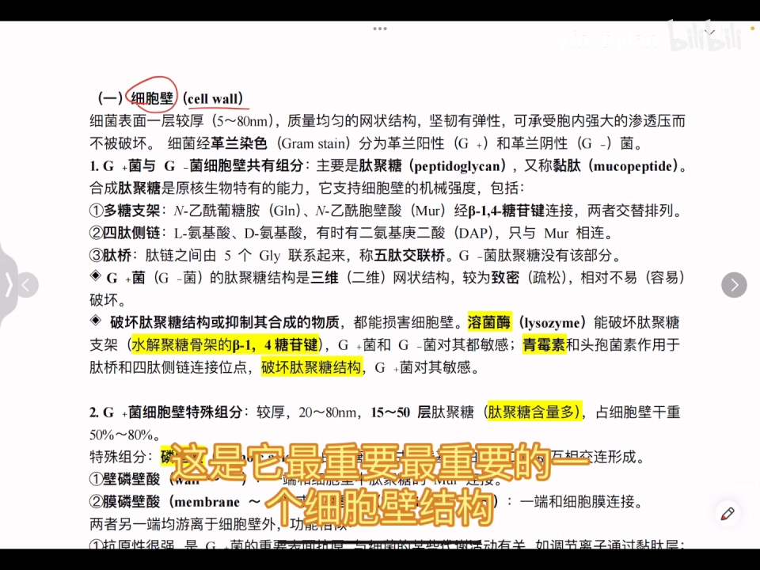
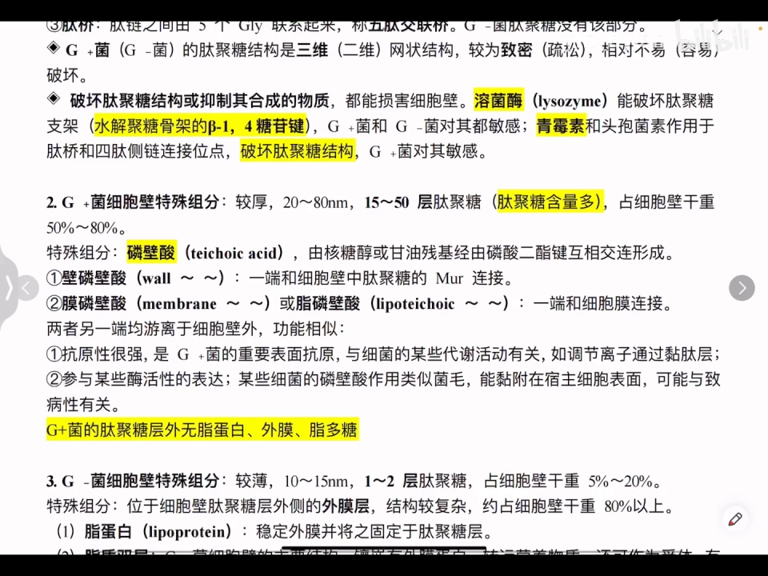
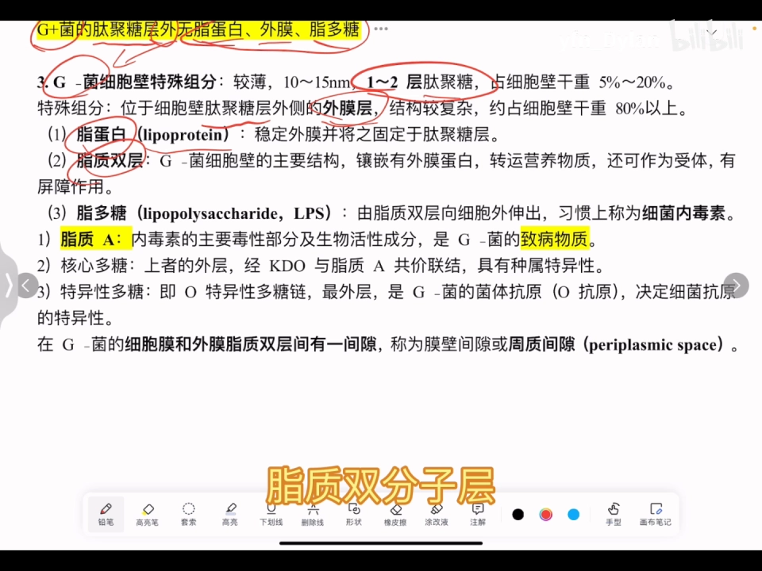
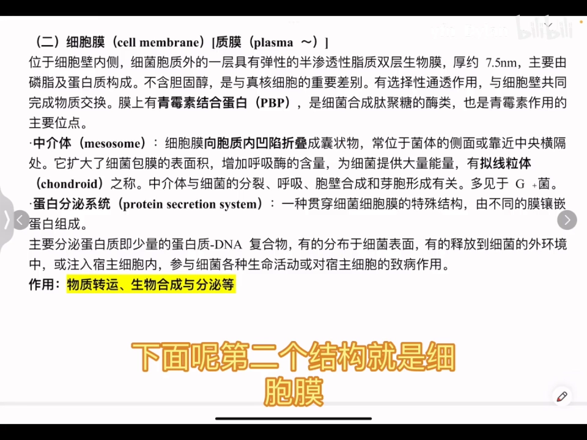
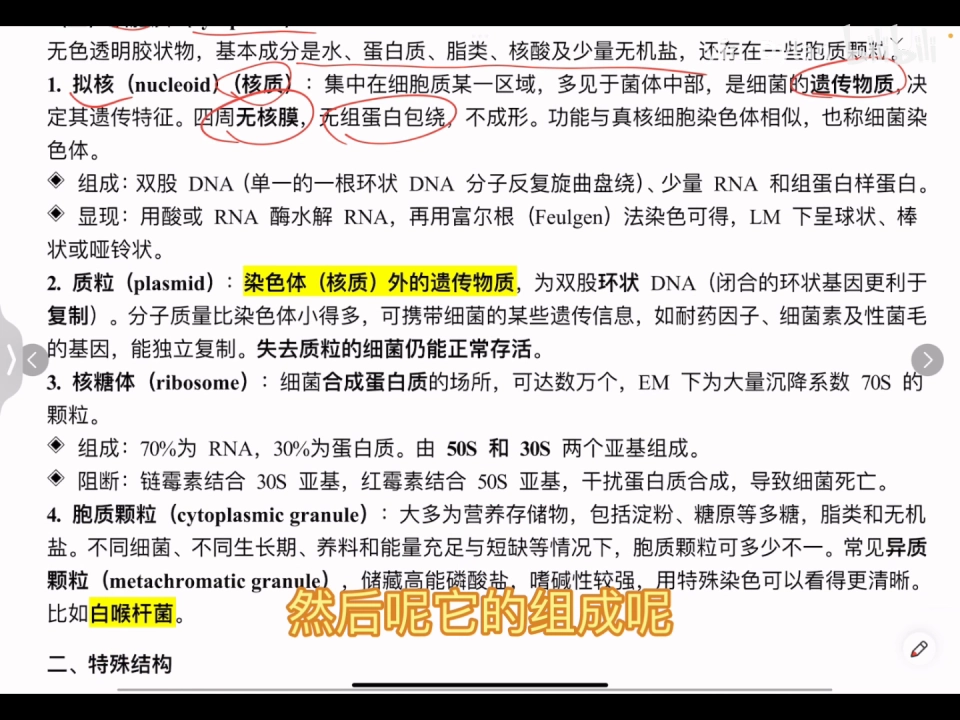
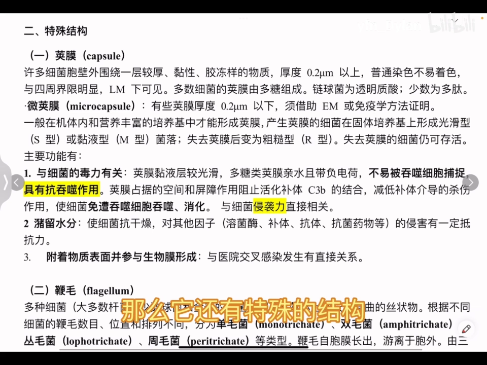
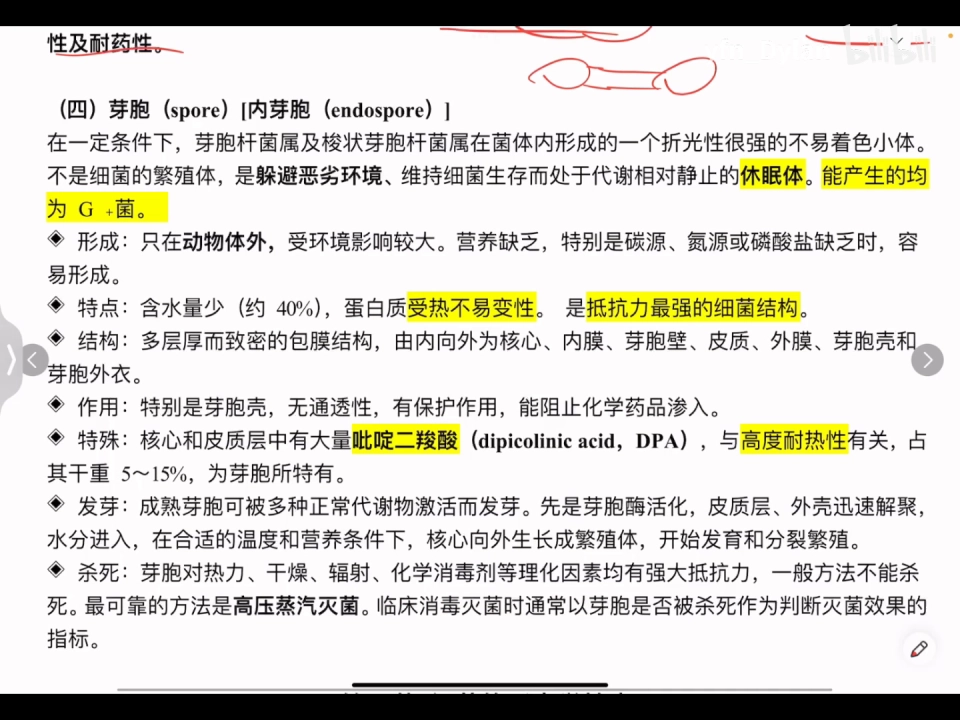

# 细菌的形态与结构：细胞壁、细胞膜、荚膜、鞭毛与芽孢

> 视频来源：[《细菌的形态与结构（细胞壁，细胞膜，细胞质，荚膜，鞭毛，菌毛等）【微生物学期末速成2】》](https://www.bilibili.com/video/BV1hH4y1Q7Y8/)（B 站 · 微生物学期末串讲）｜时长约 12 分 28 秒
> 导读：细菌是本节要比较的三类细胞型微生物里最常被当作「标准原核」的一类。这支视频把细菌的结构拆成两层：**基本结构**（细胞壁、细胞膜、细胞质，没了它活不了）和**特殊结构**（荚膜、鞭毛、菌毛、芽孢，是「辅助装备」）。看完这一篇，再看古菌那篇，两者的差别就落在同一张结构清单上逐项对照。

## 本讲要解决的核心问题（SCQA）

**背景**：细菌的形状只有球状、杆状、螺旋状几大类，尺寸在微米级，外形上并不复杂。

**冲突**：但外形简单不代表结构简单。同一类细菌，细胞壁的成分和厚薄可以差出一个「革兰氏阴阳性」，而这层壁恰恰是青霉素、溶菌酶下手的地方；有些细菌还能在壁外再套一层荚膜、长鞭毛、长菌毛，或者在恶劣条件下变成芽孢。

**疑问**：细菌的细胞由哪些部分构成？哪些是「必须有」的，哪些是「可以有」的？这些结构差异为什么会变成临床和实验里的判据？

**回答（中心思想）**：细菌的结构分**基本结构**（细胞壁、细胞膜、细胞质）与**特殊结构**（荚膜、鞭毛、菌毛、芽孢）。细胞壁的共有组分是**肽聚糖**，革兰氏阳性菌肽聚糖层多、有磷壁酸，革兰氏阴性菌肽聚糖层薄、外加一层含脂多糖的外膜和周质间隙——这一差异既决定了革兰氏染色的颜色，也决定了溶菌酶和青霉素能不能奏效。特殊结构各自对应一种能力：荚膜抗吞噬、鞭毛管运动、菌毛管黏附与 DNA 传递、芽孢管渡过恶劣环境。

---

## 一、先把结构分成两堆：基本结构与特殊结构

视频开篇给了一个很实用的分界：[【跳转到 00:38】](https://www.bilibili.com/video/BV1hH4y1Q7Y8/?t=38)

- **基本结构**：没了它不行的部分。比如细胞壁，没有细胞壁细菌会直接被挤炸。
- **特殊结构**：对致病性、免疫性有加成作用的「辅助装备」。

这个分界不是分类学，而是**功能分界**：基本结构决定这个细胞能不能作为细胞存在；特殊结构决定它在特定环境里多一项什么能力。后面讲古菌时，同一个分界依然适用——古菌也有壁、膜、核糖体，但它没有肽聚糖，壁换成了 S 层。

形态方面只需记住一句：细菌长度一般以微米为单位，基本形态为球状、杆状、螺旋状；球菌还能再细分为双球菌、链球菌、四联球菌等，这些属于分类细节，本节不展开。[【跳转到 00:00】](https://www.bilibili.com/video/BV1hH4y1Q7Y8/?t=0)

---

## 二、细胞壁：肽聚糖是共有骨架，革兰氏阴阳性差在「外面那层」

### 2.1 共有组分：肽聚糖

革兰氏阳性菌和革兰氏阴性菌的细胞壁成分不太一样，但**共有组分是肽聚糖**。[【跳转到 01:07】](https://www.bilibili.com/video/BV1hH4y1Q7Y8/?t=67)

两者的差别首先在**含量**：革兰氏阳性菌有 15 到 50 层肽聚糖，非常多；革兰氏阴性菌只有一到两层。[【跳转到 01:30】](https://www.bilibili.com/video/BV1hH4y1Q7Y8/?t=90)

肽聚糖本身由三部分搭起来：[【跳转到 01:41】](https://www.bilibili.com/video/BV1hH4y1Q7Y8/?t=101)

1. **多糖支架**：由 N-乙酰葡糖胺（GlcNAc）与 N-乙酰胞壁酸（MurNAc）交替排列，通过 β-1,4 糖苷键连接；
2. **四肽侧链**：连在胞壁酸上；
3. **肽桥**：把相邻肽链横向连起来（革兰氏阳性菌中常见五个甘氨酸组成的五肽交联桥）。

一层一层的糖链靠肽桥横向交联，就形成了网状的立体结构。[【跳转到 01:54】](https://www.bilibili.com/video/BV1hH4y1Q7Y8/?t=114) 革兰氏阳性菌的肽聚糖是三维网状结构，革兰氏阴性菌则只有二维、比较疏松。[【跳转到 02:21】](https://www.bilibili.com/video/BV1hH4y1Q7Y8/?t=141)

### 2.2 为什么肽聚糖是抗生素靶点

视频在这里做了一个很关键的推理：**肽聚糖是细胞壁的关键成分，那么能破坏它的结构、或抑制它合成的物质，就能让细胞壁完蛋**。[【跳转到 02:32】](https://www.bilibili.com/video/BV1hH4y1Q7Y8/?t=152)

两个经典例子：[【跳转到 02:37】](https://www.bilibili.com/video/BV1hH4y1Q7Y8/?t=157)

- **溶菌酶**：水解肽聚糖骨架的 β-1,4 糖苷键，革兰氏阳性菌和阴性菌对它都敏感；
- **青霉素**：作用于肽桥和四肽侧链的连接位点（转肽反应），破坏肽聚糖的交联，主要对革兰氏阳性菌有效。

> 这就是「区分研究对象」的第一个实际后果：**同一种药对两类菌效果不同，原因不在菌的「种类」，而在细胞壁的构造**。也正因如此，古菌对这类抗生素天然不敏感——它根本没有肽聚糖（见 [古菌细胞：三域框架、醚键膜脂与极端环境适应](古菌细胞：三域框架、醚键膜脂与极端环境适应.md)）。

### 2.3 革兰氏阳性菌的特殊组分：磷壁酸

阳性菌的肽聚糖含量更多，并且有一个特殊组分叫**磷壁酸**。[【跳转到 03:07】](https://www.bilibili.com/video/BV1hH4y1Q7Y8/?t=187)

磷壁酸的功能有三条：抗原性很强，是一种重要的表面抗原；参与一些酶的活性表达；还有类似菌毛的黏附作用，能黏附在宿主细胞表面。[【跳转到 03:32】](https://www.bilibili.com/video/BV1hH4y1Q7Y8/?t=212)

> 注意阳性菌的肽聚糖层外面**没有**脂蛋白、外膜和脂多糖——这三样是阴性菌特有的。

### 2.4 革兰氏阴性菌的特殊组分：外膜、脂多糖与周质间隙

阴性菌的肽聚糖相对较少，但在肽聚糖层外侧多了一层**外膜**，阳性菌没有。[【跳转到 03:57】](https://www.bilibili.com/video/BV1hH4y1Q7Y8/?t=237)

外膜里有什么？脂蛋白、脂质双分子层（所以外膜本身就是一层膜）、外膜蛋白，以及**脂多糖（LPS）**。[【跳转到 04:22】](https://www.bilibili.com/video/BV1hH4y1Q7Y8/?t=262) 脂多糖习惯上称为细菌内毒素，它的主要致病物质是**脂质 A**——视频特别强调这是要背下来的、革兰氏阴性菌的主要致病物质。[【跳转到 04:47】](https://www.bilibili.com/video/BV1hH4y1Q7Y8/?t=287)

还有一个结构名词：在阴性菌的细胞膜和外膜之间有一个间隙，叫**周质间隙**（periplasmic space）。[【跳转到 04:58】](https://www.bilibili.com/video/BV1hH4y1Q7Y8/?t=298)

### 2.5 细胞壁做什么、不做什么

细胞壁的功能有：维持固有形态（不会让圆形的细胞被挤成奇形怪状）、保护细菌抗低渗、参与物质交换、决定抗原性（带有多种抗原决定簇）。[【跳转到 05:13】](https://www.bilibili.com/video/BV1hH4y1Q7Y8/?t=313)

但有一条要划清：**细胞壁不能抗吞噬**。抗吞噬是荚膜的功能。[【跳转到 05:43】](https://www.bilibili.com/video/BV1hH4y1Q7Y8/?t=343)

> 这类「谁负责什么」的边界在考试和读文献时都容易混：壁管形态和渗透压，荚膜管免疫逃逸，鞭毛管运动，菌毛管黏附。**一个结构对应一种能力，不要互相借**。

---

## 三、细胞膜与中介体

第二个基本结构是细胞膜，也叫质膜，位于细胞壁内侧。[【跳转到 05:55】](https://www.bilibili.com/video/BV1hH4y1Q7Y8/?t=355)

细菌细胞膜有两个值得记住的点：

1. **不含胆固醇**，这是与真核细胞膜的重要差别；膜上有青霉素结合蛋白（PBP），它既是合成肽聚糖的酶，也是青霉素的作用位点。
2. 细胞膜会向细胞质内凹陷折叠形成囊状物，叫**中介体**。折叠之后表面积大大增加，有利于呼吸、有利于与外界进行物质和氧气交换，因此中介体能增大表面积、增加呼吸酶含量、提供大量能量，有「拟线粒体」之称，多见于革兰氏阳性菌。[【跳转到 06:20】](https://www.bilibili.com/video/BV1hH4y1Q7Y8/?t=380)

> **待核对**：中介体（mesosome）是经典教材里的描述，但现代电镜研究普遍认为它主要是化学固定过程造成的人工假象，在活细胞中未必以这种形态存在。视频按教材讲法呈现，读者引用时需注意这一争议。这条说明**不在这支视频的字幕内**。

细胞膜的功能是物质转运、生物合成和分泌。[【跳转到 07:00】](https://www.bilibili.com/video/BV1hH4y1Q7Y8/?t=420)

---

## 四、细胞质：核质、质粒与核糖体

第三个基本结构是细胞质。它的主要成分包括：[【跳转到 07:05】](https://www.bilibili.com/video/BV1hH4y1Q7Y8/?t=425)

- **核质（拟核）**：细菌的遗传物质，没有核膜、也没有核蛋白环绕，不成形，就是一堆 DNA 集中在这里；
- **质粒**：染色体之外的遗传物质，一般与细菌的基本生存无关，多携带致病性等次要功能，没有质粒细菌也能活；
- **核糖体**：合成蛋白质的场所；
- **胞质颗粒**：储藏物质。

> 这一段的「基因组组织」细节本节不重述：环状染色体、单一复制起点、编码序列占比、操纵子，以及质粒的独立复制与水平转移，已在 [1.3.1 原核与真核的基因组组织](../../../1_生命的物质与组织层级/1.3_细胞结构、生物膜与物质运输/1.3.1_原核与真核细胞、细胞器与分工/原核与真核的基因组组织：环状与线性染色体、复制起点与基因排布.md) 与 [质粒：染色体之外的环状DNA、独立复制与水平转移](../../../1_生命的物质与组织层级/1.3_细胞结构、生物膜与物质运输/1.3.1_原核与真核细胞、细胞器与分工/质粒：染色体之外的环状DNA、独立复制与水平转移.md) 中展开。本节只保留「细菌有一个拟核 + 可选质粒」这一句。

---

## 五、四种特殊结构：荚膜、鞭毛、菌毛、芽孢

### 5.1 荚膜：抗吞噬

荚膜是细胞壁外围一层较厚、黏性、胶冻样的物质，厚度常在 0.2 μm 以上，普通染色不易着色。[【跳转到 08:15】](https://www.bilibili.com/video/BV1hH4y1Q7Y8/?t=495)

它的核心功能是**抗吞噬**：荚膜黏液层较光滑，多糖荚膜亲水且带负电，不易被吞噬细胞捕捉，使细菌免遭吞噬细胞的吞噬和消化，与细菌的侵袭力直接相关。[【跳转到 08:40】](https://www.bilibili.com/video/BV1hH4y1Q7Y8/?t=520) 此外荚膜还能储留水分（抗干燥），并参与生物膜形成。[【跳转到 09:05】](https://www.bilibili.com/video/BV1hH4y1Q7Y8/?t=545)

### 5.2 鞭毛：运动器官

鞭毛是细菌的运动器官，像螺旋桨一样转动，细菌就能活动。[【跳转到 09:15】](https://www.bilibili.com/video/BV1hH4y1Q7Y8/?t=555)

按鞭毛的数目、位置和排列，可分为单毛菌、双毛菌、丛毛菌、周毛菌等类型——这部分属于形态学细节，本节不展开。

### 5.3 菌毛：黏附与 DNA 传递

菌毛分两种：[【跳转到 09:34】](https://www.bilibili.com/video/BV1hH4y1Q7Y8/?t=574)

- **普通菌毛**：一种黏附结构，主要见于革兰氏阴性菌，能黏到黏膜上导致致病；
- **性菌毛**：在细菌之间传递 DNA，可以传递毒性和耐药性。

> 性菌毛这一条把结构接回了遗传学：**耐药性的传播不只是「自己突变」，还可以是「邻居借给你」**。质粒如何通过接合转移，见 1.3.1 的质粒一篇。

### 5.4 芽孢：不是繁殖体，是休眠体

芽孢是细菌在特定条件下形成的休眠体：环境恶劣、营养缺乏时，细菌缩小个体、细胞壁增厚，形成芽孢。[【跳转到 10:14】](https://www.bilibili.com/video/BV1hH4y1Q7Y8/?t=614)

三个要点：[【跳转到 10:37】](https://www.bilibili.com/video/BV1hH4y1Q7Y8/?t=637)

1. **不是繁殖体**。芽孢是躲避恶劣环境、维持生存的休眠体，一个细菌形成一个芽孢，不增加个体数。
2. **抵抗力最强的细菌结构**。多层厚而致密的包膜结构，核心和皮质层中有大量**吡啶二羧酸（DPA）**，与高度耐热性有关。[【跳转到 11:10】](https://www.bilibili.com/video/BV1hH4y1Q7Y8/?t=670)
3. **一般方法杀不死**。热力、干燥、辐射、化学消毒剂都奈何不了它，最可靠的方法是高压蒸汽灭菌。[【跳转到 11:15】](https://www.bilibili.com/video/BV1hH4y1Q7Y8/?t=675)

> 芽孢是「生长条件」这一主题的一个反面案例：**不是所有不利条件都让细菌死亡，有些只是让它暂停**。灭菌效果通常以「芽孢是否被杀死」作为判断指标，原因就在这里。

---

## 六、革兰氏染色：把结构差异变成可观察的读数

细胞壁的化学差异肉眼看不见，革兰氏染色把它变成颜色。[【跳转到 11:59】](https://www.bilibili.com/video/BV1hH4y1Q7Y8/?t=719)

步骤是四步：结晶紫初染 → 碘液媒染 → 乙醇脱色 → 稀释复红复染。[【跳转到 12:04】](https://www.bilibili.com/video/BV1hH4y1Q7Y8/?t=724)

结果是：染成蓝紫色的是阳性菌，红色的是阴性菌。

> 为什么颜色会不同？关键在乙醇脱色这一步：阳性菌肽聚糖层厚、交联致密，乙醇使其脱水、间隙缩小，结晶紫-碘复合物被留在壁内；阴性菌肽聚糖层薄、又有外膜被乙醇溶掉，复合物容易被洗出，于是被复染成红色。**染色的差别本质上是细胞壁构造的差别**。

---

## 七、边界：这份清单是「典型细菌」，不是全部

1. **不是所有细菌都有特殊结构**。荚膜、鞭毛、菌毛、芽孢都是「可以有」，判断一个细胞是不是细菌不能靠有没有这些结构。
2. **「必须有细胞壁」也有例外**。支原体没有细胞壁，因此对青霉素不敏感——这恰好从反面证明了青霉素的靶点是壁而不是别的。（支原体一例为按通行教材补充，不在这支视频的字幕内。）
3. **中介体的形态存在争议**，见上文「待核对」。
4. **本节只讲细菌**。古菌的壁与膜、真核微生物（真菌等）的壁与核糖体，见同节其他两篇；本节不涉及分类学全表，也不列具体病原体清单。

---

## 小结

- 细菌结构分**基本结构**（细胞壁、细胞膜、细胞质）和**特殊结构**（荚膜、鞭毛、菌毛、芽孢）；前者决定能不能活，后者决定多一项什么能力。
- 细胞壁的共有骨架是**肽聚糖**：阳性菌层多（15–50 层）并有磷壁酸；阴性菌层薄（1–2 层），外加含脂多糖的外膜与周质间隙，脂质 A 是内毒素的毒性部分。
- 肽聚糖是**抗生素靶点**：溶菌酶切 β-1,4 糖苷键，青霉素阻断肽桥交联；细胞膜上的 PBP 既是合成酶也是青霉素位点。
- 细胞膜**不含胆固醇**，可内折成中介体（形态有争议）；细胞质里有拟核、质粒、核糖体。
- 四种特殊结构各管一件事：**荚膜抗吞噬、鞭毛运动、菌毛黏附与 DNA 传递、芽孢抗逆休眠**。
- 革兰氏染色的颜色差异，本质上是**细胞壁构造差异**的可视化。

## 关键术语速查

| 术语 | 一句话解释 |
| --- | --- |
| 肽聚糖 | 细菌细胞壁的共有网状骨架，由多糖支架、四肽侧链和肽桥交联而成 |
| 磷壁酸 | 革兰氏阳性菌细胞壁的特殊组分，抗原性强，参与酶活性与黏附 |
| 脂多糖（LPS） | 革兰氏阴性菌外膜成分，即内毒素，脂质 A 是其主要毒性部分 |
| 周质间隙 | 革兰氏阴性菌细胞膜与外膜之间的空间 |
| 中介体 | 细胞膜向胞内折叠形成的囊状结构，教材称「拟线粒体」，其真实性有争议 |
| 青霉素结合蛋白（PBP） | 细胞膜上催化肽聚糖交联的酶，也是青霉素的结合位点 |
| 荚膜 | 细胞壁外较厚的黏性层，抗吞噬、储水、参与生物膜形成 |
| 菌毛 | 细菌表面细毛；普通菌毛管黏附，性菌毛管 DNA 传递 |
| 芽孢 | 细菌在恶劣条件下形成的休眠体，非繁殖体，含 DPA，极耐热 |
| 革兰氏染色 | 结晶紫—碘液—乙醇—复红四步染色，把细菌分为阳性（紫）与阴性（红） |