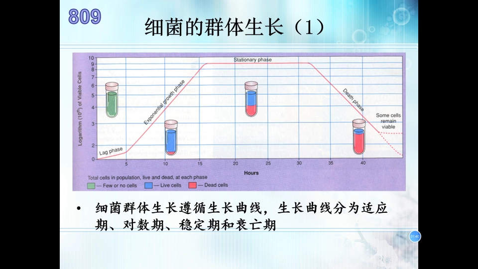
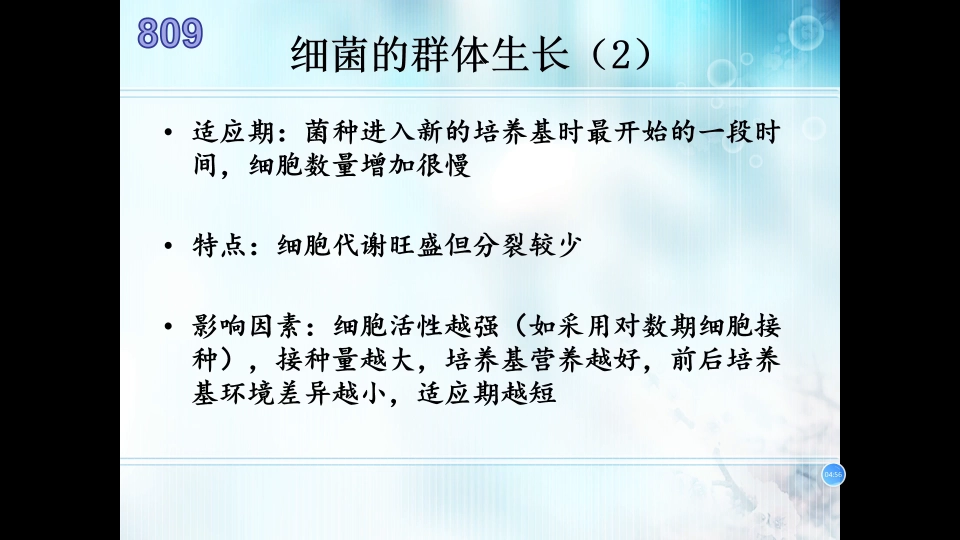
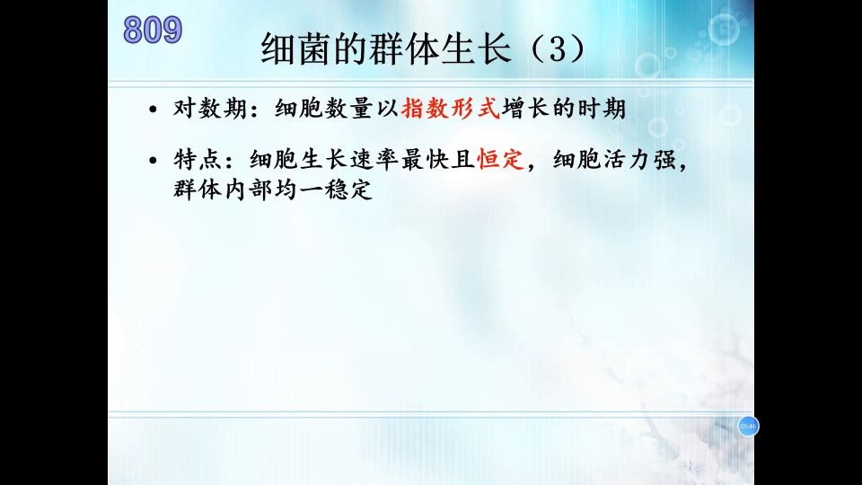
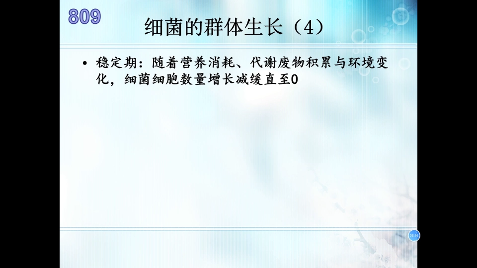
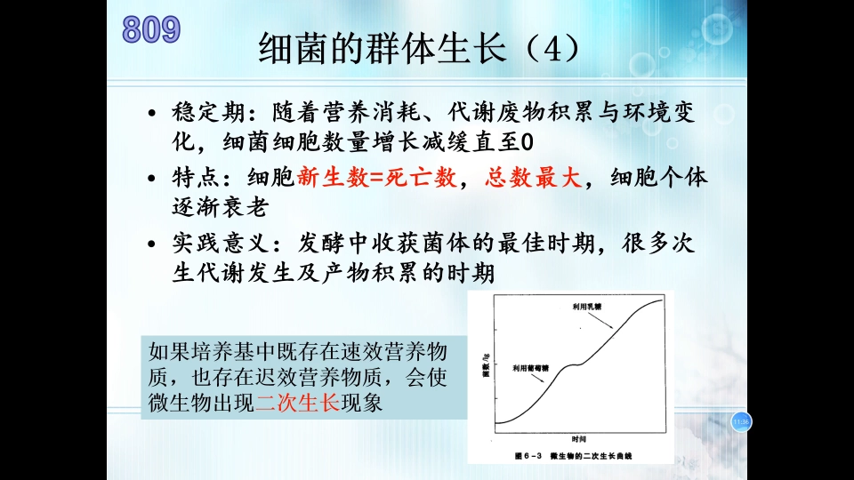
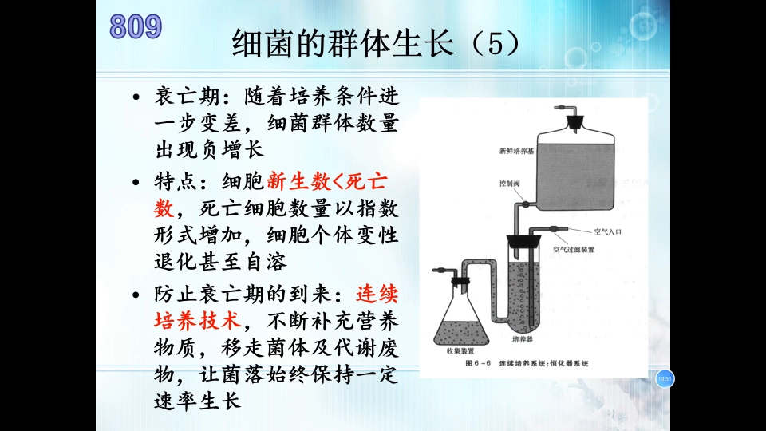

# 细菌群体生长与生长曲线：四个时期、代时与分批培养

> 视频来源：[《生物竞赛难点92-微生物学-细菌群体生长与生长曲线》](https://www.bilibili.com/video/BV1cG4y1S7Vx/)（B 站 · 生物竞赛串讲）｜时长约 14 分 44 秒
> 导读：上一篇讲的是单个细菌细胞里有什么。这一篇换一个观察对象：**一群细菌**。把一支菌接种到一瓶培养基里，隔一段时间数一次菌，得到的不是一条一直上升的线，而是一条有四个阶段的曲线。这条曲线是微生物学最基本的读数之一，也是「什么时候取样」这个实验问题的答案来源。

## 本讲要解决的核心问题（SCQA）

**背景**：细菌靠二分裂繁殖，一个变两个、两个变四个。如果条件合适，数量会以指数形式增加——理论上很快就会长满。

**冲突**：但真实培养里，数量不会一直指数上升。刚接种时几乎不长，中间一段猛涨，然后停住，最后下降。如果只按「指数增长」理解，就会把「刚接种的菌液」和「长到一半的菌液」当成同一种东西，取到的样本其实完全不可比。

**疑问**：一群细菌在封闭培养基里的数量随时间怎么变？每个阶段细胞在做什么？为什么实验要挑某一期取样？

**回答（中心思想）**：在**封闭、不补充营养的纯培养**里，细菌群体数量走一条四阶段的曲线：**适应期（延滞期）→ 对数期 → 稳定期 → 衰亡期**。适应期代谢旺盛但分裂少；对数期以指数增长、群体均一，是研究与取材的窗口；稳定期新生数等于死亡数、总数最大，也是次生代谢产物积累的时期；衰亡期死亡数超过新生数。把这条曲线的前提换掉——改成不断补充营养、移走废物——就得到连续培养。

---

## 一、先说清楚：这条曲线是「群体」的，而且有前提

视频开篇就限定对象：这里讲的是细菌的**群体生长曲线**，不是追踪每一个细胞怎么分裂，而是看一个细胞群体的数量如何变化。[【跳转到 00:00】](https://www.bilibili.com/video/BV1cG4y1S7Vx/?t=0)

> 这个区分很重要。单个细胞的「生长」指体积增大和复制内容物；群体的「生长」指数量增加。微生物学里说「生长曲线」，默认指后者。一些单细胞的真菌，比如酵母菌，也遵循同样的规律。[【跳转到 00:25】](https://www.bilibili.com/video/BV1cG4y1S7Vx/?t=25)

曲线的成立有一个前提：**一群细菌细胞在封闭环境中、不添加外界营养物质的纯培养**。[【跳转到 00:50】](https://www.bilibili.com/video/BV1cG4y1S7Vx/?t=50)

为什么必须强调这个前提？因为在自然界里，种群增长一般是 S 型曲线——生态系统中有物质和能量的交换，会不断给种群补充营养；而在实验室的封闭容器里，营养不会被补充。[【跳转到 01:15】](https://www.bilibili.com/video/BV1cG4y1S7Vx/?t=75) 所以四阶段曲线的后半段（稳定、衰亡）本质上是**封闭系统的必然结果**：营养耗尽、代谢产物积累，数量最终回落。

---

## 二、四个时期：细胞在每个阶段做什么

### 2.1 适应期（延滞期）：代谢旺盛，但分裂很少

把细菌刚接种到新培养基时，最开始那段时间细胞数量增长非常缓慢，叫适应期，也叫迟滞期。[【跳转到 01:40】](https://www.bilibili.com/video/BV1cG4y1S7Vx/?t=100)

这段时期的实质是细胞在适应新环境：代谢其实非常旺盛，在不断进行基因表达、合成蛋白质，为后续分裂做准备；但代谢旺盛不代表立即分裂——**代谢旺盛而分裂较少**，是适应期最基本的特点。[【跳转到 02:26】](https://www.bilibili.com/video/BV1cG4y1S7Vx/?t=146)

适应期能不能缩短？视频给了几条经验，逻辑都指向同一件事——**新旧环境的差距越小，需要「适应」的东西越少**：[【跳转到 03:16】](https://www.bilibili.com/video/BV1cG4y1S7Vx/?t=196)

- 新环境本身良好、与细胞原来的环境差距小，适应期就短；
- 营养充足、培养基与原来的培养条件相似，适应期短；
- 接种的细胞本身活性好（比如本来就取自对数期），适应期短；
- 接种量越大，适应期越短——微生物虽然是单细胞生物，但细胞之间存在相互影响。[【跳转到 04:31】](https://www.bilibili.com/video/BV1cG4y1S7Vx/?t=271)

> 这里的「接种量越大适应期越短」值得留意：它说明适应期不只是单个细胞的状态问题，还和群体密度有关。这也是为什么不同实验室的「同样菌株、同样培养基」会长出不同的曲线——接种比例、种子液状态都不同。

### 2.2 对数期：指数增长，而且群体均一

度过适应期就进入对数期：细胞数量以指数形式增长，基本可以看作一个指数函数；如果把细胞数量取对数作纵轴，画出来是一条直线。[【跳转到 04:56】](https://www.bilibili.com/video/BV1cG4y1S7Vx/?t=296)

对数期是细胞最活跃的时期：生长速率最快，细胞活力强；而且整个群体都处在活力较强的状态，**群体内部均一稳定**，各个细胞之间没有太多差距。[【跳转到 05:46】](https://www.bilibili.com/video/BV1cG4y1S7Vx/?t=346)

这个「均一稳定」正是**取样窗口**的根据：如果要研究细菌的正常情况，选对数期是比较好的方案。[【跳转到 06:11】](https://www.bilibili.com/video/BV1cG4y1S7Vx/?t=371) 反过来，如果你要研究的恰恰是「不正常」的细胞——比如胁迫下的状态——那就不该取对数期。[【跳转到 06:36】](https://www.bilibili.com/video/BV1cG4y1S7Vx/?t=396)

> 一句话记住这个逻辑：**对数期的价值不在「长得快」，而在「个体之间可比」**。同一瓶菌液里，如果一半细胞在适应、一半在衰老，任何平均值都会失真。

### 2.3 代时：对数期最重要的一个指标

对数期有一个非常重要的指标叫**代时**：细菌每分裂一代所需的时间。[【跳转到 07:01】](https://www.bilibili.com/video/BV1cG4y1S7Vx/?t=421)

视频给了两条影响代时的因素，正好对应本节要讲的「生长条件」：

- **外部环境**：营养条件越好、环境越接近细菌的最适生长环境（最适温度、最适 pH），代时越短；
- **菌种本身**：不同种类的细菌或微生物，代时本身差异很大。[【跳转到 07:26】](https://www.bilibili.com/video/BV1cG4y1S7Vx/?t=446)

> 代时把「生长条件」和「生长曲线」连了起来：温度、pH、营养不是四个并列的名词，它们的作用方式是**改变代时**，从而改变对数期的斜率。这也是为什么同一株菌在 37 ℃ 和 25 ℃ 下画出的曲线形状相同、斜率不同。
>
> 代时与比生长速率的关系是 $\mu = \ln 2 / g$（$g$ 为代时，$\mu$ 为比生长速率），即代时越短、比生长速率越大。这条换算是按通行微生物学教材补充的，**不在这支视频的字幕内**。

### 2.4 稳定期：总数最大，但个体在衰老

对数期后期，生长速度会慢慢减缓，不可能始终保持指数增长——因为指数增长要长久持续，需要一个资源无限的理想环境，而实际环境中资源始终有限。[【跳转到 07:51】](https://www.bilibili.com/video/BV1cG4y1S7Vx/?t=471)

进入稳定期的原因主要是环境：营养物质不断被消耗，能供应给细菌的营养在减少；同时代谢废物在培养基中积累。[【跳转到 08:16】](https://www.bilibili.com/video/BV1cG4y1S7Vx/?t=496) 视频有一个很好用的比喻：培养基既是食堂，也是卧室，最后还是厕所——在自然条件下有物质循环和能量流动来处理这些问题，但在实验室里不更换培养基就没有这些「处理者」。[【跳转到 08:41】](https://www.bilibili.com/video/BV1cG4y1S7Vx/?t=521)

稳定期的定义特征是：增长率降为零，但**不代表细菌不分裂**——它仍然分裂，只是细胞不断死亡，**出生数等于死亡数**。[【跳转到 09:06】](https://www.bilibili.com/video/BV1cG4y1S7Vx/?t=546)

稳定期有两个实用意义：

1. **细胞总数最大**，是收获菌体相对合适的时机；但个体已经开始衰老，活性下降，所以用稳定期的群体去接种，效果不如用对数期。[【跳转到 09:31】](https://www.bilibili.com/video/BV1cG4y1S7Vx/?t=571)
2. **很多次生代谢发生在稳定期**。所以想让微生物产生代谢产物时，虽然对数期代谢最旺盛，有些产物却只能在稳定期积累，必须让细菌在稳定期多待一段时间。[【跳转到 09:56】](https://www.bilibili.com/video/BV1cG4y1S7Vx/?t=596)

### 2.5 衰亡期：死亡数超过新生数

如果始终不补充营养、不移除代谢废物，最终微生物会耗尽所有营养物质，进入衰亡期：培养条件进一步变差，群体数量负增长，出生数小于死亡数，死亡细胞数量甚至会以指数形式增加。[【跳转到 10:46】](https://www.bilibili.com/video/BV1cG4y1S7Vx/?t=646)

衰亡期有两个容易被忽略的细节：

- **一般不会完全死光**。因为细菌也会发生变异和适应，衰亡期后期往往留下少量细胞，要经过很长时间才可能全部死亡。[【跳转到 11:36】](https://www.bilibili.com/video/BV1cG4y1S7Vx/?t=696)
- **细胞个体会退化，甚至自溶**。所以如果测定的是细胞总数（比如光电比浊），数值可能保持不变；而测活菌数量时，数值会下降。[【跳转到 12:16】](https://www.bilibili.com/video/BV1cG4y1S7Vx/?t=736)

> 这一条是本节最值得记住的「读数陷阱」：**总数和活菌数是两种测量对象**。同一瓶菌液在衰亡期，浊度读数几乎不动，活菌计数却在掉。看到一条「平稳」的曲线，先问它数的是什么。

---

## 三、两种偏离标准曲线的现象

### 3.1 二次生长：两种营养先后被利用

细菌从对数期进入稳定期之后，并非再也不可能回去。除了外部补充营养，如果培养基中同时存在不同种类的营养物质，还会出现**二次生长现象**。[【跳转到 11:51】](https://www.bilibili.com/video/BV1cG4y1S7Vx/?t=711)

道理在于营养物质分「速效」和「迟效」：速效是微生物能快速利用的，迟效则要经过很长时间才能利用。两者同时存在时，微生物先在对数期用完速效营养物质，然后再去利用迟效的——比如培养基中同时含葡萄糖和乳糖，就先利用葡萄糖，再利用乳糖。[【跳转到 12:41】](https://www.bilibili.com/video/BV1cG4y1S7Vx/?t=761)

> 这条现象把「生长曲线」和「营养类型／底物偏好」接上了：曲线上的一个「台阶」不是测量噪声，而是**底物切换**的信号。做生长实验时如果培养基成分复杂，看到双峰不要先怀疑污染。

### 3.2 连续培养：把「封闭」这个前提拆掉

要防止衰亡期到来，有一个特殊技术：**连续培养**。做法是不断把新鲜培养基注入培养器，同时不断收集菌液——相当于降低培养器中的种群密度，并不断移走代谢废物。[【跳转到 13:31】](https://www.bilibili.com/video/BV1cG4y1S7Vx/?t=811)

结果就是细菌可以始终保持一定的速率增长，不会进入衰亡期。[【跳转到 14:21】](https://www.bilibili.com/video/BV1cG4y1S7Vx/?t=861)

> 连续培养的意义不只是「不让它死」：它把「生长速率」变成一个**可以设定的实验参数**。分批培养里你只能观察曲线；连续培养里你可以把菌维持在某个特定的生长速率上，再去看表达谱或代谢通量的变化。这也是为什么恒化器（chemostat）在微生物生理研究里地位很高。

---

## 四、边界：这条曲线不能直接搬到自然环境和实验台上

1. **它是封闭纯培养的规律**。自然环境里营养在补充、废物被消耗、还有捕食和竞争，曲线更接近 S 型而不是「四期 + 下跌」。视频在开头就做了这个区分。[【跳转到 01:15】](https://www.bilibili.com/video/BV1cG4y1S7Vx/?t=75)
2. **它是群体数量曲线，不是单细胞生理曲线**。同一时刻的群体里可能混着不同状态的细胞；「对数期均一」是相对说法，不是绝对同步。
3. **「期」的边界是人为划分的**。四个名字描述的是曲线斜率的变化，实际过渡是连续的；不同菌株、不同培养基下各期的长度差别很大。
4. **代时的数值依赖条件**。视频给的「营养越好、越接近最适温度和最适 pH，代时越短」是趋势判断，具体数值要以该菌株在该条件下的实测为准。

---

## 小结

- 生长曲线描述的是**群体数量**，前提是**封闭、不补充营养的纯培养**；自然界的种群增长更接近 S 型。
- 四个时期：**适应期**（代谢旺盛、分裂少）→ **对数期**（指数增长、群体均一）→ **稳定期**（新生数 = 死亡数、总数最大）→ **衰亡期**（死亡数 > 新生数，常留少量存活细胞）。
- **代时**是对数期的核心指标，由菌种本身和外部条件（营养、温度、pH）共同决定；它把「生长条件」翻译成「曲线斜率」。
- 对数期之所以是取样窗口，是因为**个体之间可比**，而不是因为「长得快」。
- 两个偏离标准曲线的现象：**二次生长**（速效/迟效底物先后利用）和**连续培养**（拆掉封闭前提，把生长速率变成可设参数）。
- 读数陷阱：衰亡期**细胞总数**可能不变，**活菌数**在下降。

## 关键术语速查

| 术语 | 一句话解释 |
| --- | --- |
| 群体生长 | 以一群细胞（菌落或菌液）为对象，看数量如何变化，而非单个细胞如何分裂 |
| 纯培养 | 只含一种微生物的培养物；生长曲线的标准前提之一 |
| 适应期（延滞期） | 接种后数量增长很慢的一段，细胞代谢旺盛但分裂少 |
| 对数期（指数期） | 细胞数量以指数增长的时期，生长速率最快且恒定、群体均一 |
| 代时 | 对数期中细菌每分裂一代所需的时间；越接近最适条件越短 |
| 比生长速率 | 单位时间内细胞数量的相对增长率，与代时成反比（$\mu = \ln 2 / g$） |
| 稳定期 | 增长率降为零、新生数等于死亡数的时期，总数最大，次生代谢多在此发生 |
| 衰亡期 | 死亡数超过新生数的时期，细胞个体退化甚至自溶 |
| 二次生长 | 速效与迟效营养物质并存时，先利用速效、再利用迟效，曲线上出现两段上升 |
| 连续培养 | 不断补充新鲜培养基并移走菌液与废物，使菌群维持恒定生长速率 |