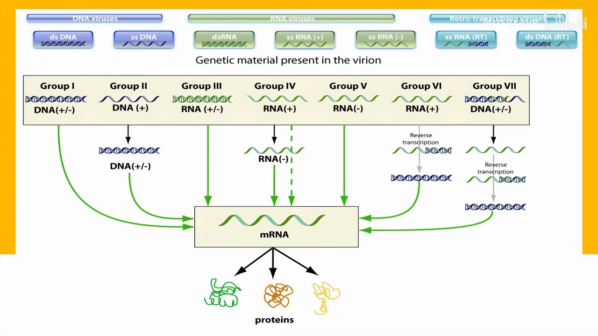
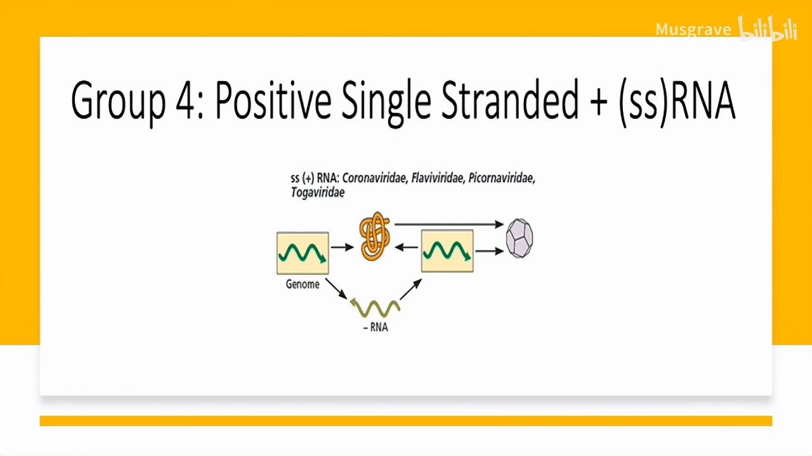
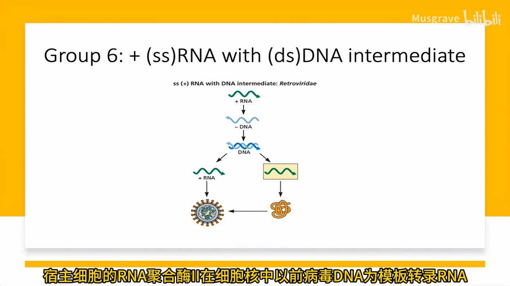
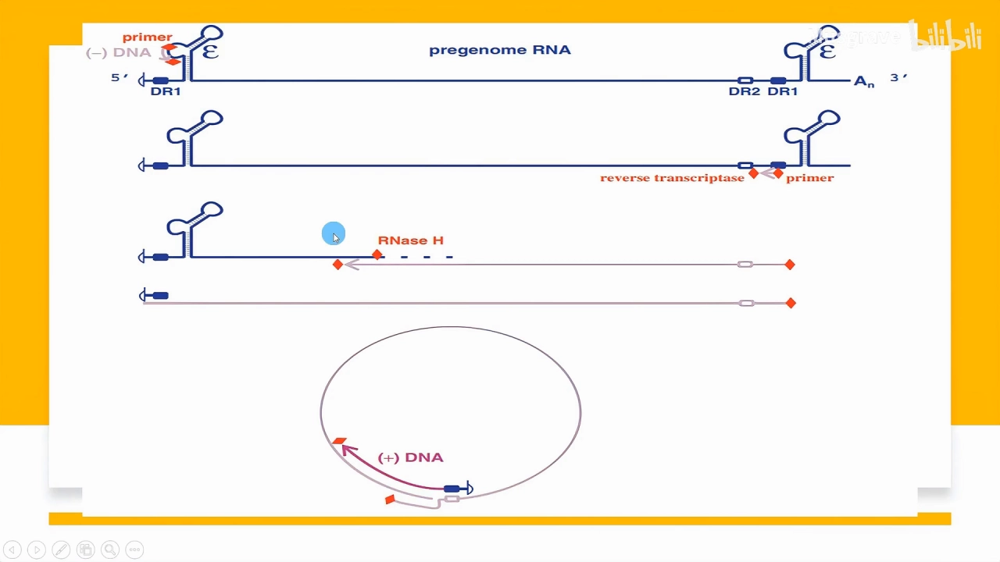

# 巴尔的摩分类：七类基因组如何汇到同一条 mRNA

> 视频来源：[病毒的巴尔的摩分类系统](https://www.bilibili.com/video/BV1Waj66hE2N/)（Bilibili · Musgrave · 5:03）。本文按该视频的逐窗口字幕与幻灯片整理，关键结论均可在原片对应时间点核对。
> 导读：这支短片只做一件事——按「基因组怎么走到 mRNA」把病毒分成七类，并逐类给出这条路径。中心法则的五条箭头本身已在 [2.3.1 中心法则、逆转录与 RNA 复制](../../../2_遗传信息流与中心法则/2.3_信息流的边界/2.3.1_中心法则、逆转录与%20RNA%20复制/信息传递不等于表型决定：中心法则的边界、选择性表达与环境.md) 讲清；本文只回答「病毒如何利用这些箭头」。颗粒结构与感染周期见同节 [病毒颗粒与感染细胞](病毒颗粒与感染细胞：结构、基因组类型与感染周期.md)。

## 本讲要解决的核心问题（SCQA）

**背景**：病毒的基因组可以是 DNA 也可以是 RNA，可以是单链也可以是双链，单链还有正义、负义之分。如果按分子种类数，组合多到无法记忆。

**冲突**：但所有病毒都必须做同一件事——合成 mRNA，才能翻译出蛋白质。[【跳转到 00:30】](https://www.bilibili.com/video/BV1Waj66hE2N/?t=30) 既然终点相同，起点为什么这么乱？而且「单链 RNA 病毒」这个说法里，第四类、第五类、第六类都是单链 RNA，它们凭什么不是一类？

**疑问**：能不能不看分子种类，只看「基因组到 mRNA 要走哪条路」来分类？七类各自的路径是什么，哪几步用的是宿主原有的酶、哪几步要病毒自己带酶？

**回答（中心思想）**：巴尔的摩在 1971 年提出的分类系统把 mRNA 放在中心，七类病毒的区别不是「核酸长什么样」，而是**从基因组到 mRNA 需要几次转换、朝哪个方向转换**。凡是基因组不能直接当 mRNA 用的，病毒要么自己带聚合酶，要么先补一条互补链；逆转录病毒和嗜肝 DNA 病毒则额外借用了逆转录这条箭头。这样一分，「单链 RNA」内部的差异立刻显现：第四类可以直译，第五类必须先抄正链，第六类要先写成 DNA。

---

## 一、分类依据：四个变量，一个中心

视频开篇交代了巴尔的摩分类的四个依据：**核酸类型**（DNA 或 RNA）、**链型**（单链或双链）、**极性**（正义或负义），以及**基因组到 mRNA 信息传递方式的组合**；七个类群用罗马数字表示。[【跳转到 00:00】](https://www.bilibili.com/video/BV1Waj66hE2N/?t=0) 罗马数字这个选择本身有信息量：它把「第几类」和「叫什么名字」解耦，类群编号只表示信息流拓扑的序号，不承担任何分类学含义。[【跳转到 00:25】](https://www.bilibili.com/video/BV1Waj66hE2N/?t=25)

前三个变量描述的是「颗粒里装了什么」，第四个描述的是「装进去之后怎么用」。视频明确说，正因为所有病毒都必须合成 mRNA 以产生蛋白质，巴尔的摩才把 mRNA 置于分类方案的中心。[【跳转到 00:30】](https://www.bilibili.com/video/BV1Waj66hE2N/?t=30)

这张总图值得单独读一遍：七类基因组各自有一条箭头指向同一个 mRNA 方框，再从 mRNA 指向蛋白质。**分类的实质是「到 mRNA 的路径拓扑」**，而不是分子清单——这正好是 [2.3.1](../../../2_遗传信息流与中心法则/2.3_信息流的边界/2.3.1_中心法则、逆转录与%20RNA%20复制/信息传递不等于表型决定：中心法则的边界、选择性表达与环境.md) 那张五箭头图在病毒身上的具体投影。

## 二、七类逐条路径

### 2.1 第一类：双链 DNA（dsDNA）

由 **DNA 依赖性 RNA 聚合酶**转录产生 mRNA，再翻译成蛋白质；基因组以**半保留复制**的方式复制。包括腺病毒，以及疱疹病毒科、痘病毒科、多瘤病毒科。[【跳转到 00:41】](https://www.bilibili.com/video/BV1Waj66hE2N/?t=41)

这一类最接近宿主自己的信息流：用的就是「DNA→RNA→蛋白质」这条主干，复制方式也和 [2.1.2](../../../2_遗传信息流与中心法则/2.1_DNA%20与遗传信息/2.1.2_DNA%20复制概览：半保留复制与遗传连续性/DNA复制、转录与翻译：一张中心法则图看懂遗传信息流.md) 讲的半保留复制一致。

### 2.2 第二类：单链 DNA（ssDNA）

基因组是单链，无论正义还是负义，进入宿主细胞后**先由宿主 DNA 聚合酶把它补成双链**，再转录出 mRNA、翻译成蛋白质；随后以与基因组 DNA 互补的那条链为模板，复制出单链 DNA 拷贝，包装后释放去感染新宿主。包括细小病毒科和圆环病毒科。[【跳转到 01:06】](https://www.bilibili.com/video/BV1Waj66hE2N/?t=66)

关键点是「补链」这一步用的是**宿主的**聚合酶——病毒没有自带。

### 2.3 第三类：双链 RNA（dsRNA）

进入细胞后，**病毒自带的 RNA 依赖性 RNA 聚合酶**以负链为模板合成 mRNA；mRNA 可用于翻译，也可经复制形成双链 RNA 基因组。包括呼肠孤病毒科和轮状病毒。[【跳转到 01:40】](https://www.bilibili.com/video/BV1Waj66hE2N/?t=100)

从这一类开始，宿主细胞里没有现成的「以 RNA 为模板」的酶，**病毒必须自己带聚合酶进颗粒**。

### 2.4 第四类：正义单链 RNA（+ssRNA）

基因组**直接作为 mRNA**，无需转录即可翻译产生病毒蛋白，其中包括 RNA 依赖性 RNA 聚合酶；该聚合酶再以正义链为模板合成负链，形成双链 RNA 中间体，又以负链为模板合成正义单链 RNA 基因组的拷贝，包装后释放。包括小 RNA 病毒科。[【跳转到 02:10】](https://www.bilibili.com/video/BV1Waj66hE2N/?t=130)

「正义」这个词在这里有了操作定义：**能直接当 mRNA 读的链就是正义链**。所以第四类的颗粒里不必预先装好聚合酶——第一个蛋白翻译出来就是它。

### 2.5 第五类：负义单链 RNA（-ssRNA）

**病毒自带的 RNA 依赖性 RNA 聚合酶**以负义基因组为模板合成正义 mRNA；mRNA 既可用于翻译，也可作为模板合成新的负义 RNA 基因组，包装并释放。正黏病毒科、副粘病毒科和弹状病毒科属于第五类。[【跳转到 02:44】](https://www.bilibili.com/video/BV1Waj66hE2N/?t=164)

与第四类对照就能看出「极性」的实际后果：负义链不能直接读，**第一步必须由随颗粒带入的聚合酶完成**，否则信息流根本打不开。季节性流感属于这一类。

### 2.6 第六类：正义单链 RNA，带 DNA 中间体（逆转录病毒）

以**逆转录酶**以线性 RNA 基因组为模板合成 DNA 链，随后降解 RNA 链并合成互补 DNA 链，形成双链 DNA 基因组；该基因组**整合到宿主细胞 DNA 中**，此时称为**前病毒**。之后宿主细胞的 RNA 聚合酶 II 在细胞核中以前病毒 DNA 为模板转录 RNA，其中一些成为 mRNA，其他全长转录本则成为新病毒颗粒的基因组 RNA。逆转录病毒科属于第六类。[【跳转到 03:18】](https://www.bilibili.com/video/BV1Waj66hE2N/?t=198)

这是七类里唯一把遗传信息**写进宿主染色体**的路径，也是 [2.3.1](../../../2_遗传信息流与中心法则/2.3_信息流的边界/2.3.1_中心法则、逆转录与%20RNA%20复制/信息传递不等于表型决定：中心法则的边界、选择性表达与环境.md) 里「逆转录」那条箭头的主要使用者。整合态带来的后果（长期潜伏、随宿主分裂传下去）见 [裂解与溶原](裂解与溶原：温和噬菌体的整合、潜伏与切出.md) 中前噬菌体一段的同构逻辑。

### 2.7 第七类：双链 DNA，带 RNA 中间体（嗜肝 DNA 病毒）

以乙肝病毒为例：它的双链 DNA 有一条链带缺口，缺口在转录前被修复成完整的双链 DNA 基因组。这类病毒的**转录方式与第一类相同**，但它们**利用逆转录来复制基因组**：复制时先转录产生前基因组 RNA，逆转录酶再以前基因组 RNA 为模板合成负链 DNA，同时降解 RNA 链、只保留一小段作为正链 DNA 合成的引物；正链 DNA 的合成在出芽时停止，因为核衣壳脱离了胞质中的核苷酸池，导致正链不完整而形成缺口。包括嗜肝 DNA 病毒科（如乙肝病毒）以及感染植物的花椰菜花叶病毒科。[【跳转到 04:02】](https://www.bilibili.com/video/BV1Waj66hE2N/?t=242)

第七类和第六类常被混为一谈，区别在于**箭头方向**：第六类是 RNA→DNA 之后**转录**出 mRNA 和基因组 RNA；第七类是 DNA→RNA 之后**逆转录回 DNA**，RNA 只是复制基因组的中间体，不是终产物。

## 三、把七类压成三条判据

| 判据 | 覆盖类别 | 判断问题 |
| --- | --- | --- |
| 基因组能不能直接当 mRNA | 第四类（能）；第一、二、三、五、七类（不能，需转录或补链） | 进入细胞后的第一个动作是什么 |
| 需不需要病毒自带聚合酶 | 第三、五类必须自带；第四类靠翻译出聚合酶；第一、二类借宿主的 | 颗粒里除了核酸还得装什么 |
| 有没有逆转录这一步 | 第六类（RNA→DNA，整合）；第七类（DNA→RNA→DNA） | 基因组会不会变成宿主染色体的一部分 |

三条判据合起来，就回答了开篇那个「单链 RNA 为什么不是一类」的问题：第四类可以直译，第五类要先抄正链，第六类要先写成 DNA——**它们的信息流拓扑完全不同**。[【跳转到 04:57】](https://www.bilibili.com/video/BV1Waj66hE2N/?t=297)

## 四、边界

- 本视频只讲「基因组到 mRNA 的路径」，不涉及进入方式、装配与释放；那部分见 [病毒颗粒与感染细胞](病毒颗粒与感染细胞：结构、基因组类型与感染周期.md)。
- 各类群列举的科名按原片保留，不作分类学更新核对；具体家族的复制细节不在本节范围。
- 视频对第七类「正链因出芽而留下缺口」的解释属于机制性描述，本文按原片转述，未另行核对原始文献。