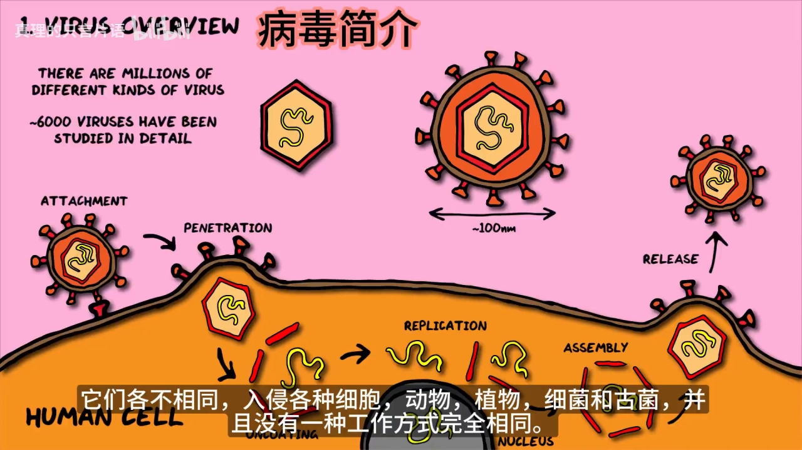
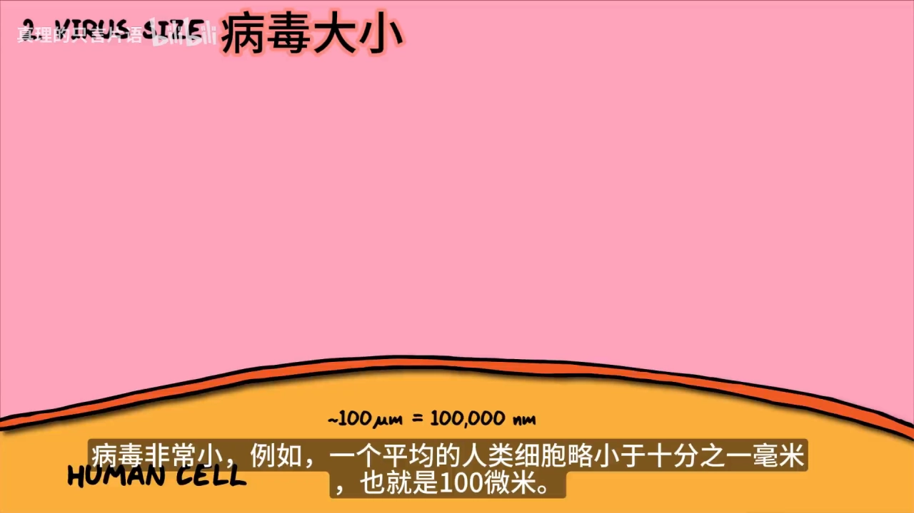
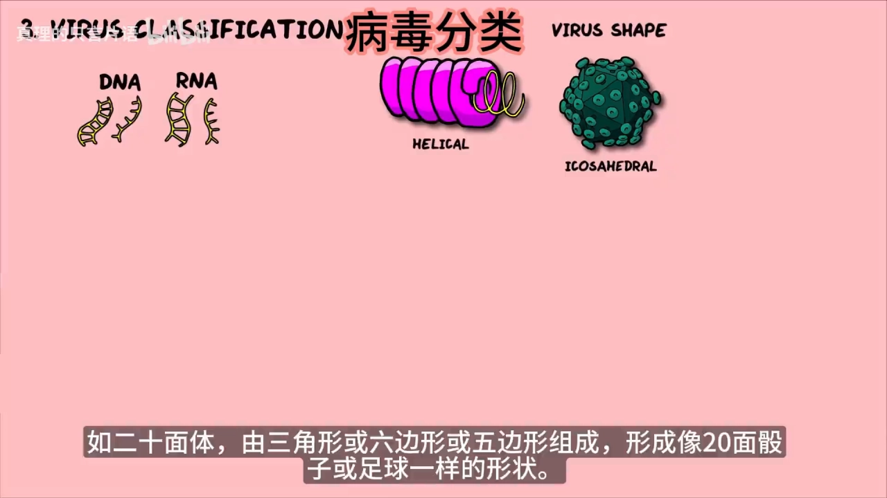
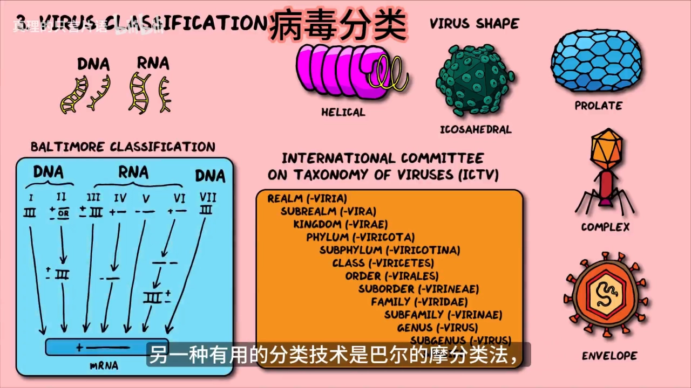
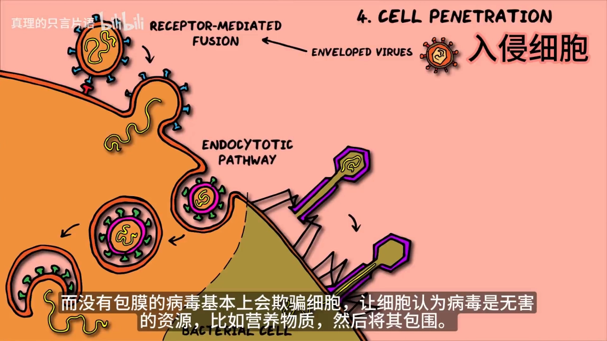
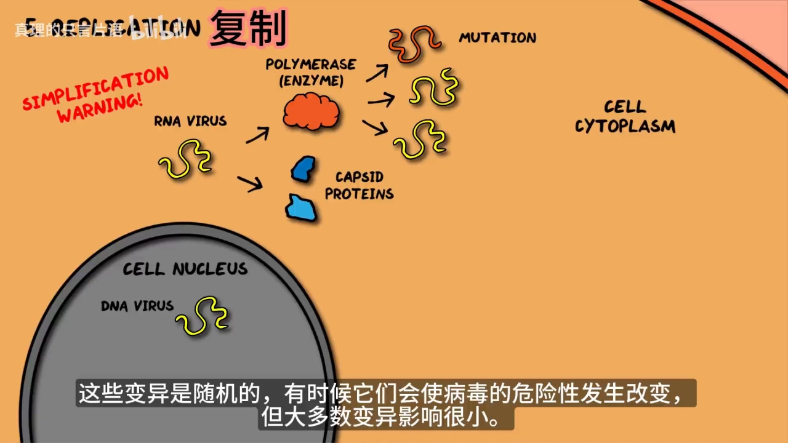
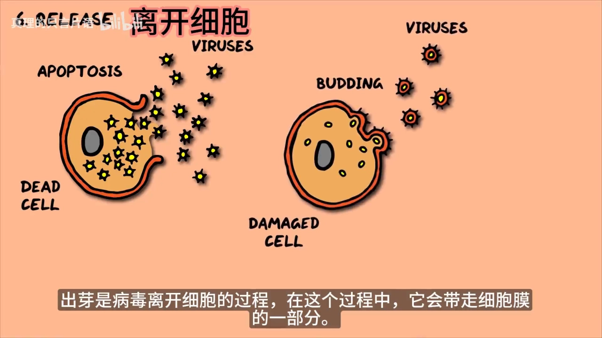

# 病毒颗粒与感染细胞：结构、基因组类型与感染周期

> 视频来源：[病毒的地图:一张图告诉你关于病毒的尺寸结构/分类/入侵/免疫…(普通话版)](https://www.bilibili.com/video/BV1Cc411S7go/)（Bilibili · 学者的只言片语 · 11:08）。本文按该视频的逐窗口字幕与幻灯片整理，关键结论均可在原片对应时间点核对。
> 导读：本文只取该视频中与「病毒颗粒与感染周期」相关的部分——病毒为什么不算完整生命、颗粒的构造与对称性、基因组类型、进入的三条路、复制与装配、释放的三种方式、宿主范围（00:13–08:14）。原片后半段（08:31–10:45）讲抗原呈递、抗体、疫苗与抗病毒药物，属免疫应答与药物范围，本文不复述，免疫部分见 B05。中心法则的五条箭头本身已在 [2.3.1 中心法则、逆转录与 RNA 复制](../../../2_遗传信息流与中心法则/2.3_信息流的边界/2.3.1_中心法则、逆转录与%20RNA%20复制/信息传递不等于表型决定：中心法则的边界、选择性表达与环境.md) 讲清，本文只讲病毒怎样使用这些箭头；七类基因组到 mRNA 的具体路径见同节 [巴尔的摩分类](巴尔的摩分类：七类基因组如何汇到同一条mRNA.md)，裂解与溶原的对照见 [裂解与溶原](裂解与溶原：温和噬菌体的整合、潜伏与切出.md)。

## 本讲要解决的核心问题（SCQA）

**背景**：病毒是地球上数量最丰富的生物实体，但它们不是真正的生命形式——不能自我繁殖，必须入侵其他细胞、接管细胞的分子机器才能复制。[【跳转到 00:13】](https://www.bilibili.com/video/BV1Cc411S7go/?t=13)

**冲突**：既然「不是生命」，为什么它们又有一套完整的结构、一套分类系统、一套和细胞几乎一样精确的复制流程？而且不同病毒的做法几乎没有一种完全相同：有的带包膜、有的不带，有的基因组是 DNA、有的是 RNA，有的直接注射、有的靠膜融合。

**疑问**：一个病毒颗粒到底由什么组成？它的遗传物质有哪几种形式？从贴上细胞到子代颗粒离开，中间要经过哪几步？「病毒颗粒」和「被感染的细胞」这两个对象，该用什么不同的判据去描述？

**回答（中心思想）**：病毒颗粒是一套**包裹**——核酸基因组加蛋白质衣壳（有时再套一层从宿主膜上取来的包膜），本身不执行代谢；被感染的细胞才是**工厂**——病毒把自己的信息流接进宿主的转录翻译机器，按吸附、进入、脱壳、复制与表达、装配、释放六步产出子代。颗粒的判据是「结构 + 基因组类型」，感染细胞的判据是「哪条信息流被打开、宿主付出什么代价」。同一句「病毒感染」，在这两个层面上说的不是一件事。

---

## 一、颗粒的构造：核酸、衣壳，以及可选的包膜

视频给的颗粒定义只有两件必需品：**一个基因组**（制造更多病毒的指令）和**一个由蛋白质构成的保护壳，称为衣壳**。衣壳的作用有两个：保护病毒安全，以及帮助病毒粘附到并进入它正在入侵的细胞。[【跳转到 00:43】](https://www.bilibili.com/video/BV1Cc411S7go/?t=43)

第三件是可选的：**包膜**。一些病毒被一层包膜覆盖，这层膜是「从它们最后感染的细胞的细胞膜上提取的油脂」——也就是说，包膜不是病毒自己合成的结构，而是宿主膜的碎片。[【跳转到 01:08】](https://www.bilibili.com/video/BV1Cc411S7go/?t=68) 这条来源决定了后面两件事：包膜病毒对肥皂敏感（肥皂能破坏这层脂膜，视频用它解释「为什么要勤洗手」），以及包膜病毒进入细胞时可以直接和宿主膜融合。

尺寸上，一个平均的人类细胞略小于 1/10 毫米，也就是 100 微米；病毒比细胞小大约 1000 倍，从约 20 纳米起步。视频按比例画了乙肝病毒、丙肝病毒、流感病毒、HIV 和巨大的埃博拉病毒。[【跳转到 01:25】](https://www.bilibili.com/video/BV1Cc411S7go/?t=85)

基因组大小也跨好几个数量级：小的只编码两种蛋白质，大的可编码多达 2500 种蛋白质。[【跳转到 01:44】](https://www.bilibili.com/video/BV1Cc411S7go/?t=104)

### 1.1 对称性：为什么衣壳长得像几何体

衣壳由**许多相同形状的蛋白质**组成，这些蛋白质**自我组装**成几种规则形状：[【跳转到 01:58】](https://www.bilibili.com/video/BV1Cc411S7go/?t=118)

- **螺旋形**：蛋白亚基绕着核酸盘成弹簧状；
- **二十面体**：由三角形、六边形、五边形拼成，像二十面骰子或足球；
- **长方体（拉长的多面体）**：同样由多边形组成，只是被拉长；
- **复合型**：不属于以上类别的复杂结构（噬菌体的头部加尾部就是典型）；
- **包膜型**：前面提到的、外面再套一层脂膜的那类。

这里有一条值得记住的因果：**用少数几种蛋白质造一个足够大的壳，唯一经济的办法是重复使用同一种亚基并让它按对称性排列**。所以「衣壳是规则几何体」不是美学选择，而是「基因组只编码一两种衣壳蛋白」这个信息预算的直接后果。

## 二、基因组类型：DNA 或 RNA，单链或双链

病毒基因组的第一层区分是化学本质：**DNA 或 RNA**；第二层是**单链或双链**。[【跳转到 03:34】](https://www.bilibili.com/video/BV1Cc411S7go/?t=214)

这四种组合只是起点。真正决定「感染后第一步做什么」的，是基因组与 mRNA 的关系——这正是巴尔的摩分类法要回答的问题：它按「病毒的基因组及其编码信使 RNA（mRNA）的途径」分类，共七个类别，代表不同形式的单链和双链 DNA 与 RNA。[【跳转到 02:44】](https://www.bilibili.com/video/BV1Cc411S7go/?t=164)

视频用同一个病毒演示了「分类要看信息流，不看名字」：一个带包膜的单链 RNA 病毒属于第四类，而季节性流感属于第五类，两者不是同一类。[【跳转到 03:09】](https://www.bilibili.com/video/BV1Cc411S7go/?t=189) 七类各自怎么走到 mRNA，本文不重复，见 [巴尔的摩分类](巴尔的摩分类：七类基因组如何汇到同一条mRNA.md)。

## 三、进入：先吸附，再选三条路之一

感染周期的第一步是**吸附**：颗粒先贴到细胞表面的受体上。这一步决定了「谁能进谁」，也是后面宿主范围（第六节）的分子基础——没有对应受体，后面的融合、内吞、注射都无从谈起。[【跳转到 03:34】](https://www.bilibili.com/video/BV1Cc411S7go/?t=214)

吸附之后，病毒把遗传物质送进细胞主要有三种方式。[【跳转到 03:39】](https://www.bilibili.com/video/BV1Cc411S7go/?t=219)

1. **受体介导的膜融合**：包膜病毒附着在细胞表面受体上，然后与细胞膜融合。因为包膜本来就是从宿主膜上取来的同类物质，细胞不把它当入侵者——这一步是「伪装」而非「破门」。
2. **内吞**：没有包膜的病毒基本靠欺骗细胞，让细胞把它当成无害的资源（比如营养物质）包围进来，这叫内吞作用。有的包膜病毒也走这条路，但进来之后必须打破囊泡，才能把遗传物质释放到细胞质里。
3. **注射**：病毒在细胞膜上打一个洞，直接把遗传物质注进去。这是相对少见的一种，噬菌体就是这样对细菌操作的——但它们不会对人类的细胞这样做。

注意第 2 步之后还藏着一个动作：**脱壳**。内吞进来的病毒被裹在囊泡里，基因组仍然在衣壳里；不破囊泡、不脱衣壳，信息流就打不开。视频把它写成「必须打破这个囊泡才能释放其遗传物质」，这就是感染周期里容易被跳过的第三步。

## 四、复制与表达：宿主细胞被改造成工厂

复制被视频明确标注为简化描述，但保留了两条最关键的规律：**一般来说，RNA 病毒在细胞质中复制，DNA 病毒在细胞核中复制**（有少量例外）。[【跳转到 04:35】](https://www.bilibili.com/video/BV1Cc411S7go/?t=275)

接下来是本文最该记住的一句：**宿主细胞开始转录病毒的遗传物质，却不知道它不是细胞的原生物质。** 病毒本身没有转录机器，它提供的是「被读的模板」和少数几个关键蛋白。

病毒基本上只编码两样东西：[【跳转到 05:00】](https://www.bilibili.com/video/BV1Cc411S7go/?t=300)

- 一种叫**聚合酶**的酶——用来创建病毒基因组的副本；
- 形成**衣壳**的蛋白质。

这也解释了病毒变异为什么快：聚合酶复制基因组时会出错，而 **RNA 病毒比 DNA 病毒变异更快，因为 RNA 本质上比 DNA 稳定性差**。这些变异是随机的，大多数影响很小，有时会改变病毒的危险性。[【跳转到 05:11】](https://www.bilibili.com/video/BV1Cc411S7go/?t=311)

## 五、装配与释放：颗粒怎么出去

装配不需要宿主帮忙搭脚手架：**壳体蛋白自我组装**，从几个简单的形状形成大型复杂的三维结构，内部封装基因材料的副本，形成一个新的病毒颗粒，准备离开细胞。[【跳转到 05:25】](https://www.bilibili.com/video/BV1Cc411S7go/?t=325)

离开的方式有三种，代价各不相同：[【跳转到 05:59】](https://www.bilibili.com/video/BV1Cc411S7go/?t=359)

- **裂解**：让细胞爆破，一次性放出大量颗粒；
- **凋亡式的受控死亡**：更常见的是让细胞受控死亡，含病毒的部分聚集成凋亡体，随后被巨噬细胞等吞掉；
- **出芽**：病毒带走细胞膜的一部分离开。这不会立即杀死细胞，但随时间推移会降解细胞，最终导致细胞死亡；
- **胞吐**：一种相反的过程，病毒在细胞内部先取得一层来自核膜或其他内膜的包膜，再通过细胞膜离开，留下这层膜，不杀死细胞。

还有第五种状态：一些病毒可以在细胞内部处于休眠状态，这被称为**潜伏**。[【跳转到 06:50】](https://www.bilibili.com/video/BV1Cc411S7go/?t=410) 潜伏不是「没感染」，而是感染周期在「复制与表达」这一步被按住——颗粒不产出，但基因组还在。细菌里的对应版本（前噬菌体整合进宿主染色体、随分裂传给子代、条件变化再切出）见 [裂解与溶原](裂解与溶原：温和噬菌体的整合、潜伏与切出.md)。

## 六、宿主依赖：颗粒能进谁，由宿主决定

**感染范围**指病毒能感染的生物种类数量。[【跳转到 07:07】](https://www.bilibili.com/video/BV1Cc411S7go/?t=427) 植物病毒不感染动物，大多数动物病毒不感染人类；多数情况下病毒只适应一个特定物种，但也有狂犬病这样范围更宽的，还有一些能在变异后传给其他物种。

对人类病毒，视频做了一个有用的二分：[【跳转到 07:37】](https://www.bilibili.com/video/BV1Cc411S7go/?t=457)

- **共存很久的病毒**：已经长期适应我们的生物学，通常不造成致命威胁——「让我们活着去感染别人，比杀死我们更有利于病毒自身的生存」；
- **新转移过来的病毒**：还没适应，因此感染后的死亡率更高。

跨物种与暴发还和基因组结构有关：流感具有**分段的基因组**，如果同一宿主被不同毒株同时感染，片段可以互换，从而更容易跨物种传播，这叫**抗原性转变**，2009 年 H1N1 就是这样来的。[【跳转到 08:14】](https://www.bilibili.com/video/BV1Cc411S7go/?t=494)

## 七、把「颗粒」和「感染细胞」分开看

把前面几节压成一张对照表，就是本节学习目标要求的那个区分：

| 观察对象 | 判据 | 在视频里的落点 |
| --- | --- | --- |
| 病毒颗粒（virion） | 有没有衣壳、有没有包膜、基因组是 DNA 还是 RNA、单链还是双链、衣壳什么对称性 | 00:43–02:39 的结构与分类段 |
| 被感染的细胞 | 哪条信息流被打开（转录谁的模板）、复制发生在核还是胞质、细胞最后是裂解、出芽还是被保留 | 04:35–06:50 的复制与释放段 |

颗粒是**包裹**，它的属性是静态的、可数的；感染细胞是**工厂**，它的属性是动态的、有代价的。这也解释了为什么「病毒不是生命」和「病毒有一套精确的复制流程」并不矛盾：流程的执行者其实是宿主细胞，病毒提供的是模板和改写指令。

## 八、边界

- 原片 08:31 之后讲抗原呈递、抗体、杀伤性 T 细胞、疫苗与抗病毒药物。这些属于免疫应答与药物范围，本文不展开，免疫部分见 B05；`[REUSE]` 的落点是 [4.4.2 神经、内分泌与免疫系统的分工](../4.4.2_神经、内分泌与免疫系统的分工/免疫作为通讯系统：先天与适应的尺度、范围与特异性.md) 中免疫作为通讯系统的尺度对照。
- 视频中「病毒 DNA 序列占我们基因组的 8%」是讲者的概括数字，用来说明逆转录病毒整合留下的内源序列规模；具体比例随统计口径变化，这里只保留量级，不作精确引用。[【跳转到 05:36】](https://www.bilibili.com/video/BV1Cc411S7go/?t=336)
- 视频把「凋亡」和「裂解」并列成释放方式，严格说凋亡是宿主程序性死亡的路径、裂解是膜破裂的结果；本文按视频的用法保留这两种表述，不引申为同一机制。
- 各病毒家族的具体复制细节、临床病程与抗病毒药物清单不在本节范围。