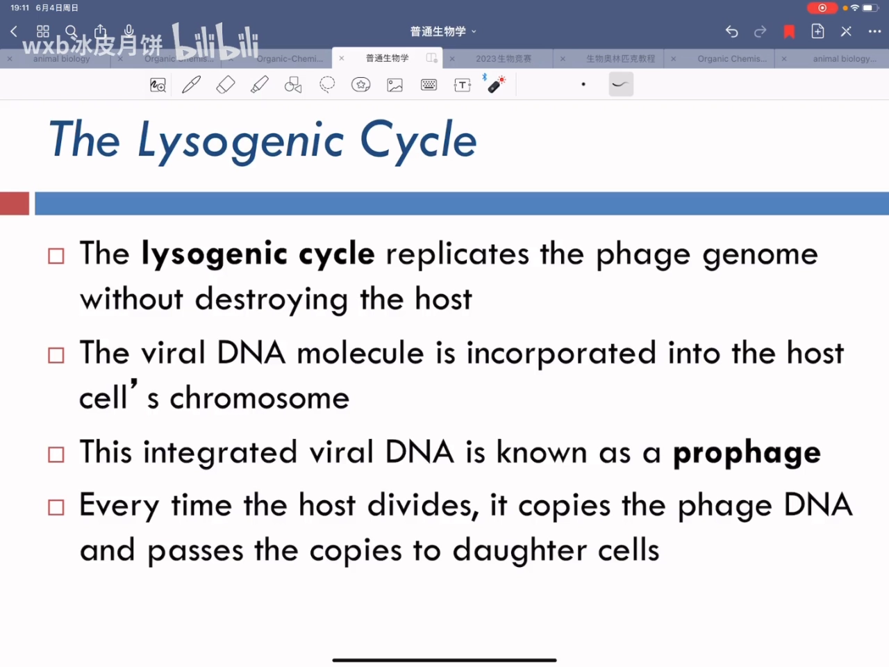
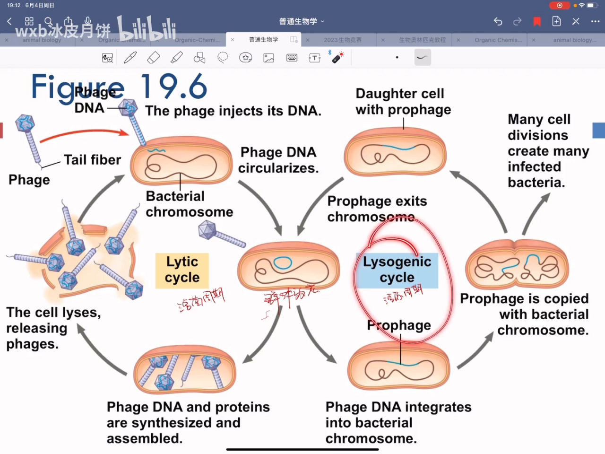
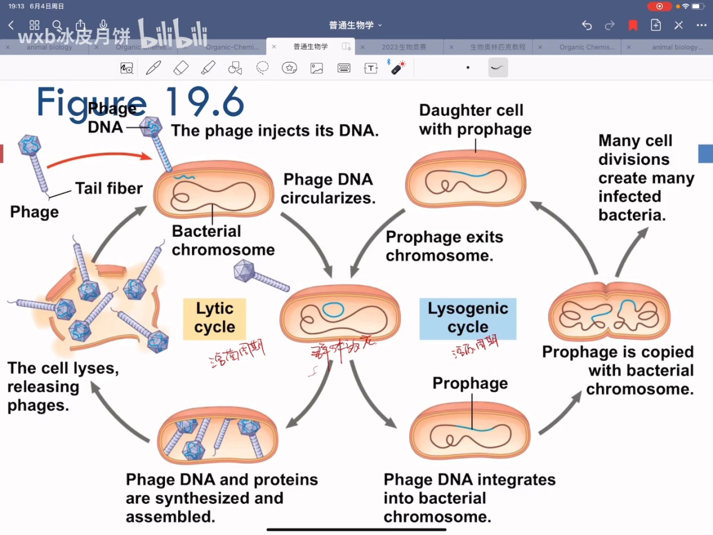

# 裂解与溶原：温和噬菌体的整合、潜伏与切出

> 视频来源：[【高中生物竞赛】速通科赫法则、溶原周期和溶菌周期](https://www.bilibili.com/video/BV1pc41137uf/)（Bilibili · 6:34）。本文只取该视频 03:44–06:30 的溶原周期与溶菌周期部分；00:00–03:44 讲科赫法则（确定病原微生物的四步判据），不属于本节范围，本文不复述。关键结论均可在原片对应时间点核对。
> 导读：这支课用两张教材图（Campbell Biology 图 19.6 与溶原周期要点页）把「同一个基因组，两种结局」讲清楚了：整合进宿主染色体就潜伏，切出来就裂解。颗粒结构与一般感染周期见同节 [病毒颗粒与感染细胞](病毒颗粒与感染细胞：结构、基因组类型与感染周期.md)，基因组类型见 [巴尔的摩分类](巴尔的摩分类：七类基因组如何汇到同一条mRNA.md)。

## 本讲要解决的核心问题（SCQA）

**背景**：噬菌体感染细菌，最直观的结局是裂解——细菌被裂开、放出一批新噬菌体。但还有一类噬菌体（**温和噬菌体**）感染之后，细菌照常活着、照常分裂，看不出被感染的样子。[【跳转到 03:52】](https://www.bilibili.com/video/BV1pc41137uf/?t=232)

**冲突**：如果噬菌体的 DNA 已经进入细菌，为什么它不复制、不装配、不裂解？细菌不死，那噬菌体靠什么传下去？更麻烦的是，同一个噬菌体、同一个宿主，为什么有的细胞裂解、有的细胞安然无恙？

**疑问**：溶原周期里噬菌体的基因组待在哪里、以什么形式存在？它怎么跟着宿主一起复制？什么条件下会从溶原切换到溶菌？切换之后又回到哪一步？

**回答（中心思想）**：温和噬菌体有两条互斥的路线。**溶原周期**里，它的 DNA **整合进宿主染色体**，这段整合态叫**前噬菌体**；此后它不产颗粒、不伤宿主，只是**随宿主 DNA 一起复制**，宿主每分裂一次就把它传给两个子细胞——这是「潜伏」，不是「没感染」。**溶菌周期**里，它从染色体上**切出**，复制蛋白、装配颗粒、裂解宿主、释放子代，再去感染新细胞。外界条件或群体效应可以触发切换，而新一次感染走哪条路并不确定。

---

## 一、溶原周期：整合、随宿主复制、不产颗粒

视频对溶原循环的描述抓住了三个要点：噬菌体在细胞里寄生，但**不会把宿主毁掉**；它的 DNA **跟着宿主 DNA 一起复制**。[【跳转到 03:52】](https://www.bilibili.com/video/BV1pc41137uf/?t=232) 这一段整合上去、并入宿主 DNA 的片段，称为**前噬菌体**。[【跳转到 04:17】](https://www.bilibili.com/video/BV1pc41137uf/?t=257) 这个状态本身有个名字：**溶原循环**，也叫**溶原周期**。[【跳转到 04:31】](https://www.bilibili.com/video/BV1pc41137uf/?t=271)

随后是这张教材图的走读：整合进去之后，随着宿主细胞的复制分裂得到两份，子细胞也带着同样一段前噬菌体，就这样进行溶原周期。[【跳转到 04:36】](https://www.bilibili.com/video/BV1pc41137uf/?t=276)

这张图最值得看的是它把两条路线画成了一个**分叉再汇合**的结构：注入之后 DNA 环化，往右走是整合成前噬菌体、随染色体复制、传给子代；往左走是复制蛋白、装配、裂解、释放。两条路共用同一个入口，也共用同一套复制与装配的机器——区别只在于**基因组此刻是游离的还是整合的**。

视频还强调了溶原状态的两个「没有」：这个过程**不会对细胞有什么危害**，同时**也没有产生噬菌体这样的个体**，它只是潜伏着。[【跳转到 05:01】](https://www.bilibili.com/video/BV1pc41137uf/?t=301)

这两个「没有」正好接上本节要区分的两个对象：溶原状态下的细胞是**被感染的细胞**（带着前噬菌体），但培养液里**没有新的病毒颗粒**。所以「检测不到噬菌体」不等于「没有噬菌体感染」——颗粒是可数的，感染状态只能从宿主基因组里去找。这个推论是本节的落点，视频本身没有展开检测方法。

## 二、切换：从溶原到溶菌

切换的触发条件，视频给得比较宽：**某些外界条件**，或者**有些群体效应的东西**，会导致它从溶原周期进入溶菌周期。[【跳转到 05:01】](https://www.bilibili.com/video/BV1pc41137uf/?t=301) 这里没有点名具体诱导物，本文也不替它补——记住「条件变化可以触发」这一层即可。

进入溶菌周期之后发生的事，就是常规的感染周期后半段：复制相关蛋白、翻译出来，与胞内物质一起形成噬菌体；噬菌体形成之后宿主就裂解了，这是一个**烈性**的过程；形成的噬菌体释放出去，再去对新的细胞下手。[【跳转到 05:26】](https://www.bilibili.com/video/BV1pc41137uf/?t=326)

## 三、新感染时的选择不是确定的

视频最后留下一个反直觉的点：噬菌体把 DNA 注射进新细胞后，**不一定马上进入溶菌周期**——它可能直接复制蛋白、组装；也可能又整合上去，进入潜伏状态。[【跳转到 05:51】](https://www.bilibili.com/video/BV1pc41137uf/?t=351)

这句话把「温和」这个性质说清楚了：温和不是噬菌体的一个固定类型标签，而是**同一份基因组在两条路线之间可切换**的能力。烈性噬菌体只有溶菌一条路，温和噬菌体两条都有，选哪条取决于感染当时的细胞状态与外部条件。[【跳转到 06:16】](https://www.bilibili.com/video/BV1pc41137uf/?t=376)

## 四、两条路线的对照

| 维度 | 溶菌周期 | 溶原周期 |
| --- | --- | --- |
| 基因组状态 | 游离，作为复制与转录的模板 | 整合进宿主染色体，成为前噬菌体 |
| 是否产颗粒 | 产，装配后裂解释放 | 不产，只随宿主 DNA 复制 |
| 对宿主的影响 | 裂解死亡（烈性过程） | 不造成危害，宿主正常分裂 |
| 传代方式 | 释放子代去感染新细胞 | 随宿主每次分裂传给两个子细胞 |
| 出口 | —— | 外界条件或群体效应触发，切出后转入溶菌 |

## 五、边界

- 视频从 00:00 起先讲科赫法则的四步判据，直到 03:44 才转入溶原与溶菌；前半段不在本节范围：它回答的是「如何确定某个微生物是病原」，属实验推断逻辑，与本节的感染周期不是同一条推理链。[【跳转到 00:00】](https://www.bilibili.com/video/BV1pc41137uf/?t=0)[【跳转到 03:44】](https://www.bilibili.com/video/BV1pc41137uf/?t=224)
- 视频没有给出切换的具体分子诱导条件、也没有讲整合与切出的酶学细节；本文按原片保留「某些外界条件／群体效应」的表述，不补外部文献。
- 溶原性转换（前噬菌体带给宿主新性状）在视频标题里出现但正文未展开，本节不涉及。
- 真核细胞的潜伏感染（如逆转录病毒整合为前病毒）机制不同，只在 [巴尔的摩分类](巴尔的摩分类：七类基因组如何汇到同一条mRNA.md) 第六类里作为信息流路径出现，本文不混为一谈。