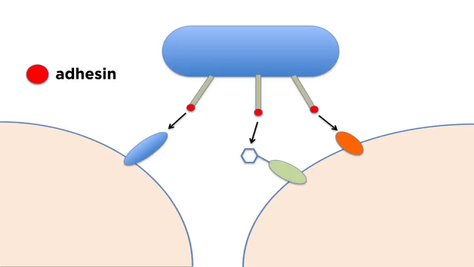
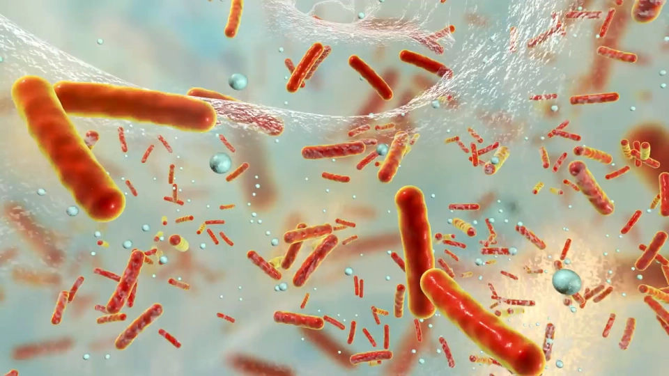
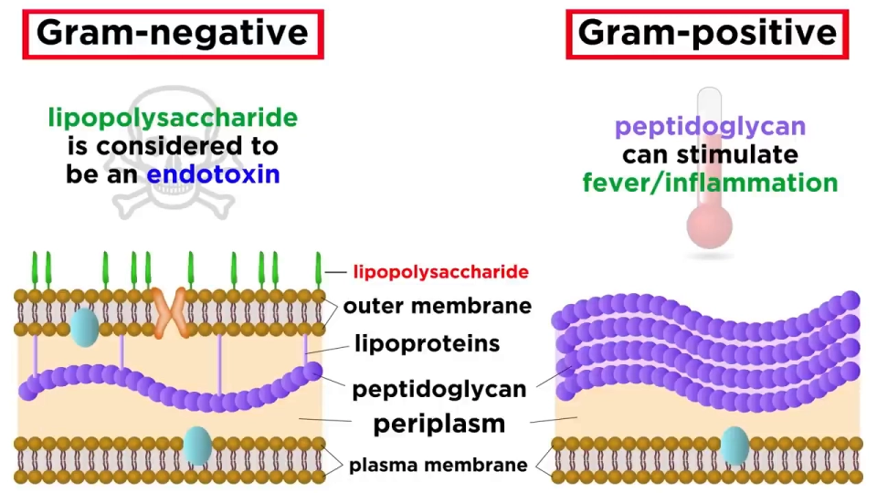
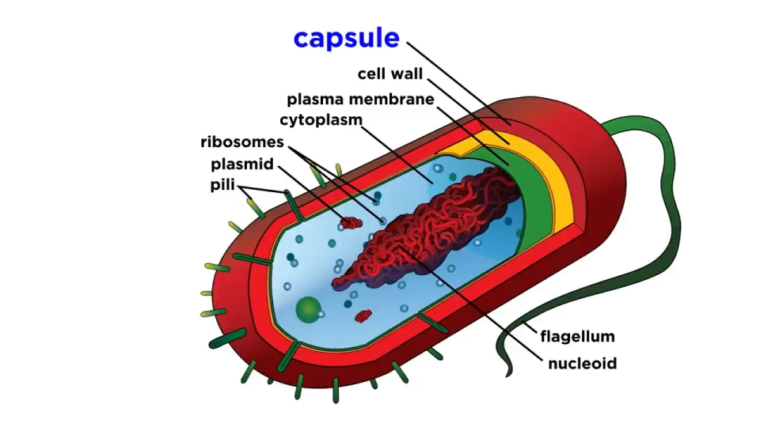

# 细菌造成损伤的四步：侵入门户、黏附定植、毒素与宿主状态

> 视频来源：[Bacterial Pathogenesis: How Bacteria Cause Damage](https://www.youtube.com/watch?v=qZCanCxo0tI)（YouTube · Professor Dave Explains）｜时长约 11 分钟。本文按该视频的逐窗口字幕与动画整理，关键结论均可在原片对应时间点核对。
> 导读：这支科普动画把「细菌怎样造成损伤」拆成一条顺序链：先绕过宿主屏障进入、再黏附定植、然后产生毒素或降解组织、最后逃避免疫；同时用接种量、感染部位和宿主免疫状态解释「为什么同样的菌有时没事、有时致命」。细菌的结构与生长见 [4.4.3](../4.4.3_细胞型微生物：细菌与真核微生物的结构和生长/细菌的形态与结构：细胞壁、细胞膜、荚膜、鞭毛与芽孢.md)；免疫应答机制不在本文范围（见 B05）。同一主题的中文课讲「毒力 = 侵袭力 + 毒素」的框架，见 [致病菌的边界](致病菌的边界：健康携带、条件致病与毒力因子.md)。

## 本讲要解决的核心问题（SCQA）

**背景**：对人体来说，细菌像住进一家「设施齐全的酒店」——温暖、潮湿、有食物、有遮挡，几乎每个角落都被改造成了适合它们生长的生态位。[【跳转到 00:11】](https://www.youtube.com/watch?v=qZCanCxo0tI&t=11) 大多数时候，这种共处并不产生症状。

**冲突**：但同一套环境，有时却会变成损伤现场：细菌释放的毒素随血液跑到远处器官，或引发过度的炎症反应，症状甚至不是细菌本身直接造成的。[【跳转到 01:28】](https://www.youtube.com/watch?v=qZCanCxo0tI&t=88) 那么，「住下来」和「搞破坏」之间差了什么？

**疑问**：细菌从接触宿主到造成损伤，要依次跨过哪几道关？每一关用的是什么工具？为什么同样的菌，换个人、换个部位、换个剂量，结果就完全不同？

**回答（中心思想）**：致病是一条四步链——**绕过屏障进入 → 黏附并定植 → 产生损伤（毒素、酶、代谢副产物）→ 逃避免疫**。每一步都只是「有机会」，不是「一定病」；最终是否出现症状，还取决于**感染部位的重要性、接种量、菌株毒力与宿主免疫状态**四个变量。定植只是链上的第二步，它本身不等于致病。

---

## 一、损伤程度由四个变量决定

细菌能造成多大伤害，视频先给了几个调节项。[【跳转到 01:53】](https://www.youtube.com/watch?v=qZCanCxo0tI&t=113)

- **部位的重要性**：中枢神经系统感染极其严重，而左脚小趾的感染可能并不致命。[【跳转到 01:58】](https://www.youtube.com/watch?v=qZCanCxo0tI&t=118)
- **菌株与接种量**：志贺菌只需约 200 个菌就能引起严重的胃肠道症状，而沙门菌可能需要一百万以上才造成严重感染。[【跳转到 02:23】](https://www.youtube.com/watch?v=qZCanCxo0tI&t=143)
- **宿主状态**：如果免疫功能受损，让沙门菌致病所需的剂量会低得多。[【跳转到 02:47】](https://www.youtube.com/watch?v=qZCanCxo0tI&t=167)

第四个变量藏在开头那句话里：细菌在进化中获得或丢失基因，使它们更会侵入某个环境、在某个生态位活得更久、更有效地分解食物，或者——最重要的——**躲避免疫系统的识别**。[【跳转到 00:32】](https://www.youtube.com/watch?v=qZCanCxo0tI&t=32) 这些适应里有一部分会变成**毒力因子**（virulence factors），让细菌更有效地致病。所谓「有毒力的细菌」，按定义就是**以宿主为代价**生长繁殖的细菌。[【跳转到 01:07】](https://www.youtube.com/watch?v=qZCanCxo0tI&t=67)

## 二、第一步：绕过宿主的天然屏障

人体有一整套天然防御：皮肤、耳垢、胃酸、泪液和黏膜。皮肤阻止微生物入侵，泪液含攻击细菌的酶，气道过滤有害颗粒，黏膜表面覆盖着能对抗微生物的分泌物。[【跳转到 03:09】](https://www.youtube.com/watch?v=qZCanCxo0tI&t=189)

但有些微生物能绕过这些防线，而且**不同的菌走不同的门**：[【跳转到 03:39】](https://www.youtube.com/watch?v=qZCanCxo0tI&t=219)

- **摄入**：沙门菌、弧菌、蜡样芽孢杆菌、志贺菌——来自放太久的野餐食物，或没洗干净的手；
- **吸入**：链球菌、分枝杆菌、军团菌——来自病人喷嚏或带菌气溶胶；
- **伤口**：破伤风梭菌；
- **其他门户**：蚊虫叮咬、针刺伤、性传播。[【跳转到 04:04】](https://www.youtube.com/watch?v=qZCanCxo0tI&t=244)

门户决定了后面能不能成立。这也解释了中文课里那句「经呼吸道感染的细菌，吃下去往往不会感染」——不是毒力不够，而是入口不对。

## 三、第二步：黏附与定植

进入体内之后，细菌还要**黏附**在表面并**定植**（colonize）——按视频的定义，定植就是「建立微生物的存在并繁殖」。[【跳转到 04:35】](https://www.youtube.com/watch?v=qZCanCxo0tI&t=275)

最典型的黏附工具是**菌毛**（fimbriae / pili），即原核细胞表面短而像毛一样的结构，用来附着在各种表面上。[【跳转到 04:49】](https://www.youtube.com/watch?v=qZCanCxo0tI&t=289) 有些细菌在菌毛尖端长了**黏附素**（adhesins），专门进化到能紧紧结合人体细胞。例如淋病奈瑟菌的菌毛特异性地结合上皮细胞表面的寡糖受体。[【跳转到 05:01】](https://www.youtube.com/watch?v=qZCanCxo0tI&t=301)

这张图说明了「宿主范围」和「组织嗜性」的分子基础：黏附素与受体的配对是特异的，没有对应受体，细菌就贴不上去，后面的定植、产毒都无从谈起。这与中文课讲的「菌毛与宿主受体是钥匙和锁的关系」是同一件事。

另一种促进定植的适应是**生物膜**（biofilm）：一种或多种微生物的集合体，细菌在其中分泌黏性的多糖网，把彼此黏成群落，从而**免受抗生素和宿主防御的伤害**。[【跳转到 05:26】](https://www.youtube.com/watch?v=qZCanCxo0tI&t=326)

铜绿假单胞菌这类细菌能感知「同伴够不够多」，通过**群体感应**（quorum sensing）触发生物膜形成。[【跳转到 05:49】](https://www.youtube.com/watch?v=qZCanCxo0tI&t=349) 生物膜在导管、牙菌斑和植入器械（如心脏起搏器）上特别常见。[【跳转到 06:02】](https://www.youtube.com/watch?v=qZCanCxo0tI&t=362)

注意这里的逻辑：**黏附和生物膜都只是「定植成功」的标志，不是「致病」的标志**。定植可以长期无症状，这正是「携带」状态的物质基础。

## 四、第三步：造成损伤的三类方式

### 4.1 生长副产物：代谢废物也能拆组织

有些细菌靠生长的天然副产物造成组织破坏。例如肠道里的厌氧菌（不需要氧气就能生长）会产生毒素、酶、气体和酸，这些都会破坏周围组织；葡萄球菌、链球菌是例子。一旦这个过程开始，细菌就有了「惯性」，这些酶会帮助疾病扩散。[【跳转到 06:21】](https://www.youtube.com/watch?v=qZCanCxo0tI&t=381)

### 4.2 毒素：按来源和作用分三类

**毒素**（toxins）是细菌产生的有害物质，作用要么是攻击附近的其它细菌，要么是损伤宿主。典型后果是细胞降解或裂解，或者触发破坏性的免疫反应。[【跳转到 06:42】](https://www.youtube.com/watch?v=qZCanCxo0tI&t=402)

按视频的讲法，症状与毒素的位置关系有两种：有的病，症状完全归因于产毒，损伤就发生在感染处；另一些情况（如破伤风、某些葡萄球菌感染），毒素会随血液传播，在身体别处引起症状。[【跳转到 07:13】](https://www.youtube.com/watch?v=qZCanCxo0tI&t=433)

按化学本质与来源，视频分了三种：

- **内毒素（endotoxin）**：革兰阴性菌外膜上的脂多糖（LPS）。低剂量可激活免疫系统或引起发热等保护性反应；高剂量可导致极高热、休克或皮肤病变，可能致命。[【跳转到 08:01】](https://www.youtube.com/watch?v=qZCanCxo0tI&t=481)
- **外毒素（exotoxin）**：蛋白质，革兰阳性菌和革兰阴性菌都能产生。包括造成细胞裂解的溶细胞素（细胞因渗透压胀破），以及结合受体后杀死细胞或改变其功能的蛋白；外毒素常由质粒或噬菌体编码。[【跳转到 08:26】](https://www.youtube.com/watch?v=qZCanCxo0tI&t=506)
- **超抗原（superantigen）**：把免疫系统激活到危及生命的程度，引起中毒性休克综合征。[【跳转到 08:45】](https://www.youtube.com/watch?v=qZCanCxo0tI&t=525)

革兰阳性菌的细胞壁成分也能引爆免疫连锁反应：肽聚糖及其降解产物可以刺激发热或炎症，对身体造成破坏性影响。[【跳转到 07:36】](https://www.youtube.com/watch?v=qZCanCxo0tI&t=456)

这里有一个容易被忽略的要点：**很多症状其实是免疫反应造成的，而不一定是细菌本身**。视频开头就点明，我们经历的许多症状来自感染触发的过度炎症或免疫反应。[【跳转到 01:28】](https://www.youtube.com/watch?v=qZCanCxo0tI&t=88) 这句话把「致病」从「细菌单方面输出」改写成了「宿主与细菌共同产生的结局」。

## 五、第四步：逃避免疫，才能长期定居

细菌还发展出多种逃避免疫的机制，在长期感染中尤其重要：[【跳转到 09:00】](https://www.youtube.com/watch?v=qZCanCxo0tI&t=540)

- **改变表面蛋白**以躲避识别，例如淋病奈瑟菌；
- **躲进细胞内部**；
- **使宿主的常规抗菌防御失活**。

最强的毒力因子之一是**荚膜**（capsule）——一层黏液样的外壳。荚膜可以模拟宿主细胞表面，使细菌避开典型的免疫反应。[【跳转到 09:25】](https://www.youtube.com/watch?v=qZCanCxo0tI&t=565)

另一些细菌在感染部位临时搭「掩体」，例如金黄色葡萄球菌用**凝固酶**（coagulase）形成屏障。[【跳转到 09:41】](https://www.youtube.com/watch?v=qZCanCxo0tI&t=581)

## 六、把四步连起来：定植不等于致病

视频最后总结：细菌有很多「招数」，有的只表达一种毒力机制，有的同时表达好几种，这些机制合起来才触发症状。[【跳转到 09:53】](https://www.youtube.com/watch?v=qZCanCxo0tI&t=593)

把这条链和第一节的四个变量放在一起，就能回答开头的问题：

| 链上的位置 | 细菌在做什么 | 是否等于致病 |
| --- | --- | --- |
| 进入 | 走对一个门户，绕过皮肤、胃酸、黏膜 | 否，只是拿到入场券 |
| 定植 | 黏附素结合受体、形成生物膜、群体感应 | 否，可以长期无症状（携带） |
| 损伤 | 产毒素、分泌酶、代谢副产物、引爆炎症 | 是，但症状可能来自免疫反应 |
| 逃逸 | 改表面蛋白、躲进细胞、荚膜、凝固酶 | 否，但决定能不能拖成慢性 |

同一株菌在链上走到哪一步，取决于剂量、部位和宿主免疫。**「携带」是走到第二步就停住，「致病」是越过了第三步**——这条分界不是菌种名单能给出的，只能按这条链逐段核对。

## 小结

- 细菌致病是一条四步链：**进入 → 黏附定植 → 造成损伤 → 逃避免疫**；每一步都只是必要条件，不是充分条件。
- **门户**决定能不能开始：摄入、吸入、伤口、蚊虫、针刺、性传播，各有对应的菌。
- **黏附素与受体的特异性**决定「谁能贴到哪种细胞上」，是宿主范围和组织嗜性的分子基础。
- **生物膜**让细菌在抗生素和免疫防御下存活，是定植而非致病的标志。
- 损伤可来自**代谢副产物、内毒素、外毒素、超抗原**，也可能来自**宿主过度的炎症反应**。
- 是否出现症状，还要看**部位、接种量、菌株毒力、宿主免疫状态**四个变量；定植与携带本身不等于疾病。

## 关键术语速查

| 术语 | 一句话解释 |
| --- | --- |
| 毒力因子 | 让细菌更有效致病的分子或结构 |
| 菌毛 / 黏附素 | 细菌表面的毛状结构与尖端蛋白，用来结合宿主受体 |
| 定植 | 建立微生物存在并繁殖，不等于致病 |
| 生物膜 | 细菌被自身多糖基质包裹成的群落，抗抗生素与免疫 |
| 群体感应 | 细菌感知同伴密度后统一启动某些行为 |
| 内毒素 | 革兰阴性菌外膜的脂多糖，低剂量发热、高剂量休克 |
| 外毒素 | 细菌分泌的蛋白毒素，常由质粒或噬菌体编码 |
| 超抗原 | 把免疫系统激活到危及生命程度的毒素 |
| 荚膜 | 菌体最外层多糖壳，模拟宿主表面、逃避吞噬 |
| 接种量 | 引起感染所需的细菌数量，因菌种与宿主而异 |