# 致病菌的边界：健康携带、条件致病与毒力因子

> 视频来源：[1101：微生物的致病性（上）](https://www.bilibili.com/video/BV1T84y1u7XN/)（Bilibili · 微生物学课程录屏）｜时长约 20 分钟。本文按该视频的逐窗口字幕与幻灯片整理，关键结论均可在原片对应时间点核对。
> 导读：这支课只讲「细菌为什么能致病」的前半段——致病菌概念的模糊处、以大肠杆菌为例的条件致病、科赫法则与健康携带者、毒力的构成与侵袭力的三件工具。原片明确把「毒素」留到下半讲（[【跳转到 20:08】](https://www.bilibili.com/video/BV1T84y1u7XN/?t=1208)），本文不复述毒素分类，毒素与宿主屏障见同节 [细菌造成损伤的四步](细菌造成损伤的四步：侵入门户、黏附定植、毒素与宿主状态.md)。细菌自身的结构与生长见 [4.4.3](../4.4.3_细胞型微生物：细菌与真核微生物的结构和生长/细菌的形态与结构：细胞壁、细胞膜、荚膜、鞭毛与芽孢.md)，本文只讲「与宿主的关系」。

## 本讲要解决的核心问题（SCQA）

**背景**：我们身上和体内长期住着大量微生物，多数时候相安无事；只有在生病时，我们才意识到它们的存在，并追问「谁是这次感染的责任病原体」。[【跳转到 00:00】](https://www.bilibili.com/video/BV1T84y1u7XN/?t=0)

**冲突**：可是同一株菌，在牛肠道里是正常菌群，在人身上却是专性致病菌；同一种大肠杆菌，有的菌株无害，有的菌株引起腹泻，还有的引起尿路感染。用「致病菌 / 非致病菌」这张名单去套，几乎处处对不上。

**疑问**：那么「携带」和「致病」的分界线到底画在哪里？判断一种细菌是否致病，要看哪些证据？「毒力」又由哪些部件组成？

**回答（中心思想）**：分界不在菌种名单，而在三个变量同时取值——**菌株是否带毒力因子、宿主的免疫状态、以及菌落到哪个部位、以多大剂量进入**。正因为如此，「健康携带者」会让经典科赫法则的第一条失效，条件致病菌是对这条裂缝打的补丁；而毒力可以拆成**侵袭力 + 毒素**，侵袭力又落在三件具体工具上：黏附素、荚膜、侵袭性酶。

---

## 一、四个概念，四种「致病」的含义

课本先给了四个并列的定义，它们并不是同一层次的东西。[【跳转到 03:17】](https://www.bilibili.com/video/BV1T84y1u7XN/?t=197)

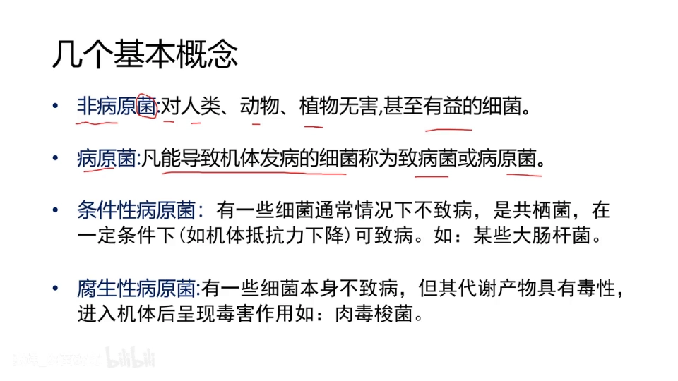

- **非病原菌**：对人类、动物、植物无害甚至有益的细菌。
- **病原菌（致病菌）**：凡能导致机体发病的细菌。
- **条件性病原菌**：通常不致病，是共栖菌，在一定条件下（如机体抵抗力下降）可致病，例如某些大肠杆菌。
- **腐生性病原菌**：细菌本身不致病，但其代谢产物有毒性，进入机体后呈现毒害作用，例如肉毒梭菌。

讲课人特意指出前两个定义「看似正确，其实有模糊性」：细菌只要环境合适就能活，环境是土壤、水体、动物、植物还是人体，对它并没有完全的限制；而免疫缺陷的人（比如艾滋病患者）身上，原来不致病的细菌也能造成感染——这时它算致病菌还是非致病菌？[【跳转到 02:02】](https://www.bilibili.com/video/BV1T84y1u7XN/?t=122) 条件致病菌就是为这个模糊地带造出来的补丁，但它本身也不精确。

这四个概念真正的用处，是提醒我们「致病」至少有三种不同的来源：**菌株本身的侵袭能力**、**宿主状态给出的机会**、以及**细菌代谢产物的毒性**。后面整讲都在展开这三条。

## 二、大肠杆菌：一条链上的四种身份

大肠杆菌是讲清这件事最好的例子，因为它同时出现在「正常菌群」「条件致病菌」「专性致病菌」三个位置上。讲课人先抛出四个问题：[【跳转到 03:57】](https://www.bilibili.com/video/BV1T84y1u7XN/?t=237) 大肠杆菌是不是都能致病？致病性大肠杆菌是不是都引起肠道感染？动物身上的大肠杆菌哪些会感染人？同一种大肠杆菌对不同动物的致病性是否一致？

### 2.1 两种定义，精确度不同

百度百科式的定义说：大肠杆菌（*Escherichia coli*，大肠埃希氏菌）是条件致病菌，在一定条件下可以引起人和多种动物发生胃肠道感染或尿道等多种局部组织器官感染。[【跳转到 04:33】](https://www.bilibili.com/video/BV1T84y1u7XN/?t=273) 这种说法容易造成一个误会：好像大肠杆菌是「一种」比较确定的细菌，只是偶尔「条件」合适才致病，而且致病的还是同一个菌株。

世界卫生组织（WHO）的定义则精确得多：大肠杆菌是人和温血动物肠道内常见的细菌，**大多数菌株无害**；然而像产志贺毒素大肠杆菌等一些菌株可引起严重的食源性疾病，主要通过被污染的食物（生的或未煮熟的碎肉制品、生鲜奶、被污染的蔬菜和芽苗菜）传给人类。[【跳转到 05:23】](https://www.bilibili.com/video/BV1T84y1u7XN/?t=323)

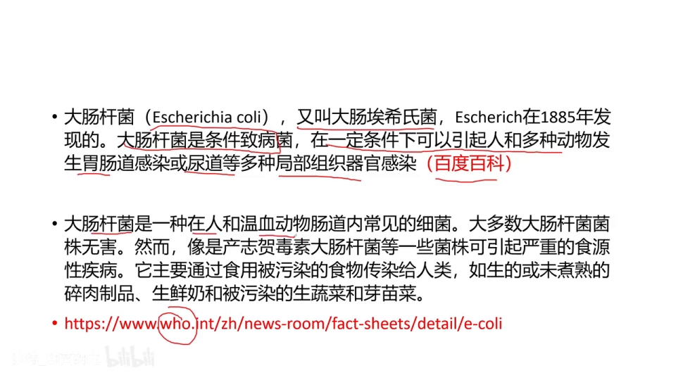

差别在于**把「菌种」还是「菌株」当作判断单位**。WHO 的说法落到菌株：无害的是大多数菌株，致病的是特定菌株。

### 2.2 肠内与肠外：致病部位不止一个

从病人身上分离的革兰阴性菌里，大肠杆菌常年排在第一位，讲课人给的数字是「20% 几，超过四分之一」；第二名是肺炎克雷伯菌。[【跳转到 05:53】](https://www.bilibili.com/video/BV1T84y1u7XN/?t=353) 但「分离率高」不等于「都是致病菌」——这正是后面要区分的携带与感染。

肠杆菌科的病原被分成两类：**原发性病原（primary pathogens，专性病原菌）** 与 **条件致病菌**。图里把大肠杆菌的一些特异性菌株归入前者，并按感染部位分成肠道内与肠道外两组。[【跳转到 06:29】](https://www.bilibili.com/video/BV1T84y1u7XN/?t=389)

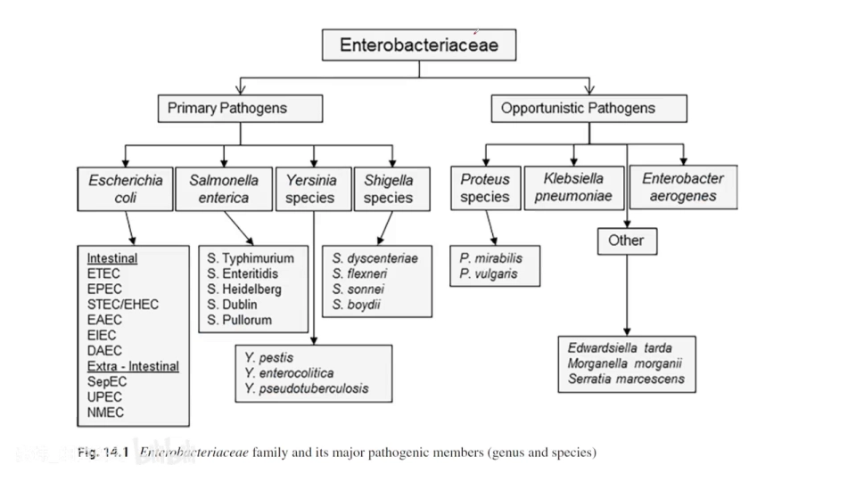

这张图回答第二个问题：**致病性大肠杆菌并不都引起肠道感染**。肠道外致病性大肠杆菌（如尿路致病型）感染的是肠道以外的部位——同一个菌种，换一个部位就从「常驻居民」变成「病原体」。[【跳转到 07:18】](https://www.bilibili.com/video/BV1T84y1u7XN/?t=438)

### 2.3 牛与猪：宿主物种决定「共生还是致病」

第三个问题用 O157 回答。牛羊携带的 *E. coli* O157:H7 属于 STEC（产志贺毒素大肠杆菌）系列。它在反刍动物肠道里是**正常菌群**，对反刍动物不致病；而对人来说，它是**专性致病菌**。[【跳转到 07:32】](https://www.bilibili.com/video/BV1T84y1u7XN/?t=452)

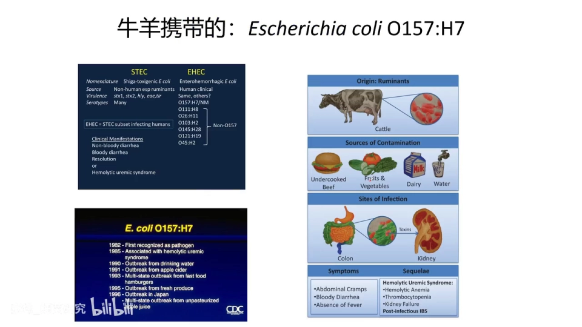

猪的大肠杆菌引起黄白痢和水肿病，但一般认为不感染人；禽的大肠杆菌也类似，虽然它有些毒力因子跟人的比较相似，但没有很坚实的证据证明禽大肠杆菌能感染人。[【跳转到 08:12】](https://www.bilibili.com/video/BV1T84y1u7XN/?t=492)

第四个问题随之有了答案：同一种大肠杆菌对不同动物的致病性并不一致。讲课人由此给了一个方法学提醒——**小鼠不是万能的毒力模型**：不同种动物对同一种细菌的致病性相差很大，小鼠在很多情况下不能代表某一种细菌对人的毒力。[【跳转到 08:59】](https://www.bilibili.com/video/BV1T84y1u7XN/?t=539)

## 三、科赫法则与它的裂缝：健康携带者

判断「这个菌是不是致病菌」有一套经典标准，即**科赫法则**，共四条：[【跳转到 09:57】](https://www.bilibili.com/video/BV1T84y1u7XN/?t=597)

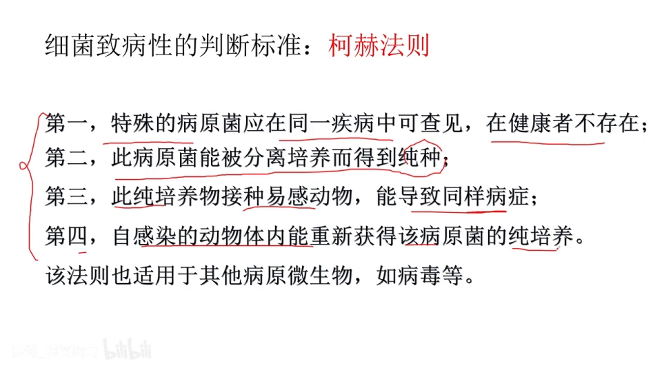

1. 特殊的病原菌应在同一疾病中可查见，在健康者中不存在；
2. 此病原菌能被分离培养而得到纯种；
3. 此纯培养物接种易感动物，能导致同样病症；
4. 从感染的动物体内能重新获得该病原菌的纯培养。

这四条构成一个闭环：查见 → 分离 → 接种 → 再分离。它也适用于病毒等其他病原微生物。

但科赫法则有裂缝，而且第一条裂缝正好落在本小节的主题上：**健康携带者**。[【跳转到 11:41】](https://www.bilibili.com/video/BV1T84y1u7XN/?t=701) 第一条要求「健康者中不存在」，可是健康人身上完全可以带着病原菌而毫无症状——这些人就是携带者。第二条也有问题：有些病原菌无法分离培养，拿不到纯种，后面的接种步骤就无从谈起。

**这就是「携带」在概念上的位置**：有微生物存在、能分离到、甚至能传给别人，但不满足「造成损害」这一条。携带不是「轻度的病」，而是这条判定链上「有菌」与「有病」之间的一段独立状态。

## 四、基因水平科赫法则：把「致病」落到毒力基因

既然「能不能培养」和「健康者有没有」都不稳，判断标准就往分子层面推进了一步，即**基因水平科赫法则**：[【跳转到 12:22】](https://www.bilibili.com/video/BV1T84y1u7XN/?t=742)

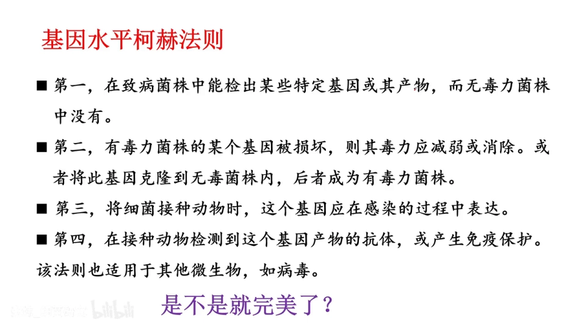

1. 在致病菌株中能检出某些特定基因或其产物，而无毒力菌株中没有；
2. 有毒力菌株的某个基因被损坏，其毒力应减弱或消除；或将此基因克隆到无毒菌株内，后者成为有毒力菌株；
3. 将细菌接种动物时，这个基因应在感染过程中表达；
4. 在接种动物中能检测到该基因产物的抗体，或产生免疫保护。

这套标准把「致病」从菌种名称换成了**可指认的分子**：某个基因在，毒力在；基因坏，毒力弱；基因转移过去，无毒变有毒。讲课人补了一句关键推论：毒力因子往往同时是**保护性抗原**——因为它在感染中表达、又被宿主免疫系统识别。[【跳转到 12:47】](https://www.bilibili.com/video/BV1T84y1u7XN/?t=767) 这句话解释了为什么很多疫苗靶点就是毒力因子。

不过讲课人也留了一个问号：基因水平科赫法则是不是就完美了？[【跳转到 13:12】](https://www.bilibili.com/video/BV1T84y1u7XN/?t=792) 原片没有展开答案，这里只记下这个问号——它与第五节「毒力由多个部件构成」正好互相呼应。

## 五、毒力 = 侵袭力 + 毒素

### 5.1 毒力是菌株的特征，不是菌种的特征

**毒力**指病原菌致病能力的强弱程度。它是**菌株个体**的特征：同一种病原菌，因菌株不同，毒力大小也不相同；按毒力大小可分为强毒株、弱毒株和无毒株，一般毒力越强致病性越强。[【跳转到 15:32】](https://www.bilibili.com/video/BV1T84y1u7XN/?t=932)

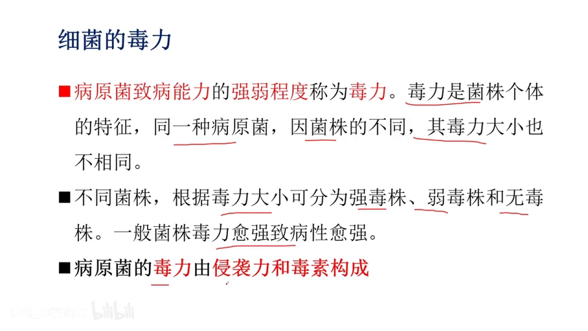

病原菌的毒力由**侵袭力**和**毒素**两部分构成。本讲只讲前半部分：侵袭力。

### 5.2 侵袭力：突破屏障、生长繁殖、扩散

**侵袭力**指病原细菌突破机体防卫屏障、在机体内生长繁殖扩散的能力。[【跳转到 15:57】](https://www.bilibili.com/video/BV1T84y1u7XN/?t=957) 它通过三种方式实现：黏附、抗吞噬与定居、促进扩散和转移。前两个靠细菌表面结构，第三个靠侵袭性酶。

**第一件工具：黏附素。** 黏附往往是细菌表面的黏附素，分为菌毛黏附素和非菌毛黏附素，其中最重要的是菌毛黏附素。[【跳转到 17:35】](https://www.bilibili.com/video/BV1T84y1u7XN/?t=1055)

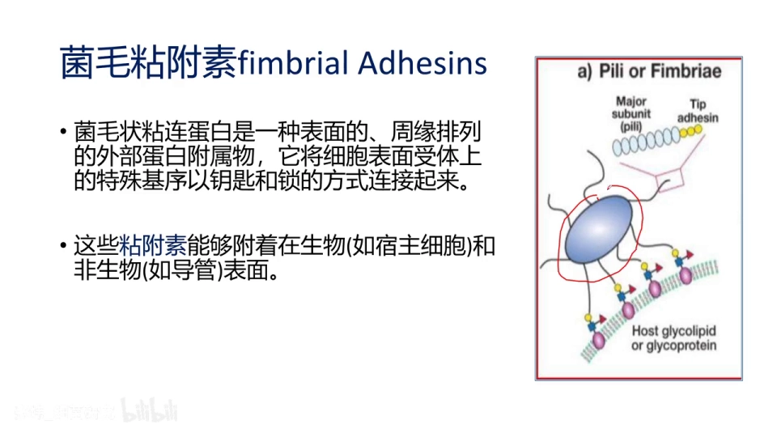

菌毛可以和宿主的某些结构形成**钥匙和锁**一样的连接，是一一对应的关系。这解释了一个现象：为什么有些细菌只能感染某些特定动物，或动物某个特定部位——比如有些大肠杆菌只感染猪小肠上的某些特定细胞，就是跟它的菌毛有关。[【跳转到 17:10】](https://www.bilibili.com/video/BV1T84y1u7XN/?t=1030) 反过来，菌毛也是开发疫苗的好靶点。[【跳转到 18:00】](https://www.bilibili.com/video/BV1T84y1u7XN/?t=1080)

**第二件工具：荚膜与微荚膜。** 抗吞噬和定居靠菌体表面的多糖，主要是荚膜。有荚膜的细菌毒力比失去荚膜时明显增强；荚膜很厚时，宿主的抗体不太能跟它表面的抗原结合，从而起到免疫逃逸和防止吞噬细胞吞噬的作用；有些荚膜多糖还能避免与吞噬细胞表面的补体受体结合。[【跳转到 18:34】](https://www.bilibili.com/video/BV1T84y1u7XN/?t=1114)

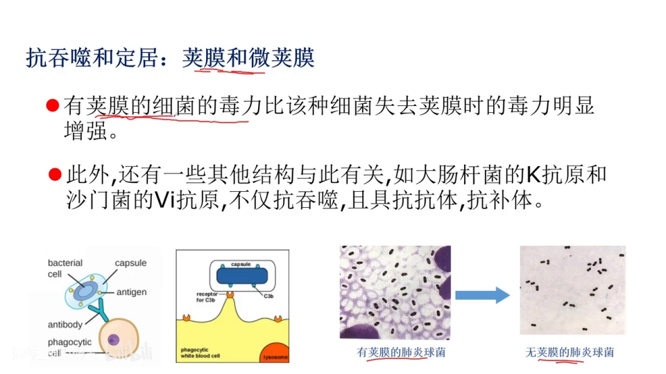

**第三件工具：侵袭性酶。** 这类酶属胞外酶，一般不直接导致疾病，但可以破坏机体的组织结构，从而协助病原菌侵入机体后抗吞噬或扩散。[【跳转到 19:43】](https://www.bilibili.com/video/BV1T84y1u7XN/?t=1183)

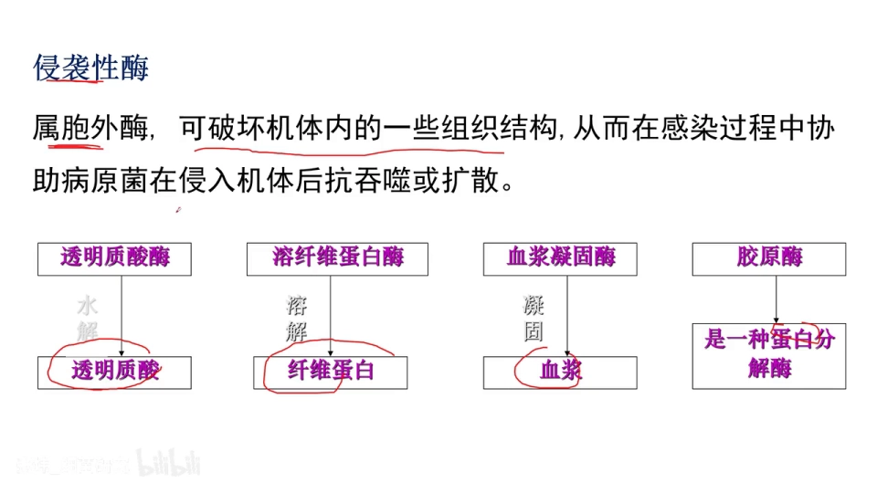

图中列了四种：透明质酸酶水解透明质酸、溶纤维蛋白酶溶解纤维蛋白、血浆凝固酶使血浆凝固、胶原酶降解胶原蛋白。它们的分工不同，但共同效果是「把组织这道墙拆松」，让细菌走得更远。

## 六、致病是细菌与宿主相互作用的结果

讲到这里，讲课人把视角从细菌拉回到关系：细菌致病是细菌与宿主之间相互作用的过程，因此既要看宿主的免疫状态，也要看病原菌这一侧。[【跳转到 14:17】](https://www.bilibili.com/video/BV1T84y1u7XN/?t=857)

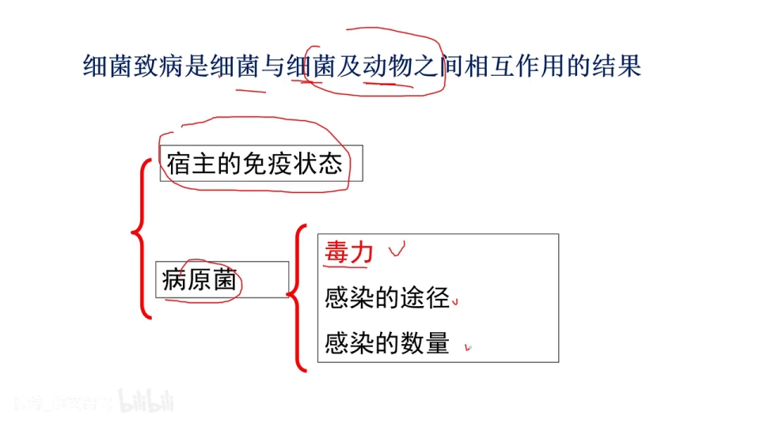

- **宿主免疫状态**：健康人能感染的，往往细菌毒力比较强；免疫受损的人感染的某些病原菌，才更接近「真正的条件致病菌」。
- **感染途径**：经呼吸道感染的细菌，如果吃下去往往并不会感染——门户不对，毒力再强也进不去。
- **感染数量（剂量）**：有些细菌需要的剂量非常高，比如副溶血弧菌必须吃到一定数量的活菌才可能感染；有些菌的剂量非常低，比如 STEC、羊种布氏杆菌。[【跳转到 14:42】](https://www.bilibili.com/video/BV1T84y1u7XN/?t=882)

把这三条和前面的概念接起来，就得到本讲的结论：**「携带」是三个变量都没越线的状态**——菌株没有（或没表达）足够的毒力因子，部位是它该待的地方，剂量与宿主免疫都还兜得住；**「致病」是其中至少一个变量越线**。所以同一种大肠杆菌可以在牛肠道里当正常菌群、在人的尿路里当病原体、在免疫受损的人身上当条件致病菌。

## 小结

- 「致病菌 / 非致病菌」是按菌种划的名单，而致病能力其实是**菌株**的特征：大肠杆菌大多数菌株无害，特定菌株才致病。
- **健康携带者**让科赫法则第一条失效；「有菌」与「有病」之间有一段独立的携带状态，不能互相替代。
- **条件致病菌**是给「宿主状态给出机会」这种情况打的补丁：菌没变，宿主变了。
- **毒力 = 侵袭力 + 毒素**；侵袭力的三件工具是黏附素（菌毛，钥匙与锁）、荚膜（抗吞噬）、侵袭性酶（拆松组织）。
- 判断一次感染，要同时看**菌株毒力、感染途径与剂量、宿主免疫状态**；缺一项，结论都可能反过来。
- 小鼠等动物模型不能直接外推到人：同一种菌对不同宿主的致病性可以相差极大。

## 关键术语速查

| 术语 | 一句话解释 |
| --- | --- |
| 条件致病菌 | 通常不致病、在宿主抵抗力下降等条件下才致病的共栖菌 |
| 腐生性病原菌 | 细菌本身不致病，靠代谢产物（如肉毒毒素）毒害机体 |
| 健康携带者 | 体内有病原体并能分离到，但不出现症状的人 |
| 科赫法则 | 查见—分离纯种—接种易感动物—再分离的四步闭环判据 |
| 基因水平科赫法则 | 用毒力基因的存在、失活与互补来判断致病性 |
| 毒力 | 病原菌致病能力的强弱，是菌株个体特征 |
| 侵袭力 | 突破防卫屏障、在体内生长繁殖扩散的能力 |
| 黏附素 | 菌毛或非菌毛表面蛋白，以钥匙-锁方式结合宿主受体 |
| 荚膜 | 菌体表面多糖层，抗吞噬、抗补体、助免疫逃逸 |
| 侵袭性酶 | 透明质酸酶、溶纤维蛋白酶、血浆凝固酶、胶原酶等胞外酶 |