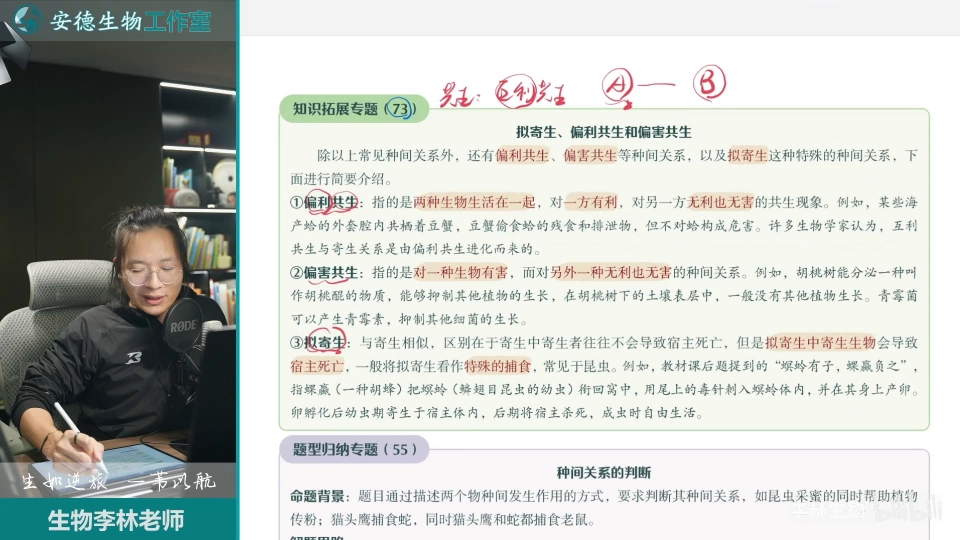
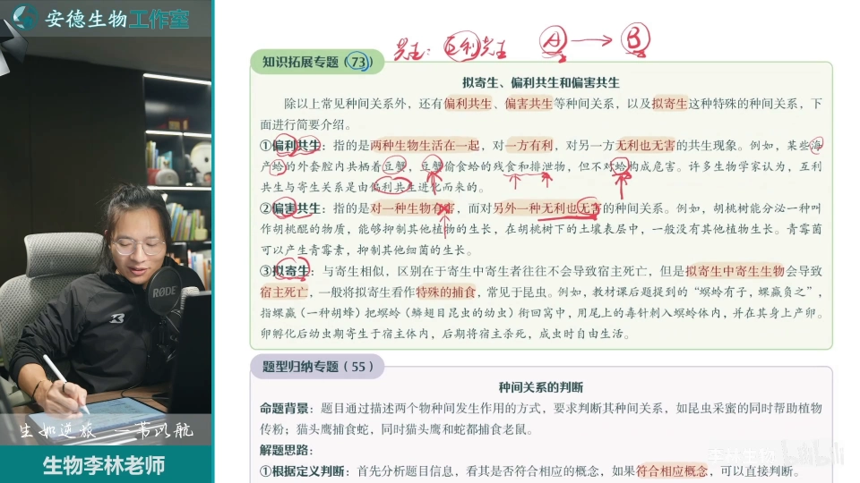
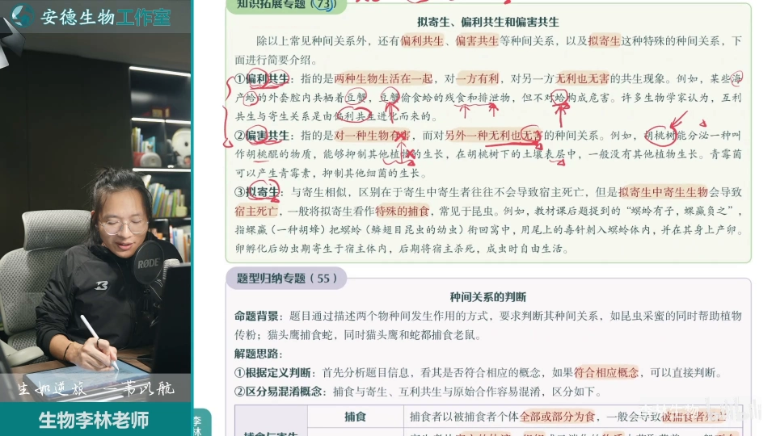
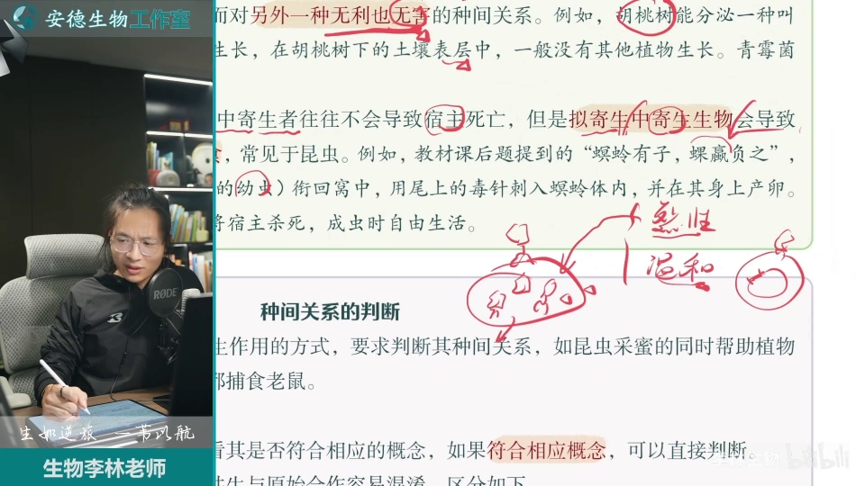

# 偏利、偏害与拟寄生：符号表里被省略的三类互作

> 视频来源：[【李林生物笔记】高考生物98个超纲考点拓展详解之【拟寄生、偏利共生和偏害共生】](https://www.bilibili.com/video/BV1ZPXTB7Ekw/)（Bilibili · 李林生物，约 8 分钟）
> 导读（100 字以内）：一支八分钟的考点拓展课，专门补教材五类关系之外的三类：偏利共生、偏害共生、拟寄生。它的价值在于把「符号表」补全成 $+$/$0$、$-$/$0$ 和「形似寄生实为捕食」三种格子，并给出分开能否存活这条判据。

## 本讲要解决的核心问题（SCQA）

**背景**：教材给出的种间关系是五种——捕食、寄生、竞争、互利共生、原始合作。用「双方各得什么」的记法，它们只覆盖了 $+$/$+$、$+$/$-$、$-$/$-$ 三种组合。

**冲突**：可是自然界里存在大量「一方受益、另一方既不受益也不受害」和「一方受害、另一方也不受益」的关系。前者放不进 $+$/$+$（因为另一方没得到好处），后者放不进 $-$/$-$（因为另一方没受损）。还有一类更麻烦：它长得像寄生，结局却像捕食。

**疑问**：这三类关系分别是什么？判据是什么？它们和已经学过的五类怎么区分？

**回答（中心思想）**：把符号表补全，需要三个新格子——**偏利共生** $+$/$0$、**偏害共生** $-$/$0$，以及**拟寄生**（形似寄生、归入捕食）。三者的共同点是：教材的五类关系描述的是「双方都受到显著影响」的情形，而这三类描述的是「一方几乎不受影响，或者影响的时点被推迟」的情形。理解了这一点，就理解了为什么符号表要写成三档（$+$、$-$、$0$）而不是两档。

---

## 一、先立判据：分开还能不能活

视频开场先把教材的五种关系过了一遍——捕食、寄生、竞争、互利共生、原始合作——然后说明：高考不喜欢只考课本，所以补充三种教材没有、但题目中可能涉及的关系：偏利共生、偏害共生和拟寄生。

[【跳转到 00:00】](https://www.bilibili.com/video/BV1ZPXTB7Ekw/?t=0)

然后他把已经学过的互利共生重新定义了一遍，因为后面三类都要靠它做参照。

互利共生的字面意思是双方都有利，是两个物种之间非常重要的种间相互作用。例子是大豆和根瘤菌：根瘤菌帮大豆固氮，提供更多的含氮化合物——氮可以合成蛋白质、核酸、磷脂，所以能帮大豆获得更多营养物质，促进生长；没有固氮菌，大豆产量一般会非常低、长势也不好。反过来，对根瘤菌来说大豆也非常重要：如果没有大豆提供足够的营养物质，根瘤菌自己根本无法生存。

**互利共生的评价标准就是不能分开**：一旦分开，对双方都无利，甚至会导致一方死亡。这也正是它和原始合作最主要的区别——原始合作是分开之后各自也能独立生活。

[【跳转到 00:55】](https://www.bilibili.com/video/BV1ZPXTB7Ekw/?t=55)

这条判据在后面反复用到：偏利共生里的受益方，往往也「不能分开」。

[【跳转到 00:30】](https://www.bilibili.com/video/BV1ZPXTB7Ekw/?t=30)

---

## 二、偏利共生：一方有利，另一方无害也无利（$+$/$0$）

偏利共生指的是两种生物生活在一起，对一方有利，对另一方**无利也无害**。

视频的描述是：A 和 B 之间，对其中一方没有什么危害、没有什么影响，「你来不来都无所谓」；但对 B 来说它不能分开，它必须从 A 那里获得营养或者其他生存条件。

例子是海产的**蛤蜊和豆蟹**：豆蟹会偷吃蛤蜊吃剩的残食和排泄物。这对蛤蜊倒也没什么影响——残食它也不要了，排泄物更是不要的东西，都给豆蟹吃掉了。对蛤蜊没有危害，对豆蟹却是有利的，而且豆蟹非常依赖蛤蜊的残食和排泄物。

[【跳转到 01:45】](https://www.bilibili.com/video/BV1ZPXTB7Ekw/?t=105)

**为什么会有偏利共生？** 视频给了一个演化上的解释：很多科学家认为，偏利共生其实是互利共生或者寄生的**早期阶段**。再演化下去有两种可能——一种是对另一方也开始有利，就变成互利共生；另一种是长期生活在一起之后得寸进尺、开始危害对方，就变成寄生。所以一般认为，寄生、偏利共生和互利共生可能是由偏利共生长期进化来的。

这个说法把三类关系排成了一条时间轴，也解释了为什么偏利共生在自然界「例子比较少」：它可能是一个过渡态，而不是稳定态。

[【跳转到 02:35】](https://www.bilibili.com/video/BV1ZPXTB7Ekw/?t=155)

[【跳转到 01:20】](https://www.bilibili.com/video/BV1ZPXTB7Ekw/?t=80)

---

## 三、偏害共生：一方受害，另一方无害也无利（$-$/$0$）

偏害共生指的是对一种生物有害，而对另外一种**无利也无害**的种间关系。

视频的说法很直白：说白了就是「损人不利己」——我要弄死你，可对我自己也没什么影响。那为什么还要这么干？逻辑在于：短期内对施害方没有什么特别作用，既无利也无害，**但长期看，对别人的危害对自己是有利的**。

例子是**胡桃树与胡桃醌**：胡桃树能分泌一种叫胡桃醌的物质，能够抑制其他植物生长。这对胡桃自己没什么影响，但妨碍了其他植物生长，所以在胡桃树下的土壤表层中，一般没有其他植物生长。长期来看这对胡桃是有好处的：别的植物不能生长之后，它就少了竞争者，不会有人跟它竞争土壤、水和无机盐、阳光，等于增强了竞争力。

[【跳转到 03:25】](https://www.bilibili.com/video/BV1ZPXTB7Ekw/?t=205)

讲义还给了第二个例子：**青霉菌产生青霉素，抑制其他细菌的生长**。这是同一个格子的微生物版本。

### 3.1 为什么它不该被写成 $-$/$-$

如果把偏害共生写成 $-$/$-$，就会误以为双方都在付出代价、竞争强度对称。实际不是：施害方付出的代价小到可以忽略，收益则被推迟到「竞争者消失之后」。这解释了为什么这类关系在观察上容易被漏掉——短期看只是一方长不好，长期看才是竞争力的差距。

[【跳转到 03:00】](https://www.bilibili.com/video/BV1ZPXTB7Ekw/?t=180)

---

## 四、拟寄生：形似寄生，实为捕食

拟寄生这个词听上去很像寄生，视频用课本上的「螟蛉有子，蜾蠃负之」把它讲清楚。

**典故**：螟蛉是一种鳞翅目的幼虫；蜾蠃是一种胡蜂、一种食虫蜂。这种蜂会把螟蛉的幼虫衔回自己的巢穴。古人看到这个行为，以为螟蛉自己没有孩子、是蜾蠃把别人的孩子领回去养，后来就用这个典故形容一个人宽宏大量、博爱。所以现在也把义子叫做「螟蛉之子」。

[【跳转到 04:40】](https://www.bilibili.com/video/BV1ZPXTB7Ekw/?t=280)

**实际过程**：蜾蠃把自己的卵产在螟蛉的身体里面，卵在螟蛉体内以它的身体为食，获得食物之后生长发育，最后孵化出新的蜾蠃后代。讲义写得更细：蜾蠃用尾上的毒针刺入螟蛉体内，并在其身上产卵；卵孵化后幼虫寄生于宿主体内，**后期将宿主杀死**，成虫时自由生活。

[【跳转到 05:05】](https://www.bilibili.com/video/BV1ZPXTB7Ekw/?t=305)

**为什么它不是寄生**：寄生通常不会导致寄主死亡——寄主死亡对寄生者是不利的，寄主死了，寄生者也活不下去。而且寄生一般不会吃掉整个身体，只吃一部分，吃一些食物残渣、一些体液。但螟蛉和蜾蠃的关系不是这样：第一，它会导致螟蛉死亡；第二，它会把身体全部吃光，除了外壳那层皮不吃，里面都吃光了。

[【跳转到 05:55】](https://www.bilibili.com/video/BV1ZPXTB7Ekw/?t=355)

**所以叫拟寄生**：与寄生相似，区别在于寄生中寄生者一般不会导致寄主死亡，而拟寄生中寄生生物**会**导致寄主死亡。一般把拟寄生看作特殊的捕食，是一种捕食关系。视频提到福建高考考过一次，问「螟蛉有子，蜾蠃负之」属于什么样的种间关系，答案是**捕食**。

[【跳转到 04:15】](https://www.bilibili.com/video/BV1ZPXTB7Ekw/?t=255)

### 4.1 一个延伸：病毒和噬菌体算哪一类

视频末尾顺着拟寄生提了一个开放问题：如何评价病毒的作用？动物病毒、植物病毒和噬菌体，跟它们的寄主是什么种间关系？

视频的判断是：动物病毒和植物病毒一般算寄生——我们容易感冒、容易感染病毒，但多数情况下病毒也不会导致人死亡，感冒一般不会致死（个别免疫力特别差的情况会有危险）。但噬菌体对宿主细胞的作用不一定算寄生，它也可能像拟寄生、像捕食。

[【跳转到 07:01】](https://www.bilibili.com/video/BV1ZPXTB7Ekw/?t=421)

理由是噬菌体分两种：**烈性噬菌体**会直接在细胞内大量增殖、产生大量子代，使宿主细胞裂解死亡；**温和噬菌体**在一段时间内保持温和状态，会和宿主基因组 DNA 结合，暂时不发生裂解。视频的推测是：烈性噬菌体导致宿主细胞裂解死亡的过程，应该算拟寄生、算捕食，而不应算寄生。

这一段视频自己标注为「高中没有做过多探讨」，属于讲课人的判断而非教材结论。它值得保留，因为它示范了同一个判据（宿主死不死、身体剩不剩）怎么用到新对象上——而不是因为它给出了定论。

[【跳转到 07:51】](https://www.bilibili.com/video/BV1ZPXTB7Ekw/?t=471)

---

## 五、补全后的符号表

把本文和教材的五类放在一起，符号表才完整：

| 关系 | 甲 | 乙 | 判据 | 例子 |
| --- | --- | --- | --- | --- |
| 互利共生 | $+$ | $+$ | 分开后双方都活不好 | 大豆与根瘤菌 |
| 原始合作 | $+$ | $+$ | 分开后各自也能独立生活 | 海葵与寄居蟹 |
| **偏利共生** | $+$ | $0$ | 一方获益，另一方无利也无害；获益方往往离不开对方 | 蛤蜊与豆蟹 |
| 寄生 | $+$ | $-$ | 宿主受害但身体结构仍完整，通常不致死 | 蛔虫与人、菟丝子与大豆 |
| 捕食 | $+$ | $-$ | 猎物死亡或身体残缺 | 翠鸟捕鱼、狼捕兔 |
| **拟寄生** | $+$ | $-$ | 形似寄生，但最终杀死宿主并吃光身体，归入捕食 | 蜾蠃与螟蛉 |
| **偏害共生** | $0$ | $-$ | 一方受害，另一方无利也无害；施害方长期获益 | 胡桃与胡桃醌、青霉菌与青霉素 |
| 种间竞争 | $-$ | $-$ | 双方争夺同一份有限资源，相互排斥 | 大草履虫与双小核草履虫 |

三条容易混的边界可以压成三句话：

1. **分开能不能活**：能活是原始合作，都活不好是互利共生，只有一方离不开是偏利共生。
2. **对方还剩多少**：宿主身体完整是寄生，猎物死亡或残缺是捕食，先寄生后杀死的拟寄生归捕食。
3. **另一方有没有付出**：付出代价是竞争或捕食，没付出但受害是偏害，没付出也没收益是偏利。

---

## 六、这篇没有覆盖的部分

- 视频是一节高考考点拓展课，没有给任何定量测量：偏利、偏害的「影响大小」在野外怎么测、拟寄生的寄生率怎么估，都不在范围内。
- 「偏利共生是互利共生与寄生的早期阶段」是视频转述的一种学界观点，不是已定论；本节按视频保留，读者不宜把它当作普遍规律。
- 拟寄生与寄生的界线在昆虫学里还有更细的划分（如容性寄生、抑性寄生等），视频只讲到「宿主死不死的时点」这一层。
- 本篇不涉及偏利共生与「清洁共生」的关系。清洁鱼与宿主鱼常被举为互利或偏利的例子，但视频里的蛤蜊—豆蟹是取食残食，不是清洁行为，两者不能混为一谈。

## 小结

- 教材的五类关系只覆盖 $+$/$+$、$+$/$-$、$-$/$-$ 三种组合；补上偏利共生 $+$/$0$ 与偏害共生 $-$/$0$，符号表才完整。
- 偏利共生：一方获益、另一方无利也无害，获益方往往离不开对方（蛤蜊与豆蟹）。
- 偏害共生：一方受害、另一方无利也无害，施害方的收益被推迟到「竞争者消失之后」（胡桃醌、青霉素）。
- 拟寄生：形似寄生，但会杀死宿主并吃光身体，归入捕食（蜾蠃与螟蛉）。
- 三条判据：分开能不能活、对方还剩多少、另一方有没有付出代价。

## 关键术语速查

| 术语 | 一句话解释 |
| --- | --- |
| 偏利共生 | 对一方有利、对另一方无利也无害的共生，受益方常依赖对方 |
| 偏害共生 | 对一方有害、对另一方无利也无害的种间关系，施害方长期获益 |
| 胡桃醌 | 胡桃树分泌的抑制其他植物生长的物质，偏害共生的经典例子 |
| 拟寄生 | 与寄生相似但会杀死宿主的寄生方式，一般归为特殊的捕食 |
| 螟蛉与蜾蠃 | 「螟蛉有子，蜾蠃负之」的两种昆虫，拟寄生的经典例子 |
| 烈性噬菌体 | 在宿主细胞内大量增殖并使其裂解的噬菌体 |
| 温和噬菌体 | 基因组整合进宿主基因组、暂不裂解宿主的噬菌体 |