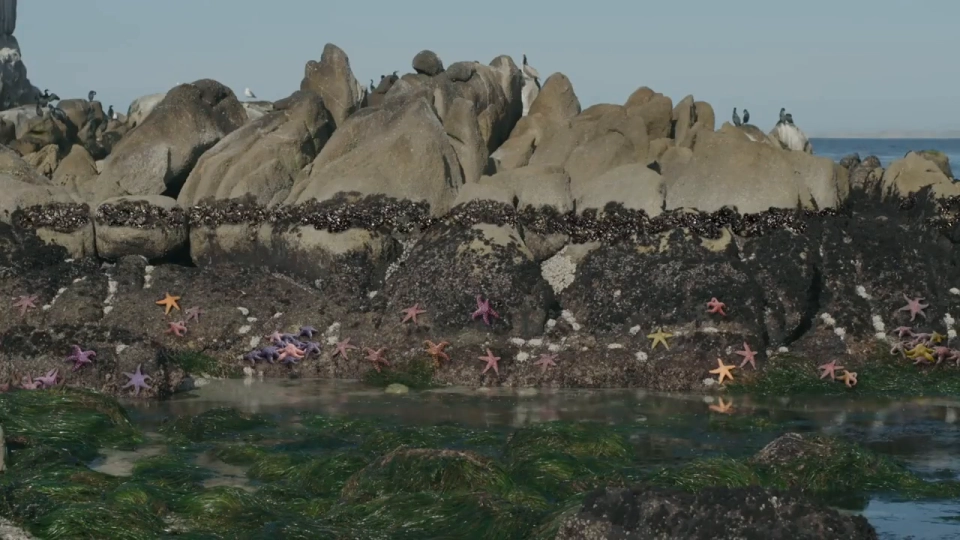
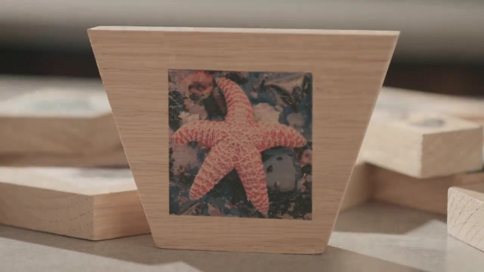
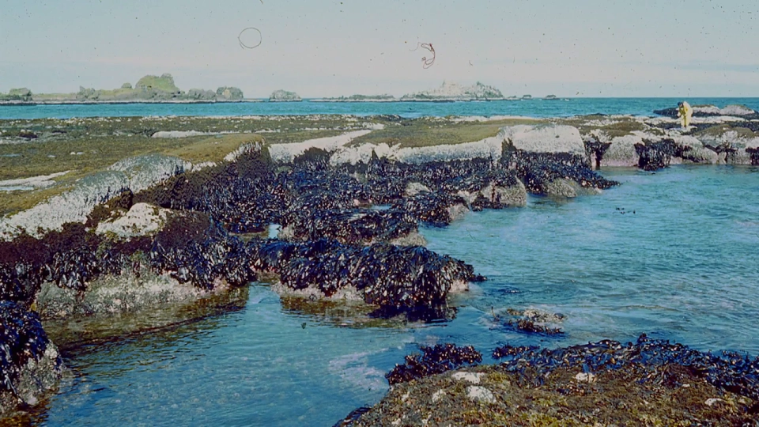
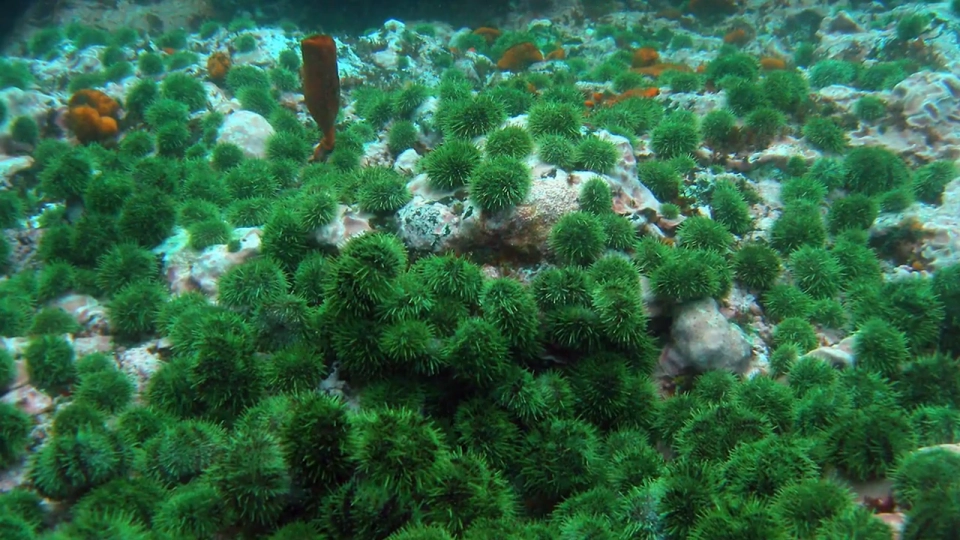
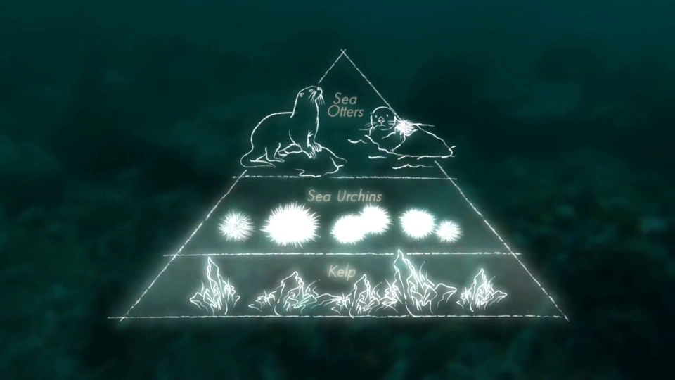
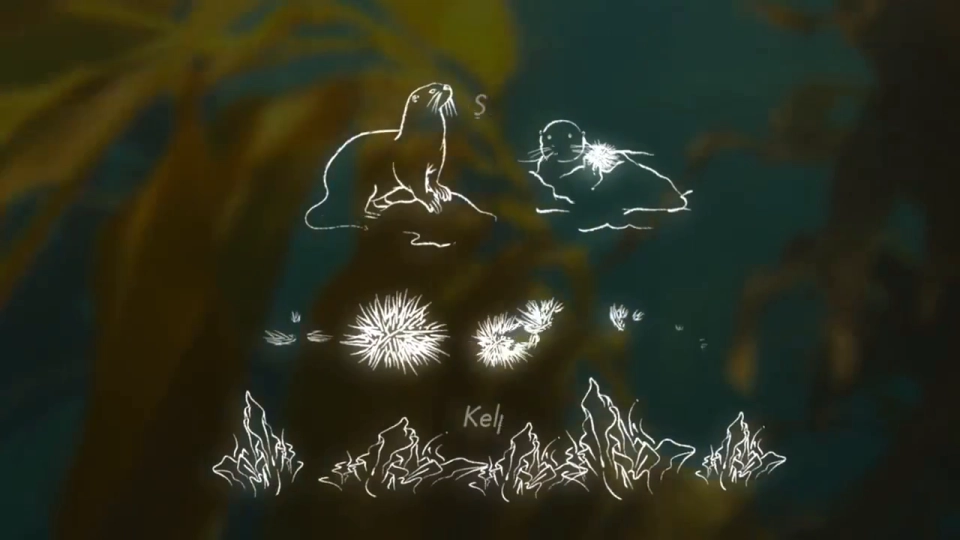

# 关键物种与营养级联：移除一个种之后

> 视频来源：[3.3 有些动物比其他动物更平等：关键物种和营养级联](https://www.bilibili.com/video/BV1644y1X74f/)（Bilibili · 译制科学短片，约 19 分钟）
> 导读（100 字以内）：一支科学史纪录片，讲佩恩 1963 年把海星扔进海里、以及二十多年后海獭与虎鲸的故事。本文按时间顺序复述这两个实验，并把「移除一个种 → 整条链变化」拆成可检验的推理步骤；译名与物种名按通行译法订正。

## 本讲要解决的核心问题（SCQA）

**背景**：生态学的教科书里常有一句话——能量从生产者流向食草动物，再流向捕食者，每一层的数量由下面一层的食物量决定。按这个说法，只要植物够多，食草动物就会一直增长，直到把植物吃光。

**冲突**：可现实是，世界是绿色的。树木长着叶子，并没有被吃光。为什么食草动物没有增长到把树叶全部吃掉的规模？

**疑问**：是什么在限制食草动物的数量？如果限制来自上层——捕食者——那么把捕食者拿掉，整个群落会发生什么？这种影响能不能被实验证明，而不只是推测？

**回答（中心思想）**：捕食者不只是「吃掉一些个体」，它还能**决定谁能占据空间**。1963 年佩恩把海星从礁石上撬走，一年半内岩石上的物种数从 15 种降到 8 种，最后整片岩石被贻贝独占——一个物种的移除改变了整个群落的组成。这类影响远超它直接捕食的物种，佩恩称之为**关键物种**；而这种沿食物链向下传递的间接影响，就是**营养级联**。它也给出了本节最重要的区分：**个体层面的「谁吃到食物」和群体层面的「群落还剩几个物种」，是两个不同的问题。**

---

## 一、一个反问：树为什么是绿色的

影片从一个课堂提问开始。密歇根大学的一间教室里，弗雷德·史密斯教授问学生一个看似简单的问题：为什么那棵树是绿色的？有人说是叶绿素。史密斯说，叶绿素确实是让树变绿的原因，但他问的是更大的问题——**是什么让树叶留在那里**。

他当时在想食物链。链条是这样的：你显然有生产者，它们是以它们为生的任何东西的能源供应商；然后上面有消费者，再上面我们知道是食草动物。当时流行的想法是：生产者的数量限制了食草动物的数量，反过来，食草动物的数量限制了以它们为食的捕食者的数量——**每一层都是由食物链底部向上的食物量调节的**。

[【跳转到 01:15】](https://www.bilibili.com/video/BV1644y1X74f/?t=75)

但这种观点解释不了一件事：为什么食草动物的数量不会简单地增长，一直增长到把树上所有的叶子都吃掉？

史密斯和两位同事——纳尔逊·海尔斯顿和劳伦斯·斯洛博特金——讨论了这个难题，提出了一个新主意：食草动物**有能力**破坏植物群落，树木可能会落叶，但为什么它们没有落叶？答案是周围没有足够的昆虫来做到这一点。这就是捕食者的角色。

**世界是绿色的，因为捕食者控制了食草动物。** 这个激进的概念后来被称为「绿色世界假说」。这堂课，是对绿色世界假说的第一次公开审查。

[【跳转到 02:16】](https://www.bilibili.com/video/BV1644y1X74f/?t=136)

注意这个假说的形式：它不是「捕食者很重要」这种笼统说法，而是一个**可被推翻的预测**——如果捕食者真的在控制食草动物，那么移除捕食者，食草动物就应该暴增，植物就应该被吃光。史密斯的一个学生罗伯特·佩恩，后来成了检验这个想法的人。

---

## 二、海星实验：移除顶级捕食者

几年后，作为华盛顿大学的新教授，佩恩去找一个能研究捕食者角色的系统。他找到了太平洋海岸——多岩石的海岸，潮间带。

他从识别所有的生物开始，然后绘制谁吃谁：有以藤壶为食的食肉腹足类动物，有以藻类为食的海胆，还有很多。他的观察表明，一种名为 *Pisaster ochraceus* 的紫色和橙色大型海星处于食物链的顶端。

海星看起来不太可能是捕食者，但把时间加快一点，你会看到致命的猎人。如果海星在进食，你把它翻过来，就能看到它在吃什么：它们在吃贻贝，也吃很多其他东西，但它们在吃贻贝。

[【跳转到 03:19】](https://www.bilibili.com/video/BV1644y1X74f/?t=199)

于是佩恩问了一个问题：**当你把捕食者海星从一块礁石上移走时，会发生什么？**

方法很朴素：给海星一个惊喜——它们钳在撬杆上，需要很强的手腕；然后尽可能把它们甩出去，在那个年代可以把海星扔到六七十英尺的深水里。退潮时袭击这个区域，把所有海星清走，取完其他数据，返回西雅图。

[【跳转到 03:29】](https://www.bilibili.com/video/BV1644y1X74f/?t=209)

### 2.1 结果：物种数从 15 降到 8

生态系统开始迅速变化。一年半之内，佩恩就知道自己达到了生态学目标：尽管顶级捕食者已经被移除，令人惊讶的是，岩石中的物种数量实际上**从 15 种减少到 8 种**。三年后，它下降到 7 种；然后又过了七年，它简化了自己，基本上变成了单一栽培。

随着实验继续，一条条贻贝沿着岩石面向前推进，几乎垄断了所有可用的空间，把所有其他物种排挤出去。

[【跳转到 03:49】](https://www.bilibili.com/video/BV1644y1X74f/?t=229)

这个结果值得停一下：**移除一个捕食者，物种数不是增加而是减少**。如果按「捕食者只是消耗猎物」的直觉，拿掉捕食者应该让猎物变多、多样性上升；实际发生的是相反的——少了海星这个捕食者，贻贝赢下了空间竞争，把别的物种全挤掉了。

[【跳转到 04:05】](https://www.bilibili.com/video/BV1644y1X74f/?t=245)

---

## 三、关键种：拱顶石的比喻

佩恩发现，一个捕食者可以控制整个群落的组成。他创造了一个术语，来描述一个单一物种对生态系统所能发挥的力量。

他对建筑知之甚少，但如果你建造一座拱门，你必须让它的两边互相施加压力，因此在拱门的顶点有一块**拱顶石**；你把拱心石拉出来，整个结构就倒塌了。许多捕食者就像 *Pisaster* 海星一样，是关键物种。

[【跳转到 04:32】](https://www.bilibili.com/video/BV1644y1X74f/?t=272)

关键物种的定义要点在于**影响与数量不成比例**：这些关键物种产生了巨大的影响，远远超出它们主要捕食的物种。影片用一组对照说明这一点——大多数物种在其他实验中没有这么大的影响：他们又移除各种物种，但这对生态系统几乎没有影响。

于是影片说出了那句被用作标题的话：**作为一个整体，动物是平等的，但有些动物比其他动物更平等。** 这表示，事实上所有物种对系统的影响并不相同。而这件事不能靠推理得出，只能通过实验来解决——而这通常不容易做到。

关键物种的概念在生态学领域引起了涟漪，然后把它颠倒过来：**我们移动捕食者，系统就自我简化。** 这是一个生态概念，它是普遍的、全球性的。

---

## 四、潮汐池：海胆与海带

佩恩在离海岸稍远的地方继续他的研究，注意到另一个醒目的图案：有很多潮汐池，一些潮汐池以海胆为主，有些不是。**在潮汐池里有很多海胆的地方，海带少了很多。**

佩恩怀疑海胆阻止了海带的生长。他对自己说：那是我的下一轮实验。他用手把一些池子里的海胆都移走，又让附近的水池原封不动。

结果是戏剧性的：在他移除海胆的池塘里，海带几乎立即开始生长。**海胆控制着海带。**

[【跳转到 05:32】](https://www.bilibili.com/video/BV1644y1X74f/?t=332)

影片在这里说了一句关键的话：这**完全违反了绿色世界假说**。按绿色世界假说，是捕食者控制食草动物、从而保护植物；但在佩恩的池子里，海胆（食草动物）吃掉了所有的海带，而没有任何东西在调节海胆的数量。

**那么，为什么没有任何东西来调节海胆的数量呢？** 这个问题把影片推向了第二个故事。

---

## 五、海獭：从毛皮贸易到营养级联

答案来自一个偏远岛屿上的偶然相遇。在阿拉斯加的阿留申岛链中，佩恩在 1971 年遇到了另一位科学家——詹姆斯·埃斯特斯，一个雄心勃勃的年轻研究生。两人看完电影后在酒吧相遇：佩恩对海胆很感兴趣，而埃斯特斯在研究海獭的生理学。

佩恩在解释他想做什么：一个叫阿姆奇特卡岛的岛屿可以支持如此丰富的捕食者，这是通过理解生产量、以及通过食物网向上流动的能量和物质的效率来做到的。埃斯特斯的反应是：那不是很有趣吗？**你有没有想过，这些动物可能会对整个系统造成什么影响？**

佩恩意识到，与其研究海带，他可能会发现海獭在自然组织中扮演的角色。于是他提出了一种类似扔海星实验的方法：**把海獭从生态系统中移除，测试对其他物种的影响。**

[【跳转到 06:32】](https://www.bilibili.com/video/BV1644y1X74f/?t=392)

### 5.1 天然实验：毛皮贸易已经做过一次移除

埃斯特斯说，他当时并不认为这能做，但他做了，因为他对海獭的历史很了解：海獭在北太平洋很丰富，然后太平洋海上毛皮贸易开始于 1741 年，在随后的一百五十年里，海獭被猎杀到灭绝的边缘。1911 年或 1912 年禁止进一步捕猎，其中一些种群幸存了下来，为该物种的恢复提供了种子。

但海獭的恢复**参差不齐**：它们完全从一些岛屿系统的毛皮贸易中恢复过来——穿越阿留申群岛，阿姆奇特卡是其中的一部分；还有其他岛屿系统，它们还没有恢复。

这就等于大自然已经做了一次「移除实验」：有的岛有海獭，有的岛没有。实验设计因此变得很简单。

[【跳转到 07:07】](https://www.bilibili.com/video/BV1644y1X74f/?t=427)

### 5.2 把头伸进水里的一瞬间

他们从阿姆奇特卡岛开始。埃斯特斯很了解阿姆奇特卡的样子：海胆很常见，但非常小。下一步是安排到附近没有海獭的岛屿潜水。

埃斯特斯描述了那一刻：那是我在谢米亚岛把头伸进水里——**只有绿色，有海胆，没有海带**。一切都在一瞬间就到位了。

海獭从那个系统中消失，已经完全重组了原本海带可能非常丰富的系统。之前海獭的消失导致了海胆的大量繁殖，在海獭不在的时候把所有的海带都吃了。

[【跳转到 07:54】](https://www.bilibili.com/video/BV1644y1X74f/?t=474)

这是绿色世界假说的一个引人注目的证明：**海獭这个捕食者控制着以海带为食的海胆。** 佩恩把「清除海獭、海带森林消失」这件事称为一个物种向下对其他物种的级联效应——**营养级联**。

### 5.3 营养级联的定义

影片给的定义是：营养级联是**当你有一个顶级捕食者，它控制着资源分配，于是产生了这些间接影响的级联**——很多很多的间接影响。

具体到这条链：你的海獭少了，你就有更多的海胆，你的海带就少了。而海带少了，影响不止于此——每个沿海物种都可能受到这样或那样的影响：海带森林里的鱼类非常依赖海带，在海带林中觅食的鸟类、在海带森林中觅食的无脊椎动物，几乎所有生活在沿海地区的生物都在某种程度上依赖这个系统。

所以海獭是另一个关键物种，它们调节着沿海海洋群落的结构。结果毫不含糊。

[【跳转到 08:25】](https://www.bilibili.com/video/BV1644y1X74f/?t=505)

---

## 六、第四个营养级：虎鲸为什么改吃海獭

埃斯特斯定期返回阿拉斯加研究海獭。大约二十年后，他注意到发生了一些奇怪的事情：他们在捕捉海獭，抓到足够多的东西——这很奇怪，因为他从来没有遇到过抓海獭的困难。**海獭的数量似乎在下降。**

他试图想出各种可能的解释，把能想到的所有假设排成一排：他排除了饥饿的可能性，排除了疾病。然后第三个假设出现了。蒂姆·廷克是一名技术人员，冬天的一天他打电话说：你知道吗，我开始怀疑是不是虎鲸。埃斯特斯说，这太疯狂了，这不可能发生，它们不吃海獭。廷克说，是呀它们吃，我见过它们吃了一对。

[【跳转到 08:51】](https://www.bilibili.com/video/BV1644y1X74f/?t=531)

### 6.1 怎么检验：找一个虎鲸到不了的地方

再一次，大自然提供了一个理想的场所：一个虎鲸无法到达的地点。他们在两三天内捕获了大约三十只动物，结果发现**这一小群海獭的数量并没有下降**，而其他所有地方都在下降。这帮助埃斯特斯确信，这是一个可行的假设。

[【跳转到 09:43】](https://www.bilibili.com/video/BV1644y1X74f/?t=583)

### 6.2 为什么虎鲸现在吃海獭

虎鲸一般吃鲸鱼，不是海獭。二战后有很多鲸鱼，但二战后日本人和俄国人开始大量捕杀这些鲸鱼，到 20 世纪 60 年代末，它们已经耗尽了 90%。把所有大鲸鱼从系统中剥离出来，震惊了这些虎鲸，迫使它们扩大食谱，开始以其他物种为食。

影片的总结是：发生的事情是，这个**三级营养级联被虎鲸增加了第四个营养级**，它使这个系统的行为就像理论预测的那样——虎鲸吃海獭，海胆数量增加，海带消失。

[【跳转到 09:73】](https://www.bilibili.com/video/BV1644y1X74f/?t=613)

对埃斯特斯来说，令人惊讶的是：像捕鲸这样的事情，始于 20 世纪中叶、发生在北太平洋的海洋领域，可能会影响沿海生态系统中的海胆和海带。甚至想到这一点都令人难以置信。这是一个令人满意的确认，它提供了一个例子，说明营养级联的概念是如何在自然界中发挥作用的。

---

## 七、这套推理给了我们什么

随着生态学家用新的眼光探索其他栖息地，他们在许多地方发现了关键物种和营养级联：就像海獭一样，清除狼等捕食者、鲨鱼和狮子，会对其他物种的数量和种类产生深远的影响，以及对整个生态系统的影响。这些基本的见解改变了我们看待世界的方式。

影片最后落在一句警告上：人类还有很多东西要学着不去忽略。**忽视它，风险自负。** 顶级捕食者扮演什么角色？

### 7.1 个体效应与群体结果，是两件事

把两个实验并排看，会发现它们各自都在回答同一个问题的两个层面：

| 层面 | 问的问题 | 海星实验里的答案 | 海獭故事里的答案 |
| --- | --- | --- | --- |
| 个体 | 谁吃到了、谁没吃到 | 海星吃到了贻贝 | 虎鲸吃到了海獭 |
| 种群 | 某个物种的数量往哪走 | 贻贝数量上升，其他物种下降 | 海獭下降，海胆上升 |
| 群落 | 还剩几个物种、结构如何 | 物种数 15 → 8 → 7，最后单一栽培 | 海带森林消失，沿海物种连带受影响 |

个体层面「适者」指的是当下能拿到资源、留下后代的那一个；群体层面「稳定」指的是群落里还有多少个物种、结构是否维持。这两件事没有必然联系：海星在个体层面只是「吃到了贻贝」，在群落层面却决定了十几个物种能不能留在岩面上。

### 7.2 生态变化与遗传演化，是两个时间尺度

影片里出现的所有变化——物种数从 15 降到 8、海胆暴增、海带森林消失——都是**生态变化**：数量、分布、组成在几年到几十年内改变。这类变化原则上可逆：把海獭放回去，海带森林有可能恢复。

而**遗传演化**是可遗传变异频率的跨代改变，时间尺度长得多，也不会因为环境恢复就自动回退。影片没有讲演化，但它提供了一个演化问题的起点：如果海獭长期缺席，海胆种群会不会在可遗传的性状上发生变化？这已经不是本节的范围，但读者需要分清——**看到「群落变了」不等于「物种演化」，前者是生态，后者需要跨代的证据。**

### 7.3 为什么这是「实验」而不是「故事」

影片反复强调方法：佩恩不是观察到「有海星的地方物种多」就下结论，而是**主动移除**海星，并保留对照；海獭部分则利用毛皮贸易造成的天然差异（有海獭的岛 vs 没有海獭的岛）作为对照，再用「虎鲸到不了的地点」作为独立检验。

这条证据链的形状是：**操纵 → 预测 → 观察 → 排除替代解释**。埃斯特斯先排除了饥饿、排除了疾病，才轮到虎鲸；虎鲸假设又被一个「虎鲸到不了的地方」单独检验。没有这一步，营养级联只是一个说得通的故事。

---

## 八、边界与待核对

- **影片是科学史叙事，不是定量研究**。物种数 15→8→7 是佩恩的观察结果，影片没有给出重复次数、统计检验或误差范围；引用这些数字时应说明它们是单组实验的观察值。
- **「关键物种」不等于「重要的物种」**。影片的定义是「影响远超其自身数量比例」，这需要实验对照才能判断；仅凭「这个物种很显眼」不能推。影片自己也说，大多数物种被移除后对生态系统几乎没有影响。
- **营养级联的强度因系统而异**。影片一方面说这个概念「是普遍的、全球性的」，另一方面又用实验对照说明「大多数物种被移除后对生态系统几乎没有影响」。这两句话并不矛盾，但合起来意味着：级联不是每个物种都会触发，判断某个物种是否关键必须逐个做移除实验，不能把海獭案例当作所有生态系统的模板。
- **译名与物种名已按通行译法订正**：*Pisaster ochraceus*（赭色海星）、阿姆奇特卡岛（Amchitka）、谢米亚岛（Shemya）、虎鲸（影片字幕作「逆戟鲸」）、海獭（字幕作「水獭」）。影片字幕为机器翻译，个别句子（如「一条条肌肉沿着岩石面向前推进」）按上下文订正为「一条条贻贝」。
- **本节不推导动力学模型**。影片只给出「谁多谁少」的方向性结论，没有给出捕食率、转化效率等参数，也没有写出任何方程。

## 小结

- 绿色世界假说提出一个可检验的预测：捕食者控制食草动物，所以世界是绿色的。
- 佩恩移除海星后，岩石上的物种数从 15 种降到 8 种，最终被贻贝独占——移除捕食者让多样性**下降**，不是上升。
- 影响远超自身数量比例的物种叫**关键物种**；拱顶石的比喻说明：抽掉它，整个结构就塌。
- 潮汐池实验显示海胆控制海带；而海胆为什么没有被调节，答案在海獭身上。
- 海獭—海胆—海带构成一条营养级联；虎鲸改吃海獭又给这条链加了第四个营养级。
- 证据链的形状是「操纵 → 预测 → 观察 → 排除替代解释」，天然对照（有/无海獭的岛、虎鲸到不了的地点）在其中起了关键作用。
- 个体层面的「谁吃到」与群体层面的「群落还剩几个物种」是两个问题；生态变化与遗传演化是两个时间尺度。

## 关键术语速查

| 术语 | 一句话解释 |
| --- | --- |
| 绿色世界假说 | 捕食者控制食草动物，所以植物生物量没有被吃光的假说 |
| 关键物种 | 对群落影响远超其自身数量比例的物种，移除后群落结构显著改变 |
| 营养级联 | 顶级捕食者的变化沿食物链向下传递，引起间接影响的连锁反应 |
| 海胆荒漠 | 海胆大量繁殖、啃食殆尽后只剩裸露岩面的状态，海带森林消失 |
| 天然实验 | 利用历史上已经发生的差异（如毛皮贸易造成的海獭有无）作为对照 |
| 生态变化 | 数量、分布、组成在短期内的改变，原则上可逆 |
| 遗传演化 | 可遗传变异频率的跨代改变，时间尺度长且不易回退 |