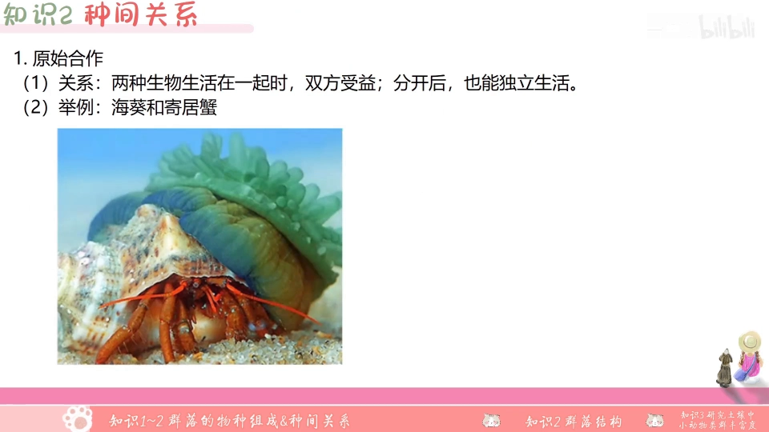
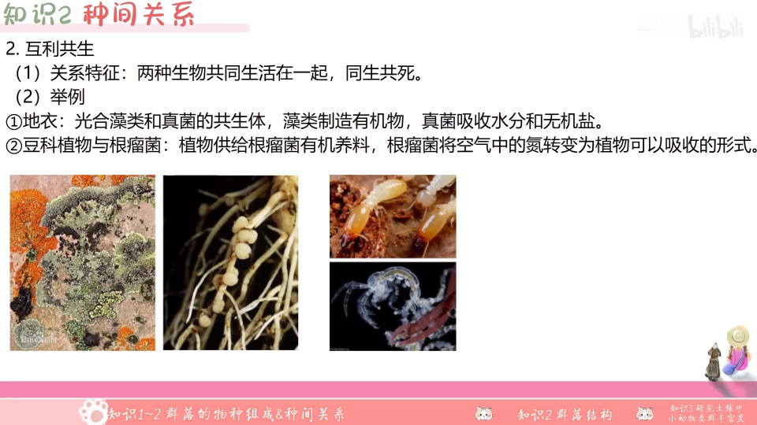
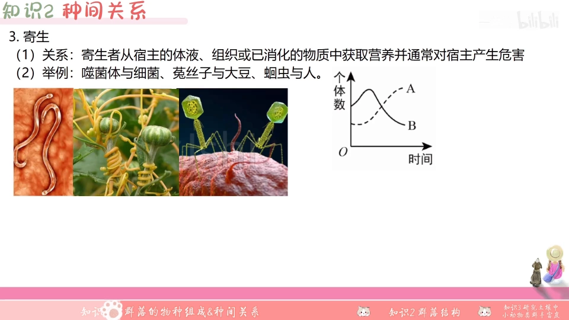
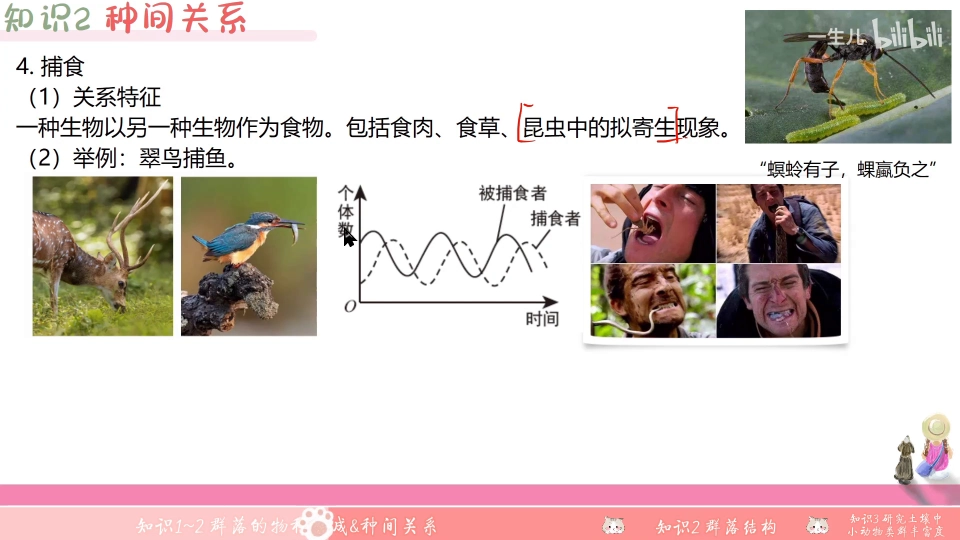
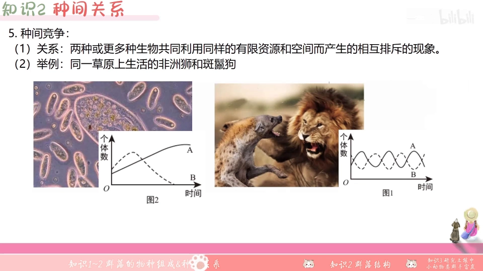
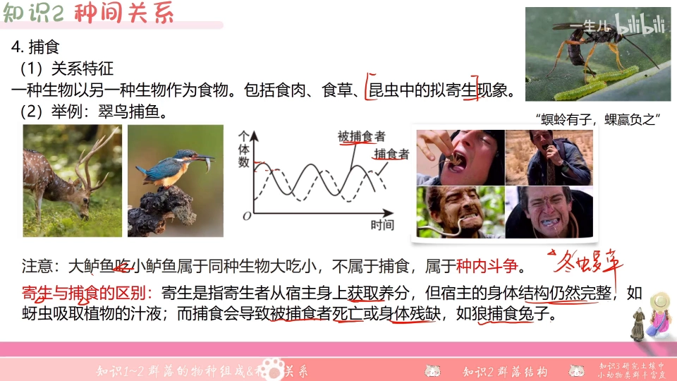
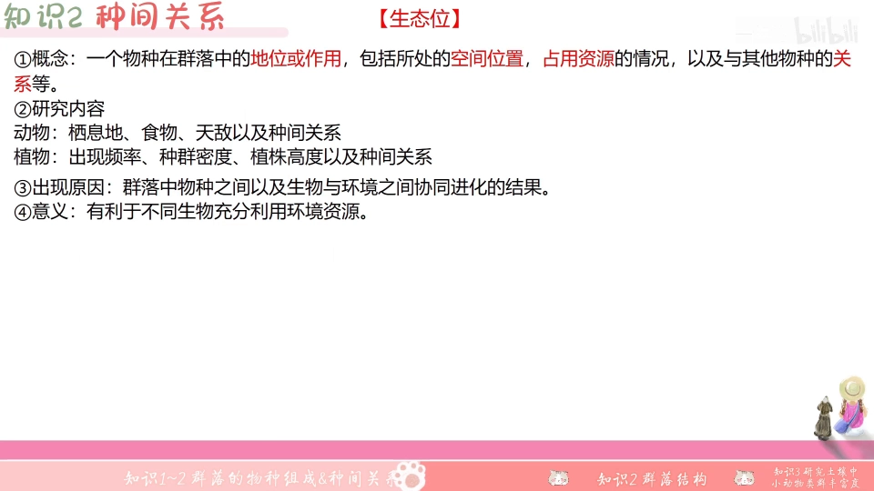
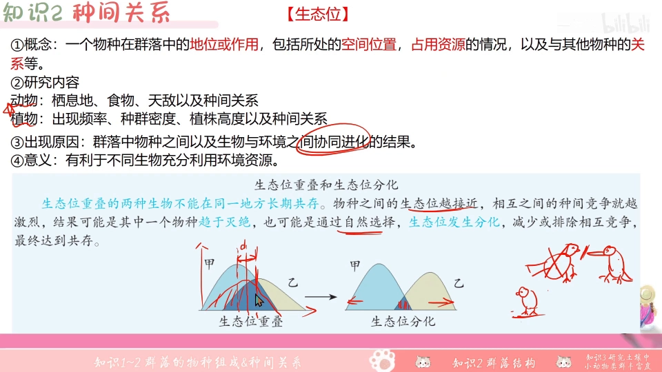

# 群落中的种间关系：五类互作、竞争排斥与生态位分化

> 视频来源：[群落的结构｜选择性必修二【0基础 学生物】](https://www.bilibili.com/video/BV1rzm7BiEER/)（Bilibili · 一生儿，约 35 分钟）
> 导读（100 字以内）：一场高中复习课，按教材顺序把五类种间关系逐个配例子讲完，再用两条曲线讲捕食与竞争。本文只取其中「种间关系」这一大段（02:46–22:17），把例子整理成一张符号表；群落定义、丰富度、空间结构与土壤动物实验留在第六节说明取舍。

## 本讲要解决的核心问题（SCQA）

**背景**：一片草原上，狮子、斑鬣狗、草、兔子、寄生虫、根瘤菌同时存在。直觉上我们会说「它们互相有关系」，但「有关系」不是可检验的说法——狮子吃斑鬣狗和狮子跟斑鬣狗抢食物，对双方数量的影响方向完全相反。

**冲突**：教材给出的判断标准不是「谁凶」，而是**双方各自得到什么**。可一旦落到具体例子上，边界就开始模糊：大鲈鱼吃小鲈鱼算捕食吗？冬虫夏草是真菌吃虫子还是真菌寄生在虫子里？狮子把斑鬣狗咬死算竞争还是捕食？

**疑问**：能不能用一套统一的记法，把任意两个物种的关系判成「谁受益、谁受损」？判完之后，这些关系又怎样决定两个种群的数量走向——是你死我活，还是长期共存？

**回答（中心思想）**：种间关系可以写成一对符号 $(+/-/0)$ 表示双方各自的得失，五类常见关系就是这张符号表上的五个格子。符号只说明**方向**，不说明**结局**：同样是 $-$/$-$ 的竞争，既可能以一方被排除告终，也可能通过生态位分化走向共存；同样是 $+$/$-$ 的捕食，既可能让双方数量稳定波动，也可能把猎物吃崩、连带自己一起崩。所以判类型只是第一步，第二步要看这套相互作用在**群体层面**产生了什么结果。

---

## 一、把两个物种的关系写成符号：五类互作

视频按教材顺序讲了五类关系：原始合作、互利共生、寄生、捕食、种间竞争。它们的区别不在「亲密程度」，而在**双方各自的得失**，以及**分开之后还能不能独立生活**。

| 关系 | 符号（甲/乙） | 判据 | 视频给的例子 |
| --- | --- | --- | --- |
| 原始合作 | $+$ / $+$ | 双方受益，分开也能独立生活 | 海葵与寄居蟹 |
| 互利共生 | $+$ / $+$ | 双方受益，同生共死，分开都活不好 | 地衣（藻类＋真菌）、豆科植物与根瘤菌、白蚁与鞭毛虫 |
| 寄生 | $+$ / $-$ | 寄生者从宿主体液、组织或已消化物质取营养，宿主受害但身体结构仍完整 | 噬菌体与细菌、菟丝子与大豆、蛔虫与人、虱子 |
| 捕食 | $+$ / $-$ | 一种生物以另一种生物为食物，猎物死亡或身体残缺 | 翠鸟捕鱼、鹿吃草、昆虫中的拟寄生 |
| 种间竞争 | $-$ / $-$ | 两种或更多生物共同利用同样的**有限**资源和空间，相互排斥 | 大草履虫与双小核草履虫、狮子与斑鬣狗 |

[【跳转到 02:46】](https://www.bilibili.com/video/BV1rzm7BiEER/?t=166)

### 1.1 原始合作：双方受益，但分开也能活

原始合作指两种生物生活在一起时双方受益。视频用海葵和寄居蟹举例：寄居蟹带着海葵到处走，让海葵有更大的空间去觅食；反过来，海葵的触手有毒，可以帮寄居蟹抵御天敌。

关键在于**分开也能独立生活**——不是离了谁就不行。这一点是它和互利共生最主要的分界。

[【跳转到 04:06】](https://www.bilibili.com/video/BV1rzm7BiEER/?t=246)

### 1.2 互利共生：分开就都活不好

新教材把原始合作和互利共生拆成了两条，其实两者都属于「互利」性质，只是互利共生**关系更密切**：共同生活在一起，同生共死。视频给了三个例子。

**地衣**是光合藻类和真菌的共生体，一般是先锋植物：先在岩石上出现，再通过地衣酸加上时间和风化作用，把岩石变成大石块、沙粒。在岩石这样恶劣的环境下，藻类和真菌单独都很难活——它们一般生活在比较湿润的地方。两者在一起时，藻类制造有机物给真菌吃；真菌一方面用菌丝包裹藻类，帮它抵御干燥，另一方面吸收水分和无机盐供给藻类。

**豆科植物与根瘤菌**：豆科植物需要的氮比较多，根瘤菌把空气中的氮转变成植物可以吸收的形式供给它；反过来，植物合成有机物供给根瘤菌使用。

**白蚁与鞭毛虫**：白蚁吃木屑，但自己不会分解纤维素，得靠肠胃里的鞭毛虫分泌纤维素酶帮它水解。视频提到一个实验——把白蚁放在「热锅上」，这个温度足以让鞭毛虫死亡但白蚁不死；此时白蚁会一直吃一直吃，因为没人帮它分解纤维素、拿不到能量，最后肚皮被撑破而死。

[【跳转到 04:53】](https://www.bilibili.com/video/BV1rzm7BiEER/?t=293)

### 1.3 寄生：宿主受害，但身体结构还完整

寄生关系是寄生者从宿主的体液、组织或者已消化的物质中获取营养，并通常对宿主产生危害。视频的判据是**宿主的身体结构仍然完整**。

例子包括：噬菌体与细菌（噬菌体把遗传物质注入细菌，利用宿主细胞合成子代，最后把细菌裂解）、菟丝子与大豆（菟丝子没有叶绿素，不自己光合，缠着寄主直接吸收导管、筛管里的有机物）、蛔虫与人、虱子（体表寄生）。

[【跳转到 07:21】](https://www.bilibili.com/video/BV1rzm7BiEER/?t=441)

### 1.4 捕食：猎物死亡或身体残缺

捕食关系比较多样，总体来说就是一种生物以另外一种生物作为食物：小鹿吃草、翠鸟吃鱼都算。视频特别强调，教材把**昆虫中的拟寄生**也归在捕食里（见 2.3）。

[【跳转到 11:52】](https://www.bilibili.com/video/BV1rzm7BiEER/?t=712)

### 1.5 种间竞争：抢同一份有限资源

竞争指的是两种或更多生物共同利用同样的**有限**资源和空间而产生的相互排斥现象。视频给了两个例子。

**大草履虫与双小核草履虫**：在培养瓶里都只给一种细菌，最后的竞争结果是一方活、另一方活不好——双小核草履虫繁殖能力更强、生长更快，占据优势。这条曲线是「一方上升、另一方下降直至消失」。

**狮子与斑鬣狗**：同在非洲草原上抢吃的。狮子从体型和武力值上都更胜一筹，单挑一般没得说；但斑鬣狗成群结队，以数量取胜——落单的雄狮它们不敢挑衅，刚捕食完、精疲力尽的雄狮就可能被抢，落单的小狮子或雌狮更是直接被围攻。所以它俩有时候它赢、有时候它赢，没有一定是你死我活，数量是此起彼伏的波峰对波谷。

视频还点了一句：自然界里这种「波峰对波谷」的竞争曲线，其实没有「一方被排除」那种常见，所以考题里出现更多的是后者。

[【跳转到 14:42】](https://www.bilibili.com/video/BV1rzm7BiEER/?t=882)

---

## 二、三条容易判错的边界

符号表只有五个格子，可现实里的例子会落在格子之间。视频专门辨析了三处。

### 2.1 种内斗争不是捕食：大鲈鱼吃小鲈鱼

「大鱼吃小鱼」听上去是捕食，但要看两条鱼是不是同一个物种。大鲈鱼吃小鲈鱼是**同一个物种**内部的事，属于种内斗争，不属于捕食关系。视频给的解释很直白：环境条件不好时，它自己都养活不了，怎么养小鲈鱼，干脆直接补充营养。

这条边界很重要：捕食、竞争、寄生都是**种间**关系，符号表描述的是两个不同物种之间的得失；同一物种内部的资源争夺、甚至同类相食，走的是另一套逻辑（个体适合度与种群调节），不能混进这张表。

[【跳转到 12:42】](https://www.bilibili.com/video/BV1rzm7BiEER/?t=762)

### 2.2 寄生与捕食：冬虫夏草算哪一类

两者的区别是**宿主/猎物还剩多少**：

- 寄生：寄生者从宿主身上获取养分，宿主的身体结构仍然完整，比如蚜虫吸食植物汁液。
- 捕食：会导致被捕食者死亡或身体残缺，比如狼捕食兔子，兔子整个被吃掉只剩骨头。

用这个判据看冬虫夏草：冬天小虫子在冬眠，被真菌寄生；真菌没有嘴，没办法「吃」这个虫，它是寄生在虫子身体里边吸取营养，随着繁殖逐渐占据虫子的身体。虫子的身体还在，只不过因为被占据而死了，真菌长得像小草，所以叫冬虫夏草。**这是寄生，不是捕食。**

[【跳转到 14:22】](https://www.bilibili.com/video/BV1rzm7BiEER/?t=862)

### 2.3 拟寄生归捕食：螟蛉有子，蜾蠃负之

「螟蛉有子，蜾蠃负之」出自《诗经》，古人以为蜾蠃自己没有孩子，把螟蛉的幼虫领回去养，后来就用「螟蛉之子」指义子。实际上：蜾蠃是一种细腰的蜂，它把螟蛉青青的幼虫搬回巢，先用尾部的毒针蜇一蜇（毒一毒，幼虫基本就不动了），再把卵产在螟蛉体内，让自己的孩子一出生就有饭吃；随着幼蜂成长，螟蛉最后被吃空。

这看起来像寄生，但视频把它归在**捕食**：因为它既导致螟蛉死亡，又把身体几乎全部吃光（除了外皮）。教材把它作为「昆虫中的拟寄生现象」放在捕食条目下，所以题目问「螟蛉有子，蜾蠃负之」体现哪种种间关系，答案是捕食。

---

## 三、捕食：两条曲线的读法

捕食关系有一张非常经典的图：横轴时间，纵轴个体数，两条曲线一实一虚交替起伏。视频给了三个判读要点。

### 3.1 谁先变、谁峰值高

- **峰值高的是被捕食者**。翠鸟吃鱼，鱼的数量多一些；小鹿吃草，草的数量多一些；「贝爷吃虫」，虫的数量多一些，贝爷就一个。所以被捕食者的峰值会比捕食者的峰值高。
- **先变化的是被捕食者**，捕食者跟着它变。链条是这样的：被捕食者多了 → 捕食者食物多了、吃得好了 → 捕食者个体数上升 → 被捕食者被吃得多了 → 被捕食者数量下降 → 捕食者食物少了 → 捕食者数量也下降 → 被捕食者又得以回升。

所以先到峰值、峰值最高的那条曲线是被捕食者，另一条是捕食者。

### 3.2 这是一条负反馈链，不是「捕食者越强越好」

把上面的链条连起来看，它其实是一个**负反馈回路**：猎物多让捕食者多，捕食者多又让猎物少，猎物少再让捕食者少。任何一方都不会单调增长到无限——不是因为它们「懂得节制」，而是因为对方的数量变化反过来改变了自己的食物供给。

这里有一个容易被忽略的推论：**捕食者把猎物压得越低，自己下一期的食物就越少**。极端情况下，捕食者过度捕食会让猎物崩溃，随后自己也跟着崩溃——这在个体层面看是「捕食者很成功」，在群体层面看却是「双方都变差」。第三节的 3.3 会把这个区分讲清楚。

### 3.3 个体层面与群体层面：同一件事的两种读法

视频没有用「个体/群体」这组词，但它给的两条曲线正好把这件事摊开了：

| 观察层面 | 看到的 | 例子 |
| --- | --- | --- |
| 个体 | 谁吃到了、谁没吃到；捕食者个体获得了食物 | 翠鸟捕到一条鱼，这一只翠鸟吃饱了 |
| 种群 | 两条曲线的相位差与振幅；谁的数量在上升、谁在下降 | 鱼的数量上升后翠鸟数量上升，翠鸟多了鱼又下降 |
| 群落 | 其他物种能不能留下来 | 海星被移除后，贻贝独占岩面（见另一篇《关键物种与营养级联》） |

个体层面「适者」指的是当下能拿到资源、留下后代的那一个；群体层面「稳定」指的是两个种群的数量都没有走向零。这两件事没有必然联系：一群个体都在拼命抢到食物，完全可能对应两个种群同时走向崩溃。**判断生态学结论时，先问清楚说的是哪一层。**

---

## 四、竞争：排斥还是共存

竞争是五类关系里唯一「双方都受损」的一类，也是最容易得出错误结论的一类——很多人会直接推到「竞争就是你死我活」。视频用两段内容纠正这个直觉。

### 4.1 生态位：竞争强度的真正来源

生态位指一个物种在群落中的地位或作用，包括所处的空间位置、占用资源的情况，以及与其他物种的关系等。研究动物和研究植物，侧重点不一样：

- 动物：栖息地、食物（住哪儿、吃什么）、天敌，以及种间关系；
- 植物：出现频率、种群密度、植株高度，以及种间关系。

生态位的出现原因，是群落中物种之间以及生物与环境之间**协同进化**的结果；它的意义是**有利于不同生物充分利用环境资源**。

关键的一步在这里：**生态位如果发生重叠，就必然有竞争关系**——要么抢吃的，要么抢住处。而且物种之间的生态位越接近、重叠越大，相互的种间竞争就越激烈。

[【跳转到 16:38】](https://www.bilibili.com/video/BV1rzm7BiEER/?t=998)

### 4.2 竞争排斥：一方被排除

重叠太大时，最直接的结果就是一方被排除。大草履虫与双小核草履虫在同一个培养瓶里只给一种细菌，双小核草履虫繁殖快、占优势，另一方就活不好——这就是**竞争排斥**。

### 4.3 生态位分化：各退一步，走向共存

但自然界有那么多的空间，而且吃的远不止一两种，食物可以非常丰富。所以更常见的结果不是排除，而是**生态位的分化**：一开始重叠程度大、中间竞争激烈，死的死、淘汰的淘汰；经过自然选择，中间那些活不下来，生态位就朝两边分开——它往左移、它往右移，重叠度变小，两个物种得以共存。

视频的例子是麻雀与啄木鸟：如果两只鸟都喜欢吃同一种虫子，那应该是啄木鸟赢，把麻雀啄死；所以在长期的自然选择中，跟啄木鸟抢虫子吃的麻雀死亡率高，可能被淘汰。但麻雀不只吃虫子，有些喜欢在土里找蚯蚓，这些麻雀跟啄木鸟的食物基本不重叠，存活率就高。慢慢的，抢虫子的麻雀被淘汰，吃土的麻雀留下来，两者通过生态位分化达到共存。

[【跳转到 17:53】](https://www.bilibili.com/video/BV1rzm7BiEER/?t=1073)

### 4.4 一个可读的指标：两个峰值的距离 D

考题里常给一张「两个物种的食物范围—个体数量」图：横轴是食物范围，纵轴是个体数量，两个峰之间的距离记作 $D$。视频的判读是：**$D$ 越小（两个峰挨得越近），重叠越大，竞争越激烈；$D$ 越大，竞争越弱**。

这个指标只是把「生态位重叠」这个抽象说法变成了图上的一段距离，它本身不是动力学模型——它告诉你竞争的**强度**，不告诉你竞争会在多少代之后产生什么结果。

---

## 五、生态变化与遗传演化：同一张图上的两个时间尺度

这一节是本文对视频内容的整理与延伸，用来把「生态」和「演化」分开。

视频里其实同时出现了两种变化，只是没有并列起来讲：

| | 生态变化 | 遗传演化 |
| --- | --- | --- |
| 变化的是什么 | 数量、分布、组成 | 可遗传变异的频率 |
| 时间尺度 | 一代之内到几十代，可逆 | 跨很多代，基本不可逆 |
| 视频里的例子 | 捕食者—猎物曲线的起伏；草履虫培养瓶里一方数量下降 | 麻雀种群中「吃虫子」的个体被淘汰、「吃蚯蚓」的个体留下 |
| 判据 | 数量回去了，关系就回到原样 | 即使环境恢复，种群的性状组成也不回去 |

所以「竞争排斥」和「生态位分化」虽然写在同一个标题下，其实是两件不同层面的事：排斥是**生态**结果（一个种群在这个地方的数量降到零），分化是**演化**结果（种群的可遗传特征分布发生了移动）。视频说生态位分化是「经过自然选择」发生的，这一句就把两者接上了——**生态互动提供选择压力，演化改变性状分布，改变后的性状又反过来改变生态互动的强度**。这条反馈回路本节只点到为止，不展开。

需要强调的是：本节不做任何动力学推导。捕食曲线只读相位与峰值，竞争只读重叠与分化方向，都不写方程。

---

## 六、本篇没有覆盖的部分

视频是一门完整的群落复习课，除种间关系外还讲了下面这些内容。它们不属于本节「生态互作」的范围，这里只登记，不展开：

- 群落的定义与判断（00:25 起）：相同时间聚集在一定地域的各种生物种群的集合；加上环境就可以称为生态系统。
- 物种丰富度与优势种（00:50–02:46）：丰富度是物种的**种类**数目，不是个体数目；优势种是数量多且对其他物种影响大的物种，优势种的改变标志着群落演替。
- 群落的空间结构与季节性（22:17 起）：垂直分层主要与光照有关，水平结构表现为镶嵌分布；「高低错落的竹林」只是一个种群，不构成群落的空间结构。
- 土壤小动物类群丰富度的调查（30:16 起）：取样器取样法、诱虫器、记名计算法与目测估计法。

另外，视频没有涉及、但属于本节学习目标的几项，需要另外的材料补齐，本文不代为断言：捕食率的**功能反应饱和**（猎物很密时捕食者吃不更快了）、**清洁共生**（如清洁鱼与宿主鱼）、**菌根**（真菌与植物根系的共生，与本文的地衣、根瘤菌不是同一回事）、以及种群过稀时反而难以维持的**阿利效应**。

---

## 小结

- 种间关系可以写成一对符号 $(+/-/0)$：原始合作与互利共生是 $+$/$+$，寄生与捕食是 $+$/$-$，种间竞争是 $-$/$-$。判据是双方各自的得失，以及分开后能否独立生活。
- 原始合作与互利共生的分界是「分开能不能活」；寄生与捕食的分界是「宿主/猎物还剩多少」；同一物种内部的相食是种内斗争，不进这张表。
- 昆虫中的拟寄生（螟蛉与蜾蠃）在教材里归捕食：它既导致宿主死亡，又几乎吃光身体。
- 捕食曲线读三件事：被捕食者峰值更高、被捕食者先变化、捕食者跟随。这条链是负反馈，捕食者过度捕食会让双方一起崩。
- 竞争的强度由**生态位重叠**决定，不由「谁更强」决定。重叠大可以走向竞争排斥，也可以通过生态位分化走向共存。
- 生态变化是数量与分布的短期变化，遗传演化是可遗传频率的跨代变化；生态互动提供选择压力，演化改变性状分布，两者接成一条反馈回路。

## 关键术语速查

| 术语 | 一句话解释 |
| --- | --- |
| 种间关系 | 两个不同物种之间的相互作用，按双方得失分成 $+$/$+$、$+$/$-$、$-$/$-$ 等类型 |
| 原始合作 | 双方受益，但分开也能独立生活 |
| 互利共生 | 双方受益且相互依赖，分开后双方都活不好 |
| 寄生 | 寄生者取食宿主的体液或已消化物质，宿主受害但身体结构仍完整 |
| 拟寄生 | 形似寄生、实为捕食：寄生者最终杀死宿主并吃光其身体，如蜾蠃与螟蛉 |
| 种内斗争 | 同一物种内部的资源争夺或相食，不属于种间关系 |
| 生态位 | 一个物种在群落中的地位或作用，包括空间位置、占用资源、与其他物种的关系 |
| 生态位重叠 | 两个物种依赖同一组资源，重叠越大竞争越激烈 |
| 竞争排斥 | 生态位重叠过大时，一方被排除、另一方独占资源 |
| 生态位分化 | 通过自然选择使两者的资源利用错开，重叠变小，从而共存 |
| 负反馈 | 一方数量上升导致对方上升、再反过来压低自己的回路，使数量围绕某个水平波动 |