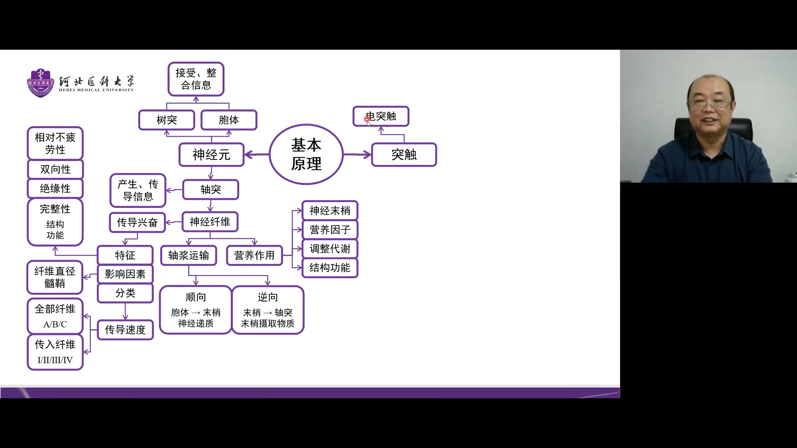
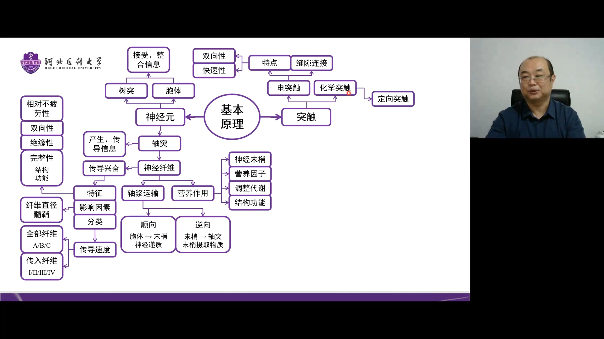
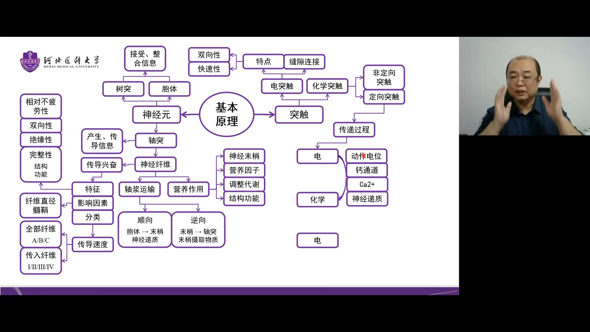
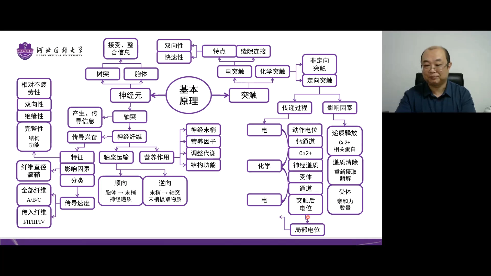
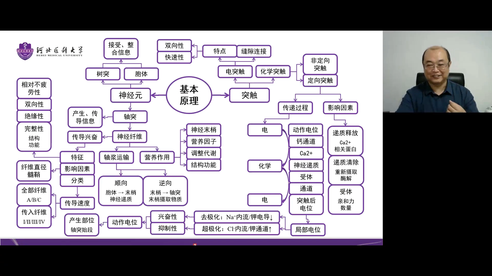

# 从神经纤维到突触：传导速度、电—化学—电转换与突触后电位总和

> 视频来源：[28 神经原理1（2024版）-03 思维导图：神经系统功能活动的基本原理（一）；神经元，突触传递](https://www.bilibili.com/video/BV1gGkxBbE5P/)（Bilibili · 滕旭的生理课，约 20 分钟）
> 导读：这支复习课用一张逐步长出来的思维导图，把"单个神经元—神经纤维—突触—突触后电位"串成一条线。本文只取这条线中与通讯速度、方向和靶细胞有关的部分；动作电位的离子机制见 3.4.2，激素与神经调质的分工见 4.4.8。

## 本讲要解决的核心问题（SCQA）

**背景**：3.4.2 已经讲清了动作电位本身：静息电位约 -70 mV，阈电位约 -55 mV，钠内流的正反馈把膜电位推到峰值，钠通道失活与钾外流把它关回去，不应期保证信号单向。也就是说，"一个点上的电信号长什么样"已经有了答案。

**冲突**：但神经系统不是一根导线。信号要沿着轴突跑几十厘米，要跨过一个叫突触的缝隙交给下一个细胞，而下一个细胞往往同时接着上千个输入。同一种动作电位，在有的纤维上每秒只走零点几米，在有的纤维上每秒能走一百多米；到了突触这一端，它甚至不再是一比一地传下去。

**疑问**：动作电位沿轴突传播时，速度由什么决定？跨过突触那一步，电信号怎样变成化学信号、又变回电信号？变回来的电信号还是"全或无"的吗？如果每个突触送来的电位大小不一，下一个神经元凭什么决定自己要不要放电？

**回答（中心思想）**：神经通讯是一条 **"电—化学—电"** 的接力：动作电位在轴突上以**局部电流逐点重新触发**的方式传播，速度由**纤维直径与有无髓鞘**决定；到了突触，电信号先转成**钙触发的递质释放**，再由递质把突触后膜变成一块**等级性的局部电位**；这些局部电位在胞体与树突上**做加法**，只有加总后仍能把轴突始段推到阈电位，才会产生下一个动作电位。**突触因此既是"单向阀"，也是"积分器"**。

---

## 一、神经元的两段分工：接受整合，产生传导

### 1.1 树突和胞体做加法，轴突做决定

一个神经元从结构上分包体和突起，突起又分树突和轴突。**胞体和树突功能相近**，主要负责**接受和整合信息**：它们接住其他神经元传来的信号，把这些信号整合起来，最终决定这个神经元的命运——产生还是不产生动作电位。

**轴突**负责**产生和传导信息**。动作电位并不是在胞体中央产生的，而是在**轴突始段**（轴突刚离开胞体的那一段）产生，然后沿着轴突往下传，传到轴突末梢后让末梢释放神经递质，把信息交给下一个神经元。

[【跳转到 00:44】](https://www.bilibili.com/video/BV1gGkxBbE5P/?t=44)

> 为什么是轴突始段？因为那里电压门控钠通道密度高，"有足够的通道，正反馈才必然发生"。这一点 3.4.2 讲正反馈时已经埋下伏笔，这里只需要记住位置。

### 1.2 轴突裹上"包装"就成了神经纤维

以轴突为核心，外面再裹上一些结构，就构成了**神经纤维**。裹得"高级"的，是有专门的细胞把它包起来，这叫**有髓神经纤维**；裹得比较简单的、拿膜好歹裹一裹的，叫**无髓神经纤维**。

不管有髓还是无髓，神经纤维的基本功能只有一个：**传导兴奋**（也就是传导动作电位）。这个功能有四个特征：

| 特征 | 含义 | 反例或证据 |
| --- | --- | --- |
| 完整性 | 结构完整（不能断）＋功能完整（离子通道正常） | 阻断钠通道，动作电位产生不了——局麻药就是靠这个起麻醉、镇痛作用 |
| 绝缘性 | 走形相同的纤维聚成神经束，但彼此互不干扰 | 一根纤维的电位不影响旁边那根 |
| 双向性 | 在纤维中间刺激，动作电位可向两端传导 | 与突触的单向传递形成对照 |
| 相对不疲劳性 | 持续刺激就能持续产生动作电位 | 与突触连续传递容易疲劳形成对照 |

[【跳转到 02:24】](https://www.bilibili.com/video/BV1gGkxBbE5P/?t=144)

注意"双向性"这一条：**单根纤维本身是双向的**，是突触把它变成了单向。这一点在第四节会再回到。

### 1.3 轴突里还有一条物流线

神经纤维除了用细胞膜传导电信号，轴突里的细胞浆（**轴浆**）也在运输物质，这叫**轴浆运输**，有两个方向：

- **顺向**：胞体 → 末梢。代表性货物就是神经递质——递质在胞体合成，用囊泡膜包好，沿轴浆运到末梢。
- **逆向**：末梢 → 胞体。末梢不是只出不进的，它会把突触间隙里的一些物质摄取回来运回胞体。多数情况下摄取的是神经营养因子这类有益物质；但破伤风和狂犬病正是末梢摄取了有毒物质、经逆向轴浆运输而发病。

[【跳转到 06:09】](https://www.bilibili.com/video/BV1gGkxBbE5P/?t=369)

### 1.4 神经末梢还会"发营养"

神经末梢不只释放神经递质影响效应器（比如神经—骨骼肌接头释放乙酰胆碱，让骨骼肌产生终板电位、最终收缩），还会释放**营养因子**，调整骨骼肌的代谢，影响它的结构和功能。反过来，运动神经元的胞体或轴突出了问题，都可能导致骨骼肌萎缩。

这条性质说明：**神经对靶细胞的作用不止"开关"一种**，还有长期的营养性影响。本文后面只讨论开关这一面。

[【跳转到 07:49】](https://www.bilibili.com/video/BV1gGkxBbE5P/?t=469)

---

## 二、传导速度：直径与髓鞘两个旋钮

### 2.1 决定速度的两个因素

动作电位沿纤维传播的速度主要受两个因素影响：

1. **纤维直径**：越粗的纤维传导越快。
2. **有无髓鞘**：有髓的比无髓的快。

但髓鞘不是越厚越好。课上给出的经验值是：**中间轴突与整个纤维的直径比为 0.6 : 1 时传导速度比较理想**，也就是轴突占六成、外面的髓鞘占四成。

[【跳转到 04:04】](https://www.bilibili.com/video/BV1gGkxBbE5P/?t=244)

### 2.2 速度成了分类的依据

正因为速度差别很大，生理学干脆**按传导速度给纤维分类**，而且有两套体系，因为两拨人关心的纤维不一样：

- 一套把**所有**神经纤维从快到慢排成 **A、B、C** 三类，A 类最快，C 类最慢；
- 另一套只研究**传入纤维**，从快到慢排成 **I、II、III、IV** 四类，I 类最快，IV 类最慢。

[【跳转到 05:19】](https://www.bilibili.com/video/BV1gGkxBbE5P/?t=319)

这套分类在下一篇（牵张反射）里会立刻派上用场：肌梭的传入纤维就是 **Ia 类**——最快的那一档。

### 2.3 为什么有髓就快：把"逐点重燃"变成"跳站"

视频只给了结论（直径、髓鞘），没有展开机制。结合 3.4.2 的"逐点重新触发"图像，可以补一句直觉解释：无髓纤维上，动作电位必须在**每一个相邻的膜片段**上重新触发一次，每一站都要花时间；髓鞘是绝缘层，其下的膜几乎不产生动作电位，兴奋只能在**两段髓鞘之间的裸露处（朗飞结）**重新触发。于是同样的距离，需要"点火"的次数少得多，速度就上去了。

这也是为什么**脱髓鞘疾病**（如视频系列后面专门讲的急性炎性脱髓鞘性多发性神经根神经病）会表现为传导变慢甚至传不过去：跳站的路被打断了。

> 本节只到"少点几次火"这个直觉层面，不推导电缆方程。想深入的话，时间常数与空间常数是更精确的语言。

---

## 三、突触：电突触与化学突触

### 3.1 两种载体，两代方案

神经元与神经元之间、神经元与效应器之间传递信息，靠的是**突触**。按信息传递的载体不同，突触在进化上有两种：

| | 电突触 | 化学突触 |
| --- | --- | --- |
| 载体 | 带电离子（电流） | 神经递质（化学物质） |
| 结构基础 | **缝隙连接**——两个细胞各出半个通道，拼成一个完整的孔道 | 突触前膜、突触间隙、突触后膜 |
| 方向 | **双向** | **单向** |
| 速度 | **快** | 慢（多一步化学转换） |
| 能否抑制 | 不能（只能把兴奋传过去） | 能（递质可产生抑制性电位） |

电突触的优势是快，劣势是双向。而神经调节之所以在体液调节之上进化出来，要的就是**精细**；精细建立在**反射弧是单行道**这个前提上——信号不能倒着走，否则整个环路就乱了。双向的电突触满足不了这个要求，所以主流让位给了化学突触。

[【跳转到 09:04】](https://www.bilibili.com/video/BV1gGkxBbE5P/?t=544)

### 3.2 化学突触又分"递到手里"和"撒传单"

化学突触按结构再分两种：

- **定向突触**：一对一。典型例子是运动神经末梢与骨骼肌之间——一个末梢对着一个靶细胞，把信息直接递到它手里。
- **非定向突触**：主要见于自主神经的节后纤维。交感神经到了心脏，并不是一个末梢对一个心肌细胞，而是像撒传单、天女散花一样把递质放出去，让递质自己去找心肌细胞上的受体。

从调节精细度看，**定向突触更符合要求**，所以它是主流。但"非定向"这一支不能丢——它正是后面要讲的**神经调质**的解剖基础：一个末梢影响一片靶细胞，而不是一个。

[【跳转到 10:44】](https://www.bilibili.com/video/BV1gGkxBbE5P/?t=644)

---

## 四、电—化学—电：一次突触传递的完整步骤

### 4.1 四个字概括

定向突触的传递过程，简单归纳就是四个字：**电—化学—电**。

**第一个"电"**：突触前神经元产生动作电位，沿轴突传到末梢。

**电 → 化学**（这一步的关键离子是 Ca²⁺）：

1. 动作电位使**突触前膜去极化**；
2. 去极化让前膜上的**电压门控钙通道**打开；
3. Ca²⁺ 在浓度差驱动下**从细胞外流入**轴突末梢（细胞外高钙、细胞内低钙）；
4. 末梢内 Ca²⁺ 升高，激活**突触囊泡**，囊泡以**出胞**方式把神经递质释放到突触间隙。

**化学 → 电**：递质扩散过突触间隙，与**突触后膜上的受体**结合，受体再去影响离子通道，最终在突触后膜上产生一个电位变化——**突触后电位**。

[【跳转到 11:34】](https://www.bilibili.com/video/BV1gGkxBbE5P/?t=694)

### 4.2 受体有两种接法，速度差一档

递质与受体结合后怎样影响通道，有两种情况：

- **受体本身就是通道**，即**化学门控离子通道**。典型例子是神经—骨骼肌接头：末梢释放乙酰胆碱，骨骼肌终板膜上是 **N2 型（NM 型）胆碱能受体**；乙酰胆碱结合，通道打开，不结合就关闭。
- **受体本身不是通道**，比如 **G 蛋白偶联受体**。递质结合后要通过信号转导（G 蛋白）去调控相应离子通道的开启或关闭。

两者都能产生突触后电位，但速度不同：受体就是通道的那种，"结合—开门—出电位"一气呵成，更快；走 G 蛋白信号转导的那种要多绕几步，慢一些。这也解释了为什么同一个神经元上可以同时有"快"和"慢"两种突触后电位。

[【跳转到 12:49】](https://www.bilibili.com/video/BV1gGkxBbE5P/?t=769)

### 4.3 突触后电位不是动作电位

这是最容易混的一步。**突触后电位的本质是局部电位，不是动作电位**。判据就是 3.4.2 里那条：动作电位是**全或无**的，局部电位是**等级性**的——递质释放得多，突触后电位幅度就大；释放得少，幅度就小。

正因为它是局部电位，它才会**衰减**、才会**叠加**。这两条性质决定了下一节的全部内容。

[【跳转到 14:04】](https://www.bilibili.com/video/BV1gGkxBbE5P/?t=844)

---

## 五、影响突触传递的三个环节（也是药物靶点）

突触传递环节多，每个环节都会受相应因素影响。视频把影响因素归成三类，这三类恰好对应三个可以下手的"关口"：

| 环节 | 正常情况 | 被打断的后果 | 例子 |
| --- | --- | --- | --- |
| **递质能否释放** | 依赖 Ca²⁺，以及囊泡膜与突触前膜融合所需的一系列蛋白 | 递质释放不出来，信息传不过去 | 肉毒杆菌毒素、某些蛇毒让这些蛋白变性失活 → 瘫痪 |
| **递质能否清除** | ①重新摄取（回收后可分解，也可重新装囊泡再用）；②酶解（如乙酰胆碱被胆碱酯酶分解） | 递质滞留，受体被持续刺激 | 有机磷农药抑制胆碱酯酶 → 乙酰胆碱堆积 → 骨骼肌持续收缩、抽搐痉挛 |
| **受体是否响应** | 受体的**亲和力**与**数量** | 递质再多也叫不动靶细胞 | 受体下调、拮抗剂 |

[【跳转到 14:29】](https://www.bilibili.com/video/BV1gGkxBbE5P/?t=869)

这张表说明一件事：**"突触"不是一个点，而是一条可以被逐个环节调节的链**。神经系统的药物之所以多，很大程度上是因为这条链上的关口多。

---

## 六、兴奋还是抑制：突触后电位的两种符号

### 6.1 EPSP：让膜往阈电位方向走

递质与受体结合后，如果造成**钠离子内流**，或者让**钾电导降低**（钾通透性下降、钾外流减少），结果都是细胞内正电荷变多、负电荷被中和——这就是**去极化**。去极化一旦到阈电位，就可能爆发一次动作电位。

这种突触后电位叫**兴奋性突触后电位**（EPSP）。

### 6.2 IPSP：让膜离阈电位更远

如果打开的是**氯离子通道**（Cl⁻ 内流），或者让**钾通道开放**（钾外流增多），结果都是细胞内负电荷变多——这就是**超极化**。超极化意味着离阈电位更远，更不容易产生动作电位。

这种突触后电位叫**抑制性突触后电位**（IPSP）。

[【跳转到 16:59】](https://www.bilibili.com/video/BV1gGkxBbE5P/?t=1019)

注意这里有一个容易被忽略的要点：**同一个递质可以产生不同的效应，取决于受体**。决定"兴奋还是抑制"的不是递质名字，而是受体后面接的是哪条通道。这也是 3.4.1"配体—受体—响应"这条主线在神经系统的具体化。

---

## 七、总和：一个神经元怎样"表决"

### 7.1 上千个输入，一次加法

一个神经元的胞体和树突上，有成千上万个突触。这些突触送来的既有 EPSP 也有 IPSP。这个神经元最终兴奋还是抑制，**就看哪一类占优势**：

- EPSP 总和 > IPSP 总和 → 膜净去极化 → 到阈电位 → 产生动作电位；
- 反之 → 净超极化 → 不产生。

这就是**总和**。它之所以可能，正是因为突触后电位是**局部电位**：局部电位可以叠加，而动作电位不能（动作电位是全或无的，来了就是来了，不会两个叠成两倍高）。

[【跳转到 18:14】](https://www.bilibili.com/video/BV1gGkxBbE5P/?t=1094)

### 7.2 表决结果在哪里执行

总和的结果在**轴突始段**执行：如果净效应足以把始段推到阈电位，就在那里产生动作电位，然后沿轴突双向传开——一路向前传到末梢释放递质，一路回传到胞体和树突。

[【跳转到 19:04】](https://www.bilibili.com/video/BV1gGkxBbE5P/?t=1144)

这个结构带来两个重要推论：

1. **突触是单向阀**。递质只存在于突触前囊泡、只能由前膜释放、只能作用于后膜受体，所以信息只能从前向后走。单根纤维本身双向，是突触把它变成了单向。
2. **突触是积分器**。一个输入不足以决定输出，输出是所有输入的总和。这解释了为什么神经系统既能"精确"（定向突触一对一）又能"稳健"（大量输入表决，个别噪声不改变结果）。

---

## 八、边界：这一篇讲到哪里为止

- **动作电位本身**（离子梯度、阈电位、正反馈、不应期）见 3.4.2，本文只把它当作"输入"和"输出"使用。
- **递质的种类与受体亚型**（乙酰胆碱的 M/N 受体、谷氨酸的 AMPA/NMDA、GABA 的 A/B 受体等）本文只点到 NM 型胆碱能受体与 G 蛋白偶联受体两类"接法"；完整的递质—受体谱是下一层内容。
- **神经调质与激素**：非定向突触是"一个末梢影响一片"的解剖基础，但"弥散调节"与"经血液运输"的完整比较留给 4.4.8。
- **突触可塑性**（长时程增强、习惯化等）只作为名词出现，机制不展开。

---

## 小结

- 神经元分两段：**胞体与树突接受整合，轴突产生传导**；动作电位起于**轴突始段**。
- 神经纤维传导兴奋有四个特征：完整性、绝缘性、双向性、相对不疲劳性；**单根纤维是双向的**。
- **传导速度由纤维直径和有无髓鞘决定**，轴突:纤维直径比约 0.6:1 时较优；速度差异大到足以作为分类依据（A/B/C 与 I/II/III/IV）。
- 突触分**电突触**（缝隙连接、双向、快、不能抑制）与**化学突触**（单向、可兴奋也可抑制、慢）；化学突触再分**定向**（一对一）与**非定向**（撒传单）。
- 化学突触传递是**电—化学—电**：动作电位 → 前膜去极化 → 电压门控钙通道 → Ca²⁺ 内流 → 囊泡出胞 → 递质 → 受体 → 通道 → 突触后电位。
- **突触后电位是局部电位**（等级性、可衰减、可叠加），不是动作电位。
- 影响因素分三关：**递质释放、递质清除、受体响应**；肉毒毒素、有机磷农药分别打在前两关。
- **EPSP**（Na⁺ 内流或钾电导下降 → 去极化）与 **IPSP**（Cl⁻ 内流或钾通道开放 → 超极化）在胞体树突上**总和**，净效应到达阈电位才在轴突始段放电。

## 关键术语速查

| 术语 | 一句话解释 |
| --- | --- |
| 轴突始段 | 轴突刚离开胞体的一段，动作电位的产生部位 |
| 有髓 / 无髓神经纤维 | 轴突外是否有专门细胞形成的髓鞘包裹 |
| 轴浆运输 | 沿轴突内部运输物质，分顺向（胞体→末梢）与逆向（末梢→胞体） |
| 电突触 | 靠缝隙连接直接让离子通过的突触，双向、快 |
| 缝隙连接 | 两个细胞各出半个通道拼成的孔道，电突触的结构基础 |
| 定向突触 | 一对一传递的化学突触，如神经—骨骼肌接头 |
| 非定向突触 | 末梢释放递质弥散作用于一片靶细胞，见于自主神经节后纤维 |
| 电压门控钙通道 | 突触前膜上去极化时开放、让 Ca²⁺ 内流的通道，递质释放的触发器 |
| 突触后电位 | 递质作用于后膜受体后产生的局部电位，等级性 |
| EPSP | 兴奋性突触后电位，去极化，使膜靠近阈电位 |
| IPSP | 抑制性突触后电位，超极化，使膜远离阈电位 |
| 总和 | 众多 EPSP 与 IPSP 在胞体树突上叠加，决定是否放电 |
| 终板电位 | 神经—骨骼肌接头处的等效"突触后电位" |