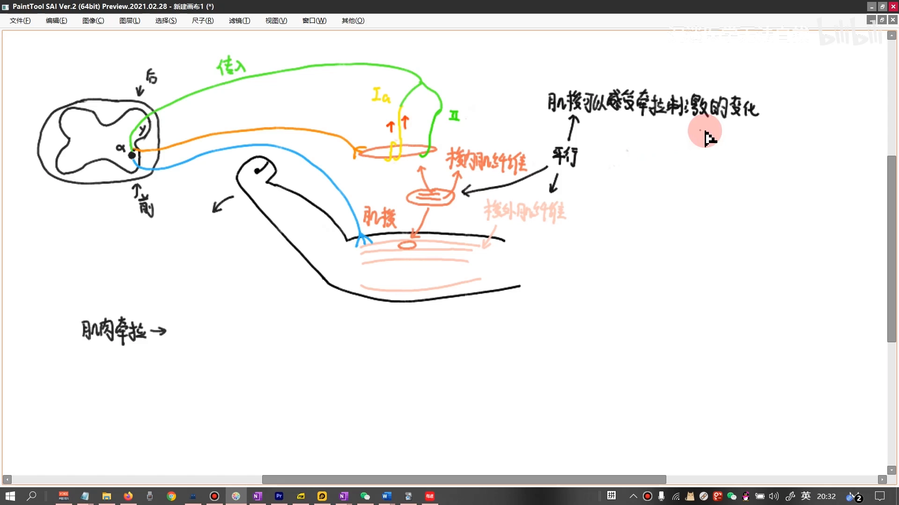
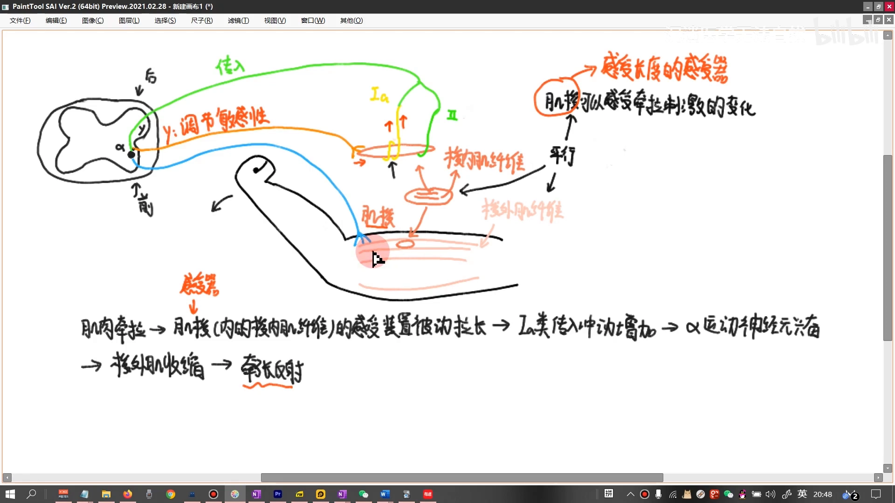

# 牵张反射：肌梭—Ia传入—α运动神经元的完整通路

> 视频来源：[牵张反射的结构和神经、肌梭和腱器官的结构](https://www.bilibili.com/video/BV1S84y1r73A/)（Bilibili · 沉迷医学无法自拔，约 7 分钟）
> 导读：这支手绘讲解把一条反射弧从感受器画到效应器，并补上 γ 运动神经元与腱器官两个"调节旋钮"。本文用它把上一篇的"电—化学—电"落到一条真实的通路上，并据此比较作用距离与靶细胞；突触机制本身见《从神经纤维到突触》。

## 本讲要解决的核心问题（SCQA）

**背景**：上一篇已经拆开了一个突触：动作电位来了，Ca²⁺ 内流，递质释放，突触后膜产生等级性的 EPSP 或 IPSP，总和之后在轴突始段决定是否放电。

**冲突**：但真实的行为不是"一个突触"完成的。医生敲一下膝盖下方的肌腱，小腿就弹起来——从被敲的那一下到肌肉收缩，中间要经过感受器、传入纤维、脊髓里的突触、传出纤维，最后还要跨过一个神经—肌肉接头。这中间每一站都在做转换，任何一站出问题，反射就消失。

**疑问**：一条完整的神经通路长什么样？信号在哪几处从电变成化学、又从化学变回电？这条通路的作用距离有多长、靶细胞有多精确？为什么肌肉自己缩短之后，这个反射不会一直持续下去？

**回答（中心思想）**：牵张反射是一条**点对点、闭环**的通路：**肌梭**感受肌肉长度 → **Ia 类传入纤维**把长度变化变成动作电位频率 → 脊髓里**兴奋 α 运动神经元** → **α 传出纤维**在神经—肌肉接头释放乙酰胆碱 → **同一块肌肉的梭外肌纤维收缩**。它的靶细胞极其精确（就是"支配同一块肌肉"的那群肌纤维），作用距离却可以很长（从肌肉一直跑到脊髓再跑回来）。而肌肉一收缩，肌梭跟着缩短、Ia 放电减少，**反射自动减弱**——这条通路自带负反馈。γ 运动神经元和腱器官则是两个附加旋钮：一个调灵敏度，一个在张力过大时踩刹车。

---

## 一、感受器：肌梭是一个"长度计"

### 1.1 肌梭住在肌肉里，和梭外肌纤维平行

一块肌肉由许多肌纤维构成。在这些肌纤维之间，有一个呈**梭状**的组织，外层是结缔组织囊，囊内包绕着几根细小的肌纤维——这个结构就是**肌梭**。

命名由此而来：

- 囊**内**的肌纤维叫**梭内肌纤维**；
- 囊**外**的、构成肌肉主体的肌纤维叫**梭外肌纤维**。

关键在于两者的空间关系：**肌梭与梭外肌纤维是平行排列的**。平行意味着——肌肉被拉长时，肌梭也被拉长；肌肉缩短时，肌梭也跟着缩短。所以肌梭能"读到"肌肉的长度。

[【跳转到 00:25】](https://www.bilibili.com/video/BV1S84y1r73A/?t=25)

### 1.2 梭内肌纤维：中间感受，两端收缩

把梭内肌纤维放大，它分成两段功能不同的部分：

- **中间是感受装置**——真正"测量"被拉长程度的地方；
- **两端是收缩成分**——可以被神经命令收缩。

这个"中间感受、两端收缩"的设计是后面理解 γ 运动神经元的关键：两端一收缩，中间的感受装置就被**拉长**，于是测量基准被抬高。

[【跳转到 00:50】](https://www.bilibili.com/video/BV1S84y1r73A/?t=50)

### 1.3 传入纤维：Ia 类螺旋缠绕

肌梭的传入纤维有两类：**Ia 类**和 **II 类**。其中 Ia 类神经纤维末梢呈**螺旋形**，缠绕在肌梭感受装置的部位。所以当肌肉受到外力牵拉、感受装置变形时，螺旋形末梢跟着变形，**Ia 类传入冲动增加**。

[【跳转到 01:40】](https://www.bilibili.com/video/BV1S84y1r73A/?t=100)

上一篇讲过，神经纤维按传导速度分类，I 类是最快的一档。放在这里很合理：牵张反射要求快——肌肉被拉长到收缩回缩，中间不能有可感知的延迟。

---

## 二、中枢：脊髓前角的两类运动神经元

### 2.1 前角管运动，后角管感觉

把脊髓横切，可以看到**前角**和**后角**：**前角负责运动，后角负责感觉**。Ia 类和 II 类传入纤维从后角进入脊髓，然后**全部终止于前角的 α 运动神经元**。

### 2.2 α 与 γ：一个管力量，一个管灵敏度

前角里有两类运动神经元，传出纤维支配的对象不同：

| | α 运动神经元 | γ 运动神经元 |
| --- | --- | --- |
| 传出纤维支配 | **梭外肌纤维**（肌肉主体） | **梭内肌纤维的收缩部分**（肌梭两端） |
| 直接效果 | 肌肉收缩、产生力量 | 肌梭两端收缩，把中间的感受装置拉长 |
| 能否让整块肌肉缩短 | 能 | 不能（力量太小） |
| 实际作用 | 执行反射与随意运动 | **调节肌梭对牵张刺激的敏感性** |

[【跳转到 02:05】](https://www.bilibili.com/video/BV1S84y1r73A/?t=125)

γ 这一路很容易被忽略，但它的意义很实在：如果肌梭的灵敏度固定不变，那么肌肉一旦收缩、肌梭跟着变短，感受装置就"松"了，接下来再被拉长时就不敏感了。γ 运动神经元通过收紧肌梭两端，把感受装置重新绷紧，让肌梭在肌肉缩短的状态下**仍然保持测量能力**。这是"量程自动调整"。

---

## 三、一次牵张反射的完整流程

### 3.1 五步走完一条反射弧

把上面几块拼起来，牵张反射的过程是：

1. **牵拉**：肌肉受到外力被动拉长（比如手臂伸直、或者敲击肌腱）；
2. **感受**：肌梭与梭外肌纤维平行，跟着被拉长，梭内肌纤维中间的感受装置被动拉长；
3. **传入**：螺旋缠绕其上的 Ia 类末梢变形，**Ia 类传入冲动增加**；
4. **中枢**：Ia 传入终止于脊髓前角的 α 运动神经元，使其**兴奋**；
5. **传出与效应**：α 传出纤维支配**同一块肌肉**的梭外肌纤维，引起梭外肌收缩，整块肌肉缩短、产生张力，对抗刚才那次牵拉。

[【跳转到 02:30】](https://www.bilibili.com/video/BV1S84y1r73A/?t=150)

### 3.2 用反射弧五要素对照

| 反射弧环节 | 牵张反射里的对应物 |
| --- | --- |
| 感受器 | 肌梭（梭内肌纤维中间的感受装置） |
| 传入神经 | Ia 类、II 类纤维 |
| 神经中枢 | 脊髓（前角） |
| 传出神经 | α 纤维（引起收缩）、γ 纤维（调节敏感性） |
| 效应器 | 梭外肌纤维（同一块肌肉） |

[【跳转到 05:50】](https://www.bilibili.com/video/BV1S84y1r73A/?t=350)

这张表就是本篇要交付的"完整通路"。它把上一篇的三个抽象环节落到了具体位置：**传入纤维上的传导**是电信号沿轴突跑；**脊髓里的突触**是电—化学—电的第一次转换；**神经—肌肉接头**是第二次转换，终点是肌纤维的收缩。

### 3.3 这条通路的"作用距离"与"靶细胞"

牵张反射最能说明神经通讯的两个特征：

- **作用距离可以很长，但路径是固定的**。信号从肌肉跑到脊髓再跑回来，物理距离可能是几十厘米；但它不是"广播"，而是沿着一条确定的线路走。这跟激素随血液到全身完全不同。
- **靶细胞极其精确**。α 运动神经元支配的是"**同一块肌肉**"的梭外肌纤维——不是随便一块肌肉。这就是上一篇说的**定向突触**在系统层面的体现：一对一，递到手里。

把这两条放在一起，就得到神经调节的招牌：**远距离、点对点、快**。

---

## 四、闭环：为什么反射不会一直持续

### 4.1 肌肉一收缩，肌梭就"松"了

α 运动神经元让梭外肌纤维缩短之后，由于肌梭与梭外肌纤维平行，**肌梭也跟着缩短**。肌梭里的感受装置被拉长的程度下降，**Ia 类放电减少甚至消失**。

于是反射自动减弱。由此可以给肌梭下一个定义：**肌梭是一种感受长度的感受器**。

[【跳转到 04:35】](https://www.bilibili.com/video/BV1S84y1r73A/?t=275)

这就是一个**负反馈**：牵拉 → 收缩 → 牵拉减少 → 收缩减弱。3.4.2 讲过的"输出反过来减少输入"在这里有了具体的解剖对应物。

### 4.2 γ 环路：把"零点"调回去

问题来了：如果肌肉一直保持缩短状态，肌梭就一直松着，下一次被拉长时反应就迟钝了。解决办法就是 γ 运动神经元——它让梭内肌纤维两端收缩，把中间的感受装置重新拉紧，于是**Ia 传入放电又增加**。

注意 γ 的作用是**间接**的：它不足以让整块肌肉缩短，但它能把肌梭的灵敏度调回来。所以 γ 运动神经元的定位是"**调节肌梭对牵张刺激的敏感性**"，而不是"产生力量"。

[【跳转到 05:25】](https://www.bilibili.com/video/BV1S84y1r73A/?t=325)

### 4.3 生活里的两个场景

视频用拉伸举例，正好说明这条通路的双面性：

- **缺点**：反复快速拉伸肌肉时，牵张反射会反射性地抵消掉一部分牵拉力，让拉伸的效果打折扣——你往长拉，它往回缩。
- **优点**：正因为有这股回缩的力，肌肉被拉到一定程度就会自我保护；没有它，肌肉会一直被拉，到极限就拉伤。

[【跳转到 03:45】](https://www.bilibili.com/video/BV1S84y1r73A/?t=225)

---

## 五、另一个感受器：腱器官与反牵张反射

### 5.1 串联的张力计

除了肌梭，肌肉—肌腱交界处还有**腱器官**。关键差别在空间关系：**腱器官与梭外肌纤维是串联的**（肌梭是并联的）。

串联意味着它测的不是长度，而是**张力**：肌肉收缩、张力增大，腱器官受到的力就大。

### 5.2 效应相反：踩刹车

腱器官兴奋后，传入脊髓，**使支配同一块肌肉的 α 运动神经元受到抑制**，于是梭外肌纤维活动受限、肌肉舒张。

这个反射与牵张反射的效应**相反**，所以叫**反牵张反射**。它的意义是保护：张力过大时及时卸力，避免肌腱和肌肉被拉伤。

[【跳转到 06:15】](https://www.bilibili.com/video/BV1S84y1r73A/?t=375)

把肌梭和腱器官放在一起看，是一条很经济的设计：**一个测长度、一个测张力；一个促进收缩、一个抑制收缩**。两个感受器、两条通路，就把肌肉的长度和张力都稳定住了。

---

## 六、边界：这一篇讲到哪里为止

- **动作电位的离子机制**（静息电位、阈电位、正反馈、不应期）见 3.4.2，本文只把它当作通路上的"信号"。
- **突触传递的分子步骤**（Ca²⁺、囊泡、EPSP/IPSP、总和）见《从神经纤维到突触：传导速度、电—化学—电转换与突触后电位总和》，本文不重复。
- **更复杂的运动调控**（锥体系、锥体外系、小脑与基底神经节的环路）不在本篇范围；本文只取"最短的一条反射弧"作为通路范例。
- **激素与神经调质的尺度比较**见 4.4.8。

---

## 小结

- **肌梭与梭外肌纤维平行**，因此感受肌肉**长度**；梭内肌纤维"中间感受、两端收缩"。
- **Ia 类**纤维螺旋缠绕感受装置，牵拉时放电增加；Ia 与 II 类传入都终止于脊髓前角的 **α 运动神经元**。
- 牵张反射五步：**牵拉 → 肌梭拉长 → Ia 放电增加 → α 运动神经元兴奋 → 同一块肌肉的梭外肌收缩**。
- **α 管力量，γ 管灵敏度**：γ 让梭内肌纤维两端收缩，把感受装置重新绷紧，间接增加 Ia 放电。
- 肌肉收缩后肌梭跟着缩短、Ia 放电减少，反射自动减弱——这是一条**负反馈**。
- **腱器官与梭外肌纤维串联**，测的是**张力**；它抑制 α 运动神经元，产生**反牵张反射**，与牵张反射效应相反。
- 这条通路同时展示了神经通讯的两个特征：**作用距离可以很长，但路径固定、靶细胞精确**（"同一块肌肉"）。

## 关键术语速查

| 术语 | 一句话解释 |
| --- | --- |
| 肌梭 | 肌肉内梭状感受器，与梭外肌纤维平行，感受肌肉长度 |
| 梭内肌纤维 | 肌梭囊内的细肌纤维，中间为感受装置，两端为收缩成分 |
| 梭外肌纤维 | 构成肌肉主体的肌纤维，受 α 运动神经元支配 |
| Ia 类纤维 | 螺旋缠绕肌梭感受装置的粗传入纤维，传导速度最快的一档 |
| α 运动神经元 | 脊髓前角运动神经元，支配梭外肌纤维，直接引起肌肉收缩 |
| γ 运动神经元 | 支配梭内肌纤维收缩部分，调节肌梭对牵张的敏感性 |
| 腱器官 | 位于肌腱处、与梭外肌纤维串联的张力感受器 |
| 反牵张反射 | 腱器官兴奋后抑制 α 运动神经元、使肌肉舒张的反射 |
| 牵张反射 | 肌肉被牵拉时反射性收缩的回路，感受器为肌梭 |