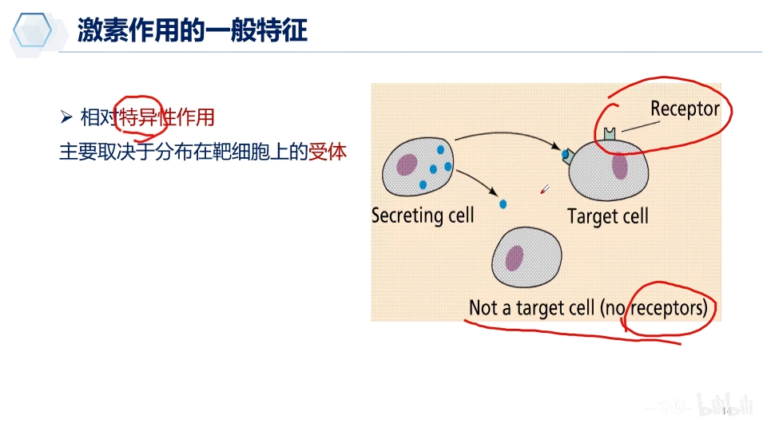
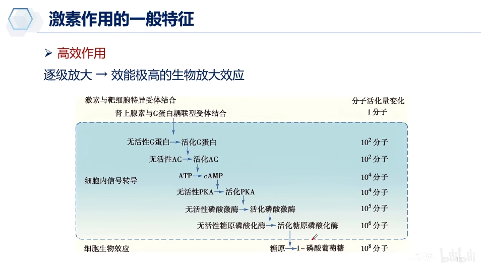
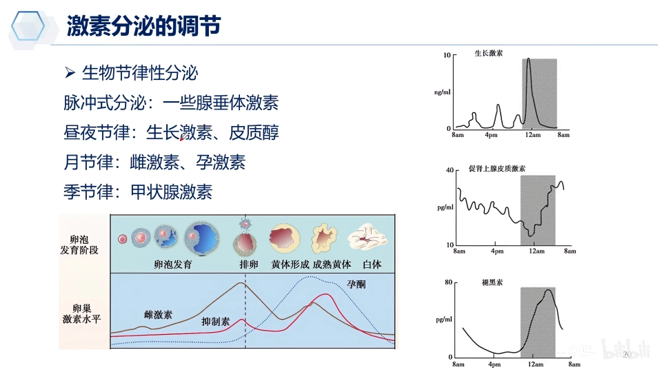
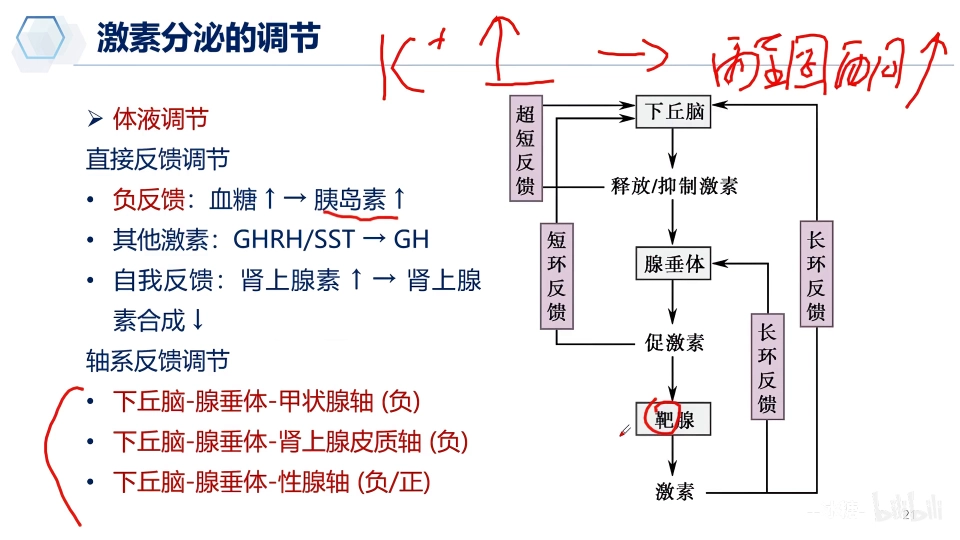
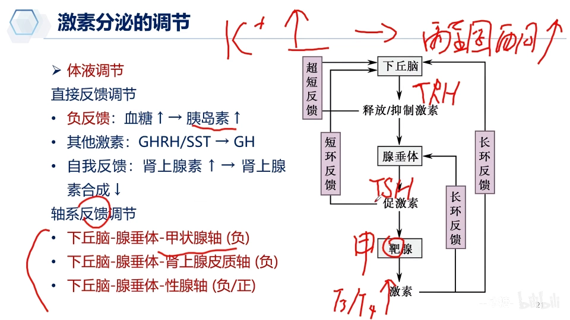

# 激素作用的特征与分泌调控：受体特异性、三大轴与长反馈短反馈

> 视频来源：[《生理学》11-1 激素作用的一般特征、激素分泌的调控](https://www.bilibili.com/video/BV1rPjvzsExs/)（Bilibili · 生理学课堂实录，约 29 分钟）
> 导读：这支课把"激素凭什么只作用于某些细胞 → 受体在哪 → 激素之间怎么互相影响 → 分泌怎么被节律和反馈管住"串成一条线，最后落到三大靶腺轴和长/短/超短反馈。本文按"受体 → 作用特征 → 节律 → 反馈轴"重排；信号转导的分子细节见 [3.4.1](../../../3_从分子结构到生物功能/3.4_细胞信号转导与反馈调控/3.4.1_受体、信号转导与第二信使/细胞信号转导总览：信使分级、受体类型与三条经典通路.md)，反馈环的部件见 [3.4.2](../../../3_从分子结构到生物功能/3.4_细胞信号转导与反馈调控/3.4.2_反馈、稳态与时间依赖的细胞响应/稳态与反馈：调定点、负反馈与正反馈.md)。

## 本讲要解决的核心问题（SCQA）

**背景**：上一节已经知道，激素进入血液后随循环跑到全身，每个细胞门口都会经过它。也知道激素分水溶性和脂溶性两类，运输形式不同（见 [激素的信号传递与血液运输](激素的信号传递与血液运输：远距分泌、旁分泌、自分泌与神经分泌.md)）。

**冲突**：既然激素"路过"所有细胞，为什么只有少数细胞响应？如果受体决定一切，那受体在细胞膜上和在细胞核里，后果一样吗？更麻烦的是，体内同时有几十种激素，它们对同一个指标常常一个升、一个降、一个"只负责盖章"，机体怎么保证不打架？而激素水平本身又为什么不是一条平线，而是忽高忽低？

**疑问**：激素的作用有哪些共同特征？受体位置与激素化学性质怎么对应？激素的分泌受哪些机制调控，为什么反馈要分"长、短、超短"三种？

**回答（中心思想）**：激素只对**长了相应受体**的细胞起作用，这叫相对特异性——**靶细胞由受体定义，不由器官定义**。受体位置与化学性质对应：**水溶性激素用膜受体、经第二信使转导；脂溶性激素进入细胞、用核受体调节基因表达**（甲状腺激素是例外）。激素本身只传递信息（信使作用），但通过级联放大可以极高效；多种激素之间还存在协同、拮抗、允许、竞争四种相互作用。激素的分泌则同时受**生物节律**（脉冲、昼夜、月、季节）和**反馈**调控，其中三级靶腺轴的反馈分为**长反馈、短反馈、超短反馈**三种，共同把靶腺激素压在稳态区间内。

---

## 一、靶细胞由受体定义：相对特异性

### 1.1 锁和钥匙

激素随血液跑到全身，但并不是什么细胞都能被它作用。原因只有一个：**靶细胞膜上或胞内有能与它结合的受体**，没有受体的细胞对它毫无反应。视频把它概括为"锁钥关系"——激素是钥匙，受体是锁；谁长了这把锁，钥匙才能在谁那里开门。

[【跳转到 01:40】](https://www.bilibili.com/video/BV1rPjvzsExs/?t=100)

这句话值得单独记：**激素自己说不上话，受体才说了算**。所以"靶器官"不是被激素"找到"的，而是被受体"筛"出来的。同一个器官可以同时是升糖激素和降糖激素的靶器官，因为它同时有两种受体；一个器官没有某种受体，它就不是那种激素的靶器官——这一点在 [4.4.1 血糖轴](../4.4.1_内环境稳态：物质交换与生理反馈/血糖稳态：胰岛素与胰高血糖素的负反馈回路.md) 里已经用过一次（肌肉没有胰高血糖素受体）。

### 1.2 "相对"两个字的含义

特异性是相对的，不是绝对的。视频用肾上腺素和去甲肾上腺素举例：

| 受体 | 分布 | 效应 | 谁能结合 |
| --- | --- | --- | --- |
| α 受体 | 血管平滑肌 | 血管收缩 | 肾上腺素、去甲肾上腺素都可 |
| β1 受体 | 心肌细胞 | 心肌正性效应 | 两者都可 |
| β2 受体 | 血管 | 血管舒张 | 主要是肾上腺素，去甲肾上腺素很弱 |

肾上腺素和去甲肾上腺素结构很相似，所以 α 和 β1 都能接受；但 β2 的选择性很高，只有肾上腺素能结合。这就是为什么肾上腺素被当作强心药、去甲肾上腺素被当作升压药——**同一个家族的两个配体，靠受体亚型的分布差异做出不同效果**。

> 这条也解释了药物设计的一个基本思路：想只影响某个器官，就去找那个器官特有的受体亚型。

[【跳转到 04:10】](https://www.bilibili.com/video/BV1rPjvzsExs/?t=250)

---

## 二、受体在哪：膜受体还是核受体

### 2.1 一条对应规则

激素的化学性质决定它能不能穿过细胞膜，也就决定了受体必须在哪：

| 激素类型 | 溶解性 | 能否过膜 | 受体位置 | 信号怎么传 |
| --- | --- | --- | --- | --- |
| 含氮激素（肽类、儿茶酚胺） | 水溶性 | 不能 | **细胞膜上** | 第二信使学说：受体→G 蛋白→AC/cAMP 或 PLC 等→蛋白激酶→磷酸化 |
| 类固醇（甾体）激素 | 脂溶性 | 能 | **胞浆/细胞核内** | 基因表达学说：激素-受体复合物结合 DNA，启动或抑制转录，改变蛋白质（主要是酶）合成 |
| 甲状腺激素 | 脂溶性（例外） | 能 | **核内** | 也走基因表达学说 |

视频在回顾时把这条规则压成一句话：**甾体激素约等于脂溶性，用基因表达学说；含氮激素约等于水溶性，用第二信使学说**。[【跳转到 28:17】](https://www.bilibili.com/video/BV1rPjvzsExs/?t=1697)

分子层面的细节（G 蛋白循环、cAMP 与 PLC 两条支路、受体酪氨酸激酶）不在本讲范围，见 [3.4.1 细胞信号转导总览](../../../3_从分子结构到生物功能/3.4_细胞信号转导与反馈调控/3.4.1_受体、信号转导与第二信使/细胞信号转导总览：信使分级、受体类型与三条经典通路.md)。

### 2.2 受体位置决定"快慢"与"持久"

> 补充核对（非视频内容）：视频只给出了"水溶性→第二信使、脂溶性→基因表达"这条对应，没有展开时间尺度。下面两条是生理学的标准推论，用来解释为什么两类激素的临床特点不同。

这条规则不只是解剖学差别，它直接决定两类激素的时间性格：

- **膜受体 + 第二信使**：改的是**已有蛋白的活性**（开通道、磷酸化酶），几秒到几分钟起效，也容易被逆转——适合应激这类需要快速响应的场景；
- **核受体 + 基因表达**：改的是**蛋白质的合成种类和数量**，要转录、翻译，几小时到几天才见效，但效果持久——适合生长、分化、代谢率这类长期设定。

甲状腺激素"含氮却脂溶性、受体在核内"这个例外，正好解释了它的临床特点：起效慢、作用持久，血里指标变化到症状出现之间有明显的滞后。
---

## 三、一般特征：信使、高效、相互作用

### 3.1 信使作用：不赋予新功能

激素只传递信息，**不凭空制造新功能**。它引起或抑制的功能，是靶细胞本来就有的：细胞本来就能生长发育，激素只是把生长程序"点亮"。

视频用生长激素和侏儒症解释了这里看似矛盾的地方：如果激素只是信使，为什么幼年缺生长激素就不长了？因为生长程序本身有开关，**没有钥匙就打不开**——锁是现成的，但需要钥匙。给这类患者补充生长激素可以长高，等于补上了那把钥匙。

这条特征有一个重要推论：**激素不能"命令"细胞做它本来不会做的事**。

[【跳转到 05:05】](https://www.bilibili.com/video/BV1rPjvzsExs/?t=305)所以激素的效应总是"增强或减弱某个已有过程"，而不是"新增一个过程"。

### 3.2 高效作用：级联放大

激素在血里的浓度极低（纳摩尔到皮摩尔级），却能产生显著效应，原因是信号转导是**级联放大**：一个激素分子结合受体，激活许多 G 蛋白，每个 G 蛋白激活一个酶，每个酶催化生成许多第二信使，再逐级放大。

[【跳转到 09:10】](https://www.bilibili.com/video/BV1rPjvzsExs/?t=550)

视频给的数量级：1 分子肾上腺素经级联放大，最终可激活约 $10^8$ 个糖原磷酸化酶分子。**正因为有放大，激素分泌量的微小变化就能引起功能的明显异常**——这是"激素水平必须被精密调控"的原因。

### 3.3 相互作用：协同、拮抗、允许、竞争

多种激素作用于同一指标时，有四种关系：

| 关系 | 含义 | 视频给的例子 |
| --- | --- | --- |
| 协同 | 总效应大于各自单独效应之和（1+1>2） | 皮质醇 + 胰高血糖素 + 肾上腺素共同升血糖 |
| 拮抗 | 效应方向相反 | 胰岛素降血糖，对抗多种升糖激素 |
| 允许 | 本身不产生该效应，但缺少它时其他激素无法发挥 | 糖皮质激素是典型的"允许激素" |
| 竞争 | 结构类似，竞争同一受体 | 孕激素浓度高时竞争醛固酮受体，拮抗其作用 |

**允许多半最容易被忽略**：它不像协同那样"加起来更大"，而是"没有它就不行"。视频的比喻是盖章——程序要走完，章必须盖上；它自己不办事，但它不在，事就办不成。这也解释了为什么长期用糖皮质激素会牵动一大片功能，而不是只影响一个指标。

[【跳转到 12:07】](https://www.bilibili.com/video/BV1rPjvzsExs/?t=727)

---

## 四、分泌的调控（一）：生物节律

激素水平不是一条平线。视频把节律分成四种时间尺度：

| 节律 | 周期 | 例子 |
| --- | --- | --- |
| 脉冲式分泌 | 分钟到小时 | 一些腺垂体激素阵发性释放 |
| 昼夜节律 | 约 24 小时 | 生长激素（与慢波睡眠相关）、皮质醇（清晨高、午夜低） |
| 月节律 | 约 28 天 | 雌激素、孕激素随月经周期波动 |
| 季节节律 | 年 | 甲状腺激素冬季高、夏季低（产热需求） |

[【跳转到 16:40】](https://www.bilibili.com/video/BV1rPjvzsExs/?t=1000)

这张图右侧的三条曲线值得注意：生长激素、促肾上腺皮质激素、褪黑素的血浓度在一天里都呈**脉冲叠加在昼夜趋势上**的形态。这意味着**单点抽血测到的值，取决于抽血的时刻**——判断"高还是低"，必须知道参考区间是在什么时间、什么状态下取的。这是下一节讨论"正常值是一个范围"的直接依据。

[【跳转到 15:55】](https://www.bilibili.com/video/BV1rPjvzsExs/?t=955)

---

## 五、分泌的调控（二）：负反馈与三级轴

### 5.1 负反馈：效应反过来管住分泌

最基本的调控是负反馈：**激素产生的效应，反过来抑制它的分泌**。视频给了两个可以自己推的例子：

- 胰岛素降血糖，所以**血糖升高**促进胰岛素分泌；血糖低了还分泌胰岛素就会低血糖昏迷；
- 醛固酮保钠排钾，所以**血钾升高**促进醛固酮分泌——因为只有血钾高了才需要排钾。

这两个例子说明负反馈不需要背：**先问这个激素干什么，再问"什么时候需要它干这件事"**，答案就是它的刺激信号。

### 5.2 三级轴：从上到下促进，从下到上抑制

体内有三条经典靶腺轴（性腺轴分男女，所以是"三大轴、四小轴"）：

| 轴 | 下丘脑激素 | 腺垂体激素 | 靶腺激素 |
| --- | --- | --- | --- |
| 下丘脑-腺垂体-甲状腺轴 | TRH | TSH | T3、T4 |
| 下丘脑-腺垂体-肾上腺皮质轴 | CRH | ACTH | 糖皮质激素（皮质醇） |
| 下丘脑-腺垂体-性腺轴 | GnRH | FSH、LH | 性激素 |

它们的共同结构是：**从上到下逐级促进，从下到上负反馈抑制**。这个拓扑就是 [3.4.2](../../../3_从分子结构到生物功能/3.4_细胞信号转导与反馈调控/3.4.2_反馈、稳态与时间依赖的细胞响应/稳态与反馈：调定点、负反馈与正反馈.md) 里"感受器—比较器—效应器—反馈信号"在器官层面的具体形态：靶腺激素本身就是反馈信号。

[【跳转到 21:40】](https://www.bilibili.com/video/BV1rPjvzsExs/?t=1300)

### 5.3 长反馈、短反馈、超短反馈

三级结构里有三条不同长度的回程，这是本节最该记清的一组概念：

| 反馈 | 谁抑制谁 | 回程长度 |
| --- | --- | --- |
| **长反馈** | 靶腺激素（如 T3/T4）抑制下丘脑和腺垂体 | 跨两级 |
| **短反馈** | 腺垂体激素（如 TSH）抑制下丘脑 | 跨一级 |
| **超短反馈** | 下丘脑激素（如 TRH）抑制自身分泌 | 局部自抑制 |

[【跳转到 23:20】](https://www.bilibili.com/video/BV1rPjvzsExs/?t=1400)

为什么需要三种而不是一种？视频只说了"三种都有"，没有解释分工。下面这条是从控制角度做的读解，与视频不冲突：**每一级都需要一个"刹车"，而且刹车的灵敏度不同**。

- 长反馈是最主要的调节，靶腺激素一多就同时压住上面两级，响应幅度大；
- 短反馈让腺垂体激素不必等靶腺激素升高就能自我限制，**防止系统冲过头**；
- 超短反馈是下丘脑激素的自抑制，作用范围最小、最快，起"防抖"作用。

**三级串联 + 三种负反馈**，等于给同一个变量装了三道不同时间常数的稳定器。这也是为什么临床上测单个指标往往不够：要判断断点在哪一级，得同时看上游和下游（见 [甲状腺激素的调节](甲状腺激素的调节：下丘脑-垂体-甲状腺轴、缺碘代偿与碘阻滞.md) 里 TSH 与 T3/T4 的组合判读）。

### 5.4 例外：性腺轴的正反馈

视频特意标出一个例外：三大轴里，**性腺轴存在一个正反馈的例子**（排卵前的雌激素高峰促进 LH 峰），其余全是负反馈。这个例外到生殖那一章再展开，这里只需记住：**"轴=负反馈"是默认，不是定律**；正反馈适合需要"一次性进行到底"的事件（对照 [3.4.2](../../../3_从分子结构到生物功能/3.4_细胞信号转导与反馈调控/3.4.2_反馈、稳态与时间依赖的细胞响应/稳态与反馈：调定点、负反馈与正反馈.md) 里正反馈的判据）。

---

## 六、分泌的调控（三）：神经体液调节

除了节律和反馈，激素分泌还受神经控制。视频把它称为**神经体液调节**：把体液调节接在反射弧的**传出部分**——感受器→传入神经→中枢→传出神经→**内分泌腺（代替效应器）**→激素→靶细胞。

两个经典例子：

- **交感-肾上腺髓质轴**：应激时交感神经兴奋，引起肾上腺髓质分泌肾上腺素和去甲肾上腺素；
- **迷走-胰岛素轴**：迷走神经刺激胰岛 B 细胞分泌胰岛素。

这条通路的意义在于：**神经的快和体液的广可以串在同一条链上**。

[【跳转到 25:21】](https://www.bilibili.com/video/BV1rPjvzsExs/?t=1521)下丘脑是最典型的交汇点——它既是神经中枢，又能分泌激素，把电信号翻译成化学信号（神经分泌，见 [上一节](激素的信号传递与血液运输：远距分泌、旁分泌、自分泌与神经分泌.md)）。

---

## 七、这一节给出的读法

遇到任何一种激素，可以按四步问：

1. **谁响应它？** 有受体的细胞；没有受体就不是靶细胞。
2. **受体在哪？** 水溶性→膜受体→第二信使→快而短；脂溶性→核受体→基因表达→慢而久。
3. **它和谁一起工作？** 协同、拮抗、允许、竞争，四种关系决定"单独测它够不够"。
4. **它的分泌被什么管？** 节律（决定什么时候测）、负反馈（决定高了会怎样）、三级轴与长/短/超短反馈（决定断点在哪一级）、神经（决定应激时怎么变）。

### 7.1 三个边界

- **"正常值"是范围，不是点**：有节律、有脉冲、有个体差异，单点数值必须结合采样时刻和状态读。
- **反馈的层级决定响应速度**：超短反馈最快、长反馈最慢也最有力量；同一个变量被三道刹车管着，所以系统不容易震荡，但也不容易立刻改变。
- **激素之间不是"一个指标一个激素"**：允许作用意味着缺一个激素可能让另一个激素"看起来失效"，判读时不能只看单个指标。

---

## 小结

- **靶细胞由受体定义**：激素随血到全身，只有带受体的细胞响应；特异性是相对的（α/β1/β2 的例子）。
- **受体位置与化学性质对应**：水溶性→膜受体→第二信使（快而短）；脂溶性→核受体→基因表达（慢而久）；甲状腺激素是含氮却走核受体的例外。
- **三个一般特征**：信使（不赋予新功能）、高效（级联放大，$10^8$ 量级）、相互作用（协同/拮抗/允许/竞争）。
- **分泌受节律调控**：脉冲、昼夜、月、季节四种尺度，决定"什么时候测"。
- **分泌受反馈调控**：三大靶腺轴从上到下促进、从下到上抑制；**长反馈**（靶腺→上两级）、**短反馈**（腺垂体→下丘脑）、**超短反馈**（下丘脑→自身）三道刹车，性腺轴有一个正反馈例外。
- **神经体液调节**把体液调节接在反射弧的传出部分，下丘脑是神经与内分泌的交汇点。

## 关键术语速查

| 术语 | 一句话解释 |
| --- | --- |
| 相对特异性 | 激素只作用于有相应受体的细胞，但结构相似的配体可交叉结合 |
| 靶细胞 | 带有该激素受体的细胞，由受体而非器官决定 |
| 第二信使学说 | 水溶性激素结合膜受体，经 cAMP、IP3/DAG、Ca²⁺ 等在胞内传递信号 |
| 基因表达学说 | 脂溶性激素进入细胞结合核受体，调控基因转录 |
| 信使作用 | 激素只增强或减弱细胞已有的功能，不赋予新功能 |
| 级联放大 | 信号转导逐级放大，少量激素产生巨大效应 |
| 允许作用 | 某激素本身不产生该效应，但缺少它时其他激素无法发挥 |
| 长反馈 | 靶腺激素抑制下丘脑和腺垂体 |
| 短反馈 | 腺垂体激素抑制下丘脑 |
| 超短反馈 | 下丘脑激素抑制自身分泌 |
| 神经体液调节 | 以体液调节作为反射弧传出部分的调节方式 |