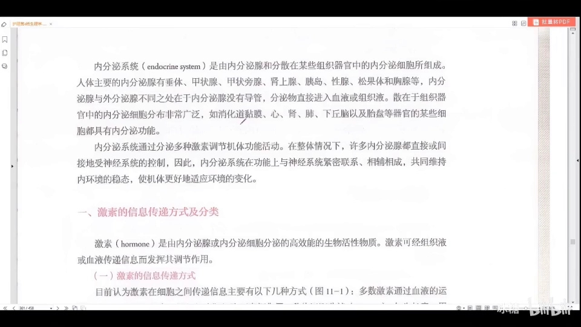
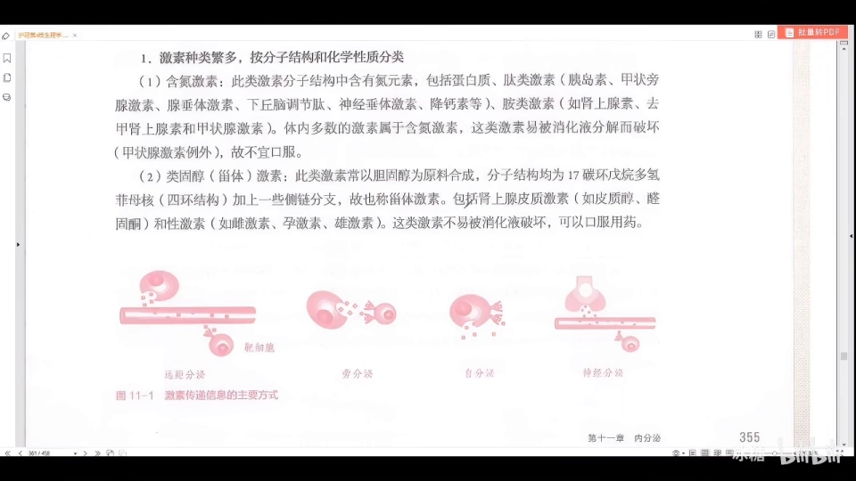
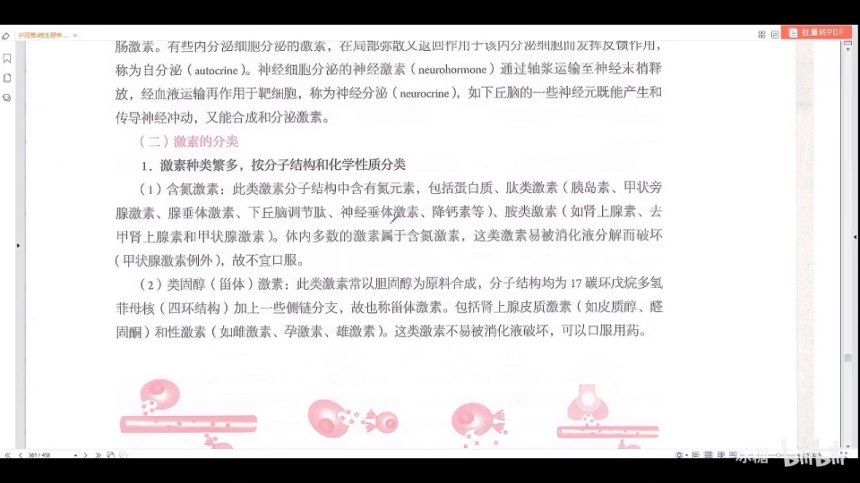
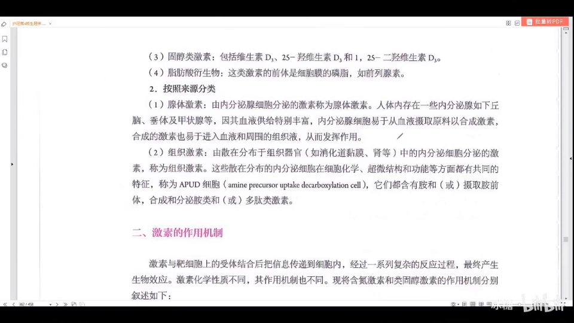
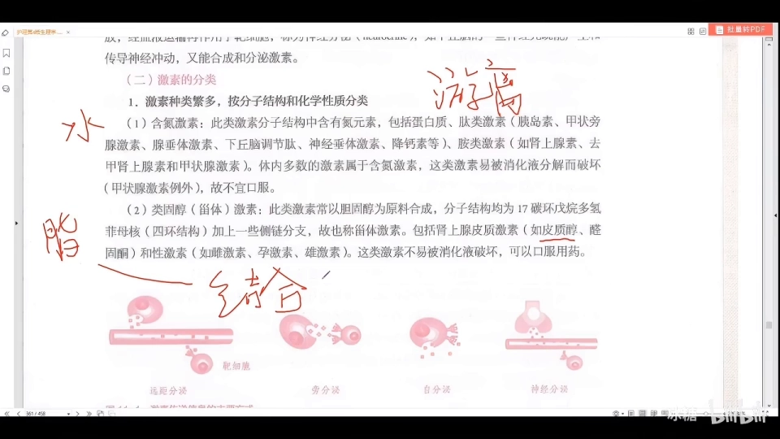

# 激素的信号传递与血液运输：远距分泌、旁分泌、自分泌与神经分泌

> 视频来源：[《生理学》内分泌1-激素的信息传递方式及分类](https://www.bilibili.com/video/BV19o4y1G7bi/)（Bilibili · 生理学课堂实录，约 13 分钟）
> 导读：这支课按教材顺序讲"内分泌系统 → 传递方式 → 化学分类 → 运输方式"，正好回答"激素是什么、走哪条路、以什么形式在血里走"。本文按"腺体 → 传递尺度 → 化学性质 → 运输形式"重排；反馈环的部件见 [稳态与反馈：调定点、负反馈与正反馈](../../../3_从分子结构到生物功能/3.4_细胞信号转导与反馈调控/3.4.2_反馈、稳态与时间依赖的细胞响应/稳态与反馈：调定点、负反馈与正反馈.md)，受体与靶细胞见同节 [激素作用的特征与分泌调控](激素作用的特征与分泌调控：受体、三大轴与长反馈短反馈.md)，血糖轴见 [4.4.1 血糖稳态](../4.4.1_内环境稳态：物质交换与生理反馈/血糖稳态：胰岛素与胰高血糖素的负反馈回路.md)。

## 本讲要解决的核心问题（SCQA）

**背景**：前面几章已经反复见到"某个器官分泌一点东西，作用到别处"的例子：血管内皮分泌前列环素抑制血小板，心房肌分泌心房钠尿肽排钠，肾脏分泌促红细胞生成素、肾素和活性维生素 D。它们和神经、免疫一起构成机体的调节系统（三者的分工见 [4.4.2](../4.4.2_神经、内分泌与免疫系统的分工/三种调节方式的分工：神经、体液与免疫的尺度对照.md)）。

**冲突**：既然心、肾、肺、消化道都能"分泌"，那"内分泌腺"这个说法还有什么意义？同样是分泌，有的信号只影响隔壁一个细胞，有的却要让全身一起改变——它们走的是同一条路吗？更进一步，激素进入血液以后，凭什么有的能自由溶解在血浆里，有的必须挂在蛋白上？

**疑问**：激素在细胞之间传递信息有哪几种尺度？按化学性质可以分成哪几类？化学性质又怎样决定它在血液里的运输形式？

**回答（中心思想）**：内分泌系统由**没有导管的内分泌腺**和**散在的内分泌细胞**共同组成，分泌物直接进入组织液或血液。按作用距离，激素的传递分为**远距分泌（系统调节）、旁分泌与自分泌（局部信号）、神经分泌（神经与内分泌的交界）**四种；按化学性质分为**含氮激素、胺类、类固醇（甾体）、固醇类和脂肪酸衍生物**五类。化学性质决定运输形式：**水溶性激素以游离形式运输，脂溶性激素主要与血浆蛋白结合运输**；甲状腺激素是"含氮却脂溶性、靠结合蛋白运输"的著名例外。这两条线索——传递尺度与化学性质——就是后面理解"受体在哪、怎么起作用"的前提。

---

## 一、内分泌系统：没有导管的腺体，加上散在各处的细胞

### 1.1 判据是"有没有导管"

内分泌系统由**内分泌腺**和**分散在某些组织器官中的内分泌细胞**两部分组成。

[【跳转到 05:00】](https://www.bilibili.com/video/BV19o4y1G7bi/?t=300)人体主要的内分泌腺有垂体、甲状腺、甲状旁腺、肾上腺、胰岛、性腺、松果体和胸腺等。

内分泌腺与外分泌腺的根本区别只有一条：**内分泌腺没有导管**，分泌物直接进入血液或组织液；外分泌腺有导管，分泌物经导管送到有腔的器官或体表。视频给的对照是胰腺——胰腺既分泌胰液经胰管送入十二指肠（外分泌），又含胰岛（内分泌），一个器官两种分泌方式。

[【跳转到 02:05】](https://www.bilibili.com/video/BV19o4y1G7bi/?t=125)

### 1.2 "内分泌"不只属于内分泌腺

视频特意先绕了一圈"人设崩塌"：严格来说，机体很多器官都有内分泌功能。消化道黏膜散在着大量内分泌细胞（G 细胞分泌促胃液素、S 细胞分泌促胰液素、I 细胞分泌缩胆囊素、ECL 细胞分泌组胺）；心、肾、肺、下丘脑、胎盘也都有内分泌细胞。

这一点对理解后面很重要：**"激素"是一个按作用方式定义的概念，不是按器官定义的概念**。

[【跳转到 02:55】](https://www.bilibili.com/video/BV19o4y1G7bi/?t=175)判断一个物质是不是激素，看它是否由细胞分泌、经体液传递、作用于有受体的靶细胞，而不看它来自哪个器官。

> 视频在这里顺带复习了一个临床连接：肺血管内皮细胞的血管紧张素转换酶把血管紧张素 I 转成血管紧张素 II，所以用这类酶的抑制剂时会出现干咳。这类"器官的兼职内分泌"正是把生理学和药理学连起来的地方。

---

## 二、四种传递方式：先分清"系统"与"局部"

激素在细胞之间传递信息，按**作用距离**分为四种。这一组是本节最该记住的结构，因为它直接对应"局部信号 vs 系统调节"这条边界。

| 方式 | 走什么路 | 作用距离 | 典型例子 |
| --- | --- | --- | --- |
| 远距分泌（telecrine） | 血液 | 全身 | 生长素、甲状腺激素、胰岛素 |
| 旁分泌（paracrine） | 细胞间液 | 邻近细胞 | 胃肠激素、组胺作用于邻近 B 细胞的 H2 受体 |
| 自分泌（autocrine） | 细胞间液 | 分泌细胞自身 | 胰岛 B 细胞分泌的胰岛素抑制自己继续分泌 |
| 神经分泌（neurocrine） | 轴浆运输到末梢后释放 | 由神经末梢决定 | 下丘脑神经元合成并释放的神经激素 |

[【跳转到 09:10】](https://www.bilibili.com/video/BV19o4y1G7bi/?t=550)

### 2.1 远距分泌：激素作为系统信号

**多数激素走这条路**：分泌进组织液、再入血浆，随循环到达远距离的靶器官、靶组织、靶细胞。它的两个特征恰好是一对优缺点：

- **覆盖全身**：一个腺体能同时影响肝、肌肉、脂肪、骨等多个器官；
- **不定向**：血液把激素送到所有细胞门口，真正决定"谁能接住"的是受体，不是激素自己。

"激素随血液弥漫全身、只有带受体的细胞才响应"这句话，是后面所有靶细胞讨论的起点。

### 2.2 旁分泌与自分泌：局部信号

**旁分泌**是激素经细胞间液弥散到邻近细胞。视频给的例子很具体：胃黏膜 ECL 细胞分泌组胺，组胺结合到邻近 B 细胞膜上的 **H2 受体**，促进 B 细胞分泌胃酸；所以 H2 受体拮抗剂（如西咪替丁）能抑制胃酸、治疗消化道溃疡。

**自分泌**是分泌出来的激素在局部弥散后又返回作用于该内分泌细胞自身，形成局部反馈。视频的例子是胰岛 B 细胞：它分泌的胰岛素可以作用回自己，抑制自己继续分泌胰岛素。

把这两种和远距分泌放在一起看，就得到本节要建立的第一条边界：

- **局部信号**（旁分泌、自分泌）作用半径只有几个细胞到一小片组织，浓度高、起效快、被局部降解，**不进血浆、不影响全身**；
- **系统信号**（远距分泌）必须进入血液，作用全身，起效慢但持久。

同一类化学物质可以两种身份都用：组胺在胃黏膜局部是旁分泌信号，前列腺素在炎症局部是旁分泌/自分泌信号，而甲状腺激素、胰岛素是典型的系统信号。**"局部还是系统"取决于释放位置和作用半径，不取决于分子大小。**

### 2.3 神经分泌：神经与内分泌的交界

**神经分泌**指神经细胞分泌的神经激素经轴浆运输到神经末梢释放，再经组织液或血液作用于靶细胞。视频点明它的意义：下丘脑的一些神经元**既能产生和传导神经冲动，又能合成和分泌激素**——这就是神经系统与内分泌系统在细胞层面的接缝，也是后面"下丘脑-垂体-靶腺轴"能够成立的结构基础。

> 这一条也解释了为什么"神经调节快、体液调节慢"不能简单对立：神经分泌把两者串在同一条链上，先电信号、后化学信号。

---

## 三、化学分类：五类激素，两种溶解性

按分子结构和化学性质，激素分为五类。分类本身不需要背清单，需要记住的是**每一类对应的溶解性**，因为溶解性决定了运输方式、也决定了受体位置。

| 类别 | 代表 | 溶解性 | 能否口服 |
| --- | --- | --- | --- |
| 含氮激素（蛋白质/肽类） | 胰岛素、甲状旁腺激素、腺垂体激素、下丘脑调节肽、神经垂体激素、降钙素 | 水溶性 | 易被消化液破坏，不宜口服 |
| 胺类 | 肾上腺素、去甲肾上腺素（儿茶酚胺）、甲状腺激素 | 前两者水溶性；**甲状腺激素脂溶性** | 儿茶酚胺不宜口服；甲状腺激素可口服 |
| 类固醇（甾体） | 皮质醇、醛固酮、雌激素、孕激素、雄激素 | 脂溶性 | 不易被消化液破坏，可口服 |
| 固醇类 | 维生素 D3、25-羟维生素 D3、1,25-二羟维生素 D3 | 脂溶性 | — |
| 脂肪酸衍生物 | 前列腺素 | 脂溶性 | — |

[【跳转到 10:00】](https://www.bilibili.com/video/BV19o4y1G7bi/?t=600)

[【跳转到 07:55】](https://www.bilibili.com/video/BV19o4y1G7bi/?t=475)

### 3.1 "能不能口服"是溶解性与消化酶的共同结果

含氮激素是肽类或蛋白质，口服会被胃蛋白酶、胰蛋白酶降解，所以胰岛素只能注射。

[【跳转到 07:05】](https://www.bilibili.com/video/BV19o4y1G7bi/?t=425)类固醇激素是胆固醇的衍生物，不被消化液破坏，可以口服。这条实用差别背后是化学结构，不是给药习惯。

**甲状腺激素是双重例外**：它按结构属于含氮的胺类（酪氨酸的碘化物），却表现出脂溶性——既能口服（临床上用左甲状腺素片，商品名优甲乐），又主要靠血浆蛋白结合运输。视频反复强调这个例外，因为它同时打破了"含氮=水溶性"和"水溶性=游离运输"两条规则。这个例外还会在受体层面再出现一次，见同节 [激素作用的一般特征与分泌调控](激素作用的特征与分泌调控：受体、三大轴与长反馈短反馈.md)。

### 3.2 类固醇激素的命名来历

类固醇激素以胆固醇为原料合成，分子结构都是 **17 碳环戊烷多氢菲母核（四环结构）加一些侧链分支**，这个母核叫"甾体"，所以也叫甾体激素。视频顺手解释了一个药名：阿司匹林抑制环加氧酶、有抗炎作用，但它不含甾体母核，所以叫**非甾体抗炎药**；皮质醇含甾体母核、也有抗炎作用，叫甾体抗炎药。两个名字的差别就是化学结构。

[【跳转到 12:30】](https://www.bilibili.com/video/BV19o4y1G7bi/?t=750)

### 3.3 按来源：腺体激素与组织激素

除了按化学性质，还可以按来源分：

- **腺体激素**：由内分泌腺细胞分泌，如垂体、甲状腺、肾上腺。它们血供特别丰富，便于从血液摄取原料合成激素，也便于激素进入血液和组织液。
- **组织激素**：由散在分布于组织器官（消化道黏膜、肾等）的内分泌细胞分泌。

[【跳转到 12:55】](https://www.bilibili.com/video/BV19o4y1G7bi/?t=775)这些细胞在细胞化学、超微结构和功能上有共同特征，称为 **APUD 细胞**（amine precursor uptake and decarboxylation cell，胺前体摄取和脱羧细胞），能合成和分泌胺类或多肽类激素。生理学里学到的 APUD 细胞主要就是分泌胃肠激素的那些细胞。

---

## 四、运输：水溶性游离走，脂溶性挂在蛋白上

激素进入血液后怎么"坐车"，由溶解性决定。这是本节第二个必须记住的对应关系。

| 溶解性 | 运输形式 | 原因 |
| --- | --- | --- |
| 水溶性（肽类、儿茶酚胺） | 以**游离形式**溶解在血浆中 | 血浆是水溶液，直接溶 |
| 脂溶性（类固醇、固醇类、脂肪酸衍生物、甲状腺激素） | 主要与**血浆蛋白结合**运输 | 不溶于水，需要载体蛋白"带着走" |

[【跳转到 11:15】](https://www.bilibili.com/video/BV19o4y1G7bi/?t=675)

视频用胆红素做了类比：红细胞破坏后产生的**非结合胆红素是脂溶性的**，在血里必须和白蛋白结合才能运输，运到肝脏代谢后生成**结合胆红素**（水溶性），才能以游离形式存在并随胆汁排出。激素的两种运输形式是同一个物理化学问题的两种答案。

### 4.1 结合运输的三个后果

> 补充核对（非视频内容）：视频只讲了"脂溶性激素与血浆蛋白结合运输"这一事实，没有展开结合运输的生理意义。下面三条是生理学的标准解释，用来回答"为什么必须有这一步"，与视频结论不冲突。

结合运输有三个后果，它们共同构成后面"游离激素才有活性"这条规则的来源：

1. **防止从尿中丢失**：小分子游离激素会被肾小球滤过，结合在蛋白上的大复合物滤不过去，等于给激素加了一个"储库"；
2. **缓冲浓度波动**：结合部分与游离部分动态平衡，分泌一阵一阵地来，游离浓度却不至于剧烈跳动；
3. **决定半衰期**：结合得越多，被降解和排出的速度越慢，半衰期越长。类固醇激素和甲状腺激素的半衰期明显长于肽类激素，原因就在这里。

由此得到一条判读规则：**只有游离激素能到达靶细胞、结合受体、产生效应**。当结合蛋白水平变化（如妊娠、肝病）时，测到的激素总量会变，而真正起作用的游离部分可能仍然正常——这正是"正常值"必须结合个体背景读的原因，也是 [甲状腺激素的调节](甲状腺激素的调节：下丘脑-垂体-甲状腺轴、缺碘代偿与碘阻滞.md) 里 TSH 往往比 T3/T4 更早、更敏感地反映问题的底层原因之一。

### 4.2 一个容易混的点：运输形式不等于作用机制

"水溶性游离、脂溶性结合"讲的是**在血里怎么走**；"水溶性激素用膜受体、脂溶性激素用核受体"讲的是**到靶细胞后怎么传信号**。两条规则方向一致，但是两件事。甲状腺激素之所以被反复当例外，正是因为它在这两条规则上都"按脂溶性走"，却在分类上属于含氮激素。

---

## 五、这一节给出的读法

把本节内容压缩成四个问题，遇到任何一种激素都可以照着问：

1. **它从哪来？** 内分泌腺（腺体激素）还是散在的内分泌细胞（组织激素）？
2. **它走多远？** 远距分泌（系统）、旁分泌/自分泌（局部）、还是神经分泌？
3. **它是什么化学性质？** 含氮/胺类（水溶性）还是类固醇/固醇/脂肪酸衍生物（脂溶性）？有没有例外（甲状腺激素）？
4. **它在血里怎么走？** 游离还是结合？结合得多，半衰期就长、起效就慢。

### 5.1 三个边界

- **"内分泌"不等于"内分泌腺"**：心、肾、肺、消化道、胎盘都有内分泌细胞，"激素"按作用方式定义，不按器官定义。
- **局部与系统不是分子大小之分**：前列腺素、组胺这类分子主要做局部信号，是因为它们释放位置就在局部、且很快被降解；一旦进入循环，同样的分子也能产生全身效应。
- **分类是工具，不是清单**：五类分类的价值在于预测"能不能口服、怎么运输、受体在哪"，不在于背出每一类有哪些激素。

---

## 小结

- 内分泌系统 = **无导管的内分泌腺** + **散在的内分泌细胞**；判据是有没有导管、分泌物进不进血液或组织液。
- 激素按作用距离分四种：**远距分泌（系统）、旁分泌、自分泌（局部）、神经分泌（神经-内分泌交界）**；局部与系统的差别在释放位置和作用半径。
- 按化学性质分五类：**含氮、胺类、类固醇（甾体）、固醇类、脂肪酸衍生物**；决定溶解性，也决定能否口服。
- 运输形式由溶解性决定：**水溶性游离、脂溶性结合蛋白**；结合运输防丢失、缓冲波动、延长半衰期，**只有游离激素有活性**。
- **甲状腺激素是双重例外**：含氮却脂溶性，可口服、靠结合蛋白运输，受体在核内。

## 关键术语速查

| 术语 | 一句话解释 |
| --- | --- |
| 内分泌腺 | 没有导管、分泌物直接进入血液或组织液的腺体 |
| 远距分泌 | 激素入血、随循环作用于远距离靶细胞的传递方式 |
| 旁分泌 | 激素经细胞间液作用于邻近细胞，如组胺作用于 B 细胞 H2 受体 |
| 自分泌 | 激素作用于分泌它的细胞自身，如胰岛素抑制 B 细胞 |
| 神经分泌 | 神经细胞合成激素、经轴浆运输到末梢释放 |
| 含氮激素 | 肽类/蛋白质与胺类激素，多数水溶性、易被消化液破坏 |
| 类固醇（甾体）激素 | 以胆固醇为原料、含 17 碳环戊烷多氢菲母核的脂溶性激素 |
| APUD 细胞 | 胺前体摄取和脱羧细胞，散在分布、分泌胺类或多肽类激素 |
| 结合蛋白 | 与脂溶性激素结合的血浆蛋白，起储库和缓冲作用 |
| 游离激素 | 未与蛋白结合的部分，是能到达靶细胞产生效应的形式 |