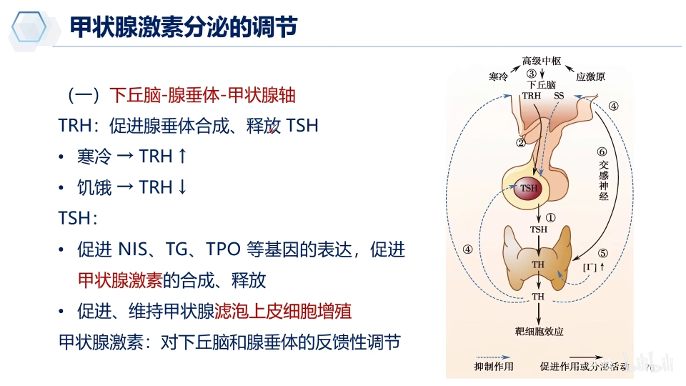
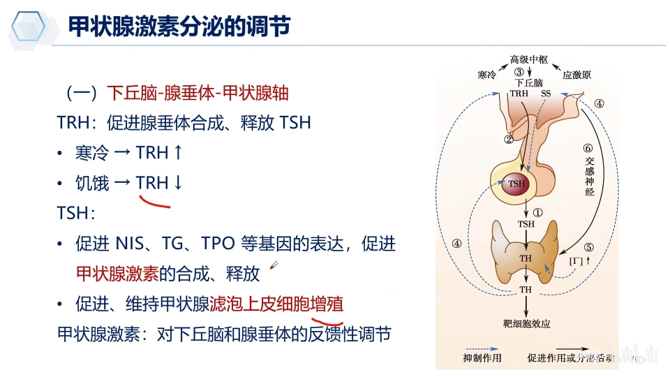
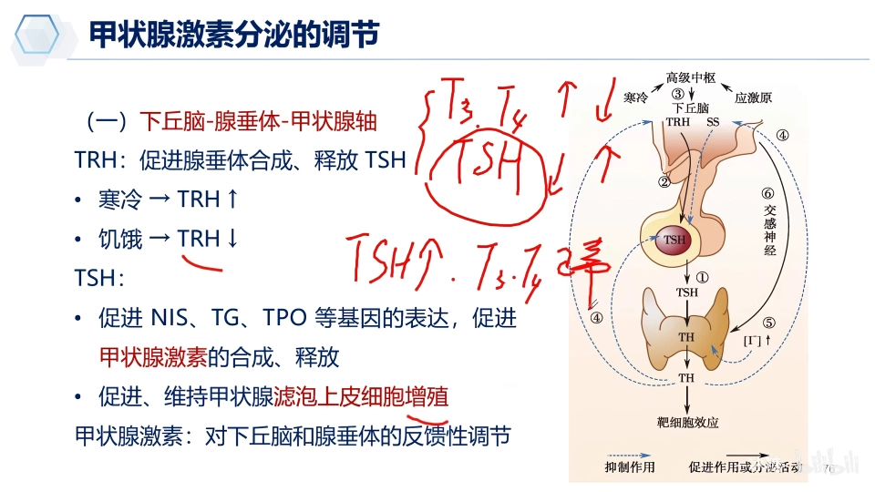
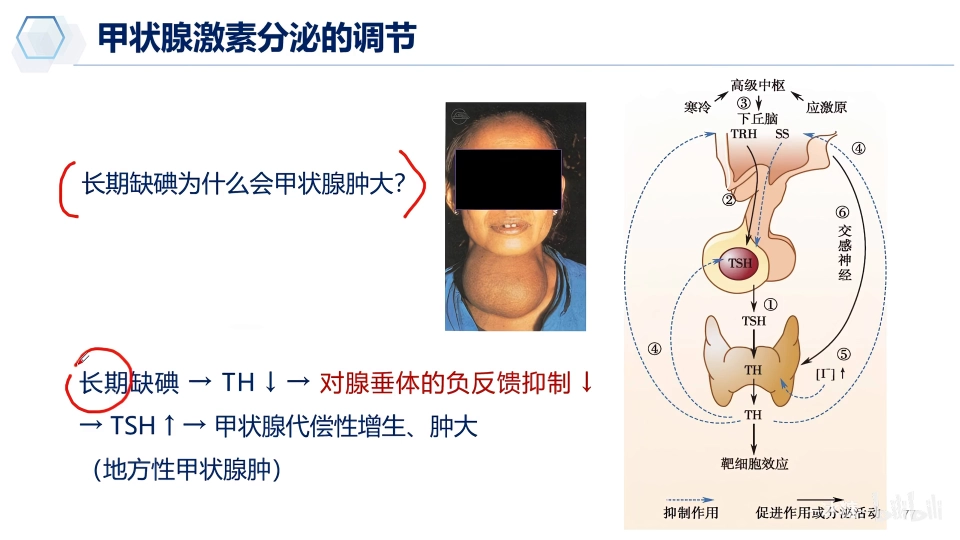
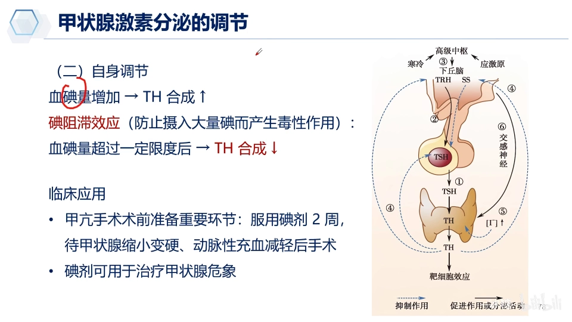
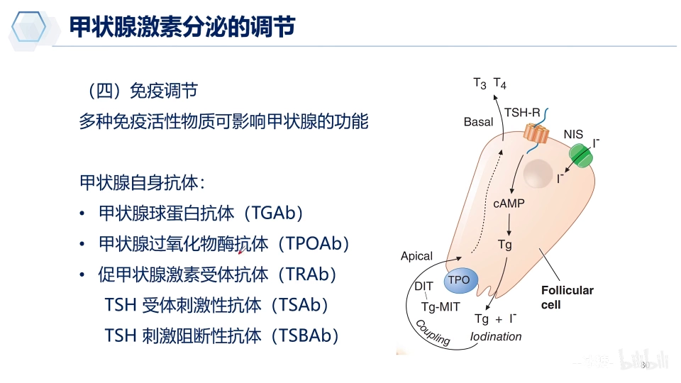

# 甲状腺激素的调节：下丘脑-垂体-甲状腺轴、缺碘代偿与碘阻滞

> 视频来源：[《生理学》11-3 甲状腺功能的调节](https://www.bilibili.com/video/BV1boTAz4EaV/)（Bilibili · 生理学课堂实录，约 27 分钟）
> 导读：这支课把下丘脑-垂体-甲状腺轴从头到尾走了一遍，并用"长期缺碘为什么甲状腺肿大""甲功三项怎么读"两道题检验负反馈。本文按"轴的四段 → 反馈的三种长度 → 缺碘代偿 → 碘阻滞"重排；运输与结合蛋白见 [激素的信号传递与血液运输](激素的信号传递与血液运输：远距分泌、旁分泌、自分泌与神经分泌.md)，长/短/超短反馈的一般定义见 [激素作用的特征与分泌调控](激素作用的特征与分泌调控：受体、三大轴与长反馈短反馈.md)。

## 本讲要解决的核心问题（SCQA）

**背景**：甲状腺激素的作用是**加速代谢、增加产热**，同时促进蛋白质合成和生长发育，对消化、心血管、神经系统基本都呈促进（兴奋）作用。甲亢就是"超级燃烧"：吃得多却消瘦、怕热、心率快。

**冲突**：可是"燃烧"是要花燃料的。冬天需要产热，燃烧该开大；饥荒时燃料不够，燃烧该关小——同一个轴，怎么知道什么时候该开、什么时候该关？更奇怪的是，碘是合成甲状腺激素的原料，**长期缺碘却导致甲状腺肿大**：原料少了，腺体反而变大，这不是反了吗？

**疑问**：下丘脑-垂体-甲状腺轴的四段分别做什么？负反馈为什么要分长、短、超短三种？长期缺碘时，这条轴在哪一步"卡住"、又从哪里"绕过去"？临床上只看一个指标够不够？

**回答（中心思想）**：这条轴是**三级串联 + 三种长度负反馈**：下丘脑分泌 **TRH** 促进腺垂体分泌 **TSH**，TSH 促进甲状腺合成释放 **T3/T4**，T3/T4 作用于全身靶细胞提高代谢率，同时**长反馈**抑制下丘脑和腺垂体（TSH 还有**短反馈**、TRH 还有**超短反馈**）。轴的输入不止反馈：寒冷激活它、饥饿抑制它，交感兴奋它、副交感抑制它。**长期缺碘**时 T3/T4 合成不足→负反馈减弱→TSH 升高→TSH 的"营养作用"使甲状腺滤泡上皮增殖→**代偿性甲状腺肿**。因为存在这种代偿，**单看 T3/T4 会漏诊**：TSH 是最敏感的指标，"T3/T4 正常 + TSH 升高"就是亚临床甲减。

---

## 一、轴的四段：从下丘脑到靶细胞

### 1.1 第一段：下丘脑分泌 TRH

下丘脑合成分泌 **TRH**（促甲状腺激素释放激素，thyrotropin-releasing hormone）。它的作用很单纯：**作用于腺垂体细胞，促进腺垂体合成和释放 TSH**。

TRH 的分泌受神经输入调节，视频给了两个方向相反的例子：

- **寒冷 → TRH 升高**：需要产热，把轴激活；
- **饥饿 → TRH 降低**：燃料不够，先把饥饿问题解决，不该继续"全部燃烧"。

这两个例子说明：**轴的设定点不是固定的，它被整体状态改写**。

[【跳转到 01:57】](https://www.bilibili.com/video/BV1boTAz4EaV/?t=117)同一个轴，冬天和饥荒时的"目标水平"不一样。

[【跳转到 01:07】](https://www.bilibili.com/video/BV1boTAz4EaV/?t=67)

### 1.2 第二段：腺垂体分泌 TSH，它有两个作用

腺垂体合成分泌 **TSH**（促甲状腺激素，thyroid-stimulating hormone）。视频强调它有两个作用，第二个常被忽略：

1. **促进甲状腺激素的合成和释放**：机制是促进合成链条上那几个关键基因的表达——**NIS**（钠碘同向转运体，负责"聚碘"）、**TG**（甲状腺球蛋白，提供装配的骨架）、**TPO**（甲状腺过氧化物酶，合成过程的关键酶）；
2. **营养支持作用**：促进靶细胞——甲状腺滤泡上皮细胞——**增殖**。

[【跳转到 04:52】](https://www.bilibili.com/video/BV1boTAz4EaV/?t=292)

第二个作用是理解"缺碘为什么甲状腺肿大"的关键：**TSH 想升高的那个东西（T3/T4）升不起来，但它想增殖的那个东西（滤泡上皮细胞）还在**。

[【跳转到 03:12】](https://www.bilibili.com/video/BV1boTAz4EaV/?t=192)

### 1.3 第三段：甲状腺分泌 T3/T4

甲状腺分泌的激素主要有两种形式：**T4**（甲状腺素，四碘甲腺原氨酸）和 **T3**（三碘甲腺原氨酸）。两者都是酪氨酸的碘化物，差别只在一个碘原子。

> 补充核对（非视频内容）：视频没有展开 T3/T4 的分泌比例与活性差异。生理学的标准说法是：甲状腺分泌的 90% 左右是 T4，T3 量少但活性约为 T4 的 3–5 倍，外周组织会把 T4 脱碘转成 T3；因此测“T4”和测“T3”不是同一件事。

甲状腺还有一个别的内分泌腺没有的特点：**激素储存在细胞外的滤泡腔里**，储量可满足机体约三四个月的需要。这解释了为什么“缺碘一两天没关系”，必须是**长期**缺碘才看得到后果。

### 1.4 第四段：T3/T4 作用于靶细胞

T3/T4 是脂溶性的，靠血浆蛋白结合运输，进入细胞后结合**核受体**、调节基因表达（受体位置的规则见 [激素作用的特征与分泌调控](激素作用的特征与分泌调控：受体、三大轴与长反馈短反馈.md)）。效应是**提高基础代谢率、增加产热**，同时促进蛋白质合成与生长发育，对多数系统呈兴奋作用。

视频给了一个便于记忆的数量级：甲状腺激素对代谢率的影响非常显著，也是"甲亢患者很少有胖的"的原因——吃进去的能量基本都被消耗掉了。

---

## 二、反馈：三种长度，三道刹车

### 2.1 长反馈是主调节

T3/T4 升高时，它**同时抑制下丘脑和腺垂体**，减少 TRH 和 TSH 的分泌，从而减少自己的生产。这就是**长反馈**（靶腺激素跨两级回抑制）。

### 2.2 短反馈与超短反馈

- **短反馈**：TSH 抑制下丘脑的 TRH 分泌；
- **超短反馈**：TRH 抑制自身的分泌。

三种反馈叠加在同一条轴上，等于给 T3/T4 装了三道时间常数不同的稳定器。一般定义与"为什么需要三种"的讨论见 [激素作用的特征与分泌调控](激素作用的特征与分泌调控：受体、三大轴与长反馈短反馈.md)。

### 2.3 用甲功三项读出断点

临床上查甲功，最主要的三个指标是 **T3、T4、TSH**。

[【跳转到 05:17】](https://www.bilibili.com/video/BV1boTAz4EaV/?t=317)把它们组合起来，可以判断断点在哪一级：

| T3/T4 | TSH | 提示 |
| --- | --- | --- |
| 升高 | 降低 | 原发性甲亢（甲状腺自身问题，负反馈把 TSH 压下去） |
| 降低 | 升高 | 原发性甲减（甲状腺自身问题，负反馈减弱使 TSH 升高） |
| 升高 | 升高 | 继发性甲亢（问题在垂体或下丘脑，TSH 被推高） |
| 正常 | 升高 | **亚临床甲减**（代偿期） |

[【跳转到 07:22】](https://www.bilibili.com/video/BV1boTAz4EaV/?t=442)

**为什么 TSH 是最敏感的指标？** 因为 TSH 处在级联的上游，受负反馈直接调节，变化幅度大；而 T3/T4 有代偿空间。视频举的"亚临床甲减"就是典型：T3/T4 一度降低→负反馈减弱→TSH 升高→TSH 又把 T3/T4 推回正常范围，于是**测出来 T3/T4 正常、TSH 却高**。此时甲状腺功能其实已经有问题，只是"看起来正常"。

[【跳转到 07:47】](https://www.bilibili.com/video/BV1boTAz4EaV/?t=467)

> 视频的说法很形象：机体发生疾病时不会坐以待毙，会自己抢救一下——这就是代偿。能在代偿期发现问题，对早期识别和预防意义很大。

---

## 三、长期缺碘为什么甲状腺肿大：一条完整的负反馈推理

这是本节最值得动手推一遍的案例，因为它把"分泌—运输—受体—负反馈"四段全用上了。

### 3.1 推理链

1. 碘是合成甲状腺激素的**原料**（另一个原料是甲状腺球蛋白）；
2. 长期缺碘 → 甲状腺激素**合成和释放明显减少**；
3. 血中 T3/T4 降低 → 对下丘脑和腺垂体的**负反馈抑制减弱**；
4. TRH、TSH **升高**（其中 TSH 起直接作用）；
5. TSH 的第一个作用——把 T3/T4 升起来——**因为缺原料而做不到**；
6. 但 TSH 的第二个作用——**促进滤泡上皮细胞增殖**——不受缺碘影响，因为细胞还在；
7. 结果：甲状腺**代偿性增生、肥大**，形成**地方性甲状腺肿**（俗称大脖子病）。

[【跳转到 12:21】](https://www.bilibili.com/video/BV1boTAz4EaV/?t=741)

### 3.2 为什么必须是"长期"

因为甲状腺有**细胞外储存**，储量够三四个月用。缺碘一两天，仓库里的存货足够顶上，看不到变化；只有长期缺碘，仓库见底，整条链才启动。**"时间尺度"是这条推理里不可省的一环**——这也是 [3.4.2](../../../3_从分子结构到生物功能/3.4_细胞信号转导与反馈调控/3.4.2_反馈、稳态与时间依赖的细胞响应/稳态与反馈：调定点、负反馈与正反馈.md) 强调"反馈有时间常数"的具体例子。

### 3.3 一个判读提醒

视频顺带纠正了一个常见误解：甲状腺肿本身并不可怕（补碘即可），真正危险的是**压迫**——肿大的腺体压迫气管、食管，导致呼吸困难和吞咽困难。

---

## 四、轴之外的调节：自身调节、神经与免疫

### 4.1 自身调节与碘阻滞效应

除了轴，甲状腺还能**直接对血碘浓度**作出反应，这叫自身调节。

[【跳转到 17:42】](https://www.bilibili.com/video/BV1boTAz4EaV/?t=1062)它的规律不是单调的：

- 血碘在一定范围内增加 → 甲状腺激素合成增加；
- 但血碘**超过一定限度**后 → 合成反而**减少**，这叫**碘阻滞效应**（Wolff-Chaikoff 效应）。

[【跳转到 18:07】](https://www.bilibili.com/video/BV1boTAz4EaV/?t=1087)

视频说机制目前还不很清楚（可能是碘过多抑制了 TPO），但规律要记住：**碘太少不行，太多也不行，只有一定范围内才是促进**。它的意义是防止摄入大量碘产生毒性。

两个临床应用：甲亢手术前服用碘剂约两周，让甲状腺缩小变硬、充血减轻，降低手术出血风险；碘剂也可用于甲状腺危象（短时间内大量甲状腺激素释放）。

### 4.2 神经调节：双重支配

甲状腺受交感、副交感双重支配，作用相反：**交感促进、副交感抑制**。

[【跳转到 20:37】](https://www.bilibili.com/video/BV1boTAz4EaV/?t=1237)这解释了为什么甲亢的心悸、紧张等症状可以用 β 受体阻断剂缓解——阻断交感，症状就轻了（但这不是抑制激素合成）。

### 4.3 免疫调节：抗体可以卡在链条的任一环

多种免疫活性物质能影响甲状腺功能。视频列了三个自身抗体，正好对应合成链条上的三个位置：

| 抗体 | 作用对象 | 后果 |
| --- | --- | --- |
| TGAb（甲状腺球蛋白抗体） | 合成原料 TG | 合成减少 → 甲减 |
| TPOAb（甲状腺过氧化物酶抗体） | 关键酶 TPO | 合成减少 → 甲减 |
| TRAb（促甲状腺激素受体抗体） | TSH 受体 | 刺激性抗体 → 甲亢；阻断性抗体 → 甲减 |

[【跳转到 23:32】](https://www.bilibili.com/video/BV1boTAz4EaV/?t=1412)

这张表把本节的结构又用了一遍：**同一个器官的同一功能，可以在"原料、酶、受体"三个不同环节被破坏，而临床表现可能相同（甲减）或相反（甲亢）**。判断断点，仍然要靠指标组合，而不是靠症状。

---

## 五、这一节给出的读法

把一个三级轴读透，可以按五步：

1. **每一级分泌什么、促进什么？** TRH→TSH→T3/T4，逐级促进。
2. **负反馈从哪一级回到哪一级？** 长反馈（靶腺→上两级）、短反馈（腺垂体→下丘脑）、超短反馈（下丘脑→自身）。
3. **轴外的输入有哪些？** 神经（寒冷、饥饿、交感/副交感）、自身调节（碘浓度）、免疫（抗体）。
4. **哪一步卡住会怎样？** 原料缺（缺碘）→ 代偿性肿大；酶坏（TPOAb）→ 甲减；受体被刺激（TRAb）→ 甲亢。
5. **哪个指标最敏感？** 上游的 TSH，因为它受负反馈直接调节、变化幅度大。

### 5.1 三个边界

- **"正常值"是范围，而且有代偿**：T3/T4 正常不等于甲状腺没问题，亚临床甲减就是代偿期的样子。
- **负反馈不是万能的**：缺碘时负反馈把 TSH 推到很高，却仍然升不起 T3/T4——因为**效应器缺原料**，反馈只能调"指令"，调不了"产能"。
- **一个症状不等于一个断点**：甲减可以由缺碘、酶缺陷、抗体破坏、垂体问题等多种原因造成，必须靠指标组合定位。

---

## 小结

- 轴的四段：**下丘脑 TRH → 腺垂体 TSH → 甲状腺 T3/T4 → 靶细胞核受体**，逐级促进；T3/T4 提高代谢率与产热。
- **TSH 有两个作用**：促进合成释放（NIS、TG、TPO 表达），以及促进滤泡上皮细胞增殖。
- 反馈有三种长度：**长反馈**（T3/T4→上两级）、**短反馈**（TSH→下丘脑）、**超短反馈**（TRH→自身）。
- 轴外输入：寒冷激活、饥饿抑制、交感促进/副交感抑制、碘浓度的自身调节、自身抗体。
- **长期缺碘→T3/T4 不足→负反馈减弱→TSH 升高→滤泡上皮增殖→代偿性甲状腺肿**；必须是“长期”，因为甲状腺有约三四个月的细胞外储存。
- **TSH 是最敏感的指标**；"T3/T4 正常 + TSH 升高"= 亚临床甲减（代偿期）。
- **碘阻滞效应**：碘超过限度反而抑制合成，用于甲亢术前准备和甲状腺危象。

## 关键术语速查

| 术语 | 一句话解释 |
| --- | --- |
| TRH | 下丘脑分泌的促甲状腺激素释放激素，促进腺垂体释放 TSH |
| TSH | 腺垂体分泌的促甲状腺激素，促进甲状腺激素合成释放并促进滤泡上皮增殖 |
| T3 / T4 | 甲状腺激素的两种主要形式，T4 分泌多、T3 活性高 |
| NIS | 钠碘同向转运体，负责把碘主动摄入甲状腺细胞 |
| TPO | 甲状腺过氧化物酶，甲状腺激素合成过程的关键酶 |
| 长反馈 | 靶腺激素（T3/T4）抑制下丘脑和腺垂体 |
| 短反馈 | 腺垂体激素（TSH）抑制下丘脑 |
| 超短反馈 | 下丘脑激素（TRH）抑制自身分泌 |
| 碘阻滞效应 | 血碘超过一定限度后反而抑制甲状腺激素合成 |
| 亚临床甲减 | T3/T4 正常而 TSH 升高，处于代偿期 |
| 地方性甲状腺肿 | 长期缺碘导致 TSH 升高、甲状腺代偿性增生肿大 |