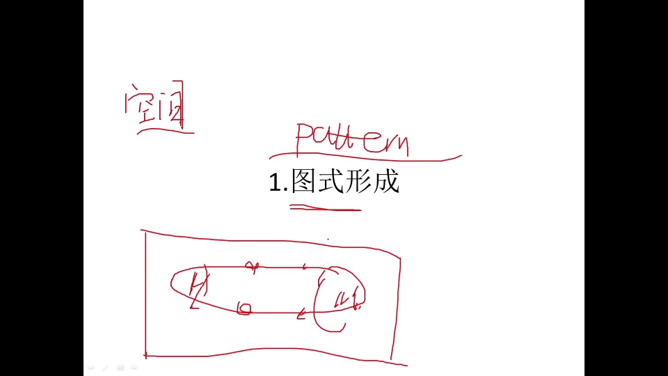
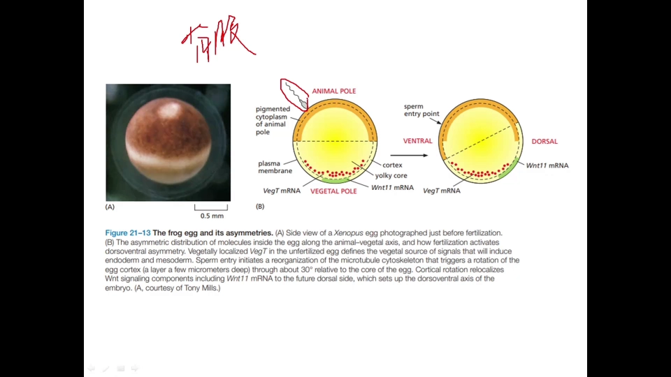
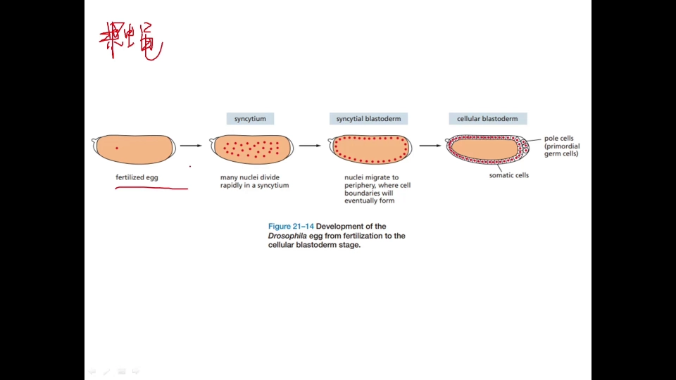
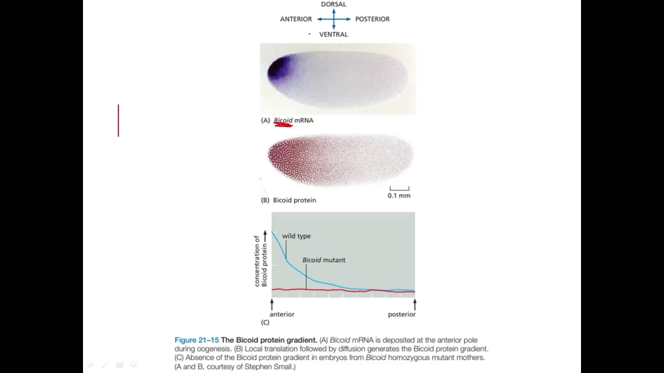
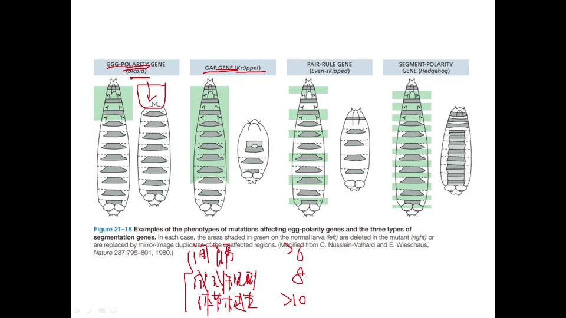
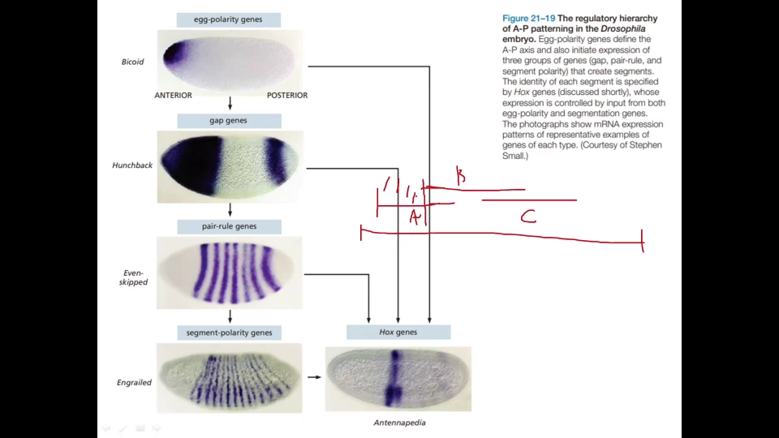
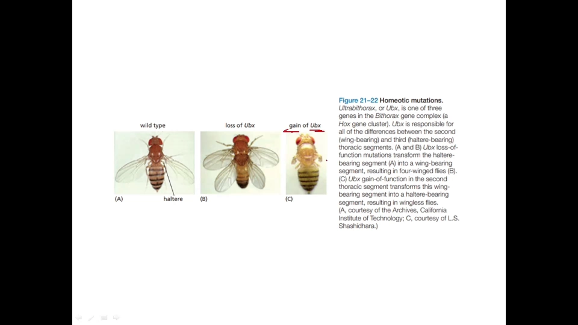
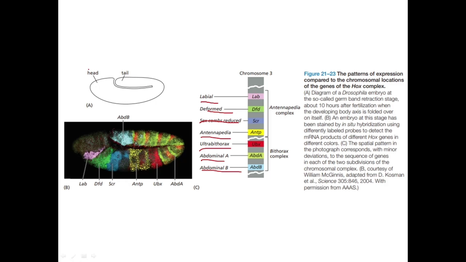
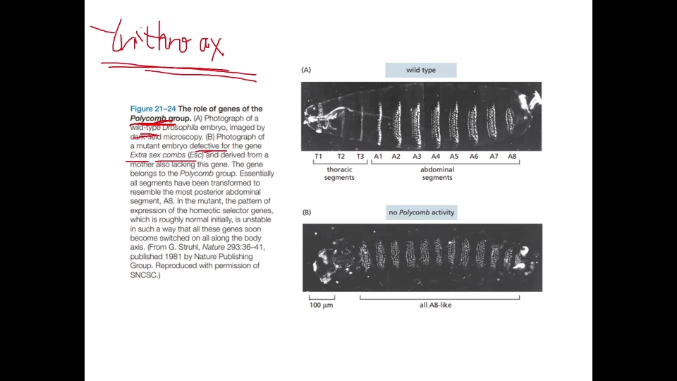

# 图式形成：体轴、母体效应梯度与体节身份

> 视频来源：[【细胞生物学讨论】21.3 胚胎发育与细胞分化-图式形成-上](https://www.bilibili.com/video/BV1iM41197Xh/)（Bilibili · 细胞生物学讨论系列，约 59 分钟，课堂讲授，中文字幕为自动识别）
> 导读（100 字以内）：这一讲用爪蟾和果蝇两个例子把「图式形成」讲完：体轴怎样从对称的卵里长出来、Bicoid 梯度怎样变成基因表达的边界、间隙—成对规则—体节极性三级基因怎样切出体节、Hox 基因怎样给每个体节一个身份。本文按「要解决什么 → 体轴 → 梯度 → 体节 → 身份 → 分工」重排；字幕中的术语错拼已按上下文订正。

## 本讲要解决的核心问题（SCQA）

**背景**：一个受精卵分裂成很多细胞，这些细胞起初看起来差不多。但成体有头有尾、有背有腹、有胸有腹，每一节上长的东西还不一样。

**冲突**：细胞里没有一张画好的图纸。基因组在几乎每个细胞里都是同一套，那么「哪里长头、哪里长腿」这类空间信息，究竟存在哪里、又怎样被细胞读出来？

**疑问**：一个对称的卵怎样变成不对称的胚胎？体轴由什么建立？从「头尾两个方向」这种粗糙信息，怎样得到一节一节精确重复、又各不相同的体节？信号分子给出的是连续浓度，基因给出的却是离散的「是／不是」，这两者怎样接上？

**回答（中心思想）**：图式形成（pattern formation）是早期细胞决定的空间层面，它要回答的是「怎样从一个对称的受精卵发育成一个不对称的胚胎」。做法是**分步骤把连续信息切成离散区域**：先用母体效应分子在卵里制造不对称，得到体轴；再用浓度梯度（形态发生素）在阈值处切换下游基因，得到粗分区；再用几组基因的重叠组合把粗分区细分成体节；最后用 Hox 基因的组合给每个体节一个身份。信号提供「位置与浓度」，基因调控网络把连续信号变成离散命运，表观调控把已经作出的决定维持下去。

---

## 一、图式形成是「早期细胞决定的空间层面」

课堂把细胞分化相关的内容分成四个角度：空间与时间的关系、形态建成、以及分化之后的生长。图式形成是第一个角度里的空间部分。

[【跳转到 01:20】](https://www.bilibili.com/video/BV1iM41197Xh/?t=80)

所谓图式，就是一张标了信息的草图：这一堆细胞里，这个地方将发育成头，那个位置发育成身体的后端，另一些细胞发育成肢体。它有两个限定词：**是空间的**，**是早期细胞决定的**——这时还不涉及具体器官怎么形成。

### 1.1 四种体轴：头尾、背腹、内外、生殖细胞与体细胞

体轴（body axis）就是「一个具体的不对称方向」。课堂上列了四种：

| 体轴 | 内容 | 例子 |
| --- | --- | --- |
| 头尾轴（前后轴） | 前端负责感觉与摄食，后端负责运动与消化 | 两侧对称动物都有头有尾 |
| 背腹轴 | 背侧与腹侧不同 | 四足动物四肢朝下，神经在背侧、消化结构在腹侧 |
| 内外轴（动植物轴） | 决定个体的内与外 | 皮肤—真皮—肌肉—内脏的分层 |
| 生殖细胞与体细胞的区分 | 少数细胞脱离一般命运，专门负责繁殖 | 生殖细胞在很早期就与体细胞分开 |

[【跳转到 02:35】](https://www.bilibili.com/video/BV1iM41197Xh/?t=155)

内外轴值得多看一眼：你可能会说受精卵的细胞膜一侧就是外、细胞质里就是内，但课堂指出这不对——细胞分裂成一团之后还会迁移，原来在内侧的细胞过一会儿可能跑到外面。**内外不是几何位置，而是被迁移行为建立起来的**。

### 1.2 图式形成发生在器官形成之前

四种图式出现得很早：受精卵发育成囊胚，再往后是原肠胚，而原肠胚时器官雏形已经出现。所以**图式形成早于原肠胚**，就发生在囊胚阶段——那时胚胎还只是一个空心的球，但这个球已经不对称了。

这条时间线很重要：它说明后续所有器官的形态，都是在一个已经带好坐标系的细胞团上长出来的。

## 二、爪蟾：卵本身的不对称加上受精位点，给出两个轴

先看一个相对简单的例子。

[【跳转到 07:25】](https://www.bilibili.com/video/BV1iM41197Xh/?t=445)

**头尾轴在受精前就定了**。爪蟾的卵本身不对称：上面叫动物极，含卵黄少、有雌原核和色素颗粒；下面叫植物极，卵黄多。卵黄妨碍细胞分裂，所以动物极分裂快、细胞小而多，植物极分裂慢、细胞大而少。动物极将来发育成头，植物极发育成尾。

**背腹轴在受精后才定**。受精时精子带来的中心体进入卵细胞，成为微管组织中心；受精位点并不正对动物极，而是偏向一侧，所以微管从这一侧开始组装，带动细胞皮层旋转。皮层上附着了一些 mRNA，比如 Wnt11；皮层一转，Wnt11 的 mRNA 就被带到这一侧。随后细胞不均等分裂，有 Wnt11 的子细胞发育成背侧，没有的成为腹侧。

[【跳转到 12:00】](https://www.bilibili.com/video/BV1iM41197Xh/?t=720)

这里出现了本篇的第一个关键机制：**一个定位在特定位置的母源分子，通过「有／没有」的分配，把一个连续的空间差异变成一个二值的细胞差异**。课堂在这里把 Wnt11 说成「翻译成蛋白后是转录因子」；按发育生物学的通行描述，Wnt11 是分泌型配体、通过受体通路起作用，不是转录因子。这一处按课堂原话保留但标记为待核对，不影响本节的推理链——无论它是转录因子还是分泌配体，起作用的方式都是「定位在背侧、把背侧身份指定下来」。

## 三、果蝇：合胞体让母体因子可以自由扩散

果蝇是发育生物学最核心的模式生物，原因是所有动物共享相同的发育调控机制，而果蝇研究得最清楚。

[【跳转到 17:30】](https://www.bilibili.com/video/BV1iM41197Xh/?t=1050)

果蝇早期发育有个特别之处：受精卵先做大量**核分裂**而不做胞质分裂，形成含很多细胞核的**合胞体**（syncytium）；这些核再迁移到细胞皮层，最后才发生胞质分裂，形成细胞胚盘（cellular blastoderm，课堂上称「细胞囊胚」）。课堂点出了这个安排的用意——**早期不分裂胞质，细胞质就是相通的，信息分子可以不跨细胞膜、直接在胞质里扩散**。

### 3.1 母体效应分子：卵里预装的定位信息

在合胞体里扩散的是**母性分子**（母体效应基因的产物）：它们不是受精卵二倍体核表达的，而是卵母细胞在减数分裂过程中表达、储存在卵里的 mRNA 或蛋白质，在胚胎发育中直接发挥作用。

课堂列了几个代表：Bicoid 在头部、Nanos 在尾部，两者相互作用决定哪些细胞成为生殖细胞；Torso、Toll 一类则参与末端结构和内外轴（外、中、内胚层）的确定。

### 3.2 Bicoid 梯度：形态发生素的标准样本

[【跳转到 20:18】](https://www.bilibili.com/video/BV1iM41197Xh/?t=1218)

Bicoid 的 mRNA 定位在胚胎前端，蛋白从头部向周围扩散，浓度从头向尾逐渐降低；把 Bicoid 突变掉，整个胚胎就检测不到这个分子。**Bicoid 就是一个形态发生素（morphogen）**：它靠浓度说话。

课堂还提醒了一个技术要点：这类结论依赖**原位**手段——直接在胚胎里看到分子的位置。提取 RNA 去测序只能得到「有没有、有多少」，得不到「在哪里」，而位置恰恰是图式形成的核心信息。

## 四、从梯度到体节：三级基因级联把连续浓度切成离散条带

有了 Bicoid 梯度，接下来的问题是：一条平滑的浓度曲线，怎样变成一节一节的体节？

### 4.1 研究方法是突变体

1980 年代还没有基因编辑，研究发育的主要手段是**突变体**：找到表型异常的个体，再看它的基因表达差异。这是从表型到基因型的正向遗传学思路。

[【跳转到 33:00】](https://www.bilibili.com/video/BV1iM41197Xh/?t=1980)

这张图把三类基因的作用方式一次讲清了：绿色是被突变去掉的结构。

- **卵极性基因**（如 Bicoid）缺失：头胸部体节全没了，只剩腹部；
- **间隙基因**（如 Krüppel）缺失：一大片体节消失；
- **成对规则基因**（如 even-skipped，even 即偶数）缺失：偶数体节跳过，只剩一半体节；
- **体节极性基因**（如 hedgehog）缺失：体节之间的间隔消失，每个体节被镜面重复一份。

### 4.2 三级级联：gap → pair-rule → segment polarity

[【跳转到 39:47】](https://www.bilibili.com/video/BV1iM41197Xh/?t=2387)

这张层级图是本讲的主干，四层依次是：

1. **母体效应基因**（Bicoid）：给出从头到尾的连续浓度梯度；
2. **间隙基因**（gap genes，六个以上）：每个基因在特定的 Bicoid 浓度区间内表达，于是平滑梯度被切成几段粗分区；
3. **成对规则基因**（pair-rule genes，约八个）：读间隙基因的**重叠组合**，把粗分区切成周期性条带；
4. **体节极性基因**（segment polarity genes，十个以上）：在每条条带内部再划出边界，确定每个体节的最终位置。

课堂对第二层的解释最直接：**「浓度大于 C1 时是一种情况，小于 C2 时是另一种情况，两者之间又是第三种情况」**——这就是阈值响应。间隙基因 hunchback 在某个阈值以上表达，别的间隙基因在另外的浓度区间表达。

[【跳转到 38:19】](https://www.bilibili.com/video/BV1iM41197Xh/?t=2299)

第三层用的是**组合编码**：间隙基因的表达区相互重叠，只有 A 的区域发育成一个体节，有 A 有 B 的区域是另一个，只有 B 的又是一个，有 B 有 C 的再是一个。六个间隙基因的重叠关系，决定了成对规则基因在哪里表达；成对规则基因再把表达变成「表达—不表达—表达—不表达」的周期排列。

### 4.3 边界靠相邻细胞相互抑制来锁定

体节极性基因给出 14 个条带，每个条带约一个细胞宽。条带边界怎样稳定下来？

[【跳转到 43:07】](https://www.bilibili.com/video/BV1iM41197Xh/?t=2587)

课堂给的机制是**相邻细胞之间的相互抑制**：even-skipped 的蛋白入核作为转录因子，开启 hedgehog 的表达；hedgehog 是分泌蛋白，作用于相邻细胞，让相邻细胞表达 wingless；wingless 又反过来作用于原来那个细胞。「就像磁铁有正极就有负极」，每两个细胞构成一对正负极，于是每个体节的边界被固定下来。

这解释了一个容易忽略的点：**边界的稳定性不是靠一个细胞自己记住，而是靠两个细胞互相维持**。这也回答了「连续信号怎样变成离散边界」——阈值先切出大致位置，相互抑制再把边界锐化成一条线。

## 五、Hox 基因：同一套基因的不同组合给出体节身份

体节位置定了，还剩一个问题：为什么第二节胸节长翅膀、第三节长平衡棒？为什么头部有的地方长触角、有的地方长足？

### 5.1 同源异形突变：一个基因换掉一整个结构的身份

[【跳转到 49:04】](https://www.bilibili.com/video/BV1iM41197Xh/?t=2944)

正常果蝇第二节胸节长翅膀（用于飞行），第三节长平衡棒（短小的变态翅膀，飞行时起平衡和感知方向的作用，像舵）。把 Ultrabithorax（Ubx）突变掉，第三节胸节又长出一个翅膀，成为四翅；反过来让 Ubx 过表达，两对翅膀都没了，全变成平衡棒。

这类基因叫**同源异形选择基因**（homeotic selector gene），缩写就是 HOX。名字的含义是：这些结构之间发生了替代，而替代的两方在发育上是同源的——触角和足都是附肢，翅膀和平衡棒都是翅膀的类型。所以不是「凭空长出新器官」，而是**把某个体节的身份换成了另一个体节的身份**。

### 5.2 线性排列与表达顺序的对应

[【跳转到 52:03】](https://www.bilibili.com/video/BV1iM41197Xh/?t=3123)

HOX 蛋白是转录因子，带一个约 60 个氨基酸的 DNA 结合域（同源域），这是很保守的结构。不同 HOX 蛋白引发不同的基因表达模式，于是体节出现差异。

更值得注意的是它们在染色体上的排布：果蝇 3 号染色体上 HOX 家族成员成簇线性排列，**排列顺序和它们在胚胎里从头到尾的表达顺序一致**（Lab、Deformed、Sex combs reduced、Antennapedia、Ultrabithorax、Abdominal A、Abdominal B）。课堂对此的判断是：线性排列能对应线性表达，说明染色体结构本身参与了调控，也就是表观调控。

### 5.3 表观调控把决定维持下去

[【跳转到 56:06】](https://www.bilibili.com/video/BV1iM41197Xh/?t=3366)

HOX 基因和体节极性基因一样，会在果蝇整个生命历程中持续表达。维持靠两条：

- **自我正反馈**：HOX 是转录因子，结合到增强子或启动子上，其下游基因里可能就有 HOX 本身；
- **染色质状态的维持**：Trithorax（三胸）结合在开放的 HOX 上，维持开放；Polycomb（多梳）结合在封闭的 HOX 上，继续保持封闭。

图中是 Polycomb 组成员 ESC（extra sex combs）缺失的结果：野生型里各体节表达不同的 HOX 组合，缺失之后每个腹节都变成第八腹节（A8）的样子。课堂的解释是：缺少抑制子之后，本应被抑制的那套 HOX 在每个体节都被打开，于是所有体节都拿到了同一个身份。

## 六、信号与基因调控的分工

把前面几节连起来，可以看到一条清楚的分工：

| 环节 | 提供什么 | 本讲中的例子 |
| --- | --- | --- |
| 母体效应分子 | 位置（谁在哪儿） | Bicoid 在前端、Nanos 在尾端、Wnt11 被皮层旋转带到背侧 |
| 浓度梯度 | 连续的位置量 | Bicoid 浓度从头向尾下降 |
| 阈值响应 | 把连续量变成离散开关 | 间隙基因在特定浓度区间表达 |
| 组合编码 | 用少量基因编码更多区域 | 六个间隙基因的重叠决定成对规则基因的表达域 |
| 相互抑制 | 把边界锐化并稳定 | Hedgehog 与 Wingless 在相邻细胞间互作 |
| 转录因子身份编码 | 给每个区域一个可记忆的身份 | HOX 基因的组合 |
| 表观维持 | 让决定跨分裂保持 | Trithorax / Polycomb |

一句话：**信号分子负责「你在哪里」，基因调控网络负责「因此你成为什么」**。连续信号不会直接决定命运，它先被阈值和组合逻辑翻译成离散的基因表达状态，再由转录因子网络和染色质状态锁定。

## 七、边界：这一讲的适用限度

- **它讲的是模式生物的一个经典案例**。果蝇的合胞体是特例：正因为早期不分裂胞质，母体因子才能自由扩散成梯度。多数动物（包括爪蟾）的形态发生素是在细胞之间、在细胞外基质里扩散的。
- **它只讲了头尾轴和体节**，背腹轴、内外轴只是一笔带过；果蝇背腹轴、脊椎动物神经管背腹图式另有机制。
- **它没有讲形态发生**。图式形成只给出「哪里该成为什么」，细胞怎样迁移、折叠、收缩成器官，是另一条线。
- **基因名字不必逐个记**。这一讲真正要带走的是三级级联的结构、阈值与组合的逻辑、以及 HOX 的组合身份编码。

## 小结

- 图式形成是早期细胞决定的空间层面，回答「对称的卵怎样变成不对称的胚胎」，发生在器官形成之前。
- 体轴至少有四种：头尾、背腹、内外、生殖细胞与体细胞；内外轴要靠细胞迁移建立，不是几何位置。
- 爪蟾用卵的固有不对称定头尾、用受精位点引发的皮层旋转定背腹；果蝇的合胞体让母体因子可以自由扩散成梯度。
- Bicoid 是形态发生素的标准样本：浓度从头向尾下降，原位手段才能看到「在哪里」。
- 体节由三级基因级联切出：间隙基因读阈值、成对规则基因读重叠组合、体节极性基因划边界并用相邻细胞相互抑制锁定。
- HOX 基因用组合给出体节身份；同源异形突变换掉的是身份，不是凭空造出新器官。
- 分工是：信号给位置，基因网络把连续变离散，表观调控把决定维持下去。

## 关键术语速查

| 术语 | 一句话解释 |
| --- | --- |
| 图式形成（pattern formation） | 早期胚胎里确定「哪一块将发育成什么」的空间布局过程 |
| 体轴（body axis） | 胚胎上一个具体的不对称方向，如头尾轴、背腹轴 |
| 形态发生素（morphogen） | 靠浓度梯度给细胞提供位置信息的分泌或扩散分子 |
| 合胞体（syncytium） | 多个细胞核共处一个细胞质、尚未完成胞质分裂的结构 |
| 母体效应基因 | 产物由卵母细胞预存、在受精卵里直接发挥作用的基因 |
| 间隙基因（gap gene） | 在特定形态发生素浓度区间内表达、把胚胎切成几大段的基因 |
| 成对规则基因（pair-rule gene） | 按两节一个周期表达、把粗分区切成周期性条带的基因 |
| 体节极性基因（segment polarity gene） | 在每个体节内部划定边界并维持边界的基因 |
| 同源异形基因（Hox） | 决定某一区域「身份」的转录因子，突变时整个结构被替换成别的体节的结构 |
| 原位杂交 | 在保持位置的条件下检测特定核酸或蛋白在胚胎中的分布 |