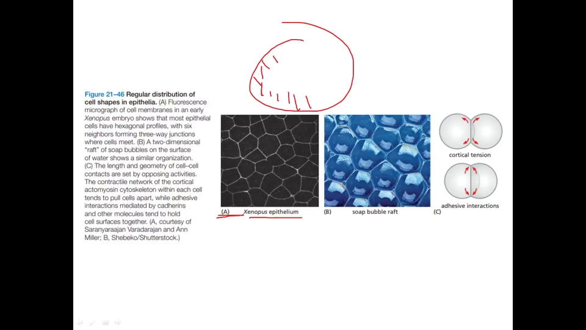
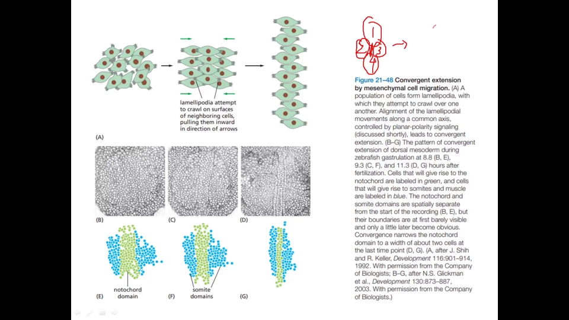
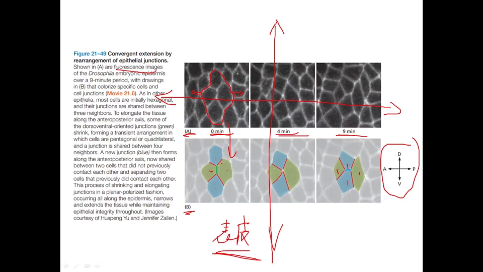
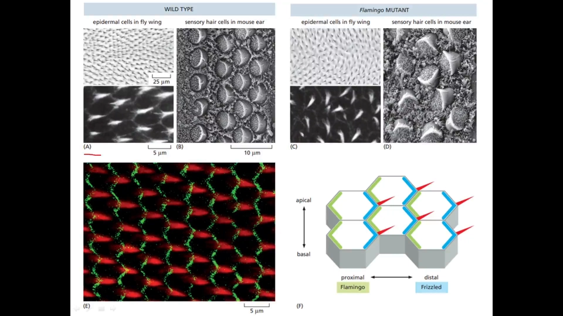
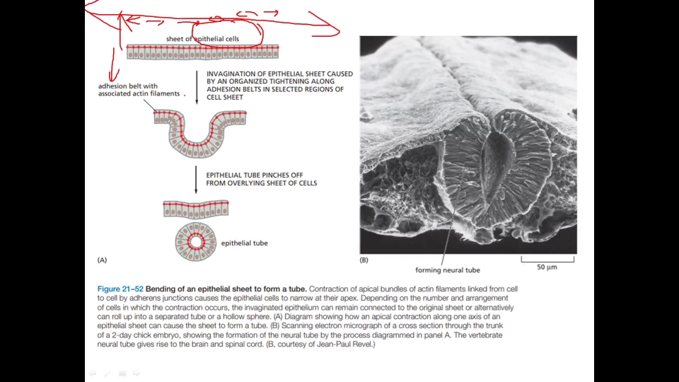
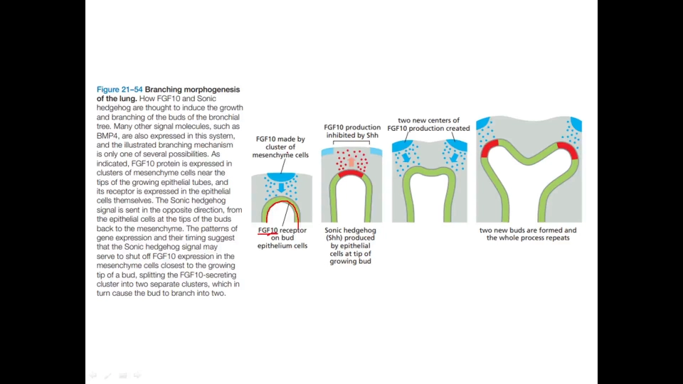

# 形态建成：片层形变、汇聚延伸与细胞迁移

> 视频来源：[【细胞生物学讨论】21.6 胚胎发育与细胞分化-形态建成-上](https://www.bilibili.com/video/BV1Pw411z7HW/)（Bilibili · 细胞生物学讨论系列，约 52 分钟，课堂讲授，中文字幕为自动识别）
> 导读（100 字以内）：这一讲把「形态建成」拆成两个层次：细胞片层怎样受力变形（汇聚延伸、平面极性、顶端收缩、分支成管），以及细胞怎样脱离片层迁移。本文按「力 → 重排 → 极性 → 卷曲与分支 → 迁移」重排，并补上凋亡与 EMT 在本脉络中的位置；字幕中的术语错拼已按上下文订正。

## 本讲要解决的核心问题（SCQA）

**背景**：图式形成给每个细胞发了「位置坐标」和「身份」，但坐标本身不会变成形状。一个球形的囊胚要变成有神经管、有肺、有心脏的个体。

**冲突**：细胞不会自己「长成」器官的形状。片层要弯成管、要拉长变薄、要分出分支，这些都不是单个细胞能完成的动作，而是整层细胞协同受力的结果。

**疑问**：一层细胞凭什么能变形？同样的细胞为什么能形成管、形成分支、形成中空的绳索？细胞脱离原来的片层跑到别处去，又是什么在指路？

**回答（中心思想）**：**形态建成（morphogenesis）是细胞之间相互联系、组成组织和器官的过程**，它本质上是**受力不均匀**的结果。片层里的力由两部分对抗产生：细胞皮层的肌动球蛋白收缩（向内）和钙黏蛋白介导的细胞黏着（向外）。改变其中任何一项——让某些连接解体、让某些细胞的顶端收缩加强、让相邻组织互相排斥——片层就会弯、会拉长、会分支。第二类机制是细胞迁移：细胞脱离片层，沿着环境信号给出的方向移动。**图式给出「哪里该成为什么」，形态建成负责「把它真的摆成那个样子」**。

---

## 一、形态建成的两个层次

[【跳转到 00:36】](https://www.bilibili.com/video/BV1Pw411z7HW/?t=36)

课堂把形态建成分成两个层次：

1. **细胞片层**：细胞构成一个二维平面（卷成管状也仍算片状结构），讨论片层内部的细胞怎样相互作用、形成组织；
2. **细胞迁移**：细胞脱离原来的片层，转移到另一个地方。

片层的变化有两大类：片层内部的**延伸、收缩、加厚**，以及片层**卷曲成管**或其他形状。

## 二、片层变形的物理基础：两种对抗的力

[【跳转到 01:41】](https://www.bilibili.com/video/BV1Pw411z7HW/?t=101)

片层变化本质上是**受力不均匀**，而受力离不开细胞骨架：参与细胞运动的主要是微丝，肌动蛋白与肌球蛋白相互滑动产生力。有些蛋白产生力，有些蛋白感受力——力本身就是一个机械信号。

### 2.1 细胞怎样感受机械刺激

课堂列了三条路径：

- **整合素—细胞骨架**：整合素连接胞外基质，是物理连接也是信息蛋白；其下游蛋白（如 α-连环蛋白、踝蛋白）在受力时构象改变，把被掩盖的结合位点释放出来，进而促进微丝骨架组装；
- **受体构象变化**：受体受力后构象改变，释放结合配体或结合胞内信号的区域；
- **机械门控离子通道**：受力后通道打开，如 Piezo 通道。

课堂的判断是：在个体发育里第三条作用不明显，主要是前两条。

### 2.2 片层像一堆肥皂泡

[【跳转到 05:08】](https://www.bilibili.com/video/BV1Pw411z7HW/?t=308)

爪蟾早期上皮的细胞大多是六边形，和肥皂泡筏的排布几乎一样。原因是两种力在对抗：

- **细胞皮层**（细胞膜下密集的微丝网络）产生一个向内的力，像表面张力；
- **细胞黏着**（钙黏蛋白等）产生一个向外的力，把细胞拉在一起。

两力平衡，细胞就粘成一片；多边形结构提供了很好的受力平面，所以稳定。这张图给出的直觉很重要：**上皮的几何形状不是被「设计」出来的，而是力学平衡的结果**。

### 2.3 让组织分开：排斥性信号

[【跳转到 07:35】](https://www.bilibili.com/video/BV1Pw411z7HW/?t=455)

细胞之间不只有黏着，也有**排斥**。膜蛋白有的促进黏着，有的相互排斥、把两个细胞往远处推——就像磁铁，N 极与 S 极相吸，两个 N 极放一起就排斥。

课堂举的例子是 **ephrin 配体与 Eph 受体**（ephrin 的中文译名当时还没有统一说法）。Eph 受体本质上是受体酪氨酸激酶。配体与受体作用后，通过信号通路改变细胞皮层的作用力：**细胞黏着变弱、胞内收缩加强**，两个细胞之间就断开。

[【跳转到 09:21】](https://www.bilibili.com/video/BV1Pw411z7HW/?t=561)

这个机制在鸡胚的**菱脑节**分离里看得很清楚：R4 菱脑节的细胞表达 B2 型配体，R5 表达 A4 型受体，两者相互排斥，于是两个菱脑节分开。这条例子说明：**边界不一定要靠「墙」，也可以靠两侧细胞互相推开**。

## 三、汇聚延伸：细胞重排把片层拉长

[【跳转到 13:31】](https://www.bilibili.com/video/BV1Pw411z7HW/?t=811)

汇聚延伸（convergent extension）是片层内部最典型的重排。课堂先用四个细胞讲清几何：原来 2 和 3 相连、1 和 4 分开；后来变成 1 和 4 相连、2 和 3 分开。就是「挤了一下」，一堆细胞相互插入——沿一个方向汇聚，垂直方向就被拉长。

### 3.1 间充质细胞的版本：伸出伪足互相爬

[【跳转到 16:21】](https://www.bilibili.com/video/BV1Pw411z7HW/?t=981)

在斑马鱼原肠胚里，中胚层细胞（间充质）伸出片状伪足，试图在相邻细胞表面爬行、相互插入；伪足运动沿同一个共同轴排列，于是整团细胞沿该轴汇聚、垂直方向延伸。结果是：将来形成脊索的细胞（绿色）被收窄到约两个细胞宽，两侧形成体节（蓝色）。

间充质这个概念课堂专门解释了：中胚层最早期的细胞都叫间充质，因为它像结缔组织，绝大多数成分是细胞外基质，只有少数细胞像成纤维细胞。

### 3.2 上皮的版本：连接解体再重组

[【跳转到 18:02】](https://www.bilibili.com/video/BV1Pw411z7HW/?t=1082)

上皮不靠爬，靠**连接的重排**。图中 0 分钟时两个绿色细胞相邻、两个蓝色细胞分开；到 9 分钟，绿色连接解体、两个蓝色细胞之间形成新的连接，细胞整体沿前后轴被拉长。

课堂特别强调了因果顺序：**细胞里的收缩力、张力其实没怎么变，变的是黏着**——绿色黏着解体，两个细胞就分开，被拉开之后新的黏着形成，形状才定型。所以是**先有力与黏着的变化，再有位移**。

## 四、平面细胞极性：片层是有方向的

[【跳转到 20:45】](https://www.bilibili.com/video/BV1Pw411z7HW/?t=1245)

片层不是各向同性的均匀平面，它常常有一个明确指向，这叫**平面细胞极性**（planar cell polarity）。

[【跳转到 21:20】](https://www.bilibili.com/video/BV1Pw411z7HW/?t=1280)

两个经典读数：

- **果蝇翅膀**：每个上皮细胞长一根毛，所有毛都指向翅膀尖端；
- **小鼠内耳毛细胞**：静纤毛朝向一致。朝向决定功能——毛偏向一侧时机械门控通道关闭，是静息状态；外界振动让毛摆动，通道打开，细胞电位变化，产生听觉。

把 **Flamingo** 基因突变掉，两种组织的毛都乱指。原因是 Flamingo 蛋白分布在细胞膜周围，参与细胞骨架的正确组装；没有它，毛不能正常形成。图下方还给出了分子层面的解释：Flamingo 与 Frizzled 在细胞两侧分布不对称，**外面看到的是毛的指向，里面其实是分子分布本身就有方向**。

课堂补充：这种极性依赖钙黏蛋白的极性黏着，也依赖 Wnt 信号——Wnt 作为配体激活受体，最终让转录因子入核调节基因表达。

## 五、片层卷曲成管：顶端收缩

[【跳转到 28:16】](https://www.bilibili.com/video/BV1Pw411z7HW/?t=1696)

片层可以发生更剧烈的形状改变。课堂用一张图概括了几种方式：片层顶起一个凸起、越顶越多最后被挤出去，于是片层里多出一个管道。

[【跳转到 35:58】](https://www.bilibili.com/video/BV1Pw411z7HW/?t=2158)

**神经管**就是这样形成的。机制叫**顶端收缩**（apical constriction）：上皮细胞顶端面（apical）的肌动蛋白束与黏着带在特定区域协同收紧，细胞变成上窄下宽的楔形，片层在这个方向上变短，于是向内凹陷卷曲；收缩越强，凹陷越深，最后掐断成一根独立的管。

课堂的因果链是：中间那些细胞表达了促进微丝收缩的基因、表达量更高，所以这些细胞被「扭」出来。中胚层里也有类似的例子：转录因子 **twist**（名字本身就是「扭曲」）在果蝇中胚层表达，形成管状内陷结构。

神经管之外，同一层外胚层剩下扁平的部分发育成表皮，神经管与表皮之间受诱导形成**神经嵴**，将来发育成外周神经等结构。

## 六、分支成管：上皮与间充质的对话

[【跳转到 30:03】](https://www.bilibili.com/video/BV1Pw411z7HW/?t=1803)

管道还有另一种来源：从一个片层上凸出芽体，再反复分支。肺就是典型：气管—主支气管—各级支气管，越分越细，末端是肺泡。

[【跳转到 40:25】](https://www.bilibili.com/video/BV1Pw411z7HW/?t=2425)

肺来自**内胚层**（消化道前肠），它要往中胚层的间充质里生长。这里的关键概念是**上皮—间充质相互作用**：不同胚层之间相互对话。

机制是一个漂亮的负反馈循环：

1. 间充质在芽尖附近表达 **FGF10**（成纤维细胞生长因子），上皮细胞上有 FGF10 受体；
2. 上皮受 FGF10 刺激后延伸，并在芽尖分泌 **Shh**（Sonic hedgehog）；
3. Shh 反过来抑制间充质合成 FGF10，于是芽尖正前方的 FGF10 被关掉；
4. 但芽体两侧的间充质还在分泌 FGF10，于是生长改向两侧，芽体一分为二；
5. 整个过程重复，形成多级分支。

**一个「促进生长」的信号加一个「抑制信号源」的反馈，就能生成一棵树**。这也解释了为什么形态建成不需要一份逐分支的图纸。

### 6.1 其他成管方式

课堂还列了几种：

- **细胞相互组装**：左边半管道、右边半管道拼成一个管道，如早期心脏——两条心管拼合后扭曲，形成四腔心脏；
- **细胞自身变中空**：如气管末端的细胞，靠微丝骨架剧烈变化把细胞内部掏空；
- **中空绳索**：如唾液腺，先是一团实心细胞，后来中间变空，靠中间细胞黏着断开；
- **穿透基膜**：唾液腺要往下分支，必须先在基膜上「穿孔」。基膜由层粘连蛋白、Ⅳ 型胶原等构成，把外胚层与中胚层隔开；唾液腺附近基膜局部解体，上皮才能向内生长。

最后一条把**细胞外基质**拉进了形态建成：形状不只由细胞决定，也由细胞脚下的「地基」决定。

### 6.2 一个反直觉的例子：缺氧促进气管生长

果蝇的气管系统来自外胚层，与肺不同源，但同样分支。它的分支也依赖 FGF，而 FGF 的合成受头尾轴、背腹轴调控，所以气管的走向也带着体轴信息。

课堂还讲了一个有意思的现象：胚胎晚期，FGF 的表达受**缺氧诱导因子（HIF）**调控，而 HIF 在缺氧时才高表达。于是缺氧 → HIF 多 → FGF 多 → 气管长得多。课堂把它类比为「用进废退」：胚胎想用氧气而氧气不够，气管就越长越多——但这是发育中的可塑性调节，不是拉马克式的获得性遗传。

## 七、细胞迁移与另外两种细胞行为

### 7.1 迁移：细胞脱离片层

形态建成的第二个层次是细胞迁移：细胞离开出生地，到别处定居。课堂在片层部分已经给出一个例子：原肠形成时，一些表皮细胞**失去表皮的特性**，迁移到胚胎内部，成为间充质。

这正是**上皮—间质转化（EMT）**在发育中的原型：上皮细胞松开彼此连接、失去极性、获得迁移能力，从片层里「下车」。同一层细胞经过汇聚延伸后，中间的形成脊索，两侧的形成体节。

细胞为什么能爬？因为它产生了**片状伪足**——本质是细胞皮层的局部延伸。迁移方向则由环境信号给出：哪里有信号，细胞就往哪里走。

### 7.2 凋亡：把多余的部分删掉

形态建成不只有「加法」。指趾分离、蝌蚪尾巴消失、神经发育中多余神经元的清除，都靠**程序性细胞死亡**。这一机制在 [程序性细胞死亡：凋亡信号、执行与清除](../../4.3_细胞增殖、生殖与命运调控/4.3.6_程序性细胞死亡：凋亡信号、执行与清除/细胞凋亡：线粒体通路、caspase%20级联与凋亡细胞的清除.md) 中展开，本讲不重复；这里只需记住它在形态建成中的角色：**用受控的删除塑造形状**。

### 7.3 五种细胞行为的对照

| 细胞行为 | 做什么 | 本讲中的例子 |
| --- | --- | --- |
| 细胞重排（汇聚延伸） | 细胞相互插入，片层沿一个方向汇聚、垂直方向拉长 | 斑马鱼原肠胚脊索区收窄、果蝇上皮连接重组 |
| 顶端收缩 | 顶端面肌动蛋白束收紧，细胞变楔形，片层内陷成管 | 神经管形成、果蝇 twist 与中胚层内陷 |
| 细胞迁移 | 细胞脱离片层，沿信号方向移动 | 原肠胚细胞迁入内部、后续的神经嵴迁移 |
| 上皮—间质转化（EMT） | 上皮细胞失去连接与极性，获得迁移能力 | 原肠形成时表皮细胞失去表皮特性、迁入胚胎内部 |
| 凋亡 | 受控删除多余细胞 | 见 4.3.6 小节 |

## 八、边界与衔接

- **本讲只讲了片层这一半**。细胞迁移的完整内容（单个迁移与集体迁移、神经嵴、导管延伸）是同系列的下一讲，本小节未覆盖。
- **力学解释不等于全部解释**。同一套「皮层张力 + 黏着」的框架能解释很多形状，但具体到某个器官，还需要具体的基因与信号（如 FGF10/Shh、Wnt、HIF）。
- **与图式形成的分工**：图式形成决定「哪里成为什么」，形态建成决定「怎样摆成那个样子」；两者在胚胎里是交替、耦合发生的，不是先后两个独立阶段。
- **与分化、干细胞的分工**：细胞命运、谱系与重编程在 [细胞分化与干细胞：命运如何被决定，又如何被重编程](../../4.3_细胞增殖、生殖与命运调控/4.3.4_干细胞、自我更新与细胞分化/细胞分化与干细胞：命运如何被决定，又如何被重编程.md) 中展开，本讲只处理「形状」。

## 小结

- 形态建成是细胞相互联系、组成组织和器官的过程，本质是受力不均匀。
- 片层里的力由细胞皮层收缩（向内）与钙黏蛋白黏着（向外）对抗产生；改变任一项，形状就变。
- 排斥性信号（ephrin–Eph）能让两个组织分开，菱脑节分离是标准例子。
- 汇聚延伸靠细胞重排：间充质靠伪足相互爬，上皮靠连接解体与重组；先有力与黏着的变化，再有位移。
- 平面细胞极性让片层有方向，果蝇翅毛与内耳毛细胞是读数，Flamingo 突变会打乱指向。
- 顶端收缩把片层卷成管，神经管是标准例子；分支成管靠上皮—间充质对话，FGF10 与 Shh 的负反馈就能生成一棵树。
- 细胞迁移与 EMT 让细胞离开片层，凋亡负责删除多余部分；五种行为共同塑造器官形状。

## 关键术语速查

| 术语 | 一句话解释 |
| --- | --- |
| 形态建成（morphogenesis） | 细胞之间相互联系、组成组织和器官的过程 |
| 细胞皮层（cell cortex） | 细胞膜下密集的微丝网络，产生向内的收缩力 |
| 钙黏蛋白 | 介导细胞间黏着连接的跨膜蛋白，提供向外的黏着力 |
| 汇聚延伸（convergent extension） | 细胞沿一个方向相互插入，使组织在该方向变窄、垂直方向拉长 |
| 平面细胞极性（PCP） | 片层内细胞具有统一指向的极性，如翅毛、静纤毛的朝向 |
| 顶端收缩（apical constriction） | 上皮细胞顶端面收缩使细胞变楔形，导致片层内陷成管 |
| 上皮—间充质相互作用 | 上皮与相邻间充质通过分泌因子相互调控生长与分化 |
| EMT（上皮—间质转化） | 上皮细胞失去连接与极性、获得迁移能力的过程 |
| 基膜（basement membrane） | 上皮下方的片层状细胞外基质，分隔上皮与结缔组织 |
| 间充质（mesenchyme） | 细胞稀疏、以细胞外基质为主的早期中胚层组织形态 |