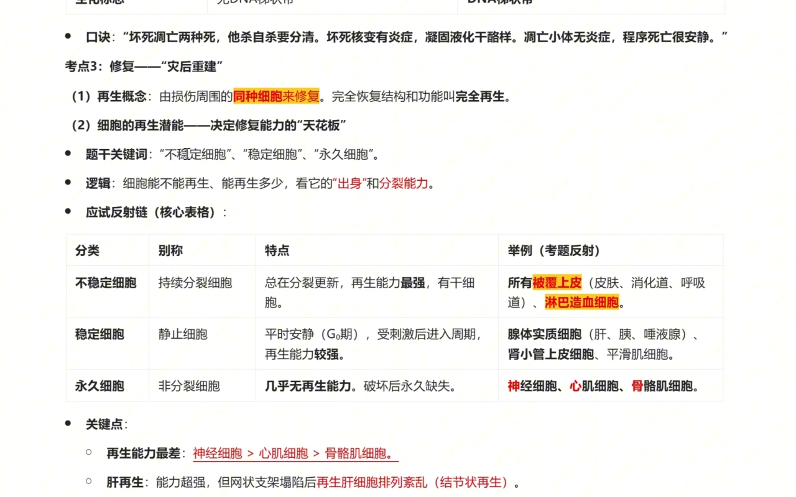
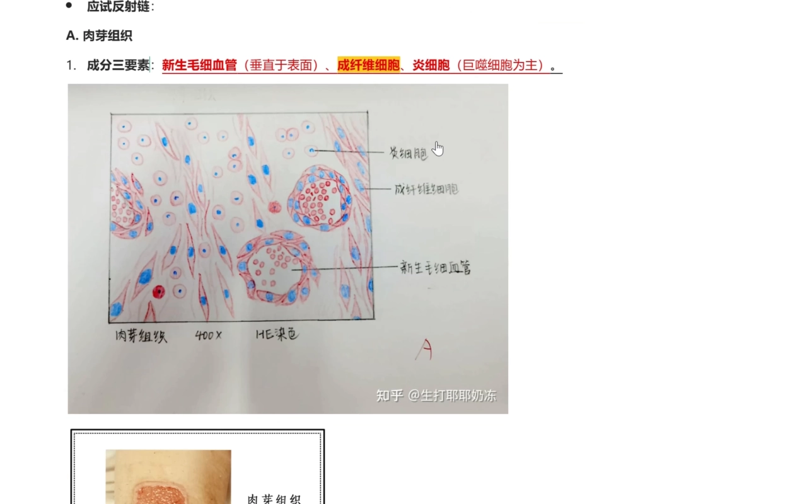
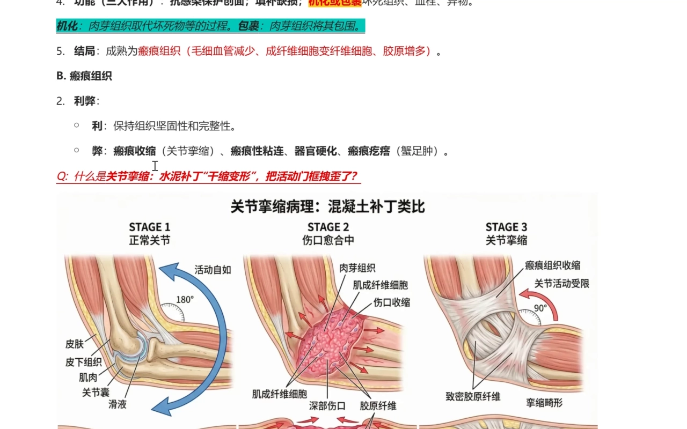
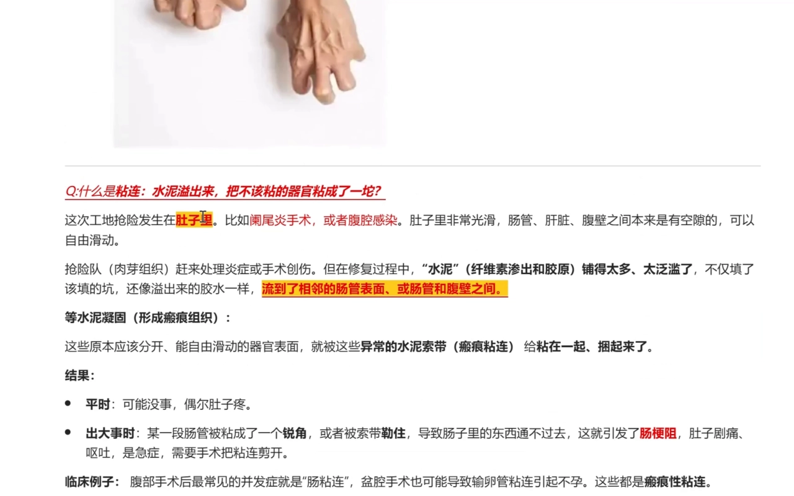
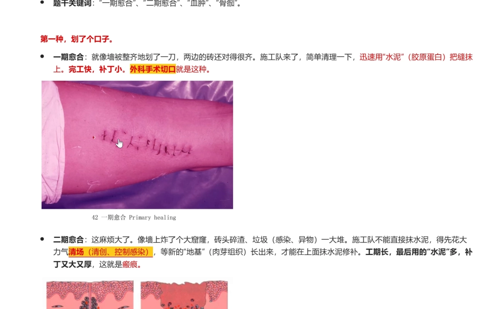
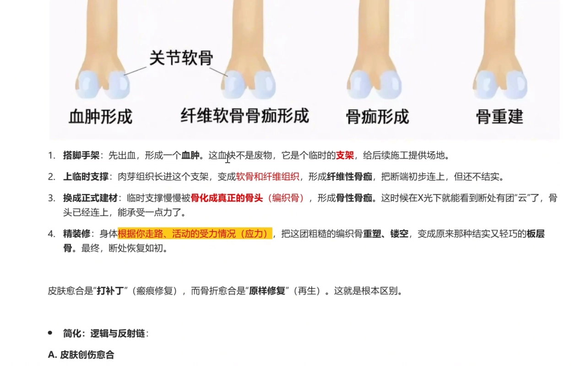

# 组织修复的两条路径：完全再生、肉芽组织与瘢痕

> 视频来源：[病理学 第 01 章 适应-损伤-修复（2）](https://www.bilibili.com/video/BV17NQcB8EJi/?p=2)（Bilibili · 风流倜傥陈大头，第二部分约 40 分钟，中文字幕为自动识别；本文只取其中的"修复"部分，约 4:30 之后）
> 导读（100 字以内）：损伤之后，身体只有两种补救方式：用同种细胞原样补齐（再生），或用"胶带打补丁"（肉芽组织→瘢痕）。这一讲把两类结局、三类细胞的再生能力、肉芽组织的三要素与瘢痕的利弊串成一条线，并解释为什么皮肤留疤而骨折能原样长好。

## 本讲要解决的核心问题（SCQA）

**背景**：细胞受到刺激后先尝试适应，适应不了就损伤，损伤之后必须修复。修复是组织维持自身完整的最后一道工序。

**冲突**：同样是"修补"，结果差别极大：表皮划一道口子能长好如初，心肌梗死后的心肌却永远缺一块；皮肤伤口愈合会留疤，骨折却能原样接上。为什么有的组织能"原样补齐"，有的只能"打补丁"？

**疑问**：什么叫完全再生？细胞的再生能力由什么决定？为什么神经细胞是"永久细胞"，而外周神经纤维又能再生？肉芽组织为什么必须由毛细血管、成纤维细胞和炎细胞三样组成？瘢痕除了难看还有什么后果？一期愈合和二期愈合差在哪里？

**回答（中心思想）**：修复有两条路径。**完全再生**是由损伤周围的**同种细胞**增殖补齐，结构和功能完全恢复；做不到时，身体改用**纤维性修复**——先由肉芽组织（新生毛细血管 + 成纤维细胞 + 炎细胞）填坑，再成熟为瘢痕组织。走哪条路，取决于**细胞的再生潜能**：不稳定细胞（上皮、淋巴造血细胞）持续分裂、再生能力最强；稳定细胞（腺体实质细胞、肝、肾小管上皮、平滑肌）平时停在 G0 期、受刺激才进入周期；永久细胞（神经细胞、心肌细胞、骨骼肌细胞）几乎不能再造，死一个少一个。瘢痕是"临时工"干完活留下的永久补丁：它保住了组织的坚固与完整，却会收缩、粘连、硬化，带来关节挛缩、肠梗阻等后果。

---

## 一、修复的两种结局：补齐，还是打补丁

课堂给了一个很好用的比喻：墙被炸出一个缺口，理想情况是找同样的砖补齐——这就是**再生**；如果没有同样的材料，只能拿胶带随便一贴——这块胶带就是**肉芽组织和瘢痕组织**。[【跳转到 02:49】](https://www.bilibili.com/video/BV17NQcB8EJi/?p=2&t=169)

- **再生（完全再生）**：由损伤周围的**同种细胞**来修复，完全恢复结构和功能。
- **纤维性修复**：细胞不能再生时，由局部新生的**肉芽组织**取代坏死组织，最终形成瘢痕——结构和功能不能完全恢复。

两种结局不是"好"与"坏"的道德判断，而是**组织能力的客观上限**。理解这一点，才不会把"留疤"当成医疗失误。

---

## 二、三类细胞：再生能力的分级

### 2.1 决定修复天花板的是"再生潜能"

不同部位的损伤，修复结果不一样：有些地方细胞死完了还能修得非常完美，有些地方死一个就少一个。课堂把原因归结为**细胞的再生潜能**——它决定了组织修复能力的"天花板"。[【跳转到 05:42】](https://www.bilibili.com/video/BV17NQcB8EJi/?p=2&t=342)

判断一个细胞属于哪一类，看两件事：**它的"出身"**（本来是不是分裂活跃的群体）和**它的分裂能力**（活不活跃）。

这张表是本节的总纲，下面逐类展开。

### 2.2 不稳定细胞：一直在换的那一层

**不稳定细胞**（持续分裂细胞）总在分裂更新，再生能力最强，带有干细胞那样的潜能。典型例子是**所有被覆上皮**（皮肤、消化道、呼吸道）和**淋巴造血细胞**。[【跳转到 08:17】](https://www.bilibili.com/video/BV17NQcB8EJi/?p=2&t=497)

为什么是它们？因为它们离体表近、总在受损伤：指甲一划皮肤就破了，吃进去的东西会摩擦消化道，吸入的 PM2.5 和烟也会摩擦呼吸道。受损之后必须马上补上，所以这些细胞"时时刻刻都在填补"。[【跳转到 05:47】](https://www.bilibili.com/video/BV17NQcB8EJi/?p=2&t=347)

血液里的细胞同理：红细胞运送氧气、白细胞执行免疫，感染时中性粒细胞要马上升高，所以造血系统必须随时能加产。

### 2.3 稳定细胞：平时安静，需要时才开工

**稳定细胞**（静止细胞）平时很安静，停留在 **G0 期**不分裂；受到刺激、需要它分裂时才重新进入细胞周期。用课堂的话说是"不鸣则已，一鸣惊人"。[【跳转到 09:57】](https://www.bilibili.com/video/BV17NQcB8EJi/?p=2&t=597)

典型例子：**腺体实质细胞**（肝、胰、唾液腺）、**肾小管上皮细胞**、**平滑肌细胞**。其中最著名的是肝——切掉一部分肝之后能重新长回来，这就是稳定细胞的能力。[【跳转到 10:47】](https://www.bilibili.com/video/BV17NQcB8EJi/?p=2&t=647)

但肝再生有一个重要的边界：**再生能力再强，也需要支架约束**。课堂用演唱会栅栏作比喻——栅栏是防止人挤人踩踏的；如果栅栏没放好，广场就会乱。肝细胞如果没有约束地增殖，就会出现**再生肝细胞排列紊乱、形成结节状结构**，这就是肝硬化的表现：肝的再生"乱长"。[【跳转到 12:27】](https://www.bilibili.com/video/BV17NQcB8EJi/?p=2&t=747)

这一点非常关键：**再生能力本身不等于好结果**。同一个能力，在完整支架下是修复，在支架塌陷后就是病理。

### 2.4 永久细胞：为什么"神心骨"不能再造

**永久细胞**（非分裂细胞）几乎无再生能力，破坏后永久缺失。课堂给的口诀是"**神心骨**"：神经细胞、心肌细胞、骨骼肌细胞。[【跳转到 07:02】](https://www.bilibili.com/video/BV17NQcB8EJi/?p=2&t=422)

为什么偏偏是这三类？课堂给了一个功能性解释：它们的**功能非常高级、非常复杂**——神经要传导、心脏要不停跳动、骨骼肌要收缩运动——因此**容错率很低**。就像培养一个医生要十多年，如果随便用一两年"修复"出一个医生，能力肯定不行；这类细胞再生出来的替代品功能太粗糙，胜任不了原来的工作，所以进化选择了"不再生"。[【跳转到 07:47】](https://www.bilibili.com/video/BV17NQcB8EJi/?p=2&t=467)

三类之间还有程度差别：**神经细胞最复杂，再生能力最差**，是"最娇贵"的那一类。

### 2.5 一个看似矛盾的现象：神经细胞不再生，神经纤维却能长

课堂专门处理了一个容易卡住的点：既然神经细胞是永久细胞，为什么又说**外周神经纤维可以完全再生**（每天约长 1 毫米）？

答案在于区分**胞体**和**纤维**。把神经细胞想成一台电脑：胞体是主机，轴突（神经纤维）是数据线。**主机不能再生**——胞体一旦死亡，这个细胞就没了；但**数据线断了可以接**——只要胞体还活着，外周神经纤维就能重新长出来。[【跳转到 13:31】](https://www.bilibili.com/video/BV17NQcB8EJi/?p=2&t=811)

临床上这对应一个常见场景：刀砍伤不仅断血管，也可能断神经纤维；纤维能恢复，所以手指活动能恢复，但精细功能多少会受损。[【跳转到 14:26】](https://www.bilibili.com/video/BV17NQcB8EJi/?p=2&t=866)

---

## 三、肉芽组织：不能再生时的"临时工"

### 3.0 一条时间线：止血 → 增殖 → 重塑

把伤口愈合按时间摊开，可以看到三个阶段，而本讲的内容正好分别落在三段上：

- **止血/炎症期**：先出血、形成血肿。骨折愈合的第一期就是血肿形成，课堂强调血肿不是废物，而是**临时支架**，为后续施工提供场地和原料。[【跳转到 33:09】](https://www.bilibili.com/video/BV17NQcB8EJi/?p=2&t=1989) 同时炎细胞进场清理细菌和坏死组织——二期愈合之所以要"先清创、控制感染"，就是因为这一段没处理好，后面全都要拖长。
- **增殖期**：肉芽组织长起来，新生毛细血管、成纤维细胞、炎细胞三要素同时到位，填补缺损、覆盖创面。
- **重塑期**：肉芽组织成熟为瘢痕，成分由"三多一少"变成"三少一多"，胶原继续重塑、收缩，可持续数月。

三个阶段不是三套独立机制，而是**同一块补丁在不同时间的样子**。理解这条时间线，后面讲三要素、三多一少、瘢痕弊端时就不会觉得是零散的知识点。

### 3.1 三要素，以及为什么必须是三样

当组织不能完全再生时，身体用肉芽组织去填坑。肉芽组织的成分有**三要素**：

1. **新生毛细血管**（垂直于表面生长）；
2. **成纤维细胞**；
3. **炎细胞**（以巨噬细胞为主）。[【跳转到 16:33】](https://www.bilibili.com/video/BV17NQcB8EJi/?p=2&t=993)

为什么一定是这三样，不能是两样或四样？课堂给了一个"工地"式的解释，逻辑很干净：

- **血管**负责运送原料、物资和营养，同时运走代谢废物；
- **成纤维细胞**是"工人"，分泌胶原纤维，也就是填坑的原料；
- **炎细胞**是"清洁工"，伤口里有沙子、细菌、坏死细胞，要先清掉才能继续填。[【跳转到 10:43】](https://www.bilibili.com/video/BV17NQcB8EJi/?p=2&t=643)

三者优势互补、缺一不可：**一个送营养、一个当工人、一个做清洁**。

肉眼看到的肉芽组织是**鲜红色、颗粒状、很嫩**的，所以叫"肉芽"——像发芽一样嫩。[【跳转到 11:18】](https://www.bilibili.com/video/BV17NQcB8EJi/?p=2&t=678)

### 3.2 三个功能：抗感染、填缺损、机化与包裹

肉芽组织的功能有三项：

1. **抗感染、保护创面**：伤口等于开了一扇门，让空气中的细菌可以入侵，肉芽组织覆盖上去把门关上；
2. **填补缺损**：把缺口填上；
3. **机化与包裹**：**机化**是肉芽组织取代坏死物的过程；**包裹**是坏死物太大、取代不了也吸收不了时，肉芽组织把它围起来。[【跳转到 19:56】](https://www.bilibili.com/video/BV17NQcB8EJi/?p=2&t=1196)

课堂用"宿舍检查卫生"作比喻：床上很乱，拿一床被子盖起来，检查时就看不到了——这床"被子"就是肉芽组织，把坏死物或异物包裹在里面。[【跳转到 20:09】](https://www.bilibili.com/video/BV17NQcB8EJi/?p=2&t=1209)

### 3.3 从"三多一少"到"三少一多"

肉芽组织成熟为瘢痕组织，镜下成分发生一次系统性反转：

- **早期（三多一少）**：三兄弟（毛细血管、成纤维细胞、炎细胞）多，胶原纤维少——工程队刚进场，产品还少；
- **后期（三少一多）**：炎细胞减少甚至消失，成纤维细胞"退休"转变为纤维细胞，毛细血管闭合退化，而**胶原纤维增多**。[【跳转到 20:55】](https://www.bilibili.com/video/BV17NQcB8EJi/?p=2&t=1255)

课堂把这个过程总结为：**肉芽组织是过程，瘢痕组织是结果**；前者是动态的工地，后者是干完活、楼盖起来之后的永久建筑。[【跳转到 28:57】](https://www.bilibili.com/video/BV17NQcB8EJi/?p=2&t=1737)

---

## 四、瘢痕：补丁的代价

### 4.1 利：保住坚固与完整

瘢痕的**利**很直接：把缺口填上、糊住，保持组织的**坚固性和完整性**。就像膝盖磕破了，用水泥把坑填上，至少结构是完整的。[【跳转到 22:31】](https://www.bilibili.com/video/BV17NQcB8EJi/?p=2&t=1351)

### 4.2 弊：收缩、粘连、硬化、疙瘩

瘢痕的**弊**有四类，课堂认为这是更常被考、也更值得理解的部分：

**（1）瘢痕收缩 → 关节挛缩。** 伤口里有一种特别的细胞叫**肌成纤维细胞**，是个"工作狂"：一边铺水泥（分泌胶原），一边拼命拉绳子，把两边伤口往一起扯，这叫伤口收缩。伤口愈合后，这块"水泥补丁"不会停在原地，胶原会继续重塑、收缩，持续数月，最后变成一块很硬、没有水分的补丁，像一张不断收紧的牛皮，把关节处的皮肤和皮下组织往中间拉扯。结果就是**关节活动范围永久性受限**。[【跳转到 23:09】](https://www.bilibili.com/video/BV17NQcB8EJi/?p=2&t=1389)

课堂特别提到，大面积烧伤后的皮肤瘢痕收缩很容易导致手指、关节挛缩——这也是烧伤要单独成科的原因之一：问题不只在皮肤本身，还在后续并发症。[【跳转到 25:15】](https://www.bilibili.com/video/BV17NQcB8EJi/?p=2&t=1515)

**（2）瘢痕性粘连 → 肠梗阻。** 腹腔里本来光滑的肠管、肝脏、腹壁之间有空隙，可以自由滑动，肠管靠蠕动把食物推下去。但炎症或手术创伤后，肉芽组织铺得太多、太泛滥，"水泥"溢出到相邻肠管表面，凝固后把原本应该分开的表面粘在一起。平时可能只是偶尔肚子疼；一旦某段肠管被粘成一个锐角或被索带勒住，内容物通不下去，就引发**肠梗阻**（痛、吐、胀、闭），需要手术剪开粘连。[【跳转到 27:17】](https://www.bilibili.com/video/BV17NQcB8EJi/?p=2&t=1637)

课堂还补了一个临床例子：盆腔手术可能导致输卵管粘连，引起不孕，叫粘连性不孕。

**（3）器官硬化。** 器官表面形成瘢痕，比如肝，就"硬化"了。

**（4）瘢痕疙瘩（蟹足肿）。** 烫伤后那块皮肤长得跟别处不一样，出现一些疙瘩，就叫蟹足肿。[【跳转到 28:19】](https://www.bilibili.com/video/BV17NQcB8EJi/?p=2&t=1699)

---

## 五、创伤愈合：一期与二期

### 5.1 一期愈合：整齐的切口

**一期愈合**像墙被整齐地划了一刀，两边的砖还对得很齐：施工队来了简单清理，迅速用"水泥"（胶原蛋白）把缝抹上，完工快、补丁小。典型场景是**外科手术切口**。[【跳转到 30:06】](https://www.bilibili.com/video/BV17NQcB8EJi/?p=2&t=1806)

### 5.2 二期愈合：被炸过的墙

**二期愈合**像墙被炸弹炸过，出现一个大窟窿，砖头、碎渣、垃圾（感染、异物）堆成一堆。施工队不能直接抹水泥，必须先花大力气**清创、控制感染**，等新的"地基"（肉芽组织）长出来，才能在上面修补。工期长、用的"水泥"多，补丁又大又厚，这就是瘢痕。[【跳转到 30:51】](https://www.bilibili.com/video/BV17NQcB8EJi/?p=2&t=1851)

两者的差别可以浓缩成一句：**所有"好的词"都给一期愈合，所有"坏的词"都给二期愈合**——创面小、创缘整齐、无感染、时间短、瘢痕小。

---

## 六、骨折愈合：为什么它能"原样修复"

### 6.1 结论先给：骨折是完全再生

骨折愈合的结论很反直觉：它是**非常完美的愈合**，断骨最后能完整复原。说明骨组织损伤后的再生能力非常强——它不用"水泥补丁"（胶原纤维），而是用原装材料把断骨重新接起来，属于**完全再生**。[【跳转到 32:37】](https://www.bilibili.com/video/BV17NQcB8EJi/?p=2&t=1957)

### 6.2 四个时期：搭脚手架 → 上临时支撑 → 换正式建材 → 精装修

1. **血肿形成**：骨折后出血形成血肿。血肿不是废物，而是**临时支架**，为后续施工提供场地和原料；
2. **纤维软骨骨痂**：肉芽组织长进支架，变成软骨和纤维组织，把断端初步连上，但还不结实；
3. **骨痂形成**：临时支撑被骨化成真正的骨头（编织骨），X 光片上能看到断处有一团"云"，骨头已经连上、能承受一点力；
4. **骨重建**：身体根据走路、活动的受力情况（应力），把粗糙的编织骨重塑、镂空，变成原来那种结实又轻巧的板层骨，断处恢复如初。[【跳转到 34:18】](https://www.bilibili.com/video/BV17NQcB8EJi/?p=2&t=2058)

课堂用"盆栽"作比：我们会扭转它的方向，让它长成好看的形状；骨重建就是按应力"修剪"新生骨。[【跳转到 34:43】](https://www.bilibili.com/video/BV17NQcB8EJi/?p=2&t=2083)

### 6.3 影响愈合的因素

课堂列了三类：

- **年龄**：小孩骨折恢复快，老年人很难恢复——年轻人的再生能力强，整个身体都在调动能量帮助这块骨愈合；
- **营养**：吃得好、维生素 C 能促进胶原合成，有利于愈合；
- **局部因素**：伤口感染、局部血供和神经支配受损、电离辐射，都会让愈合更难。[【跳转到 35:48】](https://www.bilibili.com/video/BV17NQcB8EJi/?p=2&t=2148)

---

## 七、把单细胞的分化放回组织层面

这一节把本讲与 4.3.4 的内容接起来，说明"单细胞的选择"和"组织层面的稳定"不是同一件事。

**单细胞层面**，一个细胞面对损伤只有几种选择：增殖、分化、停滞、死亡。三类细胞的差别，本质上是**这些选择的默认设置不同**——不稳定细胞默认在周期里，稳定细胞默认在 G0，永久细胞默认退出周期。

**组织层面**，稳定不是"每个细胞都健康"，而是**补充速率 = 丢失速率**。这需要三件事同时成立：

1. **有可用的补充来源**：不稳定细胞持续分裂、稳定细胞能被唤醒；永久细胞没有来源，所以损失是永久的；
2. **补充有空间和支架**：肉芽组织需要血管送原料、需要支架承载；肝再生需要网状支架约束，否则就是结节状乱长；
3. **补充有停止信号**：伤口填满后肉芽组织要"退场"（三少一多），否则就是过度修复——瘢痕疙瘩、粘连都是"补过头"的结果。

所以课堂反复强调的"再生能力有天花板"，其实是**组织层面的守恒**：能补的补到位就停，不能补的就用瘢痕封住。失衡的两个方向在临床上都能看到——补不上是萎缩、缺损、功能永久丧失；补过头是瘢痕增生、粘连、硬化。

---

## 八、边界

1. **本讲是病理学框架，不是分子机制课。** 它讲清了"哪类细胞能再生、修复走哪条路"，但没有展开再生相关的信号通路、干细胞如何被招募、炎症细胞如何切换表型。这些属于更专门的专题。
2. **"永久细胞"是功能分类，不是绝对禁令。** 课堂自己就用神经纤维再生的例子说明：胞体与纤维要分开看。类似地，心肌、骨骼肌在特定条件下也存在有限的更新能力，本讲未涉及。
3. **瘢痕不是纯粹的失败。** 它在保命和保结构上是必要的；问题在于"过量"和"位置不对"。
4. **骨折愈合的"完全再生"有前提。** 需要良好的血供、稳定的固定、没有感染；这些条件不满足时，结局会向纤维性修复偏移。

---

## 小结

- **修复只有两条路**：同种细胞补齐（完全再生），或用肉芽组织打补丁（纤维性修复→瘢痕）。
- **三类细胞决定天花板**：不稳定细胞（上皮、淋巴造血）持续分裂；稳定细胞（腺体、肝、肾小管、平滑肌）平时 G0、受刺激才分裂；永久细胞（神经、心肌、骨骼肌）几乎不再生。
- **永久细胞的逻辑是容错率**：功能越复杂、替代品越难胜任，进化越倾向于"不再生"。
- **神经纤维 ≠ 神经细胞**：胞体（主机）不可再生，外周纤维（数据线）在胞体存活时可再生。
- **肉芽组织三要素各有分工**：血管送营养、成纤维细胞填坑、炎细胞清洁；缺一不可。
- **瘢痕有利有弊**：利在坚固完整，弊在收缩（关节挛缩）、粘连（肠梗阻）、硬化、瘢痕疙瘩。
- **一期 vs 二期愈合**：整齐无感染的切口 vs 大而脏的创面，后者需要先清创、工期长、瘢痕大。
- **骨折是完全再生**：血肿支架 → 纤维软骨骨痂 → 编织骨骨痂 → 按应力重建。
- **组织稳定 = 补充速率等于丢失速率**，并且需要"停下来"的信号；补不上和补过头都是失衡。

## 关键术语速查

| 术语 | 一句话解释 |
| --- | --- |
| 修复 | 机体对所形成的缺损进行修补恢复的过程 |
| 完全再生 | 由损伤周围的同种细胞修复，完全恢复结构和功能 |
| 纤维性修复 | 细胞不能再生时，由肉芽组织取代坏死组织，最终形成瘢痕 |
| 不稳定细胞 | 持续分裂、再生能力最强的细胞，如被覆上皮、淋巴造血细胞 |
| 稳定细胞 | 平时处于 G0 期、受刺激后进入周期的细胞，如腺体实质细胞、肝、肾小管上皮、平滑肌 |
| 永久细胞 | 几乎无再生能力的非分裂细胞：神经细胞、心肌细胞、骨骼肌细胞 |
| 肉芽组织 | 由新生毛细血管、成纤维细胞和炎细胞构成的幼稚结缔组织 |
| 机化 | 肉芽组织取代坏死物、血栓、异物等的过程 |
| 包裹 | 坏死物或异物过大无法取代时，被肉芽组织包围 |
| 瘢痕组织 | 肉芽组织成熟后形成的、以胶原纤维为主的永久性修复产物 |
| 肌成纤维细胞 | 兼有收缩与分泌胶原能力的细胞，伤口收缩与瘢痕挛缩的主要执行者 |
| 一期愈合 | 创缘整齐、无感染、缺损小的伤口愈合，见于外科手术切口 |
| 二期愈合 | 创面大、创缘不整、有感染或异物的伤口愈合，需先清创，瘢痕大 |
| 骨痂 | 骨折愈合过程中连接断端的临时或骨性结构，分纤维性骨痂与骨性骨痂 |