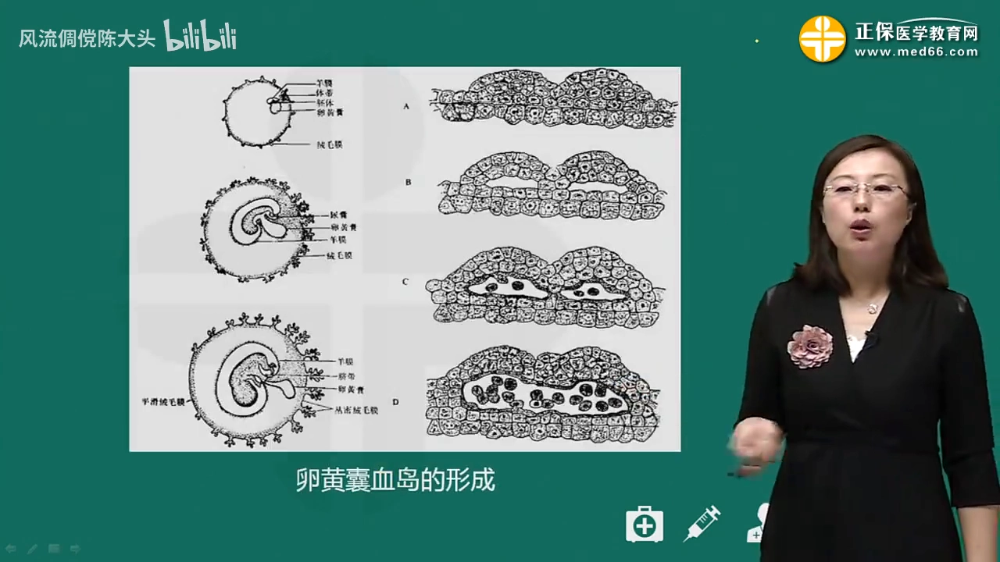
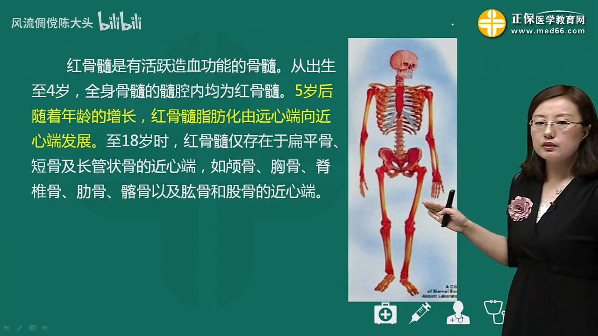
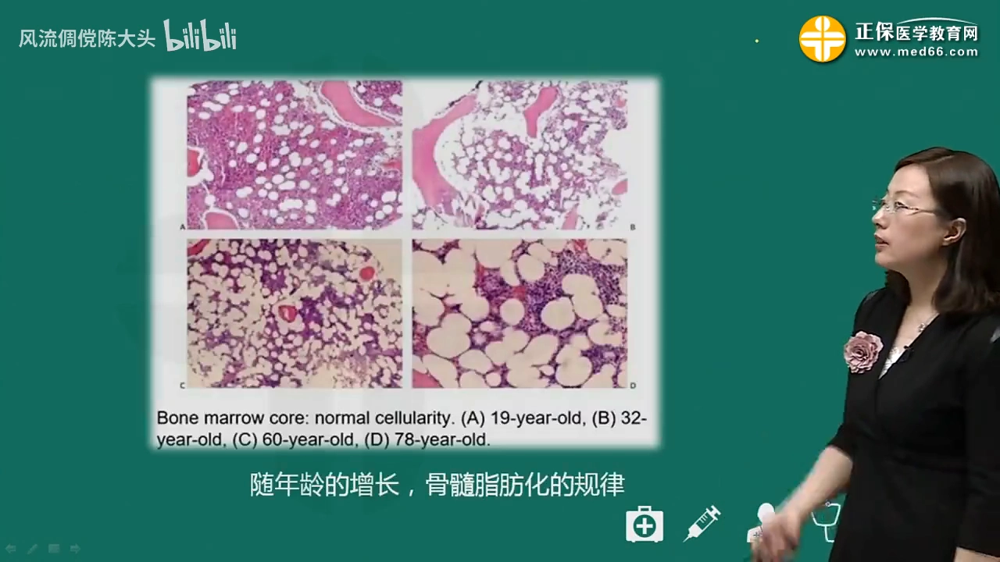
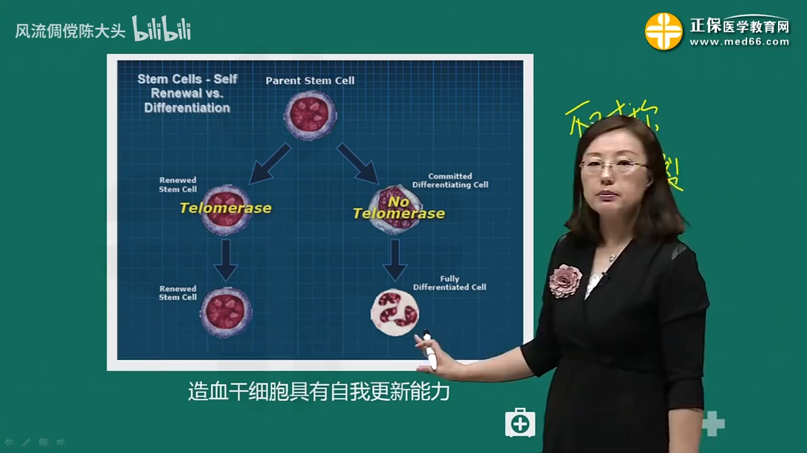
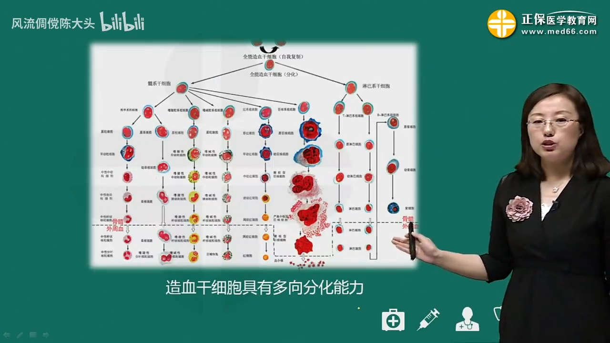
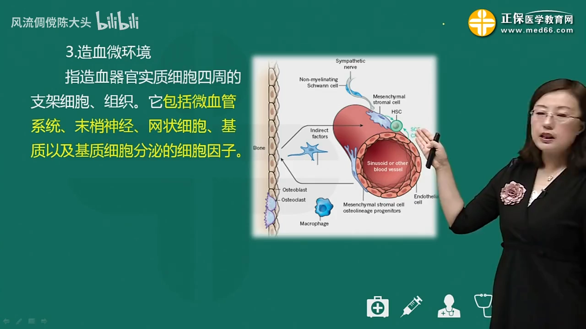
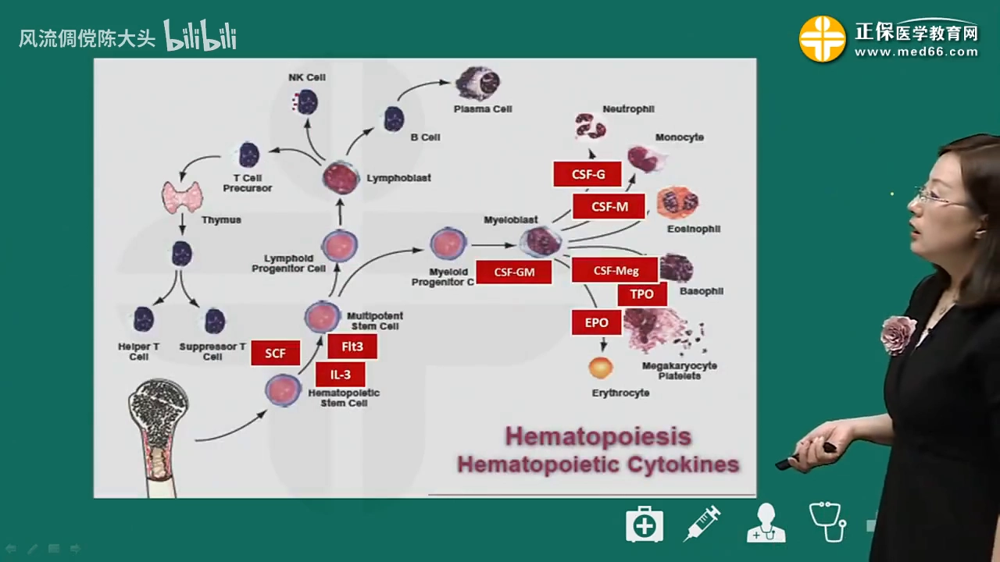
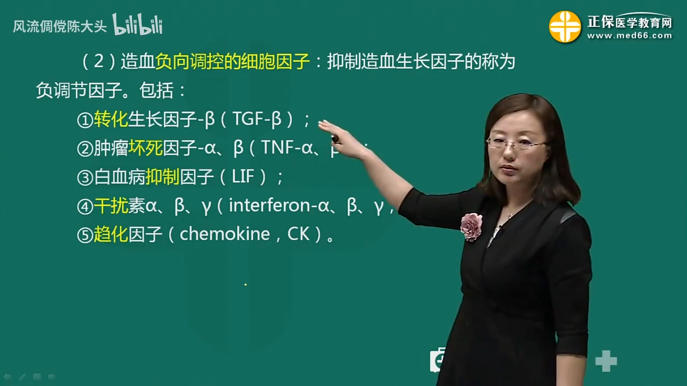
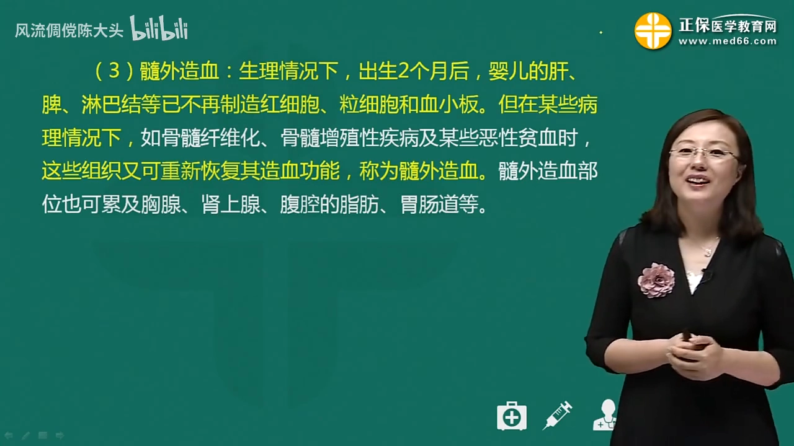

# 造血组织稳态：干细胞池、骨髓微环境与正负调控

> 视频来源：[造血器官与造血微环境（血液学 第 02 章 第 01 讲）](https://www.bilibili.com/video/BV1HMr9YaEjN/)（Bilibili · 正保医学教育网，约 51 分钟，中文字幕为自动识别）
> 导读（100 字以内）：这一讲把"造血"当作一个持续运转的组织系统来讲：血细胞不断被消耗，骨髓里的干细胞池不断补充；补充发生在什么空间、由哪些邻居细胞和细胞因子决定，又怎样被正向与负向信号同时约束。本文按"消耗—补充—生态位—调控—损伤响应"重排，术语错拼已按上下文订正。

## 本讲要解决的核心问题（SCQA）

**背景**：红细胞、粒细胞、血小板的寿命以天到月计。人一生中血液里的细胞被反复替换，而替换它们的"工厂"在出生后基本固定在一处：骨髓。

**冲突**：一个组织要长期稳定，必须让"补充速率"和"丢失速率"相等。可骨髓里真正能自我更新的细胞极少，绝大多数造血细胞都在往下游走、走向终末分化。于是问题变成：**是谁在维持那一小群细胞不减少，又是谁在需要时让它们加速产出？**

**疑问**：造血器官在胚胎期和出生后为什么换了好几个地方？骨髓里除了造血细胞还有什么？"造血微环境"到底由哪些成分组成？干细胞和祖细胞差在哪里？为什么说造血调控必须"正负两个方向同时存在"？

**回答（中心思想）**：造血是一个**由空间组织起来的补充系统**。造血干细胞（HSC）靠**不对称有丝分裂**在产生分化细胞的同时保留自身，多数时间停在 G0 期休眠；它们不是孤立存在的，而是嵌在**造血微环境**里——微血管、末梢神经、网状细胞、基质细胞、成骨/破骨细胞共同构成支架，并通过细胞因子给出促进或抑制的信号。**正向因子（SCF、Flt3 配体、IL-3、集落刺激因子、EPO、TPO）负责按阶段放行，负向因子（TGF-β、TNF、LIF、干扰素、趋化因子）负责踩刹车**；两者平衡，组织才稳定。当骨髓空间被病理过程挤占时，胚胎期造过血的肝、脾、淋巴结还能重新启用造血，这叫**髓外造血**——这是造血组织对损伤的一种代偿，但不是长久之计。

---

## 一、造血器官：一个组织为什么要换"厂址"

### 1.1 定义：能生成并支持血细胞分化、发育、成熟

课堂给的定义很直接：**造血器官**是能够生成并且支持造血细胞分化、发育、成熟的组织器官；**造血**就是造血器官生成各种血细胞的过程。定义里"支持"两个字很重要——器官不只是产出细胞，还要提供让细胞成熟的环境。[【跳转到 01:15】](https://www.bilibili.com/video/BV1HMr9YaEjN/?t=75)

### 1.2 胚胎期三次换址：卵黄囊 → 肝 → 骨髓

胚胎期造血按时间顺序分为三个造血期：

- **中胚叶造血期**：造血活动起源于中胚层，最主要的结构是**卵黄囊**——卵黄囊壁上的胚外中胚层细胞没有分化、具有自我更新能力，聚集成团形成**血岛**。血岛就是人类最初的造血中心。随后一部分细胞分化成血管内皮细胞，围成管腔，管腔里流动的就是血细胞。[【跳转到 03:14】](https://www.bilibili.com/video/BV1HMr9YaEjN/?t=194)
- **肝脏造血期**：卵黄囊是胚胎外结构，不足以继续支持造血细胞的生长发育，于是卵黄囊血岛产生的造血干细胞随血流迁移到肝脏，在大约胚胎 3–6 个月承担造血。[【跳转到 03:54】](https://www.bilibili.com/video/BV1HMr9YaEjN/?t=234)
- **骨髓造血期**：胚胎第三个月骨髓内已开始造血，到第八个月骨髓成为胚胎造血的中心。各器官的造血是**此消彼长**的过程，出生前几乎完全由骨髓承担。[【跳转到 04:29】](https://www.bilibili.com/video/BV1HMr9YaEjN/?t=269)

这张图值得看懂的地方是：**血管和血液是一起长出来的**。血岛里同一群细胞分头走向内皮和血细胞，这解释了为什么后来的造血生态位里，"血管"始终是核心组分（见第三节）。

### 1.3 出生后：骨髓是唯一场所，但"红"与"黄"在变

正常情况下，**骨髓是唯一能产生红细胞、粒细胞和血小板的场所**，也能产生淋巴细胞和单核细胞。注意"正常情况"这个前提——病理条件下结论会变。[【跳转到 06:16】](https://www.bilibili.com/video/BV1HMr9YaEjN/?t=376)

骨髓按性状分两种：**红骨髓**主要由造血细胞组成，是有活跃造血功能的骨髓；**黄骨髓**主要由脂肪组织、脂肪细胞构成。[【跳转到 06:26】](https://www.bilibili.com/video/BV1HMr9YaEjN/?t=386)

比例不是恒定的：从出生到四岁，全身骨髓髓腔内基本上全是红骨髓；**五岁以后**黄骨髓开始出现并随年龄增长而增多，这个过程叫**红骨髓脂肪化**，方向是**由远心端向近心端**发展。成年后红骨髓只存在于扁骨、短骨及长管状骨的近心端，如颅骨、胸骨、脊椎骨、肋骨、髂骨以及肱骨、股骨的近心端。[【跳转到 07:51】](https://www.bilibili.com/video/BV1HMr9YaEjN/?t=471)

这张分布图有一个直接的临床后果：**骨髓穿刺要选还有红骨髓的地方**。课堂提到胸骨可以用但后面紧邻心脏、肺脏，气胸风险虽少见仍存在；最佳部位是髂骨，具体为髂前上棘和髂后上棘。[【跳转到 08:01】](https://www.bilibili.com/video/BV1HMr9YaEjN/?t=481)

### 1.4 黄骨髓不是废料：一个"可逆的储备空间"

黄骨髓仍保持造血潜能，机体需要时可以重新转变为红骨髓参与造血。那脂肪细胞会变成造血细胞吗？课堂明确说目前认为不太可能；真正的机制是脂肪细胞**自己"瘦身"**——把胞体缩小，给造血细胞腾出空间。[【跳转到 14:41】](https://www.bilibili.com/video/BV1HMr9YaEjN/?t=881)

这张图把"组织稳态"讲得很具体：**同一个器官里，功能组织和脂肪组织在争空间**。年龄增长带来的脂肪化，本质上是可用的造血空间在减少，而造血需求并没有同比例下降。

---

## 二、补充的流水线：从干细胞到终末细胞

### 2.1 干细胞的三个特征：休眠、标志物、无系列标志

造血干细胞是一类**具有高度自我更新能力、并具有进一步分化能力的最早期造血细胞**。课堂列出的特点可以归成三条：

1. **多数处于 G0 期**，也就是休眠状态。人休息是为了恢复体力，干细胞休眠是为了保存实力，需要时才进入造血活动。[【跳转到 10:18】](https://www.bilibili.com/video/BV1HMr9YaEjN/?t=618)
2. **绝大多数表达 CD34**。CD 指分化抗原；CD34 之所以重要，是因为实验或临床分析时要用它把造血干细胞挑出来。[【跳转到 10:43】](https://www.bilibili.com/video/BV1HMr9YaEjN/?t=643)
3. **缺乏系列特异性抗原标志**（Lin 阴性）。红系、粒系、巨核系成熟后会表达各自的标志，干细胞还没走到那一步，所以不表达。[【跳转到 11:58】](https://www.bilibili.com/video/BV1HMr9YaEjN/?t=718)

顺带一个容易混的点：**CD38 主要是造血祖细胞的标志**，所以"低表达或不表达 CD38"反而支持它是更早期的干细胞。[【跳转到 11:33】](https://www.bilibili.com/video/BV1HMr9YaEjN/?t=693)

### 2.2 自我更新的实现方式：不对称有丝分裂

干细胞为什么能"既补充别人、又不减少自己"？课堂用一张图给出答案：**不对称有丝分裂**。对称有丝分裂产生两个与亲代几乎相同的子代；不对称有丝分裂产生的两个子代中，一个保持与亲代一致的性状，另一个按机体需要、在各种信号刺激下走向分化。[【跳转到 14:45】](https://www.bilibili.com/video/BV1HMr9YaEjN/?t=885)

这张图还藏了一条与衰老相关的线索：走向自我更新的那一支标着端粒酶，走向分化的那一支标着"无端粒酶"。**分裂次数被记在端粒上**，这与组织长期更新能力的上限直接相关（细胞衰老的机制见 4.3.5 小节）。

### 2.3 祖细胞：方向已经定了的那一段

干细胞往下走，就到了**造血祖细胞**（定向干细胞）：它已经**部分或全部失去自我更新能力**，分化方向也定了——红系祖细胞只能往红细胞走，不会摇身一变成为粒系祖细胞。[【跳转到 33:51】](https://www.bilibili.com/video/BV1HMr9YaEjN/?t=2031)

这个"方向已定"的性质，正是组织层面能稳定产出的原因：**越往下游，选择越少、产出越可预测**。干细胞负责"要不要补、补多少"，祖细胞负责"按既定方向批量生产"。

这张分化树是理解"一个组织如何被一个细胞池供养"的总图：**树冠很宽（细胞类型多），树根很窄（真正自我更新的细胞少）**。稳态的关键不在树冠，而在树根是否被维持住。

---

## 三、生态位：谁在告诉干细胞"你是干细胞"

### 3.1 微环境的定义：实质细胞周围的支架

课堂用了一个很朴素的比喻：种子要长成大树、秋天结果，必须有好土壤；血细胞要完成分化、增殖、成熟，也必须有好的环境。[【跳转到 20:44】](https://www.bilibili.com/video/BV1HMr9YaEjN/?t=1244)

**造血微环境**指造血器官实质细胞周围的**支架细胞和组织**，包括：

- 微血管系统（血细胞至少要完成养分交换）；
- 末梢神经；
- 网状细胞；
- 基质细胞，以及**基质细胞分泌的细胞因子**。[【跳转到 21:34】](https://www.bilibili.com/video/BV1HMr9YaEjN/?t=1294)

### 3.2 一张图看懂生态位的组成

这张模式图信息量很大，值得逐个认：

- 左侧是**骨**，贴着骨面的是**成骨细胞**与**破骨细胞**——它们参与骨的生长发育和代谢，也构成所谓"骨内膜"一侧的空间；
- 中间是**血窦**（sinusoid），内皮细胞围成管腔，造血细胞从这里进入循环；
- HSC 贴在血窦壁附近，旁边是**间充质基质细胞**和**交感神经末梢**（伴无髓鞘施万细胞）；
- 还有**巨噬细胞**，以及从基质细胞指向 HSC 的 SCF 等信号。

课堂对这张图的用法很克制：不必细究每个组分，重点是理解**血细胞不可能孤零零地存在于造血器官中**，它周围有很多细胞，靠血管、神经和细胞因子共同支撑。[【跳转到 22:30】](https://www.bilibili.com/video/BV1HMr9YaEjN/?t=1350)

### 3.3 生态位决定"干性"的三条通道

把这张图翻译成机制语言，微环境至少通过三条通道影响干细胞：

1. **细胞接触与空间**：HSC 贴附在特定的基质细胞/内皮附近，"待在哪里"本身就是身份信息；骨髓脂肪化挤占空间时，可用的生态位随之减少（见 1.4）。
2. **局部信号分子**：基质细胞分泌的细胞因子（如 SCF）直接作用在 HSC 上；不同因子作用于不同分化阶段（见第四节）。
3. **神经与血管带来的系统性输入**：交感神经末梢出现在生态位里，说明"局部"并不是封闭的，它还接收来自全身的调节。

需要说明的是，这一讲只讲到"支架 + 细胞因子"这一层，**没有展开 Wnt、Notch、BMP 等具体通路在生态位中的分工**；这部分属于信号通路的独立主题，本文不代为补充（见文末边界）。

---

## 四、组织层面的平衡：正向放行与负向刹车

### 4.1 为什么必须"双向调控"

课堂有一句关键判断：调控是**双方面**的，不能只有正向、也不能只有负向，必须两个方向达到平衡，"这才是最和谐的状态"。[【跳转到 40:19】](https://www.bilibili.com/video/BV1HMr9YaEjN/?t=2419)

这句话是本节的核心。单看某一个促造血因子，你只能解释"为什么能增产"；只有把抑制因子一起放进来，才能解释"为什么不会无限增产"——**稳态是两条相反力量相抵的结果，而不是某一条通路足够强**。

### 4.2 正向因子：按阶段放行的"通行证"

这张图把"补充"拆成了时间顺序：

- **早期**：SCF（干细胞因子）、Flt3 配体、IL-3，作用于造血干细胞和多能祖细胞；
- **中晚期**：集落刺激因子按系分工——G-CSF 作用于粒细胞，M-CSF 作用于单核细胞，GM-CSF 作用于粒单系，Meg-CSF 作用于巨核系；
- **终末阶段**：EPO 特异性作用于红系，TPO 作用于血小板/巨核系。[【跳转到 44:14】](https://www.bilibili.com/video/BV1HMr9YaEjN/?t=2654)

"集落"这个词来自体外实验：把造血干/祖细胞放在半固体的甲基纤维素培养基上培养十天到半个月，显微镜下能看到一堆一堆细胞长出来，这一堆就叫集落；不同因子作用下长出的细胞不一样，所以有不同名字。[【跳转到 41:38】](https://www.bilibili.com/video/BV1HMr9YaEjN/?t=2498)

这里有一个值得记住的结构性事实：**因子的作用是有阶段性的**。同一个组织里，早期因子决定"扩不扩",晚期因子决定"往哪个系成熟、成熟多少"。这解释了为什么临床上缺某一种成熟细胞时，可以用对应的晚期因子去"催"那一支（如 EPO 对应红细胞）。

### 4.3 负向因子：刹车片

课堂列出的负向因子包括转化生长因子-β（TGF-β）、肿瘤坏死因子（TNF-α/β）、白血病抑制因子（LIF）、干扰素（IFN-α/β/γ）和趋化因子。[【跳转到 47:02】](https://www.bilibili.com/video/BV1HMr9YaEjN/?t=2822)

这些名字背后有一条共同的逻辑：**它们大多是"炎症/应激"语境下的分子**。感染、损伤、炎症时，机体需要把有限的资源优先给防御而不是给增殖，于是用抑制性信号把造血压一压。这也意味着造血稳态不是孤立运行的，它和内环境稳态、免疫反应耦合在一起（见 4.4.1、4.4.2 小节）。

### 4.4 把"平衡"写成一句话

把正向与负向放在一起，组织层面的稳定可以写成：

> **干细胞池大小 ≈ 自我更新分裂次数 − 分化流失 − 负向信号造成的停滞**

课堂上没有给出这个公式，但它把本讲的三块内容串起来了：**干细胞池**（第二节）决定供给上限，**生态位**（第三节）决定供给条件，**正负调控**（本节）决定供给速率。任何一项被打破，组织就会偏离稳态——向萎缩或向过度增生。

---

## 五、损伤响应：当"工厂"空间不够时

### 5.1 髓外造血：一套被重新启用的旧程序

生理情况下，出生两个月以后，婴儿的肝、脾、淋巴结就不再制造红细胞、粒细胞和血小板。但在某些病理情况下——骨髓纤维化、骨髓增殖性疾病、某些恶性贫血——这些组织**又可重新恢复造血功能**，称为**髓外造血**；部位也可累及胸腺、肾上腺、腹腔脂肪、胃肠道等。[【跳转到 17:48】](https://www.bilibili.com/video/BV1HMr9YaEjN/?t=1068)

课堂用了一个很生活化的比喻：骨髓是"父母"，肝脾淋巴结是"七大姑八大姨"——骨髓这个地盘被占了，只好去亲戚家借地方。[【跳转到 19:03】](https://www.bilibili.com/video/BV1HMr9YaEjN/?t=1143)

这个现象对理解"组织稳态"很重要：**器官的身份不是永久标签，而是可以被需求重新激活的程序**。肝、脾在胚胎期造过血，这套程序被保留了下来；当主器官失效，备用程序就被调用。但课堂也强调，髓外造血"毕竟不是长久之计"，会带来相关问题。

### 5.2 移植：把"补充"整体换掉

课堂提到的临床场景是造血干细胞移植：输入健康的造血干细胞，让供体的干细胞在患者体内重建血液系统。它之所以成立，前提正是本节讲的几件事——干细胞能自我更新、能多向分化、能归巢到骨髓生态位。课堂还顺带纠正了一个常见误解：**造血干细胞并非只存在于骨髓**，外周血中也有（数量较少），否则"外周血造血干细胞移植"就无从谈起。[【跳转到 36:57】](https://www.bilibili.com/video/BV1HMr9YaEjN/?t=2217)

---

## 六、边界与常见误解

1. **CD34 是"最常用"的标志，不是"唯一"的标志。** 课堂的表述是"绝大多数表达 CD34"，并强调它在分选中的实用价值；把它当成干细胞的绝对定义会过度简化。
2. **"干细胞在骨髓里"不等于"只在骨髓里"。** 外周血中也有，只是数量少；这也是外周血干细胞采集能成立的基础。
3. **微环境的组成是"支架 + 因子"，但本讲没有展开具体通路。** Wnt、Notch、BMP 在生态位中的分工、以及氧/代谢对干性的影响，本讲未涉及，本文不作补充。
4. **休眠不等于不活跃。** G0 期是"保存实力"，不是功能缺失；需要时干细胞会进入造血活动。
5. **髓外造血是代偿，不是治愈。** 它说明旧程序可以被重新启用，但不等于器官功能恢复。

---

## 小结

- **造血器官换过三次厂址**：卵黄囊（血岛）→ 肝 → 骨髓；出生后正常情况由骨髓独家承担，各器官造血此消彼长。
- **红骨髓与黄骨髓在争空间**：五岁起红骨髓脂肪化，由远心端向近心端发展；黄骨髓保留潜能，通过脂肪细胞"瘦身"腾空间。
- **补充靠一条流水线**：HSC（G0 休眠、CD34⁺、Lin⁻）→ 祖细胞（方向已定、失去自我更新）→ 终末细胞；自我更新由不对称有丝分裂实现。
- **生态位是"土壤"**：微血管、末梢神经、网状细胞、基质细胞、成骨/破骨细胞共同构成支架，基质细胞分泌的细胞因子是主要信号。
- **稳态是双向调控的结果**：SCF/Flt3/IL-3 管早期，CSF/EPO/TPO 管晚期，TGF-β/TNF/LIF/IFN/趋化因子踩刹车；只有正负平衡，补充速率才等于丢失速率。
- **损伤时旧程序会被重启**：骨髓空间受限时肝、脾、淋巴结恢复造血（髓外造血）；移植则把整个补充系统替换掉。

## 关键术语速查

| 术语 | 一句话解释 |
| --- | --- |
| 造血器官 | 能生成并支持造血细胞分化、发育、成熟的组织器官 |
| 血岛 | 卵黄囊壁上由未分化、具自我更新能力的细胞聚集成的团块，人类最初的造血中心 |
| 红骨髓 / 黄骨髓 | 有活跃造血功能、以造血细胞为主 / 以脂肪细胞为主但保留造血潜能的骨髓 |
| 红骨髓脂肪化 | 五岁后黄骨髓随年龄增多、由远心端向近心端发展的过程 |
| 髓外造血 | 骨髓造血空间受限时，肝、脾、淋巴结等胚胎期造过血的组织重新恢复造血 |
| 造血干细胞（HSC） | 具高度自我更新能力与进一步分化能力的最早期造血细胞，多处于 G0 期，表达 CD34、Lin⁻ |
| 造血祖细胞 | 已部分或全部失去自我更新能力、分化方向已定的定向干细胞 |
| 不对称有丝分裂 | 一个子代保持干细胞性状、另一个走向分化的分裂方式 |
| 造血微环境 | 造血器官实质细胞周围的支架细胞与组织：微血管、末梢神经、网状细胞、基质细胞及其分泌的细胞因子 |
| 集落刺激因子（CSF） | 在半固体培养基上促使造血祖细胞形成细胞集落的因子，按作用系别分为 G-CSF、M-CSF、GM-CSF、Meg-CSF 等 |
| EPO / TPO | 红细胞生成素 / 血小板生成素，分别特异性作用于红系与巨核系 |
| 负向调控因子 | TGF-β、TNF、LIF、干扰素、趋化因子等抑制造血生长的因子 |