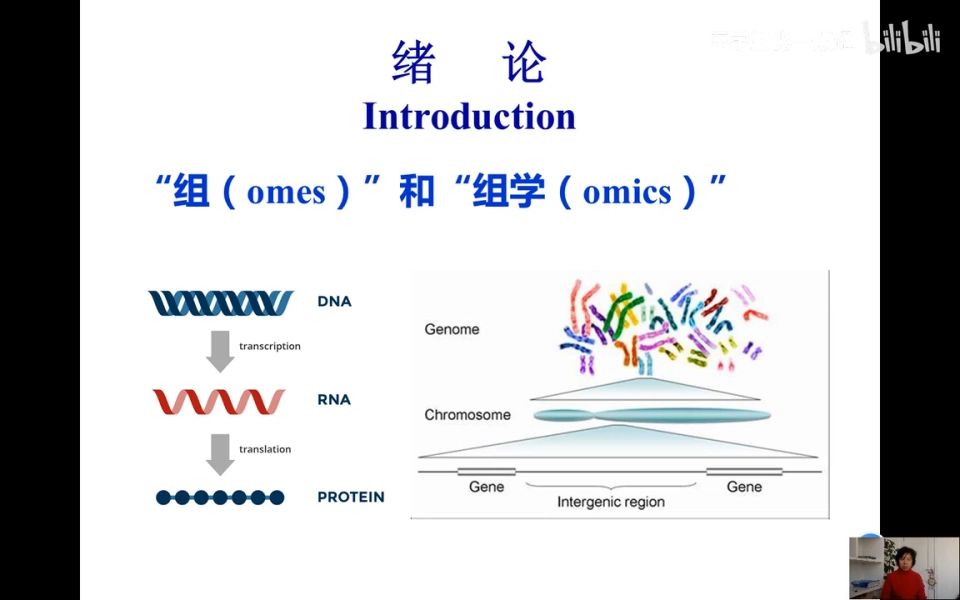
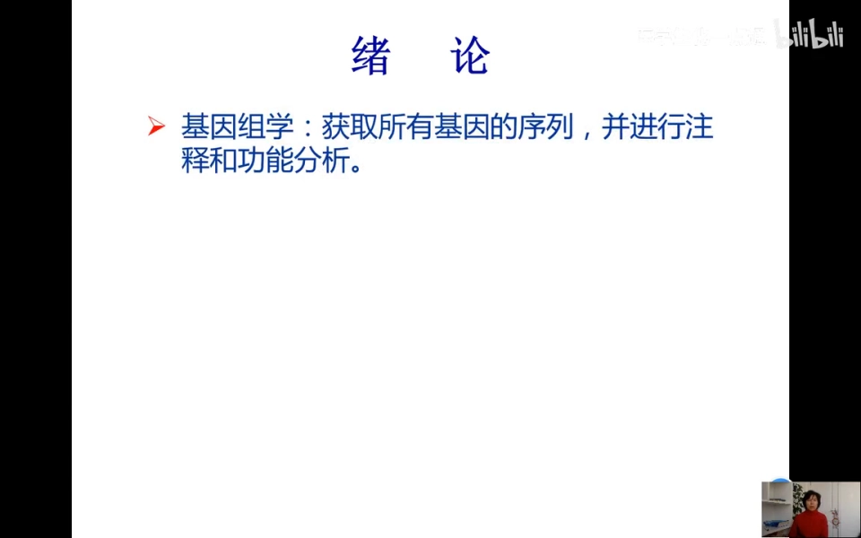
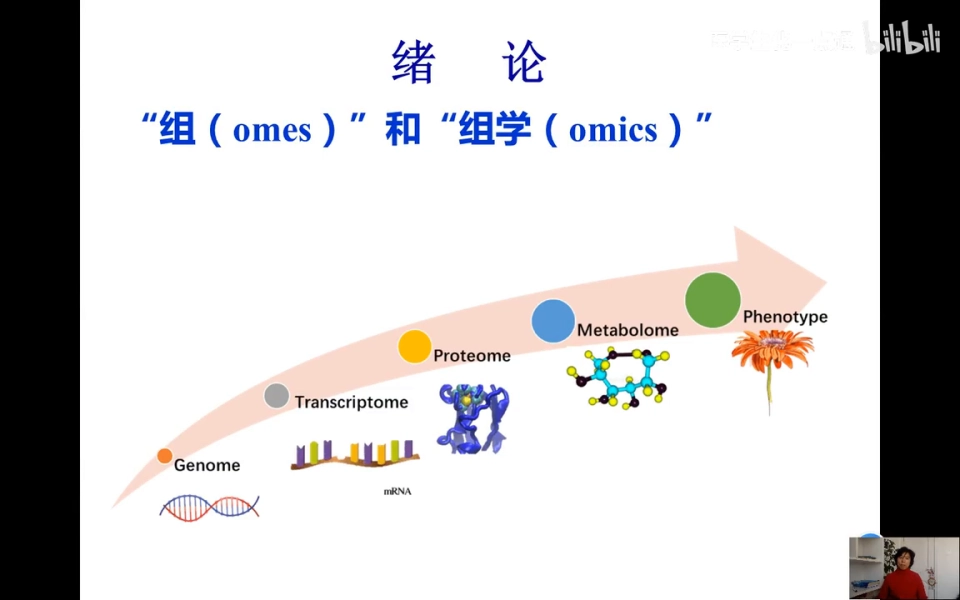
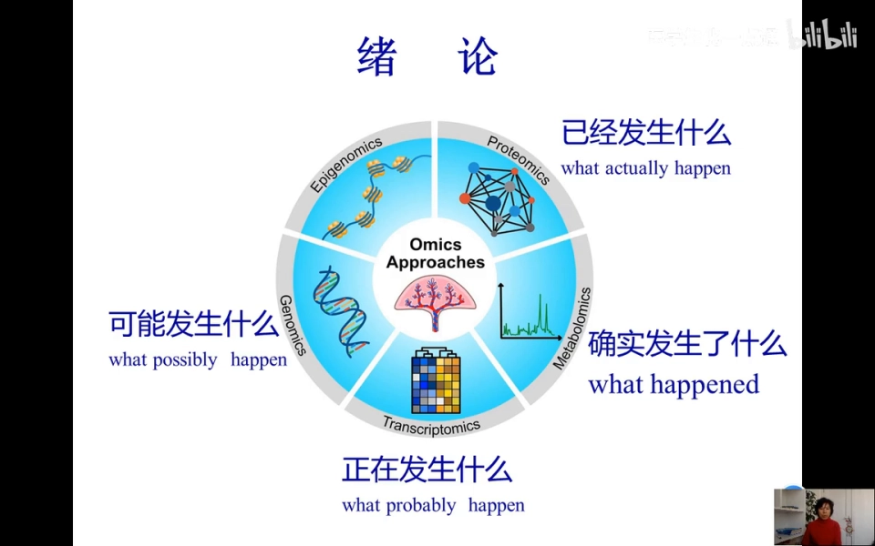
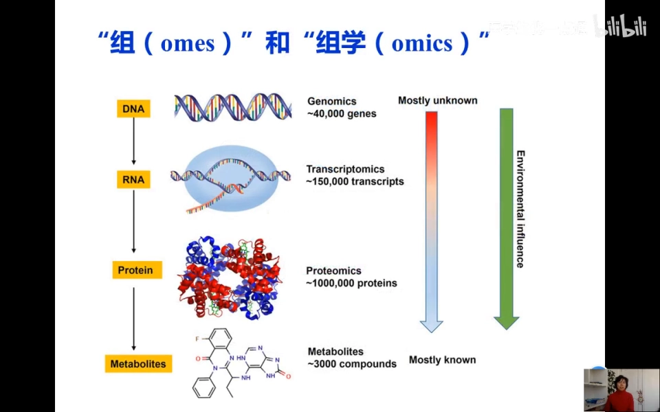
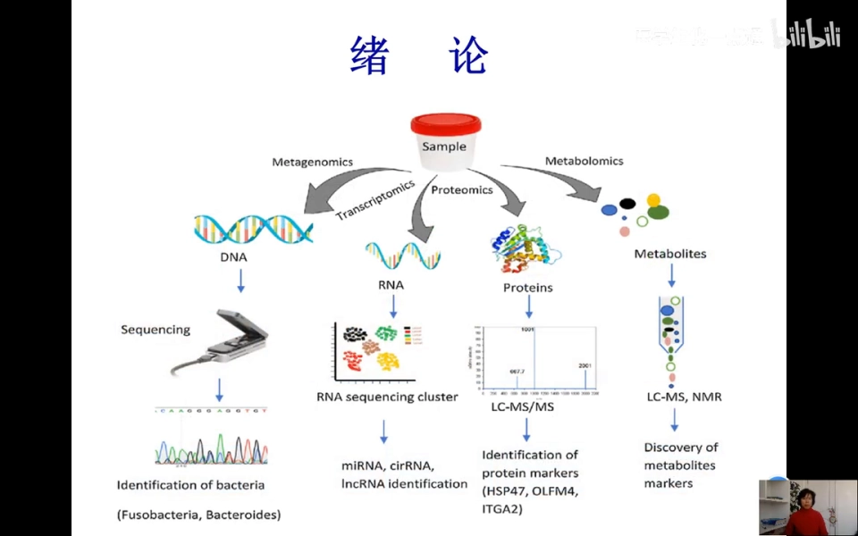
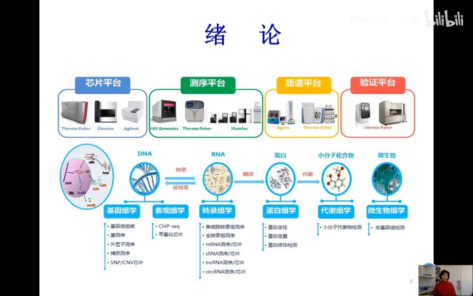
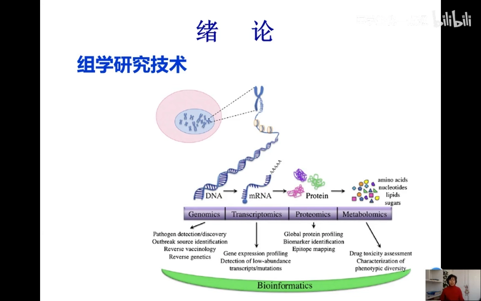
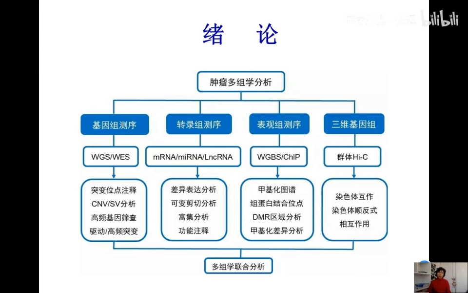

# 组学层次与读出：基因组、转录组、蛋白组、代谢组各能回答什么

> 视频来源：[20 组学概述](https://www.bilibili.com/video/BV1Lo4y1i7wr/)（B 站 · 医学生化一点通，医学组学分析技术课程第 20 讲）｜时长约 25 分钟
> 导读：这一讲把「组学」讲成一条从基因组到表型组的测量阶梯：每一层测什么、数量级为什么越往下越大、每一层的读数各自回答「可能发生／正在发生／已经发生／确实发生」中的哪一个问题。本文按原片顺序整理，并在第四至六节补上本节要求的四类测量对象对照表、层级不匹配清单和「问题—读出」判断练习；这些整理部分不来自视频，已单独标注。结构测定的方法细节在 B03，单细胞与 bulk 的测量细节在 B04，本文只做分类与判读。

## 本讲要解决的核心问题（SCQA）

**背景**：中心法则我们很熟：DNA 转录成 RNA，RNA 翻译成蛋白。以往的学习大多围绕「一个基因怎样转录、怎样翻译成一条蛋白」展开。

**冲突**：真正的研究对象往往不是一条基因，而是「所有基因」「所有 RNA」「所有蛋白」。一旦把对象换成整体，测量方式、数据量、能回答的问题都变了；而且越往中心法则下游走，要测的东西越多、越难测，读数离「基因」也越远。

**疑问**：基因组、转录组、蛋白组、代谢组分别在测什么？为什么它们的数量级一层比一层大？拿到某一层的读数，究竟能说「发生了什么」，还是只能说「可能发生什么」？

**回答（中心思想）**：组学不是「一次测很多」，而是把研究单位从单个分子换成某一层次的全部对象 [【跳转到 01:28】](https://www.bilibili.com/video/BV1Lo4y1i7wr/?t=88)。层次越往下，对象数量越大、修饰越多、离遗传密码越远，读数也越接近「体内确实发生了什么」；代价是测量更间接、更难归一化，单看一层就容易把「可能」当成「已经」[【跳转到 10:34】](https://www.bilibili.com/video/BV1Lo4y1i7wr/?t=634)。

[【跳转到 02:18】](https://www.bilibili.com/video/BV1Lo4y1i7wr/?t=138)

---

## 一、组学把研究对象从「一条基因」换成「一个层次的全部」

### 1.1 「组」是集合，「组学」是研究这个集合的学科

讲者先做了区分：基因是遗传的最小单位，是一段序列，充其量只是染色体上很短的一段；一条染色体又是细胞核里 46 条染色体中的一条。以往从单个基因出发，我们学了很多「某基因怎样转录、怎样翻译」；组学则要求从整体出发，研究 46 条染色体整体的功能 [【跳转到 01:53】](https://www.bilibili.com/video/BV1Lo4y1i7wr/?t=113)。

由此得到一组定义：

- **基因组**：一个生物体所有遗传信息的总和。最初定义更严格，指一个单倍体细胞的全套染色体（人就是 22 条常染色体加两条性染色体），后来逐渐放宽为「所有遗传信息」[【跳转到 03:52】](https://www.bilibili.com/video/BV1Lo4y1i7wr/?t=232)。
- **转录组**：所有 RNA 的集合，因为 RNA 是转录的产物 [【跳转到 02:43】](https://www.bilibili.com/video/BV1Lo4y1i7wr/?t=163)。
- **蛋白组**：细胞里所有蛋白的集合。
- **代谢组**：一个生命体内所有代谢产物的集合，至少包括糖代谢、脂代谢、氨基酸代谢、核苷酸代谢的产物 [【跳转到 03:08】](https://www.bilibili.com/video/BV1Lo4y1i7wr/?t=188)。

「组学（omics）」这个词是从「组（ome）」衍生出来的：研究基因组就是基因组学，研究所有基因以及基因之间的关系；同理有转录组学、蛋白组学、代谢组学 [【跳转到 04:17】](https://www.bilibili.com/video/BV1Lo4y1i7wr/?t=257)。

所以基因组学的任务不只是「测一遍序列」，而是获取所有基因的序列，再做注释和功能分析 [【跳转到 11:45】](https://www.bilibili.com/video/BV1Lo4y1i7wr/?t=705)。讲者后面具体展开为：提取 DNA、酶切、测序、软件分析，再用其他方法验证基因的功能 [【跳转到 12:10】](https://www.bilibili.com/video/BV1Lo4y1i7wr/?t=730)。这一步「序列 → 注释 → 功能」的拆分，是后面理解「序列测量不能直接回答功能问题」的前提。

[【跳转到 11:45】](https://www.bilibili.com/video/BV1Lo4y1i7wr/?t=705)

### 1.2 五个层次：四个「最扎实」的层次加一个表观层

课程把内容落在四个最扎实的层次——基因组学、转录组学、蛋白组学和代谢组学，并额外加入表观组学。原因是：从 DNA 转录生成 RNA 的过程中，染色体层次上还有一层调控必须掌握 [【跳转到 07:42】](https://www.bilibili.com/video/BV1Lo4y1i7wr/?t=462)。

表观遗传指的是基因本身之外的、对表达的调控：DNA 某些碱基的甲基化、核小体组蛋白的修饰，甚至 m6A 这类小分子修饰。DNA 碱基序列是遗传信息活动的主宰者，但不是唯一因素 [【跳转到 16:31】](https://www.bilibili.com/video/BV1Lo4y1i7wr/?t=991)。所以表观组学的研究对象仍是细胞核里的物质，只是问的是「DNA 和蛋白质之间有没有相关性」这类调控问题 [【跳转到 17:21】](https://www.bilibili.com/video/BV1Lo4y1i7wr/?t=1041)。

讲者也提醒「组学」概念已经泛滥：肿瘤组学、糖组学、免疫组学、影像组学、超声组学都出现了，个别科学家因此对组学概念提出质疑 [【跳转到 05:18】](https://www.bilibili.com/video/BV1Lo4y1i7wr/?t=318)。这提醒我们：**「组学」是一个研究策略，不是一张可以无限加行的清单**。判断一门「某某组学」是否成立，要看它有没有明确的测量对象、测量单位和可比较的数据，而不是看名字。

[【跳转到 18:01】](https://www.bilibili.com/video/BV1Lo4y1i7wr/?t=1081)

---

## 二、四个层次各自回答哪个问题

### 2.1 「可能发生、正在发生、已经发生、确实发生」

这是全讲最有用的一张图。讲者把五个层次对应到四个不同强度的判断 [【跳转到 10:34】](https://www.bilibili.com/video/BV1Lo4y1i7wr/?t=634)：

| 层次 | 读数说明什么 | 讲者的原话大意 |
| --- | --- | --- |
| 基因组 | **可能发生什么**（what possibly happen） | 基因只能决定你的细胞里「可能」发生什么 |
| 转录组 | **正在发生什么**（what probably happen） | 只有开始转录、生成 RNA，才说这个基因被选择、被表达了 |
| 蛋白组 | **已经发生什么**（what actually happen） | 蛋白出来了，才能说这个基因有没有完成功能 |
| 代谢组 | **确实发生了什么**（what happened） | 蛋白发挥功能、体内化学变化发生、代谢物产出，才证明机体内确实发生了什么 |

[【跳转到 10:59】](https://www.bilibili.com/video/BV1Lo4y1i7wr/?t=659)

这张表的价值在于它把「测量层次」和「结论强度」绑在了一起。看到「某基因表达升高」，它说的是「正在发生」；要说「功能增强了」，还得有蛋白或代谢层面的读数；要说「体内确实发生了变化」，还要看代谢物和环境。讲者还补了一句关键的限定：**正在发生的未必都有最终结果**，只有蛋白质生成、并真正发挥功能，才算走到了下游 [【跳转到 10:09】](https://www.bilibili.com/video/BV1Lo4y1i7wr/?t=609)。

### 2.2 数量级随层次上升：越往下越难测

同一张幻灯片给了各层次的对象数量级 [【跳转到 08:22】](https://www.bilibili.com/video/BV1Lo4y1i7wr/?t=502)：

- 基因组：约 4 万个基因（讲者补充，绝大多数学者认为人体基因数在 2 万到 2.5 万之间）[【跳转到 08:22】](https://www.bilibili.com/video/BV1Lo4y1i7wr/?t=502)；
- 转录组：约 15 万个转录本（讲者说目前大多数人认可「10 万级」）[【跳转到 08:47】](https://www.bilibili.com/video/BV1Lo4y1i7wr/?t=527)；
- 蛋白组：约 100 万个蛋白，因为翻译过程有变化、蛋白还有各种前后修饰 [【跳转到 08:47】](https://www.bilibili.com/video/BV1Lo4y1i7wr/?t=527)；
- 代谢组：约 3000 种化合物，讲者强调到代谢组这里「没有数量级的扩增」，化学分子种类并不像想象得那么多 [【跳转到 09:12】](https://www.bilibili.com/video/BV1Lo4y1i7wr/?t=552)。

幻灯片右侧还有两条相反的箭头：从基因组到代谢组，「Mostly unknown → Mostly known」（我们对上层知道得少、对下层知道得多）；另一条绿色箭头表示**环境影响力从上到下递增** [【跳转到 08:22】](https://www.bilibili.com/video/BV1Lo4y1i7wr/?t=502)。

[【跳转到 08:22】](https://www.bilibili.com/video/BV1Lo4y1i7wr/?t=502)

讲者对「越往下越难」给了三条理由，都落在测量上：

1. **转录本是动态的**：每一个时刻、不同组织细胞得到的转录产物都不一样，所以转录组学必须有动态观点，测的是「某一组织在某一状态下所有 mRNA 的总和」[【跳转到 12:35】](https://www.bilibili.com/video/BV1Lo4y1i7wr/?t=755)。
2. **转录本数量大于基因**：由于染色体层次调控、转录前后的加工修饰，要研究的转录本比基因多很多 [【跳转到 13:11】](https://www.bilibili.com/video/BV1Lo4y1i7wr/?t=791)。
3. **蛋白又多一层修饰**：翻译时模板本身就有很大变化，蛋白生成后还有多种修饰，造成蛋白层面要分析的数量又是一个数量级的改变 [【跳转到 13:36】](https://www.bilibili.com/video/BV1Lo4y1i7wr/?t=816)。

代谢组还多一个特点：它不只由遗传决定，还和生存环境有关，比如体内有什么微生物、饮食状况如何。所以只有分析代谢组，才能判断「这个人体内和别人有什么区别」[【跳转到 14:26】](https://www.bilibili.com/video/BV1Lo4y1i7wr/?t=866)。

---

## 三、测量是对对象的操作化：样本、平台、数据

### 3.1 同一样本，四条技术路线

讲者用一张流程图说明：组学测量不是「直接看生命」，而是从同一份样本出发，按目标层次分成四条路线 [【跳转到 19:47】](https://www.bilibili.com/video/BV1Lo4y1i7wr/?t=1187)：

- 测 DNA → 测序 → 得到序列；
- 测 RNA → RNA 测序 → 得到转录本；
- 测蛋白 → LC-MS/MS → 鉴定蛋白标志物；
- 测代谢物 → LC-MS、NMR → 发现代谢物标志物。

[【跳转到 19:47】](https://www.bilibili.com/video/BV1Lo4y1i7wr/?t=1187)

这张图值得单独记住，因为它把「表达量」这个听起来很确定的概念拆开了：**「表达量」不是一个可以直接测量的东西，而是一个必须选代理的概念**——你可以选 mRNA 丰度（RNA 测序）、蛋白丰度（质谱或抗体），也可以选荧光强度（显微成像）。代理不同，结论可能不同。讲者没有用「代理」这个词，但四条路线本身就是四种不同的代理。

### 3.2 平台分工：芯片、测序、质谱、验证

讲者把常用平台分成四类 [【跳转到 22:24】](https://www.bilibili.com/video/BV1Lo4y1i7wr/?t=1344)：

- **芯片平台**：做 DNA、RNA、基因组、转录组的分析；
- **测序平台**：针对转录组和基因组；
- **质谱平台**：针对蛋白质和代谢组；
- **验证平台**：常规 PCR、免疫组化、Western blot 等。

[【跳转到 22:24】](https://www.bilibili.com/video/BV1Lo4y1i7wr/?t=1344)

「验证平台」这一栏很关键：组学给出的是候选，常规实验负责验证。讲者反复强调，组学分析不是一个人能完成的，需要团队，也需要提前规划：目的是什么、对象是什么、怎样采到合适样本、怎样得到高质量样品 [【跳转到 21:47】](https://www.bilibili.com/video/BV1Lo4y1i7wr/?t=1307)。

### 3.3 数据不是结论：生物信息学与回验

组学实验得到的是海量数据，靠人工不可能分析，必须借助计算机软件，这就有了生物信息学 [【跳转到 20:12】](https://www.bilibili.com/video/BV1Lo4y1i7wr/?t=1212)。但生信分析也不是终点：从数据结合理论和预判，挑出重点分析的分子，再用常规分子生物学技术验证，才能得出结论 [【跳转到 21:10】](https://www.bilibili.com/video/BV1Lo4y1i7wr/?t=1270)。

[【跳转到 20:12】](https://www.bilibili.com/video/BV1Lo4y1i7wr/?t=1212)

讲者用肿瘤多组学举了一个完整例子：对同一患者的肿瘤做基因组测序、转录组测序、表观组测序（WGBS/ChIP）、三维基因组（Hi-C），再联合分析，最后挑重点验证 [【跳转到 23:01】](https://www.bilibili.com/video/BV1Lo4y1i7wr/?t=1381)。

[【跳转到 23:01】](https://www.bilibili.com/video/BV1Lo4y1i7wr/?t=1381)

---

## 四、四类测量对象的对照表（本节整理，不来自视频）

视频讲的是「组学层次」，本节学习目标要求的是「序列、结构、表达、表型」四类测量对象。两者可以接上：序列对应基因组层，表达对应转录组／蛋白组层，表型对应最下游的个体层；结构则是另一条独立的测量轴——它测的不是「有多少」，而是「长什么样」。下表是课程整理的分类框架，方法名只点名、不展开原理；结构方法的细节见 [B03 4.1 实验结构证据与结构文件](../../../../B03_蛋白质结构与功能基础/README.md#b03-4-1)，单细胞与 bulk 的测量细节见 B04。

| 测量对象 | 典型方法（只点名） | 分辨率 | 通量（典型量级） | 主要误差来源 | 能回答什么问题 | 不能回答什么问题 |
| --- | --- | --- | --- | --- | --- | --- |
| **序列** | Sanger 测序、二代短读长测序、三代长读长测序、外显子组/panel 测序 | 单碱基 | 一次运行百万到十亿条读段；一个样本覆盖 2 万多个基因 | 测序错误、比对/组装歧义、低覆盖、重复序列 | 有哪些变异、基因结构、剪接位点、拷贝数变化 | 表达高低、蛋白是否稳定、变异是否致病、表型后果 |
| **结构** | X 射线晶体学、冷冻电镜、核磁共振、结构预测 | 原子级（约 1–4 Å 为常见高分辨率区间） | 实验结构约十万级条目；一次实验通常一个到几十个构象 | 构象异质、静态平均、低分辨率区域、模型拟合偏差 | 折叠方式、结构域、结合界面、活性位点几何 | 细胞内动态与丰度、构象群体权重、功能后果（需功能实验） |
| **表达** | qPCR、bulk RNA-seq、scRNA-seq、质谱蛋白组、抗体/荧光成像 | 群体平均到单细胞；蛋白到细胞/组织 | 一次实验可测 2 万级基因；单细胞实验可达万到百万级细胞 | 批次效应、dropout、测序深度不均、归一化选择、抗体特异性 | 哪些基因/蛋白在什么组织、条件下升高或降低 | 因果方向、蛋白丰度是否等同 mRNA、单个细胞的完整状态 |
| **表型** | 生理指标、影像（CT/MRI/PET/超声）、行为学测试、临床终点、生存随访 | 个体、器官、像素或体素 | 一个队列百到万级个体；一人可测百到万级指标 | 观察者偏倚、指标定义不一致、环境混杂、失访与选择偏倚 | 个体/群体层面的状态、分型、结局与风险 | 分子机制、细胞来源、干预是否有效（需干预设计） |

读这张表要注意三点：

1. **「分辨率」和「通量」不是同一件事**。序列能到单碱基，但一次测的是一个样本的很多读段；结构能到原子，但一次通常只解一个分子；表达能到单细胞，但每个细胞只测到几千个转录本；表型能覆盖很多人，但每个人只是一个数。**看得细和看得多通常不能同时最大化**。
2. **误差来源要按层分开**。技术误差（仪器、批次、操作）、生物变异（个体、时间、组织异质性）、采样误差（取样代不代表整体）是三层不同的东西；重复和对照分别对付不同的层，这部分在 5.1.2 展开。
3. **「不能回答」比「能回答」更重要**。一张表如果只写能回答什么，就会鼓励过度解释；把「不能回答」写出来，才知道下一步要补哪类测量。

---

## 五、层级不匹配的四种典型过度解释（本节整理）

### 5.1 用 mRNA 推断蛋白：缺翻译调控、修饰与降解

视频给了最直接的证据：转录本数量比基因大很多，蛋白又因为翻译和修饰再多一个数量级 [【跳转到 13:36】](https://www.bilibili.com/video/BV1Lo4y1i7wr/?t=816)。所以「mRNA 升高」只能说明「正在发生」，不能自动推出「蛋白升高」，更不能推出「功能增强」[【跳转到 10:59】](https://www.bilibili.com/video/BV1Lo4y1i7wr/?t=659)。缺的那一环包括：翻译效率、蛋白稳定性/降解、修饰与定位。

### 5.2 用 bulk 推断单细胞：缺细胞组成与异质性

bulk 测的是组织里所有细胞的平均。如果两类细胞的变化方向相反、幅度相近，平均后可能互相抵消，看起来「没变化」。缺的那一环是**细胞类型组成**和**单细胞状态**；补它需要单细胞或空间测量。具体方法见 B04 与单细胞专题，本文不展开。

### 5.3 用细胞系推断个体：缺微环境、剂量与整体代偿

细胞系能回答「在给定浓度和时间下，这个分子是否改变了某条通路」，但不能回答口服后靶器官暴露多少、机体有没有整体代偿、免疫和基质如何改变反应。这条边界在 [1.2.1 跨层级推断的边界](../../../1_生命的物质与组织层级/1.2_从分子走向系统/1.2.1_生命组织层级：分子、细胞、个体与种群/跨层级推断的边界：体外实验、动物模型与人群证据.md) 已用槲皮素、β-胡萝卜素等案例讲透，本文不重复。

### 5.4 用相关推断因果：缺干预、时间顺序与混杂控制

表型组关联网络里的连线是**相关性**，不是因果：两个表型相关，可能因为共享遗传背景、共同环境，也可能一个影响另一个（见同小节《表型作为测量对象：跨尺度表型组、指标标准化与关联网络》第四节）。缺的那一环是干预或准实验设计、时间先后、混杂控制。这部分在 5.1.2 展开。

---

## 六、判断一个问题需要哪类读出：四个具体问题（本节整理）

| 问题 | 该选的读出 | 为什么 | 不能只靠什么 |
| --- | --- | --- | --- |
| 这个突变是否影响剪接？ | 基因组/外显子组测序定位变异 + RNA-seq 看剪接位点与转录本（必要时长读长） | 剪接是「序列变异 → 转录本结构」的问题，必须同时有变异和转录本两端的读数 | 只看基因组序列：知道变异，不知道实际剪接结果；只看 bulk 表达总量：可能漏掉外显子跳跃 |
| 这个药是否改变蛋白水平？ | 靶向质谱/蛋白组、Western blot 或抗体成像 | 药物可能不影响 mRNA、只影响翻译或降解；蛋白是「已经发生」的读数 | 只看 qPCR/mRNA：mRNA 不变不代表蛋白不变，反之亦然 |
| 这个细胞类型是否存在于组织中？ | 单细胞转录组、空间转录组、免疫组化/流式 | 需要单细胞或空间分辨率来确认「存在」和「在哪里」 | bulk 表达：只能说明组织里有这类细胞的基因，不能证明细胞存在 |
| 这个暴露是否增加疾病风险？ | 人群队列、病例对照、干预试验 | 风险是群体层面的概率问题，需要个体级暴露与结局的随访 | 细胞系或动物：能提示机制，不能给出人群风险 |

判断的通用顺序是：**先确定结论的主语（分子、细胞、个体还是人群），再确定要回答的是「有没有」「有多少」「在哪里」还是「会不会」**。主语和问法定了，读出类型基本就定了；反过来，先有数据再找问题，最容易犯层级不匹配的错。

---

## 七、边界：组学是策略，不是世界观

讲者在结尾强调了两点，值得作为本节的边界：

第一，**每一门组学只在一个层次上做系统性研究**，不同层次的研究最终构成系统生物学 [【跳转到 06:28】](https://www.bilibili.com/video/BV1Lo4y1i7wr/?t=388)；而系统生物学还要加上个体内外环境的变化。组学只是研究层次上的「整体」概念，不能替代对具体疾病、具体个体的系统理解 [【跳转到 06:13】](https://www.bilibili.com/video/BV1Lo4y1i7wr/?t=373)。

第二，**组学数据要回到验证**。海量数据经过生物信息学分析，挑出重点分子，再用常规分子生物学技术验证，才能得出结论 [【跳转到 21:10】](https://www.bilibili.com/video/BV1Lo4y1i7wr/?t=1270)。讲者还提醒，做组学之前要先规划：目的、对象、样本、质量，缺一项后面都补不回来 [【跳转到 21:47】](https://www.bilibili.com/video/BV1Lo4y1i7wr/?t=1307)。

还有一层视频没有展开、但必须写明的边界：**测量本身会扰动对象**。取样、解离、培养、染色都会改变细胞状态；公开数据的再分析还受元数据、批次和标准化程度限制。这些限制不会因为数据量大而消失，只会被平均掉、藏起来。表型测量的标准化问题，见同小节《表型作为测量对象：跨尺度表型组、指标标准化与关联网络》。

---

## 小结

- 组学把研究单位从「一条基因」换成「一个层次的全部对象」；基因组、转录组、蛋白组、代谢组、表观组是五个不同的测量层次 [01:03][07:42]。
- 四个层次对应四种判断强度：基因组=可能发生，转录组=正在发生，蛋白组=已经发生，代谢组=确实发生 [10:34][10:59]。
- 对象数量级逐层上升（基因约 4 万、转录本约 15 万、蛋白约 100 万、代谢物约 3000），越往下修饰越多、环境作用越大、测量越间接 [08:22][08:47]。
- 「表达量」必须选代理：mRNA、蛋白、荧光是三种不同的读数，代理不同结论可能不同 [19:47]。
- 平台分工是芯片、测序、质谱、验证四类；组学给候选，常规实验做验证 [22:24][21:10]。
- 四类测量对象（序列、结构、表达、表型）各有自己的分辨率、通量、误差和「不能回答」；层级不匹配的四种典型错误是用 mRNA 推蛋白、用 bulk 推单细胞、用细胞系推个体、用相关推因果。
- 判断需要哪类读出，先定结论的主语和问法，再选测量；不要先有数据再找问题。

## 关键术语速查

| 术语 | 一句话解释 |
| --- | --- |
| 组学（omics） | 把某一层次的全部对象作为研究单位的策略，如基因组学、转录组学 |
| 基因组 | 一个生物体所有遗传信息的总和 |
| 转录组 | 某一组织、某一状态下所有 RNA 的集合，是动态的 |
| 蛋白组 | 细胞或组织里所有蛋白的集合，因修饰而数量庞大 |
| 代谢组 | 体内所有代谢产物的集合，受遗传和环境共同影响 |
| 表观组学 | 研究 DNA 甲基化、组蛋白修饰等基因之外表达调控的层次 |
| 代理（proxy） | 用可测量的量代表一个不可直接测量的概念，如用 mRNA 丰度代表「表达量」 |
| 分辨率 | 能区分的最小单位：单碱基、原子、单细胞、个体 |
| 通量 | 一次实验能测多少个对象：读段数、细胞数、个体数 |
| 层级不匹配 | 用某一层的读数去回答另一层的问题，中间缺少必要的测量环节 |
| 验证平台 | PCR、免疫组化、Western blot 等常规实验，用来回验组学候选 |