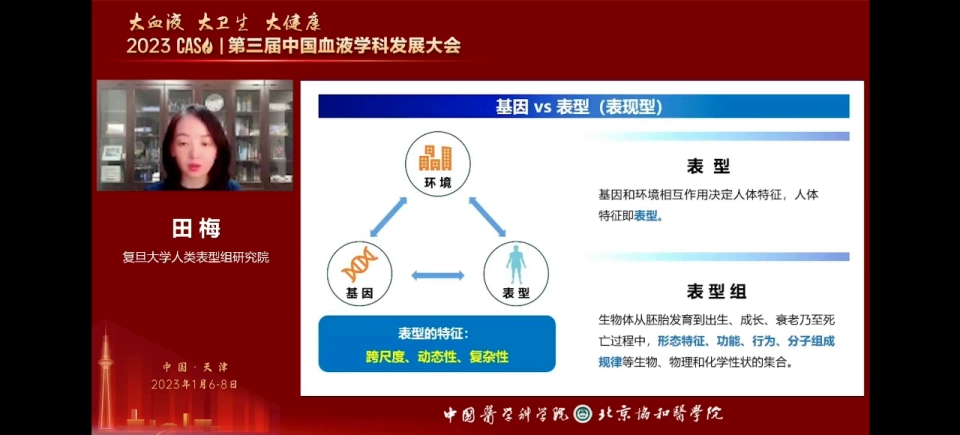
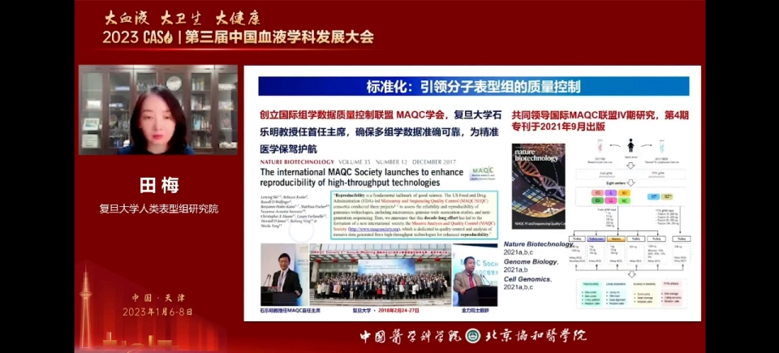
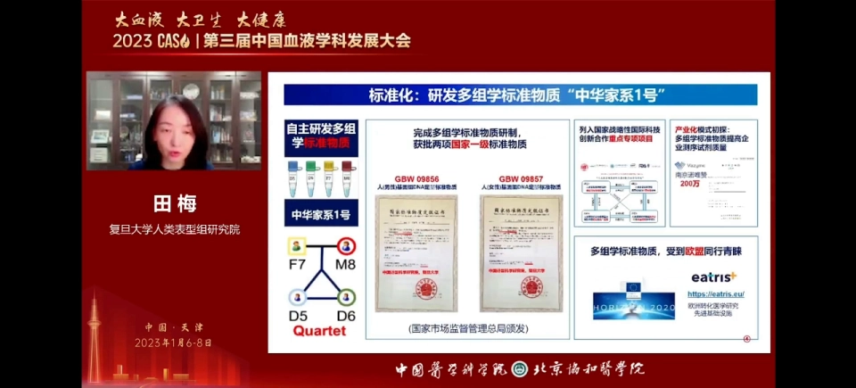
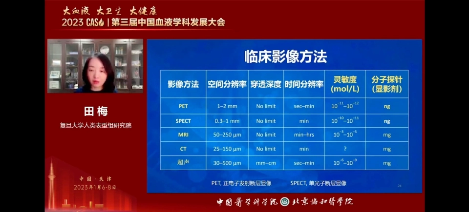
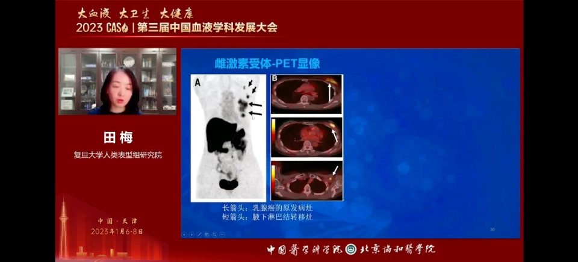
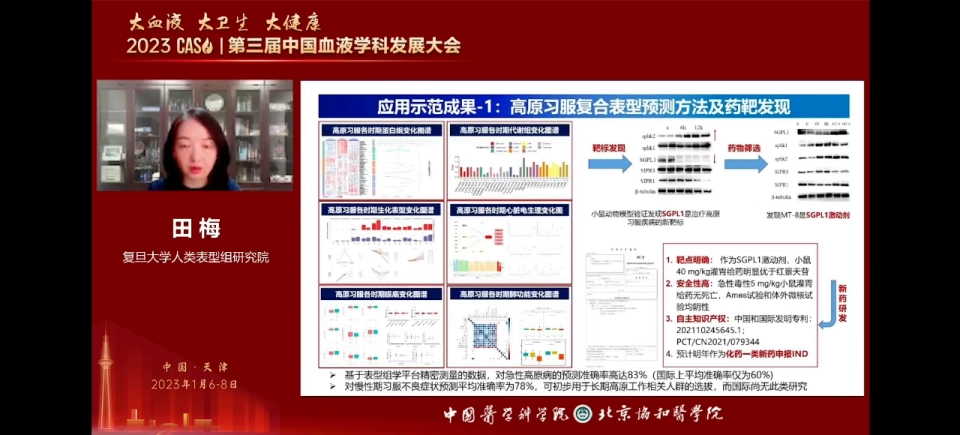
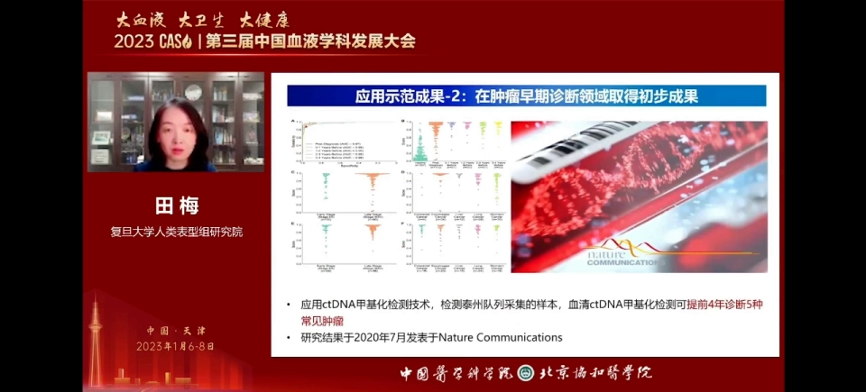

# 表型作为测量对象：跨尺度表型组、指标标准化与关联网络

> 视频来源：[从基因组学到表型组学](https://www.bilibili.com/video/BV1Ng411s72S/)（B 站 · 田梅，复旦大学人类表型组研究院，2023 年中国血液学科发展大会报告）｜时长约 24 分钟
> 导读：这是一场大会报告，前半段讲「表型组」作为测量对象怎么定义、怎么平台化、怎么标准化，后半段用高原习服、肿瘤早筛和 PET 分子影像三个案例说明表型测量的用途。报告带有平台宣传和招募内容，本文只整理与「测量」有关的部分，并标出讲者数字前后不一致的地方。表型与基因、环境的层级关系见同小节《组学层次与读出》，跨层级推断的边界见 1.2.1。

## 本讲要解决的核心问题（SCQA）

**背景**：过去 100 年，遗传学一直引领生物医学：从孟德尔定律到 DNA 双螺旋，再到人类基因组计划和精准医学计划。我们一度以为，把基因测清楚，就能解释人的特征。

**冲突**：人类基因组计划完成之后，人们越来越意识到「光知道基因还不够」——同样的基因，在不同环境、不同个体身上可以对应完全不同的形态、功能和结局；而且基因测序本身已经趋于饱和，真正的瓶颈转移到了「人身上到底能测什么」。

**疑问**：表型到底是什么？它能不能像基因组一样被系统地测量？如果能，测出来的几万个指标怎么保证可比、怎么从相关走到有用？

**回答（中心思想）**：表型组是把一个人从分子到行为的所有可测性状当作一个跨尺度集合来测；它的难点不在「测得到」，而在**指标定义、标准化和解释**——没有标准化，几万个指标无法跨人、跨批次比较；没有干预和机制证据，关联网络里的连线只能说明相关，不能说明因果 [【跳转到 00:43】](https://www.bilibili.com/video/BV1Ng411s72S/?t=43)。

[【跳转到 01:51】](https://www.bilibili.com/video/BV1Ng411s72S/?t=111)

---

## 一、表型不是「一个性状」，而是一个跨尺度集合

### 1.1 从「基因决定特征」到「基因 × 环境 → 表型」

讲者先给了定义：基因和环境相互作用决定人的特征，这些特征包括从胚胎发育到出生、生长、衰老乃至死亡过程中的形态特征、功能、行为、分子组成规律等；这些生物的、物理的和化学的所有性状的总和，叫**表型组** [【跳转到 01:25】](https://www.bilibili.com/video/BV1Ng411s72S/?t=85)。

这个定义有三个关键词，讲者自己点了出来：**跨尺度、动态性、复杂性** [【跳转到 01:51】](https://www.bilibili.com/video/BV1Ng411s72S/?t=111)。

- **跨尺度**：从基因组、转录组、蛋白组、代谢组，到细胞、器官、影像、体质、心理、行为，都在同一个「表型」概念下 [【跳转到 03:07】](https://www.bilibili.com/video/BV1Ng411s72S/?t=187)。
- **动态性**：表型不是一张静止的照片，而是从胚胎到死亡不断变化的过程。
- **复杂性**：同一个「表型」可以由很多层指标共同描述，层与层之间不是简单相加。

对测量的含义是：**「表型」这个词本身不是测量单位**。说「这个人的表型变了」，必须先回答「哪一层、哪个指标、相对什么基线」。这和我们说「表达量变了」必须先说清是 mRNA 还是蛋白，是同一个问题。

### 1.2 从基因组到表型组：知道基因还不够

讲者用一段学科史说明为什么测量对象要往上移：遗传学从启蒙期、发展期、黄金期，到人类基因组计划之后的瓶颈期；2015 年提出精准医学计划，人们发现光知道基因不够，还需要知道表型，于是又发起了人类表型组计划 [【跳转到 02:04】](https://www.bilibili.com/video/BV1Ng411s72S/?t=124)。

他把表型组计划称为「后基因组时代的战略制高点和原始创新的策源地」：从微观到宏观，涵盖基因组、转录组、蛋白组、代谢组、细胞、器官、影像、体质、心理、行为，对这些信息进行精密测量、系统解析，从而发现强关联 [【跳转到 03:07】](https://www.bilibili.com/video/BV1Ng411s72S/?t=187)。

这里有一个值得留意的逻辑跳跃：**「发现强关联」被当成了解析生命线索的途径**。关联本身不是机制，讲者在后文用高原习服和药物筛选补上了「从关联到干预」的一步，但这一步不是自动的。读这类大科学计划时，要区分「测量能力」和「因果解释能力」——前者可以靠平台和标准化堆出来，后者不能。

---

## 二、把表型变成可测指标：平台与四万多个指标

### 2.1 四类子平台

讲者介绍了位于上海张江的人体表型组精密测量平台，按测量对象分成四类 [【跳转到 04:20】](https://www.bilibili.com/video/BV1Ng411s72S/?t=260)：

| 子平台 | 测什么 | 例子 |
| --- | --- | --- |
| 分子表型平台 | 蛋白质组、代谢组 | 一站式蛋白质组测量、代谢组测量 |
| 细胞表型平台 | 细胞组成与功能 | 细胞成分分析、单细胞分析 |
| 影像表型平台 | 器官与组织的形态/功能 | 三维成像、超声、自发荧光、CT、MRI |
| 功能表型平台 | 整体生理与行为 | 睡眠、生物电、中医、皮肤、呼吸、能量代谢 |

讲者给出的总量是：**一个人可以测出 47000 个表型指标** [【跳转到 04:45】](https://www.bilibili.com/video/BV1Ng411s72S/?t=285)。

[【跳转到 04:45】](https://www.bilibili.com/video/BV1Ng411s72S/?t=285)

### 2.2 指标化的代价：定义、单位、可重复性

「47000 个指标」听起来是通量的胜利，但它同时带来三个测量问题，讲者没有逐条展开，但报告里的细节已经露出来了：

1. **指标是人定义的，不是自然给的**。比如「睡眠」可以拆成时长、潜伏期、觉醒次数、脑电频段功率等很多指标；选哪些、怎么算，决定了你最后拿到什么数。这就是「测量即操作化」：概念必须落到一个可执行的代理上。
2. **不同指标的量纲和精度差很多**。影像的空间分辨率是毫米到亚毫米，分子组学的灵敏度可以到纳摩尔，功能表型的很多指标是量表评分。把它们放进同一张网络之前，必须先解决「可比」。
3. **同一个人重复测、不同人跨批次测，结果会不会一样**？这是标准化要解决的问题。

讲者后面给出的两个数字也提示了「指标口径」的敏感性：平台说一个人可测 47000 个表型指标 [【跳转到 04:45】](https://www.bilibili.com/video/BV1Ng411s72S/?t=285)，而导航图部分又说「测量 100 余个项目，收集 20 余类、近 3 万个表型」[【跳转到 08:02】](https://www.bilibili.com/video/BV1Ng411s72S/?t=482)。两个数字不一致，可能是「可测指标」与「已入库指标」的口径不同，也可能是不同时间点的统计。本文并列保留，不替讲者调和——这本身就是读表型数据时要问的第一个问题：**这个数字数的是什么**。

---

## 三、标准化：表型测量的误差控制

### 3.1 MAQC 与标准物质

讲者把「标准化」放在平台之后、应用之前，这个顺序很重要：没有标准化，测得多不等于测得好。具体做法包括 [【跳转到 05:09】](https://www.bilibili.com/video/BV1Ng411s72S/?t=309)：

- 复旦大学石乐明教授创立国际组学数据质量控制联盟 **MAQC** 学会，带领同行制定国际标准化指南，相关成果发表在 Nature Biotechnology、Genome Biology、Cell Genomics 等，共八篇论文 [【跳转到 05:34】](https://www.bilibili.com/video/BV1Ng411s72S/?t=334)；
- 自主研发多组学标准物质「**中华家系 1 号**」，获国家批准，也受到欧盟同行青睐；并申请 ISO 标准，2021 年 10 月 25 日正式发布 [【跳转到 05:50】](https://www.bilibili.com/video/BV1Ng411s72S/?t=350)；
- 共同制定人类生物样本库基础术语、样本分类和编码等通用标准，为数据共享打基础 [【跳转到 06:20】](https://www.bilibili.com/video/BV1Ng411s72S/?t=380)。

[【跳转到 05:09】](https://www.bilibili.com/video/BV1Ng411s72S/?t=309)

### 3.2 标准物质为什么能对付「技术误差」

**标准物质**（reference material）是一份组成已知、可以反复测量的样品。它的作用不是让仪器更准，而是让不同实验室、不同批次、不同时间点的测量结果能对齐：同一份标准品今天测和明年测，如果结果漂了，说明是技术系统的问题，而不是样本的生物学差异。

这正好对应误差的第一层——**技术误差**（仪器、试剂、批次、操作）。标准物质和质控样本对付的是这一层；它们对付不了生物变异（个体差异、时间波动、组织异质性），也对付不了采样误差（这份样本能不能代表这个人、这个人群）。讲者后面用「两天一夜」的标准化检测流程和大队列来对付后两层 [【跳转到 07:17】](https://www.bilibili.com/video/BV1Ng411s72S/?t=437)，但报告没有给出重复测量的一致性数据，这是读这类平台介绍时要留意的缺口。

[【跳转到 05:50】](https://www.bilibili.com/video/BV1Ng411s72S/?t=350)

---

## 四、关联网络：相关不是因果

### 4.1 导航图怎么读

讲者展示的「人类表型组导航图 1.0 版」是一张 3D 网络图 [【跳转到 08:02】](https://www.bilibili.com/video/BV1Ng411s72S/?t=482)：

- 每个球是一个表型，颜色表示所属领域（绿色蛋白质组、蓝色体成分、红色细胞表型）；
- 每条线表示两个表型之间的**相关性**，线的强度就是相关系数的值 [【跳转到 09:03】](https://www.bilibili.com/video/BV1Ng411s72S/?t=543)；
- 「出入度」表示一个表型与多少个其他表型有关联 [【跳转到 09:09】](https://www.bilibili.com/video/BV1Ng411s72S/?t=549)；
- 可以调阈值让网络变简洁，也可以点开一个表型看它的样本数、分布和相关表型清单 [【跳转到 09:34】](https://www.bilibili.com/video/BV1Ng411s72S/?t=574)。

这套交互设计很实用，但它也最容易制造误读。讲者明确说连线是相关性 [【跳转到 08:18】](https://www.bilibili.com/video/BV1Ng411s72S/?t=498)，而相关至少有三种来源：共享遗传背景、共同环境、以及真正的因果。网络图本身不区分这三者。

### 4.2 相关网络的三种误读

1. **把「关联强」当成「关系近」**。两个表型相关，可能只是因为它们都随年龄变化；控制年龄后关联可能消失。
2. **把「出入度高」当成「重要」**。出入度高可能只是这个指标测得更精细、分布更宽，或者它处在网络的一个枢纽位置，不代表干预它能改变结局。
3. **把「网络中心」当成「治疗靶点」**。这是从相关跳到干预的典型越级；要证明靶点，需要扰动实验或干预试验。

讲者自己也没有把网络图当成终点：他紧接着给了高原习服和药物筛选的案例，用「从关联到候选靶标再到动物实验」补上了因果链的一环 [【跳转到 10:32】](https://www.bilibili.com/video/BV1Ng411s72S/?t=632)。

---

## 五、影像作为表型读出：分辨率与灵敏度的权衡

### 5.1 一张表看清「看得清」和「看得见」不能兼得

报告里最有测量学价值的一页，是临床影像方法的对照表 [【跳转到 14:51】](https://www.bilibili.com/video/BV1Ng411s72S/?t=891)：

| 影像方法 | 空间分辨率 | 穿透深度 | 时间分辨率 | 灵敏度（mol/L） | 分子探针用量 |
| --- | --- | --- | --- | --- | --- |
| PET | 1–2 mm | 无限制 | 秒到分钟 | $10^{-11}$–$10^{-12}$ | ng |
| SPECT | 0.3–1 mm | 无限制 | 分钟 | $10^{-10}$–$10^{-11}$ | ng |
| MRI | 50–250 µm | 无限制 | 分钟到小时 | $10^{-3}$–$10^{-5}$ | mg |
| CT | 25–150 µm | 无限制 | 分钟 | 表中未给 | mg |
| 超声 | 30–500 µm | 毫米到厘米 | 秒到分钟 | $10^{-4}$–$10^{-9}$ | mg |

[【跳转到 14:51】](https://www.bilibili.com/video/BV1Ng411s72S/?t=891)

这张表把「分辨率 vs 灵敏度」的权衡摆得很清楚：PET 的空间分辨率是毫米级，最粗；但灵敏度到 $10^{-11}$–$10^{-12}$ mol/L，比 MRI 高好几个数量级，所以只需注射纳克级的探针 [【跳转到 14:26】](https://www.bilibili.com/video/BV1Ng411s72S/?t=866)。CT/MRI 看得清结构，但要毫克级造影剂，且看不到特定的分子事件。

讲者用一句话概括这条技术演进线：X 光让我们「看得见」，CT 让我们「看得清」，核磁让我们「看得准」，PET 让我们「看得更早」[【跳转到 12:43】](https://www.bilibili.com/video/BV1Ng411s72S/?t=763)。「更早」指的是在结构还没改变时就能看到分子功能的变化——这是用灵敏度换分辨率的典型取舍。

### 5.2 分子影像的读出：从葡萄糖到分子分型

PET 最常用的探针是葡萄糖代谢（FDG），但讲者强调「more than FDG」：已有上百种分子示踪剂，覆盖能量异常、增殖、免疫、炎症、转移、血管生成、基因组变异、抵抗细胞死亡等肿瘤生物学特征 [【跳转到 15:56】](https://www.bilibili.com/video/BV1Ng411s72S/?t=956)。这意味着 PET 不只是「看有没有肿瘤」，还可以看「肿瘤表达什么分子」——这就是把影像从结构表型变成分子表型。

两个案例说明这种读出的用途：

- **格列卫/索坦**：格列卫治疗有效时葡萄糖代谢被明显抑制；2 年后复发、再用格列卫无效，换索坦一周后看到明显效果；停药后反跳，再给药又有效 [【跳转到 16:57】](https://www.bilibili.com/video/BV1Ng411s72S/?t=1017)。这里 PET 读出的是「药物是否在起作用」，而不是「肿瘤缩小了多少」。
- **乳腺癌分子分型**：用雌激素受体、孕激素受体、HER2 的显像剂，一次注射、扫描十分钟，就能得到分子分型；还能发现脑部转移灶，省去两次活检穿刺和两次手术 [【跳转到 18:35】](https://www.bilibili.com/video/BV1Ng411s72S/?t=1115)。

[【跳转到 18:35】](https://www.bilibili.com/video/BV1Ng411s72S/?t=1115)

这两个案例的共同点是：**影像读出的是「代理」而不是「结局」**。葡萄糖代谢抑制代理「药物起效」，受体显像代理「肿瘤的分子分型」；代理和结局之间需要临床验证，讲者也说这两种药都经过 5 到 6 年才被 FDA 认证 [【跳转到 17:47】](https://www.bilibili.com/video/BV1Ng411s72S/?t=1067)。

---

## 六、表型的动态性与环境：高原习服与队列

### 6.1 高原习服：多表型组合预测

讲者给的第一个应用案例是高原习服：从低海拔到高海拔的环境适应过程中，产生了一系列表型改变，包括蛋白质组、代谢组、生化、心脏、眼底、肺功能等 [【跳转到 10:32】](https://www.bilibili.com/video/BV1Ng411s72S/?t=632)。基于表型组平台的数据，对急性高原病的预测准确率报告为 83%，对慢性高原习服不良症状预测的准确率为 78% [【跳转到 10:57】](https://www.bilibili.com/video/BV1Ng411s72S/?t=657)。

[【跳转到 10:32】](https://www.bilibili.com/video/BV1Ng411s72S/?t=632)

这个案例对测量分类的启示是：**表型不是单一读数，而是多类读数的组合**。单一蛋白组指标可能预测不准，把影像、生理、分子几层拼起来才够。但也要注意，预测准确率高不等于机制清楚：模型可能只是学到了「哪类人更容易高反」，而不是「高反是怎么发生的」。

### 6.2 队列与早期诊断：采样与代表性

第二个案例是肿瘤早筛：在泰州队列采集的样本中，用血清 ctDNA 甲基化检测，讲者报告可以提前 4 年诊断五种常见肿瘤 [【跳转到 11:37】](https://www.bilibili.com/video/BV1Ng411s72S/?t=697)。

[【跳转到 11:37】](https://www.bilibili.com/video/BV1Ng411s72S/?t=697)

这里的关键不是「4 年」这个数字，而是**队列**：早筛的结论依赖样本来自一个有明确入组条件、随访时间和代表性的队列。换一个人群、换一个采血时间点，灵敏度可能完全不同。这就是误差的第三层——采样误差：你测的这份血，能不能代表这个人的状态；你选的这个队列，能不能代表要应用的人群。讲者没有展开队列的入组标准和随访细节，读这类结果时应当把它当作「有待独立验证的报告」，而不是已经成立的事实。

---

## 七、边界：测量能力不等于解释能力

把这场报告放回本节的框架，有三条边界必须写明：

1. **表型指标的「多」不等于「准」**。47000 个指标里，很多是同一底层量的不同切法；指标之间高度相关，会放大网络里的关联数。真正决定质量的，是指标的定义、单位和重复性，而不是数量。
2. **标准化解决可比性，不解决因果**。MAQC、标准物质、ISO 标准让不同批次的数据能放在一起，但两个表型为什么相关，仍然需要干预或机制实验。
3. **影像和分子表型都是代理**。PET 的葡萄糖代谢、受体显像、ctDNA 甲基化，都是对「疾病状态」的间接读出；代理要经过临床终点验证，才能用于决策。

报告后半段有平台招募、期刊创刊和医保推动等内容 [【跳转到 23:04】](https://www.bilibili.com/video/BV1Ng411s72S/?t=1384)，属于机构信息，不是测量方法，本文不展开。讲者最后把整场报告收在「making the invisible visible」上 [【跳转到 22:39】](https://www.bilibili.com/video/BV1Ng411s72S/?t=1359)——这句话恰好点出了表型测量的本质：**把不可见的生理状态，转成一组可见、可比、可解释的数**。而「可见」只是第一步，「可比」靠标准化，「可解释」靠因果设计。

---

## 小结

- 表型组是基因与环境共同决定的、从分子到行为的全部可测性状的集合，特征是跨尺度、动态、复杂 [01:11][01:25]。
- 表型测量要把概念落到指标：同一个「表型」可以拆成很多指标，指标定义决定了你能问什么问题 [02:60]。
- 平台分分子、细胞、影像、功能四类；讲者给出「一人 47000 个指标」和「近 3 万个表型」两个不一致的数字，读数据要先问口径 [02:85][04:82]。
- 标准化（MAQC、标准物质、ISO）对付的是技术误差和批次差异，对付不了生物变异和采样误差 [03:09][03:50]。
- 关联网络的连线是相关性，不是因果；出入度高不等于重要，网络中心不等于治疗靶点 [04:98][05:43]。
- 影像读出体现分辨率与灵敏度的权衡：PET 灵敏度最高、空间分辨率最粗，CT/MRI 看得清但灵敏度低 [08:91]。
- 表型的价值在组合与动态：高原习服用多类表型组合预测，早筛依赖队列的代表性 [06:32][06:97]。
- 测量能力不等于解释能力；代理要经过临床终点验证，相关要经过干预验证。

## 关键术语速查

| 术语 | 一句话解释 |
| --- | --- |
| 表型（phenotype） | 基因与环境相互作用形成的可观察性状 |
| 表型组（phenome） | 一个生物体所有表型性状的集合，跨尺度、动态、复杂 |
| 表型组学 | 对表型组进行系统测量与关联分析的学科 |
| 指标（indicator） | 把表型概念落到可执行测量上的具体量，如睡眠时长、受体显像强度 |
| 标准物质 | 组成已知、可反复测量的样品，用于跨批次、跨实验室比对 |
| MAQC | 国际组学数据质量控制联盟，推动测量标准化与可重复性 |
| 关联网络 | 以表型为节点、以相关性为边的网络图，只表示相关 |
| 出入度 | 一个节点与其他节点相连的边数，衡量关联数量而非重要性 |
| 空间分辨率 | 影像能区分的最小空间尺度 |
| 灵敏度 | 能探测到的最低浓度，常以 mol/L 表示 |
| 分子影像 | 用分子探针在活体内显像特定分子事件的影像方法，如 PET |
| 采样误差 | 样本不能代表整体所带来的误差，与仪器精度无关 |