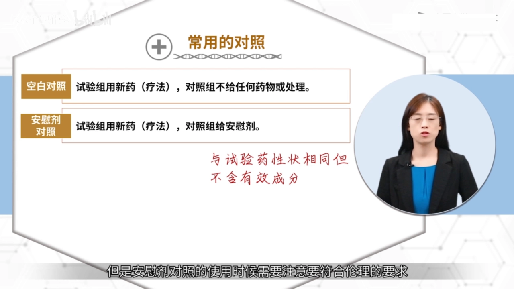
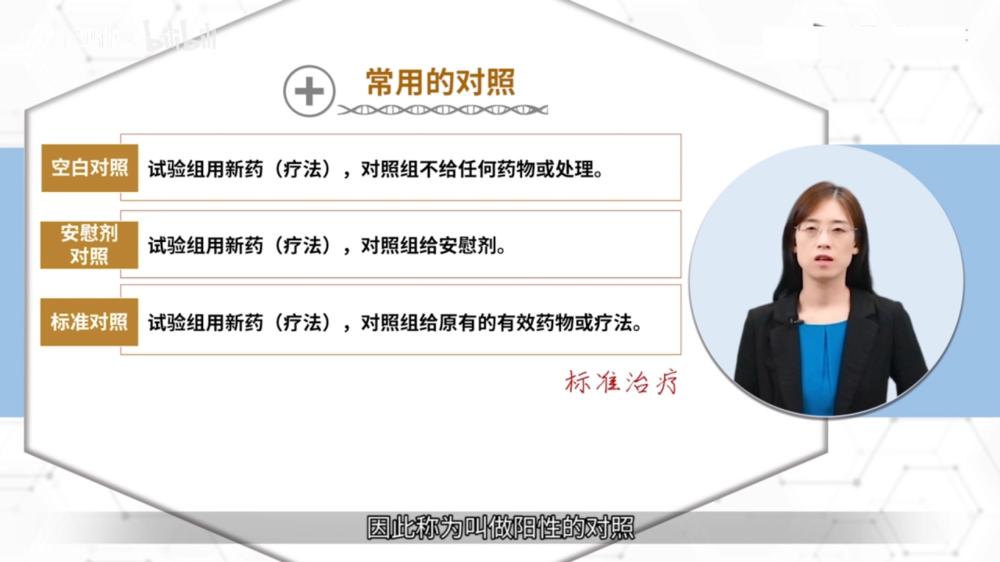
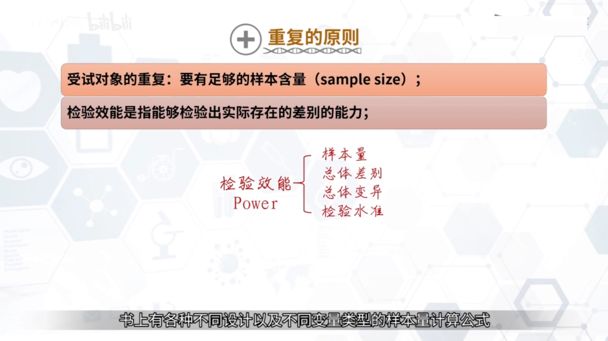
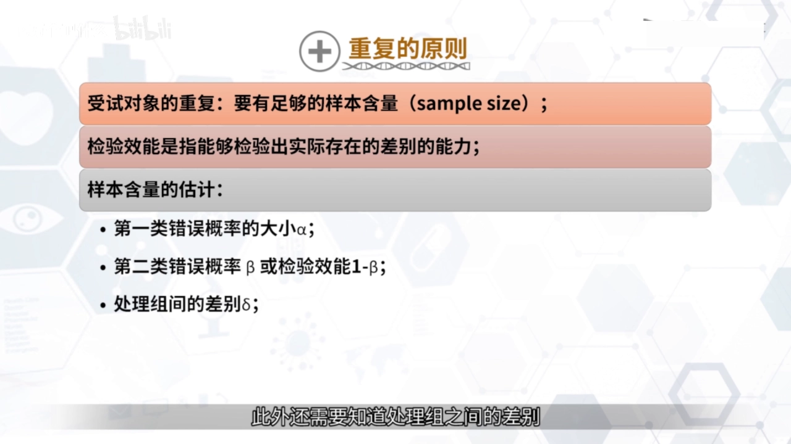

# 对照形式与重复：从安慰剂对照到检验效能

> 视频来源：[6.3.1 实验研究设计的原则-对照和重复](https://www.bilibili.com/video/BV13a411s7Pq/)（Bilibili · 公卫就业帮，复旦大学公共卫生学院 邓伟）｜时长约 12 分钟
> 导读：这是医学统计学课程里讲「实验设计三原则」的一节，只讲对照和重复两条。讲者用感冒药、安慰剂和样本量三个例子，把对照的**形式谱系**和重复的**样本量逻辑**讲清楚。本文按原讲顺序整理，并把每条原则映射回「药物 A 是否通过靶点 T 起作用」这个问题。字幕为 B 站 AI 生成，术语已按上下文订正。

## 本讲要解决的核心问题（SCQA）

**背景**：上一讲把「对照控制无关变量、假说给出预期结果」讲清楚了。但真实研究里，对照不是一个模子：有的组什么都不给，有的给安慰剂，有的给现有标准治疗，有的拿治疗前后自己比自己。重复也不是「多做几次」。

**冲突**：选错对照，结论会指向错误的对象——用空白对照证明「比不吃药好」，和用标准对照证明「比现有药好」，是两句完全不同的话。重复设错，则会出现两种相反的浪费：样本太少，真实存在的效应检不出来；样本太多，成本上升还可能把微小差异做成「显著」。

**疑问**：面对「药物 A 是否有效、是否通过 T 起作用」这类问题，该选哪一种对照？重复到底在重复什么，n 由什么决定？

**回答（中心思想）**：**对照决定你的结论在和谁比，重复决定你有没有能力看见差别**。对照形式要按「你想排除什么、伦理允许什么」来选；重复的本质是样本量问题，样本量由检验效能反推，而效能又取决于你预期的组间差别和变异 [【跳转到 08:31】](https://www.bilibili.com/video/BV13a411s7Pq/?t=511)。

---

## 一、没有对照，连「有效」都说不出口

讲者开场给了一个例子：要研究某感冒药的疗效，研究者找了 100 名感冒患者，记录体温、鼻塞流涕，给他们服药，一段时间后观察——一周以后体温下降，鼻塞流涕缓解。于是研究者说：这个药能有效治疗感冒。

讲者的评价是：这个结论「可能不是那么令人信服」。因为即使不服药，一周之后这 100 名患者的体温多半也会下降、症状也会缓解——**感冒本身有自愈特征** [【跳转到 01:09】](https://www.bilibili.com/video/BV13a411s7Pq/?t=69)。

所以在研究当中对照非常重要：**没有比较就没有鉴别**。设立对照可以排除实验过程中非研究因素的影响、减少实验误差；对照也是比较的基础，可以用来说明研究的假设是否正确。

讲者列了四类需要对照来排除的干扰：

1. **自愈或自然波动**：感冒这类有自愈倾向的疾病，或呼吸系统疾病这类随季节周期变化的疾病；
2. **安慰剂效应**：有研究显示，没有任何有效成分的安慰剂也能产生将近 30% 的治疗效应；在神经精神领域，这个效应甚至更高。没有对比，你看到的「有效」就要打一个问号；
3. **个体间差异**：人和人本来就不一样；
4. **测量本身的波动**：讲者举了一个反直觉的例子——像白细胞计数这样被认为比较稳定的实验室检查，在一天当中实际上也是有波动的。

这四条其实对应四种不同的「无关变量」。回到「A 是否通过 T 起作用」：如果 A 的效应和自愈、安慰剂效应、个体差异、测量波动混在一起，你连「A 有没有效应」都答不了，更不用说「效应是否经过 T」。

---

## 二、对照的形式谱系：从空白到标准

讲者先按**形式**分：常见的是**组间平行对照**（分成实验组和对照组，平行开展）和**配对对照**。大多数实验研究采用组间平行对照。按**内容**分，则有空白对照、标准对照、阳性对照等 [【跳转到 03:00】](https://www.bilibili.com/video/BV13a411s7Pq/?t=180)。

### 2.1 空白对照：什么都不给

实验组采用新药、新疗法或某种干预，对照组**不给予任何处理**。这种对照实施起来比较容易，但有一个很大的缺点：容易导致心理上的差异。对照组的受试对象没有接受任何处理，可能从心理上产生抵触，从而影响观察结果。

也正因为这个缺点，空白对照几乎不会用在以治疗为目的的临床试验上；它更多用于社区开展的干预实验——一些社区给干预，另一些社区不给任何干预 [【跳转到 05:40】](https://www.bilibili.com/video/BV13a411s7Pq/?t=340)。

### 2.2 安慰剂对照：给一个「像药」的东西

实验组用新药，对照组给**安慰剂**：与试验药性状相同、但不含有效成分。讲者强调，安慰剂要求从形状、颜色、大小、气味上都跟试验药完全相同，只是没有有效成分、没有治疗效果。

安慰剂对照弥补了空白对照的心理差异，但使用时要注意**伦理要求** [【跳转到 04:25】](https://www.bilibili.com/video/BV13a411s7Pq/?t=265)。

[【跳转到 04:50】](https://www.bilibili.com/video/BV13a411s7Pq/?t=290)

### 2.3 标准对照（阳性对照）：和现有最好的比

实验组用新方法，对照组给**原有的有效药物或标准治疗方案**，因此也叫**阳性对照**。对照组不再是不接受治疗，而是用了现有的标准治疗。

讲者还区分了一种类似的**实验对照**：对照组仅仅加与处理因素有关的实验因素，实验组在施加实验因素的同时给予相应的干预或处理 [【跳转到 05:15】](https://www.bilibili.com/video/BV13a411s7Pq/?t=315)。

[【跳转到 05:15】](https://www.bilibili.com/video/BV13a411s7Pq/?t=315)

安慰剂和标准对照的选择，讲者说主要考虑的是**伦理**：如果疾病本身已经有了标准的治疗或有效的治疗方案，从伦理角度一般不允许使用安慰剂，这时必须用标准对照。

### 2.4 自身对照、历史对照与文献对照：可比性问题

除了上面几种，还会看到**自身对照**（治疗后与治疗前比较）、**历史对照**（以以前的治疗结果作对比）、**文献对照**（与文献报道的其他治疗方案对比）。

讲者对这三种都提出了保留意见：

- **自身对照最大的问题是时间**：随着时间变化，疾病本身也会发生变化。前后比较时，观察到的改变无法确定是干预产生的，还是时间带来的 [【跳转到 06:46】](https://www.bilibili.com/video/BV13a411s7Pq/?t=406)。
- **历史对照和文献对照最大的问题是可比性**：病人的来源、特征、实验条件、检查方法、治疗手段、疗效评价标准，都可能和现在的实验组不一样 [【跳转到 08:01】](https://www.bilibili.com/video/BV13a411s7Pq/?t=481)。

所以讲者的结论是：这些对照形式**不推荐作为研究设计的主要对照形式**。

### 2.5 一张选择表

把上面的内容压成一张表，问三个问题就能定位：

| 对照形式 | 对照组接受什么 | 主要排除什么 | 主要代价 |
| --- | --- | --- | --- |
| 空白对照 | 什么都不给 | 自然进程、自愈 | 心理差异；治疗性试验通常不可用 |
| 安慰剂对照 | 性状相同的无活性制剂 | 心理效应、期望 | 伦理限制 |
| 标准对照（阳性） | 现有标准治疗 | 「比现有方案更好吗」 | 需要已有标准方案；样本量通常更大 |
| 实验对照 | 只加与处理有关的实验因素 | 操作流程本身 | 设计更复杂 |
| 自身对照 | 同一个体的前后/对侧 | 个体间差异 | 时间、顺序、学习效应 |
| 历史/文献对照 | 过去的或已发表的结果 | —— | 可比性差，不推荐作主要对照 |

对「A 是否通过 T 起作用」，这张表对应的是两个层次：**A 有没有效应**通常用空白或安慰剂对照；**A 是否比现有方案更好**必须用标准对照。而「是否经过 T」不是靠换对照形式解决的，它需要上一讲说的「让 T 单独变化」的对照。

---

## 三、重复：不是「多做几次」，而是样本量

### 3.1 重复的定义：实验全程的重复

讲者给出的定义是：**重复是指在相同实验条件下进行的实验全程的重复**。他特意澄清：这种全程重复不是同一个人重复做了两次实验，而是**不同人之间的重复**。在研究里，观察一个病人就是做了一次实验；观察两个病人，实际上就重复了两次实验 [【跳转到 08:36】](https://www.bilibili.com/video/BV13a411s7Pq/?t=516)。

所以「重复」主要讲的是一个**样本大小（sample size）**的问题。每个研究设计都必须决定样本量是多少，而样本量需要根据统计原则来估计：合理的样本量估计既能防止样本过大造成的成本增加，又能保证获得一定的统计效能。

### 3.2 检验效能：能看见真实差别的能力

讲者引入**检验效能（power）**，也叫把握度：它是指**能够检验出实际存在的差别的能力**。做实验的目的是检验差别、验证假设；利用效能的计算，可以反推样本量。

[【跳转到 10:05】](https://www.bilibili.com/video/BV13a411s7Pq/?t=605)

效能与四个量有关：

| 因素 | 变化方向 | 对所需样本量的影响 |
| --- | --- | --- |
| 样本量 | 越大 | 效能越高 |
| 总体差别（组间真实差异） | 越大 | 越容易检出，所需样本量越小 |
| 总体变异（标准差） | 越大 | 越难检出，所需样本量越大 |
| 检验水准 α | 越严 | 所需样本量越大 |

讲者没有给公式，只强调估计样本量前必须事先知道这些参数：一类错误 α、二类错误 β（或效能 1−β）、各处理组之间的差别 δ、各组变异的程度 σ [【跳转到 10:30】](https://www.bilibili.com/video/BV13a411s7Pq/?t=630)。

[【跳转到 11:20】](https://www.bilibili.com/video/BV13a411s7Pq/?t=680)

### 3.3 最难估的是「差别」和「变异」

讲者指出，α 和 β 通常比较明确、有固定值；真正难的是对实验各组的总体均数或总体率、以及它们的标准差进行估计。**如果估计的偏差太大，你得到的样本量可能不能满足实际需要。** 而这些数据需要经过大量查阅文献、甚至做预实验来获得 [【跳转到 11:43】](https://www.bilibili.com/video/BV13a411s7Pq/?t=703)。

这一点和上一讲的「预实验」接上了：预实验不只是看「能不能做出来」，它还在为样本量估计提供变异和差别的先验值。

### 3.4 重复与「伪重复」的分界

讲者在这里讲的是**受试对象的重复**：一个病人算一次，两个病人算两次。按这个定义，同一份样本测三次、同一个孔读三次，都不是重复——它们重复的是测量，不是实验。

把这条分界放到「A 是否通过 T 起作用」上：

- **技术重复**（同一份裂解液跑三次 qPCR、同一张切片拍三个视野）只能告诉你测量稳不稳；
- **生物学重复**（三只独立的小鼠、三个独立供体的细胞）才能告诉你效应在个体间是否成立；
- 如果把技术重复当成 n，检验的分母会被人为缩小，假阳性率会远高于你以为的水平。

这也是为什么讲者把重复和样本量绑在一起讲：**n 指的是独立实验单位的个数，不是读数的个数**。

---

## 四、把两条原则合起来看

讲者这一节只讲了两条原则，但两条原则回答的是不同的问题：

| 原则 | 回答的问题 | 出错时的后果 |
| --- | --- | --- |
| 对照 | 我在和谁比？排除了哪些替代解释？ | 结论指向错误的对象，或无法排除自愈、安慰剂、时间趋势 |
| 重复 | 我有能力看见这个差别吗？n 是什么？ | 真实效应检不出（样本太小），或把微小差异做成显著（样本过大 / 伪重复） |

对「A 是否通过 T 起作用」，两条原则的分工可以写成一句话：**对照决定你能不能把「A 的效应」从背景里分离出来，重复决定这个分离出来的效应是不是稳定到值得解释**。两者都成立，才轮得到机制层面的问题——而机制层面的「是否经过 T」，需要下一篇的干预与因果结构来回答。

---

## 小结

- **没有对照就没有鉴别**：自愈、安慰剂效应（可达约 30%）、个体差异、测量波动，都会伪装成「疗效」。
- **对照有形式谱系**：空白、安慰剂、标准（阳性）、实验、自身、历史/文献对照，各自排除不同的东西，也各有伦理与可比性的代价。历史对照和文献对照不推荐作为主要对照。
- **对照的选择由「想排除什么 + 伦理允许什么」决定**：有标准治疗时一般不能用安慰剂；治疗性试验几乎不能用空白对照。
- **重复是实验全程的重复，本质是样本量**：不是同一个人做两次，而是不同受试对象之间的重复。
- **样本量由检验效能反推**：效能取决于样本量、组间真实差别、总体变异和检验水准；最难估的是差别与变异，需要文献和预实验。
- **n 是独立实验单位的个数**：技术重复不等于生物学重复，把读数当 n 会系统性抬高假阳性。

## 关键术语速查

| 术语 | 一句话解释 |
| --- | --- |
| 空白对照 | 对照组不给任何处理；简单，但存在心理差异，治疗性试验通常不用 |
| 安慰剂对照 | 对照组给性状相同、不含有效成分的制剂；排除心理与期望效应，受伦理限制 |
| 标准对照（阳性对照） | 对照组给现有标准治疗；回答「是否比现有方案更好」 |
| 实验对照 | 对照组只加与处理因素有关的实验因素，用于分离操作流程本身 |
| 自身对照 | 同一个体治疗前后或对侧比较；受时间趋势干扰 |
| 历史对照 / 文献对照 | 与过去或已发表结果比较；可比性差，不推荐作主要对照 |
| 重复 | 相同实验条件下实验全程的重复，本质是样本量问题 |
| 检验效能（power） | 能检出实际存在差别的能力，由样本量、组间差别、变异与检验水准共同决定 |
| 技术重复 / 生物学重复 | 重复测量同一份材料 / 重复独立的生物学个体；只有后者构成 n |