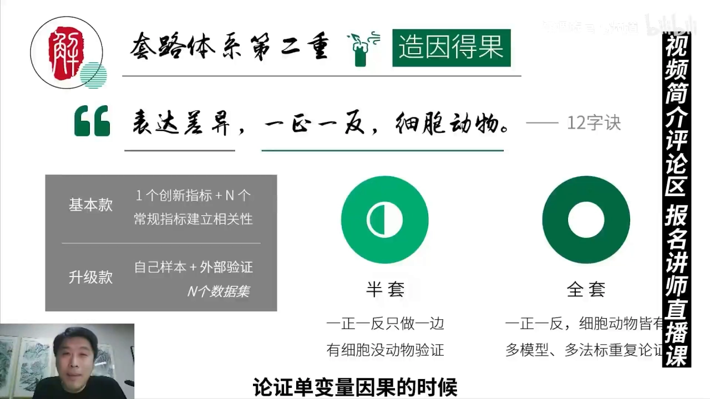
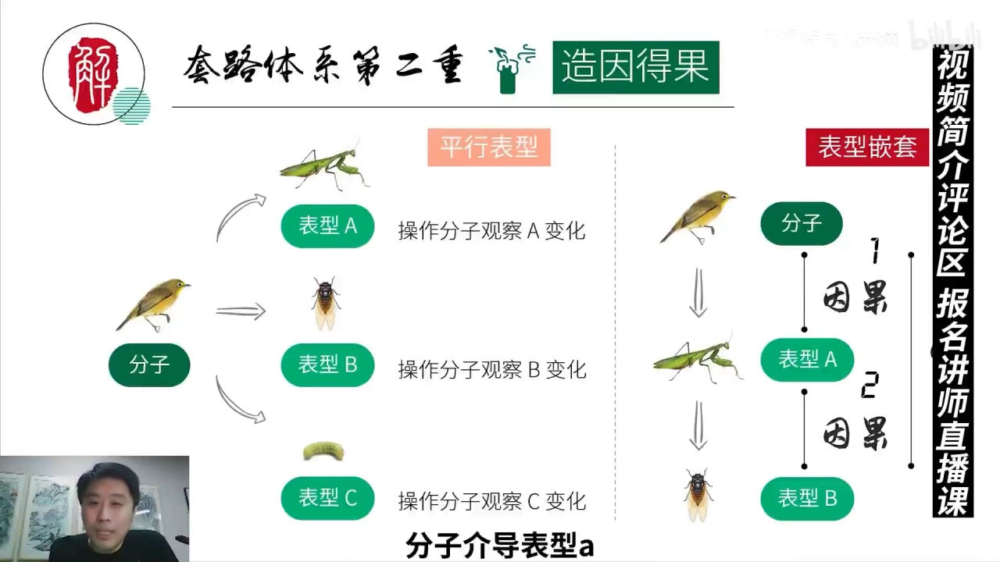
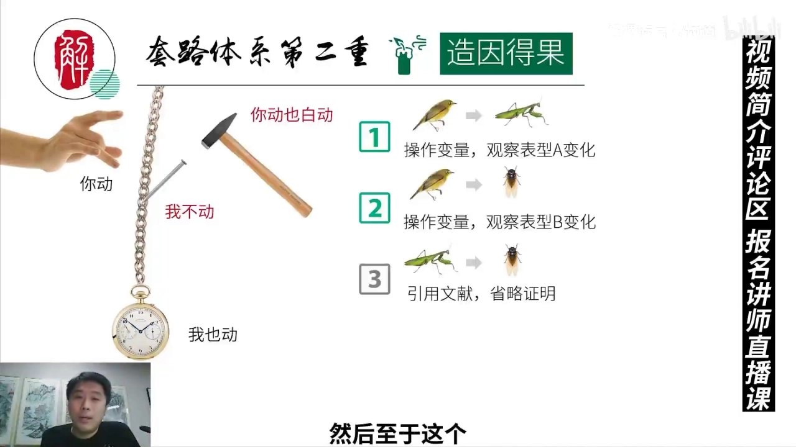
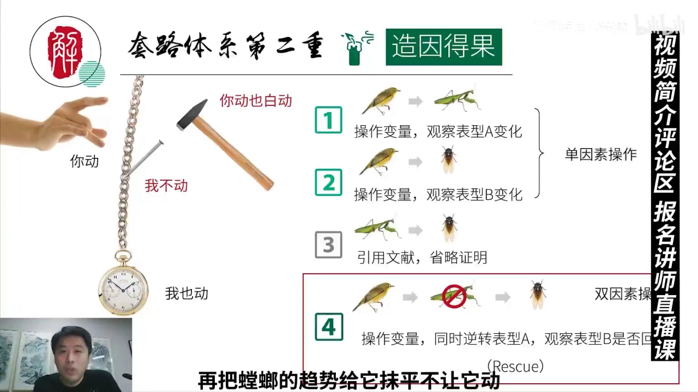

# 必要性与 rescue：正加反、双因素操作与串联因果

> 视频来源：[单变量研究之必要性证明，rescue实验](https://www.bilibili.com/video/BV1mV41157qZ/)（Bilibili · 解螺旋官方频道）｜时长约 7 分钟
> 导读：这是「套路体系第二重：造因得果」的一节短课，讲的是单变量论证怎么从「相关」走到「必要」。讲者用怀表、螳螂捕蝉和「12 字诀」把 rescue 实验的逻辑讲清楚：为什么双因素操作一定是 rescue，为什么 rescue 证明的是必要性而不是充分性。本文按原讲顺序整理，并把这条逻辑映射回「药物 A 是否通过靶点 T 起作用」。字幕为 B 站 AI 生成，错拼（如「表情」「音速」「回复」）已按上下文订正为表型、因素、回复（rescue）。

## 本讲要解决的核心问题（SCQA）

**背景**：在文献里论证一个分子的因果作用，常见的套路是「正加反」——过表达看到表型，敲低看到相反的表型；再加上细胞和动物两套体系、多个表型指标的重复。这套组合看起来已经很完整。

**冲突**：但「正加反」只能说明这个分子**能**改变表型（充分性方向），说明不了它**是必需的**。如果分子只是众多平行通路中的一条，敲掉它表型变了，也不能说明它就是那条主路径。更麻烦的是，当分子介导表型 A、表型 A 又影响表型 B 时，「分子→B」的效应可能绕过了 A。

**疑问**：怎么证明一个中间环节是「必要的」？rescue 实验为什么能做到这一点？它和「多做几个表型」有什么区别？

**回答（中心思想）**：**rescue 实验是必要性的证明，它的形式一定是双因素操作**。你先动上游，再把中间节点按住不让它动，看下游是否还响应——如果下游不再响应，说明中间节点是上游驱动下游的必经之路 [【跳转到 05:02】](https://www.bilibili.com/video/BV1mV41157qZ/?t=302)。

---

## 一、先看「全套论证」长什么样

讲者开场先给了一个判断标准：当你在文献里读到论证单变量因果的工作，如果**正加反的策略**都看到了、**表型实验的多样性重复**也都有了、**细胞加动物**两套体系都有，那么这位作者对数据的呈现是比较客观严谨的 [【跳转到 00:10】](https://www.bilibili.com/video/BV1mV41157qZ/?t=10)。

他把这套标准压缩成 12 个字：**「表达差异，一正一反，细胞动物」** [【跳转到 00:10】](https://www.bilibili.com/video/BV1mV41157qZ/?t=10)。

[【跳转到 00:10】](https://www.bilibili.com/video/BV1mV41157qZ/?t=10)

这张幻灯片把「半套」和「全套」并排放在一起：

| | 半套 | 全套 |
| --- | --- | --- |
| 一正一反 | 只做一边 | 正反都做 |
| 细胞 / 动物 | 有细胞没动物验证 | 细胞动物皆有 |
| 重复 | 单一模型、单一指标 | 多模型、多法标重复论证 |

讲者还提到「基本款」和「升级款」：基本款是「1 个创新指标 + N 个常规指标建立相关性」，升级款是「自己样本 + 外部验证 N 个数据集」。这些是数据量的堆叠，不是因果逻辑的升级——真正的升级在下一节。

---

## 二、单变量数据不够时：平行表型与表型嵌套

### 2.1 什么时候数据会不够

讲者说，单变量研究有时会「数据不太够」。什么情况下会不够？当你做的是相关性研究、又没有临床因素可以分析时：可能只是组织标本做了 qPCR 或 Western，论证了有病没病时表达高和低，但临床因素没有资料、样本量也不够展开分层分析 [【跳转到 00:32】](https://www.bilibili.com/video/BV1mV41157qZ/?t=32)。

这时常见的「加数据」策略是**平行展开论证多个表型**：操作分子的同时，既观察表型 A，也观察表型 B、C，用相应的法和标去验证 [【跳转到 01:22】](https://www.bilibili.com/video/BV1mV41157qZ/?t=82)。

### 2.2 平行逻辑的不足

讲者用「鸟可以吃虫子，也可以吃螳螂、吃蝉」来打比方：平行论证多个表型，无非是操作分子的同时观察 A、B、C 三个表型。但这样的平行逻辑「还是略微有些不足」，因为分子机制其实有一种**逻辑嵌套**的增加层次的技巧 [【跳转到 01:47】](https://www.bilibili.com/video/BV1mV41157qZ/?t=107)。

### 2.3 表型嵌套：串联因果

如果假设是「螳螂捕蝉，黄雀在后」——黄雀通过调节螳螂来影响蝉——那么分子介导表型 A、表型 A 再调节表型 B，就构成了一组**串联的因果关系**。

[【跳转到 02:12】](https://www.bilibili.com/video/BV1mV41157qZ/?t=132)

这里有一个关键的论证缺口：**你需要论证分子是依赖于表型 A 来影响表型 B 的**。怎么论证？讲者的答案是：这里就有一个关键的实验，叫 rescue 实验 [【跳转到 02:12】](https://www.bilibili.com/video/BV1mV41157qZ/?t=132)。

---

## 三、怀表模型：必要性与「你动也白动」

讲者用一个思想模型解释 rescue 为什么是必要性证明。

假设有一个怀表，你在上面动链子，下面的怀表就会晃动——「你动，我也动」。这就是因果关系证明的基本形式：**操作分子，表型随之而动**。

那么，当中间有一个环节（手通过链子影响怀表）时，你要证明「链子对于手驱动怀表是必要的」，该怎么做？讲者的做法是：还是手动，但**让链子不动**——拿个钉子把它钉住。这时候手再在上面动，表就不动了。用他的话说：**「我不动，你动也白动」** [【跳转到 03:22】](https://www.bilibili.com/video/BV1mV41157qZ/?t=202)。

[【跳转到 03:22】](https://www.bilibili.com/video/BV1mV41157qZ/?t=202)

这个模型把两种论证分得很清楚：

- **「你动我也动」**证明的是**充分性方向**：这个环节足以带动下游；
- **「钉住它，你动也白动」**证明的是**必要性**：没有这个环节，上游就带不动下游。

rescue 实验要的是后者。

---

## 四、四步操作：从单因素到双因素

讲者把「两个表型嵌套」的论证拆成四步 [【跳转到 03:47】](https://www.bilibili.com/video/BV1mV41157qZ/?t=227)：

1. **操作变量，观察表型 A 变化**——鸟能调节螳螂；
2. **操作变量，观察表型 B 变化**——鸟能调节蝉；
3. **引用文献，省略 A 与 B 之间关系的证明**——螳螂与蝉的关系已有报道；
4. **操作变量，同时逆转表型 A，观察表型 B 是否被回复**——动鸟，同时把螳螂的趋势抹平，看蝉是否还受调节。

前三步都是**单因素操作**：只动一个变量，看一个表型。第四步是**双因素操作**：同时动鸟和螳螂，观察蝉。

[【跳转到 04:12】](https://www.bilibili.com/video/BV1mV41157qZ/?t=252)

讲者在这里给了一句要记住的结论：**凡是双因素操作，通通都是 rescue 实验；只要是 rescue 实验，都是为了证明必要性** [【跳转到 05:02】](https://www.bilibili.com/video/BV1mV41157qZ/?t=302)。

[【跳转到 05:02】](https://www.bilibili.com/video/BV1mV41157qZ/?t=302)

---

## 五、rescue 证明的是哪一段必要性

讲者提醒，rescue 不是笼统地「证明必要性」，你要看清楚它论证的是哪一组必要性。一般一条路径有三个环节：**上游、中间节点、下游结局**；rescue 论证的是**中间这个节点对于「上游调节下游」的必要性**，也就是路径的必要性 [【跳转到 05:27】](https://www.bilibili.com/video/BV1mV41157qZ/?t=327)。

把它写成一句话：

> 上游 X 要影响下游 Y，必须经过中间节点 M；把 M 按住之后，X 对 Y 的作用消失。

这正好是「A 是否通过 T 起作用」所需要的论证形式：

| 环节 | 在靶点问题里 |
| --- | --- |
| 上游 | 药物 A |
| 中间节点 | 靶点 T |
| 下游结局 | 表型 Y |
| 单因素操作 1 | 加 A，看 Y 变化 |
| 单因素操作 2 | 抑制 T，看 Y 变化 |
| 双因素操作（rescue） | 加 A 的同时抑制 T，看 A 对 Y 的效应是否消失 |

如果抑制 T 之后 A 的效应消失，说明 T 是 A 驱动 Y 的必要环节；如果 A 的效应依然存在，说明 A 还能绕过 T 起作用——这时「A 通过 T 起作用」这句话就不成立，至少不是全部成立。

---

## 六、必要性与充分性：两张不同的证书

把讲者的内容压缩成对照表：

| | 正加反（loss + gain） | rescue（双因素） |
| --- | --- | --- |
| 操作 | 只动一个因素 | 同时动两个因素 |
| 回答 | 这个分子**能**改变表型吗 | 这个中间节点**必须**在吗 |
| 逻辑 | 充分性方向 | 必要性方向 |
| 反例 | 分子在平行通路里，敲掉也变，但不是主路径 | 中间节点被按住后，上游仍能绕过它影响下游 |
| 在靶点问题里 | 敲低/过表达 T 看 Y | 加 A + 抑制 T，看 A 的效应是否消失 |

讲者最后还提醒了一句现实层面的用法：哪怕只是在衡量层面多做一点验证、多做几个表型，也能堆数据；而如果学会把数据堆成因果逻辑的层次、学会 rescue，这些数据量支撑一篇三分左右的文章「一点问题没有」[【跳转到 06:17】](https://www.bilibili.com/video/BV1mV41157qZ/?t=377)。这句话是课程语境里的发表经验，不是科学标准——**数据量能堆出文章，但堆不出必要性**；必要性只能由「按住中间节点」这个操作来提供。

---

## 小结

- **全套论证的 12 字诀**：表达差异、一正一反、细胞动物。半套只做一边，全套正反与细胞动物皆有。
- **平行表型不够**：分子同时影响 A、B、C，只能说明它「能」影响多个表型；要说清机制，需要表型嵌套的串联因果。
- **怀表模型**：「你动我也动」是因果，「钉住链子，你动也白动」才是必要性。
- **rescue 一定是双因素操作**：操作上游 + 逆转中间节点，观察下游是否还响应；凡是双因素操作都是 rescue，凡是 rescue 都为证明必要性。
- **rescue 证明的是路径必要性**：中间节点对于「上游调节下游」是否必需。
- **必要 ≠ 充分**：正加反给的是充分性方向的证据，rescue 给的是必要性方向的证据；两张证书不能互相替代。

## 关键术语速查

| 术语 | 一句话解释 |
| --- | --- |
| 正加反 | 过表达与敲低/敲除两个方向都做，观察表型是否相反变化 |
| 表型嵌套 | 分子→表型 A→表型 B 的串联因果，而非多个平行表型 |
| rescue（回复实验） | 操作上游的同时逆转中间节点，观察下游效应是否被回复 |
| 双因素操作 | 同时改变两个变量的实验操作；讲者认为它等价于 rescue |
| 必要性 | 没有中间节点，上游就无法影响下游 |
| 充分性 | 有中间节点（或分子）就足以带动下游，但不排除其他路径 |
| 路径必要性 | 中间节点对「上游调节下游」这条路径是否必需 |