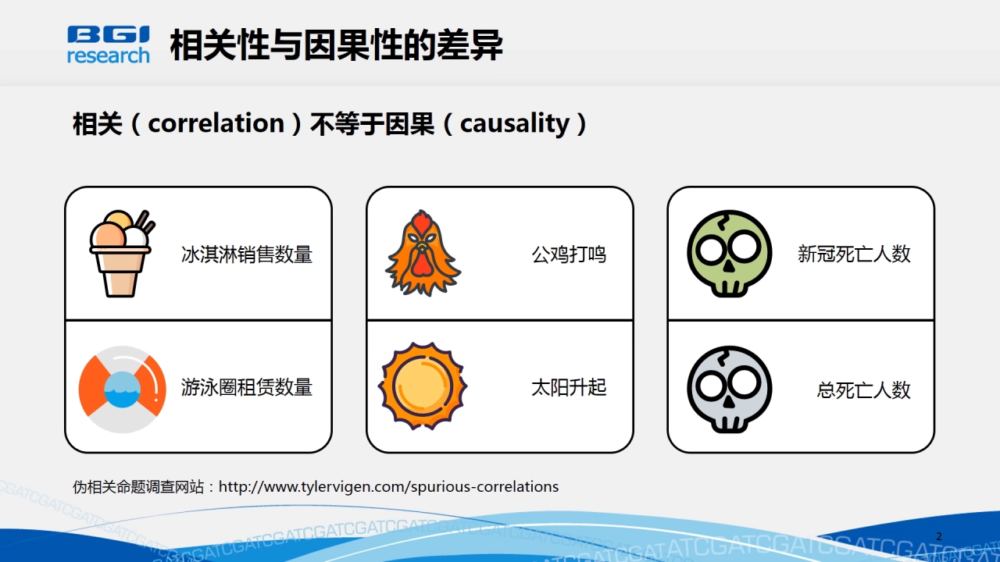
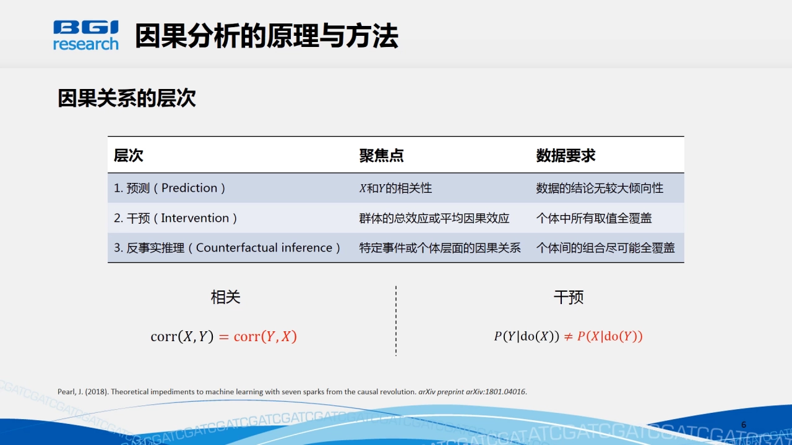
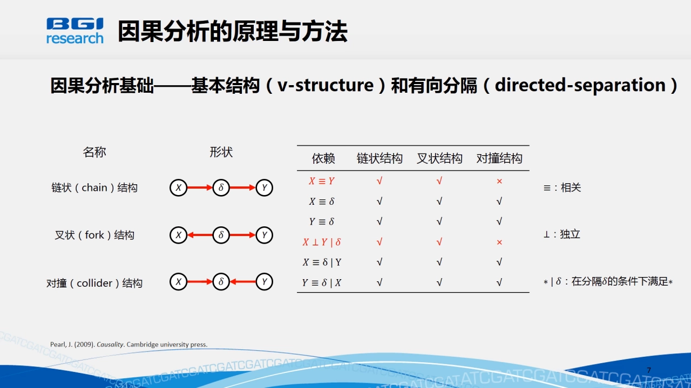
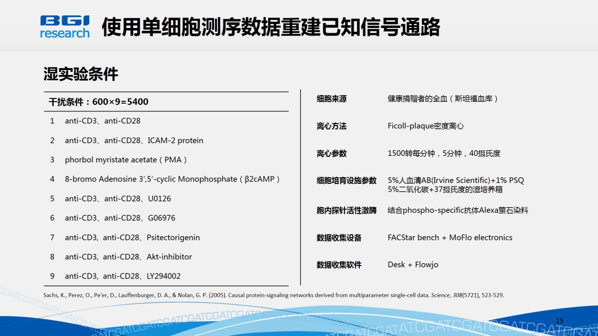
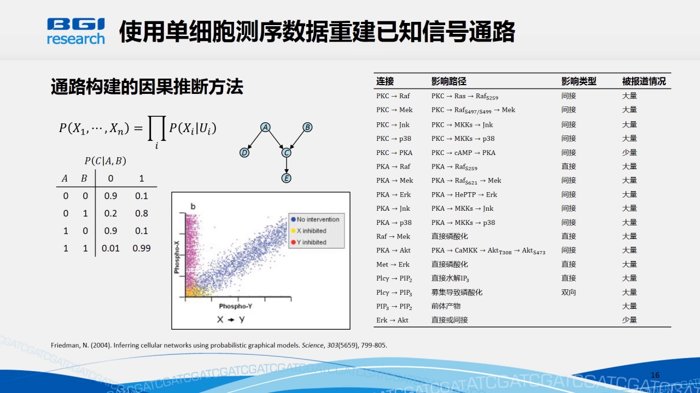

# 相关与因果：混杂结构、干预与因果发现

> 视频来源：[从相关关系到因果关系的跨越](https://www.bilibili.com/video/BV17U4y1a7ob/)（Bilibili · Horus-Zhang，生物化学技术研究所合成生物学平台 张浩林）｜时长约 17 分钟
> 导读：这是一场面向生物医学研究者的因果推断入门分享，按 Judea Pearl 的框架讲了三件事：相关为什么不是因果、因果如何用图来定义、干预为什么能把两者分开。本文按原讲顺序整理，并把 chain / fork / collider 三种结构映射回「药物 A 是否通过靶点 T 起作用」。字幕为 B 站 AI 生成，术语（如「差状结构」「有效分隔」「积极学习」）已按上下文订正为叉状结构、有向分隔、机器学习。

## 本讲要解决的核心问题（SCQA）

**背景**：在生物医学论文里，我们习惯用相关系数、p 值、置信区间来支撑结论。两个变量显著相关，看起来就足以说明它们有关系。

**冲突**：相关是对称的，因果不是。A 和 B 相关，可能是 A 导致 B，可能是 B 导致 A，也可能是第三个变量 C 同时导致了两者。更麻烦的是，相关甚至不是因果的必要条件——讲者给了一个「因果存在但统计上不相关」的极端例子。

**疑问**：既然相关既不是因果的充分条件、也不是必要条件，那因果到底怎么定义？什么样的工具能把它从数据里识别出来？

**回答（中心思想）**：**因果不是「相关更强」，而是「干预之后会怎样」**。相关问的是「观察到 X 时 Y 的分布」，因果问的是「把 X 固定到某个值时 Y 的分布」；前者对称，后者不对称。Pearl 把这件事拆成三个层次——预测（关联）、干预、反事实——每上一层，对数据的要求也更高 [【跳转到 05:22】](https://www.bilibili.com/video/BV17U4y1a7ob/?t=322)。

[【跳转到 02:15】](https://www.bilibili.com/video/BV17U4y1a7ob/?t=135)

---

## 一、相关不等于因果：三类伪相关

讲者开场先澄清一个历史事实：在统计学成为严谨学科、皮尔逊清晰地分离相关性与因果性之前，绝大多数人都把两者混为一谈；即使到现在，认为相关就代表因果的人也不在少数 [【跳转到 01:00】](https://www.bilibili.com/video/BV17U4y1a7ob/?t=60)。

他给了几个常见例子：

- 夏天天气热，冰淇淋销量增加，游泳圈租赁数量也增加——但冰淇淋销量增加并没有导致游泳圈租赁增加；
- 自然条件下日出之前总有公鸡打鸣，但没有人认为公鸡打鸣导致了日出；即使把所有的公鸡都关起来，太阳仍然照常升起；
- 更荒诞的伪相关：美国政府在自然科学、航天航空与科技产业的财政拨款，与每年非正常死亡人数呈显著相关；每年溺水人数与尼古拉斯·凯奇拍烂片的数量呈显著相关 [【跳转到 01:50】](https://www.bilibili.com/video/BV17U4y1a7ob/?t=110)。

这些例子的共同点是：**两个变量同步变化，但改变其中一个不会改变另一个**。第三个例子（财政拨款与死亡人数）尤其值得记住——它说明「显著相关」可以完全是巧合或共同趋势的产物。

---

## 二、相关与因果的两个方向都不成立

### 2.1 相关不蕴含因果

讲者用新冠死亡人数与总死亡人数做例子。直觉上两者应该有因果关系：新冠死亡增加，总死亡应该增加。由此得到第一个结论：**自变量和因变量有统计相关性，并不能说明两者具有因果关系**；反过来，**如果两者有因果关系，通常具有统计相关性** [【跳转到 02:40】](https://www.bilibili.com/video/BV17U4y1a7ob/?t=160)。

### 2.2 因果也不一定表现为相关

但他紧接着追问：既然新冠死亡和总死亡有因果关系，那在统计意义上两者就一定相关吗？

他给了一个反例：假设 2020 年某国新冠死亡人数增加 50 人，总死亡人数却减少 20 人——这可能发生吗？可能。把车祸死亡也考虑进来：如果没有干预，总死亡应该是两者之和；但政府出台了禁止出行政策，车祸死亡大幅降低，最终把总死亡拉低了 [【跳转到 03:30】](https://www.bilibili.com/video/BV17U4y1a7ob/?t=210)。

所以在极端情况下，**因果关系可以没有统计相关性**。这个例子对生物学同样成立：一个干预可能同时通过两条方向相反的路径影响同一个读数，净效应接近零，但两条路径都是真实的。

### 2.3 对称性：相关与干预的分水岭

讲者把差异归结为对称性：**在统计学中相关是对称的**——X 对 Y 显著相关，也可以说 Y 对 X 显著相关；**但干预是不对称的**——干预 X 去观察 X 与 Y 的关系，和干预 Y 去观察 X 与 Y 的关系，是两件不同的事 [【跳转到 06:37】](https://www.bilibili.com/video/BV17U4y1a7ob/?t=397)。

[【跳转到 06:12】](https://www.bilibili.com/video/BV17U4y1a7ob/?t=372)

这张幻灯片把三个层次列得很清楚：

| 层次 | 聚焦点 | 数据要求 |
| --- | --- | --- |
| 1. 预测（Prediction） | X 和 Y 的相关性 | 数据结论无较大倾向性 |
| 2. 干预（Intervention） | 群体的总效应或平均因果效应 | 个体中所有取值全覆盖 |
| 3. 反事实推理（Counterfactual inference） | 特定事件或个体层面的因果关系 | 个体间的组合尽可能全覆盖 |

讲者这次只展开前两层，反事实「暂且不提及」——但它在下一篇《必要性与 rescue》里会以「必要性」的形式重新出现。

---

## 三、用图来定义因果：chain、fork、collider

### 3.1 结构化因果模型

讲者介绍，Pearl 等人把因果性从哲学拓展为数学框架：用**结构化因果模型**（SCM）描绘变量之间的关系，包括外生变量集合 U、内生变量集合 V，以及内生变量的赋值函数 F。对应到图上，外生变量是根节点，内生变量是非根节点，赋值函数就是边 [【跳转到 04:02】](https://www.bilibili.com/video/BV17U4y1a7ob/?t=242)。

他举了三个基本形状：

- X 是 Y 的原因：一条从 X 指向 Y 的边；
- Y 由 X 和 Z 共同导致：X、Z 各有一条指向 Y 的边；
- Z 由 X 导致、Y 又由 Z 导致：X→Z→Y。

在这个框架下，因果有方向、有时间先后：**因果不具有对称性**。讲者用气温与感冒举例——气温降低，身体产生一系列反应，最终导致感冒；但不能反过来说感冒导致了气温降低 [【跳转到 05:47】](https://www.bilibili.com/video/BV17U4y1a7ob/?t=347)。

### 3.2 三种基本结构

生物学里的因果关系很少是「一个物质对另一个物质」这么简单。在转录网络或代谢通路里，因果是一个复杂网络，而网络的基础是三种结构 [【跳转到 08:17】](https://www.bilibili.com/video/BV17U4y1a7ob/?t=497)：

| 结构 | 形状 | 含义 | 讲者的例子 |
| --- | --- | --- | --- |
| 链状（chain） | X → δ → Y | X 通过 δ 影响 Y | 孩子哭闹 → 妈妈没睡好 → 开会迟到 |
| 叉状（fork） | X ← δ → Y | δ 同时影响 X 和 Y | 气温升高 → 冰淇淋销量↑、游泳圈租赁↑ |
| 对撞（collider） | X → δ ← Y | X 和 Y 共同影响 δ | 张三和李四各自去王五的摊位买菜 |

[【跳转到 08:42】](https://www.bilibili.com/video/BV17U4y1a7ob/?t=522)

### 3.3 有向分隔：什么时候「控制」会制造相关

讲者用「有向分隔（d-separation）」说明这三种结构的关键差别。他的表格里最值得记住的是两行：

- **链状结构**：X 与 Y 相关；但在给定 δ（阻断 δ）的条件下，X 与 Y 独立。孩子哭闹和开会迟到本来相关，但限定「妈妈没睡好」之后，两者就成了独立事件。
- **叉状结构**：X 与 Y 相关；但在给定 δ 的条件下，X 与 Y 独立。冰淇淋销量和游泳圈租赁本来相关，但在气温相对恒定的条件下，两者的相关系数会降低——因为吃冰淇淋不再只是为了散热，游泳也不再只是为了降温 [【跳转到 09:57】](https://www.bilibili.com/video/BV17U4y1a7ob/?t=597)。
- **对撞结构**：X 与 Y 本来独立；但在给定 δ 的条件下，X 与 Y 反而相关。张三和李四互不认识、各买各的，本来独立；但如果你只知道「王五的摊位今天只被这两个人光顾过」，再知道张三买了什么，就能推断李四买了什么 [【跳转到 10:47】](https://www.bilibili.com/video/BV17U4y1a7ob/?t=647)。

最后一条最反直觉，也最重要：**控制变量不总是让结论更干净，控制一个对撞变量反而会制造出虚假的相关**。讲者给出的检验方法很直接：把因果图上任意三个节点做有向分隔，得到「应当独立/相关」的结论，再到真实数据里评估对应的概率关系；如果两者不一致，说明因果图有隐患，或者数据有问题 [【跳转到 11:12】](https://www.bilibili.com/video/BV17U4y1a7ob/?t=672)。

---

## 四、把三种结构映射到「A 是否通过 T 起作用」

这三种结构恰好对应靶点问题里三种最常见的推理错误：

| 结构 | 在靶点问题里的样子 | 结论 |
| --- | --- | --- |
| 链状 A → T → Y | A 抑制 T，T 被抑制后 Y 改变 | 这是你想证明的机制；需要干预 T 来验证 |
| 叉状 C → A、C → Y | 病情更重的病人更可能用 A，病情本身也让 Y 更差 | A 与 Y 的相关可能完全来自 C（混杂），不能读成疗效 |
| 对撞 A → S ← Y | 只有「有效且被记录」的病人才进入某个登记库 S | 在 S 内部看 A 与 Y，可能人为制造出相关 |

叉状结构就是**混杂**：C 是共同原因，控制 C 之后 A 与 Y 才可能独立。对撞结构则是**选择偏差**：控制或筛选 S 之后，本来独立的 A 与 Y 变得相关。两者都会让「A 与 Y 相关」这句话失去方向。

讲者没有用「混杂」这个词，但他讲的叉状结构就是混杂的最小图形；而链状结构正是「A 通过 T 起作用」的图形。**同一个相关性，在两种图形下含义完全相反**——这就是为什么只看相关系数无法回答机制问题。

---

## 五、因果发现：从数据反推图

### 5.1 算法骨架

讲者简单描述了一种基于条件约束的因果发现算法 [【跳转到 12:02】](https://www.bilibili.com/video/BV17U4y1a7ob/?t=722)：

1. 找到所有变量，取得它们对应的实验值；
2. 构造**全连通图**——假设每两个变量之间都存在任意关系；
3. 基于变量之间的统计结果，从一阶依赖到 N 阶依赖，分析变量之间的依赖骨架；
4. 把依赖骨架转换为合理的**等价有向图**，分清谁是因、谁是果。

最终得到的等价有向图，就是数据支持的因果图。

### 5.2 生物学案例：5400 个免疫细胞的信号网络

讲者用 Sachs 等人 2005 年发表在 Science 上的工作做案例。这项工作首次用因果发现技术自动推导细胞信号网络的因果影响：同时测量数千个人类原代免疫细胞中的多种磷酸化蛋白质和脂类成分，用不同的分子工具干扰这些细胞，再用因果分析自动阐明大多数传统报道的信号关系。讲者说，这项工作把原来需要 20 多年的控制变量法验证，缩小到了 1 到 2 年 [【跳转到 14:03】](https://www.bilibili.com/video/BV17U4y1a7ob/?t=843)。

实验分三步：

1. 在不同条件下培养共计 5400 个人类免疫细胞（600 × 9 种干扰条件）；
2. 用流式细胞术获得每个细胞中磷酸化蛋白质和脂类的量；
3. 用贝叶斯网络推理对因果关系进行标识和打分，得到高置信度的因果图。

[【跳转到 13:38】](https://www.bilibili.com/video/BV17U4y1a7ob/?t=818)

### 5.3 怎么判断谁是上游：干预的不对称性

讲者用一张图说明 X 与 Y 谁因谁果 [【跳转到 14:53】](https://www.bilibili.com/video/BV17U4y1a7ob/?t=893)：

- 没有任何干预时，X 和 Y 呈现显著相关性；
- 干预 X 之后，Y 的表达随之改变；
- 反过来干预 Y，X 却不受影响。

这就说明 X 对 Y 有控制能力，X 是 Y 的上游。这正是前面「相关对称、干预不对称」的具体用法。

[【跳转到 15:18】](https://www.bilibili.com/video/BV17U4y1a7ob/?t=918)

讲者还交代了模型的可信度处理：为防止陷入局部最优，这项工作重复了 500 次模型生成并合并结果，选择置信度高于 85% 的箭头作为因果图组成部分。在这个阈值下，有四条已知通路没有被预测出来；但当置信度降到 50% 时，因果发现得到的通路网络就和已知通路网络完全一致了 [【跳转到 16:08】](https://www.bilibili.com/video/BV17U4y1a7ob/?t=968)。

这个细节值得留意：**因果发现给出的是带置信度的候选图，不是「真相」**。阈值高低决定了你漏掉多少真通路、纳入多少假通路。

---

## 六、这套工具能回答什么、不能回答什么

把讲者的内容压缩成一张边界表：

| 你想说的 | 需要什么 | 只靠相关会怎样 |
| --- | --- | --- |
| 「A 与 Y 相关」 | 观测数据 + 相关/条件独立检验 | 可以成立，但方向未知 |
| 「A 导致 Y」 | 排除叉状混杂、确认时间顺序，最好有干预 | 可能把 C→A、C→Y 读成 A→Y |
| 「A 通过 T 导致 Y」 | 链状结构的干预证据：动 T 看 Y 是否随之改变 | 相关无法区分链状与叉状 |
| 「在某个亚组里 A 与 Y 相关」 | 先判断这个亚组是不是对撞变量 | 控制对撞会制造相关 |

讲者也承认这套方法的局限：因果推断严重依赖专家的先验知识，在基因组学、代谢组学还有待进一步讨论 [【跳转到 04:52】](https://www.bilibili.com/video/BV17U4y1a7ob/?t=292)。换句话说，图的结构不是数据自动长出来的，它需要生物学知识来约束。

---

## 小结

- **相关不等于因果**：冰淇淋与游泳圈、公鸡与日出、财政拨款与死亡人数，都是同步变化但没有因果的例子。
- **相关既不是因果的充分条件，也不是必要条件**：有因果通常相关，但极端情况下（两条方向相反的路径抵消）因果可以没有统计相关。
- **分水岭是对称性**：相关对称，干预不对称。因果问的是「把 X 固定住，Y 会怎样」。
- **三种基本结构**：链状（X→δ→Y）、叉状（X←δ→Y，混杂）、对撞（X→δ←Y，选择偏差）。给定 δ 时，链状和叉状变得独立，对撞反而变得相关。
- **因果发现**用条件独立关系反推等价有向图；Sachs 2005 的 5400 个免疫细胞是经典案例，但结果带置信度，阈值决定漏检与误纳。
- **对靶点问题**：A 与 Y 的相关可能来自混杂（叉状），也可能来自选择（对撞）；要证明 A→T→Y 这条链，必须干预 T，看 Y 是否随之改变。

## 关键术语速查

| 术语 | 一句话解释 |
| --- | --- |
| 相关 | 两个变量同步变化的程度；对称，不指向方向 |
| 因果 | 干预一个变量会改变另一个变量的分布；有方向、有时间先后 |
| 结构化因果模型（SCM） | 用外生变量、内生变量和赋值函数描述变量间因果关系的数学框架 |
| 链状结构（chain） | X→δ→Y；给定 δ 后 X 与 Y 独立 |
| 叉状结构（fork） | X←δ→Y；δ 是共同原因，给定 δ 后 X 与 Y 独立（混杂） |
| 对撞结构（collider） | X→δ←Y；给定 δ 后 X 与 Y 反而相关（选择偏差） |
| 有向分隔（d-separation） | 判断图上两组变量在给定条件下是否独立的规则 |
| 干预（intervention） | 把某个变量固定到指定值，观察其他变量如何变化 |
| 反事实（counterfactual） | 对已发生事件做「如果当时不同会怎样」的推理，因果阶梯的第三层 |
| 因果发现 | 从观测数据的条件独立关系反推等价有向图的方法 |