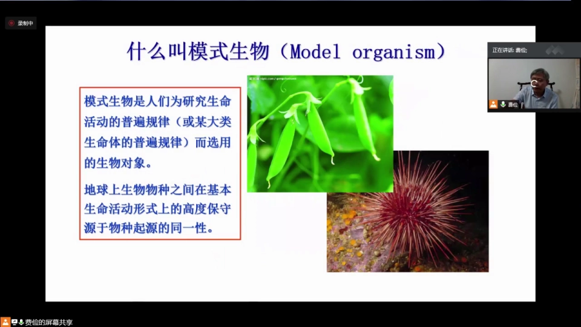
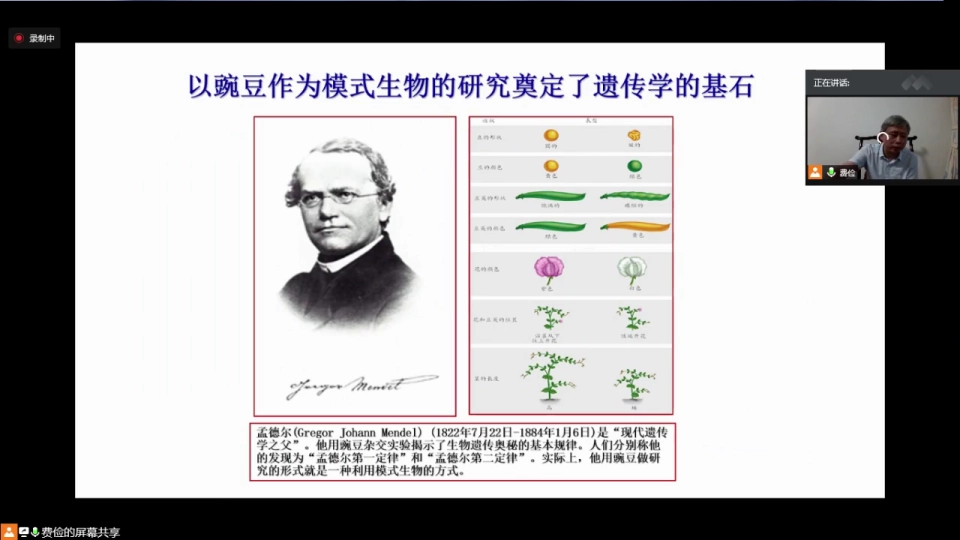
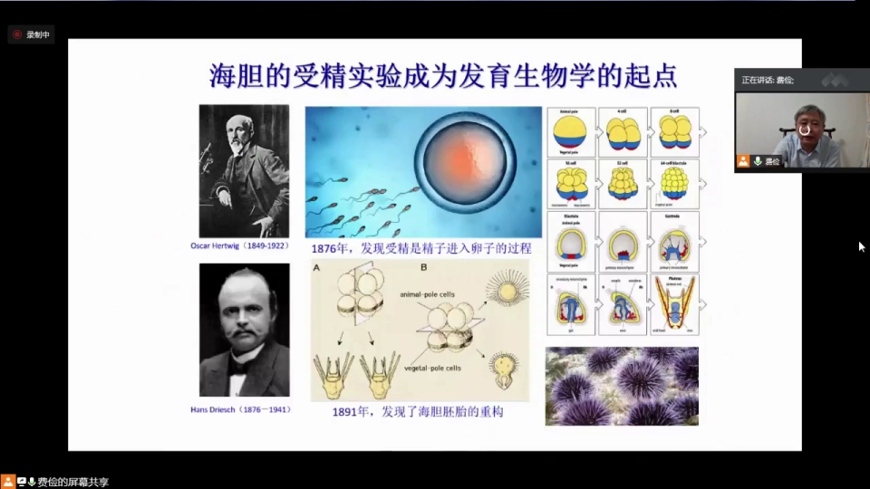
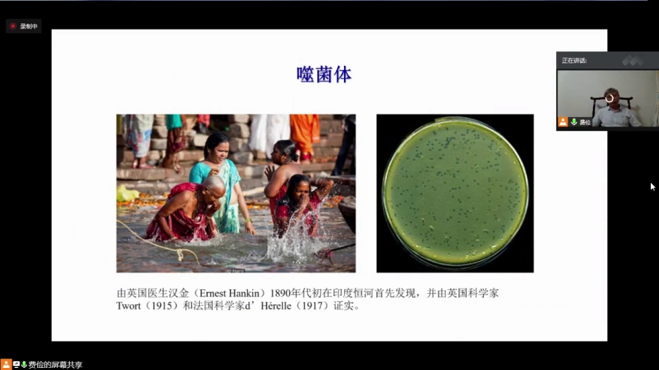
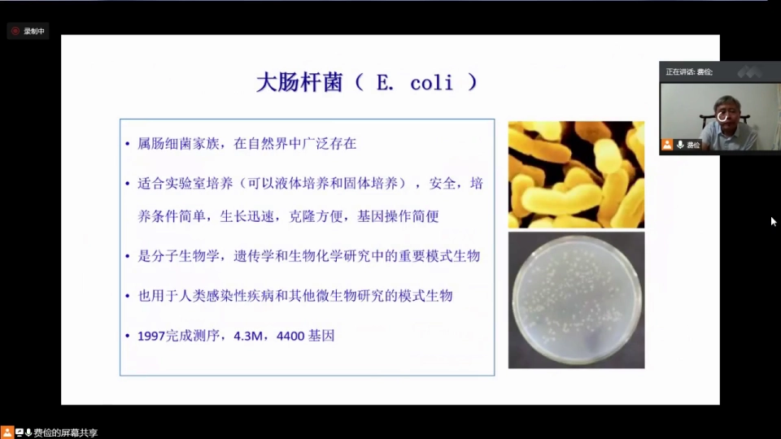
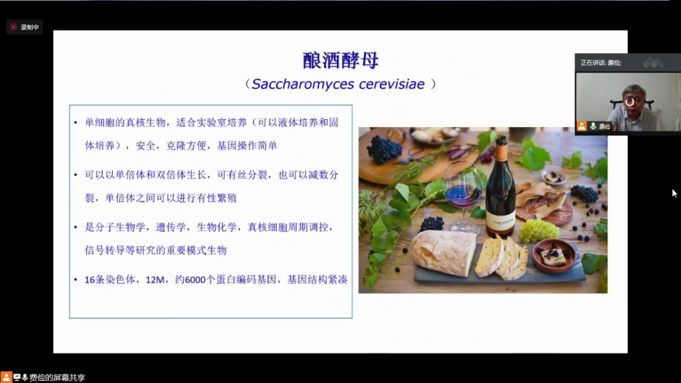
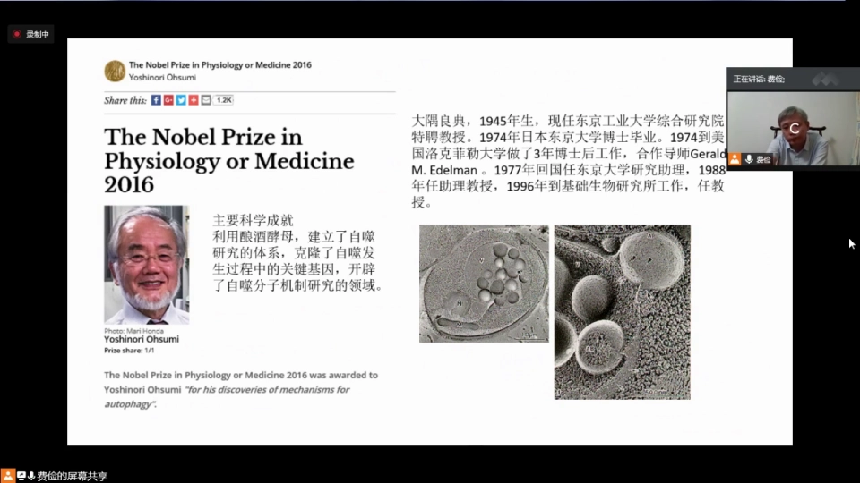
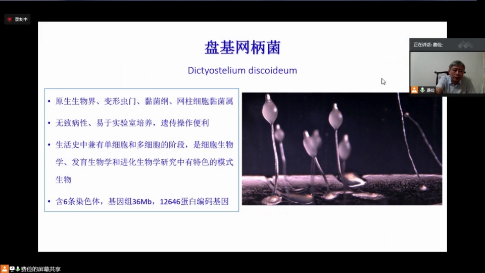
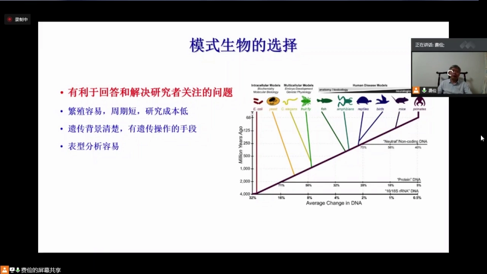
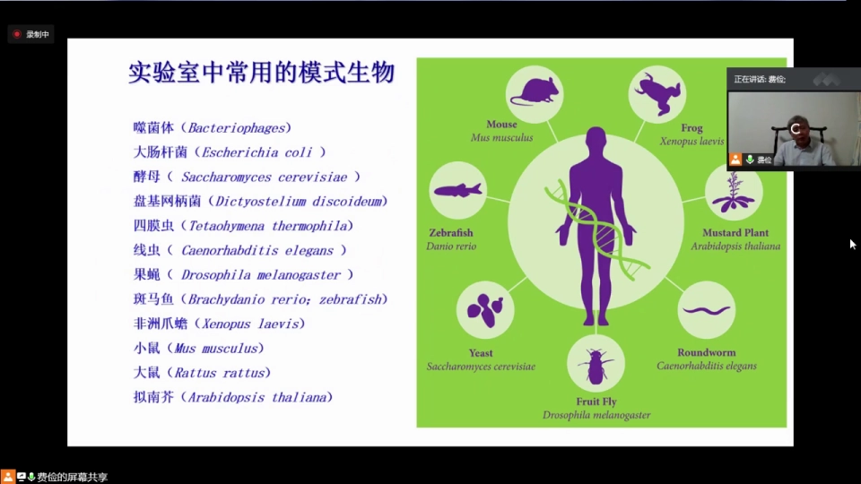

# 模式生物：从豌豆到酵母，选择标准与可外推的边界

> 视频来源：[模式生物，打开生命奥秘之门的钥匙（第一讲）](https://www.bilibili.com/video/BV1At4y1X78Q/)（Bilibili · 南模生物）｜时长约 55 分钟
> 导读：这是「模式生物」系列的第一讲，讲者没有从「常用模式生物清单」开始，而是先回答一个更基础的问题：**为什么研究一两种生物，就能得到关于所有生命的规律？** 他用孟德尔选豌豆、海胆做发育、噬菌体和大肠杆菌找基因、酵母做真核细胞、四膜虫和盘基网柄菌研究单细胞与多细胞，串出一条「选择标准 → 可外推的理由 → 边界」的线。本讲只讲单细胞模式生物，多细胞模型（线虫、果蝇、斑马鱼、小鼠）留到第二讲；跨层级推断为什么会失败，见 [跨层级推断的边界：体外实验、动物模型与人群证据](../../../1_生命的物质与组织层级/1.2_从分子走向系统/1.2.1_生命组织层级：分子、细胞、个体与种群/跨层级推断的边界：体外实验、动物模型与人群证据.md)。

## 本讲要解决的核心问题（SCQA）

**背景**：今天教科书上的遗传学、分子生物学、细胞生物学，绝大部分结论来自少数几种生物：豌豆、海胆、噬菌体、大肠杆菌、酵母、四膜虫。人类自己的细胞反而很少直接做因果实验。

**冲突**：这看起来很不合理——我们关心的是人，为什么答案来自酵母和线虫？更麻烦的是，模式生物不是一个中性的选择：孟德尔如果当年真的用了小鼠，讲者判断他「估计一无所成」[【跳转到 17:11】](https://www.bilibili.com/video/BV1At4y1X78Q/?t=1031)。选错物种，问题可能根本做不出来。

**疑问**：模式生物到底是什么？为什么它的结论可以推广到人？选择模式生物有哪些硬标准？这些标准各自对应什么代价？

**回答（中心思想）**：**模式生物是「为了回答一般规律而选用的生物对象」，可外推的根据是物种间的保守性，可操作性的根据是一组实验标准。** 讲者把选择标准压成一句话：**最有利于回答你所关注的问题**，其次是可行性（繁殖容易、周期短、成本低）、遗传背景清晰、有遗传操作手段、表型容易观测 [【跳转到 15:31】](https://www.bilibili.com/video/BV1At4y1X78Q/?t=931)。保守性保证「机制可能相通」，但这不等于「细节相同」——这正是外推的边界。

[【跳转到 02:51】](https://www.bilibili.com/video/BV1At4y1X78Q/?t=171)

---

## 一、先分清两个词：实验动物与模式生物

讲者开场先做了一个区分，因为这两个词在日常里经常混用 [【跳转到 01:20】](https://www.bilibili.com/video/BV1At4y1X78Q/?t=80)。

- **实验动物**是**法律用词**：国家指定一些动物专门用于医学检验、药品和环境评价等涉及公众健康的场景，对它的生产、使用、质量都有法规要求。它强调的是**标准化和可比性**。
- **模式生物**是**科学用词**：为了研究生命活动的一般规律而选用的物种。它强调的是**能回答什么问题**。

两者的关系是：现在几乎所有的实验动物都包含在模式生物里，但模式生物不一定是实验动物（豌豆、海胆、酵母都不是）。这个区分对读论文很有用：一篇论文说「我们用了实验动物」，是在声明合规与标准化；说「我们用了模式生物」，是在声明这个物种能代表一类生命规律。

> **术语补充**：模式生物（model organism）这个英文词本身是 2000 年以后才成为高频词的，讲者查文献发现 2000 年前几乎很少出现 [【跳转到 12:57】](https://www.bilibili.com/video/BV1At4y1X78Q/?t=777)。但「用少数物种研究一般规律」这件事从生命科学一开始就在做——孟德尔的豌豆（1860 年代）就是最早的案例 [【跳转到 08:44】](https://www.bilibili.com/video/BV1At4y1X78Q/?t=524)。词是新的，方法是老的。

---

## 二、为什么可以外推：保守性，以及它保证不了什么

讲者给的理由很朴素：地球上的物种基本来自共同祖先，所以许多基本生命活动在**形式上、基因层面上、信号通路上**都是高度保守的，因此可以「通过研究一些生命体而推广到其他生命体」 [【跳转到 03:16】](https://www.bilibili.com/video/BV1At4y1X78Q/?t=196)。

这个论证在他后面的例子里反复出现，而且每次都能给出很硬的证据：

- 在大肠杆菌里破译的**遗传密码本**，几乎地球上所有生物通用，人和大肠杆菌共用一本 [【跳转到 29:17】](https://www.bilibili.com/video/BV1At4y1X78Q/?t=1757)。
- 在大肠杆菌里发现的**DNA 损伤修复**机制，同样能在人类细胞里观察到；修复缺陷与乳腺癌的 BRCA1/BRCA2 突变相关 [【跳转到 30:33】](https://www.bilibili.com/video/BV1At4y1X78Q/?t=1833)。
- 在海胆受精卵里发现的 **cyclin**（细胞周期蛋白），后来在哺乳动物和人类中也找到 [【跳转到 11:56】](https://www.bilibili.com/video/BV1At4y1X78Q/?t=716)。

但讲者没有把保守性说成万能。他紧接着讲了一个更重要的限制：**用人做研究，几乎只能得到相关性，很难得到因果关系**——你无法把人当作实验品去操纵基因、控制环境 [【跳转到 13:52】](https://www.bilibili.com/video/BV1At4y1X78Q/?t=832)。模式生物的价值就在于它能做**因果**：改基因型、看表型、控制环境。代价是：因果是在那个物种里建立的，搬到人身上时，保守的是机制框架，不保证每个细节都一样。

> 这与 [1.2.1](../../../1_生命的物质与组织层级/1.2_从分子走向系统/1.2.1_生命组织层级：分子、细胞、个体与种群/跨层级推断的边界：体外实验、动物模型与人群证据.md) 讲的是同一件事的两面：那边讲「通路同名不等于机制同构」（CD33、CD4、中性粒细胞比例的物种差异），这边讲「保守性给了外推的资格，但没给外推的保证」。本文不重复那些例子。

---

## 三、孟德尔的选择标准：一百多年后仍然是铁律

讲者用孟德尔的豌豆实验做第一个案例，重点不是遗传定律，而是**他怎么选物种**。孟德尔在文章里写清楚了选择理由，讲者说这些理由「迄今为止仍然是指导我们如何用模式生物的铁律」[【跳转到 05:37】](https://www.bilibili.com/video/BV1At4y1X78Q/?t=337)。

[【跳转到 04:11】](https://www.bilibili.com/video/BV1At4y1X78Q/?t=251)

孟德尔的理由可以拆成四条：

1. **能回答他关心的问题**。他问的是「种瓜得瓜、种豆得豆」背后的遗传本质，这是几乎所有生命共有的特征，不是豌豆特有的 [【跳转到 05:01】](https://www.bilibili.com/video/BV1At4y1X78Q/?t=301)。
2. **容易杂交，且不受外来花粉污染**。豌豆是闭花授粉，天然纯系多；同时花器结构让去雄和人工授粉都容易操作 [【跳转到 07:07】](https://www.bilibili.com/video/BV1At4y1X78Q/?t=427)。
3. **性状容易观察和统计**。红花/白花、圆粒/皱粒、高/矮，都是离散、可数的性状；连「高」都给了可操作的标准（6–7 英尺 vs 低于 1.5 英尺）[【跳转到 07:54】](https://www.bilibili.com/video/BV1At4y1X78Q/?t=474)。
4. **有足够的候选可以筛**。他在最终选用 7 对性状之前，花了两年试了 **34 种不同的豌豆** [【跳转到 06:42】](https://www.bilibili.com/video/BV1At4y1X78Q/?t=402)。

最后一条最容易被忽略：**模式生物不是「天生」的，是筛出来的。** 讲者说，自然界没有什么生物天生就该是模式生物，它们往往是科学家选出来、再成为「实验室的宠儿」的 [【跳转到 20:27】](https://www.bilibili.com/video/BV1At4y1X78Q/?t=1227)。

反过来看小鼠这个反例就更清楚：孟德尔当时也考虑过小鼠，但他在修道院，养小鼠不现实；更重要的是，当时很难从自然界获得纯种小鼠，而豌豆经过农民一代代种植，已经积累了大量纯系 [【跳转到 17:36】](https://www.bilibili.com/video/BV1At4y1X78Q/?t=1056)。**同一个科学问题，换一个物种，可能连起点都不成立。**

---

## 四、海胆：把「发育」变成可观察的实验

第二个案例是发育生物学。1876 年 Hertwig 用海胆证明受精是精子进入卵子的过程；1891 年 Driesch 把海胆四细胞期胚胎分离，发现每个细胞都能发育成完整个体，第一次证明了早期胚胎细胞的全能性 [【跳转到 09:31】](https://www.bilibili.com/video/BV1At4y1X78Q/?t=571)。

[【跳转到 09:06】](https://www.bilibili.com/video/BV1At4y1X78Q/?t=546)

为什么是海胆？讲者给的理由非常「工程」：海胆很容易获得精子和卵子——用 0.5 M 氯化钾注射，一只海胆能给一烧杯精子，雌海胆能给一烧杯卵子 [【跳转到 10:37】](https://www.bilibili.com/video/BV1At4y1X78Q/?t=637)。**「选对一个模式生物，可以让你事半功倍」**，而且海胆胚胎发育分期清楚、容易辨认，至今仍是研究早期发育和基因通路的常用体系 [【跳转到 11:24】](https://www.bilibili.com/video/BV1At4y1X78Q/?t=684)。

这个案例说明的是：**模式生物的优势往往不是「更像人」，而是「更容易看清楚」。** 海胆在进化上离人很远，但它的早期发育机制保守，且实验窗口极好——这正是「可操作性」优先于「相似性」的典型。

---

## 五、从噬菌体到大肠杆菌：把「基因是什么」变成可操作的实验

### 5.1 噬菌体：物理学家眼中的「氢原子」

噬菌体严格说算不上完整生命，但它有生命特征。讲者讲了发现史：英国医生 Hankin 在印度恒河发现河水能杀死细菌，Twort（1915）和 d'Hérelle（1917）证实这是一种专门攻击细菌的病毒 [【跳转到 22:35】](https://www.bilibili.com/video/BV1At4y1X78Q/?t=1355)。

[【跳转到 22:10】](https://www.bilibili.com/video/BV1At4y1X78Q/?t=1330)

真正让噬菌体成为模式生物的是物理学家德尔布吕克。1940 年代大家都在问「基因到底是 DNA 还是蛋白」，他嫌果蝇太复杂，看到噬菌体「当中一个 DNA、外面一个蛋白」，觉得它就像**氢原子**一样简洁，于是把它当成解答「基因是什么」的模式生物 [【跳转到 25:35】](https://www.bilibili.com/video/BV1At4y1X78Q/?t=1535)。1952 年的 Hershey-Chase 实验用同位素标记蛋白和 DNA，证明进入细菌内部的是 DNA [【跳转到 26:00】](https://www.bilibili.com/video/BV1At4y1X78Q/?t=1560)。

这个选择的逻辑值得记住：**不是「噬菌体能代表生命」，而是「噬菌体把问题压缩到了可操作的最小系统」。** 讲者甚至说，回头看这个实验未必比艾弗里的更干净，但它在 1952 年完成时，几乎没有人再怀疑 DNA 是基因的载体 [【跳转到 26:25】](https://www.bilibili.com/video/BV1At4y1X78Q/?t=1585)。

### 5.2 大肠杆菌：分子生物学的「标准工作台」

大肠杆菌只有 4000 多个基因，培养简单、生长快、克隆方便、基因操作简便，是分子生物学、遗传学和生物化学的重要模式生物 [【跳转到 26:49】](https://www.bilibili.com/video/BV1At4y1X78Q/?t=1609)。

[【跳转到 26:49】](https://www.bilibili.com/video/BV1At4y1X78Q/?t=1609)

讲者列了一串「在大肠杆菌里第一次做出来」的成果：

- **半保留复制**（1958）：同位素标记 + 超速离心，证明 DNA 按半保留方式复制 [【跳转到 27:19】](https://www.bilibili.com/video/BV1At4y1X78Q/?t=1639)。
- **DNA 聚合酶**（1956）：Kornberg 发现第一个 DNA 聚合酶，三年后获诺贝尔奖 [【跳转到 27:54】](https://www.bilibili.com/video/BV1At4y1X78Q/?t=1674)。
- **遗传密码本**（1961 起）：第一个密码子 UUU 破译后，64 个密码子陆续全部解出 [【跳转到 28:52】](https://www.bilibili.com/video/BV1At4y1X78Q/?t=1732)。
- **操纵子模型**：基因如何响应外界信号调控转录；启动子等概念后来在整个生物界通用 [【跳转到 29:47】](https://www.bilibili.com/video/BV1At4y1X78Q/?t=1787)。

注意讲者的措辞：人类的调控方式和大肠杆菌**不完全一致**，但**基本概念一样** [【跳转到 29:47】](https://www.bilibili.com/video/BV1At4y1X78Q/?t=1787)。这句话就是外推边界的准确表述——**框架保守，细节分化**。

---

## 六、酵母：真核细胞的代表

大肠杆菌是原核生物，要研究真核细胞，讲者选了酿酒酵母。它的优势很具体：单细胞真核生物，培养方便、安全、克隆方便、基因操作简单；既能以单倍体生长，也能两个单倍体结合成双倍体，再经减数分裂形成孢子，因此**特别适合做杂交和遗传筛选**；16 条染色体、约 6000 个蛋白编码基因，基因组紧凑 [【跳转到 32:03】](https://www.bilibili.com/video/BV1At4y1X78Q/?t=1923)。

[【跳转到 31:38】](https://www.bilibili.com/video/BV1At4y1X78Q/?t=1898)

讲者举的成果覆盖了真核细胞生物学的几个核心：

- **细胞周期**：CDC 基因与 cyclin 共同组成控制细胞周期的分子，首先在酵母中发现，后来在人类细胞中也找到 [【跳转到 32:38】](https://www.bilibili.com/video/BV1At4y1X78Q/?t=1958)。
- **转录调控**：真核生物基因如何开启转录，相关诺贝尔奖工作是在酵母中完成的 [【跳转到 33:08】](https://www.bilibili.com/video/BV1At4y1X78Q/?t=1988)。
- **自噬**：大隅良典 2016 年诺贝尔奖的工作，用酵母建立自噬研究体系、克隆关键基因 [【跳转到 33:31】](https://www.bilibili.com/video/BV1At4y1X78Q/?t=2011)。

[【跳转到 33:31】](https://www.bilibili.com/video/BV1At4y1X78Q/?t=2011)

**为什么酵母能做这些？** 讲者的回答很直接：酵母非常容易得到突变体，可以做**大规模筛选**；用小鼠做同样的事就很难 [【跳转到 33:56】](https://www.bilibili.com/video/BV1At4y1X78Q/?t=2036)。这就是「通量」这个维度：不是小鼠不能做，而是单位时间能筛的突变体数量差几个数量级。

讲者还给了一个跨界的例子：形成酵母细胞壁的基因和控制哺乳动物血管生成的基因是保守的一组，于是有人想到——能干扰酵母细胞壁的药物，是否也能影响血管生成？他们发现一个用了六十多年的抗真菌/驱虫药「赛博米」确实能抑制血管生成，并在小鼠肿瘤模型上抑制肿瘤发生 [【跳转到 34:14】](https://www.bilibili.com/video/BV1At4y1X78Q/?t=2054)。这是「老药新用」的一条典型路径：**先在简单的模式生物里找到保守靶点，再到复杂体系里验证表型。**

同一类真菌里还有一个经典案例：**红色面包霉**。上世纪 40 年代，Beadle 和 Tatum 用它证明了基因与酶之间的关系（「一个基因一个酶」的雏形），奠定了生化遗传学的基础 [【跳转到 35:36】](https://www.bilibili.com/video/BV1At4y1X78Q/?t=2136)。讲者只用一句话带过，但它和酵母、大肠杆菌一样，说明**模式生物的价值在于「能把一个抽象关系变成可筛选的表型」**。

---

## 七、四膜虫与盘基网柄菌：把问题压到单细胞

讲者后半段介绍了两个不太常见但很有意思的单细胞模式生物，用来说明「模式生物的选择是跟着问题走的」。

### 7.1 四膜虫：一个细胞里有上万个「染色体单位」

四膜虫最奇特的是**双核**：大核负责转录、编码蛋白；小核负责传宗接代，通常不表达。小核有 5 条染色体，大核则由小核发育而来，形成 275 种、每种几十个拷贝的「染色体」，一个细胞里可以有上万个染色体单位 [【跳转到 37:17】](https://www.bilibili.com/video/BV1At4y1X78Q/?t=2237)。

正因为这个结构，四膜虫特别适合研究**端粒**——讲者说，端粒就是在四膜虫里发现的，因为一个细胞里有那么多染色体末端，做生化实验非常方便 [【跳转到 37:52】](https://www.bilibili.com/video/BV1At4y1X78Q/?t=2272)。此外，动力蛋白（dynein）、核酶（ribozyme）也都是在四膜虫里首先发现的 [【跳转到 38:17】](https://www.bilibili.com/video/BV1At4y1X78Q/?t=2297)[【跳转到 40:03】](https://www.bilibili.com/video/BV1At4y1X78Q/?t=2403)。

核酶的意义讲者专门点了一句：过去认为生物体内的催化剂都是蛋白质，发现 RNA 也能催化，为「RNA 世界」假说提供了最强提示——一个分子既能编码遗传信息又能催化，可能是生命起源的关键 [【跳转到 40:28】](https://www.bilibili.com/video/BV1At4y1X78Q/?t=2428)。

### 7.2 盘基网柄菌：一个物种里同时有单细胞和多细胞阶段

盘基网柄菌（Dictyostelium discoideum）是一种粘菌，6 条染色体、约 12,646 个蛋白编码基因。它最特别的地方是生活史：孢子萌发成单细胞阿米巴，在土壤里吃细菌；营养匮乏时，许多单细胞聚集起来，形成一个肉眼可见的「军团」，再分化成类似蛞蝓的结构，迁移到合适环境后长出孢子囊、形成孢子 [【跳转到 44:26】](https://www.bilibili.com/video/BV1At4y1X78Q/?t=2666)。

[【跳转到 43:46】](https://www.bilibili.com/video/BV1At4y1X78Q/?t=2626)

讲者说它适合研究的问题很具体：肿瘤细胞的迁移、细胞间如何分工、哪些细胞愿意「当梗」、哪些进入孢子囊——甚至发现了让同伴心甘情愿当梗的「欺骗基因」[【跳转到 45:41】](https://www.bilibili.com/video/BV1At4y1X78Q/?t=2741)。**多细胞发育中的分工与竞争，可以在一个可控的单细胞→多细胞系统里观察。**

---

## 八、选择清单：把讲者的标准写成可操作的问句

讲者在总结时给了五条标准，并在问答环节把它们落到了具体选择上 [【跳转到 15:31】](https://www.bilibili.com/video/BV1At4y1X78Q/?t=931)[【跳转到 48:47】](https://www.bilibili.com/video/BV1At4y1X78Q/?t=2927)。

[【跳转到 16:21】](https://www.bilibili.com/video/BV1At4y1X78Q/?t=981)

| 标准 | 要问的问题 | 代价 |
| --- | --- | --- |
| 能回答问题 | 这个物种里，我要的现象/机制存在且可测吗？ | 选错物种，问题可能不成立（孟德尔与小鼠） |
| 可行性 | 繁殖周期、饲养成本、伦理与空间能承受吗？ | 周期短、成本低的物种，往往离人更远 |
| 遗传背景 | 是纯系吗？基因组清楚吗？ | 近交系降低变异，也降低了人群代表性 |
| 遗传操作 | 能敲除、敲低、过表达、做筛选吗？ | 操作越成熟，越可能是「实验室化」的品系 |
| 表型可观测 | 表型离散、可量化、可重复吗？ | 表型越容易测，越可能只是替代终点 |

问答环节里，讲者把这套标准用一句话落地：**如果你研究的是细胞层次的事情，单细胞模式生物可能比小鼠更方便、成本更低、通量更高；如果你研究的是多细胞互作、免疫等问题，就不得不选更复杂的模式生物，比如小鼠** [【跳转到 49:12】](https://www.bilibili.com/video/BV1At4y1X78Q/?t=2952)[【跳转到 49:37】](https://www.bilibili.com/video/BV1At4y1X78Q/?t=2977)。

他还提醒了一个常见误区：一提模式生物就想到小鼠、斑马鱼，其实很多问题在更简单的体系里就能做得很清楚——比如凋亡、自噬，在四膜虫里也能研究 [【跳转到 50:27】](https://www.bilibili.com/video/BV1At4y1X78Q/?t=3027)。**「更复杂」不等于「更合适」。**

---

## 九、边界：模式生物在演化，外推也有条件

### 9.1 模式生物不是固定的名单

讲者说得很明确：模式生物都是跟着科学问题走的，以后还会有新的 [【跳转到 51:42】](https://www.bilibili.com/video/BV1At4y1X78Q/?t=3102)。他举了一个很新的例子：一种非洲的鱼，寿命只有 6 个月，为了研究脊椎动物寿命的决定因素，它正在成为新的模式生物 [【跳转到 52:32】](https://www.bilibili.com/video/BV1At4y1X78Q/?t=3152)。

这意味着「模式生物」不是一个封闭清单，而是**问题—物种**的匹配结果。今天的小鼠、斑马鱼、果蝇是历史筛选的产物，不是唯一解。

### 9.2 模式生物 ≠ 细胞培养物

问答里有人问「单细胞生物和单细胞有什么区别」，讲者的回答值得记下来：今天讲的模式生物都是**自然界独立存在的生命体**；而肿瘤细胞培养物、人的原代细胞，是**离开人为操作就不会在自然界以那种形式存在**的东西 [【跳转到 53:22】](https://www.bilibili.com/video/BV1At4y1X78Q/?t=3202)。

这个区分对应两类不同的证据：模式生物回答的是「自然生命的一般规律」，细胞培养物回答的是「这个细胞在培养条件下的行为」。两者都能指导生命研究，但**结论的主语不同**。

### 9.3 保守性给了资格，不保证结论

把这一讲和 [1.2.1](../../../1_生命的物质与组织层级/1.2_从分子走向系统/1.2.1_生命组织层级：分子、细胞、个体与种群/跨层级推断的边界：体外实验、动物模型与人群证据.md) 放在一起，边界可以写成三句话：

1. **能外推，是因为机制保守**（密码本、细胞周期、DNA 修复）。
2. **不能直接外推，是因为细节分化**（通路同名不等于机制同构；免疫细胞组成、受体分布、代谢酶都可能有物种差异）。
3. **外推需要补证据**：在模式生物里得到的因果，要在人源体系（类器官、人细胞）和人群数据里逐级验证。

---

## 十、把模式生物放回体系谱系

| 体系 | 强在哪 | 弱在哪 | 适合回答 |
| --- | --- | --- | --- |
| 噬菌体/大肠杆菌 | 极简、通量高、遗传操作成熟 | 原核，无细胞器与发育 | 复制、转录、翻译、基因调控的基本机制 |
| 酵母 | 单细胞真核、可杂交、可大规模筛选 | 无组织、无发育、细胞类型少 | 细胞周期、自噬、真核转录调控 |
| 四膜虫/盘基网柄菌 | 特殊结构（端粒、双核）或单细胞→多细胞转换 | 与人类距离远、社区小 | 端粒、核酶、细胞分化与分工 |
| 海胆/蛙/斑马鱼 | 胚胎透明、体外发育、易操作 | 与哺乳动物生理差异大 | 早期发育、图式形成 |
| 果蝇/线虫 | 遗传筛选强、神经与发育可追踪 | 无哺乳动物器官系统 | 发育、神经、行为、衰老 |
| 小鼠/大鼠 | 哺乳动物生理、免疫、疾病模型 | 贵、慢、物种差异、伦理 | 整体生理、免疫、疾病表型 |
| 非人灵长类 | 与人类最接近 | 极贵、伦理限制、样本少 | 需要灵长类特异性的问题 |

这张表的后三行（果蝇、线虫、斑马鱼、小鼠、灵长类）在本讲里只出现在「实验室常用模式生物」的清单上，讲者明确说留到第二讲展开 [【跳转到 21:42】](https://www.bilibili.com/video/BV1At4y1X78Q/?t=1302)。所以本文对它们的描述只到「强在哪/弱在哪」的层面，不展开具体品系与操作；小鼠的物种差异问题可回看 [1.2.1](../../../1_生命的物质与组织层级/1.2_从分子走向系统/1.2.1_生命组织层级：分子、细胞、个体与种群/跨层级推断的边界：体外实验、动物模型与人群证据.md)。

[【跳转到 21:17】](https://www.bilibili.com/video/BV1At4y1X78Q/?t=1277)

---

## 小结

- **模式生物是为回答一般规律而选用的物种**；实验动物是法律用词，两者不是同义词 [01:20][02:51]。
- **可外推的根据是保守性**：密码本、细胞周期、DNA 修复都能跨物种找到 [29:17][32:38][30:33]；但保守的是框架，不是细节。
- **选择标准有五条**：能回答问题、可行、遗传背景清晰、可遗传操作、表型可观测 [15:31]；最优先的是第一条。
- **模式生物是筛出来的，不是天生的**：孟德尔试了 34 种豌豆 [06:42]；选错物种，问题可能不成立 [17:11]。
- **简单体系常常更合适**：酵母做大规模筛选 [33:56]，四膜虫做端粒与核酶 [37:52][40:03]，盘基网柄菌做单细胞→多细胞分工 [44:26]。
- **边界**：模式生物随问题演化 [52:32]；模式生物不同于细胞培养物 [53:22]；外推需要人源体系与人群证据逐级补链。

## 关键术语速查

| 术语 | 一句话解释 |
| --- | --- |
| 模式生物 | 为研究生命活动普遍规律而选用的物种，如豌豆、海胆、酵母、小鼠 |
| 实验动物 | 国家法规指定、用于检验与评价的标准化动物，强调质量与可比性 |
| 保守性 | 不同物种在基因、通路、形式上保持相似，是跨物种外推的基础 |
| 遗传操作 | 通过杂交、转基因、基因编辑等手段改变基因型 |
| 突变体筛选 | 大规模产生并挑选表型异常的个体，用于找基因与通路 |
| 噬菌体 | 专门感染细菌的病毒；Hershey-Chase 实验用它证明 DNA 是遗传物质 |
| 四膜虫 | 双核单细胞真核生物，端粒与核酶在此首次发现 |
| 盘基网柄菌 | 粘菌，生活史兼有单细胞与多细胞阶段，用于研究分化与分工 |
| 近交系 | 长期近亲交配得到的遗传背景高度一致的品系，降低变异但降低代表性 |