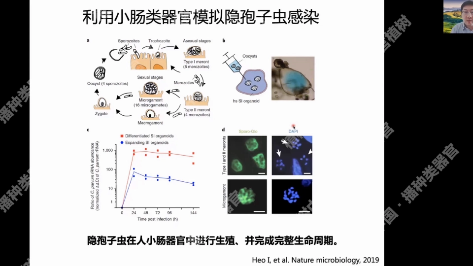
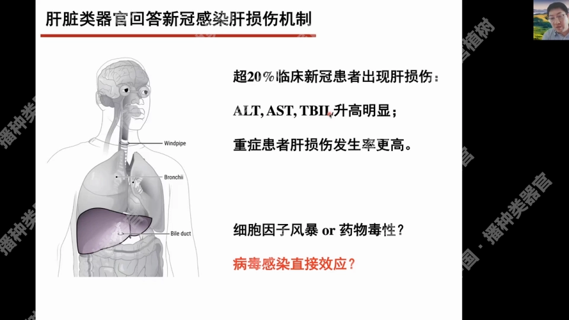
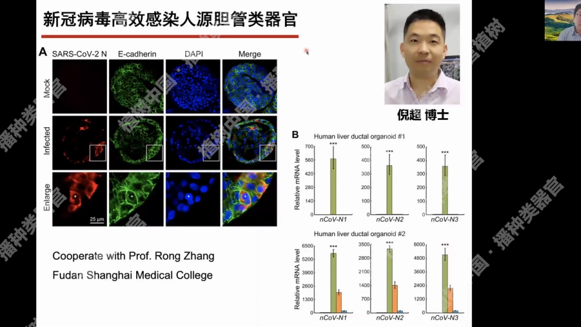
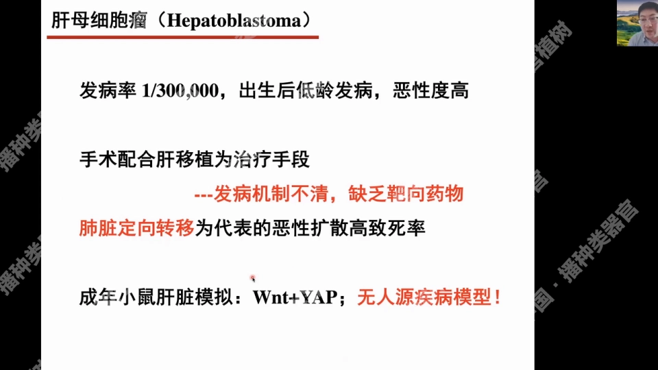
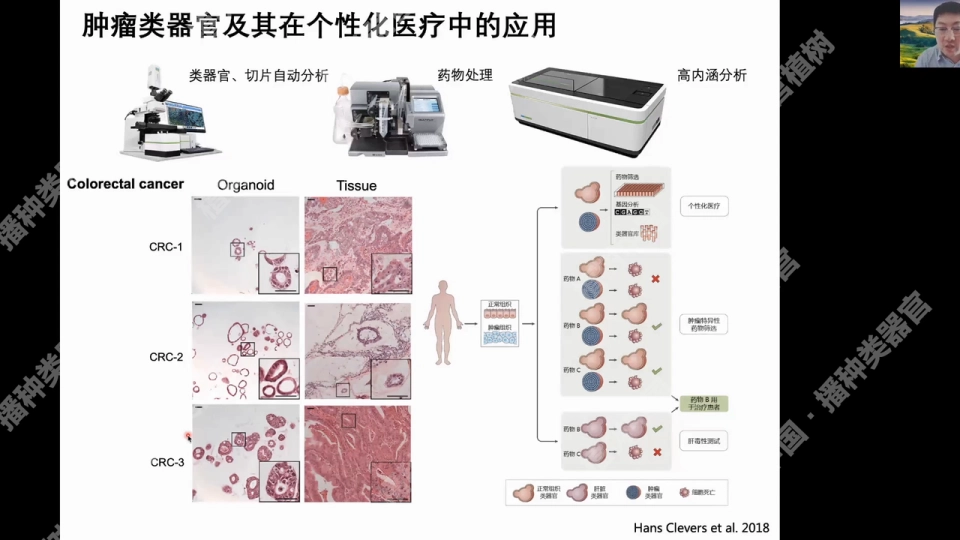
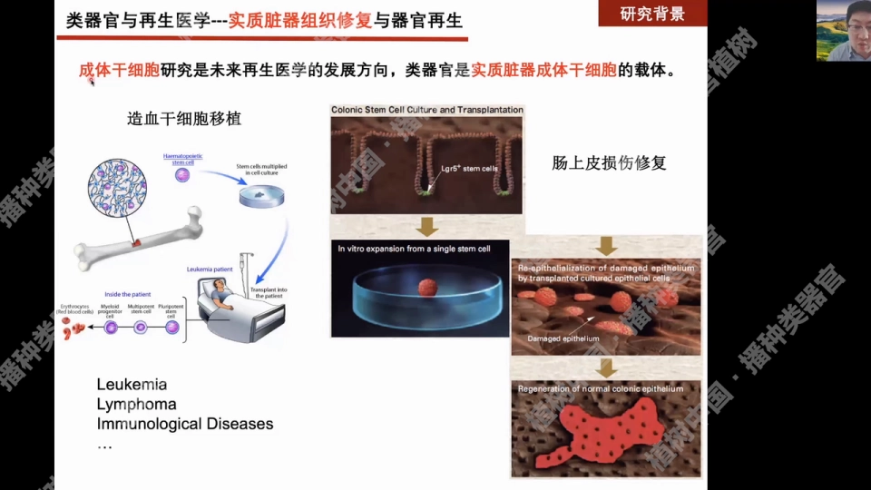
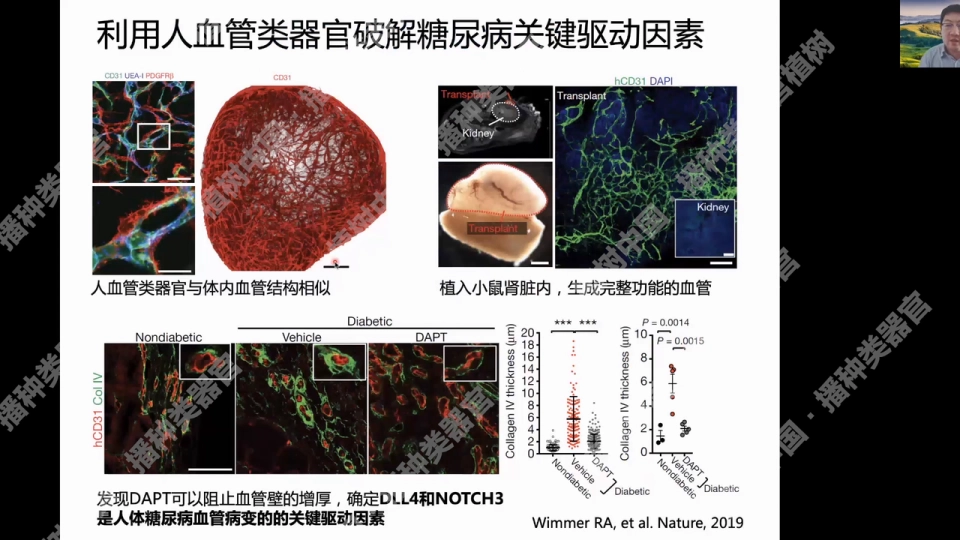
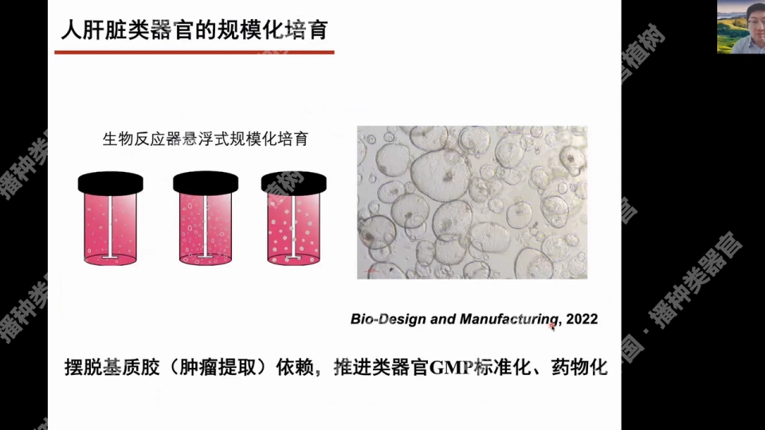

# 类器官：自组织三维结构能回答什么、不能回答什么

> 视频来源：[播种类器官｜类器官的发展、应用与展望——复旦大学赵冰教授类器官课程](https://www.bilibili.com/video/BV1DY4y1R7wD/)（Bilibili · 伯桢生物，复旦大学赵冰教授）第二讲，时长约 44 分钟
> 导读：上一节把细胞系和模式生物放进了同一张体系谱系里。这一讲补上第三类体系——**类器官（organoid）**。讲者用隐孢子虫、新冠、肝母细胞瘤、肿瘤药敏和再生医学五个案例，说明类器官不是「更复杂的细胞培养」，而是**利用组织自身的记忆与自组织能力，在体外重建一小段有结构的组织**。它补上了细胞系缺的结构、动物模型缺的人源背景，但同时也缺免疫、缺血管、缺标准化。跨层级推断为什么会失败，见 [跨层级推断的边界：体外实验、动物模型与人群证据](../../../1_生命的物质与组织层级/1.2_从分子走向系统/1.2.1_生命组织层级：分子、细胞、个体与种群/跨层级推断的边界：体外实验、动物模型与人群证据.md)，本文只在必要处回链，不重述那套论证。

## 本讲要解决的核心问题（SCQA）

**背景**：细胞系便宜、可控、通量高，但它是一层贴在塑料上的细胞；小鼠有完整的生理，但它的基因、免疫和发育节奏都不是人的。很多问题卡在中间：既要人源，又要结构，还要能重复。

**冲突**：讲者给了一个很尖锐的例子。隐孢子虫是一种只寄生在肠上皮细胞内的单细胞寄生虫，把它打进小鼠体内「什么都不会发生」，放到肠癌细胞系或永生化肠细胞系里也**不感染**——它「比人聪明」，认得出那不是真正的肠上皮 [【跳转到 00:56】](https://www.bilibili.com/video/BV1DY4y1R7wD/?t=56)。同一时期，新冠原始毒株在细胞系和实验动物里都难以重现感染 [【跳转到 09:28】](https://www.bilibili.com/video/BV1DY4y1R7wD/?t=568)。两类最常用的体系同时失效，问题就不在「模型好不好」，而在**这类问题需要什么样的体系**。

**疑问**：类器官到底「类」在哪里？它凭什么能补上细胞系和小鼠都缺的那一段？它能回答哪些问题、不能回答哪些问题？把它放进证据链时，应该放在哪一级？

**回答（中心思想）**：类器官不是人造器官，而是**给有记忆的种子一个可自组织的微环境**。讲者的总结是：它利用「器官惊人的记忆和自我组织能力」，实现高度仿生，既是「体内解析的取代」，也是「体外工程创造」 [【跳转到 23:40】](https://www.bilibili.com/video/BV1DY4y1R7wD/?t=1420)。正因为仿真是**结构层面**的，它能回答「这种细胞会不会被感染」「这个患者的肿瘤对药敏不敏感」这类功能问题；也正因为只重建了局部组织，它缺免疫、缺血管、缺整体代谢，不能替代个体和人群。

[【跳转到 23:40】](https://www.bilibili.com/video/BV1DY4y1R7wD/?t=1420)

---

## 一、类器官是什么：种子、微环境与「自组织」

讲者反复强调一个区别：**类器官不是把细胞拼成一个器官，而是让细胞自己长成组织。** 研究者做的事情是两件——提供一个「有记忆的种子」（干细胞或前体细胞），再还原一个足够像体内的微环境；剩下的结构由细胞自己的自组织完成 [【跳转到 23:40】](https://www.bilibili.com/video/BV1DY4y1R7wD/?t=1420)。

这解释了类器官的两个基本特征：

- **来源是细胞，不是图纸**。种子可以来自组织中的成体干细胞，也可以来自多能干细胞（如 iPSC）诱导分化；不同来源决定了它保留的是「这个组织」还是「这个发育阶段」。
- **结构是长出来的**。肠道类器官会自己形成腔和绒毛，肝脏类器官会形成胆管样结构。讲者用「器官记忆」形容这件事：只要微环境对，细胞记得自己该长成什么 [【跳转到 23:40】](https://www.bilibili.com/video/BV1DY4y1R7wD/?t=1420)。

> **术语补充**：类器官和「球状体（spheroid）」常被混用。球状体通常只是细胞的 3D 聚团，不要求有组织结构和干细胞自我更新；类器官要求能长期传代、能自组织出该组织的细胞类型与空间排布。判断一个 3D 培养物是不是类器官，看的是**结构 + 自我更新**，不是「圆不圆」。

这也决定了类器官的定位：它是**体外体系**，不是个体。它比细胞系多了结构和细胞间相互作用，比动物模型多了人源背景，但仍然没有血液循环、没有免疫系统、没有神经内分泌调节。

---

## 二、它补上了细胞系缺的那一段：三个「只有类器官能做」的例子

### 2.1 隐孢子虫：细胞系和小鼠都不感染的病原体

隐孢子虫寄生在肠上皮细胞**内部**，而且「特别挑食」：打进小鼠体内不发病，放到肠癌细胞系里也不感染 [【跳转到 00:56】](https://www.bilibili.com/video/BV1DY4y1R7wD/?t=56)。研究者的做法是把虫子打进人肠道类器官的**腔**里，结果虫子把类器官当成了真正的人肠上皮，定植到绒毛和吸收细胞的微绒毛上，完成整个生命周期，还能复制扩增 [【跳转到 01:46】](https://www.bilibili.com/video/BV1DY4y1R7wD/?t=106)。

[【跳转到 00:56】](https://www.bilibili.com/video/BV1DY4y1R7wD/?t=56)

讲者的评价很到位：**「不光科学家认为类器官好，连虫子都认为类器官好」**——虫子无法区分肠道类器官和真正的人体组织 [【跳转到 02:11】](https://www.bilibili.com/video/BV1DY4y1R7wD/?t=131)。这个案例说明的不是「类器官比细胞系高级」，而是：**当病原体的宿主特异性卡在「细胞极性 + 顶端膜 + 三维结构」上时，扁平的细胞系在原理上就回答不了这个问题。**

### 2.2 新冠：原始毒株在细胞系和动物里都难以重现

2020 年初，临床发现相当比例的新冠患者出现肝损伤，ALT、AST、总胆红素升高，重症患者更明显 [【跳转到 03:29】](https://www.bilibili.com/video/BV1DY4y1R7wD/?t=209)。问题是要区分三种解释：细胞因子风暴、药物毒性，还是病毒直接感染了胆管。

[【跳转到 04:19】](https://www.bilibili.com/video/BV1DY4y1R7wD/?t=259)

研究路径是「先看受体，再做感染」：用单细胞测序确认胆管细胞上存在病毒受体与共受体的双表达，然后把人的胆管类器官送到 P3 实验室，与上海分离的第一株病毒共培养 [【跳转到 05:00】](https://www.bilibili.com/video/BV1DY4y1R7wD/?t=300)。结果是病毒迅速侵染类器官，24 小时内完成基因组复制，48–72 小时下降——因为细胞已经被杀死；同时上皮紧密连接缺失、胆汁转运蛋白下调，对应临床上的胆汁淤积和肝损伤 [【跳转到 06:28】](https://www.bilibili.com/video/BV1DY4y1R7wD/?t=388)。

[【跳转到 05:33】](https://www.bilibili.com/video/BV1DY4y1R7wD/?t=333)

这个案例的关键不在结论，而在**体系选择**。讲者明确说：对新冠**原始毒株**，无论用细胞系还是实验动物，都没有办法重现感染——病毒根本不进动物细胞、也不进细胞系，所以只能选人源类器官；等到病毒进化到德尔塔，才能直接感染野生型小鼠 [【跳转到 09:28】](https://www.bilibili.com/video/BV1DY4y1R7wD/?t=568)。**同一个病毒，不同变异株的「可用体系」会变**；体系适用性不是固定属性，而是体系与问题之间的匹配。

### 2.3 肝母细胞瘤：小鼠模型「站不住脚」的地方

第三个例子更能说明类器官的不可替代性。肝母细胞瘤（hepatoblastoma）发病率约 1/300,000，出生后低龄发病，恶性度高，治疗靠手术加肝移植，发病机制不清、缺乏靶向药，以肺定向转移为特征的恶性扩散致死率高 [【跳转到 11:13】](https://www.bilibili.com/video/BV1DY4y1R7wD/?t=673)。

[【跳转到 12:28】](https://www.bilibili.com/video/BV1DY4y1R7wD/?t=748)

已有的小鼠模型是往成年小鼠尾静脉高压注射，在肝脏里上调 Wnt 和 YAP，看到肿瘤发生。讲者指出这里有一个**悖论**：肝母细胞瘤之所以叫「母细胞瘤」，是因为它起源于**还没有分化的肝前体细胞**；而在已经分化的实质细胞上做基因操纵，得到的结论是否适用于这种肿瘤，本身存疑 [【跳转到 12:03】](https://www.bilibili.com/video/BV1DY4y1R7wD/?t=723)。他们随后用人胚 12 周孕周的肝前体细胞建立类器官，再做基因操纵，结论是：**在小鼠模型上得到的结论「完全站不住脚」** [【跳转到 12:28】](https://www.bilibili.com/video/BV1DY4y1R7wD/?t=748)。

这个例子给出的判据很具体：**当疾病的关键变量是「人的发育阶段 + 人的细胞来源」时，物种差异和发育阶段差异会同时失效**。这不是「小鼠不够好」，而是这个问题的答案必须由人源、特定发育阶段的细胞来提供。

---

## 三、类器官能回答的四类问题

把上面的案例和后半场的内容放在一起，类器官的适用范围可以归成四类。

### 3.1 感染与宿主特异性：谁能进、进了之后发生什么

隐孢子虫和新冠都属于这一类。类器官提供的是**有极性、有顶端膜、有细胞间连接**的上皮，病原体识别的是这些结构特征，而不是「是不是人」这个标签。所以类器官能回答「这种病原体能不能感染这种组织」「感染后屏障和转运功能怎么变」，但不能回答「感染后全身炎症反应有多强」——那需要免疫系统和整体生理。

### 3.2 疾病机制与发育窗口：在正确的细胞和阶段上做基因操纵

肝母细胞瘤的例子说明，类器官可以把「基因突变」放进**特定发育阶段**的细胞里，观察它是否足以致病。讲者在人胚肝类器官里分别激活 YAP 等通路，发现单因素突变就能让类器官在培养板里长成恶性组织，并在分子指征上重现临床样本的特征 [【跳转到 13:46】](https://www.bilibili.com/video/BV1DY4y1R7wD/?t=826)。这类问题的关键是**起点细胞对不对**，而不是模型复不复杂。

### 3.3 个体化药敏：把「试药」变成功能检测

这是类器官目前最接近临床的用途。讲者介绍，同一患者不同部位的肿瘤具有强烈的异质性和独特突变谱，而患者来源的肿瘤类器官能保留取材位置的突变谱和药物敏感性 [【跳转到 18:38】](https://www.bilibili.com/video/BV1DY4y1R7wD/?t=1118)。

[【跳转到 19:53】](https://www.bilibili.com/video/BV1DY4y1R7wD/?t=1193)

讲者给了一组很硬的数字：3–5 年的临床回顾性研究显示，如果患者类器官对某药**不敏感**，该药用在患者身上的有效率是 **0%**；如果类器官**敏感**，患者敏感的可能性达到 **80% 以上**；而在此之前，无论用 NGS 测序还是其他解析方式，判断药物对应性的准确率总体**不超过 40%** [【跳转到 20:18】](https://www.bilibili.com/video/BV1DY4y1R7wD/?t=1218)。

> **怎么读这组数字**：0% 和 80% 不是「类器官能预测一切」，而是**阴性预测值高、阳性预测值中等**。它更适合用来「排除无效药」，而不是单独决定用什么药。讲者也把它放在「辅助决策」的位置，而不是替代临床。

### 3.4 再生医学：把干细胞送到需要修复的组织

讲者花了不少时间讲再生医学，因为这里有一个常被忽略的逻辑。成体干细胞技术并不是没用：造血干细胞移植已经是白血病、淋巴瘤和严重自身免疫病的**康复金标准** [【跳转到 25:20】](https://www.bilibili.com/video/BV1DY4y1R7wD/?t=1520)。但为什么这套逻辑扩展不到肝、肠、肺？原因是**上皮干细胞离开组织就活不了**：它不能单独维持，也不能单独扩增，所以类器官出现之前，实质脏器的干细胞没有可用的扩增策略 [【跳转到 26:10】](https://www.bilibili.com/video/BV1DY4y1R7wD/?t=1570)。

[【跳转到 27:00】](https://www.bilibili.com/video/BV1DY4y1R7wD/?t=1620)

类器官的改变在于：上皮干细胞可以**和它的「伙伴」细胞一起**扩增，从而在体外长期维持。于是有了后面的应用：肠道类器官铺到损伤的肠上皮表面做修复；甲状腺、肠道类器官种到小鼠肾脏里长出完整组织；以及一项发表在 Science 上的工作——把胆管类器官灌入因转运而受损、本来要被废弃的供体肝脏，在体外循环系统里修复胆管、改善肝脏评分 [【跳转到 28:37】](https://www.bilibili.com/video/BV1DY4y1R7wD/?t=1717)。

[【跳转到 37:29】](https://www.bilibili.com/video/BV1DY4y1R7wD/?t=2249)

---

## 四、类器官的边界：它缺什么

讲者在讲趋势时，把局限说得很直接：现在的类器官还停留在**对大器官局部组织的功能模拟**——肝脏要么是实质类器官、要么是胆管类器官，肺要么是肺泡类器官、要么是气管类器官；而且**没有免疫系统，也没有血管化系统** [【跳转到 35:13】](https://www.bilibili.com/video/BV1DY4y1R7wD/?t=2113)。这几条限制决定了它的结论能走多远。

### 4.1 缺免疫、缺血管：局部对了，整体没对上

没有免疫细胞，类器官就无法回答「免疫系统如何参与」——感染后的炎症、肿瘤的免疫逃逸、免疫药物的作用，都需要把免疫细胞「共建」进来，而这需要额外的刺激因子和培养条件 [【跳转到 37:29】](https://www.bilibili.com/video/BV1DY4y1R7wD/?t=2249)。没有血管，营养靠扩散，尺寸一大内部就会坏死，也无法模拟药物经血循环到达组织的浓度曲线。

> 这一条正好接上 [1.2.1](../../../1_生命的物质与组织层级/1.2_从分子走向系统/1.2.1_生命组织层级：分子、细胞、个体与种群/跨层级推断的边界：体外实验、动物模型与人群证据.md) 讲的「微环境缺失」：类器官把**组织结构**补回来了，但**循环、免疫、神经内分泌**仍然不在场。所以「类器官里有效」和「患者体内有效」之间，仍然隔着剂量、代谢和整体代偿。

### 4.2 培养条件本身带偏倚：基质胶、生长因子与「物理环境」

类器官培养长期依赖**基质胶（Matrigel）**，而它的来源是小鼠肉瘤提取物——讲者的原话是「你可以把它理解成老鼠的癌症的基质」 [【跳转到 39:37】](https://www.bilibili.com/video/BV1DY4y1R7wD/?t=2377)。这带来两个问题：成分批次不稳定；以及如果要往人体里用，这种来源本身就不适合做 GMP 标准化。为此，讲者的团队用**全小分子组合**替代生长因子，实现肝胆类器官的长期扩增，为低成本和标准化打基础 [【跳转到 31:31】](https://www.bilibili.com/video/BV1DY4y1R7wD/?t=1891)。

[【跳转到 39:37】](https://www.bilibili.com/video/BV1DY4y1R7wD/?t=2377)

还有一个容易被忽略的变量：**物理环境**。讲者举了肠道类器官的例子——把类器官放进能施加节律性牵张的系统，每分钟拉 50 下时发育和生长最快，改变幅度或节律都达不到同样效果 [【跳转到 38:27】](https://www.bilibili.com/video/BV1DY4y1R7wD/?t=2307)。这说明「像不像」不只是细胞类型的问题，机械力、流速、基质硬度都会改变结论。

### 4.3 批次差异与成熟度：每个实验室的类器官不是同一个东西

类器官来自患者组织或干细胞，供体之间天然不同；培养过程又高度依赖手工（讲者形容为「刀耕火种」），铺胶厚薄都会影响结果 [【跳转到 40:38】](https://www.bilibili.com/video/BV1DY4y1R7wD/?t=2438)。这带来两个直接后果：

- **同一实验在不同批次、不同实验室之间难以复现**。这也是行业在推自动化、标准化和标准物质的原因 [【跳转到 41:03】](https://www.bilibili.com/video/BV1DY4y1R7wD/?t=2463)。
- **成熟度不一致**。胎儿期来源、成体来源、iPSC 诱导来源的类器官，处在不同的发育阶段，不能互相替代。肝母细胞瘤的例子已经说明，发育阶段本身就是结论的一部分。

---

## 五、把类器官放回体系谱系：一张适用问题对照表

| 问题类型 | 细胞系 | 类器官 | 模式生物/动物 |
| --- | --- | --- | --- |
| 某基因在细胞内的通路机制 | 适合（可控、通量高） | 可用（有结构时更好） | 可用，但成本高 |
| 病原体能否感染某种人组织 | 常失效（缺极性/结构） | **适合**（隐孢子虫、新冠） | 物种特异性常挡住 |
| 组织-level 的屏障、转运、分泌 | 不适合 | **适合** | 适合，但人源性问题 |
| 个体化药敏 | 不适合（缺患者背景） | **适合**（0%/80%） | 不适合（物种+通量） |
| 免疫、炎症、整体代谢 | 不适合 | 缺免疫（需共建） | **适合**（完整个体） |
| 行为、发育、寿命 | 不适合 | 部分（发育窗口） | **适合** |
| 人群异质性、临床结局 | 不适合 | 不适合 | 不适合（需人群研究） |

这张表要表达的不是排名，而是**匹配**：每一类体系都有它能回答的问题，也有它在原理上回答不了的问题。类器官的位置很清楚——**在「有结构的人源组织」这一格，它是目前最合适的工具**；出了这一格，它既不如细胞系方便，也不如动物完整。

---

## 六、体系选择的决策清单

把这一讲和同节另外两篇放在一起，可以压成一条四步链：

1. **问题类型**：你要回答的是机制、感染、药敏、发育、免疫，还是人群结局？
2. **需要的读出**：结构、功能、表达、表型、临床终点？读出类型决定了体系的下限（读出分类见 [生物学测量：序列、结构、表达与表型](../5.1.1_生物学测量：序列、结构、表达与表型/组学层次与读出：基因组、转录组、蛋白组、代谢组各能回答什么.md)）。
3. **需要的体系**：人源 + 结构 → 类器官；通量 + 机制 → 细胞系；整体生理 → 动物；人群 → 流行病学/临床试验。
4. **需要的对照**：同一供体/同一批次、溶剂对照、阳性与阴性对照、以及**跨体系的一致性验证**（对照设计见 [实验设计与证据链](../5.1.2_实验设计与证据链：对照、重复、相关与因果/对照与假说：无关变量、溶剂对照与预期结果.md)）。

一个实用的判据是：**如果换一个体系结论就翻转，那么这个结论的主语就不是「人」，而是「这个体系」。** 隐孢子虫在细胞系里不感染、在类器官里感染，说明的是体系差异；新冠原始毒株与德尔塔的差别，说明的是同一体系在不同变异株下的适用性变化。

---

## 七、验证链：类器官是中间一级，不是终点

讲者的案例其实都走了多级验证，只是他讲得快。把它们拆开看：

| 级别 | 回答什么 | 本讲的例子 |
| --- | --- | --- |
| 细胞/分子 | 有没有受体、通路是否被激活 | 单细胞测序确认胆管细胞表达 ACE2 与共受体 [05:00] |
| 类器官 | 有结构的人源组织里，感染/突变/药敏是否成立 | 胆管类器官感染、肝母细胞瘤类器官成瘤 [05:33][13:46] |
| 动物 | 整体生理下是否重现表型、能否移植成瘤 | 类器官移植到免疫缺陷小鼠肝包膜下，30% 出现肺转移 [14:34] |
| 人样本/临床 | 人群里是否一致、是否有临床价值 | 3–5 年回顾性药敏研究 [19:28] |

这条链的含义是：**每一级回答的问题不同，不能互相替代，也不能跳级。** 类器官证明了「人源组织在结构上可以被感染」，但不能证明「患者会出现肝损伤」；动物移植证明了「这些细胞能成瘤并转移」，但不能证明「人的肿瘤也是这样转移的」；回顾性研究证明了「药敏与疗效相关」，但不能证明「按类器官选药一定更好」——那需要前瞻性临床试验。

> 这与 [1.2.1](../../../1_生命的物质与组织层级/1.2_从分子走向系统/1.2.1_生命组织层级：分子、细胞、个体与种群/跨层级推断的边界：体外实验、动物模型与人群证据.md) 的结论一致：跨层不是把结论放大，而是把每层丢掉的信息逐项补回来。类器官补的是「结构 + 人源」，没补的是「免疫 + 循环 + 整体」。

---

## 小结

- 类器官 = **有记忆的种子 + 可自组织的微环境**；它的优势是结构与人源，不是「更像人」这种笼统说法 [23:40]。
- 它能回答四类问题：**感染与宿主特异性**（隐孢子虫 [00:56]、新冠 [05:33]）、**特定发育阶段的疾病机制**（肝母细胞瘤 [12:28]）、**个体化药敏**（0%/80% [20:18]）、**再生医学**（上皮干细胞载体 [27:00]）。
- 它的边界同样清楚：**缺免疫、缺血管** [35:13]、**基质胶与培养条件带偏倚** [39:37]、**批次与成熟度不一致** [40:38]。
- 体系选择看匹配，不看排名：人源 + 结构选类器官，通量 + 机制选细胞系，整体生理选动物，人群结局只能靠人群研究。
- 类器官是**验证链的中间一级**：它把「细胞机制」和「个体表型」之间的结构缺口补上，但不替代任何一级。

## 关键术语速查

| 术语 | 一句话解释 |
| --- | --- |
| 类器官（organoid） | 由干细胞/前体细胞自组织形成的、保留来源组织结构和功能的 3D 培养物 |
| 自组织（self-organization） | 细胞在给定微环境下自行排列成组织结构的现象，不靠外部图纸 |
| 基质胶（Matrigel） | 从小鼠肉瘤提取的胶状基质，提供 3D 支撑，但成分批次不稳定 |
| 成体干细胞 | 存在于已分化组织中的干细胞，负责更新修复；上皮干细胞离开组织难以单独存活 |
| iPSC | 诱导多能干细胞，可由体细胞重编程获得，能分化为多种组织 |
| 个体化药敏 | 用患者来源类器官测试药物敏感性，辅助临床选药 |
| 血管化 | 在类器官中重建血管网络，解决营养供应和药物暴露问题 |
| GMP | 药品生产质量管理规范；类器官若要用于人体，培养体系需符合其标准 |