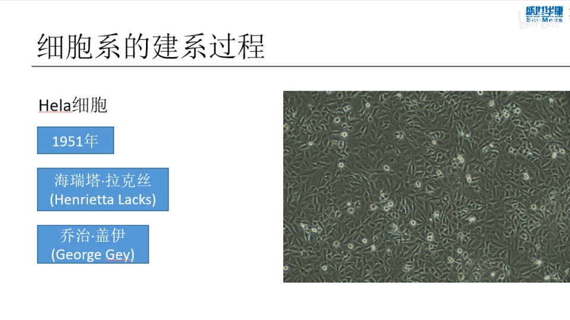
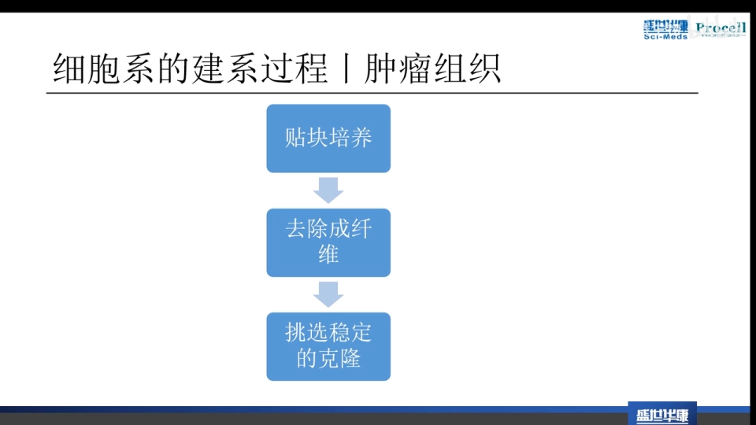
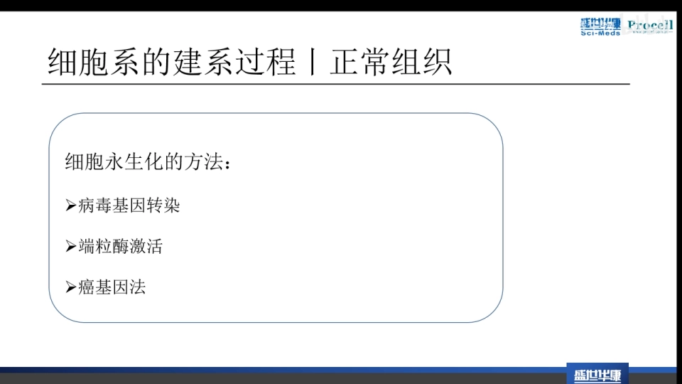
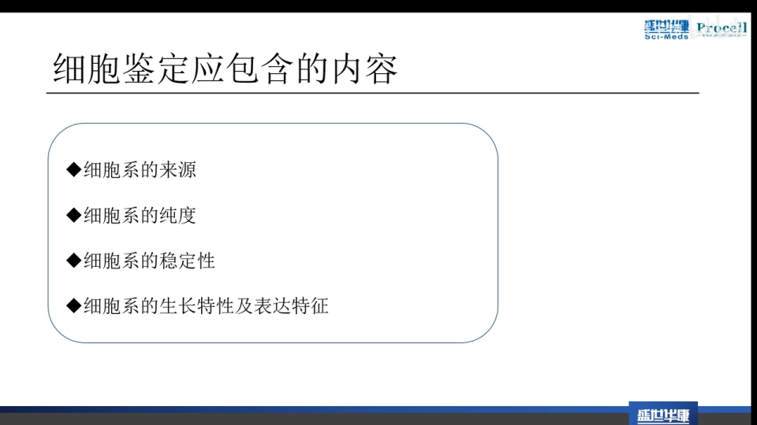
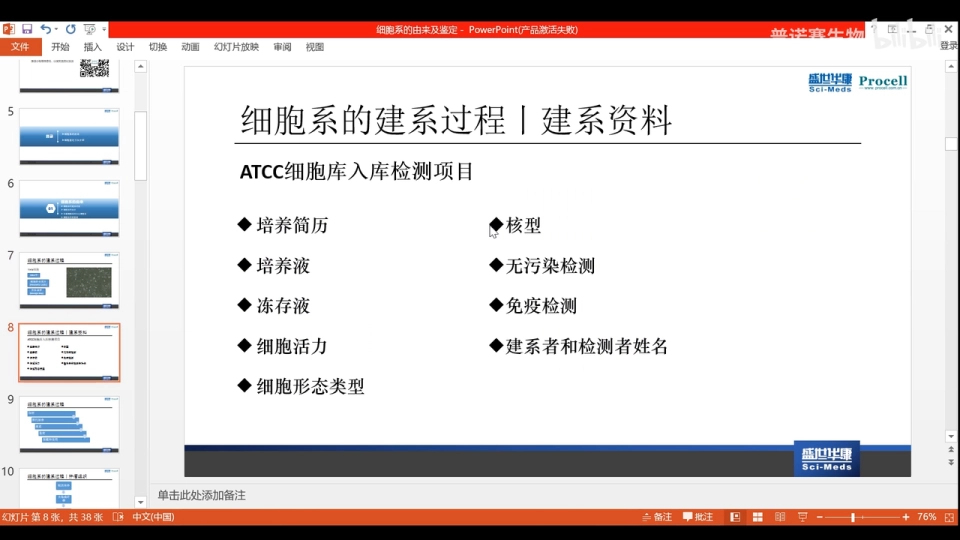
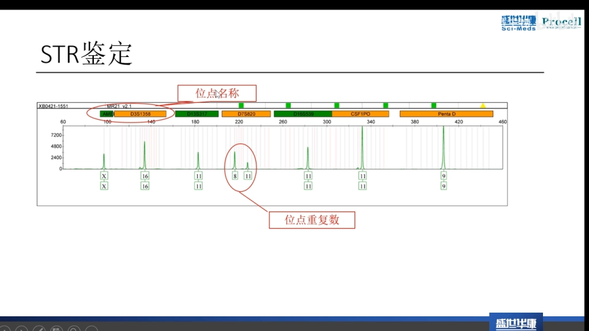
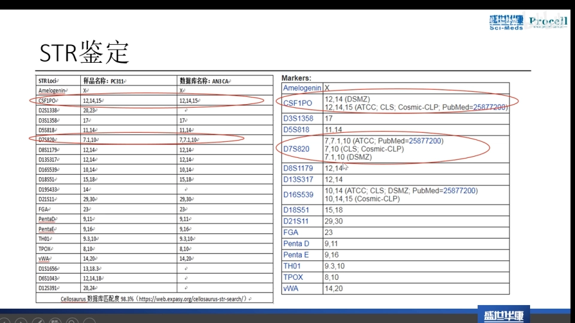
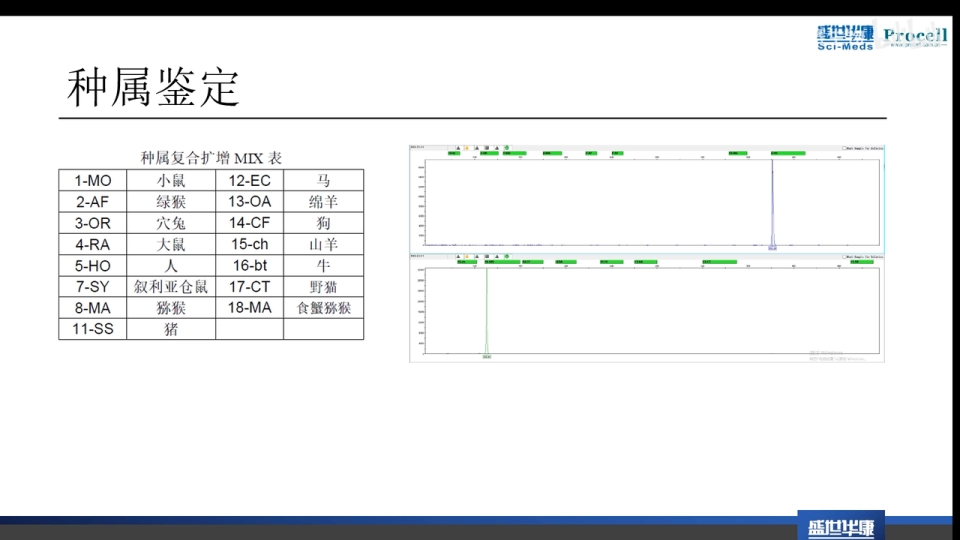
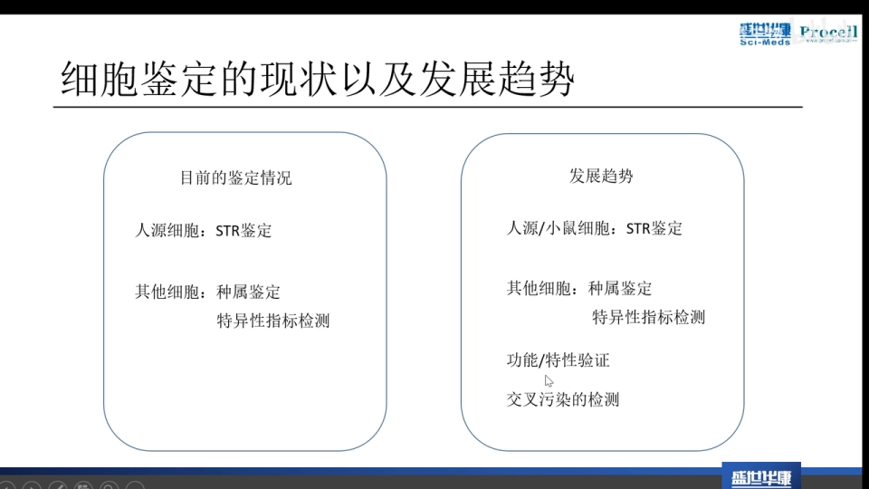

# 细胞系：建系、永生化与身份鉴定决定的适用范围

> 视频来源：[细胞系由来及鉴定问题--超详细！](https://www.bilibili.com/video/BV1Zi4y127LY/)（Bilibili · 普诺赛生物）｜时长约 45 分钟
> 导读：这是细胞库技术人员做的一场培训。前半讲细胞系是怎么建起来的、名字怎么定、背景信息到哪里查；后半讲鉴定：STR 图谱怎么读、98.3% 的匹配度是怎么算出来的、多等位基因为什么意味着污染、种属鉴定和核型各自能回答什么。本文按「**怎么建的 → 传了多少代 → 身份是否被证明**」这条线整理，因为这三件事共同决定了**一个细胞系的结论能外推到哪**。跨层级推断的完整论证见 [跨层级推断的边界：体外实验、动物模型与人群证据](../../../1_生命的物质与组织层级/1.2_从分子走向系统/1.2.1_生命组织层级：分子、细胞、个体与种群/跨层级推断的边界：体外实验、动物模型与人群证据.md)，本文只在必要处回链。

## 本讲要解决的核心问题（SCQA）

**背景**：细胞系是绝大多数生物学实验的默认起点。它便宜、可控、通量高，还能做人源细胞——这些都是动物实验替代不了的。

**冲突**：但「细胞系」这三个字里藏着三次改造。第一，它通常是**从肿瘤组织里筛出来的**，或者被**人工永生化**过；第二，它在培养皿里传了很多代，**遗传背景和表型都在漂**；第三，它的名字可能**根本不是它**——历史上大量细胞被别的细胞污染，名字却一直没变。

**疑问**：一个细胞系到底「是什么」？它的适用范围由哪些属性决定？拿到一株细胞，怎么判断它还是不是你以为的那株？

**回答（中心思想）**：**细胞系的适用范围 = 建系方式 + 传代历史 + 身份鉴定。** 建系方式决定了它带着什么改造（肿瘤突变、病毒基因、端粒酶激活）；传代历史决定了它漂了多远；身份鉴定决定了你手上的细胞是不是你以为的那株。讲者把鉴定拆成四块：**来源、纯度、稳定性、生长特性与表达特征** [【跳转到 20:56】](https://www.bilibili.com/video/BV1Zi4y127LY/?t=1256)。

[【跳转到 00:55】](https://www.bilibili.com/video/BV1Zi4y127LY/?t=55)

---

## 一、从组织到细胞系：两条完全不同的建系路

讲者把建系分成两类，因为它们的代价完全不同 [【跳转到 05:36】](https://www.bilibili.com/video/BV1Zi4y127LY/?t=336)。

### 1.1 肿瘤组织：靠恶性程度「自发永生化」

恶性肿瘤细胞本身就有无限增殖的能力。做法是切块贴壁，让细胞自己从组织块里爬出来，传两代后逐渐稳定，再挑单克隆、做鉴定 [【跳转到 05:36】](https://www.bilibili.com/video/BV1Zi4y127LY/?t=336)。

[【跳转到 05:36】](https://www.bilibili.com/video/BV1Zi4y127LY/?t=336)

这里有一个关键操作：**必须去掉成纤维细胞**。癌旁组织里主要是成纤维细胞，它在生长前期长得猛、营养代谢强，会抑制肿瘤细胞生长；去除的方法有差速贴壁，也可以机械刮除 [【跳转到 06:26】](https://www.bilibili.com/video/BV1Zi4y127LY/?t=386)。

> **这对读数据有直接含义**：肿瘤细胞系从一开始就是「被筛选过的群体」——能在塑料上贴壁、能在这种培养基里跑赢成纤维细胞的克隆。它不代表原始肿瘤的全部细胞组成。

### 1.2 正常组织：必须人工永生化

正常组织的原代细胞养几代就增殖不动了。要建系，必须做**永生化处理**，讲者列了三类方法：病毒基因转染（常用 SV40、EB 病毒）、端粒酶激活、癌基因激活 [【跳转到 08:31】](https://www.bilibili.com/video/BV1Zi4y127LY/?t=511)。

[【跳转到 08:31】](https://www.bilibili.com/video/BV1Zi4y127LY/?t=511)

这一段对读数据最重要：**「细胞系」这个词里已经包含了一次人工遗传改造**。永生化不是「让细胞活得久一点」这么简单，它改变了细胞对后续扰动的响应基线。所以「同一个组织来源」的两个细胞系，未必可以互换。

### 1.3 HeLa：三个必须记住的信息，以及它留下的问题

讲者用 HeLa 开场，强调三个点：**1951 年建系、供体 Henrietta Lacks、建系者 George Gey** [【跳转到 00:55】](https://www.bilibili.com/video/BV1Zi4y127LY/?t=55)。他还补了一句容易被忽略的历史：在 HeLa 之前，研究人员也在培养细胞，但早期培养的更接近原代细胞，传两代之后就没了 [【跳转到 01:20】](https://www.bilibili.com/video/BV1Zi4y127LY/?t=80)。

也就是说，「细胞系」这个概念的核心不是「能养」，而是**能持续传代而不衰老**。而 HeLa 的伦理问题（供体未知情同意，本讲未展开）和污染史（它污染了大量其他细胞系），是这套技术从一开始就带着的两个副作用。污染这一条后面会展开。

---

## 二、原代与连续细胞系：可重复性换来了什么

讲者回答了一个评论区问题：细胞系和原代细胞有什么区别？答案是**分界在传代**——最开始 P0 代可以认为是原代，传过代之后就可以归到细胞系的范畴 [【跳转到 11:33】](https://www.bilibili.com/video/BV1Zi4y127LY/?t=693)。

他用 HUVEC（人脐静脉内皮细胞）举例说明两者的实际差别 [【跳转到 12:48】](https://www.bilibili.com/video/BV1Zi4y127LY/?t=768)：

| | 实验室自提原代 | 公认细胞系 |
| --- | --- | --- |
| 传代能力 | 条件好的实验室能传几十代，差一点的十几二十代 | 有明确的传代范围与特性记录 |
| 批次一致性 | 每次提取的纯度、生长特点可能有差异 | 背景信息已公布，批次间更可比 |
| 使用成本 | 需要自己鉴定、自己证明 | 引用来源 + 确认身份即可 |
| 发表认可度 | 需要提供鉴定图证明「它是它」 | 公认细胞系默认其特性 |

讲者的结论很直接：**细胞系跟原代细胞最大的区别在于可重复性** [【跳转到 14:53】](https://www.bilibili.com/video/BV1Zi4y127LY/?t=893)。原代更接近体内，但每次提取都是一次新的实验；细胞系牺牲了一部分体内真实性，换来了可比较、可累积。

> 这就是「体系选择」的第一条权衡：**你要的是「更像体内」，还是「更能重复」？** 两者通常不可兼得。

---

## 三、稳定性有保质期：传代会让细胞漂走

讲者把「稳定性」列为鉴定的第三块，并给了一个很具体的观察：**有限传代细胞在 10–30 代时是一个生长速度，到 30–40 代可能是另一个生长速度，甚至形态也会变** [【跳转到 22:16】](https://www.bilibili.com/video/BV1Zi4y127LY/?t=1336)。

[【跳转到 20:56】](https://www.bilibili.com/video/BV1Zi4y127LY/?t=1256)

这就是**遗传漂变 + 培养适应**在细胞系里的具体表现：群体里不同克隆的增殖优势不同，传代就是一次次选择；培养条件（血清批次、密度、传代比例）也会筛选出适应皿壁的亚群。结果是：

- 同一株细胞，**早代和晚代的实验结果可能不一致**；
- 不同实验室的同一株细胞，**可能已经是不同群体**；
- 一个在 5 代时成立的结论，不能默认在 30 代时还成立。

**实践含义**：论文里只写「用了 A549」是不够的；代次、来源、培养基、是否做过鉴定，都会影响结论的可复现性。这也是为什么细胞库要求记录培养简历、培养液、冻存条件、细胞活力、形态、核型等一整套信息 [【跳转到 02:32】](https://www.bilibili.com/video/BV1Zi4y127LY/?t=152)。

[【跳转到 02:32】](https://www.bilibili.com/video/BV1Zi4y127LY/?t=152)

---

### 三、生长方式与维度：贴壁、悬浮与 2D

讲者把细胞的**生长特性**列为鉴定的第四块：这个细胞是**贴壁**还是**悬浮**，生长速度大概多少 [【跳转到 22:41】](https://www.bilibili.com/video/BV1Zi4y127LY/?t=1361)。这不是一个无关紧要的标签，它决定了实验能怎么做：

- **贴壁细胞**需要附着表面，形态有极性，适合做迁移、侵袭、屏障、形态学观察；
- **悬浮细胞**（如许多造血系统来源的细胞系）在培养基里自由生长，适合做悬浮培养、流式与高通量药物处理；
- 两者对**药物暴露**的方式不同：贴壁细胞的「浓度」是培养基浓度，悬浮细胞还要考虑沉降与聚集。

更关键的是**维度**。常规细胞系是 **2D 单层**：所有细胞都贴在同一平面上，营养和信号从上方均匀扩散，没有组织层面的空间排布。这带来两个后果：细胞极性被人为拉平；细胞与细胞、细胞与基质之间的三维关系被压扁。

要补回结构，就要换体系——球状体（spheroid）和类器官是 3D 的，能重建腔、绒毛、分层等结构；代价是培养更难、批次差异更大、读出更复杂。**2D 与 3D 不是「先进与落后」，而是两种不同的取舍**：2D 适合拆机制、做通量；3D 适合看结构、看组织层面的功能。类器官那一篇会展开 3D 体系能回答什么、不能回答什么（见 [类器官：自组织三维结构能回答什么、不能回答什么](类器官：自组织三维结构能回答什么、不能回答什么.md)）。

---

## 四、身份：把名字变成一段可比的数字

### 4.1 STR 的原理：微卫星重复次数的个体差异

STR（短串联重复）是基因组里的短重复序列，比如四个碱基 ATCG 重复十次或十五次；**每个人、每个细胞系的重复次数都有差异** [【跳转到 23:06】](https://www.bilibili.com/video/BV1Zi4y127LY/?t=1386)。把一组固定位点的重复数测出来，就得到一张「指纹」。

[【跳转到 24:21】](https://www.bilibili.com/video/BV1Zi4y127LY/?t=1461)

讲者讲了位点数量的演变：最早是 **8 个核心位点 + 1 个性别位点（8+1）**，后来增加到 17+1 等更多位点；位点越多，区分能力越强 [【跳转到 24:46】](https://www.bilibili.com/video/BV1Zi4y127LY/?t=1486)。

### 4.2 匹配度怎么读：98.3% 不是「几乎一样」

讲者用自己库里的一个细胞举例：把 STR 数据拿到数据库比对，匹配度是 **98.3%** [【跳转到 26:51】](https://www.bilibili.com/video/BV1Zi4y127LY/?t=1611)。

[【跳转到 26:51】](https://www.bilibili.com/video/BV1Zi4y127LY/?t=1611)

为什么不是 100%？讲者解释了三点：

- **不同数据库的记录可能不同**。同一个位点，ATCC 记录的是 7,7,10，DSMZ 记录的是 7,10，差异来自参考数据本身 [【跳转到 27:16】](https://www.bilibili.com/video/BV1Zi4y127LY/?t=1636)。
- **肿瘤细胞是非整倍体**。某个位点出现三个重复数，可能对应三条染色体，而不是污染 [【跳转到 28:31】](https://www.bilibili.com/video/BV1Zi4y127LY/?t=1711)。
- **判读有阈值**。讲者给的实用标准是：**匹配度 80% 以上可以认为与该细胞系相关** [【跳转到 28:06】](https://www.bilibili.com/video/BV1Zi4y127LY/?t=1686)。

> **怎么用这个数字**：STR 匹配度是「同一性」的证据，不是「纯度」的证据。它能告诉你「这株细胞大概率是 A」，但不能告诉你「里面有没有混进 B」。

### 4.3 多等位基因：污染的信号

如果多等位基因数量太多——比如 18 个位点里有一半出现多个等位基因——那意味着**不同种类的细胞混在一起了** [【跳转到 28:56】](https://www.bilibili.com/video/BV1Zi4y127LY/?t=1736)。这是 STR 判读里最实用的一条规则：**正常二倍体最多两个等位基因；三个及以上，先怀疑混合，再考虑非整倍体。**

---

## 五、STR 抓不到的部分：种属鉴定与核型

STR 主要针对人源细胞。非人源细胞（大鼠、小鼠、仓鼠等）要先做**种属鉴定**，再做特异性指标鉴定 [【跳转到 30:09】](https://www.bilibili.com/video/BV1Zi4y127LY/?t=1809)。

[【跳转到 32:39】](https://www.bilibili.com/video/BV1Zi4y127LY/?t=1959)

种属鉴定的两个方法：PCR 扩增 + 条带判读，以及多重引物混合 + 毛细管电泳。讲者提醒了一个容易出错的地方：**引物特异性不强时会出现非特异性条带，必须设对照**——比如检测人细胞时旁边放一个人组织对照，看条带大小是否一致 [【跳转到 31:49】](https://www.bilibili.com/video/BV1Zi4y127LY/?t=1909)。

**核型分析**则回答另一个问题：染色体数目和形态是否正常。讲者用它解释了 STR 里「三个重复数」的来源——MCF7 的 3 号染色体有 4 条、4 号有 3 条，所以对应位点会出现三个峰 [【跳转到 34:32】](https://www.bilibili.com/video/BV1Zi4y127LY/?t=2072)。核型分析在后续使用中不常用，因为麻烦，但它是理解 STR 异常的必要背景。

此外还有免疫荧光、流式、特异性染色等**辅助鉴定**：它们只能确定细胞类型（比如内皮细胞查 CD31、巨噬细胞查 F4/80），不能替代身份鉴定 [【跳转到 36:01】](https://www.bilibili.com/video/BV1Zi4y127LY/?t=2161)。

---

## 六、污染与错误标记：细胞系最隐蔽的失效方式

讲者讲了一段历史：STR 之所以被引入细胞培养领域，**最开始就是因为很多细胞在培养时被 HeLa 细胞污染了**；研究者借鉴法医学的 STR 方法，来判断细胞是否来自不同来源 [【跳转到 42:17】](https://www.bilibili.com/video/BV1Zi4y127LY/?t=2537)。

[【跳转到 39:47】](https://www.bilibili.com/video/BV1Zi4y127LY/?t=2387)

污染有三种典型形态：

1. **同种属交叉污染**：一株长得快的细胞（历史上最著名的是 HeLa）逐渐取代另一株，名字不变、数据照出。讲者提到细胞库页面上会用红字标出「这个细胞被污染/被错误分类」，比如某些肝癌细胞后来被证明其实是肝母细胞瘤细胞 [【跳转到 17:56】](https://www.bilibili.com/video/BV1Zi4y127LY/?t=1076)。
2. **跨物种污染**：STR 抓不到小鼠细胞混进人细胞，需要额外做种属鉴定 [【跳转到 42:42】](https://www.bilibili.com/video/BV1Zi4y127LY/?t=2562)。
3. **支原体污染**：不改变外观、难以察觉，但会影响细胞功能、生长、染色体和基因表达。这也是培养体系质量控制里最常被单独列出的一项（本讲只提到「无污染检测」，未展开支原体，此处按通行认识补充背景）。

讲者提到，2021 年国内专门出了**细胞交叉污染鉴定标准**，说明这件事已经从「实验室习惯」变成了「行业规范」[【跳转到 43:57】](https://www.bilibili.com/video/BV1Zi4y127LY/?t=2637)。

> **为什么这件事对结论影响这么大**：如果一株细胞被错误标记，那么**所有基于它的文献结论都挂错了对象**。这不是「实验做得不好」，而是「实验对象不是你以为的那个」。所以身份鉴定不是质量控制的可选项，而是结论有效性的前提。

---

## 七、细胞系的优点与局限：一张对照表

| 维度 | 细胞系的表现 | 代价/边界 |
| --- | --- | --- |
| 可控性 | 培养条件、剂量、时间都可精确控制 | 控制得越精确，离体内越远 |
| 成本与通量 | 便宜、可扩增、适合高通量筛选 | 通量高不等于结论可外推 |
| 机制清晰 | 单一细胞类型，通路容易拆解 | 缺细胞间互作、缺组织结构 |
| 人源背景 | 可直接用人细胞，避开物种差异 | 永生化改造改变了响应基线 |
| 可重复性 | 比原代稳定，可跨实验室比较 | 传代会漂变，早代晚代不同 |
| 身份可靠性 | STR 可验证 | 污染与错误标记历史上很常见 |
| 微环境 | 无免疫、无血管、无基质 | 需要共培养/类器官/动物补 |

这张表的核心是：**细胞系的强项是「把问题变小」，弱项是「变小之后丢掉了整体」。** 它适合回答「这个细胞里这条通路怎么走」，不适合回答「这个药在人体内有没有效」。

---

## 八、适用问题矩阵与决策清单

| 问题 | 细胞系能不能回答 | 说明 |
| --- | --- | --- |
| 某基因敲低后通路是否激活 | 能，且是最经济的体系 | 需要对照、剂量、时间、重复（见 [5.1.2](../5.1.2_实验设计与证据链：对照、重复、相关与因果/对照与假说：无关变量、溶剂对照与预期结果.md)） |
| 某药物在细胞水平的 IC50 | 能 | 但培养皿浓度 ≠ 体内暴露（见 [1.2.1](../../../1_生命的物质与组织层级/1.2_从分子走向系统/1.2.1_生命组织层级：分子、细胞、个体与种群/跨层级推断的边界：体外实验、动物模型与人群证据.md)） |
| 病原体能否感染人组织 | 常常不能 | 缺极性、缺三维结构；见 [类器官](类器官：自组织三维结构能回答什么、不能回答什么.md) |
| 组织层面的屏障、分泌、转运 | 不能 | 需要类器官或动物 |
| 免疫、炎症、整体代谢 | 不能 | 缺免疫与循环 |
| 个体化药敏 | 不能 | 缺患者背景与肿瘤结构 |
| 人群异质性与临床结局 | 不能 | 需要人群研究 |

**决策清单**（与同节另外两篇共用）：

1. **问题类型** → 机制/感染/药敏/发育/免疫/人群。
2. **需要的读出** → 表达、结构、功能、表型、临床终点（读出分类见 [5.1.1](../5.1.1_生物学测量：序列、结构、表达与表型/组学层次与读出：基因组、转录组、蛋白组、代谢组各能回答什么.md)）。
3. **体系** → 通量 + 机制选细胞系；人源 + 结构选类器官；整体生理选动物。
4. **对照** → 同代次、同批次、溶剂对照、阳性/阴性对照、跨体系一致性。
5. **身份与代次** → 做 STR/种属鉴定，记录代次与来源；否则结论的主语可能不是你以为的细胞。

---

## 九、验证链中的位置：细胞系是第一级，不是唯一一级

把这一讲放回证据链，细胞系的位置很清楚：

| 级别 | 回答什么 | 细胞系的角色 |
| --- | --- | --- |
| 细胞/分子 | 这条通路在细胞里是否成立 | **主战场**：机制、剂量反应、遗传扰动 |
| 组织/类器官 | 有结构的人源组织里是否仍成立 | 细胞系常失效，需要类器官补 |
| 动物 | 整体生理下是否重现表型 | 细胞系不能替代 |
| 人样本/临床 | 人群里是否一致、是否有临床价值 | 细胞系不能替代 |

这与 [1.2.1](../../../1_生命的物质与组织层级/1.2_从分子走向系统/1.2.1_生命组织层级：分子、细胞、个体与种群/跨层级推断的边界：体外实验、动物模型与人群证据.md) 的结论一致：**细胞系给出「什么是可能的」，不给出「实际发生了什么」。** 它的价值在于把机制拆到可操作、可重复的最小单元；它的边界在于这个单元里没有整体。

---

## 小结

- **建系方式决定改造**：肿瘤组织靠自发永生化，正常组织必须人工永生化（病毒基因、端粒酶、癌基因）[05:36][08:31]。
- **原代与细胞系的分界在传代**；细胞系用可重复性换掉了部分体内真实性 [11:33][14:53]。
- **稳定性有保质期**：有限传代细胞在 10–30 代与 30–40 代可能表现不同 [22:16]。
- **身份鉴定四件事**：来源（STR）、纯度（多等位基因/污染）、稳定性（传代）、生长与表达特征 [20:56]。
- **STR 判读**：8+1 起步、位点不断增加；80% 以上可认为相关；98.3% 的差异可能来自数据库记录与非整倍体 [24:46][28:06][26:51]。
- **STR 抓不到跨物种污染**，需要种属鉴定与核型补位 [30:09][33:54]；交叉污染已有国标 [43:57]。
- **结论**：细胞系适合回答「细胞里发生了什么」，不适合回答「人身上会发生什么」。

## 关键术语速查

| 术语 | 一句话解释 |
| --- | --- |
| 原代细胞 | 直接从组织分离、未经永生化处理的细胞，传代能力有限 |
| 细胞系 | 能持续传代的细胞群体，通常经过永生化或来自肿瘤 |
| 永生化 | 使细胞绕过衰老、获得无限增殖能力的过程（病毒基因、端粒酶、癌基因） |
| 遗传漂变 | 传代过程中群体遗传组成随机改变，导致不同代次细胞不同 |
| 培养适应 | 细胞在体外条件下被筛选出适合皿壁与培养基的亚群 |
| STR | 短串联重复序列，用于细胞身份鉴定 |
| 多等位基因 | 一个位点出现三个及以上重复数，常提示细胞混合或非整倍体 |
| 种属鉴定 | 判断细胞来自哪个物种，弥补 STR 只适用于人源的不足 |
| 核型分析 | 检查染色体数目与形态，解释非整倍体与多等位基因 |
| 交叉污染 | 一株细胞被另一株细胞取代或混入，名字不变但身份已变 |