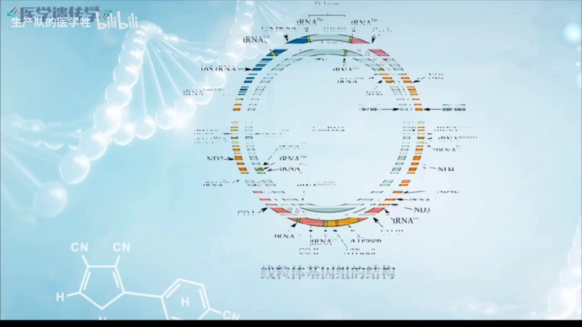
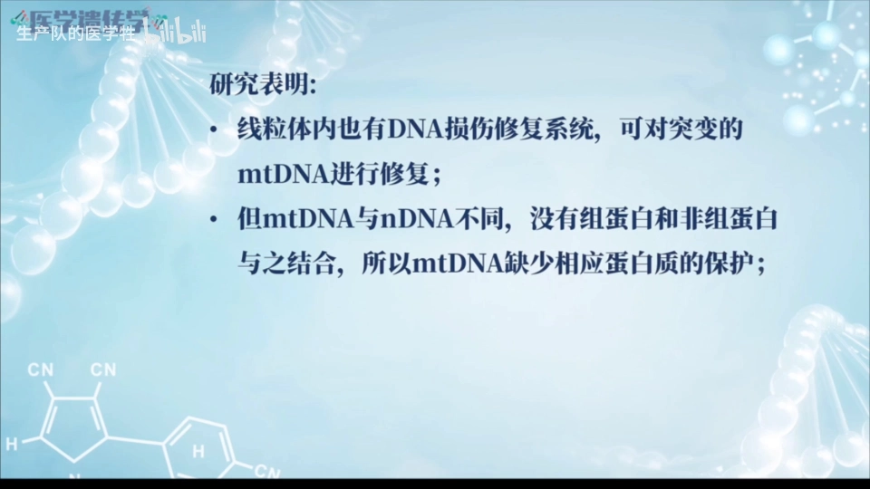
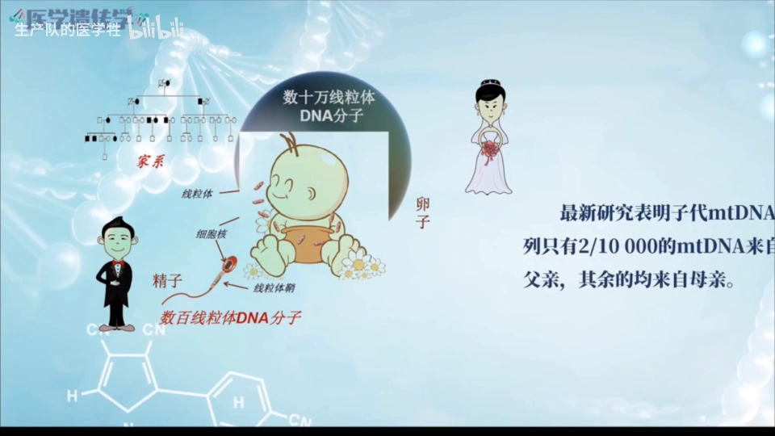
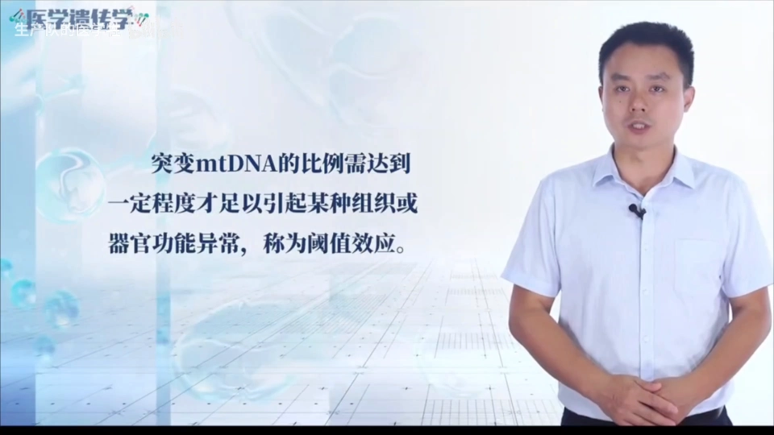
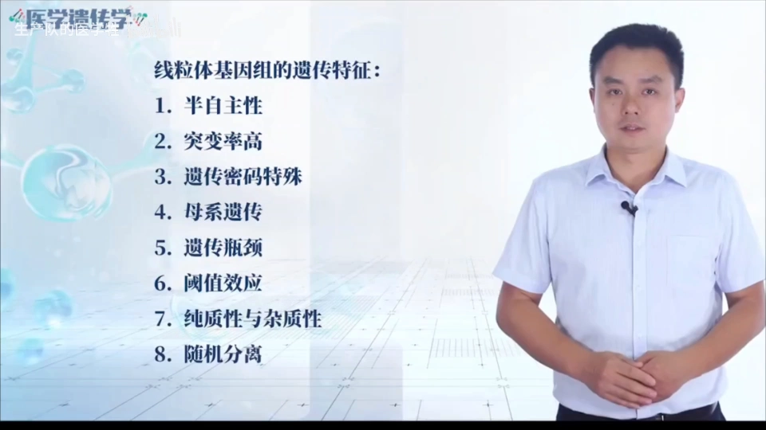

# 线粒体基因组：几千个拷贝、母系遗传与异质性

> 视频来源：[《线粒体基因组的特征 线粒体遗传病 医学遗传学》](https://www.bilibili.com/video/BV1Xt421u7uK/)（B 站 · 生产队的医学牲，主讲杨俊宝·川北医学院）｜时长约 10 分钟
> 导读：这支课把线粒体基因组拆成「结构特征」和「遗传特征」两半，前半讲一个细胞里为什么有几千个 mtDNA 拷贝、它长什么样，后半用九条遗传特征说明这些拷贝如何造成母系遗传、遗传瓶颈、阈值效应和异质性。本文按这两半重排，并把「拷贝数」这条线单独拎出来讲，因为它是后面所有遗传现象的物理基础。

## 本讲要解决的核心问题（SCQA）

**背景**：讲基因组时，默认的图景是「一个细胞一份核基因组，父母各给一半」。染色体上的基因遵循孟德尔分离比，这是遗传学的标准框架。

**冲突**：线粒体里也有 DNA，但它的行为处处违反这套框架：一个细胞里有几千个拷贝而不是两个等位基因；孩子几乎只从母亲那里拿到它；同一个人的不同组织可以有不同比例的突变 mtDNA；同一个母亲的不同子女发病轻重可以差很多。

**疑问**：线粒体基因组在结构上有什么特别之处？它的拷贝数、遗传方式和核基因差在哪里？这些差别会造成什么后果？

**回答（中心思想）**：线粒体基因组是一个约 16.5 kb 的双链闭环分子，**每个细胞有数千个拷贝**，因此它既不是「一个基因两个等位」，也不遵循孟德尔分离。**多拷贝 + 母系遗传 + 复制分离随机**三者叠加，产生四个后果：遗传瓶颈、阈值效应、同质性/异质性、以及症状随突变负荷和组织而变。理解线粒体遗传病、理解为什么 mtDNA 变异不能按核基因的方式解读，都要从「拷贝数」这一个事实出发。

---

## 一、先看结构：一个细胞里有多少份 mtDNA

### 1.1 拷贝数是数量级上的差别，不是「多几条染色体」

视频给出一组层层放大的数字：人类的每个体细胞通常有**数百个线粒体**，每个线粒体有 **2 到 10 个拷贝**的线粒体 DNA 分子，因此每个细胞中的 mtDNA 分子**可达数千个**；从 DNA 含量看，mtDNA 约占细胞 DNA 总量的 **1%**。[【跳转到 00:45】](https://www.bilibili.com/video/BV1Xt421u7uK/?t=45)

这里要抓住的不是具体数字，而是**数量级**：核基因组在一个二倍体细胞里是 2 份（每条染色体两个同源拷贝），而 mtDNA 是成千上万份。后面所有的「比例」「负荷」「阈值」概念，前提都是这个多拷贝池。

### 1.2 分子本身：16 569 bp、双链闭环、重链与轻链

人类 mtDNA 全长 **16 569 个碱基对**，是**双链闭环** DNA。两条链按碱基组成区分：**重链（H）富含 G**，**轻链（L）富含 C**；在环形基因图上重链画在外环、轻链画在内环，编号从 1 到 16 569 按顺时针方向计数。[【跳转到 01:08】](https://www.bilibili.com/video/BV1Xt421u7uK/?t=68)

「重链/轻链」不是随便起的名字，它来自早期用密度梯度离心分离两条链时它们沉降行为不同。对读注释的意义是：**同一个环上两条链都会转录，基因可以分布在任意一条链上**，所以看 mtDNA 注释时必须同时看链方向，不能假定基因都在同一条链。

### 1.3 为什么它容易突变：没有组蛋白保护 + 高氧自由基环境

线粒体内也有 DNA 损伤修复系统，可以对突变的 mtDNA 进行修复。但 mtDNA 与核 DNA 有一个关键区别：**它没有组蛋白和非组蛋白与之结合**，因此缺少相应蛋白质的保护；同时线粒体是氧化磷酸化的场所，mtDNA 暴露在相对高的氧自由基环境下，氧自由基容易对其造成损伤。[【跳转到 01:56】](https://www.bilibili.com/video/BV1Xt421u7uK/?t=116)

视频把「修复系统存在」「缺少蛋白保护」「高氧自由基暴露」三个因素合起来，解释为什么 mtDNA 容易发生突变。[【跳转到 02:36】](https://www.bilibili.com/video/BV1Xt421u7uK/?t=156) 这里要注意区分两件事：**突变容易发生**（分子层面）和**突变容易固定下来**（群体/细胞层面），后者才是后面阈值与异质性要处理的问题。

---

## 二、再看遗传：九条特征里，四条是「结构决定的」

视频把线粒体基因组的遗传特征列成九条。前四条（半自主性、突变率高、遗传密码特殊、母系遗传）主要描述这个分子本身的性质，后五条（遗传瓶颈、阈值效应、同质性/异质性、随机分离、累加效应）描述**多拷贝池在世代和细胞分裂中如何分配**。这一节先讲前四条。

### 2.1 半自主性：13 个蛋白亚基自己编码，99% 靠核基因

mtDNA 能独立复制、转录，并翻译出 **13 种线粒体蛋白质亚基**，表现出一定的自主性；但约 **99%** 的线粒体蛋白由细胞核基因组编码。[【跳转到 02:43】](https://www.bilibili.com/video/BV1Xt421u7uK/?t=163)

「半自主」这个词的实用含义是：**线粒体的功能缺陷既可能来自 mtDNA，也可能来自核 DNA**。视频开篇就把线粒体遗传病分成三类——mtDNA 异常、核 DNA 异常、以及两者共同作用——正是这个道理。[【跳转到 00:23】](https://www.bilibili.com/video/BV1Xt421u7uK/?t=23) 所以看到一个「线粒体病」家系，不能默认去做 mtDNA 测序就够。

### 2.2 突变率高：比核 DNA 高 10–20 倍

mtDNA 的突变率比核 DNA 高 **10 到 20 倍**，这是个体及群体中 mtDNA 序列差异较大的原因。[【跳转到 03:08】](https://www.bilibili.com/video/BV1Xt421u7uK/?t=188) 但视频紧接着给了一个重要的平衡：有害的 mtDNA 突变容易通过细胞溶酶体的**选择性自噬**被清除，所以尽管 mtDNA 突变很普遍，线粒体遗传病并不常见。[【跳转到 03:33】](https://www.bilibili.com/video/BV1Xt421u7uK/?t=213)

高突变率 + 强清除，是理解 mtDNA 变异解读的底色：**在人群中看到 mtDNA 变异很常见，看到致病变异很少见**，不能因为「变异常见」就认为「必然无害」，也不能因为「突变率高」就认为「每个变异都致病」。

### 2.3 遗传密码特殊：同一密码子在线粒体里换了一个意思

线粒体的遗传密码与核基因不完全一致。视频举了两个例子：**UGA** 在核基因中是终止密码子，在哺乳动物线粒体中编码**色氨酸**；**AUA** 在核基因中编码**异亮氨酸**，在哺乳动物线粒体中编码**蛋氨酸**。[【跳转到 03:58】](https://www.bilibili.com/video/BV1Xt421u7uK/?t=238)

这条对分析的直接后果是：**用核基因的密码子表去翻译 mtDNA 的编码序列会出错**，注释和变异效应预测必须使用线粒体密码子表。视频随后用一张表列出哺乳动物线粒体密码与通用密码的差异。[【跳转到 04:28】](https://www.bilibili.com/video/BV1Xt421u7uK/?t=268)

### 2.4 母系遗传：卵子给细胞质，精子只送细胞核

在有性生殖生物中，由于受精方式的限制，线粒体遗传是**母系遗传**：母亲把 mtDNA 传给子女，女儿再传给下一代，而**儿子不能把 mtDNA 传给下一代**。[【跳转到 04:36】](https://www.bilibili.com/video/BV1Xt421u7uK/?t=276)

视频给了一组对比数字：卵子携带数十万个 mtDNA 分子，精子只有数百个；最新研究表明子代 mtDNA 序列**只有万分之二来自父亲**，其余均来自母亲。[【跳转到 05:13】](https://www.bilibili.com/video/BV1Xt421u7uK/?t=313)

这条特征有直接的判读价值：如果一个家族中多个成员有相同临床症状，且**都是从发病的女性传递下来**，就应考虑 mtDNA 异常，并通过 mtDNA 序列分析确诊。[【跳转到 05:18】](https://www.bilibili.com/video/BV1Xt421u7uK/?t=318) 反过来说，**父系传递的相同症状不能作为 mtDNA 遗传的证据**。

> 「只有万分之二来自父亲」说明母系遗传不是绝对的 100%，存在极低水平的父系渗入。视频把它作为「最新研究」提出，具体数值随研究而异，引用时应回到原始文献核对，不要把它当成固定常数。

---

## 三、多拷贝池怎么分配：遗传瓶颈、阈值、异质性与随机分离

这一节是本节的核心。核基因的分离比之所以干净，是因为每个基因只有两个等位、减数分裂时精确分配；mtDNA 有几千个拷贝，分配就变成**抽样**问题。

### 3.1 遗传瓶颈：卵母细胞里的 mtDNA 从 10 万个锐减到不足 100 个

女性卵母细胞中大约有 **10 万个线粒体**，但在卵母细胞成熟时绝大多数会消失，留下来的线粒体数目**最多不超过 100 个**，有时甚至少于 10 个；此后经过早期胚胎的细胞分裂，线粒体数目又会达到每个细胞 1 万个或更多。这个「从 10 万个锐减到少于 100 个」的过程就叫**遗传瓶颈**。[【跳转到 05:42】](https://www.bilibili.com/video/BV1Xt421u7uK/?t=342)

瓶颈的作用是**放大抽样波动**：如果母亲的 mtDNA 池里突变型占 30%，经过一个只有几十个拷贝的瓶颈后，传到一个卵子里的突变比例可能远高于 30%，也可能远低于 30%，甚至变成 0 或 100%。这解释了两件在核基因里不会发生的事：

- 同一个母亲的不同子女，mtDNA 突变负荷可以差很多，发病轻重因此不同；
- 一个家系里可能出现「母亲症状轻微、某个子女症状严重」的情况。

### 3.2 阈值效应：突变比例要够高，组织才出问题

**阈值效应**是指突变的 mtDNA 比例需达到一定程度，才足以引起某种组织或器官功能的异常。[【跳转到 06:37】](https://www.bilibili.com/video/BV1Xt421u7uK/?t=397)

阈值不是全基因组统一的一个数，而是**按组织不同**：不同组织对氧化磷酸化代谢的依赖程度不同，阈值也相应不同。视频给的例子是：肝脏即使有 **80%** 的突变 mtDNA 分子还不会表现出症状，但同样的比例在**骨骼肌或脑组织**中就会出现病理症状。[【跳转到 06:46】](https://www.bilibili.com/video/BV1Xt421u7uK/?t=406)

一般规律是：线粒体产生 ATP 越少，症状涉及的器官越多、症状越严重；最先受损的是**脑**，其后为**骨骼肌、心脏、胰腺、肾脏和肝脏**。[【跳转到 07:00】](https://www.bilibili.com/video/BV1Xt421u7uK/?t=420) 这与视频开篇「病变部位是消耗 ATP 最多的器官或组织」的说法首尾呼应。[【跳转到 00:40】](https://www.bilibili.com/video/BV1Xt421u7uK/?t=40)

### 3.3 同质性与异质性：一个细胞里可以同时有两种 mtDNA

正常组织中所有 mtDNA 分子都是一致的，称为**同质性**（视频原话为「纯质性」）。如果 mtDNA 发生突变，影响部分线粒体基因组，就会造成同一细胞或同一组织中**两种或两种以上 mtDNA 共存**——一种野生型、一种突变型，这种情况称为**异质性**（视频原话为「杂质性」）。[【跳转到 07:33】](https://www.bilibili.com/video/BV1Xt421u7uK/?t=453)

症状轻重与这个比例直接相关：突变 mtDNA **同质性**的个体症状较为严重；**异质性**个体是否表现出症状、症状轻重，往往取决于突变 mtDNA 所占的比例。[【跳转到 08:22】](https://www.bilibili.com/video/BV1Xt421u7uK/?t=502)

> 术语提示：视频用「纯质性/杂质性」，通行译法是「同质性（homoplasmy）/异质性（heteroplasmy）」。读文献时两种写法都会遇到，指同一组概念。

### 3.4 随机分离：细胞分裂时 mtDNA 是被「随机抓一把」分给子细胞的

mtDNA 的复制和线粒体分裂被认为是随机进行的。在细胞分裂中，一个异质性细胞会以**随机方式**把突变的 mtDNA 以不同比例传给子细胞。[【跳转到 08:43】](https://www.bilibili.com/video/BV1Xt421u7uK/?t=523)

这带来两个后果：

1. **组织分布不均**：同一个体内不同组织的突变比例可以不同，因此「抽一次血测 mtDNA 比例」未必代表脑或肌肉里的比例。视频明确说，个体突变 mtDNA 的比例和**组织分布**与其外显率和表型密切相关。[【跳转到 08:53】](https://www.bilibili.com/video/BV1Xt421u7uK/?t=533)
2. **世代传递有方向但不确定**：虽然存在随机分离，但**母亲的突变 mtDNA 比例越高，其后代携带突变 mtDNA 的可能性越大**。[【跳转到 09:21】](https://www.bilibili.com/video/BV1Xt421u7uK/?t=561)

### 3.5 累加效应：多个 mtDNA 突变叠加，病情更重

可以观察到两个或更多 mtDNA 突变对表型的**累加效应**，例如 Leber 遗传性视神经病就表现出这一现象：突变种类越多，病情越严重。[【跳转到 09:35】](https://www.bilibili.com/video/BV1Xt421u7uK/?t=575)

这条提醒我们：mtDNA 的「基因型—表型」关系不是「一个变异对应一个病」，而是**多个变异叠加成一个负荷**。分析 mtDNA 时，把每个变异单独判为「致病/良性」往往不够。

---

## 四、把三类 DNA 实体放在一起看

本节的任务是区分**核基因组、细胞器基因组与质粒**。用一张表把三者的关键差别并排：

| 对照项 | 核基因组 | 线粒体基因组 | 质粒 |
| --- | --- | --- | --- |
| 每个细胞的拷贝数 | 二倍体细胞 2 份（每条染色体两个同源拷贝） | **数千份**（数百个线粒体 × 每个 2–10 拷贝） | 因质粒类型而异，可有多个拷贝 |
| 分子形态 | 线性染色体，多条 | 双链**闭环**，约 16.5 kb | 双链**闭环**，通常更小 |
| 与蛋白的结合 | 与组蛋白形成核小体 | **不与组蛋白结合** | 不以核小体形式包装 |
| 遗传方式 | 孟德尔分离，父母各半 | **母系遗传**（极低水平父系渗入） | 随宿主分裂垂直传递，也可**水平转移** |
| 分离是否精确 | 减数分裂精确分配 | **随机分离**，产生异质性与阈值 | 随质粒复制与分配机制，可有不均等分配 |
| 典型后果 | 显性/隐性、分离比 | 遗传瓶颈、阈值效应、组织差异 | 抗性等附加性状在菌群间扩散 |

表中核基因组与线粒体基因组两列的依据是本节所引材料；质粒一列的拷贝数与分配方式按微生物学通行教材补充，既有质粒正文只讲独立复制与水平转移，未展开拷贝数调控。

核基因组与质粒的细节分别在既有正文中展开：[原核与真核的基因组组织](../../../../B01_生命科学基础主干/1_生命的物质与组织层级/1.3_细胞结构、生物膜与物质运输/1.3.1_原核与真核细胞、细胞器与分工/原核与真核的基因组组织：环状与线性染色体、复制起点与基因排布.md) 给出「原核一个环、真核多条线」的对照，[质粒：染色体之外的环状DNA](../../../../B01_生命科学基础主干/1_生命的物质与组织层级/1.3_细胞结构、生物膜与物质运输/1.3.1_原核与真核细胞、细胞器与分工/质粒：染色体之外的环状DNA、独立复制与水平转移.md) 说明质粒如何自带复制起点、如何经滚环复制实现水平转移。

---

## 五、边界：这支课没有讲到的部分

视频是一节医学遗传学课，聚焦人类 mtDNA 与线粒体病。使用时要注意四条边界：

1. **只讲了线粒体，没讲叶绿体**。植物细胞的叶绿体基因组同样是多拷贝的环状 DNA、同样以母系遗传为主，但结构、大小和遗传细节都不同；本节涉及的「细胞器基因组」共同逻辑见同目录 [细胞质遗传：叶绿体与线粒体为何只走母系](细胞质遗传：叶绿体与线粒体为何只走母系.md)。
2. **具体数字是「典型值」，不是常数**。每个细胞数百个线粒体、每个线粒体 2–10 拷贝、卵母细胞 10 万个、瓶颈后不足 100 个，都随细胞类型、物种和测量方法变化，引用时应回到原始研究。
3. **呼吸链的酶学与能量学不在本节范围**。13 个亚基如何组装成复合体、质子梯度如何驱动 ATP 合成，属于能量代谢脉络，本节只用「氧化磷酸化依赖程度决定阈值」这一层结论。
4. **mtDNA 突变的具体检测与临床判读不在本节范围**。本节只建立「拷贝数—异质性—阈值」的概念框架；变异致病性证据的整合判读见 B02 §4.2.6，数据资源见 D01。

> 以上四条为按通行教材与课程范围补充的边界说明，**不在这支视频的字幕内**。

---

## 小结

- 线粒体基因组是约 **16 569 bp 的双链闭环**分子，分重链（富含 G）与轻链（富含 C）；人类 mtDNA 只编码 **13 个蛋白亚基**，约 99% 的线粒体蛋白由核基因编码，因此是**半自主**的。
- 一个细胞有**数千个 mtDNA 拷贝**（数百个线粒体 × 每个 2–10 拷贝），约占细胞 DNA 总量的 1%。这是后面所有遗传现象的数量基础。
- mtDNA **不与组蛋白结合**、又处在高氧自由基环境，突变率比核 DNA 高 10–20 倍；但有害突变可被选择性自噬清除，所以病变并不常见。
- **母系遗传**：卵子贡献几乎全部细胞质，子代 mtDNA 只有约万分之二来自父亲；儿子的 mtDNA 不再下传。家系中「由发病女性连续传递」是重要线索。
- 多拷贝池的分配是抽样问题，由此产生四个后果：**遗传瓶颈**（卵母细胞 mtDNA 从 10 万个减到不足 100 个）、**阈值效应**（比例够高才发病，且阈值随组织而异）、**同质性/异质性**（同一细胞可共存野生型与突变型）、**随机分离**（组织间比例不同，母体比例越高后代携带概率越大）。
- 多个 mtDNA 突变对表型有**累加效应**，因此 mtDNA 的基因型—表型关系是「负荷」而非「单变异对应单病」。
- 与核基因组、质粒的差别可以概括为：**拷贝数、包装方式、遗传路径、分离精确度**四项。

## 关键术语速查

| 术语 | 一句话解释 |
| --- | --- |
| mtDNA | 线粒体 DNA，人类为约 16 569 bp 的双链闭环分子，每细胞数千拷贝 |
| 重链 / 轻链（H / L） | 按碱基组成区分的 mtDNA 两条链，重链富含 G、轻链富含 C，基因分布在两条链上 |
| 半自主性 | mtDNA 能自己复制转录并编码 13 个蛋白亚基，但绝大多数线粒体蛋白仍由核基因编码 |
| 母系遗传 | 细胞器 DNA 几乎全部经卵细胞传递，儿子不再下传 |
| 遗传瓶颈 | 卵母细胞成熟时 mtDNA 拷贝数从约 10 万锐减到不足 100，放大突变比例的抽样波动 |
| 阈值效应 | 突变 mtDNA 比例达到组织特异的临界值后才出现功能异常 |
| 同质性（homoplasmy） | 细胞内所有 mtDNA 分子序列一致 |
| 异质性（heteroplasmy） | 同一细胞或组织中共存野生型与突变型 mtDNA，比例决定症状轻重 |
| 随机分离 | 细胞分裂时 mtDNA 拷贝随机分配，造成组织间突变比例不同 |
| 累加效应 | 多个 mtDNA 突变对表型的效应叠加，突变种类越多病情越重 |