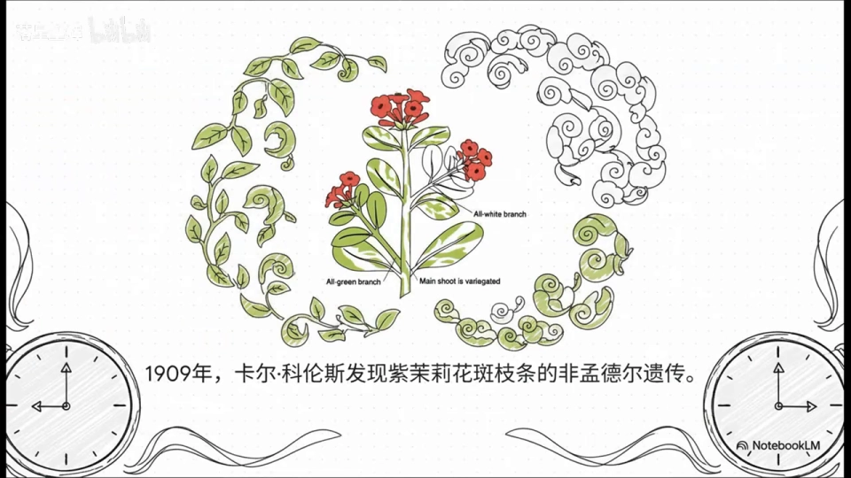
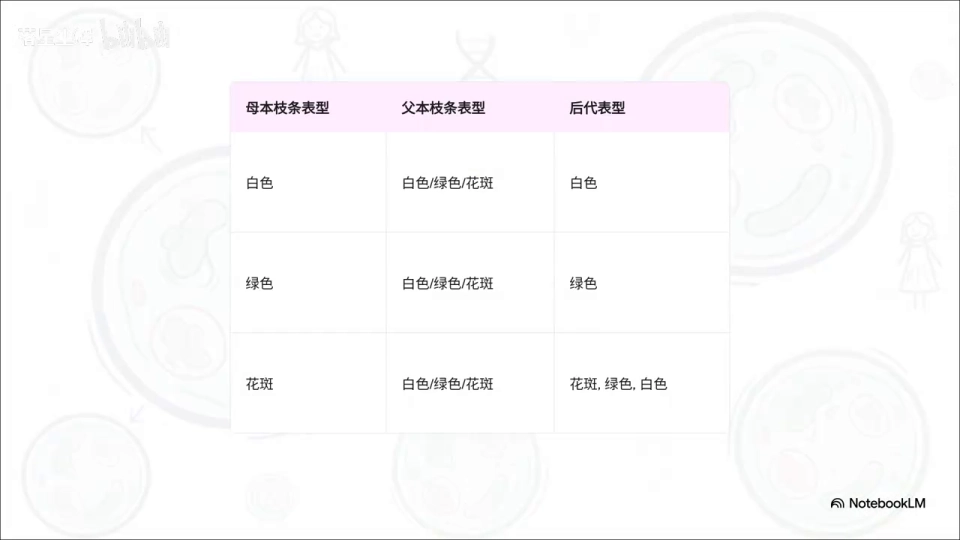
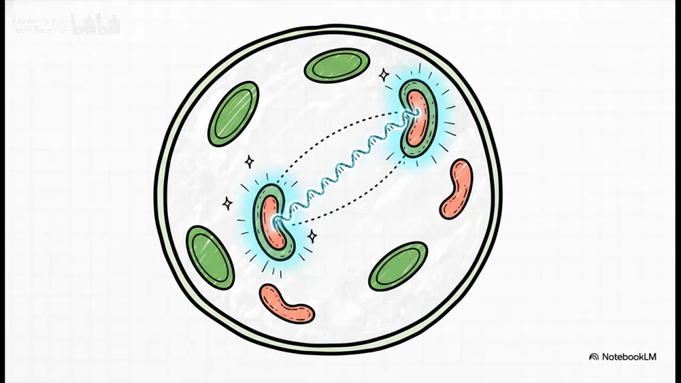
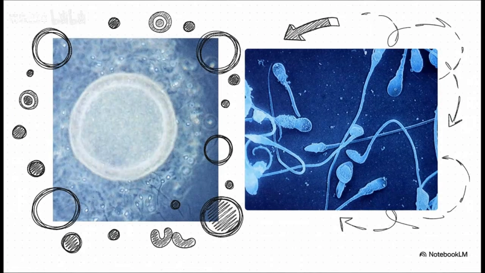
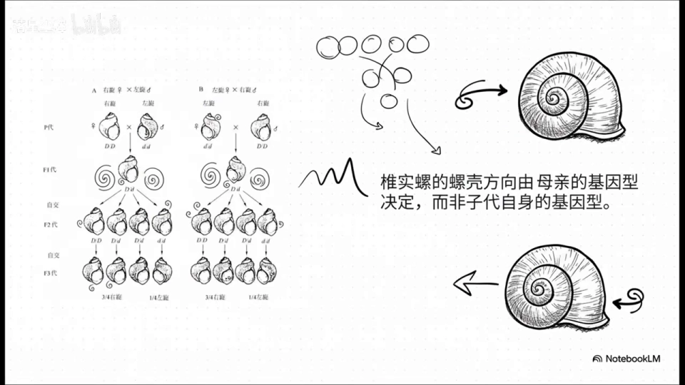
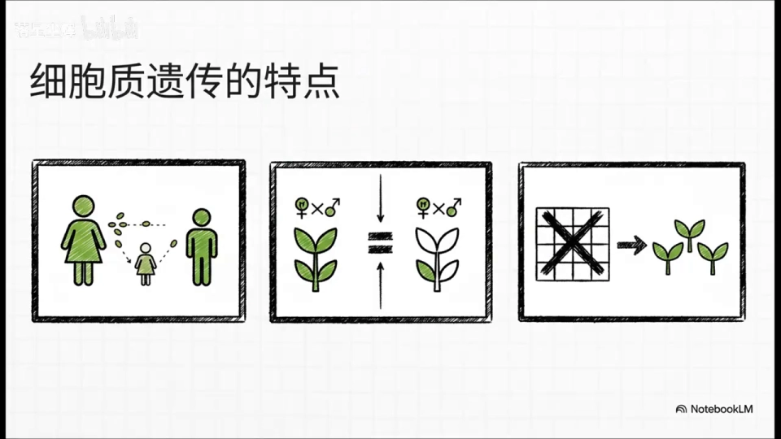

# 细胞质遗传：叶绿体与线粒体为何只走母系

> 视频来源：[《细胞质遗传：那些只能从母亲那里获得的基因》](https://www.bilibili.com/video/BV1J4ScBtEki/)（B 站 · 落星尘辉）｜时长约 8 分钟
> 导读：这支动画短片用一个 1909 年的紫茉莉花斑实验，把「细胞核遗传」和「细胞质遗传」拆成两套规则，然后回答一个很具体的问题：为什么细胞器里的基因几乎只能从母亲来。它顺带区分了一个极易混淆的概念——母性影响。线粒体基因组自身的结构、拷贝数与异质性见同目录 [线粒体基因组：几千个拷贝、母系遗传与异质性](线粒体基因组：几千个拷贝、母系遗传与异质性.md)。

## 本讲要解决的核心问题（SCQA）

**背景**：我们从小被告诉「基因一半来自爸爸、一半来自妈妈」，这套说法对应的是细胞核里的 DNA——它们被打包成染色体，父母各出一半，遵循孟德尔分离比。

**冲突**：一百多年前，一株紫茉莉不按这套规则出牌：同一棵植物上同时长着纯绿、纯白和绿白相间的花斑枝条，而杂交后代的颜色**只跟提供种子的母本枝条有关**，跟提供花粉的父本毫无关系。这直接违反了孟德尔定律。

**疑问**：控制这些性状的遗传指令到底藏在哪儿？为什么它只从母亲来？

**回答（中心思想）**：细胞核不是 DNA 唯一的家。**叶绿体和线粒体各自带一套 DNA**，它们位于细胞质中；而受精时卵细胞提供几乎全部细胞质、精子基本只送进一个细胞核，所以这些细胞器 DNA 只能沿着**母系单行道**传递——这就是**细胞质遗传**，也叫母系遗传。判断一个性状是否属于细胞质遗传，看三条：只经母亲传递、正反交结果不同、后代比例不符合孟德尔分离比。

---

## 一、先立标准：细胞核遗传长什么样

视频先复习了「标准法则」：我们绝大部分特征——眼睛的颜色、身高的潜力——都由**细胞核里的 DNA** 决定；这些 DNA 被好好打包在染色体里，**父母双方各出一半**，这个过程叫**细胞核遗传**。[【跳转到 00:55】](https://www.bilibili.com/video/BV1J4ScBtEki/?t=55)

先把这个基准讲清楚，是为了让后面的「异常」有意义：只有当你知道标准答案是什么，才能看出紫茉莉的结果哪里不对。

---

## 二、紫茉莉的花斑：一个违反孟德尔定律的性状

### 2.1 现象：同一株植物上有三种枝条

一百多年前，人们发现一株紫茉莉的表现非常奇怪：同一棵植物上竟然同时长着**纯绿色**、**纯白色**，还有**绿白相间的花斑**枝条。[【跳转到 01:17】](https://www.bilibili.com/video/BV1J4ScBtEki/?t=77)

### 2.2 实验：后代的颜色只认母本枝条

当时一位叫**科伦斯**（Correns）的科学家用它做了各种杂交实验，结果让人大跌眼镜：下一代的颜色**只跟提供种子的那根母本枝条有关系**，跟提供花粉的父本一点关系都没有。[【跳转到 01:53】](https://www.bilibili.com/video/BV1J4ScBtEki/?t=113)

这张表值得逐行读：

| 母本枝条表型 | 父本枝条表型 | 后代表型 |
| --- | --- | --- |
| 白色 | 白色 / 绿色 / 花斑 | 全白 |
| 绿色 | 白色 / 绿色 / 花斑 | 全绿 |
| 花斑 | 白色 / 绿色 / 花斑 | 花斑、绿色、白色都有 |

规律很清楚：**后代表型跟着母本走，父本换成什么都不影响结果**。这在孟德尔框架里无法解释——孟德尔遗传中正反交应该得到相同结果（除了性连锁），而这里正反交完全不同。

### 2.3 推论：细胞核不是 DNA 唯一的家

问题随之而来：遗传肯定需要基因，但如果父母双方的**细胞核基因**对这个性状都没有影响，那控制枝条颜色的遗传指令藏在哪儿？[【跳转到 02:23】](https://www.bilibili.com/video/BV1J4ScBtEki/?t=143) 答案就在一个平时容易被忽略的地方——**细胞核并不是 DNA 唯一的家**。[【跳转到 02:36】](https://www.bilibili.com/video/BV1J4ScBtEki/?t=156)

---

## 三、细胞质遗传：定义与「两个图书馆」的比喻

**细胞质遗传**顾名思义，就是由**细胞质里的基因**决定的遗传现象。因为这些遗传物质几乎 100% 都来自母亲，它还有一个更形象的名字——**母系遗传**。[【跳转到 02:46】](https://www.bilibili.com/video/BV1J4ScBtEki/?t=166)

视频给了一个好用的比喻：一个细胞的遗传信息其实存放在**两个不同的图书馆**里——一个是又大又全的**中央图书馆**，也就是细胞核；另一个是散落在细胞质里的**好几个小型专业分馆**。[【跳转到 03:03】](https://www.bilibili.com/video/BV1J4ScBtEki/?t=183)

谜底揭晓：在细胞核外面，像植物的**叶绿体**、动物细胞里的**线粒体**，这些小小的细胞器竟然有**自己独立的一套 DNA**。它们不光是细胞里的工人，还自带一套遗传蓝图；紫茉莉的颜色之谜，就是由叶绿体里的 DNA 决定的。[【跳转到 03:22】](https://www.bilibili.com/video/BV1J4ScBtEki/?t=202)

这个比喻的用处在于：**「中央图书馆」和「分馆」的遗传规则不一样**。中央图书馆的书（核基因）按孟德尔规则由父母各分一半；分馆的书（细胞器基因）只有一条进货渠道——母亲。

---

## 四、为什么只从母亲来：卵子给细胞质，精子只送细胞核

### 4.1 卵子与精子的体积差，就是细胞器 DNA 的差

受精发生时，母亲的卵细胞不光提供了一半的细胞核 DNA，还提供了新生命起步所需要的**几乎全部细胞质**；而父亲的精子就像一个**快递员**，唯一的任务是把细胞核这个包裹送到，它自己携带的那一点点细胞质基本上都被留在了门外。[【跳转到 03:59】](https://www.bilibili.com/video/BV1J4ScBtEki/?t=239)

### 4.2 一条单行道

把上面两步连起来就是核心法则：既然线粒体、叶绿体都在细胞质里，而几乎所有的细胞质都来自母亲，那这些细胞器里的 DNA 自然也只能通过**母亲这条单行道**传下去。[【跳转到 04:40】](https://www.bilibili.com/video/BV1J4ScBtEki/?t=280)

注意这条推理的**结构**：它不是一个经验规律，而是从两个可观察事实（细胞器在细胞质里、细胞质主要来自卵）**推**出来的。理解了这个推理，就能自己判断新情况——比如为什么植物叶绿体基因和动物线粒体基因会表现出同一类遗传模式。

### 4.3 落到人身上：线粒体 DNA 百分之百来自母亲

视频把话题拉回人类：你身体里每一个细胞的能量工厂——线粒体，连同它们内部那套独特的 DNA，**完完全全、百分之百都是从你母亲那里继承来的**，父亲对这件事可以说是一点贡献都没有。这就是发生在你身上的最直接的母系遗传。[【跳转到 06:46】](https://www.bilibili.com/video/BV1J4ScBtEki/?t=406)

> 「百分之百」是这支科普视频的简化说法。严格说存在极低水平的父系渗入（另一支课程材料给出的量级是万分之二），见 [线粒体基因组：几千个拷贝、母系遗传与异质性](线粒体基因组：几千个拷贝、母系遗传与异质性.md) 的「母系遗传」一节。做数据分析时，「母系遗传」应理解为「父系贡献可忽略」，而不是数学上的 0。

---

## 五、别混淆：母系遗传 ≠ 母性影响

视频接下来讲了一个**看起来很像、机制完全不同**的现象：**母性影响**。

### 5.1 关键区别：基因在母亲的细胞核里

母性影响的关键区别是：这一次决定性状的基因**在母亲的细胞核里**，不在细胞质里。但这些基因会产生一些物质，**提前放到卵细胞的细胞质中**，相当于预先设定好了孩子未来的发育方向。[【跳转到 05:12】](https://www.bilibili.com/video/BV1J4ScBtEki/?t=312)

也就是说：

- **细胞质遗传**：遗传物质本身在细胞质里（细胞器 DNA），随细胞质传递；
- **母性影响**：遗传物质在细胞核里（遵循孟德尔），但**产物**提前存进卵细胞质，让子代的表型取决于母亲的基因型。

### 5.2 椎实螺的螺壳方向：看妈妈的基因型，不看自己的

椎实螺的壳往右转还是往左转是经典例子。这张图看着复杂，结论其实很简单：**下一代螺壳往哪边转，不看它自己的基因，而要看它妈妈的基因型是什么**。比如图中左边的实验，F1 的母本基因型是 DD（右旋），那她生的所有 F2，**即使自己的基因型是 dd，也仍然是右旋的**。[【跳转到 05:36】](https://www.bilibili.com/video/BV1J4ScBtEki/?t=336)

机制是：母亲的细胞核基因提前生产出一些**蛋白质或 RNA**，存到卵细胞的细胞质里；受精之后，正是这些来自母亲的物质直接指导了胚胎的第一次分裂，从而决定了螺壳的旋转方向。可以说，在孩子自己的基因还没来得及「上班」之前，母亲已经为它画好了第一张草图。[【跳转到 06:06】](https://www.bilibili.com/video/BV1J4ScBtEki/?t=366)

> 为什么这个区分重要：如果只记住「像妈妈 = 母系遗传」，就会把母性影响误判成细胞质遗传。判别的关键是**基因在哪**——在细胞质里才是细胞质遗传；在细胞核里、只是产物提前投放，就是母性影响。

---

## 六、怎么一眼认出细胞质遗传：三条标志

视频最后给了三条判别标准：[【跳转到 07:08】](https://www.bilibili.com/video/BV1J4ScBtEki/?t=428)

1. **性状只通过母亲传递**——父亲是否携带该性状不影响子代；
2. **正反交结果不同**——把父母的角色互换，得到的结果完全不一样（紫茉莉实验里看得最清楚）；
3. **后代性状比例不符合经典的孟德尔分离比**——不会出现 3:1、1:1 这类干净的比值。

这三条是**判据**而不是定义。实际家系分析中，三条同时满足才比较可靠；只有一条符合时，还要排除母性影响、性连锁、以及样本量太小造成的比例偏差。

---

## 七、边界：这支短片省略了什么

视频是面向初学者的动画科普，为了讲清主线做了简化。使用时注意四条：

1. **「100% 来自母亲」是简化**。存在低水平的父系渗入，不同物种程度不同；也有细胞器 DNA 呈双亲遗传的物种（如部分植物的叶绿体）。所以「母系遗传」是**主流模式**，不是普适定律。
2. **没讲拷贝数与异质性**。细胞器基因组是多拷贝的，突变后同一细胞里可以共存野生型与突变型，由此才有阈值效应和症状轻重差异。这部分见 [线粒体基因组：几千个拷贝、母系遗传与异质性](线粒体基因组：几千个拷贝、母系遗传与异质性.md)。
3. **没讲细胞器基因组的分子结构**。叶绿体基因组通常比线粒体基因组大得多、结构也更复杂（部分物种有反向重复序列），本节不展开。
4. **没讲细胞质遗传与疾病的具体对应**。线粒体病的组织特异性、家系判读与变异致病性评价不在本节范围，见 B02 §4.2.6。

> 以上四条为按通行教材补充的边界说明，**不在这支视频的字幕内**。

---

## 小结

- 细胞核遗传：DNA 打包在染色体里，父母各出一半，遵循孟德尔分离比。
- 紫茉莉花斑实验（科伦斯，1909）是反例：后代颜色**只随母本枝条**，父本无影响，正反交结果不同。
- 原因是**细胞核不是 DNA 唯一的家**：叶绿体与线粒体各带一套 DNA，位于细胞质中。
- 母系遗传的机制不是经验规律，而是推理：细胞器在细胞质里 + 受精时细胞质几乎全来自卵细胞 → 细胞器 DNA 只走母系单行道。
- **母性影响 ≠ 细胞质遗传**：前者的基因在母亲细胞核里，只是产物提前存进卵细胞质（椎实螺螺壳方向）；后者的遗传物质本身在细胞质里。
- 三条判据：只经母亲传递、正反交结果不同、分离比不符合孟德尔规律。
- 边界：「100% 母系」是简化；拷贝数、异质性与阈值效应需另读线粒体基因组一节。

## 关键术语速查

| 术语 | 一句话解释 |
| --- | --- |
| 细胞核遗传 | 由染色体上的核基因决定、父母各贡献一半、遵循孟德尔分离的遗传 |
| 细胞质遗传 | 由细胞质中细胞器 DNA 决定的遗传现象，通常表现为母系遗传 |
| 母系遗传 | 子代只从母亲获得细胞器 DNA，儿子不再向下传递 |
| 叶绿体 DNA | 植物细胞叶绿体自带的环状 DNA，决定如紫茉莉花斑等性状 |
| 线粒体 DNA | 动物与植物细胞线粒体自带的 DNA，人类约 16.5 kb、多拷贝 |
| 正反交 | 把父母角色互换的两组杂交；结果不同是细胞质遗传的重要线索 |
| 母性影响 | 基因在母亲细胞核中，但其产物提前存入卵细胞质，使子代表型取决于母亲基因型 |
| 紫茉莉花斑 | 科伦斯 1909 年报道的非孟德尔遗传现象，是细胞质遗传的经典证据 |
| 椎实螺螺壳方向 | 母性影响的经典案例：子代旋向由母亲基因型决定 |