# 重复序列与转座元件：串联重复、散在重复与基因组可塑性

> 视频来源：[卫星DNA、小卫星与微卫星：串联重复的分类与滑脱](https://www.bilibili.com/video/BV1BcvzBZEDR/)（B 站 · 生信小白咪，译自 Animated Biology）；[转座机制：DNA转座子与逆转录转座子](https://www.bilibili.com/video/BV1LZc6zfEbd/)（B 站 · 生命中国，MIT 分子生物学课程）；[重复序列注释：串联重复与散在重复的分类](https://www.bilibili.com/video/BV1rf421R7Kf/)（B 站 · 基因课）；[mapping reads 到参考基因组](https://www.bilibili.com/video/BV1xP411w742/)（B 站 · 小云爱生信）
> 本篇把四支视频拼成一条主线：先按“排列方式”分清串联重复与散在重复，再看转座元件怎样移动，最后解释重复为什么会让组装、比对和注释同时变得困难。字幕为机器翻译或 AI 识别，术语已按画面和上下文订正。

## 本讲要解决的核心问题（SCQA）

**背景**：说到基因组，最容易想到的是一串基因。但真核基因组里，基因只占很小一部分，大量序列是重复的。

**冲突**：这些重复序列不编码蛋白，却占了人类基因组约一半、玉米基因组可达八成。它们让短读长组装在重复处断开，让一条 read 同时匹配多个位置，也让基因注释在重复区里产生大量假基因模型。

**疑问**：重复序列到底有哪几类？转座元件是怎样移动的？为什么重复含量高会同时造成组装碎片化、比对歧义和注释歧义？

**回答（中心思想）**：重复序列要沿两条轴看——**排列方式**（串联重复 vs 散在重复）和**移动方式**（DNA 转座子的剪切—粘贴、复制型转座，以及逆转录转座子的“转录—逆转录—插入”）。重复的麻烦来自同一个结构事实：**同一段序列在基因组里有多个几乎相同的拷贝，而重复阵列或重复元件的长度可以超过一条 read 能覆盖的范围**。于是读长跨不过去，组装就在重复边界停住；read 分不清来自哪个拷贝，比对就出现多重映射；注释器分不清哪份拷贝是功能基因，就要先把重复屏蔽掉。

---

## 一、串联重复：同一个单元首尾相接，排成阵列

### 1.1 串联重复的定义与尺度

串联重复（tandem repeat）是同一个短序列单元首尾相接、重复很多次。比如 `ATCATCATCATC`，就是 `ATC` 这个单元重复了四次。它也叫简单重复序列，从不同角度还叫卫星序列。[【跳转到 00:08:42】](https://www.bilibili.com/video/BV1rf421R7Kf/?t=522)

串联重复的规模可以非常大：重复单体可以形成一个阵列，总长度可达一百兆碱基对（100 Mb）；单体长度可以从 150–400 bp，短到十几个碱基，甚至 3–4 个碱基。[【跳转到 00:00:06】](https://www.bilibili.com/video/BV1BcvzBZEDR/?t=6)

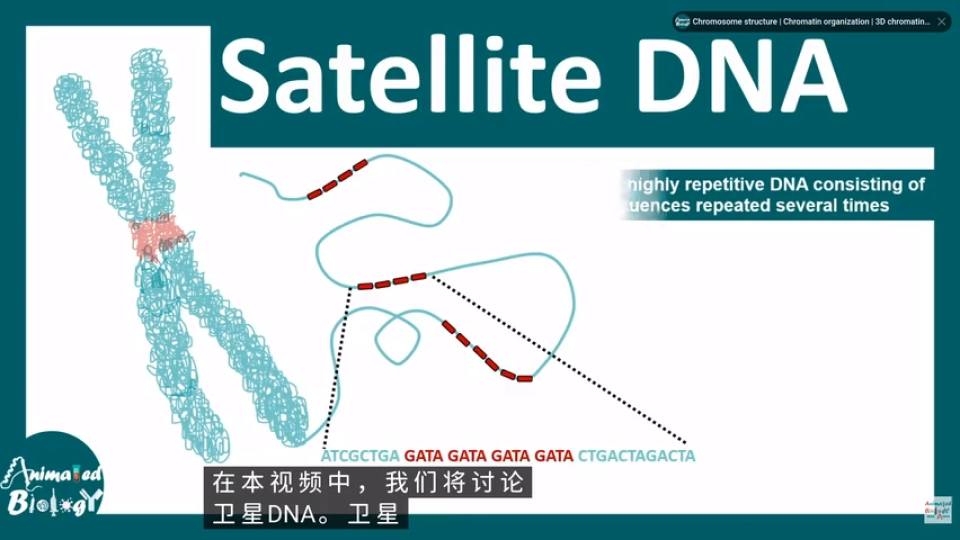

### 1.2 按重复单元长度分成四类

卫星 DNA 不是一个单一类别，而是按重复单元长度和位置分成几种亚型：

| 亚型 | 重复单元长度 | 常见位置 |
| --- | --- | --- |
| α 卫星 | 171 bp | 着丝粒区域，高度富集 |
| β 卫星 | 约 68 bp | 着丝粒周围区域 |
| 微卫星 | 2–10 bp | 分散在整个染色体 |
| 小卫星 | 10–100 bp | 端粒和次端粒区域 |

[【跳转到 00:02:30】](https://www.bilibili.com/video/BV1BcvzBZEDR/?t=150)

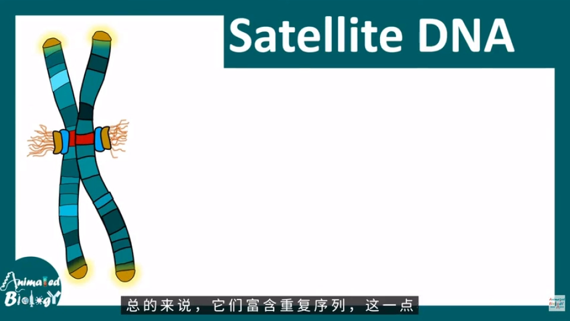

注意“微卫星”和“小卫星”只差一个字，但重复单元长度差一个数量级：微卫星是 2–10 bp，小卫星是 10–100 bp。视频字幕曾把后者译成“微卫星”，这里按画面上的英文标签订正。

### 1.3 串联重复的高突变率：复制滑脱

串联重复的突变率远高于编码区的点突变。微卫星的突变率大约在 $10^{-2}$ 到 $10^{-6}$ 之间，而编码区点突变通常低得多。[【跳转到 00:03:29】](https://www.bilibili.com/video/BV1BcvzBZEDR/?t=209)

原因叫**复制滑脱**（replication slippage）：复制酶经过一段重复序列时，新合成链和模板链可能短暂错配、滑开再重新配对，结果多合成了一个单元或少合成了一个单元。重复单元越短、越连续，越容易发生这种错配。[【跳转到 00:03:47】](https://www.bilibili.com/video/BV1BcvzBZEDR/?t=227)

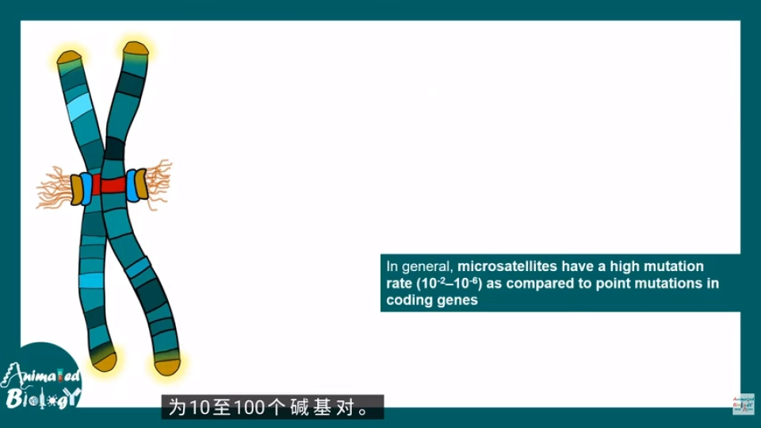

### 1.4 串联重复的后果：个体差异与法医标记

串联重复通常位于异染色质（如着丝粒附近），不被转录，但仍有功能意义。[【跳转到 00:04:09】](https://www.bilibili.com/video/BV1BcvzBZEDR/?t=249) 更直接的后果是：每个个体的串联重复次数不同。比如某个重复单元，一个人可能有 7 次重复，另一个人可能有 4 次或 12 次。[【跳转到 00:04:34】](https://www.bilibili.com/video/BV1BcvzBZEDR/?t=274)

这种长度多态性正是法医 DNA 指纹的基础：把嫌疑人和现场样本的重复区用 PCR 扩增，比较产物长度，就能判断谁匹配。[【跳转到 00:05:01】](https://www.bilibili.com/video/BV1BcvzBZEDR/?t=301)

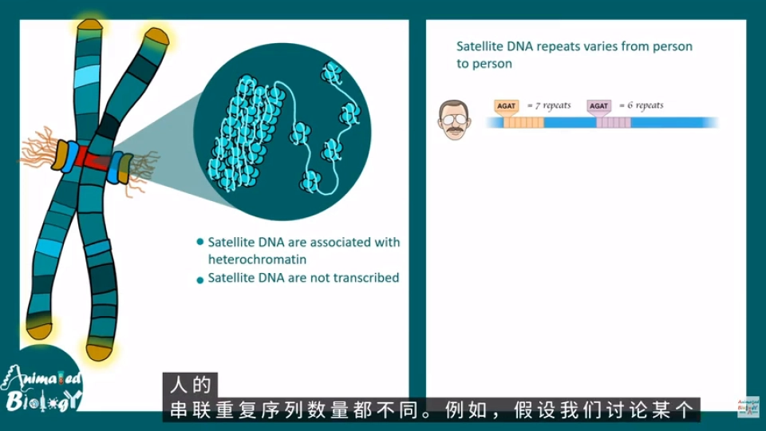

---

## 二、散在重复：转座元件及其“化石拷贝”

### 2.1 散在重复与串联重复的区别

散在重复（dispersed repeat）不是首尾相接的简单阵列，而是同一类元件散落在基因组各处。它的主体就是**转座元件**（transposable element）：一段 DNA 可以从基因组的一个位置移动到另一个位置；转座元件插入后留下的拷贝，以及后续复制出的拷贝，就在基因组中形成了散在重复。[【跳转到 00:09:00】](https://www.bilibili.com/video/BV1rf421R7Kf/?t=540)

一张常用的分类图把真核基因组的重复 DNA 分成两大支：一支是散在重复（转座元件），另一支是串联重复（着丝粒、端粒、亚端粒、微卫星等）。[【跳转到 00:08:10】](https://www.bilibili.com/video/BV1rf421R7Kf/?t=490)

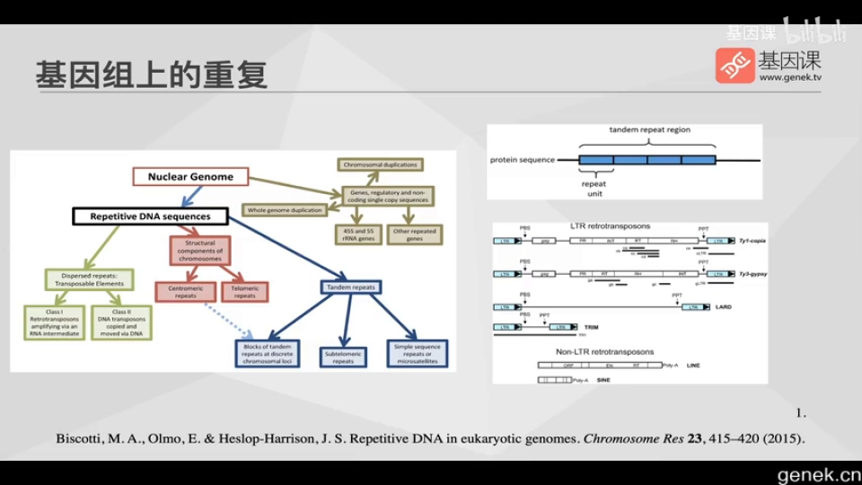

### 2.2 转座元件的两大类

转座元件按中间体分成两大类：

- **DNA 转座子（二类转座子）**：始终以 DNA 形式存在，通过转座酶把一段 DNA 插入基因组其他位置。
- **逆转录转座子（一类转座子）**：先转录成 RNA，再逆转录回 DNA，然后插入基因组。

[【跳转到 00:10:40】](https://www.bilibili.com/video/BV1rf421R7Kf/?t=640)

逆转录转座子又分成：

- **LTR 反转录转座子**：两端各有一个长末端重复序列（long terminal repeat），常见的有 copia 和 gypsy 两大类。
- **非 LTR 反转录转座子**：没有长末端重复，主要包括 LINE 和 SINE。

[【跳转到 00:13:35】](https://www.bilibili.com/video/BV1rf421R7Kf/?t=815)

LINE 和 SINE 有一个实用的分布规律：LINE 主要在动物中出现；如果在植物基因组里注释到大量 LINE，先怀疑是不是做错了。[【跳转到 00:14:25】](https://www.bilibili.com/video/BV1rf421R7Kf/?t=865) 人类基因组里还有一个特别有名的 SINE 家族——**Alu 家族**；如果在植物里发现大量 Alu，同样先怀疑注释错误。[【跳转到 00:14:50】](https://www.bilibili.com/video/BV1rf421R7Kf/?t=890)

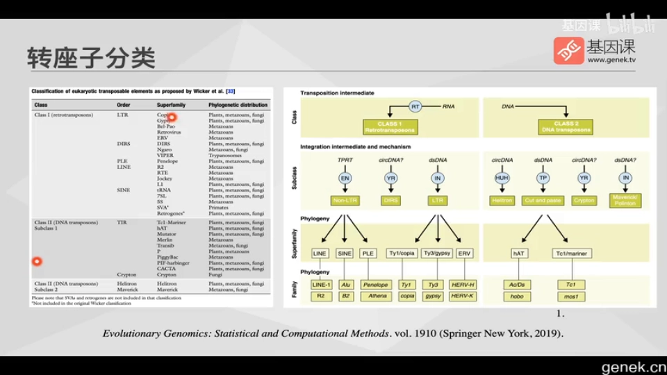

### 2.3 转座元件占基因组多少

不同生物差异极大。人类基因组首次完整测序时，最令人意外的发现之一就是约一半基因组由转座相关序列组成；其中大多数是已经灭活的“化石”，不是当前活跃的转座子。[【跳转到 00:20:21】](https://www.bilibili.com/video/BV1LZc6zfEbd/?t=1221)

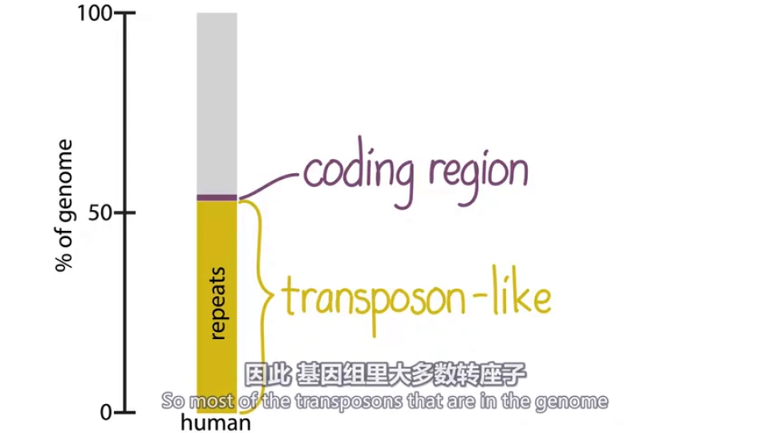

对比其他生物：细菌基因组以基因密度高著称，转座元件很少；酿酒酵母也只有少量；玉米基因组可高达 80% 为转座相关序列。[【跳转到 00:21:36】](https://www.bilibili.com/video/BV1LZc6zfEbd/?t=1296) 这种差异与基因组的演化历史有关：基因组是否需要快速复制、能否缓慢复制，以及演化过程中是否形成清除冗余 DNA 的机制，都会影响转座序列的积累。[【跳转到 00:22:01】](https://www.bilibili.com/video/BV1LZc6zfEbd/?t=1321)

---

## 三、转座机制：剪切、复制与逆转录

### 3.1 三类机制总览

MIT 课程把转座元件分成三类：

1. 经典 DNA 元件：始终以 DNA 形式存在，又分**复制型**和**非复制型**。
2. LTR 反转录转座子：有 RNA 中间体，但整合时的 DNA 反应与经典 DNA 元件相似。
3. 非 LTR 反转录转座子：同样有 RNA 中间体，但机制细节不同。

[【跳转到 00:26:36】](https://www.bilibili.com/video/BV1LZc6zfEbd/?t=1596)

### 3.2 剪切—粘贴：转座子从原位“搬家”

最简单的 DNA 转座是**剪切—粘贴**：转座子从 DNA 的一个位置被切出来，再插入另一个位置。[【跳转到 00:30:21】](https://www.bilibili.com/video/BV1LZc6zfEbd/?t=1821)

转座子的两端有**反向重复序列**，它们是转座酶的结合位点。转座酶结合两端，把转座子 DNA 的两端拉在一起，形成一个紧密的蛋白质—DNA 复合体；切割和连接都在这个复合体里完成。[【跳转到 00:30:37】](https://www.bilibili.com/video/BV1LZc6zfEbd/?t=1837)

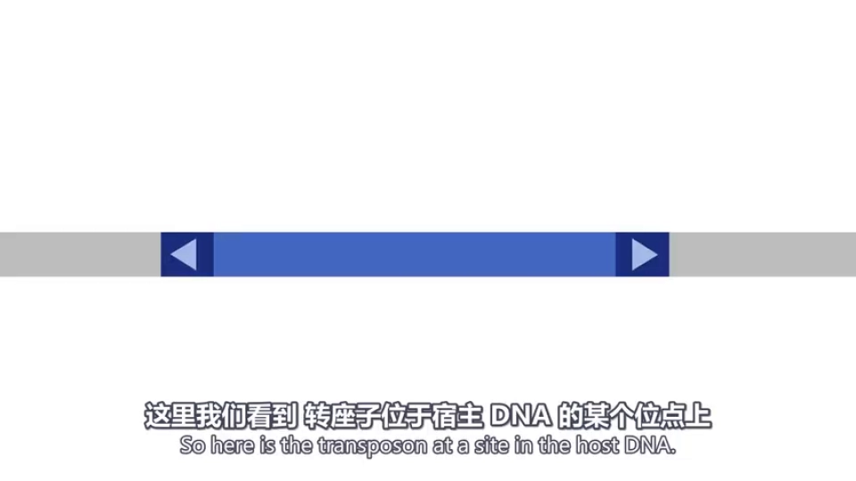

化学反应可以压缩成两步：

1. 转座酶在转座子两端切割，使两端以 3' 羟基结尾。
2. 两个 3' 羟基攻击目标 DNA 的磷酸二酯键，把转座子末端共价连接到新位点。

[【跳转到 00:31:23】](https://www.bilibili.com/video/BV1LZc6zfEbd/?t=1883)

关键细节是：两次攻击在目标 DNA 上通常**错开几个碱基**，不是正对。错位切割留下突出末端，由宿主 DNA 聚合酶补齐、连接酶封口。补齐的这段序列，就在转座子两侧形成**靶位重复**（target site duplication）。不同转座子的错位距离不同，有的 4 bp，有的 5 bp，有的 9 bp。[【跳转到 00:33:49】](https://www.bilibili.com/video/BV1LZc6zfEbd/?t=2029)

这也给了一个识别新转座子的线索：**两端有反向重复、两侧有短直接重复**，就可能是转座元件。[【跳转到 00:34:14】](https://www.bilibili.com/video/BV1LZc6zfEbd/?t=2054)

### 3.3 复制型转座：转座子复制一份，旧位点保留

复制型转座的化学步骤与剪切—粘贴相同，但产物不同：转座子末端攻击新靶点后，旧位点和它所在的 DNA 分子仍然连着，形成一个“麻花状”的中间体。DNA 复制从这个中间体的一端启动，解开后得到**两个转座子拷贝**：一个在旧位点，一个在新位点。这种结构叫**共整合体**（cointegrate）。[【跳转到 00:41:36】](https://www.bilibili.com/video/BV1LZc6zfEbd/?t=2496)

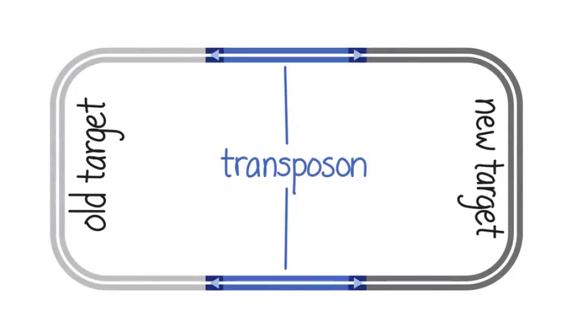

复制型转座是转座子“越来越多”的重要方式：每转座一次，拷贝数加一。剪切—粘贴则不增加拷贝数，只是换位置。

### 3.4 逆转录转座：先转录，再逆转录，最后插入

逆转录转座子移动时**不切割自身**。它的过程是：

1. 从元件末端附近启动转录，生成一条几乎覆盖整个元件的 RNA。
2. 以 RNA 为模板，逆转录合成 cDNA。
3. cDNA 的 3' 端攻击新靶点，整合进基因组。

[【跳转到 00:45:34】](https://www.bilibili.com/video/BV1LZc6zfEbd/?t=2734)

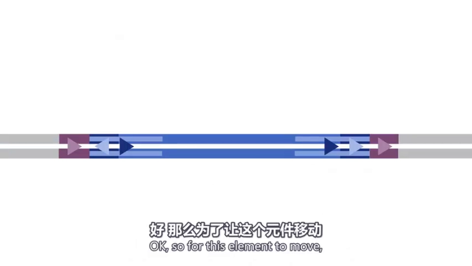

这类机制与逆转录病毒的整合反应几乎相同，区别只在于逆转录转座子从未真正脱离宿主、成为病毒。[【跳转到 00:44:36】](https://www.bilibili.com/video/BV1LZc6zfEbd/?t=2676) 非 LTR 逆转录转座子是真核生物中最活跃的转座元件之一。[【跳转到 00:27:21】](https://www.bilibili.com/video/BV1LZc6zfEbd/?t=1641)

---

## 四、重复含量高导致组装碎片化

组装的任务是把测序得到的短 read 拼成染色体。短读长测序的一条 read 通常只有几十到几百个碱基，人类基因组比对里常见的 read 约 150 bp。[【跳转到 00:09:49】](https://www.bilibili.com/video/BV1xP411w742/?t=589)

问题在于：**重复阵列的长度常常远远超过一条 read 的长度**。一个串联重复阵列可以长达 100 Mb，而 read 只有 150 bp。[【跳转到 00:00:06】](https://www.bilibili.com/video/BV1BcvzBZEDR/?t=6) 一条 read 落在重复阵列内部时，它只能看到“重复单元”，看不到阵列两端 unique 的侧翼序列。组装器无法判断这条 read 应该接在阵列的哪个位置，也无法确定阵列到底有多长。

结果就是：contig 在重复边界处停住，重复阵列本身可能被压缩、断开，或者被放到 scaffold 的错误位置。重复序列含量越高，组装难度越大。[【跳转到 00:07:58】](https://www.bilibili.com/video/BV1rf421R7Kf/?t=478)

这也解释了为什么“组装出染色体级序列”在重复丰富的真核基因组里格外困难：不是测序读得太少，而是读长跨不过重复。

---

## 五、重复含量高导致比对多重映射

### 5.1 一条 read 同时匹配多个拷贝

把 read 比对回参考基因组时，理想情况是找到**唯一**位置。但如果 read 落在重复区，参考基因组里有多个几乎相同的拷贝，它和每一个都匹配得很好，比对器就不知道它到底来自哪一个。[【跳转到 00:09:51】](https://www.bilibili.com/video/BV1xP411w742/?t=591)

视频里用了一个很直观的比喻：从一本书里抽出一行，去书里找它出现在哪一页；如果这本书不断重复同样的句子，你就无法确定页码。[【跳转到 00:09:11】](https://www.bilibili.com/video/BV1xP411w742/?t=551)

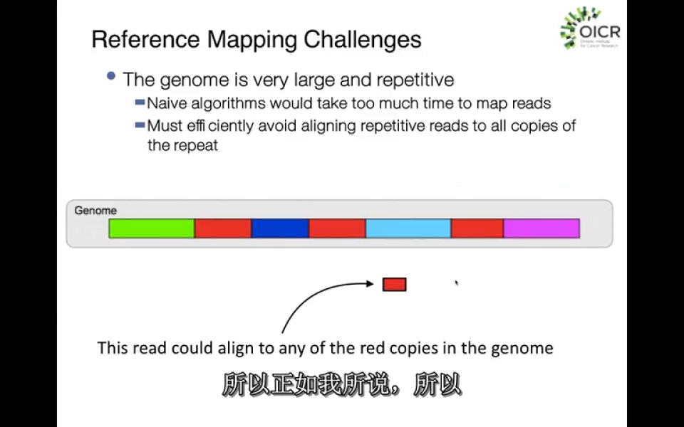

### 5.2 多重映射的可见后果：覆盖度堆积与 MAPQ 为零

多重映射会在数据里留下两个信号：

- **覆盖度异常堆积**：如果某个重复元件有很多拷贝，所有模棱两可的 read 都会堆到这些拷贝上，看起来像“覆盖度尖峰”。[【跳转到 00:25:16】](https://www.bilibili.com/video/BV1xP411w742/?t=1516)
- **比对质量为零**：完全模棱两可的 read 会有多个映射，或者被标记为完全模棱两可，映射质量（MAPQ）为零。[【跳转到 00:25:16】](https://www.bilibili.com/video/BV1xP411w742/?t=1516)

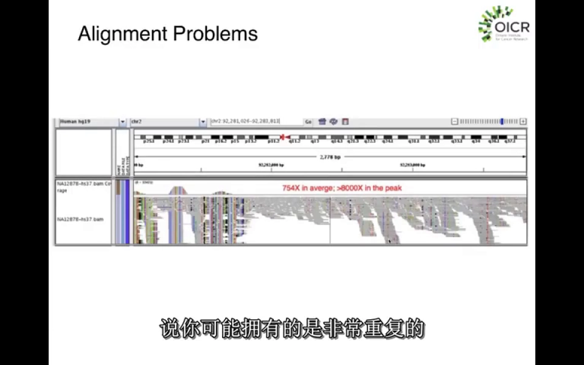

视频还给了一个具体例子：第二条 read 在 16 号和 3 号染色体上都有完美匹配，其中一个位置是基因组上的独特位置，另一个不是。比对器可能保留独特位置、忽略另一个潜在位置。[【跳转到 00:26:11】](https://www.bilibili.com/video/BV1xP411w742/?t=1571)

这对下游分析的影响很直接：如果你在重复区里数 read、判变异、算表达，多重映射的 read 会让计数和基因型判断都变得不可靠。处理多重映射之前，先要知道重复区在哪里。

---

## 六、重复含量高导致注释歧义

### 6.1 注释前先屏蔽重复

基因组注释通常分两步：先做重复序列注释，再做基因结构注释。重复序列注释的一个主要目的，是把基因组里六七十 % 的重复区域先标出来、屏蔽掉，让后续的基因预测只在剩下的区域里进行，降低复杂度。[【跳转到 00:06:18】](https://www.bilibili.com/video/BV1rf421R7Kf/?t=378)

屏蔽的理由是：重复区里充满了转座元件的“化石拷贝”，这些拷贝会增加基因预测的复杂度，让基因模型更难确定。先屏蔽重复、再预测基因，是控制这类注释歧义的常规步骤。

### 6.2 转座插入本身也会改变基因结构

重复不只是“占地方”。转座元件移动时，可以把 DNA 插入基因的新位置或调控区域，导致基因破坏或表达改变；也可能造成双链断裂和染色体重排。[【跳转到 00:24:19】](https://www.bilibili.com/video/BV1LZc6zfEbd/?t=1459)

这带来两类注释难题：

- **插入改变基因结构**：转座元件插入基因或调控区后，基因的外显子边界、启动子位置都可能改变，注释必须把插入事件和参考序列版本一起考虑。
- **重复区里的基因片段**：转座元件携带的序列可能和真实基因同源，注释器难以区分“真基因”和“转座子带来的假基因”。

所以“重复序列注释”不只是给重复区贴标签，它同时是在给基因注释划出可信边界。

---

## 小结

- 重复序列沿两条轴分类：**排列方式**（串联重复 vs 散在重复）和**移动方式**（DNA 转座子的剪切—粘贴/复制型，逆转录转座子的 RNA 中间体）。
- 串联重复按单元长度分成 α 卫星（171 bp）、β 卫星（约 68 bp）、微卫星（2–10 bp）、小卫星（10–100 bp）；复制滑脱让它们具有高突变率和长度多态性。
- 散在重复的主体是转座元件：DNA 转座子、LTR 反转录转座子、LINE、SINE、Alu。人类基因组约一半是转座相关序列，玉米可达八成，其中大多数是灭活的化石拷贝。
- 转座机制的核心是**转座酶切割 + 链转移**；剪切—粘贴不增加拷贝数，复制型转座产生共整合体、增加拷贝数，逆转录转座通过 RNA → cDNA 插入新位点。
- 重复造成组装碎片化，是因为重复阵列常比 read 长，read 跨不过去，contig 在重复边界停住。
- 重复造成比对歧义，是因为一条 read 同时匹配多个拷贝，表现为多重映射、MAPQ 为零和覆盖度堆积。
- 重复造成注释歧义，是因为转座化石拷贝会被误认成基因；常规做法是先屏蔽重复，再预测基因。

## 关键术语速查

| 术语 | 一句话解释 |
| --- | --- |
| 串联重复 | 同一个短序列单元首尾相接、重复多次，形成阵列 |
| 散在重复 | 同一类元件散落在基因组各处，主体是转座元件 |
| 卫星 DNA | 高度重复、常位于异染色质的串联重复，按单元长度分 α/β/微/小卫星 |
| 微卫星 | 重复单元 2–10 bp 的串联重复，突变率高，常用作遗传标记 |
| 小卫星 | 重复单元 10–100 bp 的串联重复，富集于端粒/次端粒 |
| 复制滑脱 | 复制酶在重复区错配滑开，导致重复单元多一个或少一个 |
| 转座子 | 可在基因组中移动位置的 DNA 元件 |
| DNA 转座子 | 以 DNA 形式转座，分剪切—粘贴（非复制型）和复制型 |
| 逆转录转座子 | 先转录成 RNA，再逆转录成 cDNA 插入基因组 |
| LTR | 长末端重复序列，LTR 反转录转座子两端的长重复 |
| LINE / SINE | 非 LTR 反转录转座子的两类，LINE 主要在动物，SINE 含 Alu 家族 |
| 靶位重复 | 转座插入后，元件两侧由错位切割和补齐形成的短直接重复 |
| 共整合体 | 复制型转座产生的中间体，旧位点和新位点各有一份转座子 |
| 多重映射 | 一条 read 同时匹配参考基因组的多个位置，无法确定唯一来源 |
| MAPQ | 比对质量值，多重映射或模棱两可的 read 通常为 0 |