# 参考基因组：组装版本与坐标系统

> 视频来源：[生信入门 第14讲：参考基因组、坐标与注释](https://www.bilibili.com/video/BV1AsnQ66EZp/)（B 站 · 生信基本功）｜[OVERLAP、CONTIG、SCAFFOLD 等基本概念介绍](https://www.bilibili.com/video/BV1HwpRe6E1S/)（B 站 · 华大基因学院）｜[参考基因组及不同版本注释文件的说明](https://www.bilibili.com/video/BV1bC4y1m7iN/)（B 站 · 孟浩巍）
> 本篇以第一支视频为主线，讲清参考基因组这把"尺子"、它为什么会改版、以及一条染色体记录到底指什么；第二支补 contig/scaffold 的层级，第三支补主染色体与 alt/random/patch 记录的实际样子。第三支原片是下载实操课，本文只取其中讲记录与版本差异的片段，不涉及下载步骤。字幕为 AI 识别，术语已按画面订正。

## 本讲要解决的核心问题（SCQA）

**背景**：做基因组分析时，read 要"放回"参考基因组，变异要写成一个坐标，基因也要用一个区间表示。所有人都默认自己脚下踩的是同一套序列。

**冲突**：同一个 TCF7L2 位点，在一份资料里是 10 号染色体 1 亿 1475 万多，在另一份资料里是 1 亿 1299 万多，差了 170 多万。两个都没写错——它们用的是两个不同版本的参考基因组。更麻烦的是，这类错误程序不会报错，只会安静地给出一个错的结果。

**疑问**：参考基因组到底是什么？版本之间改了什么，为什么会让坐标整体平移？一条"染色体记录"又是什么，为什么同一条染色体在三个数据库里有三个名字？

**回答（中心思想）**：参考基因组是一把**公共尺子**，不是一个"标准人"；尺子会改版，一改版刻度就变，所以**坐标必须和版本绑定**；而尺子本身不是一个整体，它由**一条条记录**组成——主染色体、未定位的 scaffold、替代单倍型各是独立记录，各有自己的名字。分清"组装、版本、记录"这三层，是读懂任何带坐标数据的前提。

---

## 一、参考基因组是一把公共尺子，不是"标准人"

### 1.1 它的作用是提供一个共同坐标

参考基因组是一套拼好的、大家公认的基因组序列。所有人都拿它当尺子：read 往上面放，变异相对于它来写，基因的位置在它上面标。[【跳转到 01:15】](https://www.bilibili.com/video/BV1AsnQ66EZp/?t=75)

这句话里有两个关键词。**公认**：它是一份约定，不是唯一的真理，换一把尺子，同一段 DNA 的"地址"就会变。**拼好**：它是测序之后组装出来的产物，而组装有完整度之分——这一点在第三节会展开。

### 1.2 它不是标准人，也不是健康人

初学者最容易犯的误解，是把参考基因组当成"人类的标准模板"或"健康人的基因组"。事实是：[【跳转到 01:40】](https://www.bilibili.com/video/BV1AsnQ66EZp/?t=100)

- 人类的参考基因组主要是用**少数几位捐献者**的 DNA 拼出来的；
- 它只是一套**单倍（haploid）**序列，每条染色体只有一份，而真实的人是二倍体；
- 它本身也带着一些**少见的变异**。

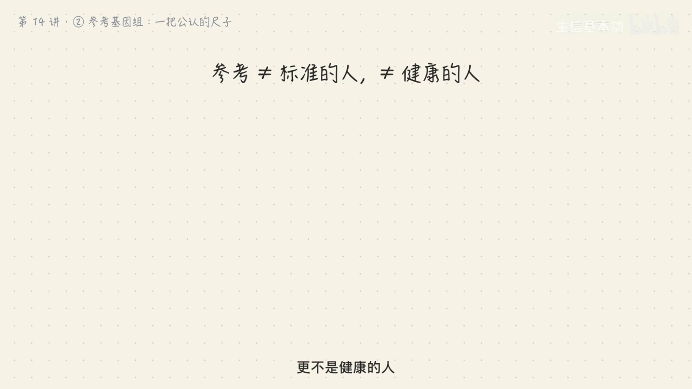

所以"我的数据和参考不一样"只说明你和这把尺子不同，不说明你有问题。反过来说，尺子的偏差会变成分析结果的偏差：一个人身上和参考差别很大的区域，read 很难比对上去，这些区域就会被系统性地低估，这个现象叫**参考偏好**（reference bias）。[【跳转到 02:05】](https://www.bilibili.com/video/BV1AsnQ66EZp/?t=125)

### 1.3 泛基因组是尺子的下一步

为了缓解参考偏好，人们开始构建**泛基因组**（pangenome）：不再只用一个人的序列，而是把很多不同人群的基因组放在一起，做成一张图。2023 年一个国际联盟发布了第一版人类泛基因组草图，包含 47 个人。[【跳转到 02:05】](https://www.bilibili.com/video/BV1AsnQ66EZp/?t=125) 这还在演进中，目前大多数数据和工具用的仍是线性参考序列，本文也只讨论线性参考。

---

## 二、版本：尺子改版，后面所有刻度跟着平移

### 2.1 人类最常见的是两版，另有 T2T

| 版本 | 发布年份 | 常见别名 |
| --- | --- | --- |
| GRCh37 | 2009 | hg19 |
| GRCh38 | 2013 | hg38 |
| T2T（端粒到端粒） | 2022 | 第一个无缺口版本 |

GRCh37 与 hg19、GRCh38 与 hg38 说的是同一回事，只是不同网站的叫法不同。[【跳转到 02:55】](https://www.bilibili.com/video/BV1AsnQ66EZp/?t=175)

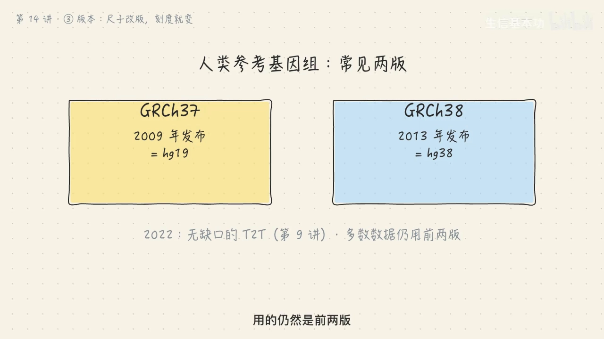

T2T 补上了前两版残留的缺口，但**现在大多数数据和工具用的仍然是前两版**——这一点很重要：新版本更好，不等于你可以直接用，生态里流通的数据大多还挂在 hg19/hg38 上。

### 2.2 为什么改版会让坐标变

新版做了三件事：补上缺口、修正错误、调整某些片段的位置。这三件事的共同后果是：**前面的序列只要多了或少了一些字母，后面所有位置的编号就都会跟着平移**。[【跳转到 03:20】](https://www.bilibili.com/video/BV1AsnQ66EZp/?t=200)

看真实的数值：

| 位点 | GRCh37 | GRCh38 | 位移 |
| --- | --- | --- | --- |
| TCF7L2 | chr10:114,758,349 | chr10:112,998,590 | 约 176 万 bp |
| 胰岛素基因 INSR | chr11 约 218 万 | chr11 约 215 万 | 约 3 万 bp |

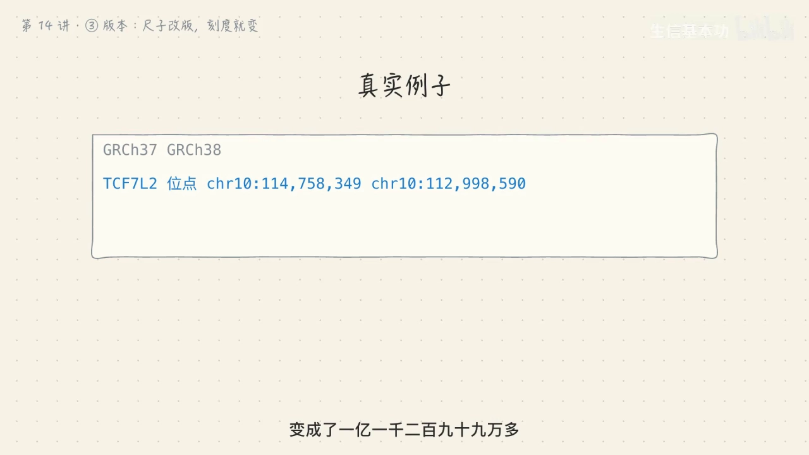

注意这两个例子的位移量级完全不同：一个差 176 万，一个差 3 万。这说明"版本差异"不是一个统一的偏移量，不能靠加减一个常数来换算——每个区域改了什么，得逐段看。

### 2.3 怎么判断一份数据用的是哪个版本

三条路，按可靠性排序：[【跳转到 03:45】](https://www.bilibili.com/video/BV1AsnQ66EZp/?t=225)

1. **看说明和文件开头**。这是最好的办法。注释文件的头部通常直接写着组装名和登录号，例如 `#!genome-build GRCh38.p13`。
2. **看染色体长度**。1 号染色体在 GRCh37 里是 2 亿 4925 万多 bp，在 GRCh38 里是 2 亿 4895 万多 bp。[【跳转到 04:10】](https://www.bilibili.com/video/BV1AsnQ66EZp/?t=250)
3. **挑几个已知位点核对**。查这些位点在两个版本里的位置，看数据和哪个对得上。

如果两份数据版本不一样，可以用工具做坐标转换（liftover）。但**转换并不总能成功**：有的区域在新版里被改得面目全非，转换后会丢掉，或者落到别的地方去。所以能用同一个版本重新分析就别转换；必须转换，就数一数丢了多少。[【跳转到 04:35】](https://www.bilibili.com/video/BV1AsnQ66EZp/?t=275)

### 2.4 "版本"不止一个层级

说"我用的是 GRCh38"其实还不够精确。同一套组装还有几个层次：

- **主版本**：GRCh37 / GRCh38；
- **补丁版本**：GRCh38.p13 里的 `.p13` 是 patch 号，表示在主版本上又修过若干处；
- **登录号**：同一套 GRCh38.p13，在 RefSeq 体系里登录号是 `GCF_000001405.39`，在 GenBank/Ensembl 体系里是 `GCA_000001405.28`。

后两点在文件头里能直接看到。下面两张图是同一台机器上两个来源的 GTF 文件头，组装名都是 GRCh38.p13，但登录号一个是 GCF 一个是 GCA：

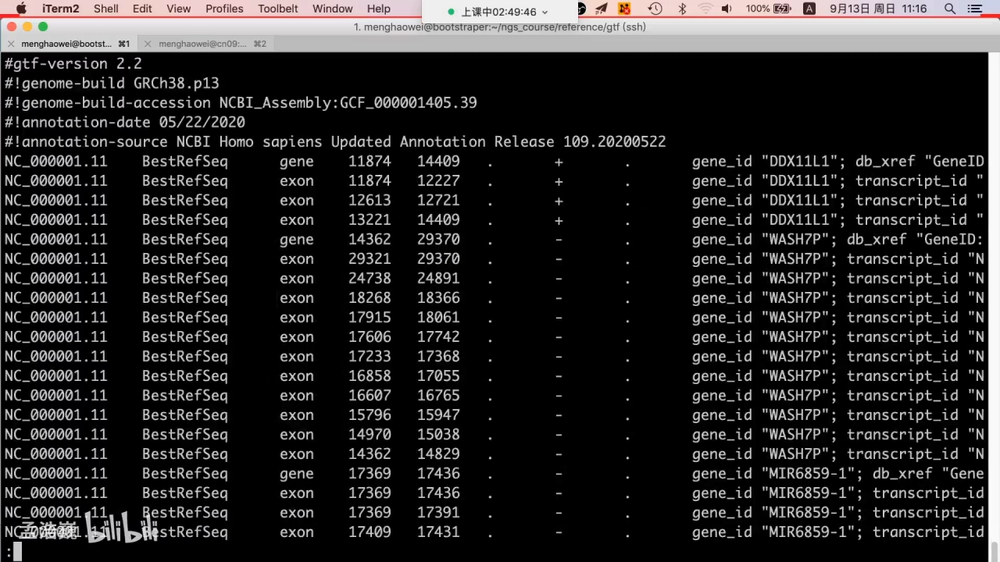

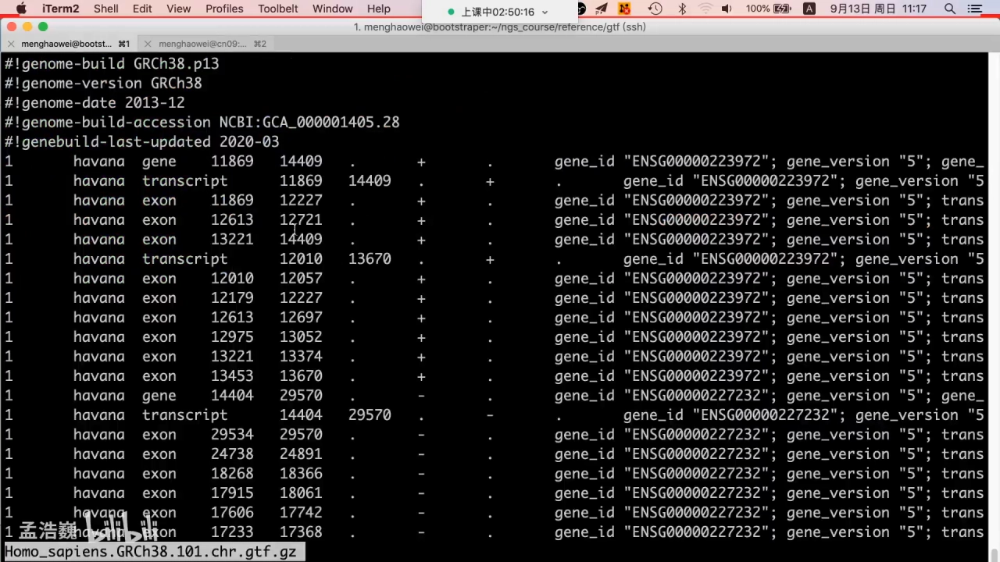

所以写方法时"参考基因组版本"至少要写到补丁号，必要时连登录号一起写。

### 2.5 版本差异有多大：看 N 区和总长

版本之间的差别不是均匀分布的。把 hg19 和 hg38 的 N 区（未知碱基）画在同一张图上，黑色部分就是 N：hg19 的黑色明显更多，尤其在 17–20 号这些地方，hg38 里好多已经"打通"了。[【跳转到 27:03】](https://www.bilibili.com/video/BV1bC4y1m7iN/?t=1623)

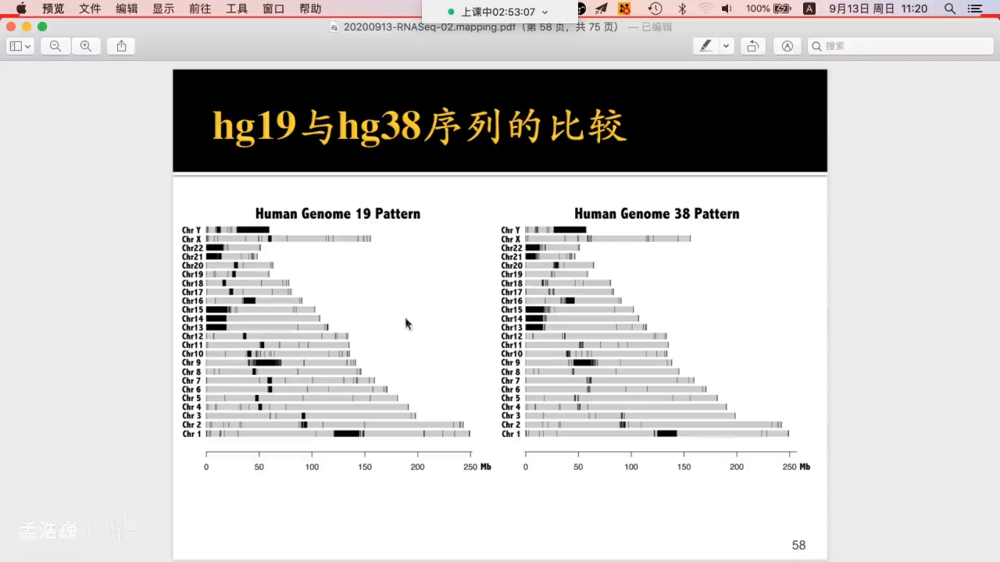

总长也能看出这件事：

| | GRCh37.p13 | GRCh38.p2 |
| --- | --- | --- |
| 总碱基数 | 3.23 G | 3.21 G |
| 去掉 N 之后 | 2.99 G | 3.05 G |

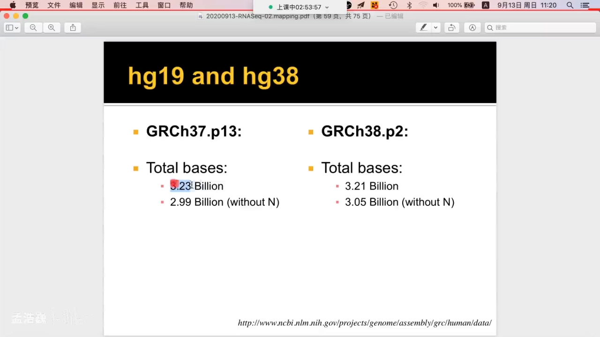

hg38 的**总长更小，但去掉 N 之后反而更大**——因为它把 hg19 里大量的 N 换成了真实序列。这正是"补缺口"在数字上的样子，也解释了为什么坐标会平移：缺口被填上，填进去的序列长度和原来占位的 N 不一定相等。

---

## 三、染色体记录：一条 FASTA 里到底装了什么

参考基因组文件不是一个整体，而是一条条**记录**（record），每条记录以 `>` 开头，后面跟记录名，然后是该记录的序列。要理解这些记录，得先理解组装是怎么把短片段拼成长的。

### 3.1 从 overlap 到 contig

两条 read 之间会有一段一模一样的序列，这段相同的部分叫 **overlap**（重叠）。比如一条是 `ATCG`，另一条是 `CGTTCG`，重叠部分就是 `CG`。利用 overlap 把 reads 拼起来，得到的一条更长的连续片段就叫 **contig**（重叠群）。[【跳转到 00:15】](https://www.bilibili.com/video/BV1HwpRe6E1S/?t=15)

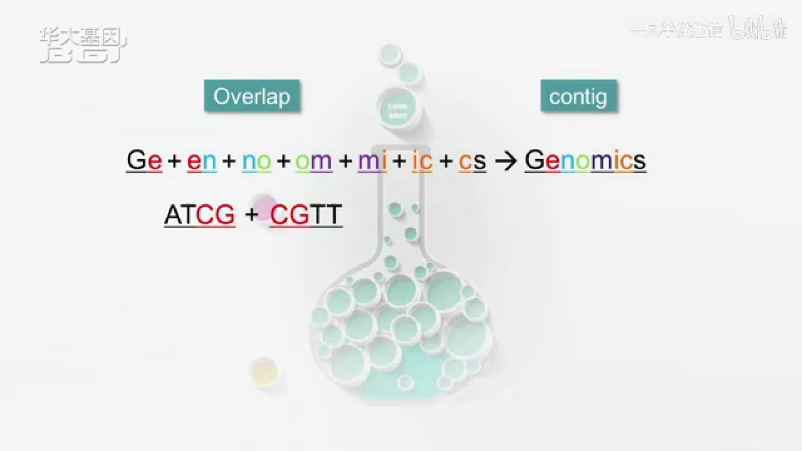

contig 的关键词是**连续**：它是一条没有中断的片段，内部没有用 N 占位的未知区。

### 3.2 从 paired-end 到 scaffold

contig 再往上拼，靠的是**双末端测序**（paired-end）：同一段 DNA 的两端各测一条 read，所以这一对 reads 一定来自同一条染色体，中间隔着已知大致长度的序列。[【跳转到 01:05】](https://www.bilibili.com/video/BV1HwpRe6E1S/?t=65)

于是可以把两个 contig 按这对 reads 的相对位置连起来，中间那段没测到的区域用未知字符（N）占位。这样连成的一条更长的片段叫 **scaffold**（支架）。[【跳转到 02:45】](https://www.bilibili.com/video/BV1HwpRe6E1S/?t=165)

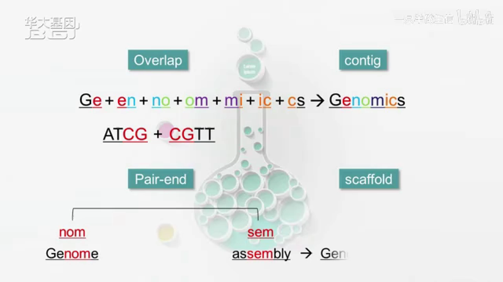

所以三层的区别很清楚：

| 层级 | 怎么来的 | 内部有没有未知区 |
| --- | --- | --- |
| read | 测序仪直接读出 | 无 |
| contig | reads 靠 overlap 拼接 | 无（连续） |
| scaffold | contig 靠 paired-end 连接 | 有，用 N 占位 |
| 染色体 | 拼装完成、能作为一条独立记录下载的整条染色体（如 `chr1.fa.gz`） | 可以有 |

补一句边界：scaffold 怎么进一步挂到染色体上属于组装方法，不在本节展开；本节只要求你能从记录名和长度判断一条记录停在哪一层。

### 3.3 参考组装里同时存在主染色体、alt 和未定位记录

打开 UCSC 的 hg38 染色体目录，会看到三类文件并存：[【跳转到 04:08】](https://www.bilibili.com/video/BV1bC4y1m7iN/?t=248)

- `chr1.fa.gz`：主染色体记录，71 MB，是拼好的 1 号染色体；
- `chr1_GL383518v1_alt.fa.gz`：**alt**（替代单倍型）记录，55 KB，是 1 号染色体的一个替代单倍型，没有并进主序列；
- `chr1_KI270706v1_random.fa.gz`：**random**（未定位）记录，56 KB，知道它属于 1 号染色体，但没法定到具体位置。

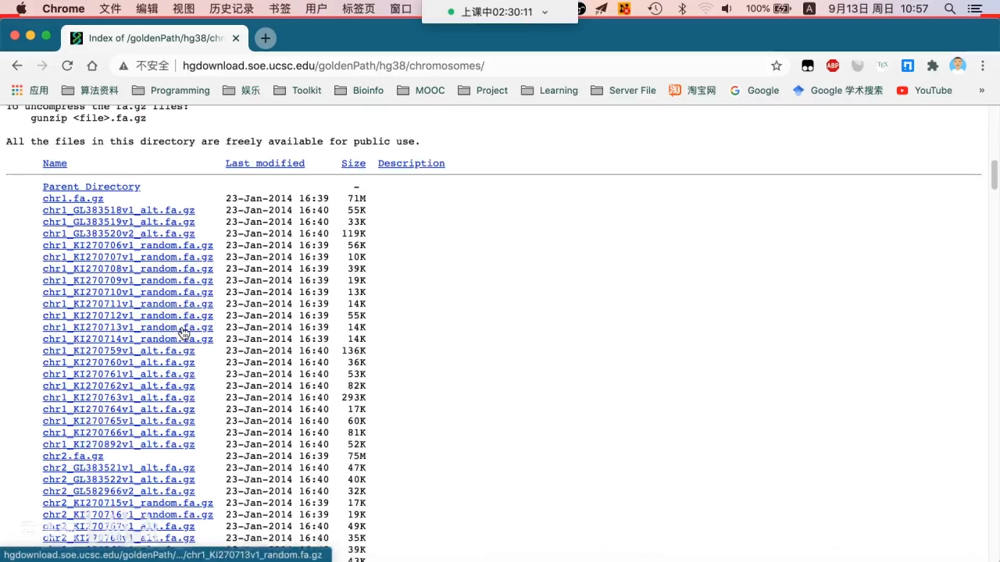

目录末尾还会有 `chrUn` 之类的记录：知道它属于人的基因组，但在哪条染色体上都没有拼出来。[【跳转到 04:33】](https://www.bilibili.com/video/BV1bC4y1m7iN/?t=273)

这些记录一般分析时不用，常规做法是只下载拼装好的主染色体。[【跳转到 04:33】](https://www.bilibili.com/video/BV1bC4y1m7iN/?t=273) 可以这样理解：alt 是替代单倍型，和主染色体描述的是同一段染色体；random/unplaced 则没有定位到具体位置。把这几类记录混进同一份 FASTA 再做比对，一个坐标就可能对应不止一条记录，统计口径随之变乱。

注释文件也遵循同样的分层。Ensembl 的 GTF 目录里同时提供 `Homo_sapiens.GRCh38.101.chr.gtf.gz` 和 `Homo_sapiens.GRCh38.101.chr_patch_hapl_scaff.gtf.gz`：前者只覆盖主染色体，后者把 patch、haplotype、scaffold 上的注释也包含进来。[【跳转到 20:29】](https://www.bilibili.com/video/BV1bC4y1m7iN/?t=1229)

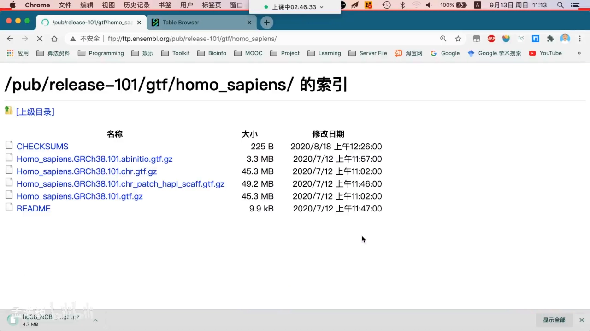

**选哪个取决于你的问题**：做常规的染色体级分析，用 chr 版就够，坐标也干净；研究的东西正好落在 patch 或 alt 区域，才需要 chr_patch_hapl_scaff 版，并且要接受"这部分坐标不是主染色体坐标"。

### 3.4 记录层级和 N 区是同一件事的两种看法

回到第二节的 N 区图：那些黑色块是序列里的 N，按讲者的说法，它们主要落在**着丝粒、端粒和复杂的重复区域**。[【跳转到 27:03】](https://www.bilibili.com/video/BV1bC4y1m7iN/?t=1623) 这些地方正是组装最难通过的区域，所以会留下缺口，用 N 占位。组装越完整，N 越少，记录越接近"一条染色体一条记录"。所以"版本更新"和"记录层级提升"是同一个过程的两个说法：hg19 到 hg38 打通了很多缺口，T2T 则把剩下的缺口也补完了。

---

## 四、同一条记录，三套名字

### 4.1 chr1 / 1 / NC_000001.11

同一条 1 号染色体，在三个体系里的记录名完全不同：

| 体系 | 1 号染色体的记录名 | 基因 ID 前缀 |
| --- | --- | --- |
| UCSC | `chr1` | — |
| Ensembl | `1` | `ENSG` |
| RefSeq（NCBI） | `NC_000001.11` | — |

线粒体也一样：有的写 `chrM`，有的写 `mt`。[【跳转到 05:50】](https://www.bilibili.com/video/BV1AsnQ66EZp/?t=350)

### 4.2 名字对不上时，软件不会报错

两份数据一合并，如果一份写 `chr1`、一份写 `1`，软件往往**不报错**，只是悄悄地什么都匹配不上，结果是一片空白位置。[【跳转到 06:15】](https://www.bilibili.com/video/BV1AsnQ66EZp/?t=375)

这是本节最值得记住的一条工程经验：**坐标系统的错误大多不抛异常，只产生空结果或错结果**。所以核对必须发生在动手之前，而不是等结果奇怪了再回头找。

同理，注释文件里的记录名必须和 FASTA 里的记录名一致。参考基因组写 `chr1`，注释写 `NC_000001.11`，两者就不 match，注释等于没用。[【跳转到 23:42】](https://www.bilibili.com/video/BV1bC4y1m7iN/?t=1422)

> 还有一个相邻的坑：坐标是从 0 数还是从 1 数、区间是闭还是半开。它和版本无关，是纯粹的书写约定，下一节 §1.2.3 专门讲，这里只提醒它存在。

---

## 五、版本还有第二个轴：注释版本与来源

### 5.1 组装没变，基因边界也会变

前面讲的都是**组装版本**。还有一条独立的版本轴：**注释版本**。

注释是标出基因、外显子、转录本在哪里的文件。它会不断更新：新找到的基因被加进来，错误的被删掉，基因的边界被修正。[【跳转到 08:20】](https://www.bilibili.com/video/BV1AsnQ66EZp/?t=500)

同一个胰岛素基因，在旧版注释里终点是 216 万 1341，在新版注释里变成 216 万 1221。**参考基因组没变，基因的边界却变了。**

这意味着：即使你和别人用的是同一个 GRCh38，只要注释版本不同，同一个基因的区间就可能差几十个 bp，落在边界上的变异判读就可能不同。

### 5.2 Ensembl/GENCODE 与 RefSeq 是两套体系

人类最常用的注释有两个体系：[【跳转到 08:45】](https://www.bilibili.com/video/BV1AsnQ66EZp/?t=525)

- 欧洲的 **Ensembl**，以及和它基本一致的 **GENCODE**；
- 美国的 **RefSeq**。

它们对同一个基因的边界、转录本的数量，甚至"这是不是一个基因"的判断都可能不同。别的物种可能更复杂：比如水稻，同一个参考基因组常用的就有两套注释，基因编号一套以 `Os` 开头、一套以 `LOC` 开头，拿着一套的编号去另一套里查，一个也查不到。[【跳转到 09:10】](https://www.bilibili.com/video/BV1AsnQ66EZp/?t=550)

### 5.3 所以"人有多少个基因"取决于怎么数

这就是"人有多少个基因取决于怎么数"这句话的机制来源：不是生物学不确定，而是**数的是哪套注释**。基因 ID 之间的换算属于另一节的内容，本节只需要建立这个区分：**组装版本**决定序列和坐标，**注释版本与来源**决定区间和基因集合。

---

## 六、拿到数据先核对五件事

把上面的内容压成一张清单。拿到任何一份带坐标的数据，动手之前先核对：[【跳转到 10:00】](https://www.bilibili.com/video/BV1AsnQ66EZp/?t=600)

1. 参考基因组是**哪个版本**（含补丁号）？
2. 注释是**哪个来源、哪个版本**？
3. 坐标是**从 0 数还是从 1 数**？
4. 染色体名字**带不带 `chr`**、线粒体写成什么？
5. 如果要合并多份数据，上面四件事**是否全部一致**？

这五件事只要有一件对不上，程序多半不会报错，而是安静地给出一个错误的结果。所以核对要在动手之前做。

---

## 小结

- 参考基因组是**公共尺子**，不是标准人或健康人；它是少数捐献者的单倍序列，本身带少见变异，并由此产生参考偏好。
- 尺子会改版：GRCh37/hg19（2009）、GRCh38/hg38（2013）、T2T（2022）。改版补缺口、改错误、调位置，**前面长度一变，后面编号整体平移**。
- 版本差异**不是统一偏移**：TCF7L2 差 176 万 bp，胰岛素基因只差 3 万 bp，必须逐段看。
- 判断版本靠**文件头、染色体长度、已知位点**三条线索；坐标转换会丢东西，能同版本重跑就别转。
- 一条参考序列由**记录**组成：主染色体、alt 替代单倍型、random/unplaced 未定位记录。alt 与主染色体共享坐标，unplaced 没有可靠坐标，混用会乱。
- 记录层级是 **read → contig（连续）→ scaffold（N 占位）→ 染色体**；N 区图就是这一层级的可视化。
- 同一条染色体在 UCSC/Ensembl/RefSeq 里叫 `chr1` / `1` / `NC_000001.11`；名字对不上时软件不报错，只给空结果。
- 还有第二条版本轴：**注释版本与来源**（Ensembl/GENCODE vs RefSeq）决定基因边界与基因集合，与组装版本独立。

## 关键术语速查

| 术语 | 一句话解释 |
| --- | --- |
| 参考基因组 | 一套公认的、拼好的单倍参考序列，用作 read 比对、变异和基因坐标的共同基准 |
| 参考偏好 | 与参考序列差异大的区域 read 难以比对，导致这些区域被系统性低估 |
| 泛基因组 | 把多个个体的基因组合成一张图的参考体系，用于缓解参考偏好 |
| GRCh37 / hg19 | 2009 年发布的人类参考组装，UCSC 称 hg19 |
| GRCh38 / hg38 | 2013 年发布的人类参考组装，UCSC 称 hg38 |
| T2T | 2022 年发布的第一个无缺口人类参考组装（端粒到端粒） |
| 补丁版本 | 主版本之上的修订号，如 GRCh38.p13 中的 p13 |
| 登录号 | 组装的数据库编号，RefSeq 用 GCF、GenBank/Ensembl 用 GCA |
| liftover | 把坐标从一个组装版本换算到另一个版本，可能丢失或错位 |
| overlap | 两条序列之间完全相同的片段，是拼接的依据 |
| contig | 靠 overlap 拼成的连续片段，内部没有未知区 |
| scaffold | 靠 paired-end 关系把 contig 连起来的更长片段，中间用 N 占位 |
| alt 记录 | 替代单倍型记录，与主染色体覆盖同一段坐标 |
| random / unplaced | 知道属于某条染色体（或只知道属于该物种）但没定位的记录 |
| N 区 | 序列中的未知碱基段，通常对应 scaffold 之间的洞或复杂重复区 |
| 注释版本 | 基因/外显子/转录本区间的版本，与组装版本独立 |
| Ensembl / GENCODE | 欧洲的注释体系，记录名用裸数字，基因 ID 以 ENSG 开头 |
| RefSeq | NCBI 的注释体系，记录名用 NC_ 登录号 |