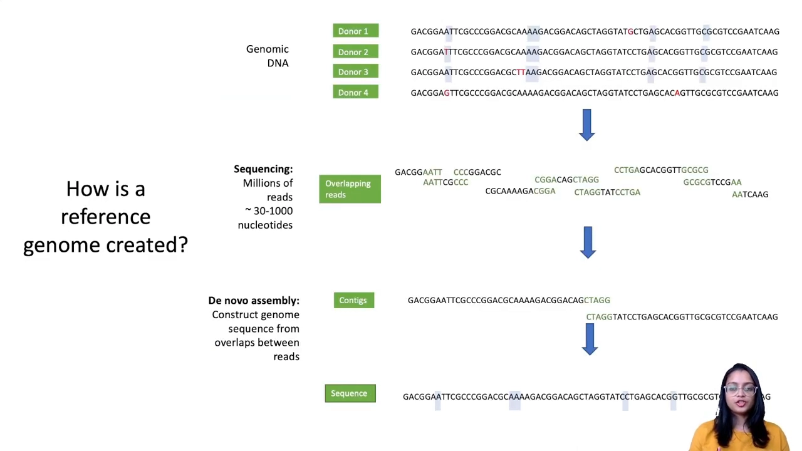
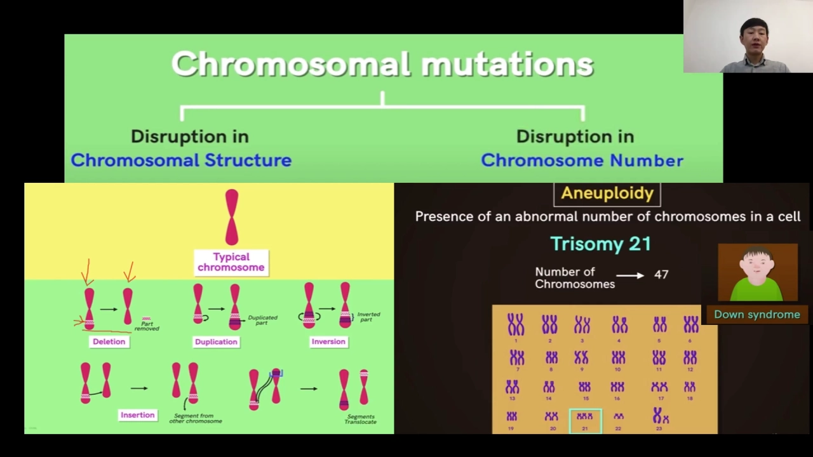
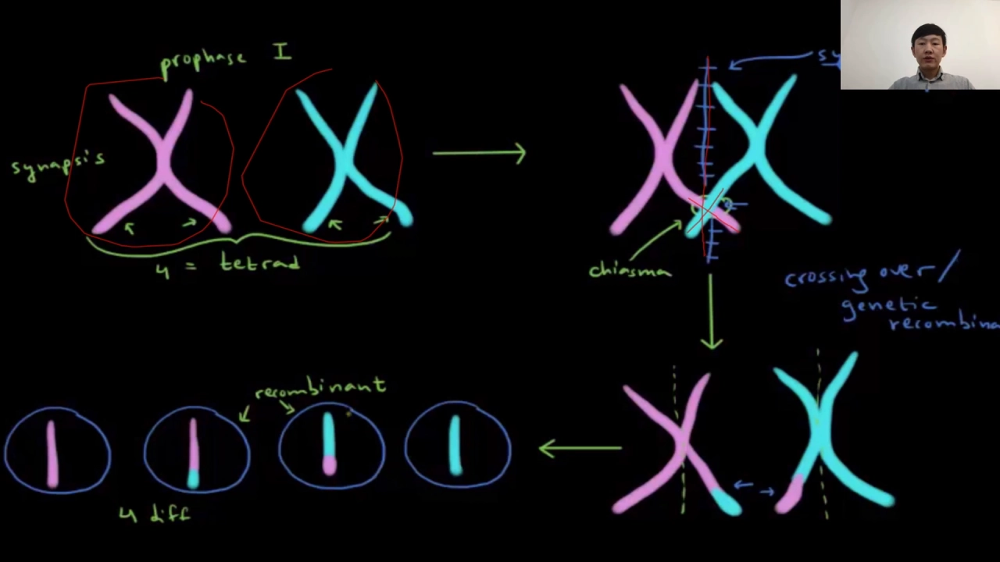
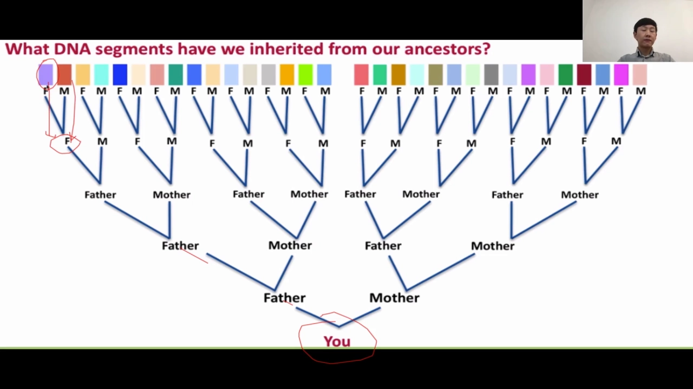
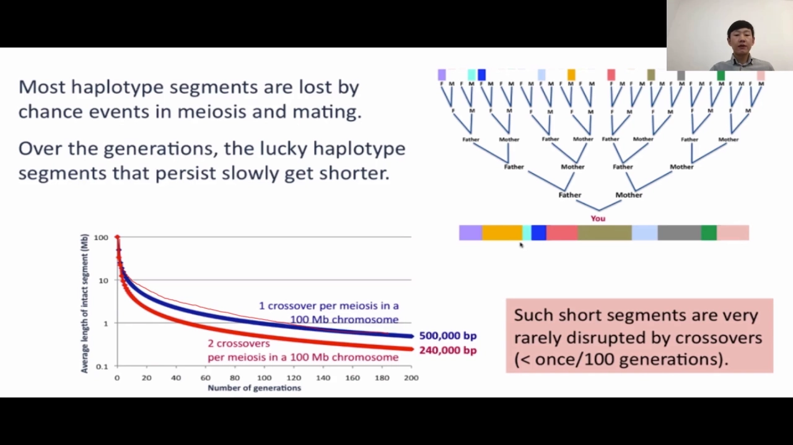
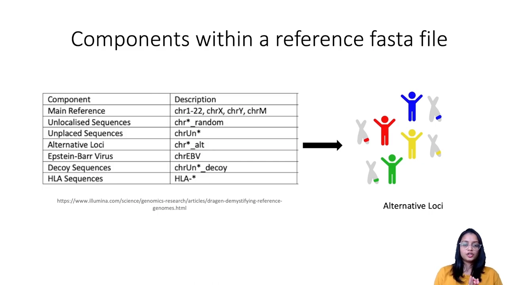
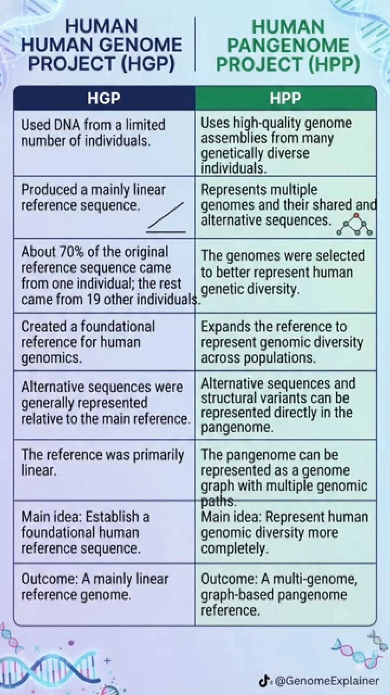
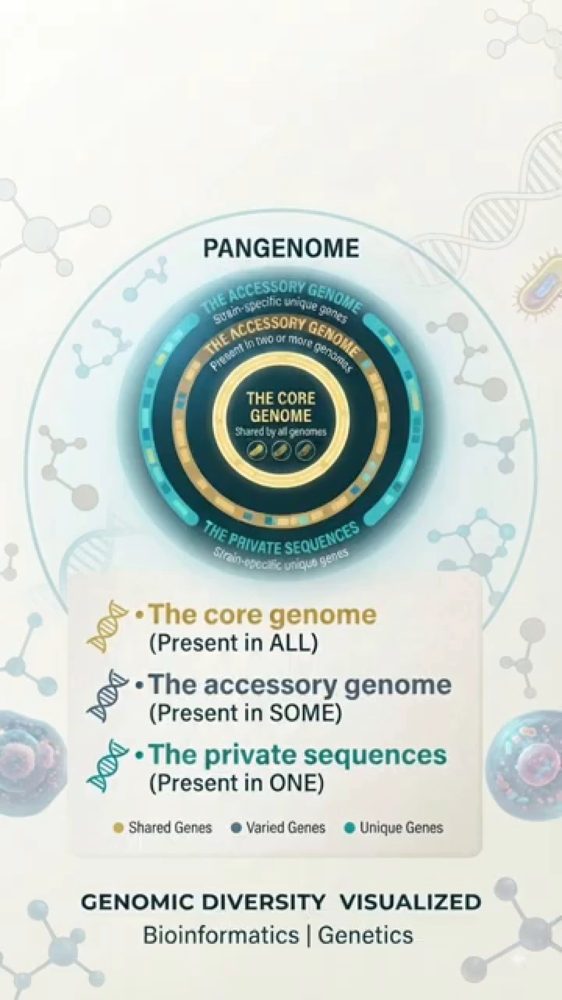
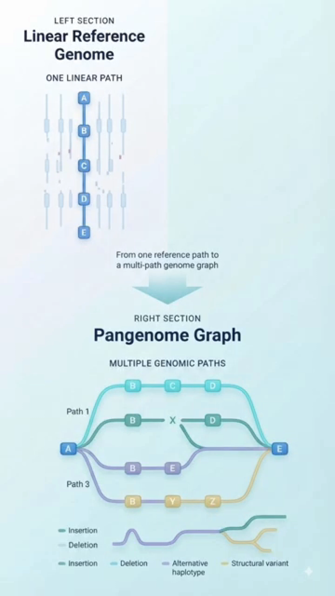
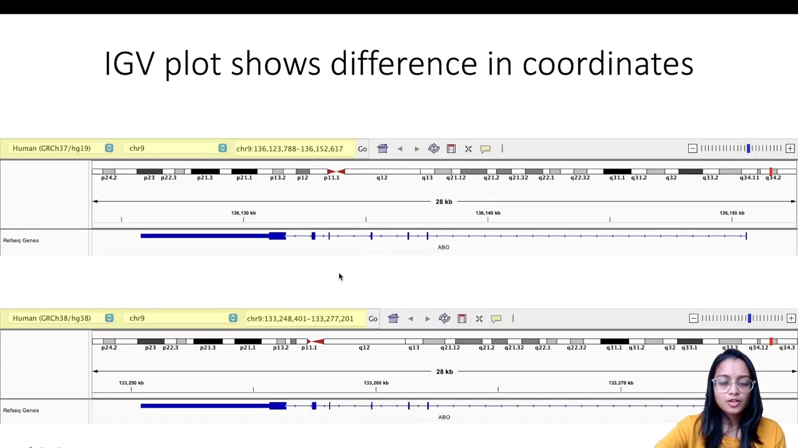

# 基因组多样性：单倍型与替代序列

> 视频来源：[What is hg19/hg38? - All you need to know about human reference genomes](https://www.youtube.com/watch?v=DeZTPCOKZrg)（YouTube · Bioinformagician）；[One Genome Is Not Enough: Pangenomes](https://www.youtube.com/watch?v=TO-5rZ60Buo)（YouTube · Nefrtari Audio Genetics）；[为什么说突变、重组、单倍型及其在群体中的扩散是分析中最重要的概念](https://www.bilibili.com/video/BV1Zy4y177FB/)（B 站 · 数据科学那些事儿）
> 本篇把三支视频拼成一条线：先说明参考基因组为什么只是“一条”序列，再说明个体差异为什么以单倍型为单位遗传，最后看替代位点、decoy 和泛基因组怎样把参考之外的序列编进来，以及这对坐标、比对和变异解读意味着什么。英文视频的字幕已译成中文，AI 字幕的术语错误已按画面订正。

## 本讲要解决的核心问题（SCQA）

**背景**：上一节把参考基因组当成一把尺子：读段比对到它上面，变异相对于它记录坐标。没有这把尺子，位置就无法描述。

**冲突**：但这把尺子只有一条序列。同一种生物的不同个体之间，既有单碱基差异，也有整段序列的插入、缺失、重复和倒位；有些序列在参考基因组里根本不存在。如果所有个体都只能跟同一条序列比较，参考里没有的序列就没有位置可放，与参考差异大的区域也可能比不上去。

**疑问**：参考基因组到底代表谁？个体之间的差异以什么单位存在和遗传？替代位点（alt contig）、decoy 和泛基因组分别往参考里补了什么？补进去以后，坐标、比对和变异解读会受什么影响？

**回答（中心思想）**：参考基因组是**一条由多个捐献者拼成的共识序列**，不是某个人的基因组，也不是一个物种的全部序列。个体差异以**单倍型**为单位共遗传：一条染色体片段上的一组变异一起传下去，重组会把片段切短。当某些常见变异或整段序列无法用一条线性参考表示时，参考组装会用**替代位点**（alt contig）为高变区域另存序列，用 **decoy** 存放放不上染色体的序列，**泛基因组**则把许多个体的共享序列和替代序列一起表示。代价是：坐标只在某一套参考里有意义，比对会受参考偏倚影响，单个变异的解读也必须放回它所处的单倍型背景。

---

## 一、参考基因组是“一条”序列，不是“所有”序列

### 1.1 它是多个捐献者拼出来的一条共识

参考基因组是一个核酸序列文库，代表一个物种的基因集合。人类参考基因组不是从一个人身上测出来的，而是用不同捐献者的 DNA 构建的。[【跳转到 00:32】](https://www.youtube.com/watch?v=DeZTPCOKZrg&t=32)

构建过程叫从头组装（de novo assembly）：把多个捐献者的基因组 DNA 打碎成不同大小的片段，测成许多条读段（read），再根据读段之间的重叠把它们拼成 contig，继续拼成 scaffold，信息足够时还能连成染色体。每一步都要在“多个捐献者不一致”的位置做选择：比如按每个位置出现频率最高的碱基生成一条一致性序列。[【跳转到 00:57】](https://www.youtube.com/watch?v=DeZTPCOKZrg&t=57)

所以参考基因组的每一段，理想上放的是“在已有个体中最常观察到的序列”。这也解释了它为什么不是任何一个人的序列：它是拼起来的。[【跳转到 01:47】](https://www.youtube.com/watch?v=DeZTPCOKZrg&t=107)

### 1.2 它不等于“健康”“平均”或“祖先”

参考基因组很容易被误当成“正常人的标准基因组”。视频明确列出了它不是什么：它不是健康基因组，不是最常观察到的基因组，不是最长的，不是祖先序列，也不是全球人群的平均；它来自若干特定捐献者，因此带有这些捐献者的特殊性。[【跳转到 01:22】](https://www.youtube.com/watch?v=DeZTPCOKZrg&t=82)

人类基因组计划使用了 20 多个捐献者的 DNA，但最终主要组装成一条线性参考；其中约 70% 的序列来自同一个人，其余来自另外 19 人。[【跳转到 00:50】](https://www.youtube.com/watch?v=TO-5rZ60Buo&t=50)

这一点对解读变异很关键：你的数据和参考不一样，只说明它和这把尺子不同，不说明你有问题。

### 1.3 一条线性序列的局限：参考偏倚

线性参考只给出一条路径。当测序读段比对到单一参考基因组时，与参考差异较大或参考中根本不存在的区域可能被漏掉。这种现象叫**参考基因组偏倚**（reference genome bias）。[【跳转到 00:25】](https://www.youtube.com/watch?v=TO-5rZ60Buo&t=25)

偏倚不是比对软件“报错”，而是安静地少算：来自替代序列的读段要么比对不上，要么被强行比对到参考里最像的位置，导致这部分变异被系统性低估。泛基因组要解决的核心问题之一，就是减少这种偏倚。[【跳转到 00:25】](https://www.youtube.com/watch?v=TO-5rZ60Buo&t=25)

---

## 二、个体差异以单倍型为单位遗传

### 2.1 变异不只有单点：从 SNV 到染色体结构变异

DNA 水平的变异包括碱基替换、缺失和插入。染色体水平的变异则包括整段的删除、重复、倒位、插入和易位，以及染色体数目的改变（例如 21 三体）。[【跳转到 02:34】](https://www.bilibili.com/video/BV1Zy4y177FB/?t=154)

染色体变异的效应往往更大，因为它一次改变多个基因；这类变异过去很难检出，三代测序让它容易多了。[【跳转到 03:24】](https://www.bilibili.com/video/BV1Zy4y177FB/?t=204)

泛基因组能揭示的也不只是单核苷酸多态性（SNP）：还包括插入、缺失、重复、倒位、拷贝数变异，以及“有/无”变异（presence/absence variation）。其中一些差异可以涉及整个基因或大片调控区域。[【跳转到 01:52】](https://www.youtube.com/watch?v=TO-5rZ60Buo&t=112)

### 2.2 重组把基因组切成一段一段

突变产生新的等位基因，重组则把已有的等位基因重新组合。两个位点可以组合出四种方式，三个位点有八种；这种通过重组形成的组合增长，是遗传多样性迅速升高的来源。[【跳转到 05:16】](https://www.bilibili.com/video/BV1Zy4y177FB/?t=316)

在减数分裂中，母本和父本的染色单体联会，形成交叉（chiasma），断裂后交换片段。一次减数分裂产生四个精子或卵子细胞，其中两个是重组类型，两个不是。这个过程没有产生新突变，但子代拿到了新的等位基因组合。[【跳转到 06:31】](https://www.bilibili.com/video/BV1Zy4y177FB/?t=391)

### 2.3 单倍型：多个变异组成的一个遗传单位

遗传的最小单位不是一个点突变，而是一条染色体片段。这条片段上可以带着好几个变异，它们一起被继承。这样一个“多个变异组成的、共遗传的染色体片段”就叫**单倍型**（haplotype）。[【跳转到 07:21】](https://www.bilibili.com/video/BV1Zy4y177FB/?t=441)

单倍型的概念解释了两件事：

- **变异不是孤立的。** 一个突变一定发生在某一条单倍型上的某个位置；它发生以后，也是以单倍型为单位传下去的。[【跳转到 10:43】](https://www.bilibili.com/video/BV1Zy4y177FB/?t=643)
- **“相位”有生物学含义。** 同一条染色体上的多个变异是一个组合；换一条同源染色体，组合可能不同。只说“这个个体在这个位点是杂合”，并没有说明两个等位基因各自还带着哪些邻近变异。

### 2.4 重组越多，单倍型片段越短

一个五代系谱里，并不是所有祖先都对今天的基因组有贡献。重组发生得有限，很多祖先的片段在传递中丢掉了；在这个系谱里，个体身上只剩不到十个单倍型，其余 22 个祖先没有贡献。[【跳转到 09:33】](https://www.bilibili.com/video/BV1Zy4y177FB/?t=573)

重组越多，单倍型片段越小，能有更多祖先留下贡献。视频给了一个定量感觉：在 100 Mb 的染色体上，每次减数分裂发生 1 次交叉时，经过约 200 代后仍能保持的完整片段平均约 500,000 bp；发生 2 次交叉时约 240,000 bp。[【跳转到 10:12】](https://www.bilibili.com/video/BV1Zy4y177FB/?t=612)

性染色体、线粒体和叶绿体是特殊情况：人类 Y 染色体严格意义上没有重组，同一父系的男性 Y 几乎一样；线粒体在哺乳动物里几乎母系遗传。所以追溯父系、母系时，常用这些单亲遗传的染色体。[【跳转到 12:18】](https://www.bilibili.com/video/BV1Zy4y177FB/?t=738)

---

## 三、参考之外还有序列：替代位点、decoy 与泛基因组

### 3.1 FASTA 里不只有染色体

打开一份人类参考基因组的 FASTA，除了 1–22 号染色体、X、Y、M，还会看到几类名字很怪的记录。它们不是噪声，而是参考组装为了容纳“放不进主染色体”的序列而设置的容器。[【跳转到 07:18】](https://www.youtube.com/watch?v=DeZTPCOKZrg&t=438)

| 组成 | 命名示例 | 含义 |
| --- | --- | --- |
| 主参考 | chr1–22、chrX、chrY、chrM | 主染色体序列 |
| Unlocalized | `chr*_random` | 知道来自哪条染色体，但不知道具体位置 |
| Unplaced | `chrUn*` | 不知道来自哪条染色体 |
| 替代位点 | `chr*_alt` | 高变区域的替代序列（alt contig） |
| EB 病毒 | `chrEBV` | 人群中普遍存在的 EB 病毒序列 |
| Decoy | `chrUn*_decoy` | 组装时放不上染色体的序列 |
| HLA | `HLA-*` | 各种 HLA 类型的序列 |

主参考加上 unlocalized 和 unplaced 序列，合起来叫**主组装**（primary assembly）；视频建议所有分析都使用完整的主组装。[【跳转到 07:43】](https://www.youtube.com/watch?v=DeZTPCOKZrg&t=463)

### 3.2 替代位点：给高变区域另存一条序列

在 GRCh37（2009 年）之前，人类参考基因组被表示为一条单一的一致性序列。但染色体上有一些区域在人群中高度变异，一条序列无法充分代表它们。于是基因组参考联盟开始为这些区域提供替代序列，也就是**替代位点**（alternative loci）或替代位点支架（alternate locus scaffolds）。[【跳转到 08:08】](https://www.youtube.com/watch?v=DeZTPCOKZrg&t=488)

数量变化很能说明问题：GRCh37 里有 3 个区域、9 条替代位点序列；GRCh38 里有 178 个区域、261 条替代位点序列。[【跳转到 08:58】](https://www.youtube.com/watch?v=DeZTPCOKZrg&t=538)

这就是“把常见变异编入参考”的第一种做法：不是把主染色体改成某一个人的序列，而是为高变区域额外保存几条有代表性的替代序列。它们有独立的名字（`chr*_alt`），和主染色体不是同一条记录。

### 3.3 decoy：给“放不上染色体”的序列一个去处

decoy 序列是组装参考基因组时无法放到染色体上的序列，其中很大一部分是难以组装的重复序列。[【跳转到 09:48】](https://www.youtube.com/watch?v=DeZTPCOKZrg&t=588)

它和替代位点的区别在于来源和用途：替代位点是为“已知位置的高变区域”准备的另一条路径；decoy 收留的是“连位置都定不下来”的序列。从命名（`chrUn*_decoy`）也能看出，这些记录不属于主染色体的坐标系。

同一份 FASTA 里还有 EB 病毒序列和 HLA 区域序列。EB 病毒自然感染 B 细胞，全球约 90% 的人感染过，所以它的序列会内源性地出现在人类样本里；HLA 区域则需要为各种 HLA 类型分别保存序列。[【跳转到 09:23】](https://www.youtube.com/watch?v=DeZTPCOKZrg&t=563)

### 3.4 泛基因组：把共享序列和替代序列一起表示

替代位点和 decoy 仍然挂在一条线性主参考上。泛基因组走得更远：它不再把基因组信息压缩成一条主序列，而是用许多遗传上多样的个体构建高质量组装，把**共享序列和替代序列一起表示**。[【跳转到 00:55】](https://www.youtube.com/watch?v=TO-5rZ60Buo&t=55)

人类泛基因组计划的第一个主要版本包含 47 个定相二倍体组装，代表 94 条单倍型。[【跳转到 01:20】](https://www.youtube.com/watch?v=TO-5rZ60Buo&t=80)

注意这里的“94 条单倍型”不是 94 个人，而是 47 个二倍体个体的两套单倍型各自被组装出来。这正好接上第二节：单倍型是共遗传的染色体片段，泛基因组要表示的正是这些不同的片段路径。

泛基因组可以分成三部分：[【跳转到 02:17】](https://www.youtube.com/watch?v=TO-5rZ60Buo&t=137)

- **核心基因组**（core genome）：大多数个体共享的序列。
- **附属基因组**（accessory genome）：只在部分个体出现、在另一些个体缺失的序列。
- **私有序列**（private sequences）：只出现在一个或少数个体中。

这些可变区域在生物学上可能很重要，因为它们可能包含与适应、抗病、耐逆等性状有关的基因或调控序列。[【跳转到 02:37】](https://www.youtube.com/watch?v=TO-5rZ60Buo&t=157)

线性基因组本质上只给出一条路径；泛基因组图可以表示多条路径，让替代序列和结构变异存在于同一个基因组框架内。[【跳转到 02:55】](https://www.youtube.com/watch?v=TO-5rZ60Buo&t=175)

---

## 四、这对坐标、比对和变异解读意味着什么

### 4.1 坐标只在“某一套参考”里成立

同一个基因在不同参考版本里的染色体位置可以不同。视频用 IGV 展示了一个基因在 GRCh37/hg19 和 GRCh38/hg38 中的位置差异：坐标数字明显不一样。[【跳转到 10:38】](https://www.youtube.com/watch?v=DeZTPCOKZrg&t=638)

这不只是版本问题，也是“参考多样性”问题的另一面：只要参考序列变了，坐标刻度就变了。替代位点、decoy 这些记录又各自有独立的序列名，不落在主染色体的坐标系里。所以一个坐标必须同时说明“哪套参考、哪条记录”，否则数字本身不完整。

### 4.2 比对：参考里没有的序列，读段无处可去

读段比对的默认假设是“样本的序列在参考里有一个对应位置”。当样本带着一段参考中不存在的插入，或者某个区域与参考差异很大时，这个假设就不成立：读段可能比对不上，可能被软剪切，也可能被强行比对到参考里最像的位置。结果就是参考偏倚——变异被少算。[【跳转到 00:25】](https://www.youtube.com/watch?v=TO-5rZ60Buo&t=25)

替代位点和泛基因组提供的是“另一条可走的路径”：读段可以比对到替代序列上，而不是被硬塞进主参考。泛基因组进一步把多条路径放进同一个框架，让替代序列和结构变异有地方表示。[【跳转到 02:55】](https://www.youtube.com/watch?v=TO-5rZ60Buo&t=175)

### 4.3 变异解读：不能只看一个点

单倍型的概念提醒我们：一个变异不是孤立存在的，它总在某条单倍型上，和邻近变异一起遗传。[【跳转到 10:43】](https://www.bilibili.com/video/BV1Zy4y177FB/?t=643)

因此，看到“某位点杂合”时，至少还要问三个问题：

1. 这两个等位基因各自还带着哪些邻近变异？它们在同一条染色体上，还是分别位于两条同源染色体上？
2. 这个组合在参考基因组里有没有对应的路径？如果参考里根本没有这段替代序列，变异检出本身可能就漏了。
3. 这个变异所在的区域，在这套参考里是主染色体、替代位点，还是 decoy？不同记录上的坐标不能直接比较。

泛基因组做等位基因特异设计时，正是把“不同单倍型上的靶点变异”一起考虑，而不是只针对一条参考序列设计。[【跳转到 03:08】](https://www.youtube.com/watch?v=TO-5rZ60Buo&t=188)

### 4.4 一个把机制串起来的变异背景（假设示例）

下面这个例子是为了把三支视频的机制串起来而构造的，不是视频里的真实病例。

设想一个人的某条染色体上带着一条单倍型 H：它包含 3 个相邻的 SNV，以及一段约 5 kb 的插入，这段插入在参考基因组里完全不存在。

- **只比对线性参考**：3 个 SNV 附近的读段还能比上，但跨过插入的读段会对不上，可能被软剪切或丢弃；插入本身没有坐标可写，变异检出容易漏掉它。插入附近的比对质量下降，还可能让邻近 SNV 的等位基因计数出现偏差——这是参考偏倚在单个样本上的可能表现（基于前文机制的推演）。
- **参考里有替代位点**：如果这段插入恰好落在某个高变区域，`chr*_alt` 记录可能提供一条替代序列，读段可以比对过去。但这条记录不在主染色体坐标系里，报坐标时必须说明用的是哪条 alt 记录。
- **参考里有 decoy**：如果这段序列是难组装的重复，它可能被收进 decoy。这样它有了明确的归属，不会被误当成主染色体的一部分。
- **用泛基因组**：插入可以作为图中的一条替代路径存在，3 个 SNV 也可以和插入放在同一条单倍型路径上。这样既能检出插入，也能保留“这 3 个 SNV 与插入共遗传”的相位信息。

这个例子说明：**替代序列解决的是“参考里没有”的问题，单倍型解决的是“变异如何组合、如何共遗传”的问题。** 两者结合，才能把“一个变异”放回它所在的序列背景里解读。

---

## 小结

- 参考基因组是多个捐献者拼成的一条共识序列，不代表任何一个人，也不等于健康、平均或祖先序列。
- 一条线性参考只给出一条路径；与参考差异大或参考中缺失的序列，会在比对时被漏掉，这叫参考偏倚。
- 遗传的最小单位是单倍型：一条染色体片段上的一组变异一起遗传；重组越多，单倍型片段越短。
- 参考 FASTA 里除了主染色体，还有 unlocalized、unplaced、替代位点（`chr*_alt`）、decoy、EBV 和 HLA 等记录。
- 替代位点为高变区域另存序列；decoy 收留放不上染色体的序列；泛基因组把多个个体的共享序列和替代序列一起表示，并分成核心、附属和私有序列。
- 坐标只在某一套参考、某一条记录里成立；变异解读要同时说明参考版本、记录类型和单倍型背景。

## 关键术语速查

| 术语 | 一句话解释 |
| --- | --- |
| 参考基因组 | 一个物种的共识序列，用作比对和坐标的尺子；由多个捐献者拼成，不代表任何个人 |
| 主组装（primary assembly） | 主染色体加上 unlocalized、unplaced 序列，推荐用于所有分析 |
| 参考偏倚（reference bias） | 读段比对到单一参考时，与参考差异大或参考中缺失的区域被少算 |
| 单倍型（haplotype） | 一条染色体上多个变异组成的、共遗传的片段 |
| 替代位点（alt contig） | 为人群中高度变异区域额外保存的替代序列，记录名常带 `_alt` |
| decoy | 组装时放不上染色体的序列，多为难组装的重复序列 |
| 泛基因组（pangenome） | 同时表示一个物种多个个体的共享序列和替代序列的参考框架 |
| 核心 / 附属 / 私有序列 | 泛基因组按“多少个体共享”划分的三类序列 |
| 结构变异（SV） | 插入、缺失、重复、倒位、拷贝数变异、有/无变异等较大尺度的变异 |