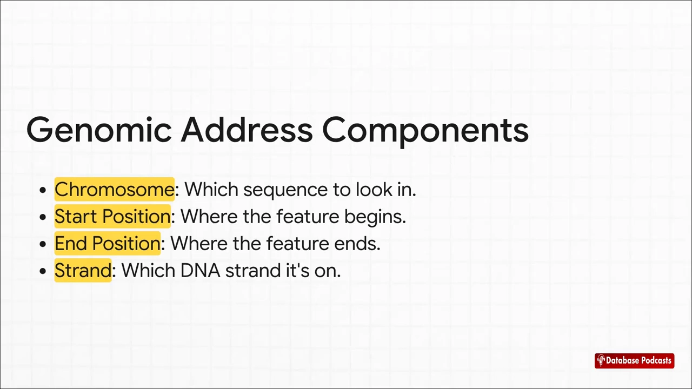
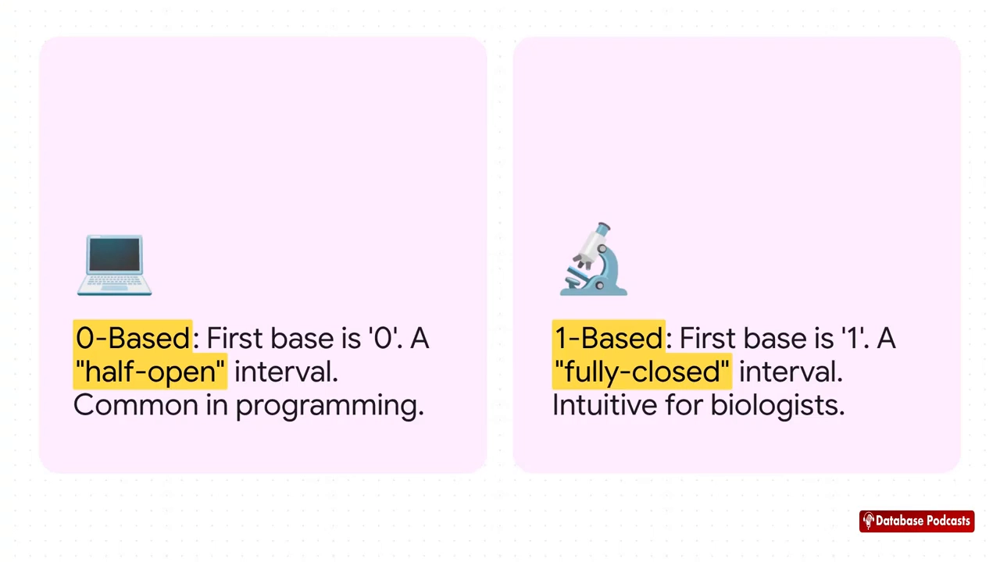
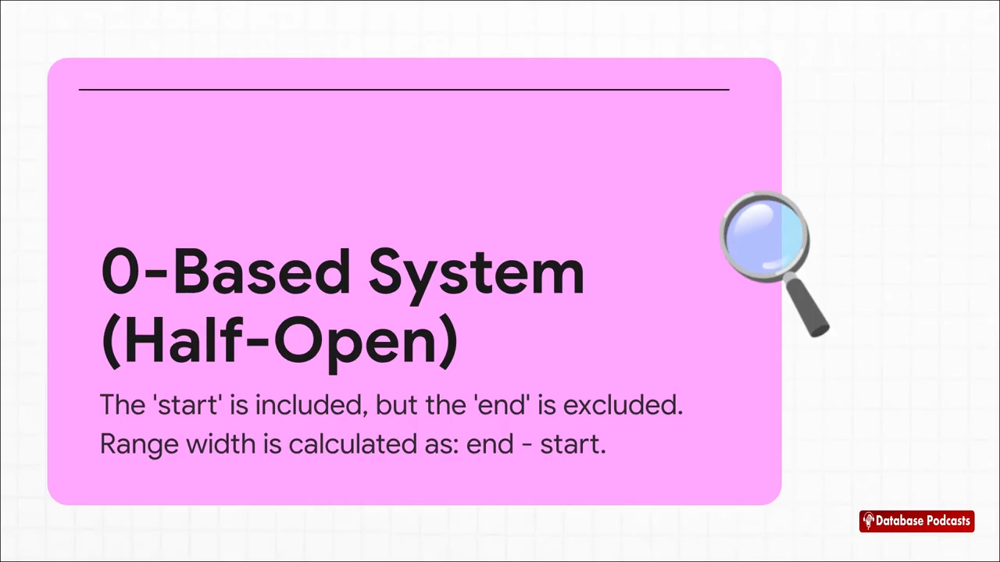
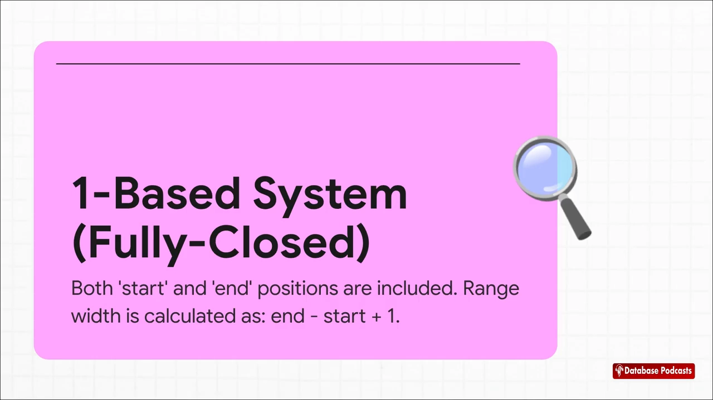
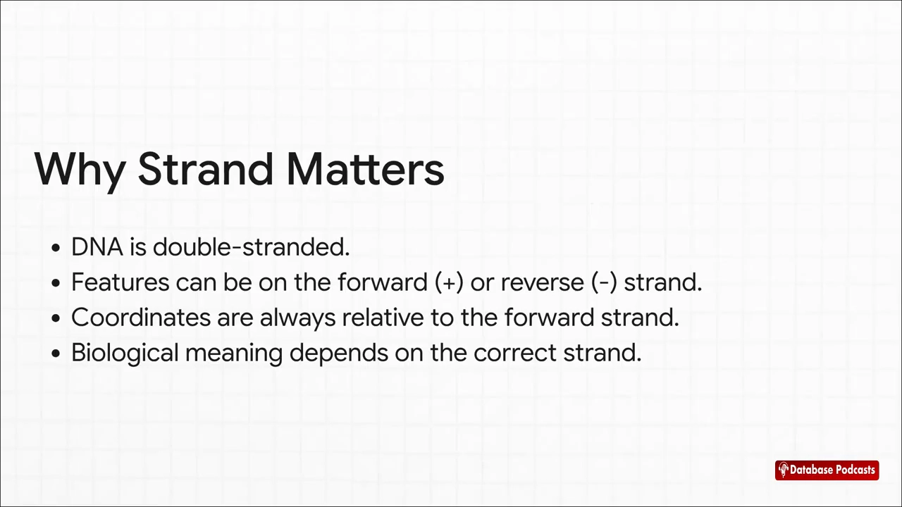
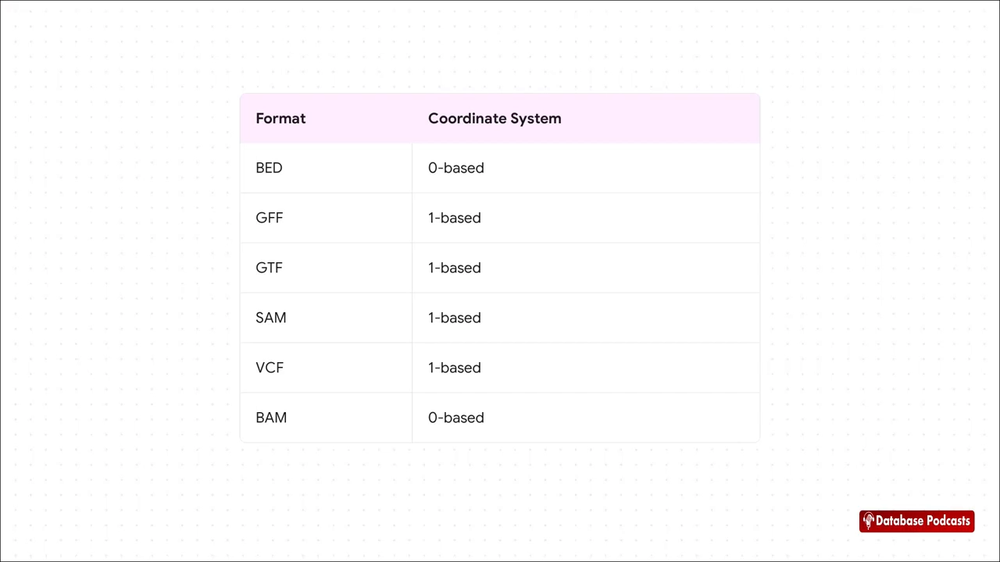
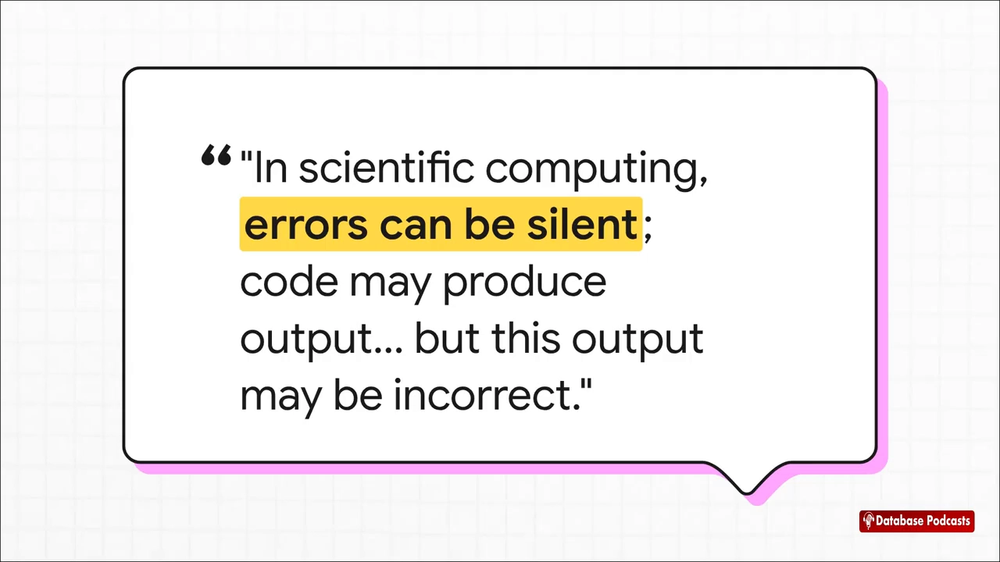
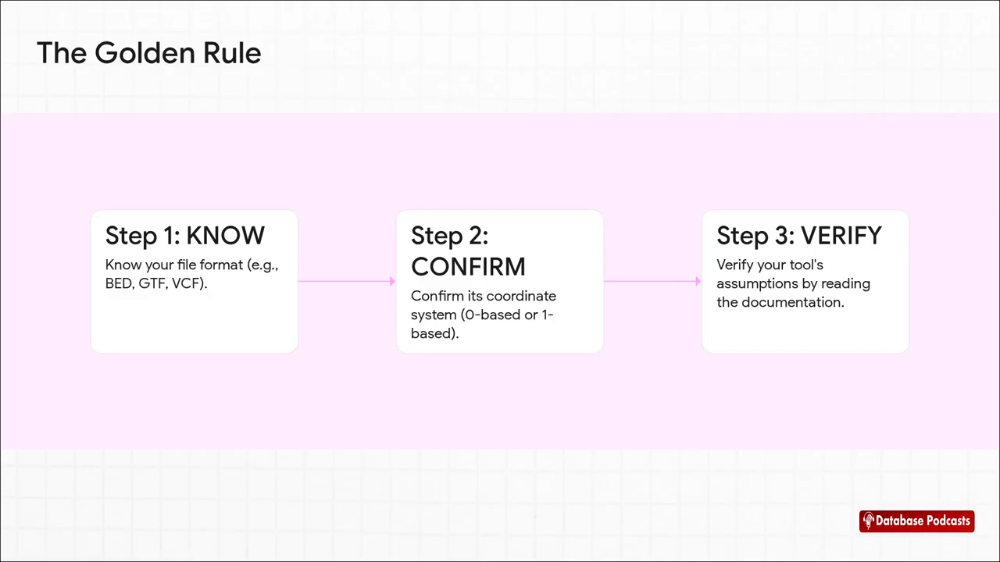

# 同一个区间两种数法：0-based 半开与 1-based 全闭如何错开一个碱基

> 视频来源：[Genomic Coordinates: 0-Based vs 1-Based, Strands & Ranges](https://www.youtube.com/watch?v=IRtQM1LT_Q8)（YouTube · Database Podcasts · 约 7 分 20 秒）。本文按该视频的逐窗口字幕与幻灯片整理，内容均可在原视频中核查。
> 导读：一支只讲坐标约定的短课。它把“基因组地址”拆成染色体、起点、终点、链四部分，再用同一段 5 个碱基的序列演示 0-based 半开区间与 1-based 全闭区间为什么写法不同、长度公式为什么差一个 1，最后说明这类错误为什么不会让程序报错。

## 本讲要解决的核心问题（SCQA）

**背景**：基因组数据用坐标定位特征。一个基因、一个外显子、一个调控元件，都要写成“哪条染色体、从哪到哪、在哪条链上”。

**冲突**：同一段 5 个碱基的序列，在一套约定里写成 1..5，在另一套里写成 0..5。起点差一，终点却相同。两个写法都不是笔误，程序也不会报错，但把其中一套当成另一套来读，拿到的就是错开一位的碱基。

**疑问**：起点到底从 0 数还是从 1 数？区间终点算不算在区间里？链方向在这套写法里又起什么作用？

**回答（中心思想）**：基因组坐标有两套并行的计数约定——**0-based 配半开区间**（含起点、不含终点）和 **1-based 配全闭区间**（两端都含）。两套约定描述同一段序列时，**起点差一、终点相同**；长度公式也因此差一个 1。链是第四个独立信息，只决定特征的读取方向，**坐标永远相对正向链书写**。把两套约定混用，就会得到不报错的“差一错误”。

---

## 一、一条基因组地址由四样东西组成

基因组地址可以类比成邮政地址：国家、城市、街道、门牌号，一层层缩小到唯一位置。视频把它拆成四个组成部分：

1. **染色体**：相当于街道名，告诉你该看哪一条巨大的 DNA 分子。
2. **起点**：特征开始的位置，相当于门牌号。
3. **终点**：特征结束的位置，和起点一起标出边界。
4. **链**：特征位于双链 DNA 的哪一侧。

[【跳转到 00:52】](https://www.youtube.com/watch?v=IRtQM1LT_Q8&t=52)

前三个部分回答“在哪里”，第四个部分回答“朝哪边读”。四者缺一，地址就不完整：只有起止坐标而没有链，你知道了位置，却不知道该按哪个方向解读这段序列。

[【跳转到 01:11】](https://www.youtube.com/watch?v=IRtQM1LT_Q8&t=71)

到这里看起来很简单。真正麻烦的地方不在“有哪些部分”，而在“起点和终点具体怎么数”。

[【跳转到 01:34】](https://www.youtube.com/watch?v=IRtQM1LT_Q8&t=94)

---

## 二、起点从 0 还是从 1：两套并行的计数体系

基因组学里有两套根本不同的计数方式。不知道它们的区别，就会遇到“差一错误”（off-by-one）：一种安静、隐蔽、能让整个分析失效却从不让程序崩溃的错误。

[【跳转到 01:55】](https://www.youtube.com/watch?v=IRtQM1LT_Q8&t=115)

两套体系分别是：

- **0-based（从零开始数）**：序列的第一个碱基编号为 0。对程序员来说很自然。
- **1-based（从一开始数）**：序列的第一个碱基编号为 1。对习惯在现实世界数数的生物学家更直观。

但区别不只是起点。**它们对区间终点的定义也不一样**：0-based 配半开区间，1-based 配全闭区间。

[【跳转到 02:16】](https://www.youtube.com/watch?v=IRtQM1LT_Q8&t=136)

### 2.1 0-based：含起点、不含终点的半开区间

在 0-based 体系里，第一个碱基是位置 0。写一个区间时，**起点被包含，终点不被包含**，这叫半开区间（half-open）。

所以从 0 到 5 的区间，覆盖的是 0、1、2、3、4 这五个碱基——**5 本身不在里面**。

[【跳转到 02:39】](https://www.youtube.com/watch?v=IRtQM1LT_Q8&t=159)

半开区间在计算上的好处是长度公式干净：直接 `end − start`。5 减 0 等于 5，不需要额外步骤。

[【跳转到 03:04】](https://www.youtube.com/watch?v=IRtQM1LT_Q8&t=184)

### 2.2 1-based：两端都含的全闭区间

在 1-based 体系里，第一个碱基是位置 1，区间是**全闭**的：起点和终点都包含在内。

所以从 1 到 5 的区间，覆盖 1、2、3、4、5 这五个碱基——**5 在里面**。

[【跳转到 03:11】](https://www.youtube.com/watch?v=IRtQM1LT_Q8&t=191)

对人不那么“计算机友好”，但更符合日常数数习惯。代价是长度公式多了一步：`end − start + 1`。

### 2.3 两套体系并排看

| | 0-based | 1-based |
| --- | --- | --- |
| 第一个碱基的编号 | 0 | 1 |
| 区间类型 | 半开：含起点、不含终点 | 全闭：两端都含 |
| 写作 `start..end` 时覆盖的碱基 | start 到 end−1 | start 到 end |
| 例：5 个碱基的区间 | 0..5，覆盖 0、1、2、3、4 | 1..5，覆盖 1、2、3、4、5 |
| 区间长度 | end − start | end − start + 1 |

这张表里最值得盯住的是最后两行：**同一段 5 个碱基的序列，在 0-based 里写成 0..5，在 1-based 里写成 1..5。起点差一，终点相同。**

---

## 三、长度公式里的 +1 不是笔误

长度公式是两套约定最直接的后果，也是最容易在代码里出错的地方。

0-based 半开区间把终点当作“区间之外的第一位”，所以终点减起点正好是区间里碱基的个数：

$$
L_{0} = end - start
$$

1-based 全闭区间把终点也算进区间，直接相减会少算最后一个碱基，必须补回来：

$$
L_{1} = end - start + 1
$$

用视频里的例子核对：0..5 的长度是 $5 - 0 = 5$；1..5 的长度是 $5 - 1 + 1 = 5$。**两种写法描述的是同样 5 个碱基，公式却不同。**

[【跳转到 03:29】](https://www.youtube.com/watch?v=IRtQM1LT_Q8&t=209)

那个小小的“加一”看起来只是多一步，却足以让一个没有预料到它的程序算错长度。这也是为什么读任何带区间的数据，都要先确认它用的是哪套约定，而不是套用一个记得住的公式。

---

## 四、链：坐标写在同一把尺子上，读取方向可以相反

DNA 是双螺旋。一个基因可以从**正向链**读取，标记为加号（+）；也可以从**反向链**读取，标记为减号（−）。

[【跳转到 03:38】](https://www.youtube.com/watch?v=IRtQM1LT_Q8&t=218)

但这里有一条必须记住的约定：

> **无论一个特征实际在哪条链上，它的坐标永远相对于正向链书写。**

也就是说，坐标系只有一把，始终沿正向链从左到右编号；链字段不改变坐标的数值，只改变“从哪一头开始读”。正链基因沿坐标增大的方向读取；负链基因的读取方向与坐标增大的方向相反，从较大的坐标走向较小的坐标。**位置由起止坐标给出，方向由链给出，两者不能互相替代。**

[【跳转到 03:48】](https://www.youtube.com/watch?v=IRtQM1LT_Q8&t=228)

这也解释了为什么链错了后果很严重：一个本来完好的蛋白编码基因，如果按错误的链去取序列，得到的只是互补链上的另一串碱基，生物学含义完全变了。视频的说法很直接——它会变成“毫无意义的生物学乱码”。

[【跳转到 04:13】](https://www.youtube.com/watch?v=IRtQM1LT_Q8&t=253)

---

## 五、同一段序列，两种写法：换算与错位

把前面的规则合起来，就得到两套写法之间的换算关系。以同一段序列为例：

- 1-based 写法：`1..5`，覆盖第 1、2、3、4、5 个碱基。
- 0-based 写法：`0..5`，覆盖第 0、1、2、3、4 个碱基。

两者覆盖的是同一段 5 个碱基。换算规则因此是：

> **从 1-based 换到 0-based：起点减一，终点不变。**

反过来，从 0-based 换到 1-based：起点加一，终点不变。

对单个碱基也一样。1-based 里位置 $p$ 的那一个碱基，在 0-based 半开区间里写成 $[p-1,\ p)$：起点是 $p-1$，终点是 $p$，长度正好是 1。

[【跳转到 04:42】](https://www.youtube.com/watch?v=IRtQM1LT_Q8&t=282)

错位就发生在这里。如果把一个 0-based 的起点当成 1-based 直接使用，整段区间会**整体平移一个碱基**：本该取第 1 到第 5 个碱基，实际取成了第 0 到第 4 个。对一段基因来说只是边界差一位，对一个单碱基变异来说，就是完全不同的位点。

---

## 六、为什么这种错误不报错：沉默错误与三步核对

这套约定不是学术上的细节，而是被硬编码进常用数据文件的现实。视频给出的对照是：

| 格式 | 坐标体系 |
| --- | --- |
| BED | 0-based |
| GFF | 1-based |
| GTF | 1-based |
| SAM | 1-based |
| VCF | 1-based |
| BAM | 0-based |

[【跳转到 04:42】](https://www.youtube.com/watch?v=IRtQM1LT_Q8&t=282)

注意 BAM 这一行：它是 SAM 的压缩二进制版本，却从 1-based 切回了 0-based。所以**不能靠猜，也不能靠“同一类文件应该一样”推断**，必须知道手里具体是什么文件。

[【跳转到 05:07】](https://www.youtube.com/watch?v=IRtQM1LT_Q8&t=307)

更麻烦的是，这类错误通常不会让程序崩溃。视频引用的一句话是：代码可以顺利运行，可以产出结果，给你一个看起来漂亮的结果，却可能完全错误。差一错误就是典型的“沉默杀手”。

[【跳转到 05:37】](https://www.youtube.com/watch?v=IRtQM1LT_Q8&t=337)

视频给出的核对流程只有三步：

1. **知道文件格式**：不要猜。
2. **确认坐标体系**：查清楚它是 0-based 还是 1-based。
3. **核对工具的假设**：读文档，弄清楚这个软件期望什么样的输入。

[【跳转到 06:11】](https://www.youtube.com/watch?v=IRtQM1LT_Q8&t=371)

归根结底，只差一个碱基对，就可能意味着找到一个致病突变，或者完全错过它。这是一个极小的细节，却有极大的后果。

[【跳转到 06:36】](https://www.youtube.com/watch?v=IRtQM1LT_Q8&t=396)

---

## 小结

- 基因组地址由**染色体、起点、终点、链**四部分组成；前三者定位置，链定读取方向。
- **0-based** 的第一个碱基是 0，配**半开区间**：含起点、不含终点；长度是 `end − start`。
- **1-based** 的第一个碱基是 1，配**全闭区间**：两端都含；长度是 `end − start + 1`。
- 同一段序列在两套约定下**起点差一、终点相同**；1-based 换 0-based 是起点减一、终点不变。
- 坐标**永远相对正向链书写**；负链基因的读取方向与坐标增大方向相反，链字段不能省。
- 不同格式固定采用其中一套（BED、BAM 为 0-based；GFF、GTF、SAM、VCF 为 1-based），混用会产生不报错的差一错误。
- 核对顺序：先认格式，再确认坐标体系，最后核对工具期望的输入。

## 关键术语速查

| 术语 | 一句话解释 |
| --- | --- |
| 基因组地址 | 用染色体、起点、终点、链四个信息定位一个基因组特征 |
| 0-based | 第一个碱基编号为 0 的计数方式 |
| 1-based | 第一个碱基编号为 1 的计数方式 |
| 半开区间 | 包含起点、不包含终点的区间，写作 `[start, end)` |
| 全闭区间 | 起点和终点都包含的区间，写作 `[start, end]` |
| 正链（+） | 与参考序列同向、沿坐标增大方向读取的链 |
| 负链（−） | 与参考序列反向、读取方向与坐标增大方向相反的链 |
| 差一错误 | 因两套坐标约定混用而整体错开一个碱基的错误，通常不报错 |
| 沉默错误 | 程序正常运行并输出结果，但结果错误的错误类型 |