# 复制叉：从起点识别到半不连续延伸与校对

> 视频来源：[【分子生物学】DNA的复制过程（49分钟纯享版）](https://www.bilibili.com/video/BV1prcKzkEdL)（B 站 · 轻轻松松学分子）｜本文使用其中第 1、2、4 分 P，约 43 分钟
> 导读：这是一套按"起始—延伸—终止"讲的分子生物学课程。本文只取起始、延伸和真核酶分工三部分，跳过终止（终止不在本节范围）。文中把课程里的蛋白名称、实验图和结论按"复制叉上每个角色做什么"重新组织。

## 本讲要解决的核心问题

**背景**：DNA 双链由互补的两条链组成，复制后每个子代分子保留一条亲代链、新合成一条子链。这个"半保留"的结论在 [B01 §2.1.2 DNA 复制概览](../../../../B01_生命科学基础主干/README.md#b01-2-1-2) 已经建立。

**冲突**：真正动手复制时，麻烦立刻出现。DNA 聚合酶只能把新核苷酸加到已有链的 3′端，不能从零开始；两条模板方向相反，复制叉却只有一个前进方向；聚合酶还会偶尔放错碱基。

**疑问**：细胞用什么顺序、哪些酶，把一个起点变成两条完整的新链，并且把错误率压下去？

**回答（中心思想）**：复制叉用一套固定分工解决这三个矛盾——**起点识别**决定在哪里开工，**RNA 引物**给聚合酶一个可以延伸的起点，**前导链/后随链的半不连续合成**化解方向冲突，**3′→5′ 外切酶校对**在延伸过程中即时纠错。理解复制叉，就是理解这四件事如何首尾相接。

---

## 一、复制从一个固定的起点开始

### 1.1 复制子：一个起点管辖一段 DNA

复制的第一个特征是"有固定的起始点"。课程先给出**复制子**（replicon）这个概念：复制子是 DNA 复制的基本单位，每个复制子含有一个复制起始区。

- 大肠杆菌只有一个复制子，所以只有一个复制起始区，叫 **oriC**。
- 真核细胞每条染色体有多个复制子，因此有多个起点，可以多点同时开工。

[【跳转到 01:34】](https://www.bilibili.com/video/BV1prcKzkEdL/?p=1&t=94)

### 1.2 oriC 是一段富含 AT、高度保守的序列

大肠杆菌的 oriC 全长 245 bp，在细菌中高度保守。它的结构可以分成左右两半：

- 左侧：三个串联的 **13 bp 重复序列**，富含 AT；
- 右侧：四个串联的 **9 bp 重复序列**。

富含 AT 不是偶然：A 与 T 之间只有两个氢键，比 G-C 更容易被拉开。复制起始时的解链正好发生在这段富 AT 区。

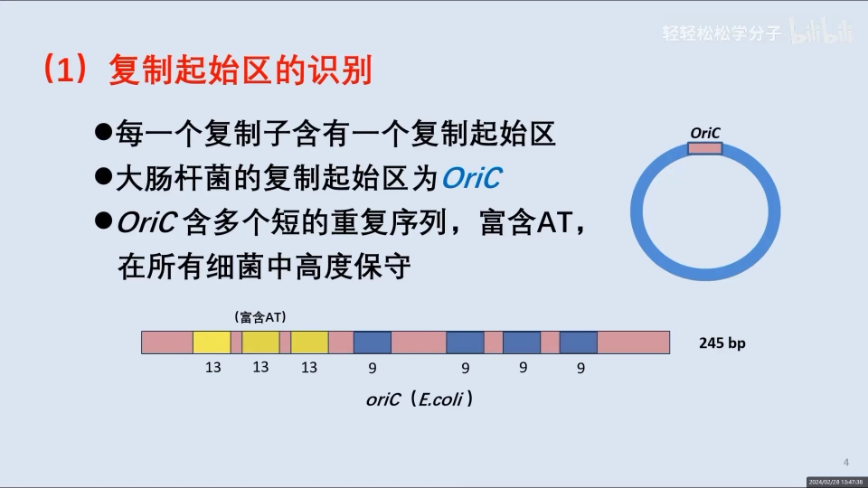

[【跳转到 02:24】](https://www.bilibili.com/video/BV1prcKzkEdL/?p=1&t=144)

### 1.3 DnaA 先"认地址"，再"撬开锁"

起点识别由 **DnaA 蛋白**完成，课程把它称为复制起始因子。过程分两步：

1. **识别**：结合有 ATP 的 DnaA 识别并结合 oriC 右侧四个 9 bp 重复序列，在那里自组装成蛋白质核心，形成一个类似真核核小体的结构。
2. **开链**：DnaA 具有 ATP 酶活性，水解 ATP 后使左侧 13 bp 重复序列变性，双链局部打开。

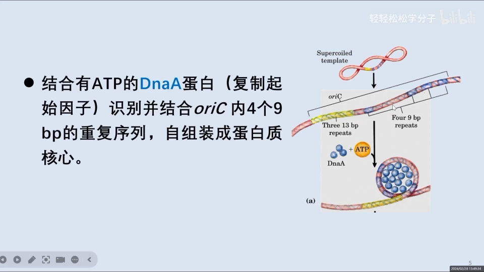

[【跳转到 03:55】](https://www.bilibili.com/video/BV1prcKzkEdL/?p=1&t=235)

这里的分工值得记牢：**DnaA 负责"打开第一道口子"，但它不是解旋酶**。真正的解旋由下一步的 DnaB 完成。

---

## 二、解旋把起点变成两个反向移动的复制叉

### 2.1 DnaB 是解旋酶，DnaC 是装载助手

局部开链后，两个 **DnaB 蛋白**在 **DnaC** 帮助下结合到单链区。DnaB 就是解旋酶（解链酶），它消耗 ATP，各自朝相反方向继续解开双链。结果是形成两个反向移动的复制叉，DnaA 随之从 DNA 上解离。

课程特别强调这个顺序：**不是解旋酶直接把双链拉开**，而是 DnaA 先制造局部开链，DnaB 再顺着开链区把双链进一步打开。

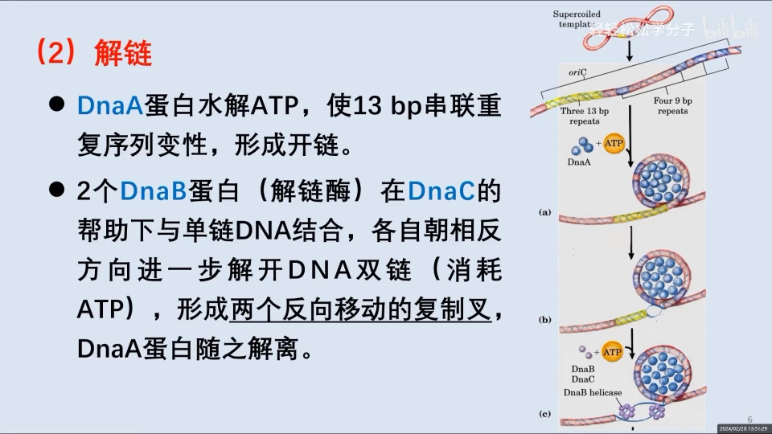

[【跳转到 04:59】](https://www.bilibili.com/video/BV1prcKzkEdL/?p=1&t=299)

### 2.2 双向复制与单链保护

两个解旋酶朝相反方向移动，形成两个复制叉，这就是**双向复制**。课程说明这是绝大多数生物的复制方式，也存在其他方式，但这里只讨论普遍情况。

解开的单链需要被保护。**单链结合蛋白（SSB）**结合在单链 DNA 上，保证复制完成前单链始终保持单链状态，防止两条解开的链重新复性。课程提醒：SSB 是蛋白质，不是酶。

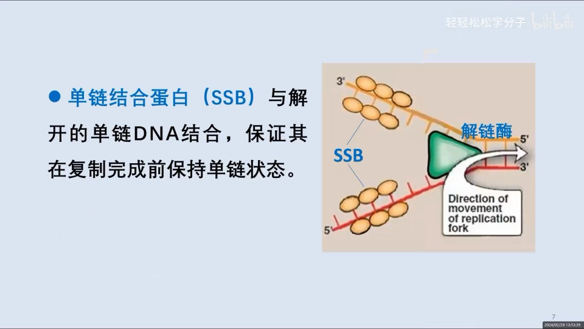

[【跳转到 08:19】](https://www.bilibili.com/video/BV1prcKzkEdL/?p=1&t=499)

### 2.3 复制叉前方还有"清障工"

复制叉前进时，前方会不断积累**正超螺旋**，负超螺旋则被不断消耗。正超螺旋积累到一定程度会成为解链的障碍。**DNA 旋转酶**（又称拓扑异构酶 II）引入负超螺旋、清除正超螺旋，这个过程消耗 ATP。

课程给出一张角色顺序图：复制叉最前方是拓扑异构酶（旋转酶），其次是解旋酶，再往后是引发酶和 DNA 聚合酶 III 的两个亚基。

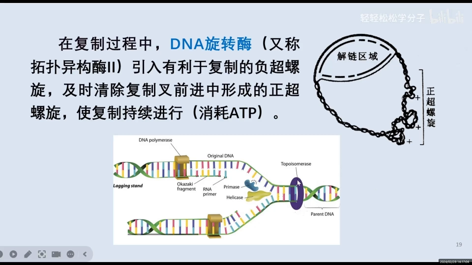

[【跳转到 12:22】](https://www.bilibili.com/video/BV1prcKzkEdL/?p=2&t=742)

---

## 三、引物：给"不会从头开始"的聚合酶一个起点

### 3.1 为什么必须有引物

DNA 聚合酶有一个硬性限制：**不能从头合成新链**，只能在已经存在的一小段核苷酸上继续延伸。所以每次开工前，必须先放一段**引物**。

体内复制用的引物是**短的 RNA**；体外复制（PCR）用的引物是 DNA。课程用这个对比说明：引物的化学本质可以是 RNA 也可以是 DNA，但体内 DNA 复制用的是 RNA。

[【跳转到 09:01】](https://www.bilibili.com/video/BV1prcKzkEdL/?p=1&t=541)

### 3.2 大肠杆菌：DnaG 合成约 11 nt 的 RNA 引物

大肠杆菌的引发酶是 **DnaG**。每个 DnaB（解旋酶）招募一个 DnaG，让它在各自的模板上合成大约 **11 个核苷酸**的 RNA 引物。所以 DnaB 不仅解旋，也参与引发——它负责把引发酶带到正确位置。

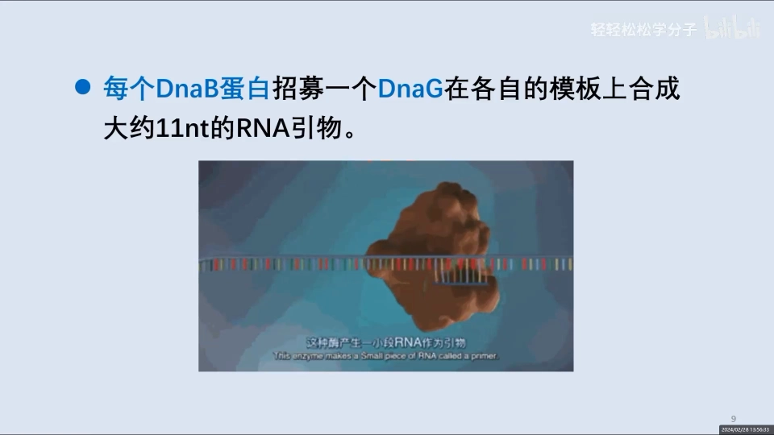

[【跳转到 10:31】](https://www.bilibili.com/video/BV1prcKzkEdL/?p=1&t=631)

引物的数量直接由链的连续性决定：

- **前导链**连续合成，只需要**一段** RNA 引物；
- **后随链**分段合成，每一条冈崎片段都需要**一段** RNA 引物，因此需要多次引发。

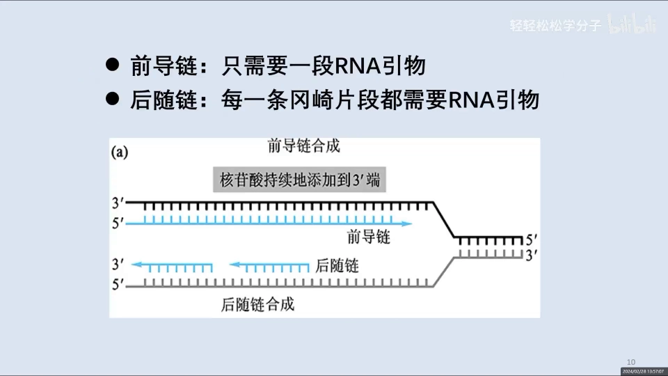

[【跳转到 11:29】](https://www.bilibili.com/video/BV1prcKzkEdL/?p=1&t=689)

### 3.3 真核细胞：引发酶与 DNA 聚合酶 α 组成复合物

真核细胞的引发由 **DNA 聚合酶 α-引发酶复合物**完成，分两段：

1. 引发酶先合成 **7~10 个核苷酸**的 RNA 引物；
2. DNA 聚合酶 α 再合成 **20~30 个核苷酸**的 DNA 片段。

所以真核细胞里所谓的"引物"，实际是"RNA 引物 + 一小段 DNA"的组合。延伸阶段再由其他聚合酶顺着这段序列继续合成。

[【跳转到 05:20】](https://www.bilibili.com/video/BV1prcKzkEdL/?p=4&t=320)

---

## 四、方向约束决定前导链与后随链

### 4.1 5′→3′ 是唯一允许的延伸方向

所有 DNA 聚合酶都只有 **5′→3′ 的聚合酶活性**，所以新链只能沿 5′→3′ 延伸。这就是复制方向问题的根源。

两条模板反向平行：一条模板的走向是 3′→5′，另一条是 5′→3′。复制叉只有一个前进方向，于是两条模板上的合成方式必然不同。

[【跳转到 01:10】](https://www.bilibili.com/video/BV1prcKzkEdL/?p=2&t=70)

### 4.2 前导链连续，后随链分段

- **前导链**：合成方向与复制叉移动方向一致，可以一路连续延伸，只需要一次引发。
- **后随链**：合成方向与复制叉前进方向相反。每解开一段，就由引发酶放一个引物，聚合酶"回头"合成一小段，然后停住；等复制叉再前进一段，再引发、再合成。这些小片段就是**冈崎片段**。

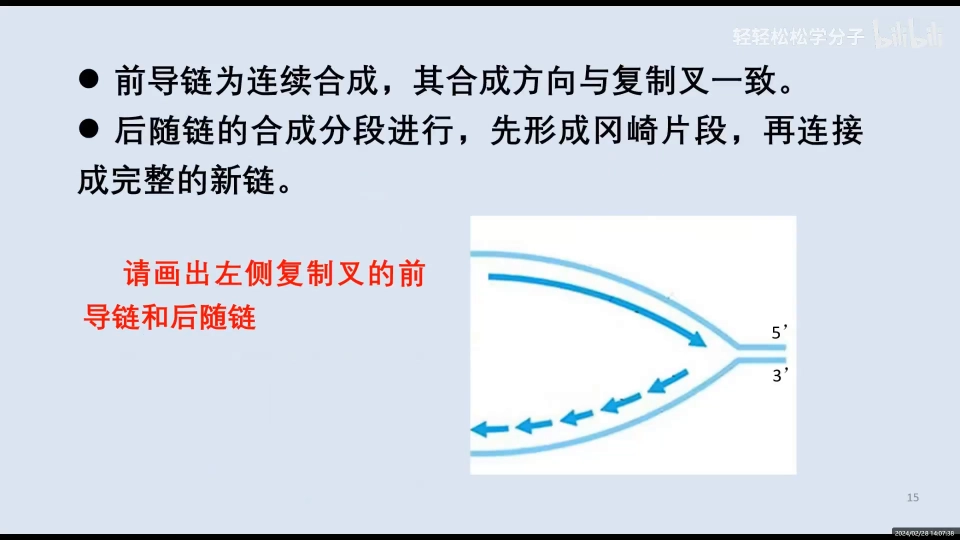

[【跳转到 04:53】](https://www.bilibili.com/video/BV1prcKzkEdL/?p=2&t=293)

因为一条链连续、另一条链不连续，这种模式叫**半不连续复制**。课程还提醒一个容易忽略的点：在双向复制的两个复制叉里，同一条新链在一个叉中是连续合成的，在另一个叉中则是不连续合成的——所以"每一条新链都有一半连续、一半不连续"。

[【跳转到 06:08】](https://www.bilibili.com/video/BV1prcKzkEdL/?p=2&t=368)

### 4.3 两个亚基如何同时同向工作：后随链模板环化

DNA 聚合酶 III 全酶有两个亚单位，一个负责前导链，一个负责后随链。但后随链的合成方向与复制叉相反，两个亚基怎么能跟着同一个复制叉一起前进？

课程给出的解释是**后随链模板链环化**：后随链的模板在聚合酶 III 的另一个亚基中绕一圈再甩出来，使这一段模板在亚基内的走向变成 5′→3′，与复制叉移动方向一致。这样两个亚基就能同向移动、同时合成两条链。

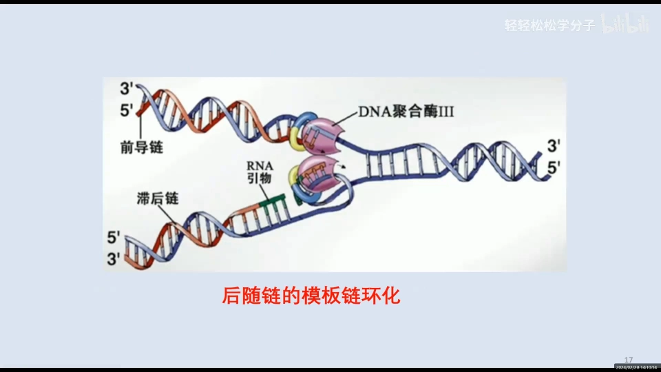

[【跳转到 07:58】](https://www.bilibili.com/video/BV1prcKzkEdL/?p=2&t=478)

---

## 五、酶的分工：谁合成、谁切引物、谁封口

### 5.1 大肠杆菌：Pol III 合成，Pol I 收尾，连接酶封口

延伸阶段的主角是 **DNA 聚合酶 III**，它是大肠杆菌主要的复制酶。全酶由多亚基组成，两个亚单位分别结合前导链和后随链，以四种 dNTP 为底物，按 5′→3′、按碱基互补配对原则合成新链。

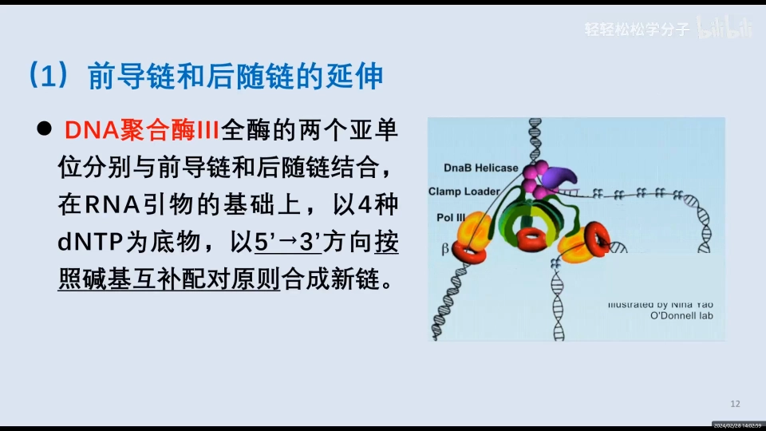

[【跳转到 00:20】](https://www.bilibili.com/video/BV1prcKzkEdL/?p=2&t=20)

RNA 引物最终要被去掉，这一步不是 Pol III 做的：

- **DNA 聚合酶 I** 利用 **5′→3′ 外切酶活性**切除 RNA 引物，再利用 **5′→3′ 聚合酶活性**把缺口补上；
- 补完后仍留下一个**切口**（磷酸二酯键断裂），Pol I 无法连接；
- **DNA 连接酶**把切口封起来。

因为 Pol I 一边切引物一边向前补缺口，切口会随之前移，这个过程叫**切口平移**。课程补充：**RNase H** 也可以切除 RNA 引物。

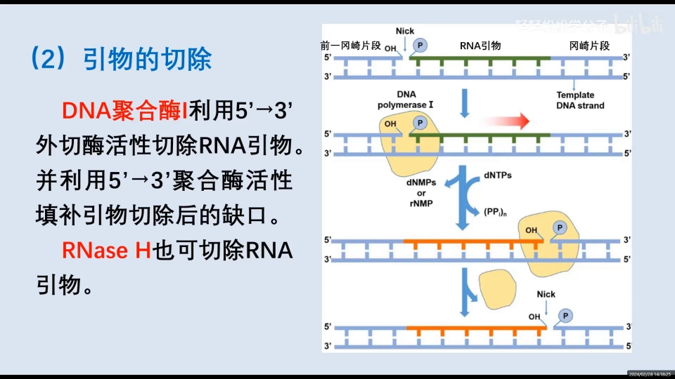

[【跳转到 14:47】](https://www.bilibili.com/video/BV1prcKzkEdL/?p=2&t=887)

DNA 连接酶催化相邻冈崎片段的 **3′羟基**与 **5′磷酸基团**连接，形成磷酸二酯键。连接需要能量：大肠杆菌的连接酶用 **NAD⁺**（烟酰胺腺嘌呤二核苷酸），其他一些连接酶用 ATP。

[【跳转到 17:17】](https://www.bilibili.com/video/BV1prcKzkEdL/?p=2&t=1037)

### 5.2 真核细胞：聚合酶按链分工，切引物另有一套酶

真核细胞的延伸分工与大肠杆菌不同，课程用一张表总结：

| 任务 | 大肠杆菌 | 真核细胞 |
| --- | --- | --- |
| 前导链合成 | DNA 聚合酶 III | DNA 聚合酶 ε |
| 后随链合成 | DNA 聚合酶 III | DNA 聚合酶 δ |
| 切除 RNA 引物 | DNA 聚合酶 I、RNase H | RNase H1、FEN1 |
| 填补引物缺口 | DNA 聚合酶 I | DNA 聚合酶 δ |
| 连接冈崎片段 | DNA 连接酶（用 NAD⁺） | DNA 连接酶 I（用 ATP） |
| 清除正超螺旋 | DNA 旋转酶（拓扑异构酶 II） | 拓扑异构酶 I |

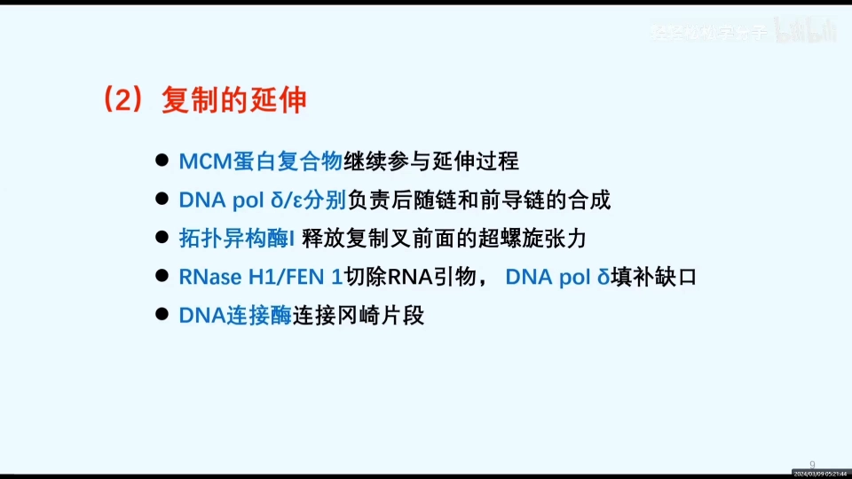

[【跳转到 07:00】](https://www.bilibili.com/video/BV1prcKzkEdL/?p=4&t=420)

### 5.3 真核起点识别：ORC—Cdc6/Cdt1—MCM

真核起点识别的逻辑与大肠杆菌相似，但蛋白换成了一套复合物：

1. **ORC**（起始点识别复合物）在复制起始之前就结合到起点上；
2. ORC 招募解旋酶装载蛋白 **Cdc6** 和 **Cdt1**；
3. 两者共同募集 **MCM 蛋白复合物**，MCM 才是发挥解旋酶活性、打开双链的蛋白。

ORC、Cdc6、Cdt1、MCM 共同形成**复制前复合体（pre-RC）**。pre-RC 在 S 期被 **CDK** 和 **DDK** 磷酸化后，MCM 的解旋酶活性被激活；随后 Cdc6 和 Cdt1 离开 ORC 并被降解或抑制，防止 pre-RC 再次装配。

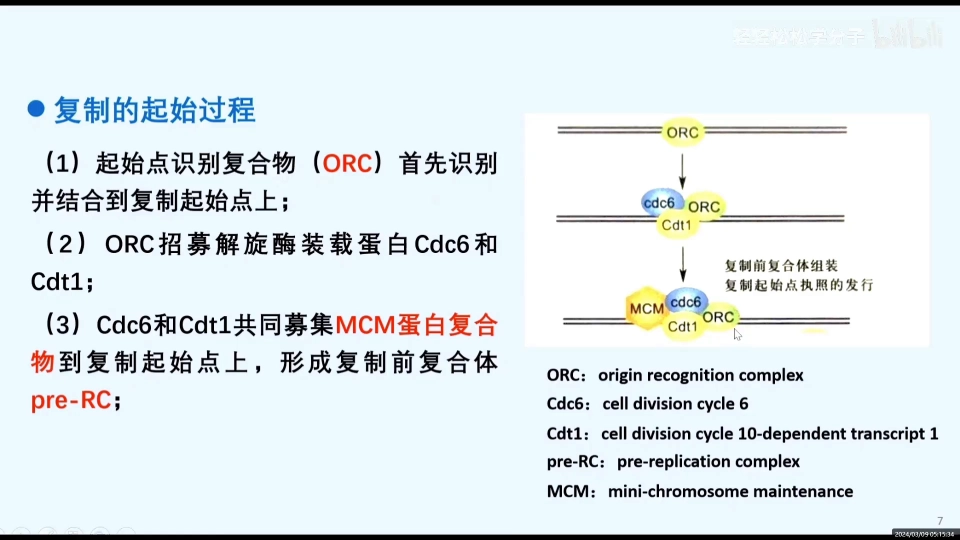

[【跳转到 01:20】](https://www.bilibili.com/video/BV1prcKzkEdL/?p=4&t=80)

课程也指出，真核起点同样富含 AT，酵母的起点包含 A 区、B1、B2、B3 四个保守序列，其中 A 区的 11 bp 序列相对保守。

---

## 六、保真性：先"选对"，再"改错"

### 6.1 第一层：聚合酶对底物高度选择

DNA 聚合酶按碱基互补配对原则引入核苷酸，对底物有高度选择性。这是保真性的第一层保障：大多数错误在掺入之前就被拒绝。

[【跳转到 02:25】](https://www.bilibili.com/video/BV1prcKzkEdL/?p=2&t=145)

### 6.2 第二层：3′→5′ 外切酶校对

但选择不可能百分之百准确。一旦引入了错配碱基，DNA 聚合酶 III 会利用 **3′→5′ 外切酶活性**把错配的碱基切掉，然后再用 5′→3′ 聚合酶活性重新引入正确配对的碱基。

这就是**校对**（proofreading）：不是等复制结束后再修，而是在延伸过程中当场回退、切除、重写。

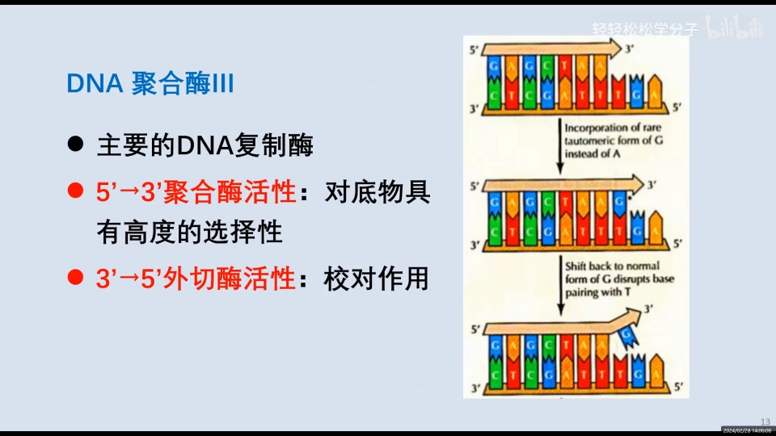

[【跳转到 03:30】](https://www.bilibili.com/video/BV1prcKzkEdL/?p=2&t=210)

课程把高度忠实性归纳为两点：**聚合酶对底物的高度选择性**，加上**校对功能**。这也解释了为什么复制叉上的聚合酶既要有"聚合"活性，又要有方向相反的外切活性。

### 6.3 边界：校对之后还有错配修复

本节的保真性只讲到复制叉自带的校对。复制完成后如果仍有错配，需要由错配修复系统识别新链并切除，那属于 B02 §1.3.4「DNA 错配修复与跨损伤合成」的范围；损伤修复的整体分类见 B02 §1.3.3「DNA 损伤修复」。本节不展开。

---

## 七、把复制叉串起来：一条因果链

把上面的角色按时间排好，复制叉的工作可以压缩成一条链：

1. **DnaA 识别 oriC 的 9 bp 重复**，水解 ATP 打开富 AT 的 13 bp 区；
2. **DnaB 解旋酶**在 DnaC 帮助下结合单链，向两侧解旋，形成两个复制叉；
3. **SSB** 保护单链，**拓扑异构酶**在叉前清除正超螺旋；
4. **DnaG 引发酶**在模板上合成约 11 nt 的 RNA 引物；
5. **DNA 聚合酶 III** 从引物 3′端按 5′→3′ 延伸：前导链连续，后随链分段并环化模板；
6. **Pol I** 切除 RNA 引物并补缺口，**连接酶**封口，得到完整子链；
7. 延伸过程中，**3′→5′ 外切酶**随时切掉错配碱基，聚合酶重新掺入正确核苷酸。

每一步都在回答同一个问题：**在"只能 5′→3′ 延伸、不能从头开始"的约束下，如何让两条反向平行的模板都被完整、准确地复制。**

---

## 小结

- 复制有固定起点：大肠杆菌的 oriC 全长 245 bp，左侧是富 AT 的 13 bp 重复区；DnaA 识别右侧 9 bp 重复并打开 13 bp 重复区。
- 解旋由 DnaB 完成，DnaC 帮助装载；两个 DnaB 反向移动形成两个复制叉，即双向复制。
- DNA 聚合酶不能从头合成，必须先有引物；体内引物是 RNA，大肠杆菌由 DnaG 合成约 11 nt。
- 5′→3′ 是唯一延伸方向：前导链连续，后随链分段形成冈崎片段，合称半不连续复制。
- 酶有明确分工：Pol III 延伸，Pol I 切引物并补缺口，连接酶封口；真核对应 pol ε/δ、RNase H1/FEN1、连接酶 I。
- 保真性来自两层：聚合酶对底物的高度选择性，以及 3′→5′ 外切酶的即时校对。
- 半保留复制的概念不在这里重复，见 [B01 §2.1.2](../../../../B01_生命科学基础主干/README.md#b01-2-1-2)；链方向与互补配对见 [B01 §2.1.1](../../../../B01_生命科学基础主干/README.md#b01-2-1-1)。

## 关键术语速查

| 术语 | 一句话解释 |
| --- | --- |
| 复制子 | DNA 复制的基本单位，每个复制子含一个复制起始区 |
| oriC | 大肠杆菌的复制起始区，245 bp，富含 AT、高度保守 |
| DnaA | 复制起始因子，识别 oriC 的 9 bp 重复，水解 ATP 打开 13 bp 富 AT 区 |
| DnaB | 解旋酶，在 DnaC 帮助下结合单链并向两侧解旋 |
| DnaG | 大肠杆菌的引发酶，合成约 11 nt 的 RNA 引物 |
| SSB | 单链结合蛋白，保护解开的单链、防止复性 |
| 前导链 | 与复制叉同向、连续合成的新链 |
| 后随链 | 与复制叉反向、分段合成的新链，片段即冈崎片段 |
| 半不连续复制 | 一条链连续、另一条链不连续的复制模式 |
| 切口平移 | Pol I 切引物并补缺口时，切口沿链前移的过程 |
| 校对 | DNA 聚合酶 3′→5′ 外切酶活性切除错配碱基并重新合成 |
| pre-RC | 真核复制前复合体，由 ORC、Cdc6、Cdt1、MCM 组成 |