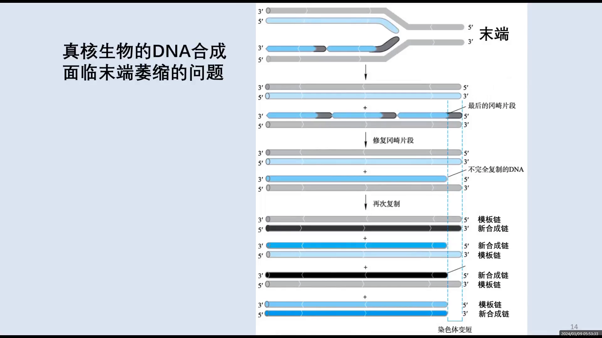
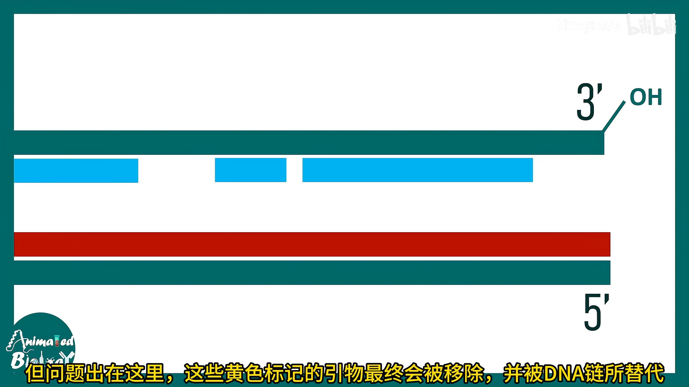
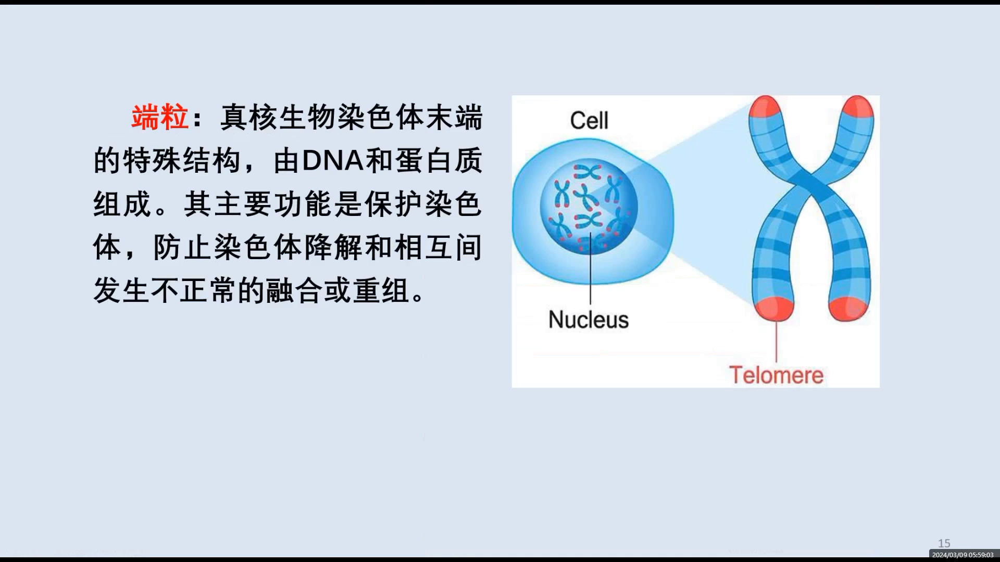
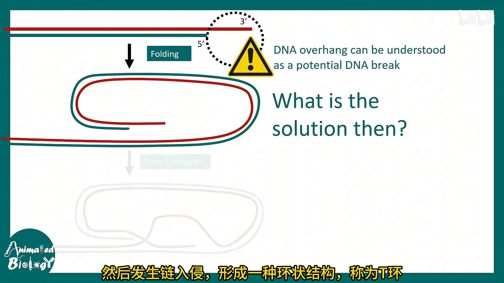
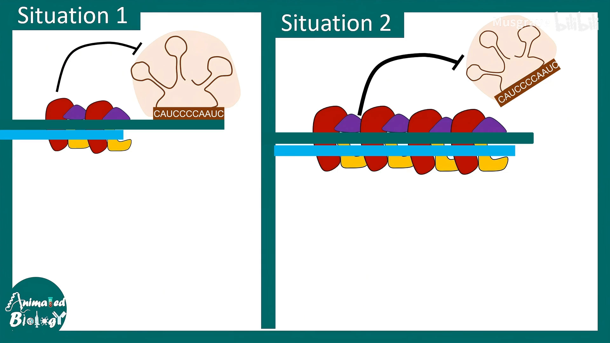
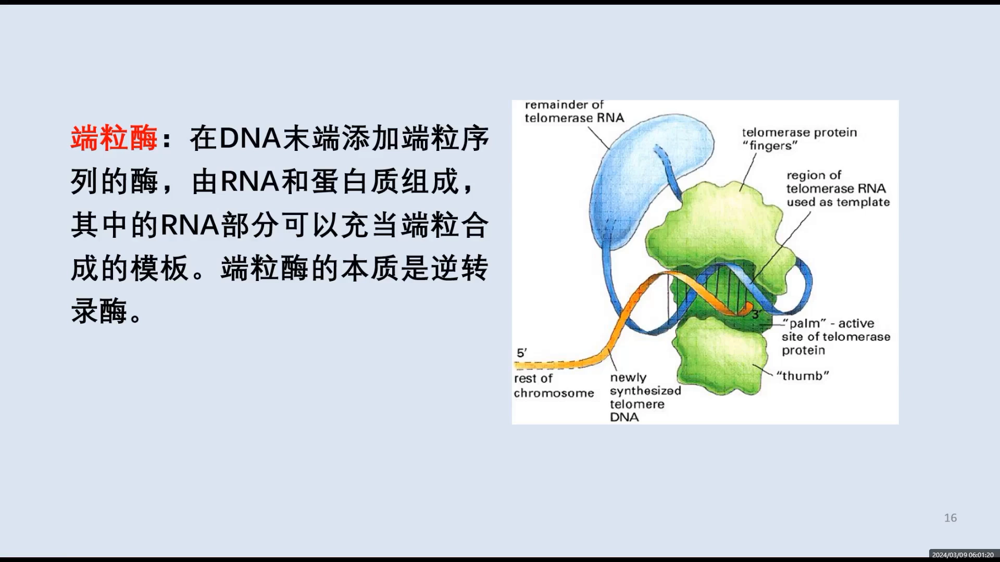
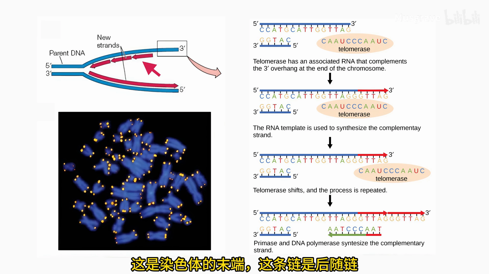
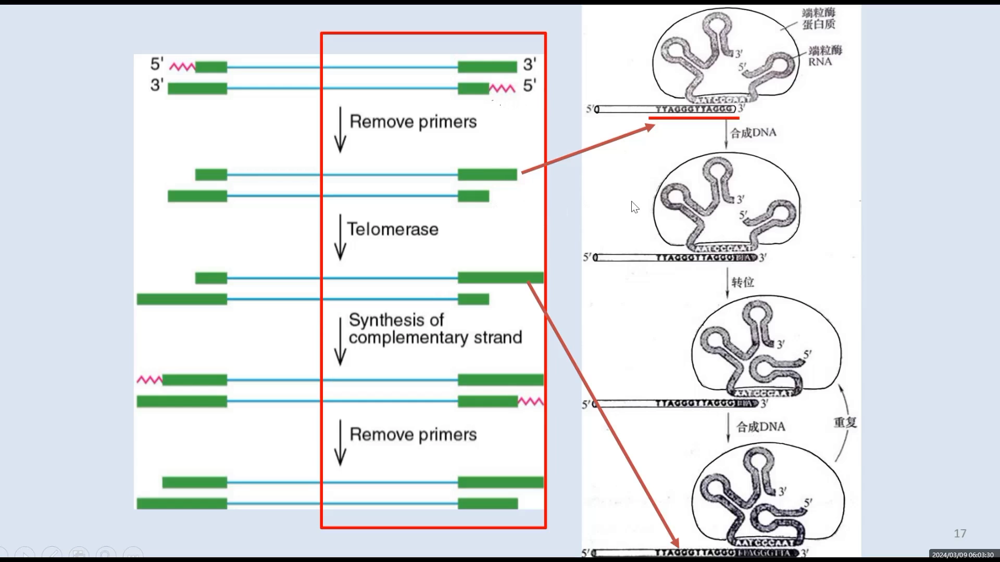
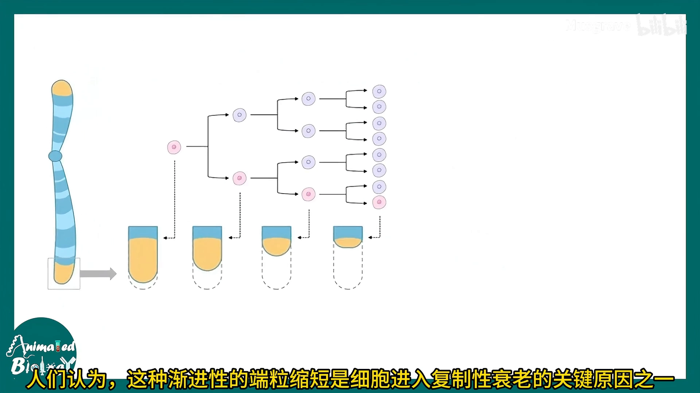
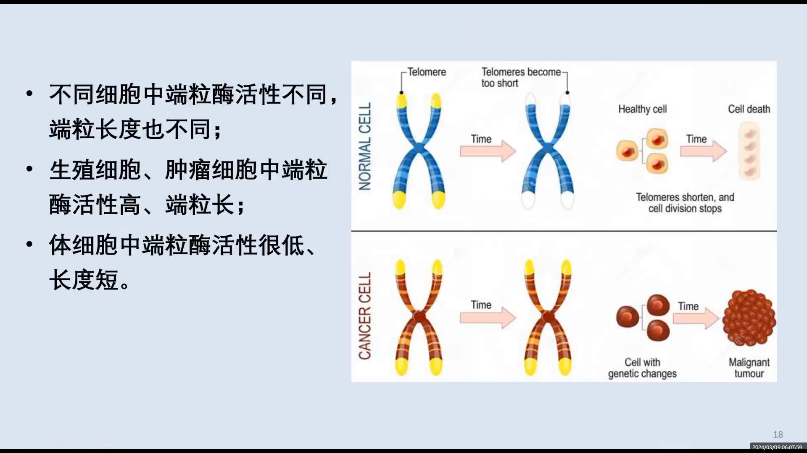

# 端粒与染色体末端维护：末端复制问题、端粒酶与复制性衰老

> 视频来源：[【分子生物学】第2章 染色体与DNA｜第3节 DNA的复制｜端粒酶与DNA末端复制](https://www.bilibili.com/video/BV1MH4y1L7Ui/)（B 站 · 17:17）；[端粒、端粒酶与复制性衰老](https://www.bilibili.com/video/BV1S4GK6wEKJ/)（B 站 · 6:23）；[长端粒≠长寿！……](https://www.bilibili.com/video/BV1UM4y1b7HM/)（B 站 · 仅采用 00:00–04:55 的科学部分）
> 导读：第一篇把“末端为什么补不回来”逐代画清楚，第二篇补上 T 环、长度调控与癌细胞维持端粒的两条路，第三篇补上短端粒综合征与超长端粒的疾病后果。第三篇末尾是端粒检测产品推广，本文不引用。衰老表型、SASP 与 Hayflick 现象见 B01 §4.3.5，本文不重复。

## 本讲要解决的核心问题（SCQA）

**背景**：DNA 聚合酶只能沿 5′→3′ 方向延伸，而且必须由一段引物提供起始的 3′-OH；后随链因此被切成许多冈崎片段，每个片段 5′ 端都带一段 RNA 引物。复制完成后，引物要被切除、缺口要被填补、切口要被连接。

**冲突**：这套“切引物—补缺口—连接”的流程，在染色体最末端会卡住：最后一个冈崎片段的引物被切掉后，它前面再也没有可供延伸的序列，缺口补不回来。线性染色体于是每复制一次就短一截。

**疑问**：细胞如何避免把基因越复制越少？为什么干细胞和肿瘤细胞能一直分裂，而多数体细胞不能？端粒长度、端粒酶活性和“复制性衰老”是同一件事吗？端粒坏掉会得什么病？

**回答（中心思想）**：端粒是一段不承载遗传信息的短重复序列，充当可消耗的缓冲垫和保护帽；端粒酶是一种自带 RNA 模板的逆转录酶，专门延长端粒的 3′ 悬突，把“每轮复制必丢的一小段”补回来。因此一个细胞会不会走向复制性衰老，不取决于某一个数，而取决于三个量的组合：初始端粒长度、每次分裂的缩短量、端粒酶活性。端粒太短会损害高更新组织（免疫、骨髓、肠、肺），端粒异常地长则与肿瘤易感相关。

## 一、末端复制问题：线性染色体为什么每复制一次就短一截

### 1.1 缺口不在“连接”，而在最末端没有 3′-OH

先看染色体一侧的末端。前导链可以顺着解旋方向连续合成；后随链则要反复合成引物、再沿 5′→3′ 延伸，形成一串冈崎片段。[【跳转到 00:35】](https://www.bilibili.com/video/BV1MH4y1L7Ui/?t=35)

复制完成后，内部那些冈崎片段的引物被切除，留下的缺口可以由相邻片段的 3′-OH 继续延伸来填补，最后由连接酶封口。但**最后一个**冈崎片段的引物切除后，它前面已经没有序列，也没有可用的 3′-OH，缺口就永远留在那里。[【跳转到 02:10】](https://www.bilibili.com/video/BV1MH4y1L7Ui/?t=130)

第二篇视频把这一点说得更直接：引物替换需要一个游离的 3′-OH 来延伸，而最末端恰恰没有这样的 3′-OH，所以“末端复制问题”不是酶不够努力，而是化学起点不存在。[【跳转到 01:17】](https://www.bilibili.com/video/BV1S4GK6wEKJ/?t=77)

### 1.2 缺口会随分裂传递：一次复制，一个正常、一个变短

只复制一次时，两个子代 DNA 分子中，一个末端完整，另一个的一条链在 5′ 端缺了一块。再复制一次，四个子代分子里只有一个仍然正常，另外三个都带上了缩短的末端；此后带缺口的分子再复制，产生的子代也继续带缺口。[【跳转到 02:35】](https://www.bilibili.com/video/BV1MH4y1L7Ui/?t=155)

所以端粒缩短不是“每次平均磨损一点”这么简单，而是**缺口一旦产生就会遗传下去**，随着分裂次数增加，带短端粒的分子越来越多、末端越来越短。[【跳转到 03:35】](https://www.bilibili.com/video/BV1MH4y1L7Ui/?t=215)

### 1.3 端粒不是“垃圾 DNA”，而是可消耗的缓冲垫

端粒是真核生物染色体末端的特殊结构，由 DNA 和蛋白质组成。它的主要功能是保护染色体，防止染色体被降解，也防止染色体之间发生不正常的融合或重组。[【跳转到 06:09】](https://www.bilibili.com/video/BV1MH4y1L7Ui/?t=369)

这解释了为什么“末端变短”不等于“马上丢基因”：端粒是一段短重复序列，本身不承载遗传信息，它的缩短相当于消耗缓冲垫。缓冲垫耗尽后，染色体末端失去保护，DNA 受到损伤，细胞最终死亡或停止增殖。[【跳转到 06:34】](https://www.bilibili.com/video/BV1MH4y1L7Ui/?t=394)

## 二、端粒的结构：重复序列、3′ 悬突与 T 环

### 2.1 端粒是 TTAGGG 重复加一段单链悬突

端粒 DNA 由短的串联重复组成。人类端粒重复单元是 **TTAGGG**；由于末端复制问题，端粒最末端始终保留一段 3′ 单链悬突（3′ overhang）。[【跳转到 02:42】](https://www.bilibili.com/video/BV1S4GK6wEKJ/?t=162)

这段悬突很关键：它既是端粒酶的结合位点，也是细胞必须“藏起来”的危险结构——单链末端看起来太像 DNA 双链断裂了。

### 2.2 T 环：把末端藏进双链里，避免被当成双链断裂

如果 3′ 悬突暴露，细胞的 DNA 损伤修复机制会把它当成双链断裂来处理，启动外切酶和损伤应答，这对染色体末端是灾难。细胞的解决办法是让悬突回折、侵入前方的双链，形成一个套索状的环状结构，称为 **T 环**（T-loop）。[【跳转到 04:05】](https://www.bilibili.com/video/BV1S4GK6wEKJ/?t=245)

T 环相当于给线性染色体末端戴上一顶“保护帽”：末端被藏起来，修复机制无法识别，端粒因此免受外切酶和 DNA 损伤应答的破坏。[【跳转到 04:30】](https://www.bilibili.com/video/BV1S4GK6wEKJ/?t=270)

### 2.3 端粒结合蛋白：给端粒酶设一道随长度变化的闸门

端粒结合蛋白除了参与末端保护，还承担另一个任务：**根据端粒长度调节端粒酶的活性**。视频中以 RF1 和 RF2 为例：两者形成复合体结合在端粒 DNA 上，抑制端粒酶。[【跳转到 03:12】](https://www.bilibili.com/video/BV1S4GK6wEKJ/?t=192)

逻辑是“数蛋白”：端粒短时，结合在端粒上的蛋白少，对端粒酶的抑制弱，端粒酶可以接近末端、按模板加重复；端粒长时，蛋白密集覆盖，形成抑制屏障，端粒酶无法靠近，延伸被阻断。[【跳转到 03:32】](https://www.bilibili.com/video/BV1S4GK6wEKJ/?t=212)

> 术语说明：文献把这类端粒结合蛋白复合体统称 **shelterin**（端粒保护蛋白复合体）。选用视频没有使用这个名字，只讲“端粒结合蛋白”并写作 RF1/RF2；这很可能是 TERF1/TERF2 的语音识别误差，具体名称以原片和原始文献为准。本文不展开六个亚基的分工。

## 三、端粒酶：自带 RNA 模板的逆转录酶

### 3.1 组成：一个蛋白催化亚基 + 一段 RNA 模板

端粒酶由 RNA 和蛋白质组成，其中 RNA 部分充当端粒合成的模板。它不需要外部模板，RNA 组分本身就是模板，蛋白质亚基提供催化活性。[【跳转到 08:03】](https://www.bilibili.com/video/BV1MH4y1L7Ui/?t=483)

以 RNA 为模板合成 DNA，这个方向与中心法则的“DNA→RNA”相反，所以端粒酶本质上是一种**逆转录酶**。[【跳转到 08:28】](https://www.bilibili.com/video/BV1MH4y1L7Ui/?t=508)

> 术语说明：文献通常把端粒酶的蛋白催化亚基写作 **TERT**（端粒酶逆转录酶），RNA 组分写作 **TERC**（端粒酶 RNA）。视频只讲“逆转录酶亚基”和“RNA 组分”，没有出现这两个缩写。

### 3.2 延伸循环：结合悬突→按模板加重复→转位→再来一轮

端粒酶只延长端粒的 3′ 悬突，不直接补另一条链。一轮完整的延伸可以拆成四步：

1. **结合**：端粒酶 RNA 的模板区与端粒最末端的 3′ 悬突互补配对。[【跳转到 10:39】](https://www.bilibili.com/video/BV1MH4y1L7Ui/?t=639)
2. **延伸**：以 RNA 为模板，沿 5′→3′ 方向往末端添加 TTAGGG 重复。[【跳转到 11:04】](https://www.bilibili.com/video/BV1MH4y1L7Ui/?t=664)
3. **转位**：每加完一个重复单元，端粒酶解离、重新结合到新的末端，继续下一轮，如此循环。[【跳转到 02:17】](https://www.bilibili.com/video/BV1S4GK6wEKJ/?t=137)
4. **补互补链**：端粒酶离开后，留下的 3′ 悬突成为模板，由引物酶和 DNA 聚合酶 α 合成互补链（C 链），把双链端粒补齐。[【跳转到 02:42】](https://www.bilibili.com/video/BV1S4GK6wEKJ/?t=162)

### 3.3 它到底解决了什么：先造出“可以放引物的空间”

把镜头拉回末端复制问题。端粒酶并不是把切掉的引物“粘回去”，而是先把 3′ 悬突延长一段，**为新的 RNA 引物制造出可配对的模板空间**；引物合成后，DNA 聚合酶再顺着引物补新链，原来丢失的那一段就被填回来了。[【跳转到 11:29】](https://www.bilibili.com/video/BV1MH4y1L7Ui/?t=689)

最终结果是：缺失的部分被补回，正常那条链的 3′ 端还多延长了一小段；互补链也随之延长。净效果是端粒维持甚至变长，而不是每轮必短。[【跳转到 13:09】](https://www.bilibili.com/video/BV1MH4y1L7Ui/?t=789)

## 四、三个常被混为一谈的量：长度、活性、复制性衰老

### 4.1 三者不是同义词

| 量 | 是什么 | 由什么决定 | 能推出什么 | 不能推出什么 |
| --- | --- | --- | --- | --- |
| 端粒长度 | 某一时刻端粒重复序列的物理长度（常用 kb 表示） | 初始长度、分裂次数、每次缩短量、端粒酶是否补回 | 这个细胞/样本“还剩多少缓冲垫” | 不能单凭长度判断细胞是否已经衰老，也不能跨物种直接比较寿命 |
| 端粒酶活性 | 细胞延长端粒的能力（酶是否表达、是否被抑制） | 细胞类型、发育阶段、端粒结合蛋白的抑制、是否被重新激活 | 这个细胞有没有能力抵消缩短 | 活性高不等于端粒一定长，也不等于细胞一定癌变 |
| 复制性衰老 | 细胞完全丧失分裂能力、进入不可逆生长停滞的状态 | 端粒缩短到临界、损伤应答被触发，以及其他衰老刺激 | 细胞已经退出分裂 | 不能反推具体端粒长度，也不能把培养皿里的传代次数换算成个体年龄 |

端粒长度是“读数”，端粒酶活性是“能力”，复制性衰老是“状态”。三者可以组合出完全不同的情形：端粒很短但端粒酶阴性（多数体细胞）、端粒很长但端粒酶被抑制（正常干细胞）、端粒长度恒定但端粒酶重新激活（多数癌细胞）。

### 4.2 体细胞：端粒酶低，缩短无法补偿

在大多数体细胞中，端粒酶活性极低，无法补偿每次分裂造成的缩短。渐进性的端粒缩短被认为是细胞进入**复制性衰老**的关键原因之一：细胞完全丧失分裂能力，进入不可逆的生长停滞。[【跳转到 04:50】](https://www.bilibili.com/video/BV1S4GK6wEKJ/?t=290)

这里只讲“端粒缩短→停滞”这一环。停滞如何被 p53–p21、p16–Rb 锁死，衰老细胞如何分泌 SASP，见 B01 §4.3.5，本文不重复。

### 4.3 生殖细胞与肿瘤细胞：端粒酶高，缩短被抵消

不同细胞的端粒酶活性不同，端粒长度也不同：生殖细胞、肿瘤细胞端粒酶活性高、端粒长；体细胞端粒酶活性很低、端粒短。[【跳转到 14:49】](https://www.bilibili.com/video/BV1MH4y1L7Ui/?t=889)

干细胞需要长期自我更新，逻辑上与生殖细胞同类；选用视频没有单独点名干细胞，而是把这类细胞统称为“增殖细胞”，并指出它们的端粒酶活性高、端粒长。[【跳转到 15:36】](https://www.bilibili.com/video/BV1MH4y1L7Ui/?t=936)

肿瘤细胞能无限增殖有两个原因：一是端粒本身比正常体细胞长，二是端粒酶活性高、延长端粒的能力强。两个原因共同作用，使肿瘤细胞端粒缩短得非常缓慢。[【跳转到 15:11】](https://www.bilibili.com/video/BV1MH4y1L7Ui/?t=911)

### 4.4 初始端粒长度不等于寿命：缩短速率更关键

一个常见的推论是“端粒越长，活得越久”。视频给出的反例是：物种的初始端粒长度与寿命并没有相关性。人类平均寿命六七十岁，初始端粒长度在自然界排不上号；小鼠平均寿命只有 1~3 年，端粒却比人类长。在小鼠内部比较，端粒极长的小鼠与普通小鼠的寿命也没有显著差别。[【跳转到 00:33】](https://www.bilibili.com/video/BV1UM4y1b7HM/?t=33)

视频引用的研究认为，比起点长度更关键的是**端粒缩短率**：短命物种的初始端粒往往更长，但单位时间丢失得也更多，很快缩短到“死亡值”。视频给出的数量级是：人类初始端粒约 5~15 kb，小鼠约 50 kb；人类端粒每年缩短约 70 个碱基，小鼠每年约 7000 个碱基，相差约 100 倍。[【跳转到 04:29】](https://www.bilibili.com/video/BV1UM4y1b7HM/?t=269)

这组对比说明：判断“端粒是否在消耗细胞的生命预算”，不能只看起点长度，还要看**每单位时间的净损失**（缩短量减去端粒酶补回量）。

## 五、端粒异常与疾病：太短和太长各有代价

### 5.1 太短：短端粒综合征集中打击高更新组织

端粒短于平均水平的人，患免疫系统问题、各种退行性疾病以及肺纤维化的风险增加。在更严重的**短端粒综合征**人群中，婴儿和儿童主要表现为免疫缺陷、骨髓衰竭和肠病；成人最常表现为特发性肺纤维化和其他端粒相关肺病。[【跳转到 01:44】](https://www.bilibili.com/video/BV1UM4y1b7HM/?t=104)

这些表型集中在需要持续更新的组织：免疫细胞要扩增、骨髓要不断产生血细胞、肠上皮要更新、肺上皮受损后要修复。端粒缩短到临界、更新能力耗尽，组织首先在这些地方出问题。反过来，视频指出短端粒人群中癌症反而十分罕见。[【跳转到 02:04】](https://www.bilibili.com/video/BV1UM4y1b7HM/?t=124)

> 范围说明：临床文献把这类由端粒维护缺陷导致的疾病统称为端粒生物学疾病，**先天性角化不良**（dyskeratosis congenita）是其中经典的严重类型。选用视频只讲了“短端粒综合征”的表型谱，没有出现这个病名，也没有讲诊断标准；本文点到名称为止，不展开临床诊断。

### 5.2 太长：POT1 突变、超长端粒与肿瘤易感

长端粒并不总是好事。视频介绍了一项约翰霍普金斯大学的临床研究：连续纳入 17 名携带 **POT1** 基因突变的个体（年龄 7~83 岁），他们的共同特征是端粒异常地长；另有 21 名未携带突变的亲属作为对照。[【跳转到 02:19】](https://www.bilibili.com/video/BV1UM4y1b7HM/?t=139)

这些突变携带者除了 B 细胞和 T 细胞淋巴瘤、骨髓癌，还可发生一系列良性和恶性肿瘤，范围涉及上皮、间充质和神经元组织；28% 具有 T 细胞克隆性，67% 具有意义未明的克隆性造血。研究中还有 4 名参与者死亡。一名 73 岁的参与者同时患有良性的副神经节瘤、甲状腺癌和两个黑色素瘤。[【跳转到 02:44】](https://www.bilibili.com/video/BV1UM4y1b7HM/?t=164)

视频给出的解释是：POT1 突变使细胞寿命延长、端粒长度随时间被维持，从而让携带突变的细胞有更多机会累积突变，最终表现为家族性克隆性造血综合征和一系列实体瘤。[【跳转到 03:14】](https://www.bilibili.com/video/BV1UM4y1b7HM/?t=194)

### 5.3 癌细胞的两条路：重新激活端粒酶，或走 ALT

大多数癌细胞快速、不受控制地分裂，按末端复制问题推算端粒应该越来越短，但事实上癌细胞的端粒长度相当恒定。[【跳转到 05:38】](https://www.bilibili.com/video/BV1S4GK6wEKJ/?t=338)

目前已知两条维持路径：大部分癌细胞**重新激活端粒酶**，少部分通过 **ALT**（替代性端粒延长）机制维持端粒。[【跳转到 05:45】](https://www.bilibili.com/video/BV1S4GK6wEKJ/?t=345)

这也解释了为什么“激活端粒酶抗衰老”不是一个可以随便做的选择：端粒酶活性在多数体细胞里被压低，本身就是抑制无限制增殖的一道闸门；把它重新打开，等于同时放松了这道闸门。

## 六、把机制串成一条判断链

遇到一个“端粒相关”的说法，可以按下面的顺序拆：

1. **先问是哪个量**：说的是端粒长度、端粒酶活性，还是细胞已经进入复制性衰老？三者不能互相替代。
2. **再问缩短是否被补偿**：这个细胞类型有没有端粒酶活性？端粒结合蛋白是否在抑制它？净缩短率是多少？
3. **再看缓冲垫还剩多少**：初始长度多长、已经分裂了多少次、是否接近临界长度。
4. **最后看后果落在哪种组织**：高更新组织（骨髓、免疫、肠、肺）对端粒耗尽最敏感；端粒异常稳定则给突变累积创造机会。
5. **区分体外与体内**：Hayflick 极限描述的是培养皿里的正常非恶性细胞，不能直接换算成个体年龄；端粒缩短是衰老的机制之一，不是唯一原因。

## 小结

- **末端复制问题的根源**是引物去除后最末端缺少 3′-OH，最后一个冈崎片段的缺口无法填补；缺口会随分裂传递，导致端粒逐代缩短。
- **端粒**是 TTAGGG 短重复加 3′ 悬突，通过 T 环和端粒结合蛋白把末端藏起来，避免被当成双链断裂。
- **端粒酶**是自带 RNA 模板的逆转录酶：结合 3′ 悬突、按模板加重复、转位循环，最后由 DNA 聚合酶 α 补互补链。它先造出引物空间，再让常规复制把缺口填回。
- **端粒长度是读数，端粒酶活性是能力，复制性衰老是状态**；细胞是否衰老取决于初始长度、每次缩短量和端粒酶活性的组合。
- **初始端粒长度不预测寿命**；缩短速率、以及缩短是否被补偿，比起点长度更有解释力。
- **太短和太长都有代价**：短端粒综合征打击免疫、骨髓、肠和肺；POT1 突变导致的超长端粒与克隆性造血和多种肿瘤相关；多数癌细胞靠重新激活端粒酶或 ALT 维持端粒。

## 关键术语速查

| 术语 | 一句话解释 |
| --- | --- |
| 末端复制问题 | 线性染色体复制时，最末端 RNA 引物去除后缺少 3′-OH，缺口无法填补，端粒因此每轮缩短。 |
| 端粒 | 染色体末端的 TTAGGG 短重复序列与结合蛋白复合体，不承载遗传信息，起缓冲与保护作用。 |
| 3′ 悬突 | 端粒最末端一段单链 DNA，是端粒酶的结合位点，也是必须被 T 环藏起来的“假双链断裂”。 |
| T 环 | 3′ 悬突回折并侵入双链形成的套索结构，把染色体末端藏起来，避免触发 DNA 损伤修复。 |
| 端粒酶 | 由蛋白催化亚基和 RNA 模板组成的逆转录酶，延长端粒 3′ 端；文献常写作 TERT + TERC。 |
| shelterin | 端粒结合蛋白复合体的统称；视频只讲“端粒结合蛋白”并写作 RF1/RF2，未用这个名字。 |
| 端粒酶活性 | 细胞延长端粒的能力，取决于酶表达、亚基完整性和端粒结合蛋白的抑制。 |
| 复制性衰老 | 端粒缩短到临界后，细胞进入的不可逆生长停滞状态；表型与 SASP 见 B01 §4.3.5。 |
| 短端粒综合征 | 端粒过短导致的一组疾病：儿童免疫缺陷、骨髓衰竭、肠病，成人特发性肺纤维化等。 |
| POT1 | 视频中导致端粒异常变长的突变基因；携带者的克隆性造血与多种良恶性肿瘤风险升高。 |
| ALT | 替代性端粒延长机制，少数癌细胞不靠端粒酶而靠它维持端粒长度。 |