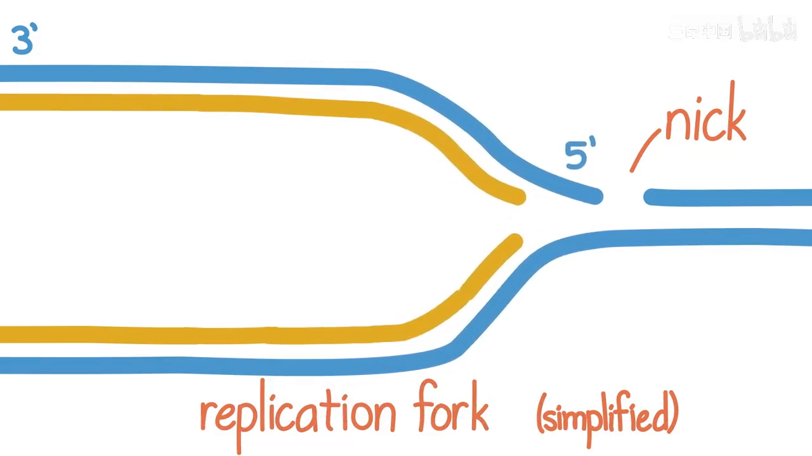
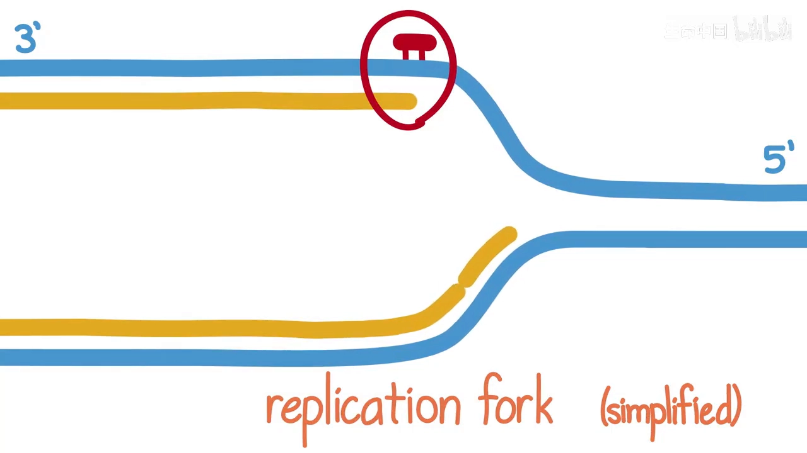
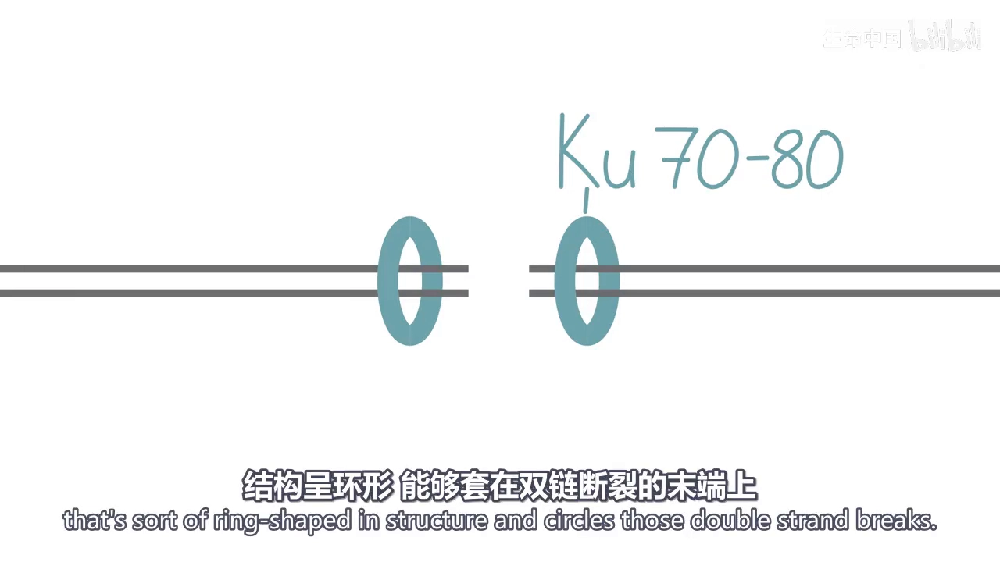
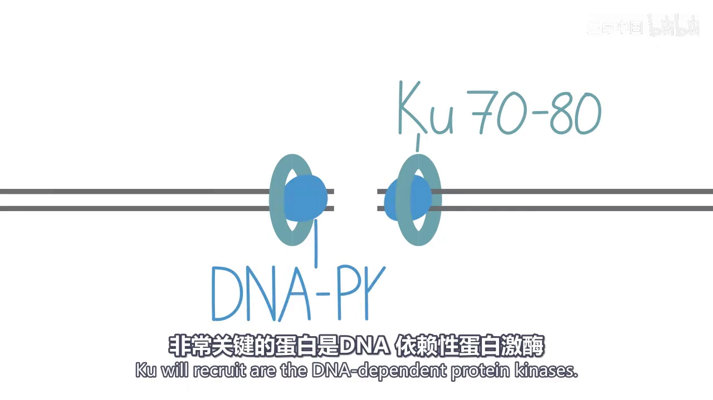
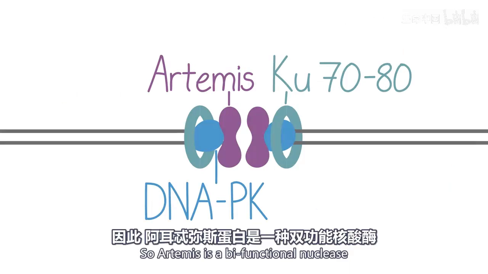
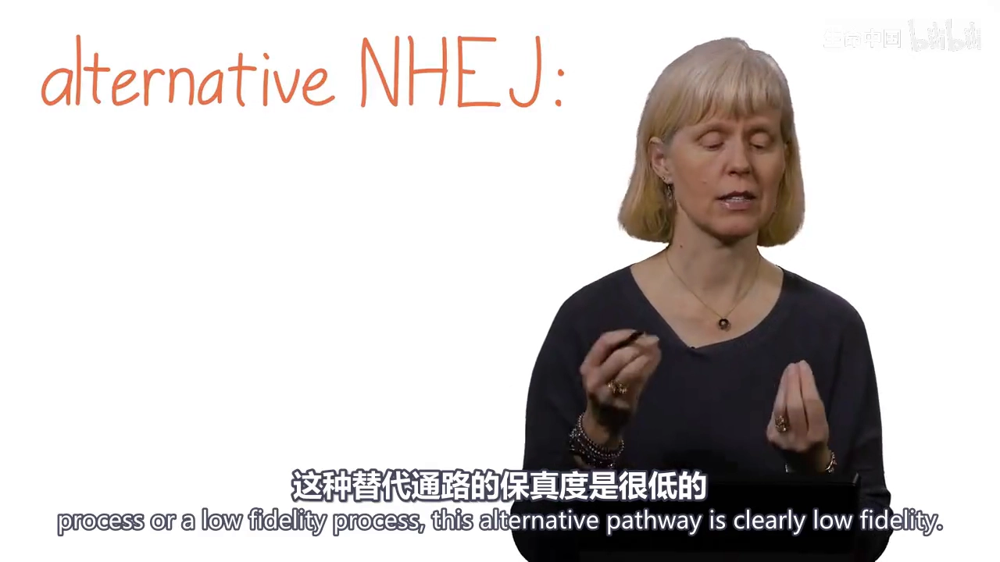
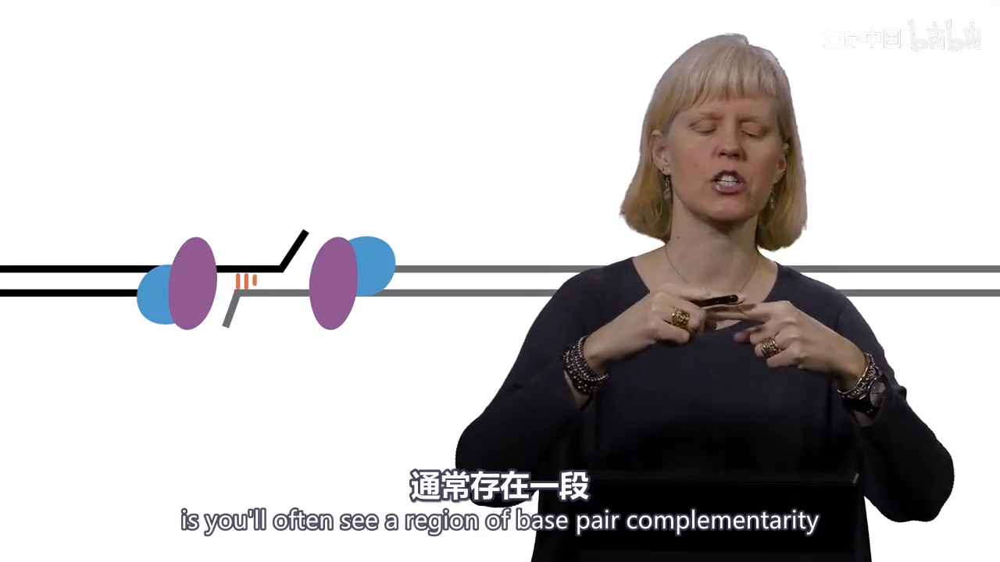
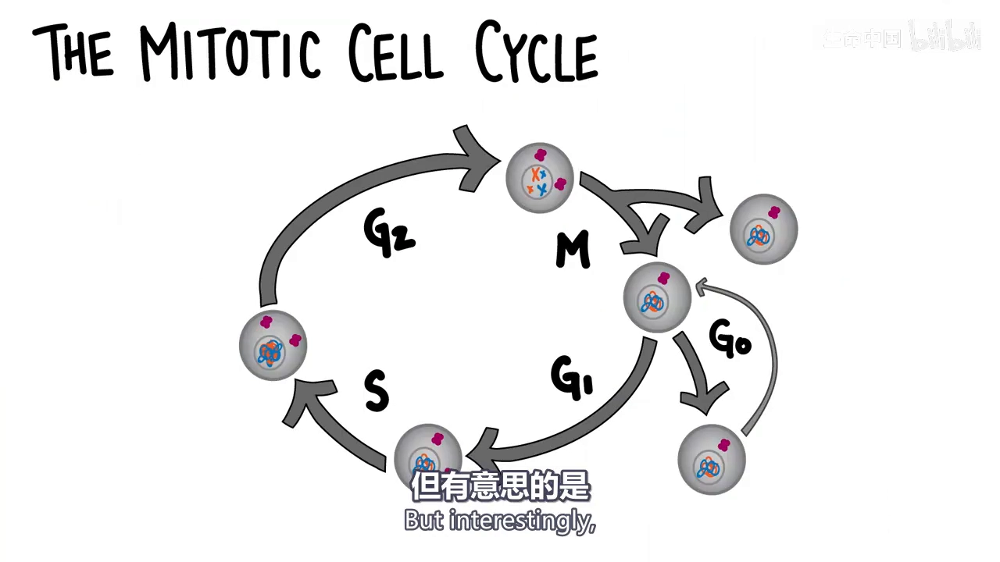
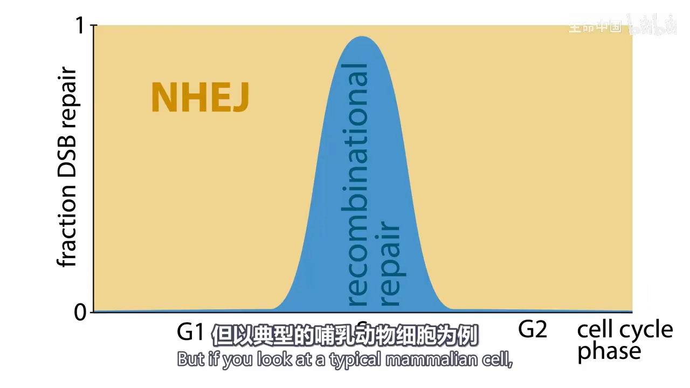

# 双链断裂修复：NHEJ 快速封口，同源重组保真重建

> 视频来源：[【分子生物学】17 双链断裂与修复](https://www.bilibili.com/video/BV17b4y1671v/)（Bilibili · MIT 分子生物学课程，Tania Baker 讲授）｜时长约 27 分钟
> 导读：这支课把双链断裂的来源、经典非同源末端连接（c-NHEJ）、替代末端连接（alt-NHEJ/MMEJ）以及细胞周期如何影响通路选择串在一起。它刻意把同源重组的分子步骤留到下一讲，所以本文只讲「两条路怎么选、各自留下什么后果」，同源重组的链入侵细节见本小节另一篇《同源重组修复：RAD51 链入侵与 Holliday 连接体如何完成无痕修复》。

## 本讲要解决的核心问题（SCQA）

**背景**：DNA 每天都在受损。碱基切除、核苷酸切除和错配修复处理的都是「一条链上的错误」，它们可以拿另一条完整的链当模板，把错误改回来。

**冲突**：双链断裂（double-strand break，DSB）不一样——两条链同时断了，没有哪一条链还能当模板。更麻烦的是，断裂末端往往不是干净的平端：辐射可能打断一条链后错开几个碱基再打断另一条，留下缺口、悬垂或化学结构不完整的末端。细胞如果不管，染色体就会丢片段；如果乱接，又可能把两条不同的染色体接在一起。

**疑问**：面对同一个双链断裂，细胞到底有哪几条修复路线？为什么有的路线几乎不留痕迹，有的却必然留下「疤痕」甚至造成染色体重排？

**回答（中心思想）**：细胞有两条主线——**非同源末端连接（NHEJ）**把断端直接接回去，快、全细胞周期可用，但会增删几个碱基；**同源重组（HR）**用一份完好的同源 DNA 当模板重新合成，几乎无痕，但只在 S/G2 期、有模板时才能用。此外还有一条低保真的替代末端连接（alt-NHEJ/MMEJ），它靠微同源配对，容易把不同染色体接在一起。**修复路线的选择，决定了断裂之后是「恢复原样」「留下小疤」还是「发生重排」。**

## 一、双链断裂为什么是最难处理的一种损伤

### 1.1 一个未修复的断裂就足以杀死细胞

讲者给出的量级很直接：对许多细胞类型来说，**单个未修复的双链断裂就是致命事件** [【跳转到 04:10】](https://www.bilibili.com/video/BV17b4y1671v/?t=250)。这不是因为断口本身「有毒」，而是因为断口把一条染色体切成了两段：复制时没有完整模板，有丝分裂时可能丢失片段，细胞最终走向死亡。

双链断裂的来源可以分成两类：

- **外源物理损伤**：X 射线、γ 射线等电离辐射可以直接打断双链。讲者举了一个日常例子：一次约十小时的跨洲飞行，平均每个细胞约有 5% 的概率发生双链断裂 [【跳转到 06:28】](https://www.bilibili.com/video/BV17b4y1671v/?t=388)。
- **内源复制事故**：复制叉遇到模板链上的缺口或损伤时，可能解体、回撤，把单链损伤「转化」成双链断裂 [【跳转到 08:33】](https://www.bilibili.com/video/BV17b4y1671v/?t=513)。

这也解释了一个容易混淆的点：**紫外线本身主要造成单链损伤，但单链损伤在复制时可能间接变成双链断裂。** 所以「双链断裂修复」不只是处理辐射伤，它也是复制叉重启和基因组维护的一部分。

### 1.2 断端很少是「干净」的

讲者特别提醒：X 射线和 γ 射线不遵循化学规则，不会总是正好在两条链的同一位置切断。常见的情况是两条链的断点错开几个碱基，中间留出一小段互补区域；末端还可能有 3' 磷酸、5' 羟基之类不能直接连接的化学基团 [【跳转到 14:30】](https://www.bilibili.com/video/BV17b4y1671v/?t=870)。

而 DNA 连接酶要工作，需要一侧是 **5' 磷酸**、另一侧是 **3' 羟基** [【跳转到 15:31】](https://www.bilibili.com/video/BV17b4y1671v/?t=931)。所以任何修复路线在「接上」之前，都得先做一件事：**把末端加工成可连接的结构**。这一步决定了修复是保真还是易错。

## 二、经典 NHEJ：先套环、再修剪、最后封口

### 2.1 Ku70/80 是断裂末端的第一个「夹子」

经典 NHEJ（c-NHEJ）的第一步，是 Ku70/80 异二聚体识别并结合断裂末端。Ku 的结构像一个环，可以套在双链 DNA 的末端上，保护末端不被进一步降解，同时为后续蛋白提供装配平台 [【跳转到 12:32】](https://www.bilibili.com/video/BV17b4y1671v/?t=752)。

Ku 随后招募 **DNA-PK**（DNA 依赖性蛋白激酶）。DNA-PK 与 Ku 一起把两个断端拉近、固定，让后面的修剪和连接反应能在同一个「工作台」上完成 [【跳转到 12:57】](https://www.bilibili.com/video/BV17b4y1671v/?t=777)。

### 2.2 Artemis 修剪末端，连接酶 4 封口

断端被拉近之后，需要核酸酶把不规则的末端「啃」成可连接的样子。讲者重点介绍了 **Artemis**：它同时具有内切酶和外切酶活性，既能从末端往回咬，也能在单链中间切开，因此可以处理辐射留下的各种奇怪末端 [【跳转到 13:22】](https://www.bilibili.com/video/BV17b4y1671v/?t=802)。

修剪之后，可能还需要 DNA 聚合酶补齐几个核苷酸，最后由包含 **DNA 连接酶 4** 的复合体把 5' 磷酸和 3' 羟基共价连接起来，恢复 DNA 双链的连续性 [【跳转到 16:43】](https://www.bilibili.com/video/BV17b4y1671v/?t=1003)。

### 2.3 NHEJ 的「保真度」取决于断在哪里

NHEJ 不是复制，它没有模板可查，所以连接处几乎总会留下几个碱基的增删——讲者把它叫作「疤痕」（scar）[【跳转到 17:14】](https://www.bilibili.com/video/BV17b4y1671v/?t=1034)。

但这个疤痕的后果，完全取决于它落在哪里：

- 如果落在**基因中间**，几个碱基的插入或缺失就可能改变读码框，产生截短或序列错误的蛋白，后果严重 [【跳转到 18:12】](https://www.bilibili.com/video/BV17b4y1671v/?t=1092)。
- 如果落在**基因间区**，几个碱基的变化通常没有明显影响。

所以「NHEJ 易错」和「NHEJ 是细胞最主要的修复方式」并不矛盾：它对**保持染色体完整**很有效，只是不保证**序列一字不差**。讲者估计，在典型哺乳动物细胞里，NHEJ 是双链断裂修复的主要方式，尤其在细胞不活跃合成 DNA 的 G1 和 G2 期 [【跳转到 26:15】](https://www.bilibili.com/video/BV17b4y1671v/?t=1575)。

## 三、替代末端连接：靠微同源配对，容易造成重排

### 3.1 当经典 NHEJ 不在时，细胞还有一套「最后手段」

除了经典 NHEJ，讲者还介绍了一条**替代途径（alt-NHEJ）**。它通常在经典 NHEJ 不活跃、或细胞损伤严重时启动。第一步识别末端的不是 Ku，而是 **PARP1**；随后由其他修复蛋白修剪末端、寻找可配对的单链 [【跳转到 19:25】](https://www.bilibili.com/video/BV17b4y1671v/?t=1165)。

### 3.2 微同源配对：2–10 个碱基就够

alt-NHEJ 的关键特征是：两个断端不靠 Ku 对齐，而是靠各自修剪后暴露出来的**微同源序列（microhomology）**配对。讲者给出的典型长度是 **2–10 个碱基对** [【跳转到 20:40】](https://www.bilibili.com/video/BV17b4y1671v/?t=1240)。

配对之后，两侧多余的单链会被剪掉，剩下的缺口由聚合酶补齐，最后由连接酶封口。因为配对只依赖很短的相同序列，这套机制有两个直接后果：

1. **必然丢失序列**：为了凑出配对，断端要被修剪掉一段，所以 alt-NHEJ 的连接处通常比经典 NHEJ 缺失更多碱基。
2. **可能接错对象**：如果两个断端来自**不同的染色体**，微同源配对同样可以把它们接在一起，形成**易位（translocation）** [【跳转到 21:42】](https://www.bilibili.com/video/BV17b4y1671v/?t=1302)。

讲者因此把 alt-NHEJ 称为细胞的「最后补救措施」：在严重损伤下，它宁可留下缺失或重排，也要先把断裂封住 [【跳转到 21:54】](https://www.bilibili.com/video/BV17b4y1671v/?t=1314)。

## 四、细胞周期决定用哪条路

### 4.1 NHEJ 全周期可用，同源重组要等模板

两条主线的分工，本质上由**有没有模板**决定：

- **NHEJ** 不需要模板，所以从 G1 到 M 期都能工作。它要做的只是把断端接回去。
- **同源重组** 需要一个完整的同源 DNA 分子当模板。在真核细胞里，最方便的模板是复制完成后紧挨着的**姐妹染色单体**。所以同源重组主要在 **S 期和 G2 期**活跃 [【跳转到 25:11】](https://www.bilibili.com/video/BV17b4y1671v/?t=1511)。

这张图把「为什么同源重组更准，却不是主力」讲清楚了：**准是有代价的**。它要求细胞先复制出一份模板，还要求断裂附近能找到这份模板；在 G1 期，姐妹染色单体还没出现，同源重组基本无从下手。

### 4.2 同源重组「几乎无痕」，但并非没有代价

讲者对同源重组的评价是：它可以连接 DNA 链、完美修复断裂，**断裂处不会有序列丢失或增加** [【跳转到 24:40】](https://www.bilibili.com/video/BV17b4y1671v/?t=1480)。这是它比 NHEJ 优越的地方。

但「用模板」也意味着另一个风险：如果模板本身不是完全相同的序列（比如同源染色体上带着不同等位基因，或重复序列之间发生配对），修复就可能把模板上的版本「复制」到断裂处，改变原来的等位基因组合。这个问题在重复序列丰富的基因组里尤其值得注意，也是同源重组相关重排的来源之一。

## 五、把三条路线放在一起比较

| 路线 | 是否需要模板 | 主要细胞周期 | 速度 | 连接处的典型结果 | 主要风险 |
| --- | --- | --- | --- | --- | --- |
| 经典 NHEJ | 不需要 | 全周期，G1/G2 为主 | 快 | 少量碱基增删（疤痕） | 基因中间的小 indel 可能破坏读码框 |
| alt-NHEJ / MMEJ | 不需要完整模板，只靠 2–10 bp 微同源 | 经典 NHEJ 不活跃或严重损伤时 | 较慢 | 较长缺失 | 不同染色体末端相连，造成易位 |
| 同源重组（HR） | 需要同源 DNA（姐妹染色单体/同源染色体） | S/G2 | 慢 | 按模板恢复，几乎无痕 | 模板选择错误可改变等位基因组合；重复序列间重组可致重排 |

这张表的读法是：**不要问「哪条路最好」，要问「这个断裂发生在什么细胞、什么周期、附近有没有模板」。** 同一个双链断裂，在 G1 期可能走 NHEJ 留下小疤，在 S/G2 期则可能走同源重组恢复原样；如果损伤过重、经典 NHEJ 失效，细胞还可能启用 alt-NHEJ，用缺失或易位换取「先活下来」。

## 小结

- 双链断裂是最危险的 DNA 损伤之一；单个未修复的断裂就可能导致细胞死亡。
- 断裂可以来自电离辐射，也可以来自复制叉遇到缺口或损伤后的解体。
- 经典 NHEJ 由 Ku70/80 识别末端，招募 DNA-PK，经 Artemis 修剪后由连接酶 4 封口；快、全周期可用，但会留下几个碱基的疤痕。
- alt-NHEJ/MMEJ 靠 2–10 bp 微同源配对，保真度低，容易造成缺失和染色体易位，是严重损伤下的补救路线。
- 同源重组需要同源模板，主要在 S/G2 期活跃；它能几乎无痕地恢复序列，但受模板可得性的限制。
- 修复路线的选择由细胞周期、模板可得性和损伤严重程度共同决定，这也解释了为什么同一个断裂在不同细胞里会有不同结局。

## 关键术语速查

| 术语 | 一句话解释 |
| --- | --- |
| DSB | 双链断裂，DNA 两条链同时断开，没有现成的互补链当模板 |
| c-NHEJ | 经典非同源末端连接，Ku70/80 识别末端、DNA-PK 固定、Artemis 修剪、连接酶 4 封口 |
| alt-NHEJ / MMEJ | 替代末端连接/微同源介导末端连接，靠 2–10 bp 微同源配对，易造成缺失和易位 |
| Ku70/80 | 环状异二聚体，套在断裂末端上，是经典 NHEJ 的第一识别蛋白 |
| DNA-PK | DNA 依赖性蛋白激酶，被 Ku 招募，帮助把断端拉近并固定 |
| Artemis | 具有内切酶和外切酶活性的核酸酶，负责修剪不规则的断裂末端 |
| 连接酶 4 | 经典 NHEJ 最终封口所需的 DNA 连接酶 |
| 微同源 | 两个断端修剪后暴露出的很短（约 2–10 bp）相同序列，可用来配对 |
| 易位 | 两条不同染色体的片段被错误连接，是 alt-NHEJ 的典型风险 |
| 同源重组 | 以同源 DNA 为模板重新合成断裂处序列的修复方式，主要在 S/G2 期 |