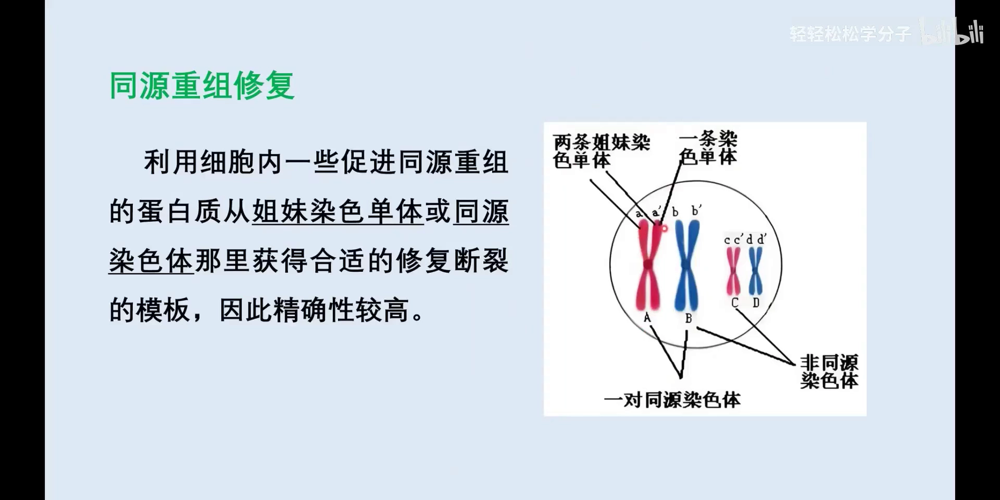
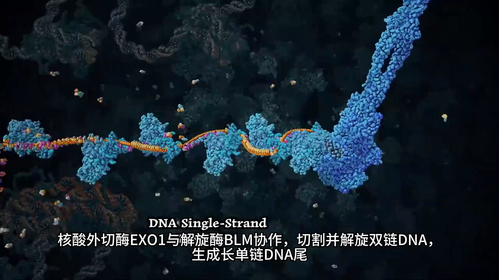
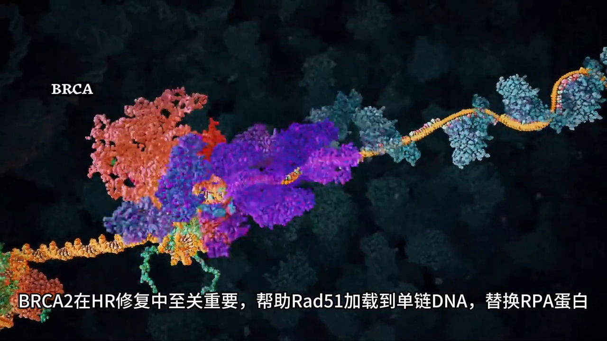
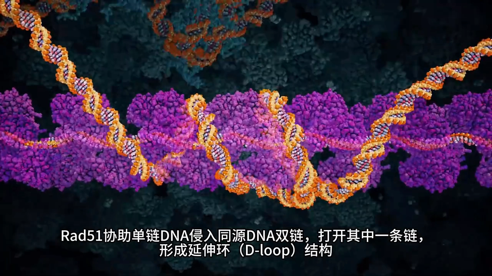
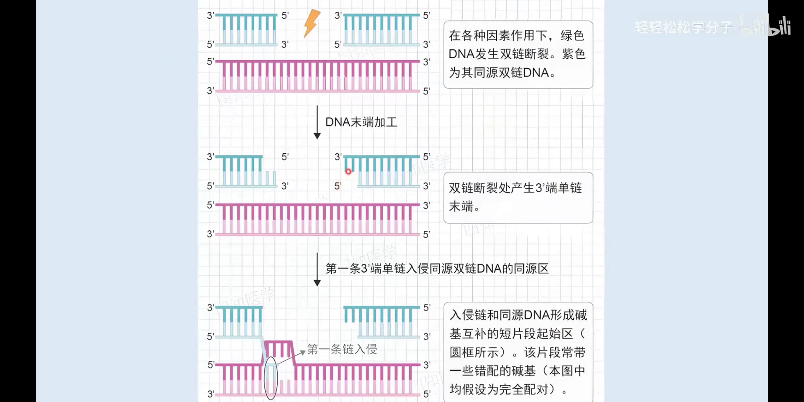
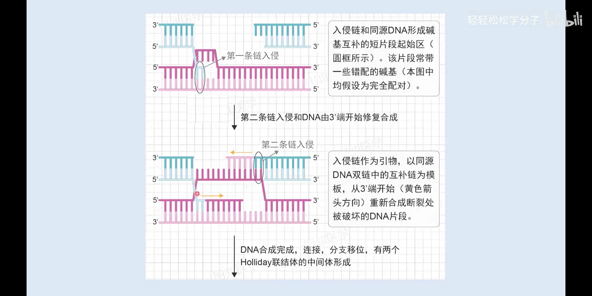
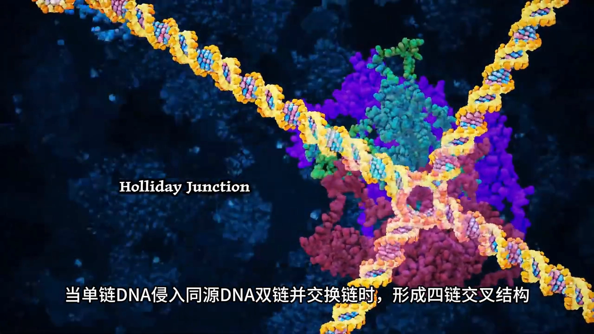
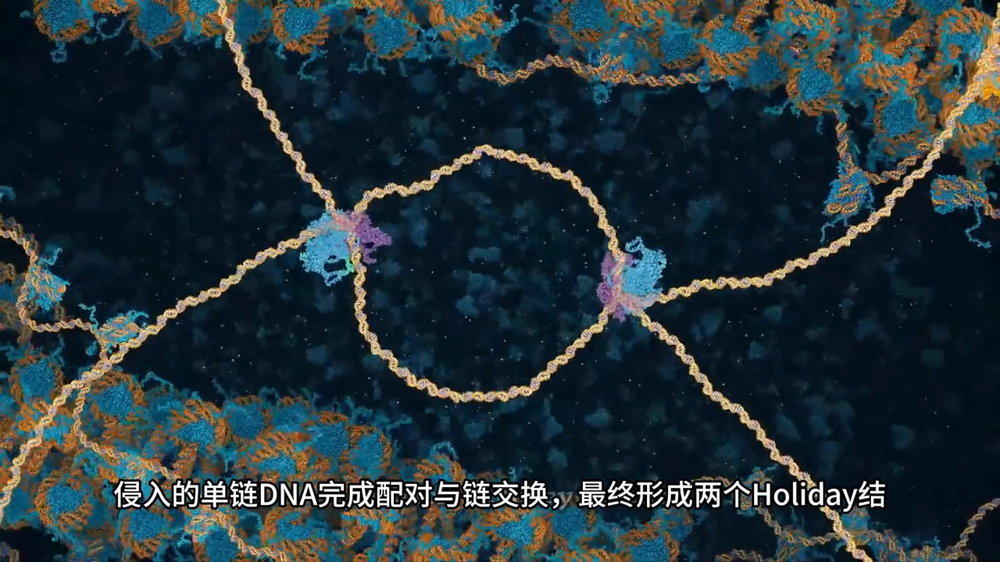
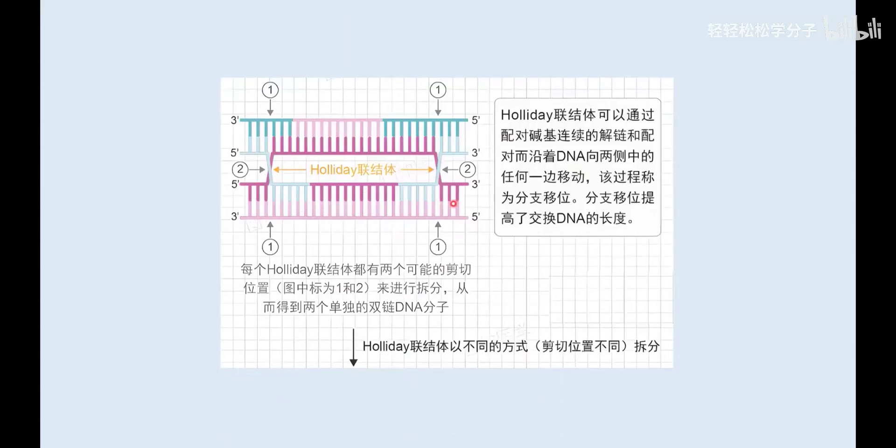
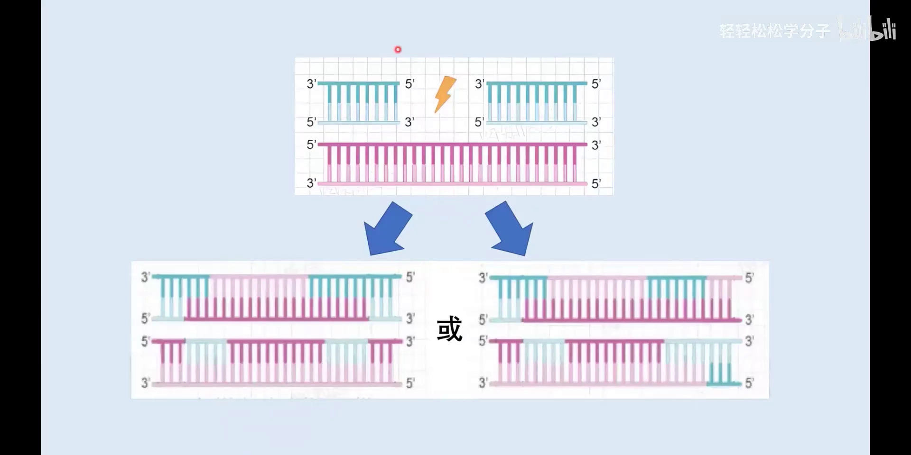

# 同源重组修复：RAD51 链入侵与 Holliday 连接体如何完成无痕修复

> 视频来源：
> - [【分子生物学】第2章 染色体与DNA｜第4节 DNA的损伤与修复｜双链断裂修复——同源重组修复](https://www.bilibili.com/video/BV1ujwzepETd/)（Bilibili · 轻轻松松学分子，约 11 分钟）
> - [动态演示同源重组：精准修复DNA损伤的分子机理](https://www.bilibili.com/video/BV1KVqGYVEUv/)（Bilibili · 分子机制动画，约 6 分钟）
>
> 导读：第一篇用板书把同源重组的「末端加工 → 链入侵 → Holliday 连接体 → 两种拆分结果」走了一遍；第二篇用分子动画补上 RPA、BRCA2、RAD51 核蛋白丝和双 Holliday 连接体这些关键角色。两篇互补，本文按机制顺序合并讲述。细胞周期与 NHEJ/MMEJ 的比较见本小节另一篇《双链断裂修复：NHEJ 快速封口，同源重组保真重建》。

## 本讲要解决的核心问题（SCQA）

**背景**：双链断裂没有现成的互补链可以照着修。NHEJ 能把断端直接接回去，但连接处常留下几个碱基的疤痕；如果断裂落在基因中间，这个疤痕就可能破坏读码框。

**冲突**：细胞其实还有一条更精确的路线——同源重组（homologous recombination，HR）。它不靠「猜」着接，而是找一份完好的同源 DNA 当模板，把断裂处缺失的信息重新合成出来。可问题是：断裂端是双链的，模板是双链的，两条双链怎么才能「对齐」并交换信息？

**疑问**：同源重组到底怎样从一对断端，走到「用模板恢复原样」？中间那些 Holliday 连接体、分支移位、两种拆分方式，各自决定了什么后果？

**回答（中心思想）**：同源重组先把断裂端加工出 **3' 单链尾巴**，用 **RAD51 核蛋白丝**带着这条尾巴去搜索同源模板，侵入模板双链形成 **D-loop**；以模板为指导合成缺失的 DNA 后，修复中间体会形成 **Holliday 连接体**。连接体往哪边拆分，决定了最终是「交换型」还是「非交换型」产物——前者会交换两侧 DNA，后者只把模板信息复制到断裂分子上。**正因为有模板可查，同源重组才能做到几乎无痕；也正因为需要模板，它主要发生在 S/G2 期。**

## 一、同源重组的核心资源：一份可用的同源模板

### 1.1 模板可以从哪里来

同源重组的第一步不是「切」，而是「找模板」。讲者给出的定义很直接：同源重组修复利用细胞内促进重组的蛋白质，**从姐妹染色单体或同源染色体那里获得合适的修复模板**，因此准确性较高 [【跳转到 02:34】](https://www.bilibili.com/video/BV1ujwzepETd/?t=154)。

这张图里要注意两件事：

1. **姐妹染色单体**是复制后由同一条染色体产生的两份拷贝，序列几乎完全相同，是最理想的模板。
2. **同源染色体**是父源和母源各一条，序列高度相似但可能带着不同的等位基因。用同源染色体当模板，修复后断裂处的序列会「变成模板的版本」，原来的等位基因组合可能被改变。

这也是同源重组与 NHEJ 最根本的差别：**NHEJ 不需要模板，所以随时能用；同源重组需要模板，所以要先有「另一份」。** 在细胞周期里，姐妹染色单体要等 S 期 DNA 复制后才出现，这就是同源重组主要发生在 S/G2 期的原因（细胞周期与通路占比见本小节另一篇）。

### 1.2 为什么不能直接「粘」回去

同源重组不能用连接酶直接把两个断端接上，因为断裂处可能丢了几个碱基，直接接会留下缺失。它需要先把断端变成**单链**，才能让单链去「试探」模板双链、寻找互补序列。这个把双链断端变成 3' 单链尾巴的过程，叫**末端切除（end resection）**。

## 二、末端切除：把断端变成 3' 单链尾巴

### 2.1 先切掉一条链的 5' 端

讲者的板书把这一步讲得很具体：断裂的绿色 DNA 需要找到同源的紫色 DNA；修复的第一步是对断裂端进行加工——在两条链的 **5' 端各切掉几个核苷酸**，让 **3' 端突出**出来，形成一段单链区 [【跳转到 04:25】](https://www.bilibili.com/video/BV1ujwzepETd/?t=265)。

动画版把参与的酶补得更全：**MRN 复合体**先识别断裂端，**CtIP** 参与起始切除，**EXO1** 核酸外切酶与 **BLM** 解旋酶协作，一边解旋一边切割，生成较长的 3' 单链 DNA 尾巴 [【跳转到 01:14】](https://www.bilibili.com/video/BV1KVqGYVEUv/?t=74)。

### 2.2 单链先被 RPA 保护，再交给 RAD51

刚生成的单链 DNA 很容易被降解，也容易自己折叠。动画里说，单链 DNA 会迅速被 **RPA 蛋白**（复制蛋白 A，由 RPA1、RPA2、RPA3 三个亚基组成）覆盖，防止降解并维持稳定 [【跳转到 01:35】](https://www.bilibili.com/video/BV1KVqGYVEUv/?t=95)。

但 RPA 只是「保护者」，真正要去搜索模板的是 **RAD51**。RPA 必须被替换掉，RAD51 才能加载到单链上。这个替换过程需要 **BRCA2**：BRCA2 与 RAD51 和单链 DNA 相互作用，帮助 RAD51 加载、替换 RPA [【跳转到 02:13】](https://www.bilibili.com/video/BV1KVqGYVEUv/?t=133)。

RAD51 在单链 DNA 上排列成螺旋状的**核蛋白丝（nucleoprotein filament）**。这条核蛋白丝就是同源重组的「搜索头」：它带着单链扫描基因组，寻找与自身序列高度相似的模板 [【跳转到 02:34】](https://www.bilibili.com/video/BV1KVqGYVEUv/?t=154)。

## 三、链入侵与 D-loop：单链怎样「读」到模板

### 3.1 第一条 3' 单链侵入模板双链

找到同源区域后，RAD51 核蛋白丝协助单链 DNA 侵入同源双链：模板双链局部解开，其中一条链被挤到一边，入侵的单链与另一条模板链配对，形成一个局部的三链结构，叫 **D-loop（置换环，displacement loop）** [【跳转到 02:50】](https://www.bilibili.com/video/BV1KVqGYVEUv/?t=170)。

板书版把这一步画得更「平面」：第一条 3' 单链入侵紫色模板，与浅紫色链配对，形成一个短片段起始区；这个起始区就相当于引物，接下来可以从 5' 到 3' 方向合成新链 [【跳转到 04:50】](https://www.bilibili.com/video/BV1ujwzepETd/?t=290)。

### 3.2 第二条单链也要入侵，才能把两端都接上

只入侵一条链还不够，因为断裂有两个末端。讲者接着讲：第二条 3' 单链也会入侵模板，与另一条模板链配对；这样两条入侵链分别以模板的两条链为指导，各自延伸合成 [【跳转到 05:15】](https://www.bilibili.com/video/BV1ujwzepETd/?t=315)。

这一步的要点是：**两条新链的模板分别来自同源 DNA 的两条链**。所以修复完成后，断裂处的序列不是「猜」出来的，而是从模板上「抄」下来的。这也是同源重组几乎不引入突变的根本原因。

## 四、Holliday 连接体：修复中间体长什么样

### 4.1 两条链都入侵后，形成四链交叉

当两条入侵链都完成配对和合成，两个 DNA 分子之间就会形成两个交叉点。讲者把这种结构称为 **Holliday 连接体**（Holliday junction）：两个双链 DNA 在交叉点处交换了链，形成一个可以左右移动的「X」形中间体 [【跳转到 07:20】](https://www.bilibili.com/video/BV1ujwzepETd/?t=440)。

动画版补充了它的动态性：Holliday 连接体不是静止的，它可以沿着 DNA 移动，扩展已经交换的区域，这个过程叫**分支移位（branch migration）**；分支移位越长，交换的 DNA 长度就越大 [【跳转到 04:42】](https://www.bilibili.com/video/BV1KVqGYVEUv/?t=282)。

### 4.2 两个交叉点：双 Holliday 连接体

因为断裂有两个末端，最终形成的通常不是单个交叉，而是**双 Holliday 连接体（double Holliday junction, dHJ）**：两个交叉点把一段交换区域夹在中间 [【跳转到 05:03】](https://www.bilibili.com/video/BV1KVqGYVEUv/?t=303)。

板书版也画出了同样的结构：两个分支点分别向两侧移动，交换的 DNA 长度随之增加 [【跳转到 07:45】](https://www.bilibili.com/video/BV1ujwzepETd/?t=465)。

## 五、拆分方式决定后果：交换型还是非交换型

### 5.1 每个 Holliday 连接体都有两种切法

Holliday 连接体必须被核酸酶切开，两条 DNA 分子才能分开。讲者强调：每个连接体都有**两个可能的剪切位置**（图中标为 1 和 2），切在不同的位置，得到的结果不同 [【跳转到 08:10】](https://www.bilibili.com/video/BV1ujwzepETd/?t=490)。

- **切在相同方向（例如两个连接体都切 1，或都切 2）**：两条 DNA 分子在交叉点处「换臂」，产物是**交换型（crossover）**——断裂点两侧的 DNA 片段发生了整体交换。
- **切在相反方向（一个切 1、一个切 2）**：两条 DNA 分子各自恢复原来的臂，产物是**非交换型（non-crossover）**——没有整体交换，但断裂处的序列已经被模板改写。

讲者的板书用两种切法演示了这两种结果：一种切法让紫色片段跑到绿色分子上、绿色片段跑到紫色分子上；另一种切法只是把断裂处补好，两条分子没有整体交换 [【跳转到 08:35】](https://www.bilibili.com/video/BV1ujwzepETd/?t=515)。

### 5.2 非交换型也会「改写」序列

这里有一个容易忽略的点：**非交换型不等于「什么都没发生」**。断裂处的几个碱基如果原本丢了，修复时是按模板抄回来的；如果模板和原来的序列有差异（比如同源染色体上带着不同的等位基因），修复后断裂处的序列就会变成模板的版本。这种「以模板为准改写序列、但不发生整体交换」的过程，常称为**基因转换（gene conversion）**。

讲者在总结时也指出：不管走哪种拆分方式，最终两条 DNA 分子都可能既有原来的绿色片段、又有来自紫色模板的片段，说明修复过程发生了遗传信息的混合 [【跳转到 10:15】](https://www.bilibili.com/video/BV1ujwzepETd/?t=615)。

### 5.3 为什么同源重组「几乎无痕」，却不是零风险

把整条路径串起来看，同源重组的保真来自两点：

1. **模板是现成的同源序列**：新链按模板合成，不靠随机增删。
2. **末端切除后可以反复校对**：入侵链与模板的配对必须足够长、足够互补，才能稳定形成 D-loop。

但它也有自己的风险：

- **模板选择**：如果用同源染色体而不是姐妹染色单体，模板上的等位基因会被「复制」到断裂处，改变原来的基因型组合。
- **重复序列**：基因组里有大量相似但不完全相同的重复序列；如果 RAD51 核蛋白丝在重复序列之间错误配对，同源重组就可能把不相邻的片段接在一起，造成缺失、重复或重排。

所以同源重组不是「绝对安全」，而是**在有正确模板的前提下，把错误率降到最低**。

## 六、回到基因编辑：Cas9 只负责切，修复方式决定结果

动画开头提到，CRISPR-Cas9 这类 DNA 切割酶被广泛用于精准基因编辑 [【跳转到 00:40】](https://www.bilibili.com/video/BV1KVqGYVEUv/?t=40)。把本节的机制放回这个场景，可以得到一条很实用的推论：**Cas9 只负责在目标位点制造一个双链断裂，真正决定编辑结果的是细胞随后走哪条修复路线。**

- **不提供模板时**：细胞主要走 NHEJ，连接处随机增删几个碱基（indel）。如果断裂落在编码区，indel 不是 3 的整数倍就会改变读码框，导致移码、提前终止或蛋白序列错乱——这就是 CRISPR 敲除（knockout）的分子基础。如果走的是 MMEJ，缺失通常更长，还可能伴随局部重排。
- **提供同源模板时**：细胞可以通过同源重组（在基因编辑语境里常叫 HDR，homology-directed repair）按模板把指定序列写进断裂处，实现敲入（knock-in）或精确替换。但这条路线依赖 S/G2 期的模板条件，效率通常低于 NHEJ。
- **这也解释了敲除和敲入的难度差异**：敲除只需要「切 + 让 NHEJ 留下 indel」，几乎所有细胞周期都能发生；敲入需要「切 + 提供模板 + 细胞处于 S/G2 且选择 HR」，条件更多，效率自然更低。

> 这一段是把本节机制放回应用场景的解释，不展开 sgRNA 设计、递送、单克隆筛选和编辑效率检测等实验流程；那些属于基因编辑实验小节的内容。

## 小结

- 同源重组需要一份同源 DNA 当模板，最常用的是复制后紧挨着的姐妹染色单体；这也是它主要发生在 S/G2 期的原因。
- 第一步是末端切除：在 5' 端切掉几个核苷酸，露出 3' 单链尾巴；MRN、CtIP、EXO1、BLM 参与其中。
- 单链先被 RPA 覆盖保护，再由 BRCA2 帮助加载 RAD51，形成 RAD51 核蛋白丝。
- RAD51 核蛋白丝带着单链搜索同源模板，侵入模板双链形成 D-loop；两条入侵链分别以模板的两条链为指导合成新链。
- 修复中间体是 Holliday 连接体，通常是双 Holliday 连接体；分支移位可以扩展交换区域。
- 连接体的拆分位置决定产物：交换型会整体交换两侧片段，非交换型只把断裂处按模板改写（基因转换）。
- 同源重组的保真来自模板，但模板选择错误或重复序列错误配对仍可能造成等位基因改变或染色体重排。

## 关键术语速查

| 术语 | 一句话解释 |
| --- | --- |
| 同源重组（HR） | 以同源 DNA 为模板重新合成断裂处序列的修复方式 |
| 末端切除 | 在断裂端切掉 5' 链、露出 3' 单链尾巴的过程，是同源重组的起点 |
| RPA | 复制蛋白 A，结合单链 DNA，防止其降解和折叠 |
| BRCA2 | 帮助 RAD51 加载到单链 DNA 上、替换 RPA 的关键蛋白 |
| RAD51 | 在单链 DNA 上形成核蛋白丝、驱动同源搜索和链入侵的重组酶 |
| 核蛋白丝 | RAD51 在单链 DNA 上排列成的螺旋状结构，是同源搜索的「搜索头」 |
| D-loop | 入侵单链与模板双链配对后形成的局部三链结构，被挤出的链形成环 |
| Holliday 连接体 | 两个 DNA 分子交换链后形成的四链交叉中间体 |
| 双 Holliday 连接体 | 两个交叉点夹住一段交换区域的中间体，是同源重组拆分的底物 |
| 分支移位 | Holliday 连接体沿 DNA 移动、扩展交换区域的过程 |
| 交换型 / 非交换型 | 拆分后两侧 DNA 是否发生整体交换；非交换型仍可能发生基因转换 |
| 基因转换 | 以模板为准改写断裂处序列、但不发生整体交换的过程 |