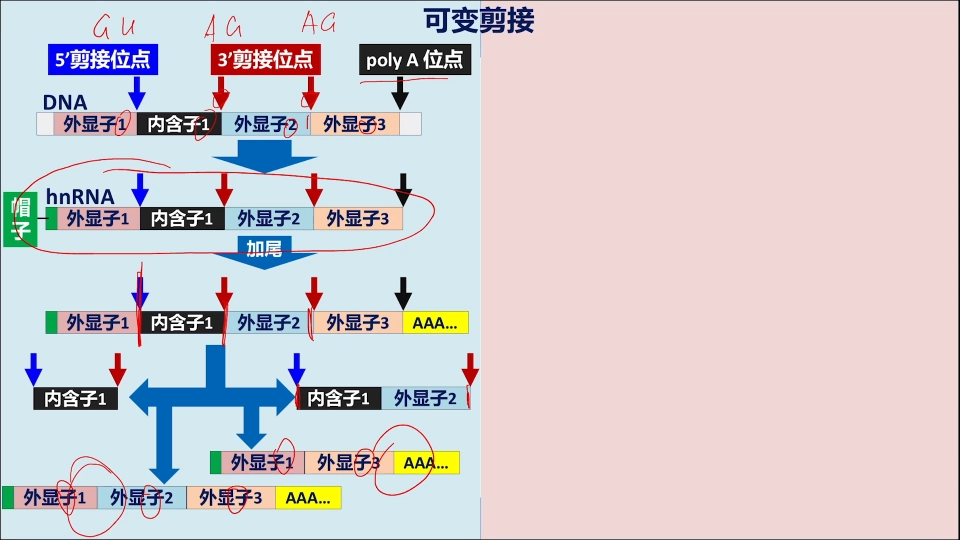
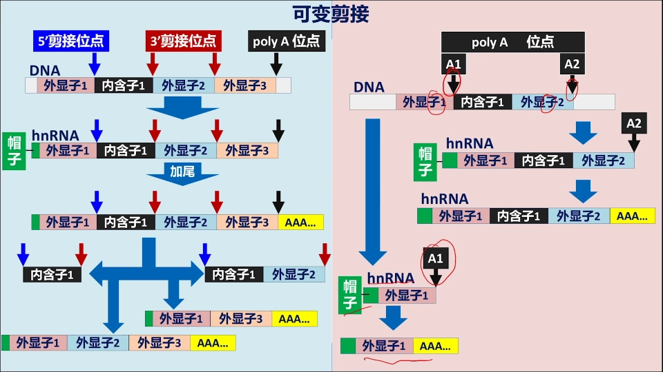
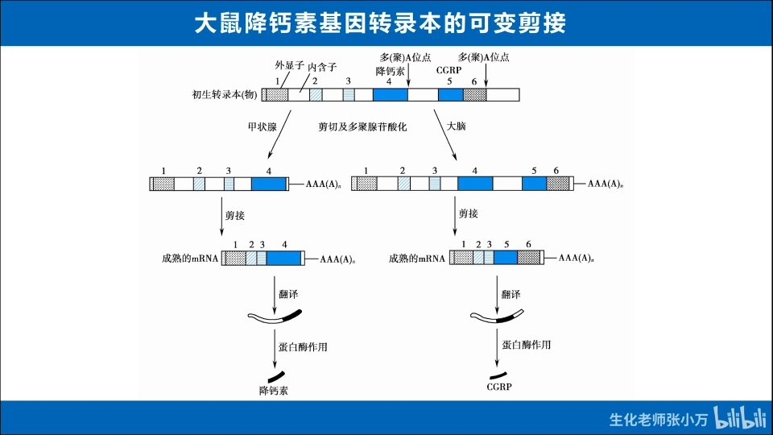
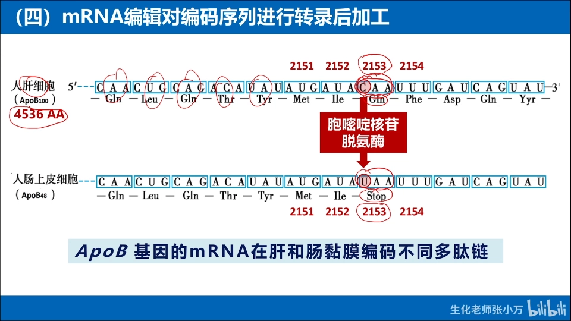

# 同一个基因，不同产物：可变剪接、可变加尾与 RNA 编辑

> 视频来源：[《【03章】03节-真核生物 mRNA 的转录、加工和降解（2）》](https://www.bilibili.com/video/BV1kHoWB1EQu/)（B 站 · 生化老师张小万）｜时长约 27 分钟
> 导读：这支课按「加帽 → 加尾 → 剪接 → 编辑」讲真核 mRNA 加工。加帽与加尾的化学细节属于 B01 的加工机制，本文只取其中回答「一个基因座为何产出多种产物」的部分（约 15:50–22:05）：可变剪接、可变加尾、组织特异的降钙素基因，以及 ApoB 的 RNA 编辑。字幕中的「外弦子」「简洁」「POLLYA」已订正为外显子、剪接、poly(A)。

## 本讲要解决的核心问题（SCQA）

**背景**：一个基因座在 DNA 上是一段固定序列，转录出来的前体 RNA 也是固定序列。按最朴素的印象，产物应该是确定的。

**冲突**：同一个基因座，在甲状腺里产出降钙素，在脑里产出降钙素基因相关蛋白；同一个 ApoB 基因，在肝脏里产出 4536 个氨基酸的蛋白，在小肠里产出 2152 个氨基酸的蛋白。DNA 序列完全一样。

**疑问**：一段固定的 DNA，怎么在加工阶段被「改写」成不同的成熟 mRNA 和不同的蛋白？

**回答（中心思想）**：**一对多关系发生在加工阶段，而不只是转录阶段。** 同一个前体 RNA 上，剪接位点的选择决定哪些外显子被连起来（可变剪接）；poly(A) 位点的选择决定转录在哪里结束、3′ 端保留多长（可变加尾）；核苷酸的化学改写可以凭空造出一个终止密码子（RNA 编辑）。三者叠加，使 2.08 万个蛋白编码基因能产出超过 10 万种蛋白质。

---

## 一、可变剪接：同一前体 RNA，两种剪法

视频给的定义是：**有一些前体 mRNA 分子（注意不是全部）经过剪接或剪切加工后，会形成结构有所不同的 mRNA 分子**，这就是可变剪接，也叫选择性剪接。[【跳转到 16:01】](https://www.bilibili.com/video/BV1kHoWB1EQu/?t=961)

### 1.1 第一种方式：两个 3′ 剪接位点，选近的或远的

视频用的例子是三个外显子、一个内含子的基因：

- 内含子前面有一个 5′ 剪接位点（GU），内含子后面有一个 3′ 剪接位点（AG）；
- 但**外显子 2 的后面也是一个 AG**，所以这个基因里有两个 3′ 剪接位点；
- 外显子 3 后面有一个 poly(A) 位点，即加尾信号。

前体 RNA 先加帽、加尾，然后剪接。5′ 剪接位点只有一个，所以上游那一刀是固定的；3′ 端那一刀有两个可能位置：[【跳转到 16:26】](https://www.bilibili.com/video/BV1kHoWB1EQu/?t=986) [【跳转到 16:51】](https://www.bilibili.com/video/BV1kHoWB1EQu/?t=1011)

| 3′ 端下刀位置 | 成熟 mRNA 包含 | 结果 |
| --- | --- | --- |
| 内含子 1 的后面 | 外显子 1、2、3 | 长转录本 |
| 外显子 2 的后面 | 外显子 1、3（外显子 2 被跳过） | 短转录本 |

同一条前体 RNA，因为 3′ 剪接位点选得不同，最终生成了两条不同的成熟 mRNA。[【跳转到 17:16】](https://www.bilibili.com/video/BV1kHoWB1EQu/?t=1036)

### 1.2 第二种方式：两个 poly(A) 位点，提前收尾

第二个例子里，基因有两个外显子、一个内含子，但上面有**两个 poly(A) 位点**：一个在外显子 1 后面，一个在外显子 2 后面。[【跳转到 18:06】](https://www.bilibili.com/video/BV1kHoWB1EQu/?t=1086)

- 若外显子 1 后面的加尾信号先被识别：直接在外显子 1 后面加尾巴，形成一条只含外显子 1 的成熟 mRNA；
- 若加尾发生在第二个位点：尾巴加在外显子 2 后面，再剪接，得到同时含外显子 1 和 2 的成熟 mRNA。

视频把这也归入可变剪接的范畴，但从机制上看它属于**可变加尾（alternative polyadenylation）**：改变的不是外显子组合，而是**转录终止的位置**，因此 3′ 端保留的长度不同。poly(A) 信号与终止的机制见 [转录如何发生](../../../../B01_生命科学基础主干/2_遗传信息流与中心法则/2.2_从基因到产物/2.2.1_转录：DNA%20模板与%20RNA%20合成/转录如何发生：从启动子到成熟mRNA的分子流水线.md) 的「3.6 终止」。

### 1.3 规模：2.08 万个基因，10 万种以上蛋白

视频给的数字是：通过可变剪接，人体虽然只有 **2.08 万个蛋白编码基因**，但最终可表达的蛋白质数量**超过 10 万种**。[【跳转到 19:26】](https://www.bilibili.com/video/BV1kHoWB1EQu/?t=1166)

这就是「基因数不等于产物数」的机制来源。注意它和 B01 里「一个基因多种 mRNA」的结论是同一件事，但这里给出了位点级的过程：**变化发生在剪接位点和加尾位点的选择上，而不是 DNA 序列上**。

---

## 二、组织特异：大鼠降钙素基因

视频用一个经典例子把「一对多」落到组织层面：大鼠降钙素基因的初始转录本，通过可变剪接在不同组织中产生两种不同的蛋白质——甲状腺中产生**降钙素**，大脑中产生**降钙素基因相关蛋白（CGRP）**。基因是同一个，只是在不同组织细胞中表达出了不同的蛋白质。[【跳转到 19:51】](https://www.bilibili.com/video/BV1kHoWB1EQu/?t=1191)

这张幻灯片比口述多给了一层信息，值得单独读：

1. 前体 RNA 上有**两个 poly(A) 位点**（对应外显子 4 之后和外显子 6 之后），所以「在哪里加尾」本身就是一次选择；
2. 甲状腺路径保留外显子 1–4，大脑路径保留外显子 1–3 再接外显子 5、6，**外显子 4 与 5 是互斥使用的**；
3. 两条成熟 mRNA 翻译出的前体蛋白还要经过**蛋白酶作用**切割，才成为成熟的降钙素或 CGRP。

第 3 点很重要：**一个转录本对应的蛋白前体，经切割可以产生不同的活性肽**。这是「一个转录本 → 多个蛋白产物」的另一条路径，与 B01 [翻译如何发生](../../../../B01_生命科学基础主干/2_遗传信息流与中心法则/2.2_从基因到产物/2.2.5_翻译：核糖体、mRNA%20与多肽合成/翻译如何发生：从密码子到多肽链的分子流水线.md) 的「六、翻译后修饰」中「修剪把无活性前体变成有活性酶」是同一类机制。

---

## 三、RNA 编辑：不改 DNA，也能造出终止密码子

视频接着讲的另一个机制是 **RNA 编辑**：mRNA 上的一些序列在转录以后还发生了改变。[【跳转到 20:23】](https://www.bilibili.com/video/BV1kHoWB1EQu/?t=1223)

经典例子是载脂蛋白 B（ApoB）：

- 肝细胞中表达的是 **ApoB100**，4536 个氨基酸；
- 小肠黏膜细胞中表达的是 **ApoB48**，2152 个氨基酸；
- 两者来自**同一个基因、同一条 mRNA**。[【跳转到 20:48】](https://www.bilibili.com/video/BV1kHoWB1EQu/?t=1248)

机制链条是这样的：[【跳转到 21:13】](https://www.bilibili.com/video/BV1kHoWB1EQu/?t=1273) [【跳转到 21:43】](https://www.bilibili.com/video/BV1kHoWB1EQu/?t=1303) [【跳转到 22:08】](https://www.bilibili.com/video/BV1kHoWB1EQu/?t=1328)

1. 肝细胞里，第 2153 个密码子是 **CAA**，编码谷氨酰胺，翻译继续往后走，得到 4536 个氨基酸的 ApoB100；
2. 小肠上皮细胞里有一个酶叫**胞嘧啶核苷脱氨酶**，特异地把这个 CAA 里的 C 脱氨变成 U；
3. CAA 于是变成 **UAA**，而 UAA 是终止密码子；
4. 翻译到第 2152 个氨基酸就停止，得到 2152 个氨基酸的 ApoB48。

关键细节：**ApoB48 的前 2152 个氨基酸序列与 ApoB100 的前 2152 个氨基酸完全一样**。[【跳转到 22:33】](https://www.bilibili.com/video/BV1kHoWB1EQu/?t=1353)

这说明 RNA 编辑改变的不是「读哪段外显子」，而是**序列本身**：一个碱基的化学改写，就把一个编码密码子变成了终止信号。它和可变剪接的区别可以这样记：

| 机制 | 改变的对象 | 发生在哪一步 | 结果 |
| --- | --- | --- | --- |
| 可变剪接 | 外显子组合 | 剪接 | 不同的外显子组合 |
| 可变加尾 | 转录终止位置 | 3′ 端加工 | 不同的 3′ UTR 长度 |
| RNA 编辑 | 单个碱基的身份 | 转录后 | 密码子含义改变，可造出终止密码子 |

---

## 四、把三条机制放回注释和实验里

- **一个基因座 → 多条转录本 → 多个蛋白**，这条链上的每一环都可以有分叉：起点（可变启动子）、剪接（可变剪接）、终点（可变加尾）、序列（RNA 编辑）、翻译起点（选择性起始）、翻译后（切割与修饰）。
- **注释里的 transcript 记录是「数据库收录的一种产物」**。同一个基因座在不同组织、不同条件下还可能使用本节展示的其他位点组合。
- **做实验必须说明针对哪条转录本、哪个区域**：ApoB 的例子说明，同一个基因在两种组织里的产物长度差一倍；如果引物或抗体落在第 2153 个密码子之后，按 ApoB100 设计的检测在肠道样本里就会落空。
- **RNA 编辑的存在意味着「基因组序列 → 蛋白序列」不是一一映射**：从 DNA 预测蛋白时，编辑位点是一个必须单独考虑的变量。

---

## 小结

- 一对多不只来自转录，更来自**加工**：剪接位点、加尾位点、碱基编辑都可以改变最终产物。
- **可变剪接**：同一前体 RNA 因 3′（或 5′）剪接位点选择不同，得到不同外显子组合的成熟 mRNA。
- **可变加尾**：同一基因座有多个 poly(A) 位点，选近端就提前结束转录，3′ UTR 变短。
- **组织特异**：大鼠降钙素基因在甲状腺与大脑中走不同剪接/加尾路径，再经蛋白酶切割生成降钙素或 CGRP。
- **RNA 编辑**：ApoB 的 CAA → UAA，凭空造出终止密码子，使同一 mRNA 在肝与小肠编码不同长度的多肽。
- 规模上，2.08 万个蛋白编码基因可以产出超过 10 万种蛋白质。

## 关键术语速查

| 术语 | 一句话解释 |
| --- | --- |
| 可变剪接（选择性剪接） | 同一前体 mRNA 以不同位点剪接，产生结构不同的成熟 mRNA |
| 5′ / 3′ 剪接位点 | 内含子两端被剪接体识别的序列，通常为 GU / AG |
| poly(A) 位点 | 加尾信号所在位置，决定转录在哪里结束 |
| 可变加尾 | 同一基因座使用不同 poly(A) 位点，产生 3′ UTR 长度不同的转录本 |
| RNA 编辑 | 转录后改变 mRNA 上的碱基身份，可改变密码子含义 |
| 胞嘧啶核苷脱氨酶 | 把 C 脱氨变成 U 的酶，ApoB 编辑的执行者 |
| ApoB100 / ApoB48 | 同一 ApoB 基因在肝与小肠分别产出的两种长度不同的蛋白 |
| CGRP | 降钙素基因相关蛋白，降钙素基因在大脑中的剪接产物 |